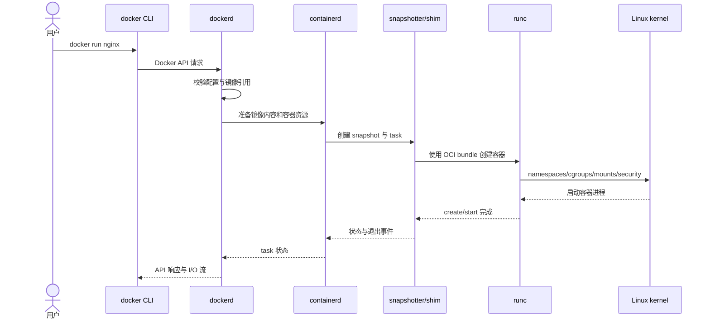

## 1. 先建立正确的心智模型

Docker 不是一个单独的进程。

它是一组围绕镜像、容器、网络和存储协作的组件。

最常见的 Linux Engine 链路可以简化为：

```text
用户
  │ docker CLI / API 客户端
  ▼
Docker API
  │ Unix socket 或受保护的 TCP
  ▼
dockerd
  │ 管理镜像、网络、卷、构建与容器生命周期
  ▼
containerd
  │ 管理内容、快照、容器元数据、任务和 shim
  ▼
containerd-shim-runc-v2
  │ 维持容器生命周期，解耦 containerd
  ▼
runc
  │ 按 OCI Runtime Spec 创建容器进程
  ▼
Linux kernel
  namespaces / cgroups / capabilities / seccomp / VFS / netfilter
```

这里最重要的结论是：

- CLI 主要是客户端。
- `dockerd` 提供 Docker 产品层能力和 API。
- `containerd` 是容器生命周期与内容管理运行时。
- `runc` 是低层 OCI runtime，负责真正创建容器进程。
- 隔离和资源控制最终由 Linux 内核完成。
- 容器不是一台小型虚拟机，而是受约束的宿主机进程。

## 2. 本文版本语境

本文按 2026-08-04 的指定版本语境说明：

- Docker Engine 29.7.1。
- Docker Desktop 4.85.0。
- Engine 29.7 打包 BuildKit 0.32。
- containerd 2.3.3。
- runc 1.4.3。

具体安装可能使用发行版自行打包的依赖。

也可能启用不同的 image store、snapshotter、网络后端或安全策略。

因此不要仅凭版本号推断每台机器的内部配置。

应以以下命令的实际输出为准：

```bash
docker version
docker info
docker buildx version
docker info --format '{{json .}}'
```

## 3. Linux Engine 与 Docker Desktop 的边界

### 3.1 原生 Linux Engine

在 Linux 上，Docker Engine 通常直接运行在 Linux 主机上。

容器进程也是这台主机上的 Linux 进程。

它们共享同一个 Linux kernel。

可以从宿主机观察进程、namespace、cgroup 和网络设备。

```bash
ps -ef | grep -E 'dockerd|containerd|shim'
docker inspect --format '{{.State.Pid}}' my-container
sudo nsenter -t "$(docker inspect -f '{{.State.Pid}}' my-container)" -a ps aux
```

### 3.2 macOS 和 Windows 上的 Docker Desktop

Linux 容器需要 Linux 内核能力。

macOS 没有 Linux kernel。

Windows 运行 Linux 容器时也需要 Linux 环境。

Docker Desktop 因此在一个受管理的 Linux VM 中运行 Engine 和容器。

```text
macOS / Windows
┌──────────────────────────────────────────────┐
│ docker CLI / Desktop UI / 文件共享与端口代理 │
│                 │                            │
│       Desktop 管理的 Linux VM                │
│       ┌──────────────────────────────┐       │
│       │ dockerd/containerd/runc      │       │
│       │ Linux containers             │       │
│       │ Linux namespaces/cgroups     │       │
│       └──────────────────────────────┘       │
└──────────────────────────────────────────────┘
```

因此 Desktop 上看到的“宿主机”有两层含义：

- 对 Docker CLI 而言，API 服务在 Desktop 环境中。
- 对 Linux 容器而言，直接宿主是 Desktop Linux VM。
- 对用户而言，文件和端口还要跨越 VM 边界。

这会影响 bind mount 性能、网络路径和排障方法。

不要把 Linux 主机上的 `/var/lib/docker` 路径经验直接套到 Desktop。

Windows 容器模式又是另一套内核与隔离机制。

本文重点讨论 Linux 容器。

## 4. Docker CLI 的职责

`docker` 命令通常不直接创建 namespace。

它负责：

- 解析命令行参数。
- 读取 context 和客户端配置。
- 组织 Docker API 请求。
- 发送请求并流式展示响应。
- 执行客户端侧登录凭据协作等逻辑。

例如：

```bash
docker run --rm -p 8080:80 nginx:alpine
```

从客户端视角，这不是一个内核系统调用。

它会形成一组 API 交互。

概念上包括：

1. 确认镜像是否可用，必要时拉取。
2. 创建容器配置。
3. 配置网络端点和端口发布。
4. 启动容器。
5. 在前台模式下附着标准输入输出。
6. `--rm` 容器退出后请求删除。

具体 API 调用次数和顺序可能随版本、选项而变化。

不应把概念步骤当作稳定的私有实现协议。

### 4.1 Docker context

CLI 不一定连接本机 daemon。

```bash
docker context ls
docker context show
docker context inspect
```

context 可以指向：

- 本机 Unix socket。
- 远程 SSH 环境。
- 受 TLS 保护的 TCP API。
- Docker Desktop 管理的 endpoint。

因此排障第一步常常不是重启 daemon。

而是先确认 CLI 当前连到了哪里。

### 4.2 API socket 是管理权限边界

Linux 常见 endpoint 是：

```text
/var/run/docker.sock
```

能访问它的用户通常可以创建特权容器、挂载宿主路径并控制容器。

这在效果上接近宿主机 root 权限。

不要把 Docker socket 随意挂进业务容器：

```bash
# 高风险示例，不应作为普通业务模式
docker run -v /var/run/docker.sock:/var/run/docker.sock some-image
```

远程 TCP API 也必须使用正确的 TLS、认证和网络限制。

## 5. dockerd 的职责

`dockerd` 是 Docker Engine daemon。

它承担 Docker 产品语义，而不只是“运行进程”。

主要职责包括：

- 提供版本化 Docker API。
- 管理容器、镜像、网络和卷的 Docker 对象。
- 协调镜像拉取和推送。
- 调用 BuildKit 处理现代构建。
- 处理 restart policy。
- 配置 bridge 网络、端口发布和 DNS 协作。
- 将低层容器操作委托给 containerd。
- 记录事件并暴露状态。

daemon 配置通常可来自：

- 命令行参数。
- Linux 上的 `/etc/docker/daemon.json`。
- Desktop 设置生成和管理的配置。

配置位置和可用项随平台不同。

可以观察 daemon 视角：

```bash
docker info
docker system df
docker network ls
docker volume ls
docker events
```

Linux systemd 环境还可观察日志：

```bash
sudo systemctl status docker
sudo journalctl -u docker.service
```

Desktop 应优先使用 Desktop 的诊断与日志入口。

## 6. containerd 的职责

containerd 是通用容器运行时项目。

Docker Engine 使用它管理更低层的容器对象和执行任务。

核心概念包括：

- content：按 digest 保存的不可变内容。
- image：镜像名称到目标 descriptor 的引用。
- snapshot：基于镜像层准备的文件系统视图。
- container：运行配置和元数据对象。
- task：实际运行中的进程及其 I/O、退出状态。
- namespace：containerd API 内的逻辑命名空间。

containerd namespace 不是 Linux namespace。

两者只是名称相同。

Docker 管理的数据通常处在 containerd 的 Docker 专用 namespace 中。

具体名称应从运行环境查询，不要硬编码假设。

containerd 自带的 `ctr` 主要用于调试和开发。

它不是 Docker CLI 的等价替代品。

直接用 `ctr` 创建对象可能绕过 Docker 的元数据与生命周期管理。

生产日常操作应继续使用 `docker` API/CLI。

## 7. shim 为什么存在

如果 containerd 始终是每个容器进程的直接父级和 I/O 保持者，升级或重启它会很麻烦。

shim 提供一层进程级解耦。

典型作用包括：

- 维持容器 stdio。
- 收集容器退出状态。
- 让 containerd 不必永久作为容器进程直接父级。
- 在 runtime v2 模型下承接任务生命周期 RPC。

这也是为什么系统上可能看到每个运行容器对应的 shim 进程。

实现和进程模型会随 runtime、平台与版本变化。

不要依赖 shim 进程名编写业务逻辑。

## 8. runc 的职责

runc 是 OCI Runtime Spec 的参考性低层实现之一。

它读取 OCI bundle。

bundle 主要包含：

```text
bundle/
├── config.json
└── rootfs/
```

`config.json` 描述：

- 要启动的进程。
- 环境变量和工作目录。
- root filesystem。
- Linux namespaces。
- cgroup 资源与设备规则。
- mounts。
- capabilities。
- seccomp 等安全设置。

runc 按规范调用 Linux 内核建立环境并启动进程。

正常使用 Docker 时，用户通常不会直接执行 `runc`。

Docker/containerd 会生成适合该容器的 OCI 配置并调用 runtime。

runc 不是长期管理全部 Docker 产品对象的 daemon。

## 9. 一次 docker run 的请求链路

以下过程是准确的概念模型，不承诺每个内部 RPC 名称固定不变。



### 9.1 解析镜像引用

`nginx` 通常会被补全到默认 registry、repository 和 tag 语义。

tag 是可变名称。

digest 是内容身份。

如果本地没有满足要求的镜像，daemon/containerd 侧会拉取内容。

### 9.2 准备 root filesystem

镜像层是只读内容。

snapshotter 或 storage driver 将它们组合成容器可见的 rootfs。

再增加一个容器可写层。

具体是 overlayfs、其他 snapshotter，还是 Desktop VM 内的实现，取决于配置。

### 9.3 创建隔离和资源边界

OCI 配置被交给低层 runtime。

runtime 设置 namespace、cgroup、mount、capability 和 seccomp。

最后启动镜像配置指定的进程。

容器生命周期与这个主进程密切相关。

PID 1 退出后，容器通常进入 stopped/exited 状态。

### 9.4 接入网络

Docker 网络层为容器创建 endpoint。

默认 bridge 场景通常涉及 network namespace、veth、bridge、IP 分配和 netfilter 规则。

用户定义 bridge 还提供容器名解析等能力。

具体后端可能使用 iptables 或 nftables 兼容路径。

### 9.5 附着 I/O

不使用 `-d` 时，CLI 一般保持 API 连接并附着容器 I/O。

终端里按 `Ctrl+C` 的效果取决于：

- 是否分配 TTY。
- 是否代理信号。
- 容器进程如何处理信号。
- CLI 是否处于 attach 模式。

## 10. exec 与 run 的区别

`docker run` 创建一个新容器。

`docker exec` 在已有运行容器中增加进程。

```bash
docker run -d --name web nginx:alpine
docker exec web ps aux
```

exec 进程通常加入容器现有 namespaces 和 cgroup。

它不会创建新的镜像层。

也不会重新执行镜像的 ENTRYPOINT 作为容器初始化流程。

容器停止后不能按普通方式 exec。

## 11. stop、kill 与 delete

```bash
docker stop web
docker kill web
docker rm web
```

`stop` 通常先向容器主进程发送可配置的停止信号。

等待超时后再强制终止。

`kill` 默认发送 `SIGKILL`，也可指定其他信号。

`rm` 删除容器对象和其可写层。

它不等于删除命名 volume。

镜像也不会因删除一个容器而自动消失。

观察事件比猜测顺序更可靠：

```bash
docker events --filter container=web
```

## 12. restart policy 在哪一层生效

Docker 的 restart policy 是 Engine 管理语义。

```bash
docker run -d --restart unless-stopped --name web nginx
```

它不是应用进程自身的重启逻辑。

也不要与 Compose 的声明、Swarm service 的调度策略、Kubernetes controller 混为一谈。

不同编排层可能各自管理期望状态。

多个层同时重启会让故障表现更难理解。

## 13. 状态分层观察

### Docker 对象视角

```bash
docker ps -a
docker inspect web
docker stats web
docker top web
```

### Engine 事件视角

```bash
docker events --since 10m
```

### Linux 进程视角

```bash
pid=$(docker inspect -f '{{.State.Pid}}' web)
ps -fp "$pid"
sudo ls -l "/proc/$pid/ns"
sudo cat "/proc/$pid/cgroup"
```

这些 Linux 命令应在真正承载容器的 Linux 主机执行。

在 Desktop 上，这通常意味着 VM 内部，而不是 macOS 的 `/proc`。

Desktop 内部 VM 不是稳定的用户管理接口。

优先使用 Docker API、`docker debug` 或官方诊断手段。

## 14. 常见故障定位顺序

### CLI 无法连接

先检查：

```bash
docker context show
docker context inspect
docker version
```

`docker version` 只有 Client 段通常说明 Server 不可达。

再检查 socket 权限、daemon 状态、TLS 和 Desktop 状态。

### 容器立即退出

```bash
docker ps -a
docker inspect -f '{{json .State}}' container-name
docker logs container-name
```

容器不是“后台环境”的同义词。

它需要主进程持续运行。

### 镜像拉取失败

检查完整引用、认证、代理、DNS、证书和 registry 限流。

```bash
docker pull registry.example.com/team/app:tag
docker image inspect registry.example.com/team/app:tag
```

### 启动卡住

同时观察：

- `docker events`。
- daemon 日志。
- 存储空间与 inode。
- 网络与 DNS。
- runtime 或安全策略错误。

不要只盯应用日志。

应用进程尚未成功创建时根本不会有应用日志。

## 15. 常见误区

### 误区一：Docker CLI 就是 Docker Engine

CLI 是客户端，Engine 是服务端系统。

它们可以在不同机器上。

### 误区二：containerd 会完全替代 dockerd 的所有语义

containerd 提供通用运行时能力。

Docker 网络、卷、API 兼容和产品行为仍由 Docker Engine 层协调。

### 误区三：runc 是一直驻留的容器 daemon

runc 主要按 OCI 配置执行低层创建与生命周期操作。

长期状态承接通常由 shim/containerd 等组件完成。

### 误区四：容器拥有自己的 kernel

Linux 容器共享承载它的 Linux kernel。

Desktop 里的 Linux 容器共享 Desktop VM 的 kernel。

### 误区五：能进容器就是隔离绝对安全

namespace 主要隔离视图。

cgroup 主要限制和核算资源。

安全还依赖 capabilities、seccomp、LSM、只读挂载、用户身份和补丁状态。

### 误区六：直接操作 containerd 数据不会影响 Docker

绕过 Docker 修改底层对象可能造成元数据不一致。

除非明确在调试，否则不要混用管理入口。

## 16. 一组最小实验

启动容器：

```bash
docker run -d --name internals-demo nginx:alpine
```

查看 Docker 状态：

```bash
docker inspect internals-demo
docker top internals-demo
docker stats --no-stream internals-demo
```

查看事件：

```bash
docker events --since 5m --filter container=internals-demo
```

在 Linux Engine 主机查看内核对象：

```bash
pid=$(docker inspect -f '{{.State.Pid}}' internals-demo)
sudo readlink "/proc/$pid/ns/pid"
sudo readlink "/proc/$pid/ns/net"
sudo cat "/proc/$pid/cgroup"
```

清理：

```bash
docker rm -f internals-demo
```

## 17. 总结

- Docker 是分层组件系统，不是单一二进制。
- CLI 通过 Docker API 请求 daemon。
- dockerd 提供 Docker 对象、网络、卷、构建和策略语义。
- containerd 管理内容、快照、容器和 task。
- shim 解耦容器进程与 containerd 生命周期。
- runc 根据 OCI Runtime Spec 创建 Linux 容器进程。
- Linux kernel 才是 namespace、cgroup 和文件系统等机制的执行者。
- Linux Engine 容器直接运行在 Linux 主机内核上。
- Desktop 的 Linux 容器运行在受管理 Linux VM 中。
- 排障应先确认 context，再沿 CLI、daemon、containerd/runtime、kernel 分层观察。

## 18. 官方资料

- Docker Engine overview：https://docs.docker.com/engine/
- Docker Engine API：https://docs.docker.com/reference/api/engine/
- Docker contexts：https://docs.docker.com/engine/manage-resources/contexts/
- Docker Desktop architecture：https://docs.docker.com/desktop/
- containerd 项目：https://containerd.io/
- containerd 文档：https://github.com/containerd/containerd/tree/main/docs
- runc 项目：https://github.com/opencontainers/runc
- OCI Runtime Spec：https://github.com/opencontainers/runtime-spec
- OCI Image Spec：https://github.com/opencontainers/image-spec
