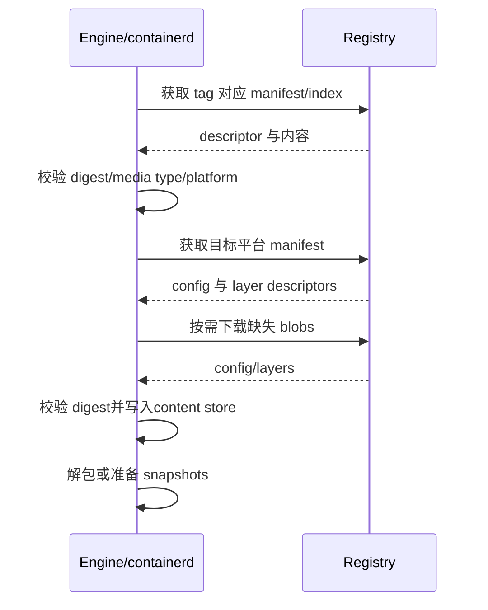

## 1. 镜像到底是什么

Docker 镜像不是一个完整磁盘文件的简单副本。

从 OCI 视角看，它是一组通过 descriptor 连接的内容对象。

核心对象包括：

- manifest 或 image index。
- image config。
- 一组 filesystem layer blobs。
- 每个对象的 media type、大小和 digest。

镜像名称只是访问入口。

真正的内容身份由 digest 表示。

```text
registry.example.com/team/app:1.0
│                 │        └─ tag：可移动名称
│                 └────────── repository
└──────────────────────────── registry

registry.example.com/team/app@sha256:...
                              └─ digest：内容身份
```

## 2. 本文版本与实现边界

本文采用 2026-08-04 的指定环境：

- Docker Engine 29.7.1。
- Docker Desktop 4.85.0。
- Engine 29.7 打包 containerd 2.3.3。
- Engine 29.7 打包 runc 1.4.3。

Docker 可使用不同 image store 和 snapshotter。

经典 graphdriver 经验与 containerd image store 经验并不总能逐项对应。

不要依赖 `/var/lib/docker` 下的私有目录结构编写程序。

应通过 Docker API、OCI 工具或 registry API 观察。

## 3. OCI 解决了什么问题

Open Container Initiative 维护多个互补规范。

### 3.1 OCI Image Specification

定义镜像内容如何组织。

重点包括：

- descriptor。
- manifest。
- image index。
- image config。
- filesystem layers。
- image layout。

它回答“镜像内容长什么样”。

### 3.2 OCI Runtime Specification

定义运行时 bundle 和容器生命周期。

重点包括：

- `config.json`。
- root filesystem。
- process 配置。
- mounts。
- Linux namespaces。
- resources 和安全配置。

它回答“如何按配置启动容器”。

### 3.3 OCI Distribution Specification

定义 registry 内容分发 API。

重点包括：

- blobs 上传与下载。
- manifests 拉取与推送。
- digest 校验。
- 内容发现与错误语义。

它回答“内容如何在客户端和 registry 之间传输”。

三者相互配合，但不是同一个规范。

## 4. descriptor：连接内容图的指针

OCI descriptor 通常包含：

```json
{
  "mediaType": "application/vnd.oci.image.manifest.v1+json",
  "digest": "sha256:...",
  "size": 1234
}
```

还可能包含：

- annotations。
- platform。
- artifactType 等扩展字段。

`digest` 用来验证内容。

`size` 可用于传输校验和预分配。

`mediaType` 告诉消费者如何解释字节。

descriptor 使镜像形成一张有向内容图。

父对象通过 digest 引用子对象。

## 5. 内容寻址

内容寻址的基本思想是：

```text
digest = hash(content bytes)
```

内容字节变化，digest 就变化。

相同字节可以复用同一个 blob。

这带来：

- 下载后完整性校验。
- 跨镜像复用相同层。
- registry 去重的可能性。
- 不可变引用。
- 可验证的供应链基础。

但要注意：

- digest 保证“这些字节与摘要一致”。
- digest 本身不证明内容可信。
- 信任还需要签名、来源策略、审计和密钥管理。

## 6. tag 与 digest

tag 类似一个可更新指针。

```bash
docker pull alpine:3.22
```

维护者可以让同一 tag 后续指向新 manifest。

digest 引用锁定具体内容：

```bash
docker pull alpine@sha256:&lt;manifest-digest&gt;
```

生产部署使用 digest 可提高可重复性。

但更新也不会自动发生。

需要配合明确的升级与漏洞修复流程。

查看仓库 digest：

```bash
docker image inspect alpine:3.22 --format '{{json .RepoDigests}}'
```

本地 image ID、config digest 和 registry manifest digest 不一定是同一个值。

它们对应不同对象。

## 7. manifest 的结构

单平台 OCI image manifest 可以简化为：

```json
{
  "schemaVersion": 2,
  "mediaType": "application/vnd.oci.image.manifest.v1+json",
  "config": {
    "mediaType": "application/vnd.oci.image.config.v1+json",
    "digest": "sha256:config...",
    "size": 1000
  },
  "layers": [
    {
      "mediaType": "application/vnd.oci.image.layer.v1.tar+gzip",
      "digest": "sha256:layer1...",
      "size": 100000
    }
  ]
}
```

manifest 不直接内嵌所有层字节。

它通过 descriptor 引用 blobs。

Docker media types 与 OCI media types 可能并存。

现代工具通常能处理双方兼容格式。

不要假定所有 registry 返回的 media type 完全相同。

## 8. image config 的内容

image config 是 JSON blob。

它通常描述：

- architecture 和 OS。
- rootfs diff IDs。
- history。
- 默认环境变量。
- Entrypoint 与 Cmd。
- WorkingDir。
- User。
- 暴露端口和 volume 声明等镜像配置。

观察配置：

```bash
docker image inspect nginx:alpine
```

镜像配置只是默认值和元数据。

运行时可覆盖许多字段：

```bash
docker run --entrypoint sh nginx:alpine
docker run -e FOO=bar nginx:alpine
```

镜像的 `EXPOSE` 不会自动发布宿主机端口。

它主要是元数据。

## 9. layer blob 与 diff ID

filesystem layer 通常表现为 tar 变更集。

它不是每层一个完整 rootfs。

层只记录相对于下层的新增、修改与删除语义。

常见 registry blob 会压缩。

manifest 中的 layer digest 对压缩后的 blob 字节计算。

image config 的 `rootfs.diff_ids` 通常对应未压缩层内容摘要。

因此同一逻辑层可能出现两个不同摘要概念：

- distribution digest：传输 blob 的摘要。
- diff ID：未压缩变更集的摘要。

不要把二者直接比较并判断损坏。

## 10. 层如何组合成 rootfs

假设有三层：

```text
Layer 3: /app/app.bin，删除 /tmp/build.log
Layer 2: /usr/lib/libx.so，/tmp/build.log
Layer 1: /bin/sh，/etc/os-release
```

容器看到的是组合视图：

```text
/
├── app/app.bin
├── bin/sh
├── etc/os-release
└── usr/lib/libx.so
```

删除通常由 whiteout 语义表达。

上层的 whiteout 告诉合并实现隐藏下层路径。

它不一定从下层 blob 中物理擦除数据。

这解释了一个常见现象：

```dockerfile
RUN download-secret
RUN rm secret
```

后续层删除文件，不会让前一层中的字节消失。

敏感内容绝不能先写进层再靠下一层删除。

## 11. Dockerfile 指令与镜像层

并非每条 Dockerfile 指令都必然产生可见 filesystem diff。

`RUN`、`COPY`、`ADD` 通常会改变文件系统。

`ENV`、`CMD`、`ENTRYPOINT` 等主要改变配置元数据。

构建历史、空层表示和 BuildKit 优化会影响观察结果。

不要简单背诵“一条指令一定一层”。

更准确的说法是：

- 构建步骤形成缓存与结果图。
- 最终镜像配置记录 history。
- 有文件变化的结果会形成 filesystem layer diff。

查看历史：

```bash
docker history --no-trunc image-name:tag
```

`docker history` 是便于阅读的视图。

它不是完整 OCI 对象浏览器。

## 12. 镜像只读层与容器可写层

创建容器时，镜像层保持只读。

容器在其上得到独立可写层。

```text
容器进程看到的 merged rootfs
┌────────────────────────────┐
│ Container writable layer   │  可写，容器私有
├────────────────────────────┤
│ Image layer N              │  只读，可共享
├────────────────────────────┤
│ ...                        │
├────────────────────────────┤
│ Image layer 1              │  只读，可共享
└────────────────────────────┘
```

多个容器可共享镜像只读内容。

每个容器有自己的可写状态。

```bash
docker run --name a alpine sh -c 'echo A >/marker'
docker run --name b alpine sh -c 'test ! -e /marker'
```

`a` 中的 `/marker` 不会出现在 `b` 中。

## 13. copy-up

OverlayFS 等联合文件系统中，修改下层已有文件通常触发 copy-up。

概念过程是：

1. 文件原本位于只读 lower layer。
2. 第一次写入时复制到 upper layer。
3. 后续读取优先看到 upper 版本。
4. lower 版本仍然存在但被遮蔽。

这意味着首次写大文件可能有额外代价。

具体 copy-up 粒度和元数据行为取决于内核、挂载选项和 snapshotter。

不要将某个内核版本的微观行为当作跨平台保证。

## 14. 删除为何不一定释放镜像空间

容器删除一个来自镜像的文件，通常只在可写层记录隐藏语义。

底层镜像 blob 仍存在。

构建阶段在后续层删除大文件也一样。

例如：

```dockerfile
RUN curl -o /tmp/archive.tar https://example.invalid/archive.tar
RUN rm /tmp/archive.tar
```

第二层不会消除第一层的归档字节。

应在同一 `RUN` 中下载、使用和清理：

```dockerfile
RUN curl -o /tmp/archive.tar https://example.invalid/archive.tar \
    && extract-command /tmp/archive.tar \
    && rm /tmp/archive.tar
```

更好的方案常是 multi-stage build。

最终阶段只复制运行所需产物。

## 15. 容器可写层不是持久数据方案

可写层具有以下特征：

- 生命周期通常绑定容器对象。
- 删除容器后一起删除。
- 不便于独立备份、迁移和共享。
- 写入会经过 storage driver/snapshotter 路径。
- 容量统计可能包含稀疏文件和共享层差异。

业务持久数据应优先使用 volume 或明确管理的 bind mount。

临时敏感数据可考虑 tmpfs，但要评估内存与 swap 行为。

查看容器可写层统计：

```bash
docker ps --size
docker system df -v
```

这些数字的精确含义受驱动和共享内容影响。

不要把它们当作简单的目录 `du` 等价物。

## 16. containerd content store 与 snapshotter

现代 containerd 模型把“内容”和“可挂载文件系统快照”区分开。

### content store

保存按 digest 标识的 blobs。

可能包含：

- manifests。
- indexes。
- configs。
- compressed layers。
- attestations 或其他 OCI artifacts。

### snapshotter

将层内容转化为可供容器使用的快照。

负责准备：

- 只读 parent snapshots。
- active writable snapshot。
- commit 后的只读 snapshot。
- mounts 或远程按需读取语义。

内容存在不等于已经解包成 snapshot。

snapshot 存在也不代表每个字节都独占一份。

具体 snapshotter 可以是 overlayfs、原生实现、远程/懒加载实现等。

Docker 实际启用项应查 `docker info`。

## 17. 经典 storage driver 与 containerd image store

历史文档常围绕 Docker graphdriver 讲 `overlay2`。

新环境可能启用 containerd image store。

两者都可能最终利用 Linux OverlayFS。

但元数据组织、内容管理和功能支持不完全相同。

containerd image store 更自然地表达：

- 多平台镜像。
- OCI content graph。
- attestations。

- snapshotter 扩展。

检查当前环境：

```bash
docker info
docker info --format '{{json .DriverStatus}}'
```

字段会随版本和平台变化。

优先阅读当前版本 `docker info` 的实际输出。

## 18. image index 与多平台镜像

OCI image index 是一组 manifest descriptor。

每个 descriptor 可声明 platform：

```json
{
  "manifests": [
    {
      "digest": "sha256:amd64...",
      "platform": {"os": "linux", "architecture": "amd64"}
    },
    {
      "digest": "sha256:arm64...",
      "platform": {"os": "linux", "architecture": "arm64"}
    }
  ]
}
```

拉取时，客户端和 runtime 根据目标平台选择匹配 manifest。

```bash
docker buildx imagetools inspect nginx:latest
docker pull --platform linux/arm64 nginx:latest
```

顶层 index digest 与每个平台 manifest digest 不同。

平台 manifest 的 config 和 layers 也通常不同。

## 19. manifest list 与 OCI index

Docker schema 2 manifest list 和 OCI image index 解决相似问题。

media type 与部分字段语义存在格式差异。

工具可能在推送、复制或转换时选择不同格式。

使用者应关注：

- registry 是否支持对应 media type。
- 签名和 attestations 是否被保留。
- 复制工具是否只复制单个平台。
- digest 是否因格式转换发生变化。

“内容逻辑相同”不代表序列化字节相同。

字节变化会导致 digest 变化。

## 20. 拉取镜像的概念流程



下载可以并发。

已有相同 digest 的内容通常无需重复下载。

是否立即完整解包取决于 snapshotter 和配置。

## 21. 推送镜像的概念流程

推送通常先确认 registry 已有哪些 blobs。

缺失 blobs 上传完成后再提交 manifest。

最后让 tag 指向 manifest。

```text
本地 content graph
  ├─ config blob ───────┐
  ├─ layer blobs ───────┼─> registry blob store
  └─ manifest/index ────┴─> repository reference
```

registry 端是否全局去重、仓库内去重，属于实现和部署细节。

OCI Distribution 关注可观察 API 语义。

不要依赖 registry 私有存储布局。

## 22. 镜像检查实验

拉取并观察：

```bash
docker pull alpine:3.22
docker image inspect alpine:3.22
docker history --no-trunc alpine:3.22
```

观察远端多平台结构：

```bash
docker buildx imagetools inspect alpine:3.22
```

若工具支持 raw 输出，可进一步查看 manifest JSON：

```bash
docker buildx imagetools inspect --raw alpine:3.22
```

响应可能是 index，也可能是单平台 manifest。

应根据 `mediaType` 判断，而不是猜测。

## 23. 可写层实验

```bash
docker run -d --name layer-demo alpine sleep 1d
docker exec layer-demo sh -c 'dd if=/dev/zero of=/large-file bs=1M count=10'
docker ps --size --filter name=layer-demo
docker diff layer-demo
```

`docker diff` 常见标记：

- `A`：新增。
- `C`：修改。
- `D`：删除。

然后删除容器：

```bash
docker rm -f layer-demo
```

可写层随容器删除。

镜像 `alpine` 仍然存在。

## 24. docker commit 应谨慎使用

`docker commit` 可把容器文件系统变化做成新镜像。

```bash
docker commit container-name repo/image:debug
```

它适合临时取证或实验。

不适合作为主要可重复构建方式。

原因包括：

- 操作步骤难审计。
- 构建输入不明确。
- 容器运行状态可能不一致。
- 挂载中的数据通常不属于容器可写层。
- 密钥和临时文件可能意外进入镜像。

正式镜像应通过 Dockerfile、BuildKit 和版本化构建上下文生成。

## 25. 镜像大小的三个视角

“镜像大小”至少可能指：

- registry 中压缩 blobs 的传输大小。
- 本地解压快照占用。
- 与其他镜像共享后新增的实际占用。

因此：

```bash
docker images
docker system df -v
```

显示值不一定与 registry UI 完全一致。

压缩算法、共享层、快照元数据和稀疏文件都会影响数字。

比较前先明确指标。

## 26. 垃圾回收与引用

内容寻址存储不能只靠“文件多久没访问”来删除。

系统需要判断内容是否仍被以下对象引用：

- image name/tag。
- container。
- snapshot。
- build cache。
- lease 或进行中的操作。

Docker 提供高层清理命令：

```bash
docker image prune
docker container prune
docker builder prune
docker system prune
```

执行前先查看：

```bash
docker system df -v
```

`prune` 可能删除未来构建可复用的缓存。

不要在不了解共享环境的情况下自动执行 `docker system prune -a`。

## 27. 安全与供应链注意点

### 不把 secret 写入 layer

不要：

```dockerfile
COPY .npmrc /root/.npmrc
RUN npm install
RUN rm /root/.npmrc
```

应使用 BuildKit secret mount。

### 固定基础镜像

tag 便于接收更新。

digest 便于复现。

可以同时写 tag 与 digest以兼顾可读性和固定内容：

```dockerfile
FROM alpine:3.22@sha256:&lt;digest&gt;
```

digest 需要由自动化更新工具定期刷新。

### 扫描正确对象

扫描结果应关联具体 digest。

同一个 tag 后续可能指向别的镜像。

多平台 index 下各平台内容与漏洞也可能不同。

## 28. 常见误区

### 误区一：镜像是一层完整文件系统

镜像通常由多个变更层和 config 组成。

### 误区二：删除上层文件会缩小旧层

不可变旧层不会被重写。

删除只是新层中的隐藏语义。

### 误区三：tag 是不可变版本

tag 可以移动。

需要不可变身份时使用 digest。

### 误区四：所有 sha256 都指同一个东西

index、manifest、config、压缩 layer 和 diff ID 都可有自己的 digest。

### 误区五：OCI 镜像等于 OCI runtime bundle

镜像是可分发内容格式。

runtime bundle 是创建容器时使用的 rootfs 与 `config.json`。

### 误区六：容器里修改文件会改变镜像

修改进入容器可写层。

原镜像保持不可变。

### 误区七：本地目录布局是稳定 API

image store、snapshotter 和平台会改变内部布局。

应使用受支持的 API 和命令。

## 29. 排障清单

镜像平台不匹配：

```bash
docker image inspect image:tag --format '{{.Os}}/{{.Architecture}}'
docker buildx imagetools inspect image:tag
```

镜像占用过大：

```bash
docker history --no-trunc image:tag
docker system df -v
```

容器可写层增长：

```bash
docker ps --size
docker diff container-name
```

digest 变化：

- 确认比较的是 index 还是平台 manifest。
- 确认 media type 是否被转换。
- 确认 config、时间戳和压缩字节是否变化。
- 确认 tag 是否已被更新。

## 30. 总结

- OCI Image Spec 把镜像描述为 descriptor 连接的内容图。
- manifest 引用 config 和 filesystem layers。
- index 引用多个平台 manifest 或其他子 manifest。
- digest 是内容身份，tag 是可移动名称。
- 压缩 layer digest 与未压缩 diff ID 不是同一概念。
- 镜像层是只读变更集，容器另有可写层。
- copy-up 让下层文件的修改落到上层。
- 后续层删除文件不会抹掉旧层字节。
- content store 与 snapshotter 分别处理内容和文件系统视图。
- containerd image store 与经典 graphdriver 的内部组织不同。
- 持久数据不应依赖容器可写层。
- 多平台镜像必须区分 index digest 与平台 manifest digest。

## 31. 官方资料

- OCI Image Specification：https://github.com/opencontainers/image-spec
- OCI Runtime Specification：https://github.com/opencontainers/runtime-spec
- OCI Distribution Specification：https://github.com/opencontainers/distribution-spec
- Docker images：https://docs.docker.com/get-started/docker-concepts/the-basics/what-is-an-image/
- Docker storage drivers：https://docs.docker.com/engine/storage/drivers/
- Docker containerd image store：https://docs.docker.com/engine/storage/containerd/
- Docker multi-platform images：https://docs.docker.com/build/building/multi-platform/
- Docker image inspect：https://docs.docker.com/reference/cli/docker/image/inspect/
- Docker system df：https://docs.docker.com/reference/cli/docker/system/df/
