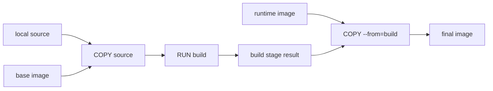
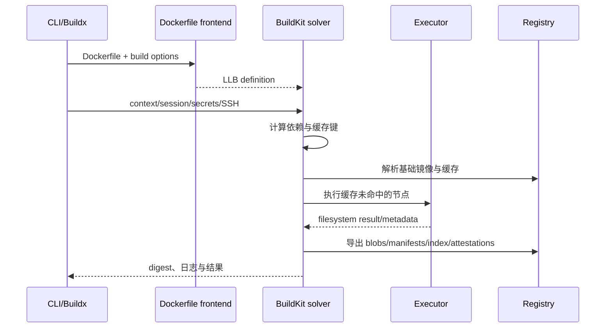
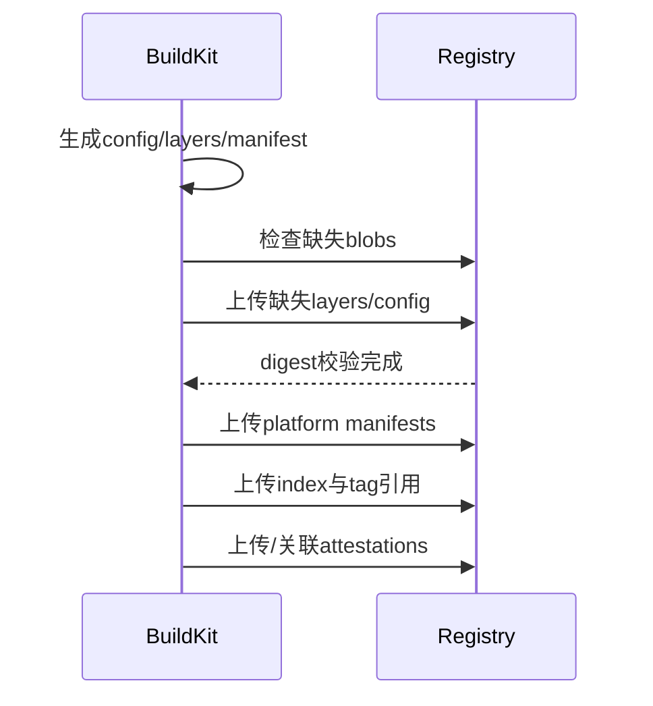

## 1. BuildKit 解决什么问题

BuildKit 是现代 Docker 构建后端。

它把构建视为依赖图求值，而不是只能逐行顺序执行的脚本。

主要能力包括：

- 并行执行互不依赖的步骤。
- 精确传输和使用 build context。
- 可导入、导出缓存。
- secret、SSH 和 cache mounts。
- multi-stage build。
- multi-platform build。
- 输出 OCI/Docker 镜像、local 文件、tar 等结果。
- 生成 provenance、SBOM 等 attestations。

Dockerfile 仍是最常见前端语言。

但 BuildKit 内部求值对象不是 Dockerfile 文本本身，而是 LLB 图。

## 2. 本文版本语境

按 2026-08-04 的指定上下文：

- Docker Engine 29.7.1。
- Docker Desktop 4.85.0。
- Engine 29.7 打包 BuildKit 0.32。
- containerd 2.3.3。
- runc 1.4.3。

`docker buildx version` 显示的 Buildx 插件版本是另一项信息。

Buildx 负责客户端编排和 builder 管理。

它不等于 BuildKit daemon 的版本。

实际环境应检查：

```bash
docker version
docker buildx version
docker buildx ls
docker buildx inspect --bootstrap
```

Desktop 可能管理独立 builder 和 VM 内资源。

远程 builder 也可能与本机 Engine 版本不同。

## 3. 组件关系

```text
docker build / docker buildx build
             │
             ▼
        Dockerfile frontend
             │ parse/convert
             ▼
       LLB definition graph
             │ solve
             ▼
          BuildKit daemon
      ┌──────┼─────────────┐
      │      │             │
  source   executor    cache manager
      │      │             │
      └──────┼─────────────┘
             ▼
       exporter / registry
```

具体进程是 Engine 内建 BuildKit、`docker-container` builder 还是远程 `buildkitd`，取决于 driver。

## 4. Buildx 与 BuildKit

Buildx 是 Docker CLI 插件。

它提供：

- 创建和选择 builder。
- 多节点 builder 管理。
- multi-platform 参数。
- cache importer/exporter 参数。
- imagetools 等 registry 操作。

BuildKit 是实际执行构建图的后端。

```bash
docker buildx create --name tutorial-builder --use
docker buildx inspect --bootstrap
```

创建 builder 会改变当前构建上下文选择。

共享环境执行前应先看 `docker buildx ls`。

## 5. builder driver

常见 Buildx driver：

- `docker`：使用 Docker Engine 内置 builder。
- `docker-container`：在容器中运行独立 BuildKit daemon。
- `kubernetes`：在 Kubernetes 中运行 builder。
- `remote`：连接外部 buildkitd。

driver 会影响：

- 支持的 exporter。
- 缓存存放位置。
- 构建结果是否自动进入本地 image store。
- 多平台能力。
- 网络和证书配置位置。

不要看到同一条 `buildx build` 命令就假定所有机器行为相同。

## 6. Dockerfile frontend

Dockerfile frontend 负责把 Dockerfile 转为 LLB。

语法版本可通过 parser directive 指定：

```dockerfile
# syntax=docker/dockerfile:1
FROM alpine:3.22
RUN echo hello
```

frontend image tag 可能是可移动的。

严格可重复场景可固定具体版本或 digest。

同时要制定安全更新策略。

新 Dockerfile 功能是否可用，可能取决于 frontend 版本，而不只取决于 Engine 版本。

## 7. LLB 是什么

LLB 即 Low-Level Build。

它是 BuildKit 的内容可寻址构建定义。

LLB 图包含操作节点和依赖边。

常见操作概念包括：

- source：读取镜像、local context、Git 等源。
- exec：在 rootfs 上执行命令。
- file：复制、创建、删除文件等。
- merge/diff：组合或计算 filesystem 状态。



图模型让 BuildKit 能跳过未被目标引用的阶段，并并行执行独立分支。

## 8. 一次构建的概念链路



实际传输可以并行和流式进行。

节点缓存命中时不会执行对应命令。

## 9. 缓存不是“按行号记忆”

BuildKit cache key 通常由操作及其输入决定。

概念上包括：

- LLB operation 定义。
- 父节点结果。
- mount 类型和选择器。
- build args 等参与操作的配置。
- `COPY`/source 使用的文件元数据与内容。
- secret/SSH mount 的标识和配置。
- frontend 生成的图。

具体缓存键算法属于实现细节。

不要依赖未承诺的内部 hash 格式。

重要的是：任何被依赖的输入变化都可能让节点失效，并使后续依赖节点重算。

## 10. Dockerfile 顺序为何影响缓存

不理想：

```dockerfile
COPY . .
RUN npm ci
RUN npm run build
```

任意源码变化都会使 `COPY . .` 变化。

从而让 `npm ci` 失去缓存。

更好的顺序：

```dockerfile
COPY package.json package-lock.json ./
RUN npm ci
COPY . .
RUN npm run build
```

依赖声明不变时，安装依赖节点可复用。

这不是为了减少镜像层数量。

而是让依赖图的变化边界更精确。

## 11. `.dockerignore`

`.dockerignore` 控制 build context 中排除的路径。

```text
.git
node_modules
dist
*.log
.env
```

作用包括：

- 减少 context 传输。
- 避免无关文件破坏缓存。
- 降低 secret 误复制风险。
- 减少 frontend/source 扫描成本。

忽略规则语义与 `.gitignore` 不完全相同。

应按 Docker 官方规则编写并通过构建验证。

`.dockerignore` 不是 secret 管理的唯一防线。

## 12. build context 不总是整个目录上传

BuildKit 可以按构建图和协议按需请求 context 文件。

但大量文件、错误 ignore 和文件 metadata 扫描仍会有成本。

远程 builder 时，这个成本更明显。

可以使用 named contexts：

```bash
docker buildx build \
  --build-context docs=./docs \
  --build-context base=docker-image://alpine:3.22 \
  .
```

Dockerfile frontend 可按支持的语法引用这些 context。

## 13. RUN cache mount

cache mount 为构建命令提供可复用工作目录。

```dockerfile
# syntax=docker/dockerfile:1
FROM node:24-alpine
WORKDIR /app
COPY package*.json ./
RUN --mount=type=cache,target=/root/.npm \
    npm ci
```

它与最终镜像层缓存不同。

cache mount 内容通常不会自动进入最终 layer。

它是构建期间的可变缓存目录。

适合包管理器下载缓存、编译缓存等。

缓存可能被 GC，构建必须在缓存为空时也能正确完成。

## 14. cache mount sharing

并发构建访问同一 cache 时，需要考虑工具是否支持并发。

Dockerfile mount 可提供 sharing 语义，例如：

- shared。
- private。
- locked。

某些包管理器数据库需要 `locked`，避免并发损坏。

选择应基于工具行为。

强制锁会降低并行度，但保证单写语义。

## 15. secret mount

错误方式：

```dockerfile
ARG TOKEN
RUN curl -H "Authorization: Bearer $TOKEN" ...
```

ARG 和命令可能进入历史、日志或缓存元数据。

正确方向是 BuildKit secret mount：

```dockerfile
# syntax=docker/dockerfile:1
RUN --mount=type=secret,id=api_token \
    TOKEN="$(cat /run/secrets/api_token)" && \
    fetch-private-dependency "$TOKEN"
```

构建命令：

```bash
docker buildx build --secret id=api_token,src=./token.txt .
```

secret 文件本身不会自动写入最终层或缓存。

但命令若主动复制、打印或嵌入产物，仍会泄露。

## 16. secret 与缓存键

为避免 secret 值泄露，secret 内容通常不直接作为普通缓存键材料。

这意味着 secret 值变化不一定自动让该步骤失效。

若构建结果合法地依赖某个凭据所选择的内容，应通过非敏感版本参数显式控制缓存失效。

例如：

```dockerfile
ARG PRIVATE_DEP_VERSION
RUN --mount=type=secret,id=token \
    install-private-dep "$PRIVATE_DEP_VERSION"
```

不要把 secret hash 作为公开 ARG，这可能泄露可关联信息。

具体方案取决于威胁模型。

## 17. SSH mount

BuildKit 可以转发 SSH agent/socket，避免复制私钥：

```dockerfile
# syntax=docker/dockerfile:1
RUN --mount=type=ssh git clone git@example.com:team/private.git
```

构建：

```bash
docker buildx build --ssh default .
```

仍需正确管理 `known_hosts`。

不要为了绕过校验永久关闭主机密钥验证。

SSH mount 只在指定 RUN 可见，不应进入镜像层。

## 18. bind mount in RUN

构建步骤可以临时 bind mount context 内容，而不把它直接保留到结果层：

```dockerfile
RUN --mount=type=bind,source=.,target=/src,ro \
    compiler -i /src -o /out/app
```

只有命令写入结果 rootfs 的产物进入该步骤结果。

这有助于避免把完整源码保留在层中。

具体语法能力依赖 Dockerfile frontend 版本。

## 19. multi-stage build

```dockerfile
# syntax=docker/dockerfile:1
FROM golang:1.25 AS build
WORKDIR /src
COPY go.mod go.sum ./
RUN --mount=type=cache,target=/go/pkg/mod go mod download
COPY . .
RUN CGO_ENABLED=0 go build -o /out/app ./cmd/app

FROM gcr.io/distroless/static-debian12
COPY --from=build /out/app /app
USER 65532:65532
ENTRYPOINT ["/app"]
```

最终镜像不包含 Go 工具链和完整源码。

BuildKit 只求解目标阶段真正依赖的图分支。

可以指定目标：

```bash
docker buildx build --target build .
```

## 20. 缓存记录与镜像 layer 的区别

最终镜像 layer 是 OCI 镜像分发内容的一部分。

BuildKit cache record 描述构建节点结果如何被复用。

二者有关联，但不是同一对象集合。

```text
Build graph operation
  ├── cache metadata/key
  ├── result snapshot/reference
  └── exported image layer（若进入最终输出）
```

未进入最终 stage 的中间结果可以有 cache，但不会成为最终镜像 layer。

cache mount 内容也不会因存在缓存就自动进入镜像。

## 21. 本地缓存与 garbage collection

BuildKit 会保存可复用结果。

空间有限时由 GC 策略清理。

观察 Docker builder 空间：

```bash
docker buildx du
docker system df
```

清理：

```bash
docker buildx prune
docker builder prune
```

命令作用范围受当前 builder/driver 影响。

执行前检查 builder 选择和共享影响。

缓存是优化，不应是构建正确性的唯一输入。

## 22. cache exporter 与 importer

远程 CI 节点通常是短生命周期。

需要显式导出缓存并在下一次导入。

常见 backend 包括：

- registry。
- local。
- inline。
- GitHub Actions cache 等特定 backend。

可用 backend 取决于 BuildKit、Buildx driver 和环境。

不要假定所有 driver 支持相同组合。

## 23. registry cache

示例：

```bash
docker buildx build \
  --cache-from type=registry,ref=registry.example.com/team/app:buildcache \
  --cache-to type=registry,ref=registry.example.com/team/app:buildcache,mode=max \
  --push \
  -t registry.example.com/team/app:1.0 \
  .
```

`mode=min` 通常导出最终镜像所需附近的缓存。

`mode=max` 倾向导出更多中间结果。

准确支持和默认值以当前文档为准。

registry cache reference 应与发布 image tag 分开管理。

## 24. inline cache

inline cache 把缓存元数据与镜像输出关联存放。

优点：

- 使用发布镜像作为 cache source 较方便。
- 不需要单独 cache reference。

限制：

- 复杂 multi-stage 的缓存覆盖可能不如独立 registry cache 的 `mode=max`。
- 镜像删除会影响缓存来源。
- 需要正确的 importer 配置。

选择取决于 CI 拓扑和缓存保留策略。

## 25. local cache

```bash
docker buildx build \
  --cache-to type=local,dest=./build-cache \
  --cache-from type=local,src=./build-cache \
  .
```

适合本地转移、离线环境或 CI workspace 缓存。

要注意：

- cache 目录会增长。
- 并发写需要管理。
- 旧索引和 blobs 的清理策略。
- 不要把 cache 当作最终制品。

## 26. 缓存污染与信任边界

导入远程 cache 等于信任其记录和内容验证路径。

BuildKit 会使用 digest 验证内容，但供应链信任仍需考虑：

- 谁可写 cache reference。
- registry 认证与 TLS。
- cache tag 是否可能被不可信方覆盖。
- builder 和 frontend 是否可信。
- secret 是否会被构建命令输出。

对外部 PR 构建，不应给予生产 cache、push 凭据和 secrets 的同等写权限。

## 27. 镜像 exporter

BuildKit 可将结果导出为镜像并：

- 加载到本地 image store。
- 直接 push registry。
- 写 OCI layout/tar。
- 写 Docker archive 等受支持格式。

常见命令：

```bash
docker buildx build --load -t app:dev .
docker buildx build --push -t registry.example.com/team/app:1.0 .
```

`--load` 常用于单平台本地调试。

多平台结果是否能完整加载到本地，取决于 image store 和 driver 能力。

直接 `--push` 通常更适合发布 multi-platform index。

## 28. registry 分发对象图

单平台输出：

```text
tag
 └── image manifest
      ├── config blob
      └── layer blobs
```

多平台输出：

```text
tag
 └── image index / manifest list
      ├── linux/amd64 manifest
      │    ├── config
      │    └── layers
      └── linux/arm64 manifest
           ├── config
           └── layers
```

attestations 还可能作为额外 manifests/artifacts 与 subject 关联。

具体表现依赖 OCI referrers、registry 和 exporter 支持。

## 29. push 的概念流程



并发和具体提交顺序可由实现优化。

manifest 通常在其引用 blobs 可用后提交。

上传相同 digest blob 时 registry 可避免重复传输。

去重范围属于 registry 实现和授权策略。

## 30. pull 的平台选择

客户端拉取 multi-platform tag 时：

1. 获取 index/list。
2. 根据目标 OS、architecture 和 variant 选择 descriptor。
3. 获取对应 manifest。
4. 下载缺失 config/layers。
5. 校验 digest。
6. 由 image store/snapshotter 准备 rootfs。

```bash
docker buildx imagetools inspect registry.example.com/team/app:1.0
docker pull --platform linux/arm64 registry.example.com/team/app:1.0
```

顶层 index digest 与各平台 manifest digest不同。

## 31. multi-platform 构建策略

常见三种策略：

### 模拟执行

通过 QEMU/binfmt_misc 在一类 CPU 上运行另一架构二进制。

优点是配置方便。

缺点是编译和测试可能明显变慢，且模拟不完全等同真实硬件。

### 多原生节点

builder 同时包含 amd64、arm64 等原生节点。

优点是性能和真实性较好。

缺点是基础设施和缓存协调更复杂。

### 交叉编译

编译器在构建平台输出目标平台二进制。

优点是通常最快。

缺点是依赖语言工具链支持，并需正确处理 CGO/本地依赖。

三种策略可以组合使用。

## 32. BUILDPLATFORM 与 TARGETPLATFORM

BuildKit 提供自动平台参数。

常见包括：

- `BUILDPLATFORM`。
- `BUILDOS`、`BUILDARCH`、`BUILDVARIANT`。
- `TARGETPLATFORM`。
- `TARGETOS`、`TARGETARCH`、`TARGETVARIANT`。

示例：

```dockerfile
# syntax=docker/dockerfile:1
FROM --platform=$BUILDPLATFORM golang:1.25 AS build
ARG TARGETOS TARGETARCH
WORKDIR /src
COPY . .
RUN GOOS=$TARGETOS GOARCH=$TARGETARCH go build -o /out/app ./cmd/app

FROM alpine:3.22
COPY --from=build /out/app /usr/local/bin/app
ENTRYPOINT ["app"]
```

构建阶段固定在 build platform 可避免无谓模拟编译器。

最终阶段按 target platform 选择基础镜像。

## 33. multi-platform 命令

```bash
docker buildx build \
  --platform linux/amd64,linux/arm64 \
  -t registry.example.com/team/app:1.0 \
  --push \
  .
```

每个平台通常产生独立 config 和 layers。

共享字节完全相同的 blobs 可按 digest 复用。

最终 tag 指向 index/list。

构建成功不代表目标平台运行测试已覆盖。

应在原生或可信模拟环境执行测试。

## 34. platform 常见陷阱

### 在 Dockerfile 写死 `FROM --platform=linux/amd64`

这可能让所谓 multi-platform 输出实际包含错误架构内容。

除非有明确理由，使用 `$BUILDPLATFORM` 或让目标平台自动选择。

### 把 `uname -m` 当目标平台

在交叉编译阶段，`uname -m` 显示执行该 RUN 的环境架构。

它不一定等于 `TARGETARCH`。

### 只改 manifest 标签

把 amd64 镜像 descriptor 标成 arm64 不会转换二进制。

平台元数据必须与实际内容一致。

### CGO 和原生依赖

交叉编译需要目标 libc、compiler 和 linker。

纯 Go 与 CGO 项目策略不同。

## 35. reproducibility

可重复构建需要控制所有输入：

- 基础镜像 digest。
- 包仓库内容与 lockfile。
- frontend 版本。
- build args。
- 时间戳。
- 文件顺序和权限。
- 编译器与依赖工具链。
- 网络下载资源。

内容寻址不自动让构建可重复。

它只能精确标识某次输出字节。

BuildKit 支持与 reproducible builds 相关的能力，但应用构建系统仍需配合。

## 36. provenance 与 SBOM

BuildKit 可为构建输出生成 attestations。

常见类型：

- provenance：描述构建来源、参数和 builder 信息。
- SBOM：描述软件组成。

示例参数形式：

```bash
docker buildx build \
  --provenance=mode=max \
  --sbom=true \
  --push \
  -t registry.example.com/team/app:1.0 \
  .
```

具体默认、字段、支持的 exporter 和 registry 行为以当前文档为准。

provenance 可能包含构建环境信息。

公开发布前应审查披露范围。

## 37. attestations 与镜像可运行性

attestation 通常不是运行容器 rootfs 的普通 layer。

它作为与镜像 subject 关联的 OCI 对象分发。

旧 registry、镜像复制工具或清理工具可能不保留 referrers/附属 manifests。

迁移 registry 时要验证：

- multi-platform index 是否完整。
- signatures 是否保留。
- provenance/SBOM 是否保留。
- digest 是否因格式转换变化。

## 38. registry 认证链路

BuildKit 拉取基础镜像、导入 cache 和 push 输出都可能需要凭据。

Buildx/BuildKit 通过 session 和 credential helper 等机制协作。

```bash
docker login registry.example.com
```

凭据可能由系统 keychain/helper 保存，而不是明文写配置。

不要把 `~/.docker/config.json` 直接复制进镜像或共享到不可信 builder。

远程 builder 需要单独验证凭据转发和信任边界。

## 39. registry TLS 与私有 CA

私有 registry 使用企业 CA 时，证书信任可能要分别配置在：

- Docker daemon。
- BuildKit daemon/builder container。
- Docker Desktop。
- 企业代理环境。

只给 CLI 主机安装 CA 不一定让远程 buildkitd 信任 registry。

不要长期使用 insecure registry 绕过证书问题。

应配置正确 SAN、完整证书链和受信 CA。

## 40. 构建网络

RUN 步骤可能需要访问包仓库。

构建网络与最终容器运行网络不是同一个生命周期对象。

缓存命中时，RUN 根本不会发网络请求。

因此排障要注意：

- 代理参数是否传入 builder。
- DNS 是否在 builder 环境可用。
- 企业 CA 是否在构建阶段可用。
- `--network` 等选项是否由当前 driver/frontend 支持。

不要把代理 secret 固化进最终镜像环境变量。

## 41. 日志与调试

使用 plain progress 便于 CI 和排障：

```bash
docker buildx build --progress=plain --no-cache .
```

`--no-cache` 用于验证缓存相关问题。

它不必然禁用所有外部源解析缓存或强制 tag 指向更新内容。

基础镜像更新可结合：

```bash
docker buildx build --pull --no-cache .
```

仍应通过 digest 和输出日志确认实际输入。

## 42. 缓存未命中排查

按顺序检查：

1. builder 是否相同。
2. cache 是否成功导入。
3. Dockerfile frontend 是否变化。
4. 基础镜像 digest 是否变化。
5. build args 和 platform 是否变化。
6. `COPY` 输入是否被无关文件改变。
7. 文件权限或 metadata 是否变化。
8. cache record 是否被 GC。

```bash
docker buildx ls
docker buildx inspect
docker buildx du
docker buildx build --progress=plain .
```

“Dockerfile 没改”不足以保证缓存命中。

## 43. push 失败排查

先区分阶段：

- token 获取失败。
- manifest 读取/写入无权限。
- blob upload 失败。
- TLS 或代理失败。
- registry 不接受 media type。
- index 或 attestation 不受旧 registry 支持。

检查完整 repository 名称和权限 scope。

```bash
docker buildx imagetools inspect registry.example.com/team/app:tag
```

避免仅重试整次构建。

内容寻址 blob 通常可复用，真正问题可能在 manifest commit。

## 44. 常见误区

### 误区一：Buildx 就是 BuildKit daemon

Buildx 是 CLI 插件和 builder 编排层，BuildKit 是执行后端。

### 误区二：缓存命中只看 Dockerfile 行文本

缓存键还依赖父结果、source、参数、mount 和平台等输入。

### 误区三：cache mount 会进入最终镜像

cache mount 是构建时可变缓存，不自动进入结果层。

### 误区四：secret mount 保证命令不会泄露 secret

命令仍可打印或复制 secret。

机制只避免默认固化。

### 误区五：multi-platform 就是复制同一镜像改标签

每个平台必须包含对应架构内容和 config。

### 误区六：`--load` 总能加载完整多平台 index

能力取决于 driver 与本地 image store。

多平台发布通常使用 `--push`。

### 误区七：digest 相同证明发布者可信

digest 证明字节完整性，不证明来源授权。

### 误区八：cache 是永久构建输入

cache 可被 GC；无缓存构建也必须成功。

## 45. 一个完整构建示例

```dockerfile
# syntax=docker/dockerfile:1
FROM --platform=$BUILDPLATFORM golang:1.25-alpine AS build
ARG TARGETOS TARGETARCH
WORKDIR /src
COPY go.mod go.sum ./
RUN --mount=type=cache,target=/go/pkg/mod go mod download
COPY . .
RUN --mount=type=cache,target=/root/.cache/go-build \
    CGO_ENABLED=0 GOOS=$TARGETOS GOARCH=$TARGETARCH \
    go build -trimpath -o /out/app ./cmd/app

FROM alpine:3.22
RUN adduser -D -u 10001 app
COPY --from=build /out/app /usr/local/bin/app
USER 10001:10001
ENTRYPOINT ["app"]
```

构建并发布：

```bash
docker buildx build \
  --platform linux/amd64,linux/arm64 \
  --cache-from type=registry,ref=registry.example.com/team/app:buildcache \
  --cache-to type=registry,ref=registry.example.com/team/app:buildcache,mode=max \
  --provenance=mode=max \
  --sbom=true \
  --push \
  -t registry.example.com/team/app:1.0 \
  .
```

检查：

```bash
docker buildx imagetools inspect registry.example.com/team/app:1.0
```

实际版本号和镜像 digest 应在项目中固定并自动更新。

## 46. CI 设计建议

- 每次构建记录 builder、frontend、基础镜像和最终 digest。
- 外部 PR 不接触生产 push 凭据。
- cache reference 与 release tag 分离。
- 使用 immutable digest 作为部署输入。
- 在目标架构执行测试，而不只完成交叉编译。
- 定期做无缓存构建，验证 cache 不是隐藏依赖。
- 对 provenance 和 SBOM 设定保留、审查和复制策略。
- 对 registry GC 验证 manifest、referrers 和 cache 的引用关系。
- 限制构建 context，避免无关 secret 进入 builder session。
- 对远程 builder 进行与生产 runner 相同级别的加固。

## 47. 总结

- Dockerfile frontend 把 Dockerfile 转换成 LLB。
- BuildKit solver 按依赖图求值并复用 cache records。
- 缓存键依赖操作及其输入，不只是 Dockerfile 行文本。
- cache mount、secret mount、SSH mount 都是构建时能力，不应自动进入镜像。
- multi-stage build 减少最终镜像内容并改善依赖图边界。
- Build cache 与 OCI image layers 相关但不等价。
- cache exporter/importer 让短生命周期 CI 节点复用结果。
- Buildx 管理 builder，BuildKit 执行构建。
- multi-platform 可使用模拟、多原生节点或交叉编译。
- index/list 聚合各平台 manifest，顶层与平台 digest 不同。
- registry 按 OCI 内容图分发 blobs、manifests、indexes 和 attestations。
- provenance 和 SBOM 需要 registry、复制工具和策略共同保留。
- Desktop 的 builder 和镜像 store 位于受管理 VM 边界内，行为应按 driver 与配置验证。

## 48. 官方资料

- Docker Build overview：https://docs.docker.com/build/
- BuildKit project：https://github.com/moby/buildkit
- BuildKit LLB README：https://github.com/moby/buildkit#exploring-llb
- Docker Build cache：https://docs.docker.com/build/cache/
- Cache backends：https://docs.docker.com/build/cache/backends/
- Dockerfile reference：https://docs.docker.com/reference/dockerfile/
- Build secrets：https://docs.docker.com/build/building/secrets/
- Multi-platform builds：https://docs.docker.com/build/building/multi-platform/
- Build drivers：https://docs.docker.com/build/builders/drivers/
- Build attestations：https://docs.docker.com/build/metadata/attestations/
- OCI Image Specification：https://github.com/opencontainers/image-spec
- OCI Distribution Specification：https://github.com/opencontainers/distribution-spec
