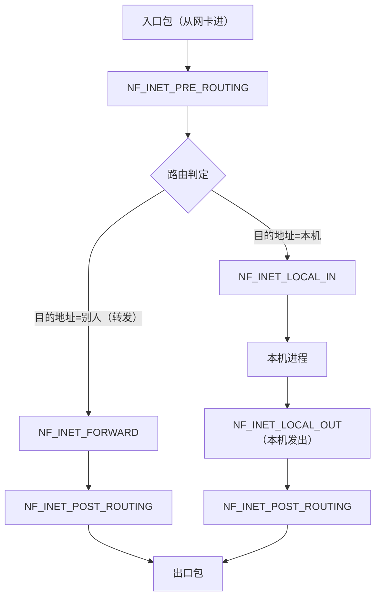

::: abstract 本章定位
把防火墙从"装了就安心"变成"每条规则都看得懂、能验证"：从 Netfilter 五大钩子与 iptables 四表五链讲清原理，逐个掌握 iptables/nftables/firewalld/ufw 四套命令，最后落到排障手法与安全加固清单。原理呼应 [网络栈](/kb/os/Linux/13-Linux网络栈内核原理/)，入门见 [Linux 安全实操](/kb/os/Linux/06-Linux安全权限与审计/)。
:::

Linux 世界有"祖孙三代"防火墙：`iptables`（老牌，最通用）、`nftables`（内核新框架，替代者）、`firewalld`/`ufw`（面向普通用户的封装）。本机和云上服务器出问题，**八成是防火墙或安全组挡了流量**——本篇的目标：看到"端口不通"，能快速定位是防火墙、安全组还是服务本身，并熟练添加/验证/回滚规则。

::: warning 远程操作警示
给远程服务器改防火墙规则前，先留一条"保命规则"，或者开一个能断开即重连的维护窗口。典型事故：`iptables -P INPUT DROP` 之后才发现自己忘了放行 SSH，直接把自己锁在门外。**动手实验请在本地虚拟机/容器里做，规则用完还原。**
:::

## 0. 远程变更安全前置

把下面流程当成命令前置条件，适用于 iptables、nftables、firewalld 和 ufw：

1. **保留当前 SSH 会话**，不要先退出；另开第二个终端准备新连接，并确认云控制台、串口、KVM 或现场入口可用。
2. **确认自己不会被封**：记录 `echo "$SSH_CONNECTION"` 的来源 IP、`ip route get <来源IP>` 的出口/入接口；检查当前 SSH 监听 `ss -ltnp | grep sshd`。
3. **先备份、再候选校验**：`iptables-save`/`nft list ruleset` 导出；iptables 用 `iptables-restore --test`，nft 用 `nft -c -f`，firewalld/ufw 先只加临时规则。
4. **先放行后收紧**：明确放行当前 SSH 端口、来源网段、回环和 `ESTABLISHED,RELATED`；新端口先临时放行，保留旧端口。
5. **从第二个终端新建连接验证**：不能只看当前连接，因为 conntrack 可能继续放行已建立的 SSH；至少验证新 TCP 连接、认证、sudo 和业务端口。
6. **再持久化并回滚检查**：确认新连接成功后再删除旧规则，保存运行时配置；给高风险变更准备自动回滚计时器、带外命令或可执行的 restore 文件。

### 0.1 定时回滚：把"锁死"变成"最多失联 N 分钟"

远程改防火墙的核心保命思路是**先安排好自动恢复，再动规则**。哪怕新规则把自己封死，计时器到点会把机器拉回可登录状态。四种常用手段按可靠性排序：

```bash
# 方式一：firewalld 原生超时规则，到点自动移除，无需外部计时器
sudo firewall-cmd --zone=public --add-port=8443/tcp --timeout=300
sudo firewall-cmd --zone=public --add-rich-rule='rule family="ipv4" \
  source address="203.0.113.10" port port="22" protocol="tcp" accept' --timeout=10m

# 方式二：systemd 一次性定时器恢复备份（脱离当前 SSH 会话，断线也会执行）
sudo iptables-save > /root/fw.rollback
sudo systemd-run --on-active=10min --unit=fw-rollback \
  /bin/sh -c 'iptables-restore < /root/fw.rollback'
sudo systemctl list-timers fw-rollback.timer      # 确认已排入计划
sudo systemctl stop fw-rollback.timer             # 验证成功后取消回滚

# 方式三：at 任务（需 atd 已启用）
echo 'nft -f /root/nft.rollback' | sudo at now + 10 minutes
atq                                               # 查看待执行任务
sudo atrm &lt;job-id&gt;                                # 验证成功后删除

# 方式四：确认式应用，超时未回答自动恢复
sudo iptables-apply -t 60 /root/iptables.candidate
```

预期输出片段：

```text
success
Running as unit: fw-rollback.service; invocation ID: 3f2c...
NEXT                        LEFT     UNIT               ACTIVATES
Tue 2026-08-11 10:40:00 UTC 9min     fw-rollback.timer  fw-rollback.service
Can you establish NEW connections to the machine? (y/N)
```

参数与解读：`--timeout=` 只作用于 **runtime** 规则，到期自动撤销，因此它天生不会被 `--runtime-to-permanent` 之外的操作固化；不能与 `--permanent` 同时使用。`systemd-run --on-active` 生成瞬时 timer，进程属于 systemd 而不是你的 SSH 会话，SSH 断掉也照样触发，比 `sleep 600 && ...` 放在前台可靠得多。`at` 依赖 `atd` 服务（Debian/Ubuntu 装 `at`，RHEL 装 `at` 并 `systemctl enable --now atd`），最小化镜像常常没有。

::: warning 计时器本身也会犯错
回滚文件必须先 `iptables-restore --test`/`nft -c -f` 校验，否则到点执行的是一份加载不了的备份。回滚窗口别设太短（改规则、切终端、重连往往要几分钟），也别太长（长时间失联同样是故障）；5–15 分钟是常见区间。回滚只恢复防火墙，若同时改了 sshd、路由或接口，要为每一项各自准备恢复动作。验证成功后**立刻取消计时器**，否则它会把你刚做好的变更一并撤销。
:::

### 0.2 完整的"不把自己锁在外面"流程

把上面的要素串成一条可照着执行的清单：

```bash
# 1) 记录现状与自己的来源
echo "$SSH_CONNECTION"                       # 客户端IP 客户端端口 服务端IP 服务端端口
ss -ltnp | grep sshd
ip route get "$(echo "$SSH_CONNECTION" | awk '{print $1}')"

# 2) 备份 + 校验回滚材料（三件套都要能加载）
sudo iptables-save > /root/fw.rollback
sudo iptables-restore --test < /root/fw.rollback && echo "rollback OK"

# 3) 安排自动回滚
sudo systemd-run --on-active=10min --unit=fw-rollback \
  /bin/sh -c 'iptables-restore < /root/fw.rollback'

# 4) 先放行保命规则，再收紧
sudo iptables -I INPUT 1 -i lo -j ACCEPT
sudo iptables -I INPUT 2 -m conntrack --ctstate ESTABLISHED,RELATED -j ACCEPT
sudo iptables -I INPUT 3 -p tcp -s "$(echo "$SSH_CONNECTION" | awk '{print $1}')" --dport 22 -j ACCEPT

# 5) 从第二个终端建立全新连接验证（不是复用当前会话）
#    ssh -o ControlMaster=no -o ControlPath=none user@host 'id; sudo -n true'

# 6) 验证通过 → 取消回滚 → 持久化
sudo systemctl stop fw-rollback.timer
sudo iptables-save > /etc/iptables/rules.v4     # Debian 系；RHEL 系见 2.4 节
```

关键点：第 4 步的 `-I` 顺序保证保命规则在任何兜底 DROP 之前；第 5 步必须显式禁用连接复用（`ControlMaster=no -o ControlPath=none`），否则 `ssh` 可能复用旧 TCP 连接，看起来"能登录"其实没验证任何新规则。带外入口（云控制台 VNC、串口、KVM、云厂商的 session manager）是最后一道保险，动手前先确认它真的可用，而不是假设它存在。

::: important 为什么要验证新连接
`iptables -P INPUT DROP`、`nft ... policy drop`、`firewall-cmd --reload`、`ufw enable` 都可能让重连失败。已有 SSH 会话“看起来没断”不是安全证明；远程操作必须以第二条全新连接成功为准。远程 sshd 的配套流程见 [远程操作与文件同步](/kb/os/Bash/11-远程操作与文件同步/)。
:::

## 1. 防火墙概念与 Netfilter 背景

### 1.1 包过滤防火墙原理

防火墙按工作层分三类：**包过滤**（L3/L4，看 IP、端口、协议）、**应用层**（L7，如 WAF 看 HTTP 内容）、**状态检测**（既看当前包又查连接表）。Linux 防火墙是**内核态包过滤 + 状态检测**：每个包流经内核协议栈时，被挂在内核里的检查点截住，逐条匹配规则，命中即执行放行/丢弃等动作，**不进入用户态**，所以又快又省。

### 1.2 Netfilter 五大钩子：包走的必经之路

Netfilter 是内核自带的包处理框架，在 IP 层埋了 **5 个钩子（hook）**，包每经过一个钩子就"停下来让注册的规则审一遍"。[网络栈](/kb/os/Linux/13-Linux网络栈内核原理/) 讲过它的位置，这里换成"包的视角"：



| 钩子 | 包的方向 | 典型用途 |
|---|---|---|
| `PREROUTING` | 入口包第一个检查点 | DNAT（改目的地址）必须在路由之前做 |
| `INPUT` | 发给本机进程前 | 本机入站过滤（最常用） |
| `FORWARD` | 网关转发流量 | 路由器/容器网桥的转发过滤 |
| `OUTPUT` | 本机发出的第一个检查点 | 本机出站过滤 |
| `POSTROUTING` | 出口最后一个检查点 | SNAT/MASQUERADE（改源地址） |

::: note 记住两条铁律
**改目的地址在路由前（PREROUTING），改源地址在路由后（POSTROUTING）**。因为 DNAT 会改变路由决策结果，必须先改再查路由；而 SNAT 只是出口时改写源，不影响转发方向。
:::

### 1.3 iptables 五链四表：钩子上挂的表与链

iptables 把"检查点"映射为**链（chain）**，把"干什么事"分为**表（table）**。表和链的关系如下：

| 表 | 职责 | 可挂的链 | 优先级 |
|---|---|---|---|
| `raw` | 跳过连接跟踪（`NOTRACK`） | PREROUTING、OUTPUT | 1（最高） |
| `mangle` | 改 TOS、打标记（QoS 用） | 全部 5 链 | 2 |
| `nat` | DNAT/SNAT/MASQUERADE | PREROUTING、INPUT、OUTPUT、POSTROUTING | 3 |
| `filter` | 放行/拒绝（**默认表**） | INPUT、FORWARD、OUTPUT | 4 |

- 链是"顺序执行的检查清单"，表是"按优先级叠加的层次"：一个包经过 PREROUTING 钩子时，先过 raw、再过 mangle、再过 nat，各表内再逐条查链。
- `filter` 是默认表，所以 `iptables -A INPUT ...` 省略 `-t` 就是加在 filter 表。
- **raw 表优先级最高**，因为要在 conntrack 建立之前就标记"别跟踪"。

### 1.4 规则的匹配-动作流程

```
包进入链 ──► 匹配规则1？──是──► 执行动作（ACCEPT/DROP/…）→ 结束
      │否
      └──► 匹配规则2？……逐条往下 ──► 都不匹配 ──► 走链默认策略（-P）
```

- **匹配（match）**：判断条件（来源 IP、目标端口、协议等），用 `-s/-d/-p/--dport/-i/-o/-m` 指定。
- **动作（target）**：用 `-j` 指定；`ACCEPT`/`DROP`/`REJECT` 是**终态**（命中即停止本链后续判断），`LOG` 记日志后**继续匹配**下一条。
- **第一条匹配即停**：规则顺序就是优先级，放行规则要写在拒绝规则**前面**。

## 2. iptables 基础操作

### 2.1 增删改查与默认策略

| 参数 | 含义 | 示例 |
|---|---|---|
| `-A` | 追加（append）到链尾 | `iptables -A INPUT -p tcp --dport 22 -j ACCEPT` |
| `-D` | 删除指定规则 | `iptables -D INPUT -p tcp --dport 22 -j ACCEPT` |
| `-I` | 插入到指定位置（默认第 1 条） | `iptables -I INPUT 1 -s 10.0.0.5 -j DROP` |
| `-F` | 清空（flush）链 | `iptables -F INPUT` |
| `-L` | 列出规则 | `iptables -L -n -v` |
| `-P` | 设默认策略（policy） | `iptables -P INPUT DROP` |
| `-t` | 指定表 | `iptables -t nat -L` |

```bash
# 允许 SSH（放在最前面，保证生效）
iptables -A INPUT -p tcp --dport 22 -j ACCEPT
# 追加一条拒绝规则
iptables -A INPUT -s 192.168.1.100 -j DROP
# 查看当前所有规则（-n 不做 DNS 反解，更快更准）
iptables -L -n -v
```
预期输出片段：
```
Chain INPUT (policy ACCEPT 0 packets, 0 bytes)
 pkts bytes target     prot opt in     out     source               destination
    0     0 ACCEPT     tcp  --  *      *       0.0.0.0/0            0.0.0.0/0        tcp dpt:22
    0     0 DROP       all  --  *      *       192.168.1.100        0.0.0.0/0
```
解读：`policy ACCEPT` 是默认策略；每条规则前的 `pkts/bytes` 是**命中计数**——这是排障的重要证据：如果计数一直为 0，说明包压根没走到这条规则。

### 2.2 匹配条件速查

| 条件 | 含义 | 示例 |
|---|---|---|
| `-s` | 来源 IP/网段 | `-s 10.0.0.0/8` |
| `-d` | 目的 IP/网段 | `-d 192.168.1.1` |
| `-p` | 协议 | `-p tcp` / `-p udp` / `-p icmp` |
| `--dport` | 目标端口（配合 `-p`） | `-p tcp --dport 80` |
| `--sport` | 来源端口 | `-p udp --sport 53` |
| `-i` | 入接口 | `-i eth0` / `-i lo` |
| `-o` | 出接口 | `-o eth0` |
| `-m` | 扩展模块 | `-m state --state NEW` |

```bash
# 组合示例：允许内网段访问 3306，其余一律拒绝
iptables -A INPUT -p tcp -s 10.0.0.0/8 --dport 3306 -j ACCEPT
iptables -A INPUT -p tcp --dport 3306 -j DROP
# 回环接口永远放行（本机进程互访、很多服务依赖 lo）
iptables -A INPUT -i lo -j ACCEPT
```

### 2.3 动作与 DROP vs REJECT

| 动作 | 行为 | 给客户端的观感 |
|---|---|---|
| `ACCEPT` | 放行 | 正常 |
| `DROP` | 静默丢弃，**不回任何包** | 连接超时（一直 hang） |
| `REJECT` | 丢弃并回一个拒绝包 | 立即报 "Connection refused" |
| `LOG` | 记日志（`--log-prefix`），**继续匹配** | 不拦包，只留证据 |

| | DROP | REJECT |
|---|---|---|
| 回显 | 无 | 回 ICMP/RST，客户端立刻知道被拒 |
| 安全 | 隐蔽端口（扫描器会以为不可达） | 暴露"这里被挡了" |
| 排障 | 客户端表现为超时，难分辨 | 好分辨，但攻击者也更容易确认 |
| 典型场景 | 隐藏服务、抗扫描 | 明确的策略性拒绝 |

```bash
iptables -A INPUT -p tcp --dport 3306 -j REJECT --reject-with tcp-reset
iptables -A INPUT -p tcp --dport 22 -j LOG --log-prefix "SSH-ACCESS: " --log-level 4
```

### 2.4 查看计数与持久化

```bash
# 带计数列出（pkts/bytes 每列都填了才有说服力）
iptables -L -n -v
# 零计数：可以配合测试来验证某条规则是否真的被命中
iptables -Z INPUT
# 导出/导入规则集（持久化核心命令）
iptables-save > /etc/sysconfig/iptables
iptables-restore < /etc/sysconfig/iptables
```
解读：`iptables -L -n -v` 的 `pkts` 列就是 [网络栈](/kb/os/Linux/13-Linux网络栈内核原理/) 里 `ipt_do_table` 每次匹配后累加的计数。`iptables` 的规则**存在内存里**，重启即失——要落盘：RHEL 系用 `/etc/sysconfig/iptables` + `service iptables save`，Debian 系用 `iptables-persistent`（存到 `/etc/iptables/rules.v4`）。

::: warning 别用 iptables-save 覆盖手写文件
`iptables-save` 导出的是**当前内存规则**；若内存规则本身是坏的，落盘后重启就带着坏规则上线。先 `iptables -L -n` 确认没问题再导出。
:::

### 2.5 三个典型示例

```bash
# 1) 只允许 SSH：先放行 22 和回环，再默认全拒（注意顺序）
iptables -A INPUT -p tcp --dport 22 -j ACCEPT
iptables -A INPUT -i lo -j ACCEPT
iptables -P INPUT DROP && iptables -P FORWARD DROP
# 2) 开放 80/443（Web 服务）
iptables -A INPUT -p tcp -m multiport --dports 80,443 -j ACCEPT
# 3) 限制来源：只允许公司出口 IP 访问管理端口
iptables -A INPUT -p tcp -s 203.0.113.10 --dport 22 -j ACCEPT
iptables -A INPUT -p tcp --dport 22 -j DROP
```

## 3. iptables nat 与状态

### 3.1 SNAT / DNAT / MASQUERADE

`nat` 表是 Linux 做路由器/网关/端口映射的底座，改的是包的"收发件人地址"：

| 动作 | 改什么 | 挂哪条链 | 场景 |
|---|---|---|---|
| `SNAT` | 改**源地址** | POSTROUTING | 内网主机统一用一个公网 IP 出去 |
| `MASQUERADE` | SNAT 的"自动版" | POSTROUTING | 出口 IP 是动态获取的（家用路由器、拨号） |
| `DNAT` | 改**目的地址** | PREROUTING | 公网端口映射到内网某台机（端口映射） |

```bash
# 内网共享上网：把 eth0 口出去的包源地址改成 eth0 的 IP
iptables -t nat -A POSTROUTING -o eth0 -j MASQUERADE
# 等价于固定出口 IP 的 SNAT
iptables -t nat -A POSTROUTING -o eth0 -s 10.0.0.0/24 -j SNAT --to-source 203.0.113.5
# 端口映射：公网 80 → 内网 10.0.0.2 的 8080
iptables -t nat -A PREROUTING -d 203.0.113.5 -p tcp --dport 80 \
    -j DNAT --to-destination 10.0.0.2:8080
```
解读：做 NAT 网关时需两条配套设置——开启转发 `sysctl net.ipv4.ip_forward=1`，并放行 FORWARD 链的转发流量（`-A FORWARD -m state --state ESTABLISHED,RELATED -j ACCEPT`）。

### 3.2 状态防火墙：-m state 与 conntrack

**状态防火墙**就是"只放行新连接的入门流量，回包和已有连接全放行"。这依赖内核的 conntrack（连接跟踪）表，[网络栈](/kb/os/Linux/13-Linux网络栈内核原理/) 第 5.3 节讲过它的原理：

```bash
# 经典三条：放行回包+相关包、放行回环、只对 NEW 的 22 放行，其余 DROP
iptables -A INPUT -m state --state ESTABLISHED,RELATED -j ACCEPT
iptables -A INPUT -i lo -j ACCEPT
iptables -A INPUT -m state --state NEW -p tcp --dport 22 -j ACCEPT
iptables -P INPUT DROP
```

| 状态 | 含义 | 典型放行对象 |
|---|---|---|
| `NEW` | conntrack 表里没有的**新连接**（首个包） | 主动连进来的 22/80/443 |
| `ESTABLISHED` | 已在表里、双向都有流量 | **所有连接的回复包** |
| `RELATED` | 与现有连接相关（如 FTP 数据通道、ICMP 错误） | FTP 被动模式、ICMP unreachable |
| `INVALID` | 表里对不上的非法包 | 一律 DROP |

```bash
# 新版写法（conntrack 模块，state 的超集）
iptables -A INPUT -m conntrack --ctstate ESTABLISHED,RELATED -j ACCEPT
iptables -A INPUT -m conntrack --ctstate INVALID -j DROP
cat /proc/net/nf_conntrack | head   # 查看连接表
```
解读：有了状态匹配，出站连接的回包不用为每个端口单独开规则——这是"只开 22 也能正常 curl 外网"的根本原因：出站 NEW 由 OUTPUT 链放行，回来的是 ESTABLISHED。

### 3.3 `conntrack`：查看、删除与清空连接状态

`conntrack` 用户态工具通常来自 Debian/Ubuntu 的 `conntrack` 包、RHEL/Fedora 的 `conntrack-tools` 包；它查看的是内核连接跟踪/NAT 表，不是 `ss` 的 socket 列表。

```bash
sudo conntrack -L -p tcp --dport 443       # 列出目标端口 443 的连接
sudo conntrack -L --src 192.168.1.100      # 按源地址筛选
sudo conntrack -D -p tcp --dport 443       # 删除匹配的会话，精确操作
sudo conntrack -F                          # 清空全部 conntrack 状态，极具破坏性
sudo conntrack -S                          # searched/found/insert_failed/drop 等统计
```

预期输出片段：

```text
tcp  6 431999 ESTABLISHED src=192.168.1.100 dst=203.0.113.10 sport=51522 dport=443 src=203.0.113.10 dst=192.168.1.100 sport=443 dport=51522 [ASSURED] mark=0 use=1
```

解读：一行包含原方向和回复方向的五元组；`ESTABLISHED`/`ASSURED` 说明连接跟踪已看到双向流量。`-D` 会使匹配的 NAT/TCP 会话失去状态，下一包可能被当作新连接；`-F` 会影响所有租户、容器和 NAT 会话。`conntrack -S` 的 `insert_failed`/`drop` 持续增长时，再对比 `sysctl net.netfilter.nf_conntrack_count net.netfilter.nf_conntrack_max`。

::: warning 远程安全流程
远程执行 `conntrack -D/-F` 前先保留 SSH 会话和带外入口，记录精确过滤条件，优先 `-D` 而不是 `-F`；删除后从第二终端重新建立 SSH 和业务连接。`-F` 没有“只清除某个服务”的语义，不能当作普通缓存清理。
:::

::: note 判断规则是否真的"有状态"
`-m conntrack --ctstate ESTABLISHED,RELATED -j ACCEPT` 应放在具体服务规则和兜底拒绝之前。没有它，本机主动发起的 DNS/HTTP/SSH 客户端连接，其回复包以本机临时端口为目标，可能被 INPUT 默认策略丢弃；而本机作为 SSH **服务端**发出的回复走 OUTPUT 链，不是 INPUT。优先使用 `conntrack` 模块，`state` 是兼容旧写法。
:::

## 4. nftables：现代替代

### 4.1 三层结构：table → chain → rule

`nftables`（内核 3.13+，`nf_tables` 框架）把 iptables 的"表-链-规则"统一为**一套语法**，不再区分 `-t filter` 这种多表叠加，而是显式声明：

```bash
nft add table inet filter                  # 建表（inet = IPv4/IPv6 双栈）
nft 'add chain inet filter input { type filter hook input priority 0; }'
nft add rule  inet filter input tcp dport 22 accept
nft add rule  inet filter input drop
```
预期输出：无输出即成功（`nft add rule inet filter input drop` 是兜底拒绝，规则先 accept 后 drop，顺序即优先级）。
- `hook input` 对应 Netfilter 的 INPUT 钩子，`priority 0` 决定同钩子多链的执行顺序（数字小先执行）。
- 建了链、加完规则后，把整棵结构用 `nft list ruleset` 一次性导出，就是完整配置。

### 4.2 常用操作

```bash
nft list ruleset                    # 查看全部规则（等价于 iptables-save）
nft list table inet filter          # 只看某张表
nft add rule inet filter input ip saddr 10.0.0.0/8 drop
nft delete rule inet filter input handle 3   # 按 handle 号删，必须先查
nft flush chain inet filter input   # 清空某链
nft -a list ruleset                 # -a 显示 handle（删除必需）
```
预期输出片段（`nft list ruleset`）：
```
table inet filter {
        chain input {
                type filter hook input priority filter; policy accept;
                tcp dport 22 accept
                ip saddr 10.0.0.0/8 drop
        }
}
```

### 4.3 与 iptables 对比

| 维度 | iptables（xtables） | nftables（nf_tables） |
|---|---|---|
| 设计 | 4 张固定表 + 多套 `-m/-j` 模块 | 统一命名空间，表/链自定义 |
| 提交方式 | 每条命令独立生效 | 一次提交整个 ruleset，可原子替换 |
| 数据结构 | 链表逐条线性扫描 | 更高效，支持**集合（sets）**批量匹配 |
| IPv4/IPv6 | 两套命令/两套规则 | `inet` 家族一套管双栈 |
| 调试 | 每表独立 `-L` | `meta nftrace set 1` + `nft monitor trace` 逐包跟踪 |
| 现状 | 维护模式 | 内核默认后端 |

```bash
# nftables 的集合：一条规则封掉一整个网段列表（iptables 要写 N 条）
nft 'add set inet filter blacklist { type ipv4_addr; flags interval; }'
nft 'add element inet filter blacklist { 10.0.0.0/8, 203.0.113.0/24 }'
nft add rule inet filter input ip saddr @blacklist drop
```

### 4.4 iptables-nft 与迁移

现在主流发行版（RHEL 9、Debian 12、Ubuntu 22.04+）的 `iptables` 命令**默认就是 `iptables-nft`**——一个兼容壳，把老语法翻译成 nftables 提交给内核 `nf_tables` 后端：

```
用户敲 iptables -A … ──► iptables-nft 翻译 ──► nf_tables 内核后端
用户敲 nft add rule … ──► nft 直接提交 ────────► nf_tables 内核后端
```

| 场景 | 做法 |
|---|---|
| 老脚本全是 iptables | 不用改，`iptables-nft` 兼容即可 |
| 新写规则 | 优先 nft 语法，长期可维护 |
| 两套混用 | `nft list ruleset` 能看到 iptables-nft 生成的规则，但 `iptables -L` 看不到任意原生 nft 表；避免两个控制面共同管理同一钩子 |
| 持久化 | `systemctl enable nftables` + `/etc/nftables.conf`（`nft list ruleset > /etc/nftables.conf`） |

::: warning 别让 iptables 与 nft 共同管理同一规则域
`iptables-nft` 和原生 nft 共用 nf_tables 后端，并非完全“互相看不见”；问题在于 `iptables -L` 只理解兼容层维护的表/链，原生 nft 链可能另行 accept/drop。排查先用 `nft list ruleset` 看全局，再用实际配置管理器确认所有权；不要手工修改 firewalld/ufw/容器运行时生成的表。
:::

### 4.5 `iptables-legacy` 与 `iptables-nft`：先确认后端

同名的 `iptables` 命令在不同发行版/版本里可能指向两种后端：

```bash
iptables --version
readlink -f "$(command -v iptables)"
sudo update-alternatives --display iptables 2>/dev/null || true   # Debian/Ubuntu
sudo iptables-legacy -L -n -v 2>/dev/null
sudo iptables-nft -L -n -v 2>/dev/null
```

预期输出片段：

```text
iptables v1.8.9 (nf_tables)
iptables v1.8.9 (legacy)
```

解读：`(nf_tables)` 表示 `iptables-nft` 兼容层，规则进入内核 `nf_tables`；`(legacy)` 表示旧 xtables 内核路径。两者有各自的规则视图和计数，不能用 legacy 命令验证 nft 后端规则。Ubuntu/Debian 可能通过 `update-alternatives` 切换；RHEL 8/9、Fedora 和 Debian 新版通常默认 nft 后端，但可用性以本机 `--version` 为准。

```bash
iptables-translate -A INPUT -p tcp --dport 8443 -j ACCEPT
iptables-restore-translate -f /root/iptables.rules
```

预期输出片段：

```text
nft 'add rule ip filter INPUT tcp dport 8443 counter accept'
```

参数与解读：`iptables-translate` 把**一条**旧规则翻译为 nft 语句，`iptables-restore-translate -f` 翻译规则文件；它是迁移辅助，不保证所有扩展模块、helper、字符串匹配和自定义脚本语义完全等价。翻译后要用 `nft -c -f` 校验，并在隔离环境按计数、连接和回滚流程验证，不要直接把屏幕输出粘到生产。

::: warning 远程切换后端的保命流程
先用 `iptables-save`/`nft list ruleset` 分别备份，确认当前实际后端；在**已有 SSH 会话不退出**的情况下，用 `iptables-translate` 生成候选 nft 文件，`nft -c -f` 只做语法检查，再通过第二条连接验证新规则。保留旧后端的可回滚命令、云控制台/串口入口和旧 SSH 放行规则，确认新连接成功后才切换服务和持久化配置。
:::

### 4.6 nft sets 与 maps：批量匹配与映射

set 适合“一组值对应同一 verdict”，map 适合“值映射到端口、接口或 verdict”：

```bash
nft add table inet acl
nft 'add set inet acl blocked4 { type ipv4_addr; flags interval; }'
nft 'add element inet acl blocked4 { 203.0.113.66, 198.51.100.0/24 }'
nft 'add chain inet acl input { type filter hook input priority 0; policy accept; }'
nft add rule inet acl input ip saddr @blocked4 counter drop
nft 'add map inet acl service_ports { type inet_service : verdict; }'
nft 'add element inet acl service_ports { 22 : accept, 443 : accept }'
nft add rule inet acl input tcp dport vmap @service_ports
nft list set inet acl blocked4
nft list map inet acl service_ports
```

预期输出片段：

```text
table inet acl {
        set blocked4 {
                type ipv4_addr
                flags interval
                elements = { 198.51.100.0/24, 203.0.113.66 }
        }
        map service_ports {
                type inet_service : verdict
                elements = { 22 : accept, 443 : accept }
        }
}
```

解读：`@blocked4` 让一条规则匹配大量 IP，更新集合不必反复改规则；`vmap` 根据端口取 verdict，适合端口到动作的集中映射。`flags interval` 支持 CIDR 区间合并，但必须确保输入地址/前缀合法。集合与 map 的定义和元素应放入同一 ruleset 原子加载，避免脚本先建空集合再短暂放行。

::: warning 集合不是自动过期黑名单
nft set 元素默认不会自动删除；临时封禁要明确 `timeout 1h` 并在创建 set 时声明 `flags timeout`，或由 fail2ban/外部任务管理生命周期。大批量动态更新前评估内存、规则更新频率和审计记录。
:::

### 4.7 `nft monitor trace`：逐包跟踪规则路径

先在**最小范围、短时间**打开 trace 标记，再另一个终端观察：

```bash
sudo nft add table inet debug 2>/dev/null || true
sudo nft 'add chain inet debug preroute { type filter hook prerouting priority -301; policy accept; }' 2>/dev/null || true
sudo nft add rule inet debug preroute ip saddr 192.0.2.10 meta nftrace set 1
sudo nft monitor trace
```

预期输出片段：

```text
trace id 9a2c inet filter packet: iif "eth0" ip saddr 192.0.2.10 ip daddr 192.0.2.20 tcp dport 443
trace id 9a2c inet filter rule input tcp dport 443 counter accept (verdict accept)
```

解读：`meta nftrace set 1` 标记经过该链的包，`nft monitor trace` 输出其进入哪张表/链、命中哪条规则以及最终 verdict；它不是 `nft trace` 命令。测试后必须关闭/删除标记规则和临时 debug 表，避免长期对流量做高成本跟踪：

```bash
sudo nft -a list chain inet debug preroute
sudo nft delete rule inet debug preroute handle &lt;handle&gt;
sudo nft delete table inet debug
```

`nft monitor trace` 需要较新 nftables，输出字段和内核支持随版本变化；生产环境应只对测试源地址/目的端口标记，并限制观察窗口。

## 5. firewalld（RHEL 系）

### 5.1 定位：iptables 的上层封装

`firewalld` 是 RHEL/CentOS 系自带的动态防火墙，**底层仍是 nftables/iptables**，但引入"区域（zone）"抽象，按服务名/端口管理，不用碰底层语法：

```
firewall-cmd ──► firewalld 守护进程 ──► nftables/iptables 规则 ──► 内核 Netfilter
```

核心命令：
```bash
firewall-cmd --state                    # running 表示服务在跑
firewall-cmd --list-all                 # 当前活动区域的完整规则
firewall-cmd --get-active-zones         # 哪个网卡属于哪个 zone
firewall-cmd --permanent --add-service=http
firewall-cmd --permanent --remove-port=8080/tcp
firewall-cmd --reload                   # 让 --permanent 的改动生效
firewall-cmd --add-service=https        # 不加 --permanent = 运行时临时生效（重启即失）
```
预期输出片段（`--list-all`）：
```
public (active)
  target: default
  icmp-block-inversion: no
  interfaces: eth0
  sources:
  services: ssh dhcpv6-client http
  ports: 8080/tcp
```

### 5.2 区域（zone）概念

zone 是一套"不同信任级别"的预置规则集合，网卡/来源 IP 可以归属不同 zone：

| zone | 信任度 | 默认放行 |
|---|---|---|
| `drop` | 最低 | 全丢（不回应） |
| `block` | 低 | 全 REJECT |
| `public` | 默认 | ssh、dhcpv6、icmp |
| `home`/`internal` | 中 | ssh、mdns、samba 等内网服务 |
| `trusted` | 最高 | 全部放行 |

```bash
firewall-cmd --permanent --zone=trusted --add-source=10.0.0.0/24   # 内网段全放行
firewall-cmd --permanent --zone=public --add-service=mysql
firewall-cmd --reload
firewall-cmd --set-default-zone=internal     # 切换默认区域
```

### 5.3 rich rule 与应急放行/封锁

rich rule 是 firewalld 的"高级语言"，能写比 `--add-service` 更精细的规则：

```bash
# 只允许特定网段访问 22
firewall-cmd --permanent --add-rich-rule='rule family="ipv4" \
    source address="10.0.0.0/24" port port="22" protocol="tcp" accept'
# 封锁某个恶意 IP（permanent 需 --reload 生效）
firewall-cmd --permanent --add-rich-rule='rule family="ipv4" \
    source address="203.0.113.66" drop'
firewall-cmd --reload
# 应急：立刻封（不带 --permanent，不落盘，秒生效）
firewall-cmd --add-rich-rule='rule family="ipv4" source address="203.0.113.66" drop'
# 应急恢复：删掉刚加的规则
firewall-cmd --remove-rich-rule='rule family="ipv4" source address="203.0.113.66" drop'
```

::: note --permanent 与运行时规则
不带 `--permanent` 的改动只对**当前运行**有效，`--reload` 后丢弃；带 `--permanent` 的写入配置，但必须 `--reload` 才会生效到内核。紧急封禁用运行时规则，确认无误后再转成 permanent。
:::

### 5.4 firewalld 与 iptables 的关系

- firewalld 是**配置管理工具**，不是内核框架；它把 zone/rich rule 翻译成底层规则写进内核。
- 与直接写的 iptables/nft 规则**并存但互不知情**：`iptables -F` 不会删掉 firewalld 生成的规则，反之亦然。
- 排障顺序：先 `firewall-cmd --list-all` 看服务层，再 `nft list ruleset` 看底层，别只盯一处。

### 5.5 direct 规则、运行时转持久化与端口转发

`--direct` 是 firewalld 的逃生舱，允许把底层规则写进指定表/链/优先级。它不是普通 zone 配置，只有在 service/port/rich rule 无法表达需求时使用：

```bash
sudo firewall-cmd --direct --add-rule ipv4 filter INPUT 0 \
  -p tcp -s 10.0.0.0/24 --dport 8443 -j ACCEPT
sudo firewall-cmd --direct --get-all-rules
sudo firewall-cmd --direct --remove-rule ipv4 filter INPUT 0 \
  -p tcp -s 10.0.0.0/24 --dport 8443 -j ACCEPT
```

预期输出片段：

```text
ipv4 filter INPUT 0 -p tcp -s 10.0.0.0/24 --dport 8443 -j ACCEPT
```

解读：参数依次是 IP family、table、chain、priority 和底层规则参数；数字越小通常越早执行。直接规则不会自动出现在 `--list-all` 的 services/ports 中，要用 `--direct --get-all-rules` 与 `nft list ruleset` 审计。某些新版本/发行版对 direct 的后端支持和持久化文件结构不同，尽量由 firewalld 写入，不要直接编辑生成文件。

端口转发（DNAT）优先用 firewalld 的高层接口：

```bash
# 先只加入 runtime 规则，公网 8443 -> 内网 10.0.0.2:8080
sudo firewall-cmd --zone=public --add-forward-port=port=8443:proto=tcp:toaddr=10.0.0.2:toport=8080
sudo firewall-cmd --zone=public --query-forward-port=port=8443:proto=tcp:toaddr=10.0.0.2:toport=8080
sudo firewall-cmd --runtime-to-permanent     # 第二连接验证成功后再持久化
```

预期输出：`yes`。

解读：forward-port 负责目的地址/端口转换，但网关还必须开启 `net.ipv4.ip_forward=1`，并允许对应 zone 的 FORWARD 流量；内网主机默认网关也必须能把回复路由回网关，必要时再配置 SNAT/MASQUERADE。`--runtime-to-permanent` 将当前运行配置复制为持久配置，等于把该时刻所有 runtime 变化一起保存，执行前必须审计 `--list-all`。

::: warning firewalld 远程变更顺序
保留当前 SSH 和带外入口，先 `--add-service=ssh`/新端口（runtime），第二终端用 `nc -zv` 和全新 `ssh -p` 验证，确认后才 `--runtime-to-permanent`。不要把 `--complete-reload` 当普通 reload，它可能中断连接；`--reload` 会重新按 permanent 配置装载，尚未转持久化的 runtime 增量可能消失。
:::

## 6. ufw（Ubuntu 系）

### 6.1 定位：最简封装的 iptables 前端

`ufw`（Uncomplicated Firewall）是 Debian/Ubuntu 系的默认防火墙前端，比 firewalld 更简单——几乎只有 allow/deny 两个词，底层同样翻译成 iptables（或 iptables-nft）。

```bash
sudo ufw enable          # 启用（会改系统启动项，警告是正常的）
sudo ufw status          # Status: active 表示开启
sudo ufw status verbose  # 显示默认策略和完整规则
sudo ufw disable         # 关闭（恢复默认策略）
```
预期输出片段：
```
Status: active
Logging: on (low)
Default: deny (incoming), allow (outgoing), disabled (routed)
New profiles: skip
```
解读：`Default: deny (incoming), allow (outgoing)` 就是 Ubuntu 的安全基线——**默认拒绝入站、放行出站**，你只需显式放行需要的入站端口。

### 6.2 allow / deny / delete

```bash
sudo ufw allow 22/tcp                     # 按端口+协议放行
sudo ufw allow 80,443/tcp                 # 多端口
sudo ufw allow 1000:2000/tcp              # 端口范围
sudo ufw deny 23/tcp                      # 拒绝 telnet
sudo ufw delete allow 80/tcp              # 删除规则（参数要和添加时一致）
sudo ufw status numbered                  # 带编号列出，配合 delete 编号删除
```
预期输出（`ufw delete allow 80/tcp`）：`Rule deleted`

### 6.3 来源 IP 限制与 app 规则

```bash
# 只允许内网段访问 SSH；精确到单 IP + 端口
sudo ufw allow from 192.168.1.0/24 to any port 22 proto tcp
sudo ufw allow from 203.0.113.10 to any port 3306
sudo ufw deny from 203.0.113.66     # 封锁 IP

# app 规则：按"程序名"管理（/etc/ufw/applications.d 下的 .info 文件）
sudo ufw app list
# Available applications:
#   OpenSSH
sudo ufw allow 'OpenSSH'            # 直接按服务名放行
```
解读：`ufw allow from ... to any port 22 proto tcp` 对应 iptables 规则 `-A INPUT -s 192.168.1.0/24 -p tcp --dport 22 -j ACCEPT`。`ufw app list` 读本机已装服务的 profile 文件，比手打端口更不易错。

### 6.4 默认策略与安全基线

```bash
sudo ufw default deny incoming    # 默认拒绝所有入站
sudo ufw default allow outgoing   # 默认放行所有出站
sudo ufw allow 'OpenSSH'          # 显式放行 SSH
sudo ufw enable
```
::: note 启用 ufw 的注意点
`ufw enable` 时若 SSH 没被显式 allow，现有 SSH 连接**不会被掐断**，但重连可能失败。云服务器上更推荐用**云安全组**做第一道边界，ufw 做主机内第二道。
:::

### 6.5 `ufw route`：转发流量与端口映射边界

`ufw route` 管的是 FORWARD 路径，不是本机服务的 INPUT：

```bash
sudo sysctl -w net.ipv4.ip_forward=1
sudo ufw route allow in on eth1 out on eth0 \
  from 10.0.0.0/24 to any port 443 proto tcp
sudo ufw route allow in on eth1 out on eth0 \
  from 10.0.0.0/24 to any port 53 proto udp
sudo ufw status verbose
sudo ufw show raw
```

预期输出片段：

```text
10.0.0.0/24 on eth1 to any port 443 proto tcp (out eth0) ALLOW FWD
```

解读：`in on`/`out on` 限制流量接口，`from`/`to`/`port`/`proto` 缩小转发范围；`ufw show raw` 查看最终生成的 iptables/nft 规则。要做公网端口 DNAT，UFW 没有一个跨版本稳定的 `ufw forward-port` 高层命令，通常在 `/etc/ufw/before.rules`（IPv4 nat）或 `/etc/ufw/before6.rules` 中维护 DNAT，并同时写 `ufw route allow`。该文件由 UFW 加载，编辑后需 `ufw reload`，先保持当前 SSH 会话并从第二连接验证。

一个概念性 IPv4 DNAT 片段：

```text
*nat
:PREROUTING ACCEPT [0:0]
-A PREROUTING -i eth0 -p tcp --dport 8443 -j DNAT --to-destination 10.0.0.2:8080
COMMIT
```

只把 DNAT 规则放进去并不够：还要开启转发、加入 `ufw route allow`，并根据回复路由决定是否在 `*nat` 的 `POSTROUTING` 做 MASQUERADE。配置格式会随 Ubuntu/UFW 版本变化，修改前备份并用 `ufw show raw`、`iptables-save` 验证。

## 7. 防火墙排障

### 7.1 排查顺序：从服务到防火墙

"端口不通"先分清是**谁**挡的，按这条流水线走：

```
1) 服务在监听吗？   ss -tlnp | grep &lt;port&gt;     ← 服务没起，一切免谈
2) 防火墙开着吗？   iptables -L -n / nft list ruleset / firewall-cmd --state / ufw status
3) 本机测通吗？     curl http://127.0.0.1:PORT  ← 本机通 = 服务正常，问题在网络层
4) 对端测通吗？     nc -zv &lt;host&gt; &lt;port&gt; / curl -v http://&lt;host&gt;:&lt;port&gt;
5) 云安全组？       控制台确认入方向是否放行该端口
```

```bash
nc -zv 10.0.0.2 3306        # -z 只探端口不传数据，-v 打印结果
# Connection to 10.0.0.2 port 3306 [tcp/mysql] succeeded!
nc -z -v -w 3 10.0.0.2 3306 # 加 -w 3 超时，避免 hang
```
解读：`nc -zv` 通但业务连不上 = 应用层问题；`nc` 不通 → 继续查防火墙/安全组。呼应 [网络命令](/kb/os/Bash/06-网络命令/) 篇的端口探测手段。

### 7.2 服务通但防火墙挡：窄范围临时验证

```bash
# 先导出；远程先保留当前 SSH 会话并准备第二连接/带外入口
iptables-save > /tmp/fw.bak
iptables -I INPUT 1 -p tcp -s <测试来源IP> --dport <测试端口> -j ACCEPT
nc -zv &lt;host&gt; &lt;port&gt;              # 通了，再结合规则计数判断
iptables -D INPUT -p tcp -s <测试来源IP> --dport <测试端口> -j ACCEPT
iptables-restore --test < /tmp/fw.bak
```
::: warning 别在线上直接 iptables -F
清空所有规则是"核弹级"操作，本机立刻裸奔；这里用单端口、单来源的临时 ACCEPT 替代清空。务必先 `iptables-save > 备份`，确认删除临时规则后再按需 restore。远程操作时更要保留 SSH 会话和第二连接，完整流程见本章 0 节。
:::

### 7.3 规则顺序问题：第一条匹配即停

经典坑：先加了宽泛的 `DROP`，后加的 `ACCEPT` 永远不生效：

```bash
iptables -A INPUT -p tcp --dport 22 -j DROP    # 先拒绝了 22
iptables -A INPUT -p tcp -s 10.0.0.0/24 --dport 22 -j ACCEPT  # 晚了一步
```
解读：内网包到达 INPUT 链先命中第一条 `DROP`，**立即结束**，永远走不到后面的 ACCEPT。改法：`-I INPUT 1` 把放行插到最前，或把 ACCEPT 写在 DROP 之前。**放行（白名单）放前面，拒绝兜底放后面。**

### 7.4 NAT 不生效排查

按"转发开关 → 链 → 表 → 数据流"四步查：

```bash
sysctl net.ipv4.ip_forward      # 转发开关，做 NAT 网关必须 =1
iptables -t nat -L -n -v        # 看 NAT 表规则与命中计数
iptables -L FORWARD -n -v       # 转发流量是否被 FORWARD 链挡掉
```
命中计数为 0 → 规则没被走到，检查接口名（`-o eth0` 是否正确）、表、链挂载点。常见原因：`ip_forward=0`（包转发不出去）；规则挂在**错的链**（SNAT 必须 POSTROUTING、DNAT 必须 PREROUTING，对应第 1.2 节两条铁律）；FORWARD 链默认 DROP 且没放行状态回包。

### 7.5 防火墙日志：LOG target、dmesg、journalctl

```bash
# 给 DROP 加日志（LOG 不拦截，继续走后面的规则）
iptables -A INPUT -p tcp --dport 3306 -j LOG --log-prefix "FW-DROP: " --log-level 4
dmesg | grep "FW-DROP" | tail          # 内核日志（iptables 日志走 ring buffer）
journalctl -k -f | grep "FW-DROP"      # journald 的 kernel 消息
```
解读：`--log-level 4`（warning）控制内核消息级别，日志最终落到 journal、`/var/log/kern.log` 或 `/var/log/messages` 取决于 rsyslog/journald 配置；`--log-prefix` 是检索标记。日志能直接看到“谁在打 3306”（来源 IP），是定位被拦包的直接证据。nftables 的逐包规则路径使用 `meta nftrace set 1` + `nft monitor trace`，见 4.7 节。

### 7.6 日志限速：避免防火墙反过来打满磁盘

单独的 `LOG` 规则会对每个匹配包写内核日志，攻击者可以用日志放大把 CPU、journal 或磁盘打满。给日志规则加限速，并把最终 DROP/ACCEPT 分开：

```bash
iptables -A INPUT -p tcp --dport 3306 -m limit \
  --limit 5/min --limit-burst 10 \
  -j LOG --log-prefix "FW-DROP-3306: " --log-level 4
iptables -A INPUT -p tcp --dport 3306 -j DROP
```

```bash
# nft：每秒最多记录 5 个，允许瞬时 10 个
nft add rule inet filter input tcp dport 3306 limit rate 5/minute burst 10 packets \
  log prefix "FW-DROP-3306 " level warn
nft add rule inet filter input tcp dport 3306 drop
```

预期日志片段：`kernel: FW-DROP-3306: IN=eth0 SRC=203.0.113.66 DST=... DPT=3306`。

解读：iptables `limit` 是整条规则共享的令牌桶；`hashlimit` 可按源 IP 分桶，但会占用内核状态。nft `limit rate` 的语法和支持字段受 nftables 版本影响，先 `nft -c -f` 校验。还要配置 journald/rsyslog 的磁盘配额、压缩和保留期，防火墙限速不能替代日志系统轮转。

### 7.7 与安全组/云防火墙的关系

```
互联网 ──► 云安全组（控制台，第一道）──► 云防火墙/WAF（可选）──► 主机防火墙（iptables/nft/ufw，最后一道）
```
- **云安全组**在宿主机虚拟化层生效，规则在主机外执行；被安全组挡掉的流量主机上的 iptables 根本"看不到"——所以安全组是最容易被忽略的一环。
- **结论**：两处都要会查。`nc -zv` 不通且本机 `ss -tlnp` 正常时，优先去云控制台翻安全组入方向。

### 7.8 ipset：legacy 大量 IP 的集合匹配

`ipset` 是 iptables 时代的高效集合工具，适合成千上万 IP/网段共享一条规则；它属于 legacy/xtables 生态，现代 nft 原生集合见 4.6 节。Debian/Ubuntu 通常安装 `ipset`，RHEL/Fedora 可能安装 `ipset`/`ipset-service`，内核需有 `ip_set` 相关模块。

```bash
sudo ipset create blocklist hash:net family inet timeout 3600 -exist
sudo ipset add blocklist 203.0.113.66 timeout 600 -exist
sudo ipset add blocklist 198.51.100.0/24 timeout 3600 -exist
sudo ipset test blocklist 203.0.113.66
sudo ipset list blocklist
sudo iptables -I INPUT 1 -m set --match-set blocklist src -j DROP
```

预期输出片段：

```text
Name: blocklist
Type: hash:net
Timeout: 3600
Number of entries: 2
203.0.113.66 timeout 587
```

解读：集合把大量地址/网段存为 hash，iptables 只做一次 `-m set` 匹配；单个元素的 `timeout` 可自动过期。`hash:net` 比 `hash:ip` 更适合本例的 CIDR，`-exist` 使脚本重复执行不报错。若要替换整批地址，先建立新集合、导入并原子交换：

```bash
sudo ipset create blocklist.new hash:net family inet timeout 3600
sudo ipset restore < /root/blocklist.restore
sudo ipset swap blocklist.new blocklist
sudo ipset destroy blocklist.new
```

`ipset save`/`ipset restore` 可持久化集合，但它只恢复集合数据，不替代 iptables 规则持久化。不要把来源未经验证的公网黑名单直接导入，先做格式校验和去重；nft 后端环境优先使用 nft set，避免再引入一套控制面。

### 7.9 fail2ban-client：日志驱动的临时封禁

`fail2ban-client` 非默认工具，Debian/Ubuntu 包为 `fail2ban`，RHEL/Fedora 同名包；它读取 jail/filter 日志，并调用 iptables、nftables 或 firewalld action。先查看而非直接封禁：

```bash
sudo fail2ban-client status
sudo fail2ban-client status sshd
sudo fail2ban-client get sshd banip
sudo fail2ban-client set sshd banip 203.0.113.66
sudo fail2ban-client set sshd unbanip 203.0.113.66
```

预期输出片段：

```text
Status for the jail: sshd
|- Currently failed: 2
|- Currently banned: 1
`- Banned IP list: 203.0.113.66
```

解读：`status` 看 jail 与当前封禁，`get ... banip` 查看 action 已封地址，`set ... banip/unbanip` 做应急单 IP 操作。默认 jail 名称可能是 `sshd`、`ssh` 或发行版自定义；先 `fail2ban-client status` 确认，不要猜名字。

```ini
# /etc/fail2ban/jail.d/sshd.local
[sshd]
enabled = true
backend = systemd
maxretry = 5
findtime = 10m
bantime = 1h
action = %(action_)s
```

修改后：

```bash
sudo fail2ban-client -t                    # 测试配置（版本支持时）
sudo fail2ban-client reload
sudo fail2ban-client status sshd
```

::: warning fail2ban 不是永久边界策略
它是日志响应器，服务日志格式、时钟、backend、action 和防火墙后端必须一致；误封来自 NAT/CDN 的共享出口会影响很多用户。将自己的管理网段加入 `ignoreip`，并确保 SSH 保命规则优先于 ban 链。切换 nft 后端时检查 `banaction`，不要只看 `iptables -L`。
:::

### 7.10 tcp_wrappers：历史机制与淘汰

`tcp_wrappers`/`libwrap` 曾用 `/etc/hosts.allow`、`/etc/hosts.deny` 让支持 `libwrap` 的用户态服务按主机名/IP 做访问控制：

```text
# 历史示例，仅用于识别旧系统配置
sshd: 192.168.1.0/255.255.255.0
ALL: ALL
```

解读：它只对编译时链接 `libwrap` 的程序生效，不是内核防火墙；规则查找、DNS 反解和 `ALL` 语义容易造成误判。多数现代 OpenSSH、发行版服务和容器镜像已移除/不编译 libwrap，tcp_wrappers 已淘汰，不能依赖它保护 SSH。现代替代是 nftables/iptables、firewalld/ufw、服务自身 ACL 和 SSH `AllowUsers`/`AllowGroups`；升级前检查旧系统是否仍有 `hosts.allow`/`hosts.deny`，避免误以为存在防护。

## 8. 安全加固实践

### 8.1 最小暴露原则

暴露面 = 开着的端口 × 允许的来源，最小暴露 = 两个都收窄：

```bash
# 收窄端口：默认全拒，白名单放行
iptables -A INPUT -i lo -j ACCEPT
iptables -A INPUT -m conntrack --ctstate ESTABLISHED,RELATED -j ACCEPT
# 管理口只对内网段/跳板机开放
iptables -A INPUT -p tcp -s 10.0.0.0/24 --dport 22 -j ACCEPT
iptables -A INPUT -p tcp -m multiport --dports 80,443 -j ACCEPT
iptables -P INPUT DROP                    # 所有明确放行规则确认后再收紧
```
解读：`-P INPUT DROP` 是"默认全拒、白名单放行"的框架；`-s` 把 22 口收敛到内网，等于把 SSH 暴露面从整个互联网缩到一条网段。

### 8.2 限速防暴力破解：limit / hashlimit

暴力破解靠的是"大量尝试"，限速让攻击成本陡增：

```bash
# limit：单纯按时间限流（适合日志/ICMP）
iptables -A INPUT -p icmp -m limit --limit 3/minute -j LOG --log-prefix "PING: "
# hashlimit：按来源 IP 独立限速——每 IP 每分钟最多 4 次新连接 SSH
iptables -A INPUT -p tcp --dport 22 \
    -m hashlimit --hashlimit-above 4/min --hashlimit-burst 8 \
    --hashlimit-mode srcip --hashlimit-name ssh -j DROP
iptables -A INPUT -p tcp --dport 22 -j ACCEPT
```
解读：`--hashlimit-above 4/min --hashlimit-burst 8` = 每 IP 前 8 个连接直接过，之后超过 4 个/分钟就 DROP，正常使用不受影响（hashlimit 按 srcip 分桶记账）。`--hashlimit-name` 是内核计数表命名空间，必须唯一。高强度防护还要配合 fail2ban 或云 WAF。

### 8.3 防 SYN flood：sysctl 与连接表

SYN flood 是打满半连接队列的 DDoS，[网络栈](/kb/os/Linux/13-Linux网络栈内核原理/) 第 8.3 节讲过 SYN cookies 原理：

```bash
sysctl -w net.ipv4.tcp_syncookies=1         # 半连接队列满时把连接信息编码进 ISN，不占队列
echo "net.ipv4.tcp_syncookies=1" >> /etc/sysctl.d/99-security.conf && sysctl --system
sysctl -w net.ipv4.tcp_max_syn_backlog=4096 # 配合调大半连接队列上限
iptables -A INPUT -p tcp --syn -m hashlimit \
    --hashlimit-above 20/s --hashlimit-mode srcip --hashlimit-name syn -j DROP
```
解读：SYN cookies 是内核内置的第一道防线（多数发行版默认已开），`--syn` 匹配新建连接的 SYN 包；组合使用后，即使被打也能保住半连接队列。

### 8.4 规则备份与审计

```bash
# 备份（先导出再改，改前必留底）
iptables-save > /root/fw-$(date +%F).bak
nft list ruleset > /root/nft-$(date +%F).bak
# 审计：记录基线哈希，与应然规则比对
iptables -L -n -v && iptables-save | md5sum
```
解读：防火墙规则是**可被篡改的配置**，属于审计重点对象。基线哈希 + 定期比对 + auditd 的 syscall 审计（`-w /etc/sysconfig/iptables -p wa`）能发现"谁改了规则"。

### 8.5 规则原子加载、候选校验与回滚

逐条执行 `iptables -A`/`nft add rule` 会暴露中间状态：脚本执行到一半失败，机器可能只装上半套规则。生产变更应生成完整候选文件，先校验，再一次加载。

iptables/xtables 候选规则：

```bash
sudo iptables-save > /root/iptables.before
sudo iptables-restore --test < /root/iptables.candidate
sudo iptables-restore --wait 5 < /root/iptables.candidate
sudo iptables-save > /root/iptables.after
diff -u /root/iptables.before /root/iptables.after
```

预期行为：`--test` 成功通常无输出且退出码为 0；语法错误会报告行号/规则错误。`--wait 5` 最多等待 5 秒获取 xtables lock，避免与 firewalld/容器运行时并发写规则。`iptables-restore` 比逐条命令一致，但应把原子边界理解为**按表提交**，不要假定 IPv4/IPv6 或多后端能跨规则集同时切换；`ip6tables-restore` 仍是另一套加载。

nftables 完整规则集：

```bash
sudo nft list ruleset > /root/nft.before
sudo nft -c -f /root/nftables.candidate       # check：解析/验证但不提交
sudo nft -f /root/nftables.candidate          # 单批次事务提交
sudo nft list ruleset > /root/nft.after
diff -u /root/nft.before /root/nft.after
```

候选文件若要**完全替换**当前规则，应在文件中显式包含 `flush ruleset`，后面紧跟完整 table/chain/rule；同一个 `nft -f` batch 成功时整体提交，任一语句失败则不应用整个事务。若候选仅含 `add rule`，它只是原子追加，不会自动删除旧规则。

```bash
# Debian/Ubuntu 常见的确认式远程应用工具，超时未确认会恢复
sudo iptables-apply -t 60 /root/iptables.candidate
```

预期提示：`Can you establish NEW connections to the machine? (y/N)`。60 秒内确认 `y` 才保留，否则工具尝试恢复旧规则。该工具不是所有发行版默认安装，使用前检查 `command -v iptables-apply`；nft/firewalld 环境不要拿它混合回滚另一套控制面。

::: important 原子不等于远程安全
规则可以“完整而原子地”把 SSH 全部封掉。应用前仍需保留当前连接/带外入口，先放行当前来源与 SSH，应用后从第二终端建立全新连接，再取消自动回滚并持久化。恢复文件本身要先做 test/check，避免回滚时才发现备份不可加载。
:::

### 8.6 一次性封锁脚本

```bash
#!/bin/bash
# 用法: ./ban_ip.sh 203.0.113.66
set -euo pipefail

IP="$1"
BACKUP="/root/fw-$(date +%Y%m%d%H%M).bak"
iptables-save > "$BACKUP"

case "${2:-}" in
  unban)
    # 解除封锁：删除该 IP 的 DROP 规则
    iptables -D INPUT -s "$IP" -j DROP 2>/dev/null || true
    echo "[OK] unbanned $IP (backup: $BACKUP)"
    ;;
  *)
    # 封锁：先查是否已存在，避免重复插入
    if iptables -C INPUT -s "$IP" -j DROP 2>/dev/null; then
      echo "[!] $IP already banned"
    else
      iptables -I INPUT 1 -s "$IP" -j DROP
      echo "[OK] banned $IP (backup: $BACKUP)"
    fi
    ;;
esac
iptables -L INPUT -n --line-numbers | head
```
解读：脚本要点——**改前先 `iptables-save` 备份**、`-I INPUT 1` 插到最前面保证优先命中、用 `iptables -C` 查重避免重复规则、支持 `unban` 回滚。审计痕迹记录在 `$BACKUP` 文件里，可与第 8.4 节配套。

::: warning 脚本封禁的边界
封 IP 是"外科手术"，别封到：① 自己的出口 IP（把你自己锁外面）；② CDN/网关 IP（会把正常用户误伤）。正式场景建议先 `iptables -I INPUT 1 -s IP -j LOG --log-prefix "BAN:"` 观察几天再动手。
:::

### 8.7 与 [安全防御](/kb/os/安全/05-安全防御与审计/) 联动

防火墙是纵深防御的最外层：边界过滤靠防火墙/安全组，入侵检测靠 fail2ban/WAF（配合本篇 hashlimit 限速与日志），审计留证靠 auditd 监控规则文件，应急响应靠封禁脚本 + 备份恢复（第 8.6 节）。

::: tip 联动闭环
防火墙规则纳入基线管理 → 规则变更走 auditd 审计 → 暴力破解触发 fail2ban 后自动调 iptables 封禁，形成"检测 → 封禁 → 审计 → 复盘"闭环，详见 [安全防御](/kb/os/安全/05-安全防御与审计/)。
:::

## 本章小结

- Netfilter 五大钩子（PREROUTING/INPUT/FORWARD/OUTPUT/POSTROUTING）是所有防火墙的物理底座；**改目的地址在路由前（PREROUTING/DNAT），改源地址在路由后（POSTROUTING/SNAT）**。
- iptables：四表（raw/mangle/nat/filter）五链，规则**自上而下、第一条匹配即停**；`-L -n -v` 的计数是排障铁证，`iptables-save/restore` 负责持久化，`--test` 先校验、`iptables-apply` 可做确认式回滚。
- 状态防火墙靠 conntrack 表：`-m conntrack --ctstate ESTABLISHED,RELATED` 放行回包，`NEW` 才逐端口放行；`conntrack -L/-D/-F` 分别观察、精确删除、清空，后者会中断会话。
- 先辨识 `iptables-legacy` 与 `iptables-nft`，用 `iptables-translate` 迁移候选；nftables 用 `table → chain → rule`，原生 sets/maps 批量匹配，`meta nftrace set 1` + `nft monitor trace` 跟踪逐包路径。
- firewalld（zone/direct 抽象，RHEL）与 ufw（allow/deny/route，Ubuntu）都是上层封装；firewalld 的 runtime/permanent 与 `--runtime-to-permanent`、ufw 的 route/DNAT 规则都要先验证新 SSH 再持久化。
- 排障流水线：服务监听 → 防火墙状态 → 本机测 → 对端测 → 安全组；`nc -zv`/`curl` 探活，LOG target + `dmesg`/`journalctl -k` 留证据。
- 加固闭环：默认拒绝 + 白名单放行 + 来源收敛 + limit/hashlimit 日志限速 + SYN cookies + ipset/fail2ban 动态封禁 + 规则备份审计 + 原子加载回滚，和 [安全防御](/kb/os/安全/05-安全防御与审计/) 一起构成纵深防线。
- **防锁死是每次远程变更的前置动作**：先安排定时回滚（`firewall-cmd --timeout=`、`systemd-run --on-active`、`at`、`iptables-apply -t`）→ 校验回滚文件可加载 → `-I` 把回环/ESTABLISHED/当前来源 22 放到最前 → 用 `ssh -o ControlMaster=no -o ControlPath=none` 建立真正的新连接验证 → 通过后取消计时器再持久化。带外入口要提前确认可用，而不是假设存在。
- tcp_wrappers/hosts.allow 是历史兼容知识，现代系统通常已淘汰；内核、模块和 sysctl 联动见 [内核模块硬件与系统参数命令](/kb/os/Bash/17-内核模块硬件与系统参数命令/)，现代命令行工具与替代工作流见 [现代高效命令行工具](/kb/os/Bash/20-现代高效命令行工具/)。

## 动手实验

::: warning 全部实验请在**本地虚拟机/容器**里做，规则用完必须还原；别在云服务器或生产机上执行 `iptables -P INPUT DROP`。
:::
1. **iptables 放行/拒绝**：本地起 `python3 -m http.server 8080`，先 `nc -zv 127.0.0.1 8080` 测通；`iptables -A INPUT -p tcp --dport 8080 -j DROP` 后再测（应超时）；`iptables -D INPUT -p tcp --dport 8080 -j DROP` 还原。用 `iptables -L -n -v` 观察命中计数。
2. **默认拒绝 + 放行 SSH**：先在当前会话保留回滚入口，再依次加 `-A INPUT -i lo -j ACCEPT`、`-A INPUT -m conntrack --ctstate ESTABLISHED,RELATED -j ACCEPT`、`-A INPUT -p tcp -s <测试来源网段> --dport 22 -j ACCEPT`，最后才 `-P INPUT DROP`；从第二台机器建立**全新** SSH 验证，最后用备份文件 restore 还原，不要只依赖当前连接。
3. **NAT 端口映射**：起两个容器/虚拟机，在网关机上 `iptables -t nat -A PREROUTING -p tcp --dport 9999 -j DNAT --to-destination <内网机>:8080`，`curl http://<网关>:9999` 应访问到内网机的 8080，用 `iptables -t nat -L -n -v` 看命中。
4. **nft list、集合与 trace**：在候选文件中写 `table inet demo`、带 `type filter hook input priority 0` 的 input chain、`set blocked4` 与一条 `ip saddr @blocked4 drop` 规则，用 `nft -c -f` 校验后加载；另开终端运行 `nft monitor trace`，只对测试源加 `meta nftrace set 1`，结束后删除 debug 规则/表。
5. **firewalld runtime/direct/转发**（CentOS/RHEL 系）：先 `firewall-cmd --state`、`--list-all`；用 `--add-service=http` 临时放行并从第二连接测试，再执行 `--runtime-to-permanent`；另用 `--direct --add-rule` 查看/删除一条仅测试网段的规则，最后 `--remove-service=http`、删除 direct 规则并 reload 还原。端口转发只在隔离网关测试。
6. **ufw 配置**（Ubuntu 系）：`sudo ufw default deny incoming && sudo ufw default allow outgoing && sudo ufw allow 'OpenSSH' && sudo ufw enable`，`sudo ufw status verbose` 确认基线，加 `sudo ufw allow from 192.168.1.0/24 to any port 22`，实验完 `sudo ufw disable` 还原。
7. **封禁与状态观察**：在隔离环境创建 `ipset hash:net` 测试集合，添加短 timeout 网段并用 `iptables -m set` 匹配；用 `conntrack -L` 观察测试连接，精确 `-D` 后重连，不执行全局 `-F`。再用 `fail2ban-client status` 查看 jail，实验完删除集合和测试规则。
8. **原子加载与日志限速**：准备一份候选规则，先 `iptables-restore --test` 或 `nft -c -f`，再用 `iptables-apply -t 60`（若已安装）验证新 SSH；给测试端口加 `limit` 日志规则，观察 journal 后删除。所有实验保留旧会话和备份。
9. **定时回滚保命演练**（虚拟机，必做）：`iptables-save > /root/fw.rollback` 并用 `--test` 校验，`systemd-run --on-active=3min --unit=fw-rollback` 安排恢复，然后**故意**执行 `iptables -P INPUT DROP` 把自己锁在外面；等计时器到点后确认能重新 SSH，用 `journalctl -u fw-rollback` 看执行记录。再重做一次，这次先加保命三条规则，验证成功后 `systemctl stop fw-rollback.timer`。
10. **firewalld 超时规则**（RHEL 系）：`firewall-cmd --add-port=9443/tcp --timeout=60`，用 `--list-ports` 观察它在 60 秒后自动消失；再验证 `--timeout` 与 `--permanent` 不能同时使用，解释为什么超时规则只存在于 runtime。
11. **复用假阳性复现**：开启 `ControlMaster=auto` 连上测试机，加规则 DROP 掉 22 端口的 NEW 连接（保留 ESTABLISHED），观察旧连接仍可用、`ssh -o ControlPath=none` 却失败；写下这对"验证新连接"意味着什么。

## 自测题

1. **`iptables -A INPUT -p tcp --dport 22 -j DROP` 加在 `iptables -A INPUT -p tcp -s 10.0.0.0/24 --dport 22 -j ACCEPT` 之前，内网 SSH 还会通吗？** 不会。规则第一条匹配即停，`-s 10.0.0.0/24` 的包先命中 DROP 立即结束，永远到不了后面的 ACCEPT；放行必须放前面。
2. **以下规则哪个表、哪个链，做什么？`iptables -t nat -A POSTROUTING -o eth0 -j MASQUERADE`** nat 表 POSTROUTING 链；把从 eth0 出去的包源地址改成 eth0 的 IP，用于内网共享上网（出口 IP 动态时用 MASQUERADE）。
3. **`iptables -P INPUT DROP` 之后，为什么本机能正常上网、也能从允许来源访问 22？** 因为前面已放行 `-i lo`（回环）、`-m conntrack --ctstate ESTABLISHED,RELATED`，以及来源受限的 22 入站 NEW；本机出站连接的回包回到 INPUT 时是 ESTABLISHED。若把 22 的来源规则写成全网段，才是对所有来源开放。
4. **DROP 和 REJECT 对客户端的区别？各适合什么场景？** DROP 静默丢弃（客户端表现为连接超时 hang），REJECT 回拒绝包（客户端立即 "Connection refused"）；DROP 适合隐藏端口/抗扫描，REJECT 适合明确策略性拒绝，排障更容易。
5. **`iptables -A INPUT -m conntrack --ctstate NEW -p tcp --dport 22 -j ACCEPT` 与不带状态匹配的区别？** 带 `NEW` 只匹配新连接阶段，后续包由 ESTABLISHED 规则负责；不带状态仍可能允许所有符合端口条件的包，不能表达“只允许新建连接”的策略意图。
6. **为什么 SNAT 挂在 POSTROUTING 而 DNAT 挂在 PREROUTING？** 路由决策要看目的地址：DNAT 改了目的地址后必须重新路由，所以要在路由前的 PREROUTING 做；SNAT 只改源地址、在路由之后最后出口（POSTROUTING）做，不影响转发路径。
7. **`nft list ruleset` 和 `iptables -L` 为什么可能看到不一样的规则？** `iptables-nft` 生成的兼容表可在 `nft list ruleset` 中看到，但原生 nft 表不一定能被 `iptables -L` 表达。排查先看完整 nft ruleset，再确认实际管理器，不要让多个控制面共同管理同一 hook。
8. **`firewall-cmd --permanent --add-service=http` 执行后立即生效吗？** 不立即生效。它只写入持久化配置，必须再执行 `firewall-cmd --reload` 才会翻译到底层规则；不带 `--permanent` 的 `--add-service=http` 才立即生效（重启或 reload 可能丢失）。`--runtime-to-permanent` 会把当前所有 runtime 变化一起保存。
9. **`conntrack -L/-D/-F` 风险有什么差异？** `-L` 只读列出，`-D` 删除匹配会话，`-F` 清空全表并可能中断所有 TCP/NAT 连接；远程优先只读/精确删除，保留第二 SSH 与带外回滚。
10. **为什么需要日志限速？** 无限制 `LOG` 会让高包率攻击制造大量 kernel/journal 日志，消耗 CPU 和磁盘；iptables 用 `-m limit`/`hashlimit`，nft 用 `limit rate`，并配合日志系统轮转。
11. **iptables-legacy 与 iptables-nft 如何辨别？** 查看 `iptables --version` 的 `(legacy)`/`(nf_tables)`，再分别检查 `iptables-legacy -L`、`iptables-nft -L` 与 `nft list ruleset`；切换前备份并用 `iptables-translate` 生成候选，不能只改 alternatives 就认为规则已迁移。
12. **`ufw allow` 与 `ufw route allow` 的区别？** 前者放行发往本机进程的 INPUT 流量，后者放行经过本机转发的 FORWARD 流量；端口 DNAT 还需要 `ip_forward=1`、DNAT 配置和正确的回复路由。
13. **远程改防火墙前，定时回滚有哪几种做法，各自前提是什么？** `firewall-cmd --timeout=`（仅 runtime 规则，firewalld 原生，不能配 `--permanent`）；`systemd-run --on-active=10min`（有 systemd 即可，任务脱离 SSH 会话）；`echo ... | at now + 10 minutes`（需 `at` 包与 `atd` 服务，最小化镜像常缺）；`iptables-apply -t 60`（确认式，超时自动恢复，非默认安装）。共同前提：回滚文件先用 `iptables-restore --test`/`nft -c -f` 校验能加载。
14. **为什么验证新连接必须禁用 SSH 连接复用？** `ControlMaster=auto` 会复用已有 master 连接，规则完全不通时也能进 shell，是最典型的假阳性。必须 `ssh -o ControlMaster=no -o ControlPath=none`，强制走一次真实的 TCP 握手 + 认证 + 防火墙判定。
15. **验证成功后为什么要立刻停掉回滚计时器？** 计时器不知道你已经验证成功，到点会无条件恢复备份，把刚做好的变更一起撤销；用 `systemctl stop &lt;unit&gt;.timer`（或 `atrm`）取消，再持久化规则。
16. **`--timeout` 规则为什么不会被持久化？** 它按设计只存在于 runtime，到期由 firewalld 自动移除，所以不能与 `--permanent` 同用；要保留必须在到期前显式改成持久配置（例如 `--runtime-to-permanent`，且执行前先审计 `--list-all`）。
17. **tcp_wrappers 还能保护现代 sshd 吗？** 通常不能。它只对链接 libwrap 的程序有效，现代 OpenSSH/发行版多已淘汰；用 nft/iptables、firewalld/ufw 和 sshd 自身 ACL，升级旧系统时审计 `hosts.allow/deny` 但不把它当现行边界。
