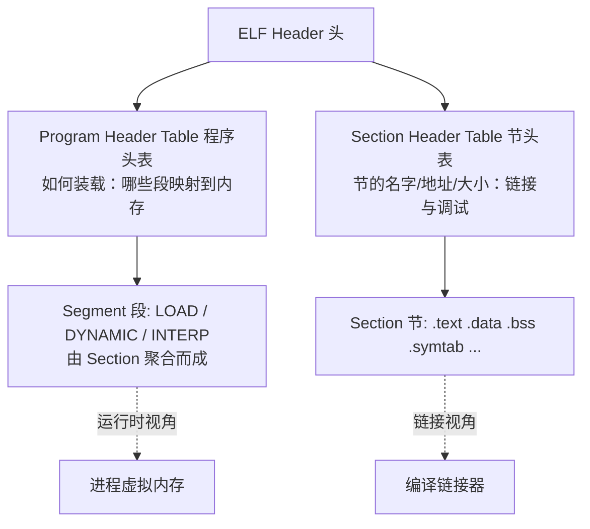

::: abstract 本章定位
从"命令怎么用"进阶到"二进制是什么"：用 `file`/`readelf` 读懂 ELF 头与节，`ldd` 排查动态链接，`objdump`/`nm`/`strings`/`xxd` 拆解可执行文件与字符串，再以 `openssl` 落地加解密与证书，最后用 hash 校验与审计思路确认文件"没被动过"。属 [Bash命令学习路线总览](/kb/os/Bash/00-Bash命令学习路线总览/) 的"安全与逆向"层，承 [高级命令与文本处理](/kb/os/Bash/09-高级命令与文本处理/)、续 [防火墙与网络安全命令](/kb/os/Bash/15-防火墙与网络安全命令/)。
:::

前面的命令操作的都是"文本"，而 `.so`、可执行程序、固件、证书这些是**二进制**——直接 `cat` 会吐出一堆乱码。这一篇交给专门的"解剖工具"：binutils（file/readelf/objdump/nm/strip）管 ELF，openssl 管密码学，coreutils 的 md5sum/sha256sum 管完整性。学会之后，你不仅能"跑程序"，还能**看懂程序、检查程序、质疑程序**。

::: tip 先装工具
本套 ELF 命令主要基于 GNU binutils（`readelf`/`objdump`/`nm` 等），`file`、elfutils、pax-utils、checksec 等是独立工具。macOS 使用 Mach-O 且自带 BSD/LLVM 工具，Homebrew 的 GNU binutils 常带 `g` 前缀或位于 keg-only 路径，不能假设所有命令都叫 `greadelf`；Linux 的最小镜像也可能需要单独安装。
:::

## 1. 文件识别与元数据

### 1.1 `file`：按 magic number 识别真实类型

```bash
file /bin/ls                      # 预期：/bin/ls: ELF 64-bit LSB pie executable ...
file /etc/passwd                  # 预期：ASCII text
file xxx.tar.gz                   # 预期：gzip compressed data, was "xxx.tar", ...
file -i data.bin                  # 预期：application/octet-stream（打印 MIME 类型）
file /usr/bin/python3             # 预期：ELF ... dynamically linked, interpreter /lib64/ld-linux...
```
解读：`file` 不看扩展名，它读取文件**头部若干字节**与 `/usr/share/misc/magic` 里的模式库比对。这个头部魔数就叫 **magic number**：

| 魔数（十六进制） | 对应类型 |
|---|---|
| `7F 45 4C 46` | ELF 可执行文件（"ELF" 三字符） |
| `25 50 44 46` (`%PDF`) | PDF 文档 |
| `89 50 4E 47` (`\x89PNG`) | PNG 图片 |
| `1F 8B 08` | gzip 压缩 |
| `23 21` (`#!`) | 脚本（shebang） |

所以"文件名骗人"在 `file` 面前没用——取证审计第一眼先 `file`。

### 1.2 `stat` 回顾：文件的元数据

```bash
stat /bin/ls
# 预期输出片段：
#   File: /bin/ls      Size: 142144    Access: (0755/-rwxr-xr-x)  Uid: (0/root)
#   Modify: 2024-01-15 ... Change: 2024-01-15 ...
stat -c '%s bytes, %y, %a' /bin/ls    # 自定义格式：大小、mtime、八进制权限
```
解读：`stat` 给的是**文件系统层**的信息（大小、时间戳、权限、inode），`file` 给的是**内容层**的识别。可疑文件先 `file` 看类型、再 `stat` 看时间戳是否与"声称的创建时间"对得上。

### 1.3 `readelf -h`：读 ELF 头

```bash
readelf -h /bin/ls
# 预期输出（节选）：
#   ELF Header:
#     Magic:   7f 45 4c 46 02 01 01 00 00 00 00 00 00 00 00 00
#     Class:                             ELF64
#     Data:                              2's complement, little endian
#     Type:                              DYN (Position-Independent Executable file)
#     Machine:                           Advanced Micro Devices X86-64
#     Entry point address:               0x6010
#     Start of program headers:          64 (bytes into file)
#     Start of section headers:          140112 (bytes into file)
readelf -h /bin/ls | head -8            # 只看前 8 行
```
解读：ELF 头是二进制文件的"总目录"。逐字段对照（呼应 [安全机制](/kb/os/Linux/14-Linux安全机制内核原理/) 中 execve 的装载）：

| 字段 | 含义 | 考点 |
|---|---|---|
| `Magic` | 固定签名 `7f 45 4c 46` + 位数/端序信息 | `02`=64 位，`01`=小端 |
| `Class` | ELF32 / ELF64 | 架构决定 |
| `Type` | `EXEC` 绝对可执行 / `DYN` 共享库或 PIE / `REL` 可重定位目标文件 | **PIE 的 Type 是 DYN** |
| `Entry point` | 进程启动后第一条指令的虚拟地址 | 从这开始执行 |
| `Start of program headers` | 程序头表在文件中的偏移 | 装载用 |
| `Start of section headers` | 节头表偏移 | 链接/调试用 |

## 2. ELF 结构基础

### 2.1 ELF 布局：头 + 两张表

**概念**。一个 ELF 文件由三部分组成（知识来源：《程序员的自我修养》第二章）：



一句话记：**节（Section）是"内容"怎么组织的，段（Segment）是"内容"往内存哪里放**。链接器管节，装载器（内核 + ld.so）管段。

| 视角 | 组织单位 | 谁消费 | 对应表 |
|---|---|---|---|
| 链接视角 | Section（节） | 编译器/链接器/调试器 | 节头表 |
| 装载视角 | Segment（段） | 内核 / 动态装载器 | 程序头表 |

### 2.2 常见节一览

```bash
readelf -S /bin/ls | grep -E '\.(text|data|bss|rodata|symtab|dynamic)'
```
各节职责：

| 节名 | 内容 | 属性 |
|---|---|---|
| `.text` | **可执行代码**（机器指令） | RX |
| `.data` | 已初始化的全局/静态变量 | RW |
| `.bss` | 未初始化全局变量（不占文件，占内存） | RW，文件中仅记录"大小" |
| `.rodata` | 只读常量：字符串、字面量 | R |
| `.symtab` / `.dynsym` | 符号表（函数名/变量名） | 调试与动态链接用 |
| `.dynamic` | 动态链接元数据 | 动态段 |
| `.plt` / `.got` | 过程链接表 / 全局偏移表 | 动态调用跳板 |

::: note `.bss` 的妙处
100MB 的未初始化数组在文件里只占几行"大小记录"，加载时内核按需清零分配——这就是 `ls -lh` 看文件小、但跑起来内存大的原因之一。
:::

### 2.3 PIE 与共享库：为什么 Type 都是 DYN

- **PIE（Position-Independent Executable）**：可重定位可执行文件，装载地址**随机化**（ASLR 的基础），所以现代发行版的 `/bin/ls` Type 是 **DYN** 而不是 EXEC。
- **共享库 `.so`**：同样是 DYN，可被映射到任意地址并共享。

```bash
file /bin/ls /lib/x86_64-linux-gnu/libc.so.6    # 两个都是 ELF ... pie/shared object
```
两者都用相对地址 + 重定位表，加载时由 `ld.so` 决定基址。

### 2.4 `readelf -l`：程序头（装载视角）

```bash
readelf -l /bin/ls | grep -E 'Type|LOAD|INTERP|DYNAMIC' | head -8
# 预期输出（节选）：
#   Type     Offset    VirtAddr   PhysAddr   FileSiz  MemSiz  Flg Align
#   INTERP   0x000318  0x0000000000000318 ...   0x1c    0x1c   R   0x1
#       [Requesting program interpreter: /lib64/ld-linux-x86-64.so.2]
#   LOAD     0x000000  0x0000000000000000 ...   0x1c118 0x1c118 R E 0x1000
#   LOAD     0x01f000  0x000000000001f000 ...   0x16b8  0x3428  RW  0x1000
#   DYNAMIC  0x01f220  0x000000000001f220 ...   0x1f0   0x1f0   RW  0x8
```
解读关键段：

| 段 | 作用 | 考点 |
|---|---|---|
| `LOAD` | 真正要映射进内存的段（代码段 R E / 只读段 R / 数据段 RW） | FileSiz 与 MemSiz 可不同（bss 补零） |
| `INTERP` | 指定**动态装载器路径** `/lib64/ld-linux-x86-64.so.2` | 缺它程序起不来 |
| `DYNAMIC` | 动态段，链接器运行时的"配置表" | 配合 `readelf -d` |
| `PHDR` | 程序头表自身的段 | |

### 2.5 `readelf -s`：符号表

```bash
readelf -s /bin/ls | grep -i 'printf\|main' | head -5
# 预期：符号表条目，含 Bind/Vis/Ndx 列
```
列含义：`Ndx`（符号所在节，`UND`=未定义）、`Bind`（`GLOBAL`/`LOCAL`）、`Type`（`FUNC`/`OBJECT`）。未定义符号说明**由外部库提供**，是分析依赖的入口。

### 2.6 `readelf -d`：动态段，查 NEEDED 依赖

```bash
readelf -d /bin/ls | grep -E 'NEEDED|SONAME|RPATH|RUNPATH'
# 预期：
#   0x0000000000000001 (NEEDED)  Shared library: [libcap.so.2]
#   0x0000000000000001 (NEEDED)  Shared library: [libc.so.6]
```
`NEEDED` 列出**直接依赖**的共享库；`RPATH`/`RUNPATH` 是运行时搜索路径；`SONAME` 是共享库自己的"身份证"。`readelf -d` 比 `ldd` 更"诚实"——它只看文件内容，不实际装载。

### 2.7 `readelf -n`：build-id 与 ELF notes

```bash
readelf -n /bin/ls
readelf -n /bin/ls | grep -A2 -E 'Build ID|NT_GNU_BUILD_ID'
# Displaying notes found in: .note.gnu.build-id
#   Owner                Data size  Description
#   GNU                  0x00000014 NT_GNU_BUILD_ID (unique build ID bitstring)
#     Build ID: 8f3c...a91d
```

`-n/--notes` 读取 `.note.*`/`PT_NOTE`，常见 `NT_GNU_BUILD_ID` 是构建产物标识；发行版调试符号常按它放在 `/usr/lib/debug/.build-id/ab/cdef.debug`，供 gdb/debuginfod 关联调试文件。build-id 不是发布者签名，也不是“文件可信”的证明；二进制被重新链接、strip 或修改后，build-id 可能改变，也可能残留成与内容不一致的旧值，仍需结合包签名和可信基线。

```bash
readelf -n core | grep -E 'NT_PRSTATUS|NT_FILE|Build ID'  # core/notes 中的现场线索
```

不同 binutils/elfutils 对 note 名称的显示略有差异；没有 notes 或 build-id 很正常，尤其是手工链接或旧工具链产物。

## 3. ldd 与动态链接

### 3.1 `ldd`：打印共享库依赖

```bash
ldd /bin/ls
# 预期输出（节选）：
#   linux-vdso.so.1 (0x00007ffc9f1a0000)
#   libcap.so.2 => /lib/x86_64-linux-gnu/libcap.so.2 (0x00007f...)
#   libc.so.6 => /lib/x86_64-linux-gnu/libc.so.6 (0x00007f...)
#   /lib64/ld-linux-x86-64.so.2 (0x00007f...)
```
解读三列：`库名 => 实际路径 (加载基址)`。`linux-vdso.so.1` 是内核虚拟映射的"伪库"无需物理文件；`=> 路径` 是最终解析到的真实库；最后一行是动态装载器本身。某一行显示 `not found`，说明该库不在当前搜索路径里：

```bash
ldd ./myprog     # 预期：libxyz.so.1 => not found
```

::: warning 不要对不信任的 ELF 直接运行 `ldd`
`ldd` 不是纯静态解析器。它通常让动态装载器在 trace 模式下解析目标；历史上的某些实现或某些特殊 ELF/解释器场景会退化为直接执行目标，恶意解释器也可能执行攻击者代码。即使常见 glibc `ldd` 不跳到目标入口点，它仍依赖动态装载器处理目标及其动态元数据，不能把它当作处理恶意样本的安全边界。因此下载样本、未知插件、入侵现场文件应先用不装载目标的 `readelf -d`/`readelf -l` 或 `objdump -p`。必须得到实际解析路径时，在无网络、无敏感文件、低权限的隔离虚拟机中把样本按“可能执行代码”处理；不要用 `LD_TRACE_LOADED_OBJECTS=1 ./sample` 冒充安全替代。
:::

对可信、已经包签名/来源确认的系统程序，`ldd` 很适合定位最终路径；风险对象按以下顺序：

```bash
file sample
readelf -l sample | grep 'Requesting program interpreter'
readelf -d sample | grep -E 'NEEDED|RPATH|RUNPATH|SONAME'
objdump -p sample | grep -E 'NEEDED|RPATH|RUNPATH|INTERP'
# 最后才在隔离环境中：ldd ./sample
```

### 3.2 搜索路径：LD_LIBRARY_PATH / rpath / runpath

装载器找库的顺序（简化且忽略 secure-execution 等例外）：

```text
DT_RPATH（没有 DT_RUNPATH 时）→ LD_LIBRARY_PATH → DT_RUNPATH → /etc/ld.so.cache → 默认目录(/lib,/usr/lib)
```

| 机制 | 设置方式 | 作用范围 | 推荐 |
|---|---|---|---|
| `RPATH` | 编译时 `-Wl,-rpath` 写死进二进制 | 只对该文件 | 弃用（RUNPATH 更可控） |
| `RUNPATH` | 编译时 `-Wl,-rpath` 新版行为 | 只对该文件，**优先级低于**环境变量 | 常用 |
| `LD_LIBRARY_PATH` | 环境变量 | 临时、影响该 shell 下所有程序；secure-exec 通常忽略 | 调试/临时用 |
| 缓存/默认 | `ldconfig` 生成 | 全系统 | 正式安装 |

```bash
LD_LIBRARY_PATH=/opt/myapp/lib ldd ./myprog    # 临时指定库路径再看依赖
```

`RUNPATH` 与 `RPATH` 的继承性和 secure-execution 细节由动态装载器实现；`LD_LIBRARY_PATH` 不能可靠影响 setuid/file-capability 程序，把不可信目录放在前面还会造成库劫持。生产配置优先使用正确 SONAME、受信任系统目录和最小化的 `/etc/ld.so.conf.d`，不要加入用户可写路径。

### 3.3 `ldconfig -p`：看系统库缓存

```bash
ldconfig -p | grep libz      # 预期：libz.so.1 (libc6,x86-64) => /lib/x86_64-linux-gnu/libz.so.1
ldconfig -p | wc -l          # 缓存里共有多少条库记录
```
`ldconfig` 维护 `/etc/ld.so.cache`，把 `/etc/ld.so.conf` 与默认目录扫描建索引。新装库到非标准路径后需 `sudo ldconfig` 刷新缓存。

### 3.4 链接三阶段与静态/动态对比

程序从源码到运行，经历**编译 → 链接 → 装载**：


| 对比项 | 静态链接 | 动态链接 |
|---|---|---|
| 生成物 | 自包含一个二进制 | 可执行文件 + 若干 `.so` |
| 文件大小 / 启动 | 大、快 | 小、稍慢（先载 ld.so） |
| 内存共享 / 升级 | 各进程一份 / 需重编译 | 代码段可共享 / 换 `.so` 即可 |
| 常见例子 | 静态 busybox、容器 init | 绝大多数系统程序 |

```bash
file /bin/ls | grep -o 'dynamically linked'    # 预期：dynamically linked
gcc -static -o /tmp/hello_static hello.c && file /tmp/hello_static
```

### 3.5 缺库报错排查

```bash
./myprog
# 预期错误：
#   ./myprog: error while loading shared libraries: libxyz.so.1:
#   cannot open shared object file: No such file or directory
```
排查路径（呼应 [排查](/kb/os/问题排查/00-系统问题排查方法论/)）：

```bash
readelf -d ./myprog | grep NEEDED   # 1. 不装载目标，先看直接依赖
ldd ./myprog | grep not             # 2. 仅对可信程序定位实际缺库
find / -name 'libxyz.so.1' 2>/dev/null   # 3. 库是否在机器上
LD_LIBRARY_PATH=/找到的目录 ./myprog      # 4. 仅在受控环境临时验证
sudo ldconfig                         # 5. 正式安装后刷新缓存
```

`readelf -d` 只列**直接** `DT_NEEDED`，不展开依赖树；`not found` 还可能来自架构不符、错误 sysroot、RPATH/RUNPATH、glibc-hwcaps 或 secure-execution 规则。先用 `file` 检查目标和库的架构，再按目标发行版安装正确包；不要为了消除报错把任意下载的 `.so` 放进 `/usr/lib`。

## 4. objdump 反汇编

### 4.1 `objdump -d`：反汇编 .text

```bash
objdump -d /bin/ls | head -25
# 预期输出（节选）：
#   /bin/ls:     file format elf64-x86-64
#
#   Disassembly of section .text:
#
#   0000000000006010 <_start>:
#       6010:   31 ed                xor    %ebp,%ebp
#       6012:   49 89 d1             mov    %rdx,%r9
#       6015:   5e                   pop    %rsi
#       6016:   48 89 e2             mov    %rsp,%rdx
#       6019:   48 83 e4 f0          and    $0xfffffffffffffff0,%rsp
```
解读：每行 `地址: 机器码 汇编指令`。`_start` 是程序入口的 C 运行时启动例程（对应 1.3 的 Entry point）：先 `xor` 清寄存器、`and` 对齐栈再跳 `__libc_start_main`。**反汇编让"黑盒"程序变"白盒"**。

### 4.2 `-S` 混排源码、`-t` 符号表、`-R` 重定位、`-h` 节头

```bash
objdump -S myprog            # 源码与汇编混合（需 -g 编译且未 strip）
objdump -t /bin/ls | grep main    # 符号表（object file table）
objdump -R /bin/ls | head -10     # 动态重定位表（.rela.dyn / .rela.plt）
objdump -h /bin/ls | head -20     # 节头表：NAME SIZE VMA LMA File off
```
| 选项 | 含义 | 用途 |
|---|---|---|
| `-d` | 反汇编可执行节 | 看代码逻辑 |
| `-S` | 汇编中插入源码行 | 调试定位 |
| `-t` | 全符号表 | 找函数边界 |
| `-R` | 动态重定位条目 | 分析 GOT/PLT 绑定 |
| `-h` | 节头 | 各节地址/大小/偏移 |

### 4.3 常见汇编速查

| 指令 | 含义 | 示例 |
|---|---|---|
| `push` / `pop` | 压栈 / 弹栈 | `push %rbp` |
| `mov` | 数据搬运（源→目标） | `mov 0x10(%rsp),%rax` |
| `add` / `sub` / `xor` | 算术/清零 | `add $0x8,%rsp` |
| `call` | 调用子程序，压返回地址 | `call printf@plt` |
| `jmp` / `jne` / `je` | 无条件跳转 / 条件跳转 | `jne 0x1234` |
| `lea` | 取地址 | `lea (%rax,%rcx,4),%rdx` |
| `cmp` / `test` | 比较后置标志位 | `cmp $0x1,%eax` |
| `ret` | 返回（弹回调用方地址） | |

::: tip 从反汇编找问题
函数边界看 `push %rbp; mov %rsp,%rbp`（序言）与 `leave; ret`（尾声）；字符串引用找 `lea <地址>` 配合 `strings` 对号入座；程序"卡死/崩溃"，用 `-S` + 行号对照源码逐步核对逻辑分支。
:::

### 4.4 `objdump -T`：动态符号表

```bash
objdump -T /bin/ls | grep printf
# 预期：0000000000000000      DF *UND*  0000000000000000 printf@@GLIBC_2.2.5
```
解读：`DF *UND*` = **动态函数、未定义**，即符号由别的库提供，运行时经 PLT/GOT 间接调用——`objdump -T` 是"这程序对外界依赖了什么"的完整清单。

## 5. nm 与符号

### 5.1 `nm`：列出符号

```bash
nm /bin/ls | head -10          # 预期：地址 + 类型 + 名字
nm -D /bin/ls | head -10       # 只看动态符号（-D / --dynamic）
nm -n /bin/ls | tail -5        # 按地址排序看符号分布
nm -D /bin/ls | grep ' U ' | head -5   # 未定义符号 = 依赖的函数
```
符号类型表（结合 `/bin/ls` 输出解读）：

| 类型 | 含义 | 例子 |
|---|---|---|
| `T` | .text 里的全局文本符号（函数） | `T main` |
| `t` | .text 里的局部符号 | `t local_func` |
| `D` / `d` | 已初始化数据（全局/局部） | `D global_var` |
| `B` / `b` | .bss 未初始化数据 | `B buf` |
| `U` | **未定义**（引用外部提供） | `U printf` |
| `R` / `r` | 只读数据（.rodata） | `R .LC0` |

### 5.2 `nm -C`：C++ 符号还原

```bash
nm myapp | grep _ZN6Logger       # 未加 -C 时是 mangled 名称
nm -C myapp | grep 'Logger::write' # -C/--demangle 后是 Logger::write(char const*)
```
解读：C++ 编译器把类名/重载编码进符号名（name mangling，如 `_Z3fooi` 是 `foo(int)`）。`-C`/`--demangle` 还原成可读形式，逆向 C++ 程序必备。

### 5.3 用 nm 判断函数是否被引用 + strip

```bash
nm app.o | grep -w 'foo'      # 有 T → 已实现；只有 U → 未定义（链接报错）
cp myapp myapp.stripped
strip myapp.stripped && nm myapp.stripped   # 工作副本删除符号后：No symbols
```
`nm` 一个 `.o` 能提前发现"函数声明了没实现"（`U` 且无对应 `T`）。**strip** 删掉 `.symtab`/`.debug_*`，体积变小、逆向更难：

```bash
cp myapp myapp.stripped
strip --strip-all myapp.stripped
ls -lh myapp myapp.stripped                 # 对比原件与副本体积
```
代价：崩溃时无符号可查、反汇编失去函数名。发布版常 strip，调试版保留（呼应 4.2 `-S` 需要未 strip）。

### 5.4 `size`：快速看 text/data/bss 体积

```bash
size app app.o libfoo.a
size -A -x app                    # SysV 格式，按节显示，十六进制
#    text    data     bss     dec     hex filename
#   18432    1024    8192   27648    6c00 app
```

默认 Berkeley 格式中 `text` 近似只读代码/数据，`data` 是已初始化可写数据，`bss` 是零初始化数据；`dec/hex` 是三者之和，不等于磁盘文件大小，也不等于进程 RSS。`-A/--format=sysv` 逐节列大小，`-x/-d/-o` 控制进制。不同链接器、目标格式和 binutils 版本的归类会有差异，做版本回归时应固定工具链并比较同一格式。

### 5.5 `addr2line` / `c++filt`：地址和 C++ 符号还原

```bash
addr2line -e ./app -f -C -p 0x40123a
# crash_handler at /src/crash.cc:42
addr2line -e ./app -a -f -C 0x40123a 0x4012a0
printf '%s\n' '_ZN6Logger5writeEPKc' | c++filt
# Logger::write(char const*)
```

`addr2line -e FILE` 指定 ELF，`-f` 显示函数，`-C` demangle，`-p` 单行美化，`-i` 展开 inline 调用链；无法解析时输出 `??:0`/`??:?`。它需要匹配该 build-id 的 DWARF/debug 文件；对 PIE/共享库崩溃地址，必须先减去运行时映射基址或让调试器处理 ASLR，否则行号会错。不要拿另一次构建的“同版本”二进制硬套地址。

`c++filt` 只做 name demangling，常用 `-n`（不要求 `_` 前缀）和 `-t`（也尝试解码类型）。它不会验证符号是否真的存在于目标里；`nm -C`/`objdump -C` 已能内联完成同类工作，单独 `c++filt` 适合处理日志、core 输出和管道文本。

### 5.6 `ar` / `ranlib`：静态库归档与符号索引

```bash
ar t libfoo.a                         # 列成员，不解包
ar tv libfoo.a                        # 详细列表：权限、UID/GID、大小、时间
ar x libfoo.a foo.o                   # 抽取指定成员到当前目录
ar rcs libfoo.a foo.o bar.o           # r=替换/加入，c=创建，s=写符号索引
ranlib libfoo.a                       # 重建索引，约等于 ar s
nm --print-armap libfoo.a             # 查看 archive symbol table
```

典型 `ar t` 输出是 `foo.o`、`bar.o`；`nm --print-armap` 会显示“符号 → 成员对象”的索引，链接器借此按需抽取 `.o`。GNU `ar` 默认可能启用 deterministic mode（时间/UID/GID 归一化，利于可复现构建）；`ar U` 关闭后会带真实元数据，不利于重现。BSD/macOS `ar`、GNU `ar`、LLVM `llvm-ar` 参数细节不同，跨平台构建优先使用构建系统的 `CMAKE_AR/CMAKE_RANLIB`。抽取不可信归档应在空目录中进行并检查成员名，避免覆盖现有文件。

## 6. ELF 复制、裁剪与修改

::: warning 先复制，再修改
`strip`、`objcopy`、`patchelf`、`chrpath`、`elfedit` 都可能不可逆改变 ELF，导致 build-id 对不上、包管理器完整性校验失败、调试符号失配或发布签名失效。对 `/usr/bin`、共享库和取证样本先只读留存 `sha256sum`、权限、xattr/capabilities，并在工作副本操作；系统包文件优先通过包管理器重装或重建包，不要就地打补丁。
:::

### 6.1 `strip`：分离或删除调试/符号信息

```bash
cp app app.stripped
objcopy --only-keep-debug app app.debug
strip --strip-debug app.stripped          # 删调试节，保留运行需要的动态符号
objcopy --add-gnu-debuglink=app.debug app.stripped
cp libfoo.so libfoo.stripped.so
strip --strip-unneeded libfoo.stripped.so  # 删除重定位不再需要的符号，先测试 ABI
```

`--strip-debug` 只移除调试信息，`--strip-all` 连普通符号也删，`--strip-unneeded` 删除重定位不需要的符号；共享库通常不能随便 `--strip-all`，否则可能破坏动态链接/ABI。常见调试符号分离流程是 `objcopy --only-keep-debug` → strip 副本 → `--add-gnu-debuglink`；最终用 `file`、`readelf -S`、测试套件与 gdb 验证。macOS 使用 `strip`/`dsymutil` 的 Mach-O 流程，不能照搬 GNU ELF 参数。

### 6.2 `objcopy`：复制节、改节与二进制格式转换

```bash
objcopy --dump-section .rodata=rodata.bin app
objcopy --only-section=.text -O binary app text.bin
objcopy --remove-section=.comment app app.nocomment
objcopy --add-section .note.audit=note.bin \
  --set-section-flags .note.audit=readonly,contents app app.noted
```

`--dump-section` 导出节，`--only-section` 只保留目标节，`-O binary` 输出裸字节，`--remove-section` 删除节，`--add-section`/`--set-section-flags` 注入并设置属性。输出文件名与输入不同最安全；即使删除 `.comment` 看似不影响运行，也会改变摘要、偏移和调试关联。不要从未知 ELF 直接假设 section headers 完整：恶意或裁剪 ELF 可能仍可按 program headers 运行，却让节级工具得到不完整视图。

### 6.3 `patchelf` / `chrpath`：修改解释器与 RPATH

`patchelf` 通常不是基础系统默认包，需要单独安装；它能重排 ELF 以容纳更长字段，功能比 `chrpath` 广：

```bash
patchelf --print-interpreter app
patchelf --print-rpath app
patchelf --set-rpath '$ORIGIN/../lib' app.copy
patchelf --set-interpreter /lib64/ld-linux-x86-64.so.2 app.copy
patchelf --replace-needed libfoo.so.1 libfoo.so.2 app.copy
patchelf --remove-rpath app.copy

chrpath -l app
chrpath -r '$ORIGIN/../lib' app.copy
chrpath -d app.copy
```

输出如 `app: RUNPATH=$ORIGIN/../lib`；单引号保护 `$ORIGIN`，让它由动态装载器按二进制所在目录展开，而不是被当前 shell 提前替换。`chrpath` 主要改已有 `DT_RPATH/DT_RUNPATH`，新值通常不能比原槽位更长；`patchelf` 可改 interpreter、SONAME、NEEDED 和 RPATH，但版本间布局处理差异较大。替换 `NEEDED` 只改名字，不保证 ABI 兼容；解释器架构/ABI 错误会让程序完全无法启动。修改后至少运行 `readelf -l/-d`、`file`、隔离环境启动测试和包完整性核验。

### 6.4 `elfedit`：低层 ELF 头编辑，谨慎使用

```bash
cp app app.copy
elfedit --output-type=exec app.copy       # 例：改 e_type；不要对未知目标照做
elfedit --output-mach=x86-64 app.copy     # 只改声明，不会转换机器码
readelf -h app.copy
```

GNU `elfedit` 直接修改 ELF header 的 machine/type/OSABI 等字段；它**不是架构转换器**，把 `e_machine` 从 AArch64 改成 x86-64 只会制造一个声明与指令不一致的坏文件。不同 binutils 版本支持的选项有限，Solaris/其他系统同名工具语法也不同。除修复明确已知的错误元数据、复现加载器测试外，优先由链接器重新生成 ELF；执行前保留原文件和哈希，完成后用 `readelf -h/-l/-d` 全面核验。

## 7. elfutils：更完整的 ELF 与栈信息

`elfutils` 是独立于 GNU binutils 的 Linux ELF 工具集；Debian/Ubuntu 通常安装 `elfutils`，RHEL/Fedora 也使用该包名，命令是否拆包由发行版决定。

```bash
eu-readelf -h ./app
eu-readelf -n ./app | grep -A2 -E 'Build ID|GNU'
eu-readelf -d ./app | grep NEEDED
eu-readelf --debug-dump=info ./app.debug | less

eu-stack -p 1234                         # 读取运行中进程的线程栈
eu-stack -p 1234 -e /opt/app/bin/app     # 指定可执行文件/符号来源
eu-stack -c core -e /opt/app/bin/app    # 分析 core（版本支持时）
```

`eu-readelf` 提供 ELF header、notes、dynamic、DWARF 等读取能力，常用参数有 `-h`、`-l`、`-S`、`-s`、`-d`、`-n`、`--debug-dump=info|decodedline`；输出含义与 `readelf` 相近，但实现和兼容性不同。`eu-stack` 输出形如 `#0  0x... in function (...) from ...so`，可用于快速收集每个线程的调用栈；它需要 ptrace 权限，优化/strip 二进制只能得到地址或动态符号。对入侵现场不要让工具连接网络下载 debuginfod，先保存样本、core 和 build-id，再在隔离分析机补符号。

### 7.1 `eu-readelf` / `readelf` / `objdump` 的选择

| 任务 | 首选 | 说明 |
|---|---|---|
| 不执行目标看直接依赖 | `readelf -d` / `eu-readelf -d` | 读 `DT_NEEDED`，不解析最终路径 |
| 看 build-id/notes | `readelf -n` / `eu-readelf -n` | elfutils 对调试信息支持更强 |
| 反汇编、动态重定位 | `objdump -d/-R` | binutils 常用 |
| 快速进程栈 | `eu-stack` | 需要目标进程或 core 的访问权限 |

命令输出不能跨实现逐字比较；审计记录应保留工具版本 `readelf --version`/`eu-readelf --version` 和输入文件摘要。

## 8. strings 与字符串

### 8.1 基础用法

```bash
strings /bin/ls | head -15            # 预期：/bin/ls 里可读的字符串（usage、选项、错误信息）
strings /bin/ls | grep -i 'usage'     # 找提示信息
strings myprog | grep '/etc/'         # 找配置文件路径
strings binary | grep -i 'password\|secret\|flag'   # 找隐藏凭据/flag
strings -n 6 /bin/ls | head           # -n：只打印长度≥6 的字符串（过滤噪声）
strings -a file.dat | head            # -a：扫描整个文件（默认只扫可装载段）
```

### 8.2 常见用途

| 场景 | 命令组合 | 为什么有效 |
|---|---|---|
| 定位配置文件路径 | `strings daemon \| grep -E '^/\\|/etc'` | 路径通常存于 .rodata |
| 找隐藏 URL/flag | `strings -a app \| grep -iE 'https?://\|flag'` | 常量明文编入 |
| 确认程序版本 | `strings -a /usr/bin/vim \| grep 'VIM - Vi'` | 版本号是字符串 |
| 粗判是否被植入 | `strings -a suspicious \| grep -iE 'reverse\|connect'` | 木马特征常现于字符串 |

### 8.3 `strings -e` 编码与组合审计

```bash
strings -e l -a utf16.bin | head   # -e l：按 UTF-16LE 解码（GNU strings）
file suspicious.bin && strings -a suspicious.bin | head   # 类型 → 线索 连查
```
恶意样本常用 UTF-16 混淆字符串，GNU `strings -e l` 可尝试解码 little-endian 16-bit 字符串；`S` 在 GNU strings 中表示 8-bit 字符，不能写成 UTF-16LE。不同 BSD/LLVM 实现的 `strings -e` 选项可能不同，先查 `strings --help`。**典型组合审计**：`file`（类型）→ `strings`（线索）→ `hexdump`（字节）三段连查。

## 9. hexdump / xxd

### 9.1 `hexdump -C`：规范十六进制视图

```bash
hexdump -C /bin/ls | head -5
# 预期：
#   00000000  7f 45 4c 46 02 01 01 00  00 00 00 00 00 00 00 00  |.ELF............|
#   00000010  02 00 3e 00 01 00 00 00  10 60 00 00 00 00 00 00  |..>......`......|
```
解读：左侧偏移、中间 16 字节（8+8 分组）、右侧 ASCII。第 0 字节 `7f 45 4c 46` 正是 1.1 的 ELF 魔数——**hexdump 是把"字符串/魔数"落回字节层面的底牌**。

| 参数 | 作用 | 例子 |
|---|---|---|
| `-C` | 规范格式：hex + ASCII 对照 | `hexdump -C` |
| `-x` | 按 2 字节十六进制字（little-endian）输出 | `hexdump -x file` |
| `-s <偏移>` | 从文件偏移处开始 | `hexdump -C -s 0x100 file` |
| `-n <长度>` | 只读前 n 字节 | `hexdump -C -n 64 file` |

### 9.2 `xxd`：更直观的十六进制工具

```bash
xxd /bin/ls | head -3               # 与 hexdump -C 类似
xxd -l 16 /bin/ls                   # 只读 16 字节（-l = length）
xxd -s 0x100 -l 32 file.bin         # 偏移 0x100 起 32 字节
xxd -r file.hex > file.bin          # -r：hex 还原成二进制（反转）
xxd -i /bin/ls | head -5            # -i：导出 C 数组（嵌入式常用）
```
`xxd -r` 配合 `xxd` 输出可实现"十六进制 ↔ 二进制"互转，是改字节、拼固件的利器；`-i` 生成 `unsigned char xxx[]` 数组，可直接嵌入 C 源码。

### 9.3 指定区域查看 + 与 strings 对比

```bash
readelf -l /bin/ls | grep -A1 'LOAD'            # 先确认虚拟地址与文件偏移映射
xxd -s 0x6010 -l 64 /bin/ls                    # 仅当 0x6010 确实是文件偏移时才这样读
```
ELF 的 `Entry point` 是虚拟地址，不一定等于文件偏移；PIE/共享库更不能直接拿入口地址给 `xxd -s`。要从入口反查文件偏移，应根据包含它的 `PT_LOAD` 的 `p_offset + (entry - p_vaddr)` 计算，且需确认地址落在该段范围内；分析复杂 ELF 让 `objdump -d --start-address/--stop-address` 或专业解析器处理更可靠。
::: tip 什么时候用哪个
想知道"写了什么字符串"用 `strings`；想知道"字节到底怎么存的"用 `hexdump -C`/`xxd`；想直接改字节拼回去用 `xxd -r`。
:::

## 10. openssl 深入

::: warning 环境提醒
macOS 自带 LibreSSL，部分命令（如 `s_client` 输出）有差异；建议 `brew install openssl` 后用 `openssl version` 确认。低版本 OpenSSL 中 `genrsa`/`enc` 的默认算法与推荐值不同，命令里均显式指定算法。
:::

### 10.1 `openssl dgst`：消息摘要

```bash
openssl dgst -sha256 /bin/ls | head -1
# 预期：SHA256(/bin/ls)= 8a1a...（64 位十六进制）
openssl dgst -md5 /etc/hosts | head -1        # 32 位十六进制
openssl dgst -sha512 /etc/hosts | head -1     # 128 位十六进制
```

| 算法 | 摘要长度 | 现状 |
|---|---|---|
| MD5 | 128 bit / 32 hex | **已破**，仅完整性非对抗场景 |
| SHA-1 | 160 bit / 40 hex | 已破（碰撞），弃用 |
| SHA-256 | 256 bit / 64 hex | 推荐 |
| SHA-512 | 512 bit / 128 hex | 推荐（64 位平台更快） |

### 10.2 `openssl rand`：随机数

```bash
openssl rand -hex 16          # 32 位十六进制随机串（16 字节）
openssl rand -base64 24       # base64 编码
```
用途：生成密钥、密码盐、token，比 `$RANDOM`（可预测）安全。

### 10.3 `openssl enc`：对称加解密

```bash
echo 'top secret' > secret.txt
openssl enc -aes-256-cbc -salt -pbkdf2 -in secret.txt -out secret.bin   # 提示输入密码
openssl enc -d -aes-256-cbc -salt -pbkdf2 -in secret.bin -out plain.txt
cat plain.txt    # 预期：top secret
```
参数：`-aes-256-cbc` 指定算法与模式；`-salt` 加随机盐防彩虹表；`-pbkdf2` 用 PBKDF2 从密码派生出密钥（**强烈建议**）；`-d` 解密；文本场景加 `-base64` 输出可打印字符。解密时算法/密码/盐必须完全一致，否则报 `bad decrypt`。

::: warning `openssl enc -aes-256-cbc` 不提供认证
CBC 加密只能隐藏内容，不能可靠检测主动篡改；`bad decrypt` 也不是完整性证明。OpenSSL `enc` 不支持 GCM/CCM 这类 AEAD 流程，长期文件/消息加密优先使用 age、GPG 或能正确管理 nonce/tag 的成熟协议工具。若因兼容性必须用 `enc`，至少独立使用强 MAC 并采用 encrypt-then-MAC 设计，不要临时拼接自创协议。
:::

### 10.4 `openssl genrsa` / `genpkey` 与 `rsa` / `pkey`

```bash
openssl genrsa -out priv.pem 2048                # 生成 2048 位 RSA 私钥
openssl genpkey -algorithm RSA -out priv2.pem -pkeyopt rsa_keygen_bits:2048   # 新版推荐
openssl rsa -in priv.pem -text -noout | head -15    # 查看私钥结构（模数/指数）
openssl rsa -in priv.pem -pubout -out pub.pem       # 从私钥导出公钥
openssl pkey -in priv.pem -pubout -out pub2.pem     # 通用接口（兼容 EC/RSA）
cat pub.pem   # 预期：-----BEGIN PUBLIC KEY-----
```
`genrsa` 是老式 RSA 专属生成器；`genpkey` 是新通用接口，支持 RSA/EC 等。`rsa` 是 RSA 专属工具，`pkey` 是通用密钥工具——看结构、导出公钥、改保护密码都用它们。

### 10.5 `openssl req`：生成证书签发请求 CSR

```bash
openssl req -new -key priv.pem -out server.csr \
  -subj "/C=CN/O=Example/CN=www.example.com"
head -1 server.csr   # 预期：-----BEGIN CERTIFICATE REQUEST-----
openssl req -in server.csr -text -noout | head -20   # 查看 CSR 内容
openssl req -x509 -new -key priv.pem -days 365 -out selfsigned.crt \
  -subj "/CN=localhost"     # 直接生成自签名证书（免 CA）
```
CSR 是"申请证书的材料"：把公钥 + 主体信息（国家/组织/CN）交给 CA 签名；自签名证书 `req -x509` 适合本地测试。

### 10.6 `openssl x509`：证书查看与有效期

```bash
openssl x509 -in server.crt -text -noout | head -30
# 预期：Subject/Issuer/Not Before/Not After/Signature Algorithm...
openssl x509 -in server.crt -noout -subject -issuer -dates   # 关键字段一行看
openssl x509 -in server.crt -noout -enddate                  # 只看过期时间
openssl x509 -in server.crt -noout -fingerprint -sha256      # 指纹（防篡改比对）
```
```
Subject: CN = www.example.com
Issuer: C = US, O = Let's Encrypt...
Not Before: Jan  1 00:00:00 2026 GMT   Not After: Jan  1 00:00:00 2027 GMT
```

### 10.7 `openssl s_client`：测试 TLS 连接、看证书链

```bash
echo | openssl s_client -connect example.com:443 -servername example.com -showcerts 2>/dev/null | grep -E 'subject|issuer'
# 预期：subject=CN=www.example.org / issuer=CN=Let's Encrypt...
openssl s_client -connect host:port -verify_hostname hostname 2>&1 | grep 'Verify return code'
# 预期：Verify return code: 0 (ok)
```
参数：`-connect host:port` 目标；`-servername` SNI（多证书主机必需）；`-showcerts` 打印证书链；`-verify_hostname` 校验主机名。`Verify return code: 0` 表示证书链验证通过。

### 10.8 `openssl verify`：验证证书

```bash
openssl verify -CAfile ca.pem server.crt       # 按指定信任根验证链
openssl verify -CAfile selfsigned.crt selfsigned.crt  # 明确把自签证书当信任锚
```
默认 `openssl verify server.crt` 使用系统/编译时信任库（具体路径与版本相关），只适合证书链能接到该信任库的证书；自签证书若不显式作为 `-CAfile`/`-CApath` 信任锚，通常会报 `self-signed certificate`。报 `unable to get local issuer certificate` 表示链缺中间证书或信任根；“链能验证”也不等于主机名匹配，TLS 客户端还需验证 SAN/hostname（呼应 [密码学](/kb/os/安全/02-身份认证与密码学基础/) 的信任链模型）。

### 10.9 哈希验证呼应

```bash
echo -n 'hello' | openssl dgst -sha256
# 预期：SHA2-256(stdin)= 2cf24dba5fb0a30e26e83b2ac5b9e29e1b161e5c1fa7425e73043362938b9824
sha256sum <(echo -n 'hello')     # 与上面一致则殊途同归
```
`openssl dgst` 与 `sha256sum` 计算同一算法应得同一摘要——同一数学、不同入口。

## 11. 完整性校验与安全审计

### 11.1 md5sum / sha256sum：生成与校验

```bash
sha256sum /bin/ls            # 预期：<64位hex>  /bin/ls
sha256sum *.iso > CHECKSUMS.sha256     # 批量生成清单
sha256sum -c CHECKSUMS.sha256          # 按清单校验
# 预期：bin.iso: OK  （篡改后：bin.iso: FAILED）
```
为什么校验下载文件：网络劫持/镜像污染可能让"下载的"与"官方的"不一致。流程：官方给摘要 → 本地 `sha256sum` 比对 → 一致才安装。

| 命令 | 场景 | 强度 |
|---|---|---|
| `md5sum` | 磁盘拷贝一致性、去重 | 弱（可碰撞） |
| `sha1sum` | 兼容旧脚本 | 弱 |
| `sha256sum` | 软件分发校验 | **推荐** |
| `sha512sum` | 高安全要求 | 强 |

### 11.2 GPG 校验（简述）

```bash
gpg --import publisher.asc                # 导入发行方公钥
gpg --verify software.sig software.tar.gz # 预期：gpg: Good signature from ...
```
hash 校验只证明"文件没变"，GPG 签名还能证明"发布者是谁"（私钥持有者）。下载软件优先看官方是否给 `.sig`。

### 11.3 二进制是否被篡改：file + sha256sum + strings 组合审计

```bash
file /usr/bin/sshd              # 1. 类型、链接方式是否异常（如变脚本）
sha256sum /usr/bin/sshd         # 2. 与可信基线/包内容比对，不能替代签名
strings -a /usr/bin/sshd | grep -iE 'bash|/bin/sh|reverse|ncat'   # 3. 是否混入可疑命令
rpm -V openssh-server 2>/dev/null || debsums -c openssh-server 2>/dev/null  # 4. 包管理器校验
```
审计套路：**来源/签名 → 类型 → 哈希 → ELF 属性/依赖 → 字符串 → 包校验**；哈希清单自身未签名时只能证明与清单一致，不能证明清单可信（呼应 [安全机制](/kb/os/Linux/14-Linux安全机制内核原理/)）。

### 11.4 `checksec`：汇总 ELF 加固特征

`checksec` 往往不是最小系统默认命令，Debian/Ubuntu 可安装 `checksec`，RPM 发行版的软件源/版本差异较大；也存在同名的 Go 实现，参数和输出不完全相同。

```bash
checksec --file=/usr/bin/ssh
checksec --dir=/usr/local/bin
checksec --proc=1234                    # 进程模式：检查映射/加固（实现支持时）
# RELRO           STACK CANARY      NX            PIE             RPATH RUNPATH Symbols FORTIFY
# Full RELRO      Canary found      NX enabled    PIE enabled     No    No      No      Yes
```

| 字段 | 理想结果 | 解读与边界 |
|---|---|---|
| RELRO | Full RELRO | GOT 重定位后只读；Partial 只保护一部分 |
| Canary | found | 栈破坏检测，不能阻止所有越界 |
| NX | enabled | 栈通常不可执行；JIT/映射和 ROP 仍是其他问题 |
| PIE | enabled | 主程序可随机装载，需系统 ASLR 配合 |
| RPATH/RUNPATH | 无不可信路径 | `$ORIGIN` 不必然危险，要看目录是否可写 |
| FORTIFY | 有并实际 fortified | 依赖编译优化、libc 与受保护函数覆盖率 |

`checksec` 是静态/启发式汇总：全绿不代表没有漏洞，缺某项也不自动等于可利用。脚本中先记录 `checksec --version`，不要跨不同实现逐列硬比较；对 setuid、file capabilities 和高权限服务，还要结合文件权限、依赖搜索路径、运行时 seccomp/LSM 与业务输入面。

### 11.5 `scanelf`：批量扫描 ELF 头、依赖与搜索路径

`scanelf` 来自 `pax-utils`，常用于发行版构建、rootfs 和容器镜像的批量静态检查：

```bash
scanelf -n /usr/bin/ssh                  # NEEDED 依赖
scanelf -i /usr/bin/ssh                  # ELF interpreter
scanelf -r /opt/app/bin/app              # RPATH/RUNPATH
scanelf -e /usr/bin/ssh                  # GNU_STACK 标记
scanelf -R -n /opt/app                   # 递归扫描目录
scanelf -qR -r /opt/app                  # quiet：通常只显示可疑/非空结果
```

典型输出含 `TYPE`、`FILE`、`NEEDED`、`RPATH`、`STK/REL/PTL` 等列：`ET_DYN` 可能是 PIE 或共享库，不能只凭类型下结论；`RWX` GNU_STACK、可写目录中的 RPATH/RUNPATH、意外解释器和未知 NEEDED 都值得复核。`-R` 递归，`-n` 依赖，`-i` interpreter，`-r` 运行时搜索路径，`-e` GNU_STACK；不同 pax-utils 版本的 quiet 判定和列名会变化，自动化宜使用本机支持的 `-F/--format` 并固定版本。

`scanelf` 读取 ELF，不解析库的最终落盘路径，也不会执行目标；适合不信任样本的第一轮清单。但解析器本身仍可能有漏洞，恶意文件应在受限分析环境处理，并保留原始摘要。

### 11.6 `getfattr/setfattr`：扩展属性查看与受控修改

```bash
getfattr -d file                        # 默认主要显示 user.*
getfattr -d -m - --absolute-names file # 匹配所有 namespace，保留绝对路径
getfattr -n security.selinux file       # 查看指定属性（存在时）
getfattr -n security.capability -e hex /usr/bin/ping

setfattr -n user.audit-note -v 'ticket-1234' file
setfattr -x user.audit-note file
```

输出示例：

```text
# file: usr/bin/ping
security.capability=0sAQAAAgAgAAAAAAAAAAAAAAAAAAA=
security.selinux="system_u:object_r:ping_exec_t:s0"
```

`-d` dump，`-m PATTERN` 选择属性名（`-m -` 匹配全部），`-n` 指定名称，`-e hex|base64|text` 控制编码；`setfattr -n/-v` 设置，`-x` 删除。`user.*` 通常由文件属主写，`security.*`/`trusted.*` 常需特权且受 LSM/文件系统约束。不要用 `setfattr` 手写 `security.capability` 或 SELinux 标签：前者应使用 `setcap`，后者用 `restorecon`/`semanage fcontext`，否则容易制造不可解释或会被策略覆盖的元数据。

xattr 可能因文件系统/挂载选项不支持而报 `Operation not supported`；普通 `cp`、tar、备份和跨文件系统传输也可能丢失 xattr、ACL 和 capabilities。取证/迁移应分别保存摘要与元数据，并用支持 xattr/ACL 的选项验证恢复结果。

### 11.7 `getfacl/getcap`：ACL 与 file capabilities 审计

```bash
getfacl -p /usr/local/bin/app             # -p 保留绝对路径
getfacl -e /srv/share/report              # 显示 effective 权限注释
getfacl -R -p /opt/app > /tmp/app.acl     # 递归导出，注意敏感路径和体积

getcap /usr/bin/ping
getcap -r /usr /opt 2>/dev/null           # 递归查 file capabilities
getcap -n /usr/bin/ping                    # 显示 namespaced root UID（实现支持时）
# /usr/bin/ping cap_net_raw=ep
```

ACL 中的 `mask::` 是命名用户和组类权限上限，不能只看 `user:alice:rwx`；`getfacl -e` 会显示 `#effective:`。capability 输出的 `=ep` 表示 permitted/effective 集，`cap_sys_admin`、`cap_dac_override`、`cap_setuid` 等高权能力必须有明确业务理由。`getcap -r /` 可能跨入伪文件系统、网络挂载并产生大量错误，审计时限制到本地系统目录并结合 `findmnt`。

这里只做查看与风险解读；ACL/capabilities 的授权操作见 [权限与用户管理](/kb/os/Bash/04-权限与用户管理/)，内核能力集合与安全模型见 [Linux 安全机制内核原理](/kb/os/Linux/14-Linux安全机制内核原理/)。

### 11.8 `rpm -V` / `debsums`：包文件完整性基线

```bash
rpm -V openssh-server                       # 单包；无输出表示未发现差异
sudo rpm -Va                                # 全系统，输出可能很多
rpm -Vf /usr/sbin/sshd                      # 按文件所属包校验

debsums -c openssh-server                   # 摘要变化
debsums -m openssh-server                   # 缺失文件
debsums -ca                                 # 全包并包含配置文件
```

RPM 输出 `S M 5 D L U G T P` 分别代表大小、模式、摘要、设备、链接、属主、属组、mtime、capabilities，后续 `c` 表示配置文件；Debian 的 `debsums` 主要核对包提供的 MD5 清单，部分包没有清单，且配置文件默认处理方式需看参数。程序文件异常通常比已登记配置变化更可疑，但任何结果都要与变更单、配置管理和已知基线核对。

这两类工具信任**本机包数据库和工具本身**。主机已被完全攻陷时，攻击者可同时篡改数据库或命令；严格取证应从可信只读介质启动，用可信包/仓库签名重建基线，并先采集现场再考虑 `--reinstall`。完整包命令和签名链见 [包管理与软件安装](/kb/os/Bash/14-包管理与软件安装/)。

### 11.9 `auditctl` / `ausearch` / `aureport`：从静态状态追到谁改过

```bash
sudo auditctl -l                               # 当前内核审计规则
sudo ausearch -f /usr/bin/ssh -i               # 按文件查事件，-i 解码 UID/时间
sudo ausearch -k binary_watch -ts today -i     # 按规则 key 和时间查明细
sudo aureport -f -i                            # 文件事件汇总
```

`getfattr/getfacl/getcap/rpm -V` 回答“现在是什么”，auditd 记录可回答“谁、何时、通过哪个进程改过”。本篇只提供取证入口；如何用 `auditctl -w/-a` 建规则、持久化到 `/etc/audit/rules.d/*.rules`、解释 `ausearch` 多记录事件和 `aureport` 报告，见 [安全防御与审计](/kb/os/安全/05-安全防御与审计/) 与 [Linux 安全实操](/kb/os/Linux/06-Linux安全权限与审计/)。运行时临时规则重启会丢，`auditctl -e 2` 又会使规则到重启前不可变，生产环境必须按变更流程操作。

### 11.10 可疑脚本/二进制排查思路

```bash
file suspicious.bin && head -c 200 suspicious.bin        # 是不是文本还是真 ELF
strings -a suspicious.bin | grep -iE 'curl|wget|ssh|base64|/tmp'   # 下载/外联特征
ls -la /tmp /dev/shm 2>/dev/null                          # 木马常藏匿目录
ps aux | grep -iE '/(tmp|dev/shm|\.hidden)'               # 可疑进程路径
```
高发藏匿点：`/tmp`、`/dev/shm`、`/var/tmp`、home 目录隐藏点开头的文件；进程常伪装成常见名（`[kworker]`、`syslog` 等）——用 `ps -eo pid,cmd` 看**完整路径**而非只看名字。

### 11.11 crontab 与开机项审计

```bash
crontab -l 2>/dev/null          # 当前用户计划任务
sudo cat /etc/crontab           # 系统计划任务
ls /etc/cron.d/ /etc/cron.daily/ 2>/dev/null   # cron 目录
ls /etc/init.d/ /etc/systemd/system/ 2>/dev/null   # 开机脚本
systemctl list-unit-files --state=enabled | head   # systemd 开机自启清单
grep -rE '^@reboot|^@weekly' /etc/cron* ~/ 2>/dev/null   # 找重启触发
```
审计重点：新增了谁？指向的文件存不存在？被篡改的开机项往往是**持久化**的手段——杀完进程重启又回来（呼应 [安全防御](/kb/os/安全/05-安全防御与审计/) 的持久化检测）。

### 11.12 常见入侵手法与检测入口

| 手法 | 表现 | 检测 |
|---|---|---|
| 进程伪装 | 进程名仿系统服务，路径却隐藏 | `ps aux` 看**全路径**与 `readlink /proc/PID/exe` |
| 开机自启 | crontab/systemd 增加项 | 11.11 的 cron 与 systemd 审计 |
| 文件隐藏 | 隐藏点文件名、藏 /tmp | `ls -la`、`find / -name '.*'` 异常 |
| 外联回连 | 反向 shell、心跳连接 | `ss -tnp`、`lsof -i` |
| 替换系统命令 | `ls`/`ps` 被换成后门版本 | 包校验 `rpm -V`/`debsums`、可信静态工具交叉比对 |

::: important 审计的前提是"干净"
被入侵后，系统自带的 `ls`/`ps`/`ldd` 可能都被替换。用挂载的**只读 Live USB** 或静态编译工具（busybox -static）做取证，结论才可信。
:::

## 本章小结

1. **ELF 静态读取**：`file` 认 magic/type，`readelf -h/-l/-S/-s/-d/-n` 分别看头、段、节、符号、直接依赖和 build-id；build-id 是构建标识，不是可信签名。
2. **不信任 ELF 禁止直接 `ldd`**：先 `readelf -l/-d` 或 `objdump -p` 静态查看 interpreter、NEEDED、RPATH/RUNPATH；`ldd` 只对可信文件使用，未知样本若必须解析最终依赖应进低权限、无网络隔离环境。
3. **反汇编与符号**：`objdump -d/-S/-R/-T` 看指令、源码混排、重定位和动态符号；`nm` 的 T/D/B/U 区分代码、数据、bss 和外部符号，`addr2line` 按匹配 build-id 的调试信息还原行号，`c++filt` 只做 demangle。
4. **静态库与体积**：`ar` 管 archive 成员，`ranlib` 重建符号索引，`size` 比较 text/data/bss；`eu-readelf` 深读 DWARF/notes，`eu-stack` 从进程或 core 快速取栈。
5. **ELF 修改只动副本**：`strip`/`objcopy` 裁剪或导出节，非默认的 `patchelf` 和 `chrpath` 改 interpreter/RPATH，`elfedit` 只改低层声明；都可能破坏签名、build-id、包校验或 ABI，不能把改 `e_machine` 当架构转换。
6. **字符串与字节**：GNU `strings -a/-n/-e l` 做全文件、长度和 UTF-16LE 扫描；`hexdump`/`xxd` 看文件偏移。ELF entry 是虚拟地址，必须通过 `PT_LOAD` 换算后才能当文件偏移。
7. **密码学入口**：SHA-256/512 用于摘要，GPG/可信签名验证发布者；OpenSSL 管密钥、CSR、证书和 TLS。`enc -aes-256-cbc` 即使带 salt/PBKDF2 也没有认证，不适合新协议。
8. **加固扫描是线索**：`checksec` 汇总 RELRO/Canary/NX/PIE/FORTIFY，`scanelf` 批量查 interpreter、NEEDED、RPATH 和 GNU_STACK；全绿不代表无漏洞，命中也需结合权限和运行环境判断。
9. **权限元数据与完整性**：`getfattr/getfacl/getcap` 分查 xattr、ACL、file capabilities，`rpm -V`/`debsums` 对比本机包数据库；这些数据库和命令本身必须可信。
10. **静态状态 + 审计证据**：`auditctl` 建规则、`ausearch` 查明细、`aureport` 汇总的完整用法交叉链接到安全审计笔记；入侵主机最终要回到可信只读介质、远程日志和先采证后修复原则。

## 动手实验

1. **ELF 基线**：对可信 `/bin/ls` 依次运行 `file`、`readelf -h/-l/-d/-n`，记录 Type、INTERP、NEEDED 和 Build ID；说明哪些是虚拟地址、哪些只列直接依赖。
2. **安全依赖检查**：复制 `/bin/ls` 到实验目录，将其当未知样本，仅用 `readelf -l/-d`、`objdump -p` 列解释器/依赖，再对已确认可信的原 `/bin/ls` 运行 `ldd`，比较直接依赖与完整树；不得从网络下载未知 ELF 来练习。
3. **符号与地址**：编译带 `-g -O0` 的小程序，用 `nm -C`、`objdump -S`、`addr2line -e app -f -C` 还原一个函数地址；复制后 `strip --strip-debug`，比较 `size`、`readelf -S` 和行号结果。
4. **静态库**：把两个 `.o` 用 `ar rcs libdemo.a` 归档，运行 `ar t/tv`、`nm --print-armap`、`ranlib`；在空目录抽取成员并验证摘要，不在原工作树直接 `ar x`。
5. **ELF 副本修改**：只在副本上用 `objcopy --dump-section` 导出 `.rodata`，用 `patchelf --print-rpath`/`chrpath -l` 查看；若工具可用，设置 `$ORIGIN/../lib` 后用 `readelf -d` 核验，再删除副本。不要改系统包文件。
6. **加固与元数据**：对一个可信程序运行 `checksec --file`、`scanelf -n -i -r -e`、`getfattr -d -m -`、`getfacl -p`、`getcap`，逐项区分“无输出”“未启用”“工具不支持”和“存在风险”。
7. **包完整性**：选一个未修改系统包，Debian 用 `debsums -c`，RPM 用 `rpm -V`；复制其中一个普通文件后修改副本并用 `sha256sum` 对比，绝不为了实验修改 `/usr/bin`。
8. **证书与摘要**：生成自签证书，用 `openssl verify -CAfile c.pem c.pem` 明确信任锚，再用 `x509 -dates` 查看期限；运行一次 CBC 加解密实验，并说明为何 salt/PBKDF2 仍不能提供篡改认证。
9. **elfutils 与审计入口**：若已安装 elfutils，用 `eu-readelf -n` 对比 GNU readelf 输出；在测试进程上用 `eu-stack -p`。只读执行 `auditctl -l`，再按交叉链接的安全笔记在测试机建立、查询并清理临时规则。

## 自测题

1. 为什么现代系统里 `file /bin/ls` 显示的是 DYN 而不是 EXEC？
2. `readelf -l` 里的 `INTERP` 段写了什么？它被删掉会怎样？
3. 为什么不信任 ELF 不能直接运行 `ldd`？安全的检查顺序是什么？
4. `nm` 输出里 `T`、`D`、`B`、`U` 分别代表什么？哪个说明"依赖外部"？
5. 已 strip 的二进制为什么 `objdump -S` 看不到源码？用什么命令替代排查？
6. GNU `strings` 怎么做全文件扫描？UTF-16LE 字符串用什么参数？
7. `openssl enc` 为什么要用 `-salt -pbkdf2`？`openssl x509 -in c.pem -noout -enddate` 看什么？
8. `sha256sum -c` 能证明文件"没被篡改"吗？它和 GPG 校验有什么区别？
9. `ar` 与 `ranlib` 分别做什么？`size` 的 bss 为什么不等于磁盘占用？
10. `addr2line` 对 PIE 崩溃地址为何不能直接查？build-id 在这里有什么作用？
11. `patchelf --replace-needed` 为什么不能证明两个库 ABI 兼容？`elfedit --output-mach` 为什么不是架构转换？
12. checksec 显示 Full RELRO、Canary、NX、PIE 全开，能否证明程序没有可利用漏洞？
13. `getfattr`、`getfacl`、`getcap`、`rpm -V`/`debsums` 各查看哪一层状态？

<details><summary>参考答案</summary>

1. 因为现代发行版默认启用 **PIE**（位置无关可执行文件），配合 ASLR 使装载地址随机化，安全加固；PIE 与共享库一样在 ELF 头 Type 里记为 DYN。
2. `INTERP` 段写的是**动态装载器路径**，如 `/lib64/ld-linux-x86-64.so.2`。它是动态程序启动的前置步骤，缺失则 exec 后无法解析符号/装载依赖，程序起不来。
3. `ldd` 可能调用 ELF 声明的解释器，某些实现/特殊 ELF 场景会执行任意代码，因此不能对未知样本直接运行。先 `file`，再用 `readelf -l` 查 INTERP、`readelf -d` 或 `objdump -p` 查直接 NEEDED/RPATH/RUNPATH；只有来源可信时才用 `ldd` 看完整解析，未知样本若必须动态解析则进入低权限、无网络隔离环境。
4. `T`=text 段函数（全局文本符号）、`D`=已初始化数据、`B`=bss 未初始化数据、`U`=未定义（由外部库提供）。`U` 说明依赖外部。
5. strip 删掉了 `.symtab` 与调试节，`-S` 的源码信息（DWARF）也没了。改用 `objdump -d`（无函数名纯汇编）、`objdump -T`（动态符号）、`strings` + 交叉引用，或从开发侧保留未 strip 的版本。
6. GNU `strings -a` 全文件扫描；UTF-16LE 用 `strings -e l -a`。其他实现参数可能不同，应先查本机帮助。
7. `-salt` 加随机盐，使相同密码加密结果不同、并防彩虹表预计算；`-pbkdf2` 用 PBKDF2 从密码慢速派生密钥，避免直接用弱密码做密钥。`-enddate` 输出证书过期时间，用于"证书是否还有效"检查。
8. 只能证明**文件内容与清单一致**（完整性），但清单本身可能是伪造的——若 `-c` 用的是可信来源的官方清单则足够。GPG 用签名者的私钥做数字签名，能同时证明**发布者身份**与内容完整，防中间人替换清单。
9. `ar` 创建/增删/抽取 archive 成员，`ranlib` 写或重建供链接器查找的符号索引。bss 是零初始化内存，ELF 通常只记录大小、装载时再分配清零，所以不按同样大小占磁盘。
10. PIE/共享库运行地址包含 ASLR load bias，需先减去映射基址得到相对虚拟地址；还必须使用与 core/地址完全匹配的调试信息。build-id 用来关联对应构建的 debug 文件，但本身不是签名。
11. `replace-needed` 只改依赖字符串，函数、符号版本、结构布局和语义都可能不兼容；`elfedit` 只改 ELF header 声明，不会重写机器指令，两者都可能制造可装载失败或运行错误的文件。
12. 不能。它们降低若干利用路径，但不发现业务漏洞、逻辑缺陷、堆破坏、JIT 映射、错误权限或供应链问题；checksec 是加固清单，不是漏洞证明。
13. `getfattr` 看 xattr namespace，`getfacl` 看 POSIX ACL 及 mask，`getcap` 看 file capabilities，`rpm -V`/`debsums` 对比本机包数据库/摘要清单。主机失陷时这些本地基线可能一并被篡改，需可信介质复核。
</details>
