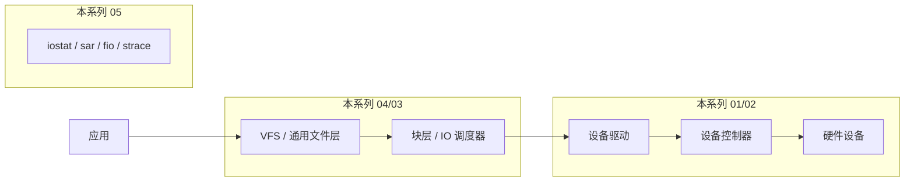

::: abstract 本章定位
操作系统把千差万别的硬件统一成"文件"，IO 子系统就是这条抽象流水线。本系列基于《Operating System Concepts》第 9 版 Ch12（I/O Systems），从硬件层的设备控制器、中断、DMA，讲到内核的缓冲/缓存/调度，最后落到 Linux 的 IO 栈与性能调优。
:::

IO 的主题只有一个：**用最少的 CPU 参与，完成最多的数据搬运**。CPU 很贵、设备很慢，二者速度差了几个数量级，于是有了中断（别等轮询）、有了 DMA（别让 CPU 搬数据）、有了缓冲（别让慢设备卡住快进程）、有了异步（别让进程傻等）。理解 IO，就理解了操作系统为什么值得存在。

## 1. 主题地图

| 篇目 | 回答的问题 | 核心概念 | Linux 观察点 |
|---|---|---|---|
| [IO硬件与设备控制](/kb/os/IO/01-IO硬件与设备控制/) | 设备怎么被"看见"和控制？ | 块/字符/网络设备、controller、寄存器、IO port vs MMIO、polling | `lsblk`、`lspci -v`、`cat /proc/iomem` |
| [IO控制方式与中断DMA](/kb/os/IO/02-IO控制方式与中断DMA/) | 数据怎么从设备进内存？ | interrupt-driven IO、IVT、PIC/APIC、DMA、cycle stealing | `cat /proc/interrupts`、`lspci -k` |
| [内核IO子系统与缓冲](/kb/os/IO/03-内核IO子系统与缓冲/) | 内核怎么让 IO 高效、透明、可靠？ | buffering/caching/spooling、IO 请求生命周期、同步/异步模型 | `strace -e read,write`、`free`、`iostat` |
| [设备驱动与设备管理](/kb/os/IO/04-设备驱动与设备管理/) | 内核怎么和具体设备打交道？ | device driver、内核 IO 结构、统一设备模型、file_operations、模块 | `lsmod`、`/sys/bus`、`/dev`、`modprobe` |
| [IO路径与性能优化](/kb/os/IO/05-IO路径与性能优化/) | 数据全程走下来怎么量化、怎么优化？ | IO 栈、bio/request、page cache、blk-mq、NVMe、IOPS/延迟 | `iostat`、`sar -d`、`pidstat -d`、`blktrace`、`fio` |

## 2. 推荐学习顺序

1. **先建立硬件直觉**：[IO硬件与设备控制](/kb/os/IO/01-IO硬件与设备控制/)——设备是"寄存器的集合"，这是最容易被忽视却最基础的一课。
2. **理解数据怎么流动**：[IO控制方式与中断DMA](/kb/os/IO/02-IO控制方式与中断DMA/)——轮询 → 中断 → DMA 三步进化，是 IO 性能的灵魂。
3. **进入内核视角**：[内核IO子系统与缓冲](/kb/os/IO/03-内核IO子系统与缓冲/)——缓冲、缓存、spooling 是内核的"看不见的手"，同时把应用层四种 IO 模型讲透。
4. **认识驱动**：[设备驱动与设备管理](/kb/os/IO/04-设备驱动与设备管理/)——设备如何被抽象成文件，驱动如何被加载。
5. **收口到性能**：[IO路径与性能优化](/kb/os/IO/05-IO路径与性能优化/)——用前面的机制解释指标，用指标反过来定位机制问题。
6. **跨目录收尾**：配合 [排查](/kb/os/问题排查/04-磁盘与IO瓶颈排查/) 做综合演练。

::: tip 学习顺序的两种取向
- **自底向上**（硬件 → 内核 → 应用）：理解机制，适合打基础，是本系列默认顺序。
- **自顶向下**（应用 → 内核 → 硬件）：从 `read()` 开始逆向追因，适合面试冲刺：先读 [内核IO子系统与缓冲](/kb/os/IO/03-内核IO子系统与缓冲/) 的"read 全链路"，再倒回去补硬件细节。
:::

## 3. 每篇一句话介绍

- [IO硬件与设备控制](/kb/os/IO/01-IO硬件与设备控制/)：IO 设备按粒度分三类、控制全靠寄存器，轮询是最简单但最浪费 CPU 的控制方式。
- [IO控制方式与中断DMA](/kb/os/IO/02-IO控制方式与中断DMA/)：中断让 CPU 从"傻等"变"随叫随到"，DMA 让 CPU 连搬数据都不用做，异步 IO 让进程连等待都不用。
- [内核IO子系统与缓冲](/kb/os/IO/03-内核IO子系统与缓冲/)：缓冲平滑速度差、缓存复用数据、spooling 独占设备变共享，内核把 IO 包装成可靠的"文件"抽象。
- [设备驱动与设备管理](/kb/os/IO/04-设备驱动与设备管理/)：驱动是内核与硬件的翻译官，统一设备模型让 `sysfs`/`udev` 把设备管理变成"插上就能用"。
- [IO路径与性能优化](/kb/os/IO/05-IO路径与性能优化/)：IOPS 与延迟是结果，page cache、blk-mq、多队列才是手段，观测工具让瓶颈无处可藏。

## 4. 实验清单

::: important 建议全程在一台 Linux 环境（本机 / WSL2 / 虚拟机）执行，每个概念都要"看到"才算学会。
:::

| 实验 | 命令 | 验证的概念 | 对应篇目 |
|---|---|---|---|
| 列出块设备 | `lsblk -t` / `lsblk -o NAME,TRAN,ROTA,SIZE` | 块设备、传输类型、SSD/HDD | 01 |
| 查看 PCI 设备 | `lspci -v` | 设备控制器、总线、MMIO 地址区间 | 01 |
| 看内存映射 IO | `cat /proc/iomem` | MMIO、设备地址空间 | 01 |
| 看中断分布 | `cat /proc/interrupts` | 中断、IRQ 亲和、APIC | 01/02 |
| 看 DMA 能力 | `lspci -k \| grep -i -A5 dma` | DMA engine | 02 |
| 追踪系统调用 | `strace -e trace=read,write,openat -p &lt;pid&gt;` | 系统调用与返回字节数 | 03 |
| 看缓冲/缓存 | `free -h`、`cat /proc/meminfo` | page cache（buff/cache） | 03/05 |
| 看块层 IO | `iostat -x 1`、`sar -d 1` | 块设备吞吐、await、util | 05 |
| 盯进程 IO | `pidstat -d 1` | 进程级 IO 速率 | 05 |
| 基准测速 | `dd if=/dev/zero of=/tmp/test bs=1M count=1024 oflag=direct` | direct IO 裸吞吐 | 05 |
| 专业测速 | `fio --filename=/tmp/fio_test --direct=1 --rw=randread --bs=4k --ioengine=libaio --iodepth=32 --size=1G --numjobs=1` | IOPS、延迟分布 | 05 |
| 观察 IO 调度器 | `cat /sys/block/sda/queue/scheduler` | IO scheduler（none/mq-deadline/bfq） | 05 |

**安全提示**：`dd`/`fio` 请使用普通文件或明确的安全设备，**不要**对系统盘整盘操作；`strace` 跟踪前确认目标进程不是关键系统服务。

## 5. 常见面试考点清单

- 块设备 vs 字符设备 vs 网络设备的区别（01）
- IO 端口与 MMIO 的区别，为什么 MMIO 更常用（01）
- 轮询 vs 中断：各自优缺点、各自适用场景（02）
- **中断处理流程 5 步**：能画出 INTR → 保存现场 → 查 IVT → 服务例程 → 恢复（02）
- **DMA 为什么能减少中断次数**：一次 DMA 传输代替 N 次单字节中断（02）
- DMA 传输流程与 cycle stealing 的含义（02）
- **同步 IO vs 异步 IO / 阻塞 vs 非阻塞**的区别（02/03）
- 缓冲与缓存的区别（03）
- 为什么需要缓冲：速度匹配、设备互操作、复制语义（03）
- spooling 如何把独占设备变共享（03）
- 四种应用层 IO 模型：阻塞/非阻塞/多路复用/异步，各自实现与成本（03）
- select / epoll / io_uring 的演进与差异（03）
- 设备驱动的角色，为什么驱动要进内核态（04）
- Linux 统一设备模型：sysfs、/dev、udev 的关系（04）
- 字符设备驱动 vs 块设备驱动的 file_operations 差异（04）
- Linux IO 栈各层职责，page cache 在哪一层（05）
- 缓冲 IO vs direct IO，什么时候该用 direct IO（05）
- page cache 的 write-back 机制与脏页落盘（05）
- NVMe 为什么多队列、blk-mq 解决什么问题（05）
- 高并发读写服务器 IO 为什么慢：队列深度、调度器、延迟/吞吐权衡（05）

## 6. 跨目录联动

- 磁盘怎么转、扇区/磁道/寻道：[磁盘](/kb/os/存储/01-磁盘结构与大容量存储/)
- RAID 与磁盘调度算法：[存储](/kb/os/存储/02-磁盘调度算法与RAID/)
- 文件系统接口与实现（inode、目录）：[文件系统](/kb/os/存储/03-文件系统接口与目录结构/)、[文件系统性能](/kb/os/存储/05-文件系统性能与空间管理/)
- Linux 命令实操（iostat/sar/free/df）：[Linux](/kb/os/Linux/04-LinuxIO与性能监控实操/)
- 遇到磁盘慢/IO 高的综合排查：[排查](/kb/os/问题排查/04-磁盘与IO瓶颈排查/)

## 7. 学习完成标准

学完本系列，应能回答：

- 一次 `read()` 调用，从用户态到硬件，经过了哪些层、每一层做了什么？
- 为什么"中断 + DMA"是现代 IO 的标配？没有它系统会怎样？
- 为什么 `free` 里 `buff/cache` 很高不是坏事？
- 磁盘吞吐高但延迟也高，瓶颈在哪一层？怎么用工具逐层定位？
- direct IO 与缓冲 IO 各适合什么业务场景？
- 为什么 SSD/NVMe 时代传统 IO 调度器反而拖后腿，blk-mq 解决了什么？

从 [IO硬件与设备控制](/kb/os/IO/01-IO硬件与设备控制/) 开始。
