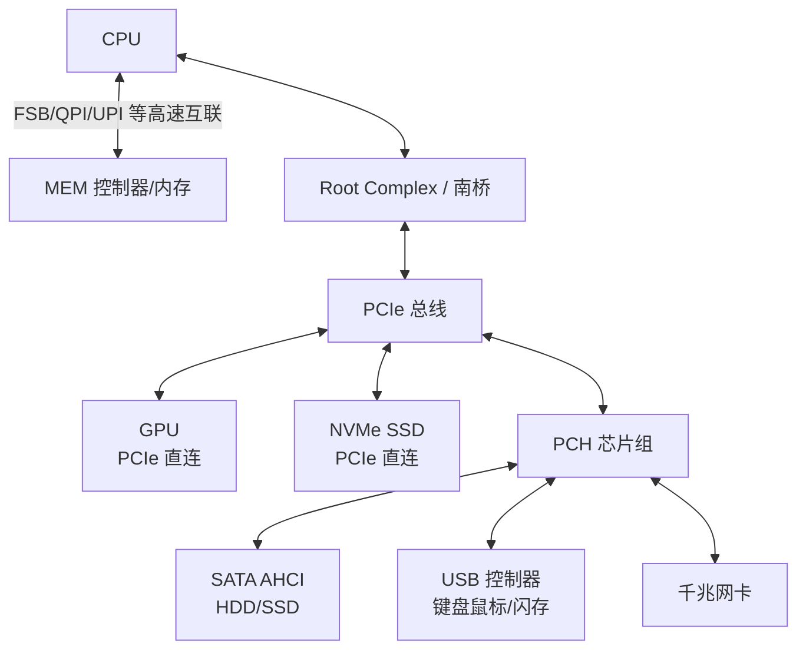
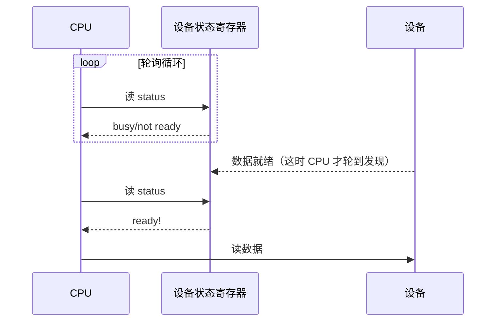

::: abstract 本章定位
IO 的一切都从"设备是可编程的寄存器集合"这个事实出发。本篇讲清设备怎么分类、控制器怎么被 CPU 访问（IO 端口 vs MMIO）、总线怎么串起它们，以及最朴素的控制方式——轮询为什么是 CPU 的浪费。
:::

## 1. 设备分类：三种粒度

### 1.1 块设备（block device）

- 以**固定大小的块**（典型 512B / 4096B）为单位读写，支持**随机访问**。
- 典型：HDD、SSD、USB 盘、SD 卡。
- 特点：每次读写都要指定"从哪个块开始、读几块"，因此文件系统建在它之上最合适。
- 速度衡量：IOPS（每秒 I/O 次数）、吞吐量（MB/s）、寻道/延迟（对 HDD 而言寻道是大头）。

### 1.2 字符设备（character device）

- 以**字节流**为单位顺序读写，**不支持随机访问**（没有 seek）。
- 典型：键盘、鼠标、串口、终端（tty）、打印机。
- 特点：数据按字节到达/发出，一次一个字符，天然顺序。

### 1.3 网络设备（network device）

- 以**帧/报文**为单位收发，介于块与字符之间。
- 特点：数据是"包"，有头部/长度/地址，不像块设备有明确块号；网卡通常自带缓冲与 DMA，甚至有独立 CPU（TOE，TCP offload）。
- 由于语义特殊，操作系统不把网络设备映射成 `/dev` 文件，而是走**套接字（socket）**接口（本系列不展开，参考 Linux 网络部分）。

| 维度 | 块设备 | 字符设备 | 网络设备 |
|---|---|---|---|
| 数据单位 | 块（512B/4K） | 字节流 | 报文/帧 |
| 访问方式 | 随机访问 | 顺序访问 | 包级收发 |
| 典型设备 | HDD / SSD | 键盘 / 串口 / 终端 | NIC |
| 内核接口 | `block_device` + 请求队列 | `file_operations`（字符） | socket / `net_device` |
| 缓冲 | page cache / 调度器 | 行缓冲 / 立即 | 网卡环队列（ring buffer） |
| 是否映射为文件 | 是（`/dev/sda`） | 是（`/dev/tty0`） | 否（走 socket） |

::: tip 记忆锚点
块设备"能定位"，字符设备"只能排队"，网络设备"包办一切"。Linux 里 `lsblk` 只列块设备；`/dev` 下既有块又有字符，用 `ls -l` 首字母区分：`b` = block，`c` = character。
:::

## 2. 设备控制器（device controller）

### 2.1 为什么需要控制器

CPU 无法直接驱动磁盘马达、磁头或闪存通道。每个设备都配一个**设备控制器**（controller / adapter / 南桥时代的 host adapter）：

- 把设备的**模拟信号**翻译成 CPU 能懂的**寄存器位**。
- 管理设备的**机械/电气状态**（磁头定位、闪存磨损均衡、网卡协议栈）。
- 承载**与 CPU 的数据交换**（IO 端口或 MMIO）和 **DMA**。

典型：磁盘控制器（AHCI/NVMe）、显卡（GPU 自带几千核）、网卡（NIC，自带 DMA 与中断）。

### 2.2 控制器的三类寄存器

控制器对 CPU 暴露一组寄存器（每个寄存器几字节宽）：

| 寄存器 | 作用 | 读写方向 |
|---|---|---|
| **数据寄存器**（data register） | 存放要读/写的数据（输入缓冲或输出缓冲） | 双向 |
| **状态寄存器**（status register） | 反映设备当前状态：busy/ready、error 位 | CPU 读 |
| **命令寄存器**（command register） | 接收 CPU 下发的命令（读、写、复位、寻道） | CPU 写 |

CPU 与控制器交互的基本套路：

1. CPU 写**命令寄存器**：请求读块 42。
2. CPU 轮询/等待**状态寄存器**的 ready 位。
3. CPU 通过**数据寄存器**收/发数据。

```c
/* 伪代码：程序控制 IO（PIO），一次读一个字节 */
while ((status & BUSY) == 0) ;          /* 1. 等设备空闲 */
controller.command = READ_SECTOR;        /* 2. 发命令 */
controller.memory_addr = 42;             /* 3. 指定块号 */
controller.control = GO;                 /* 4. 启动 */
while ((status & DONE) == 0) ;           /* 5. 轮询完成位 */
int data = controller.data_register;     /* 6. 取数据 */
```

::: important 内存视角的统一
从 CPU 视角看，**"访问 IO" 与 "访问内存" 只有编址方式的不同**——要么走专用 IO 指令，要么走普通 load/store。控制器只是把读写操作翻译成设备动作。这就是下一篇把 IO 分成"寄存器级 PIO / 中断 / DMA"的基础。
:::

## 3. 设备地址：IO 端口 vs 内存映射 IO（MMIO）

设备寄存器如何出现在 CPU 的地址空间里？两种方案：

### 3.1 IO 端口（port-mapped I/O, PMIO）

- 使用**独立于内存的 IO 地址空间**，用专用指令 `in`/`out`（x86）访问。
- 优点：不占用内存地址空间，指令有 IO 权限区分（ring 0 才能用）。
- 缺点：指令集有限、需要单独的保护机制、现代设备地址范围大时难扩展。
- 实例：x86 的 IO 端口从 `0x0000` 到 `0xFFFF`，老式串口 COM1 = `0x3F8`。

```bash
# 查看设备使用的 IO 端口（x86）
lspci -v | grep -A10 "Region 0"     # 只看内存/端口区域
cat /proc/ioports                    # 整个 IO 端口分配表
```

### 3.2 内存映射 IO（MMIO）

- 把设备寄存器**映射到内存地址空间**的某一段，CPU 用普通 `load`/`store` 指令访问。
- 优点：指令集丰富、地址范围大、无需特殊指令；配合虚拟内存可实现页级保护与用户态映射。
- 缺点：占用地址空间；读写可能被 CPU 缓存干扰（需要 uncached / write-through 属性）；一条 store 可能触发副作用（设备可见），编译器/CPU 重排需内存屏障。
- 实例：几乎所有现代设备（NVMe、GPU 显存窗口、网卡 BAR）。

```bash
cat /proc/iomem          # 系统内存 + MMIO 区间一览
#   e0000000-e07fffff : pcie@...  <- 这就是设备 BAR 映射进来的 MMIO 区间
lspci -vv -s 00:1f.6     # 网卡示例，Region 0 标注 Memory 或 I/O
```

| 维度 | IO 端口（PMIO） | 内存映射 IO（MMIO） |
|---|---|---|
| 地址空间 | 独立 IO 空间 | 共享内存地址空间 |
| 指令 | 专用 `in`/`out` | 普通 load/store |
| 地址范围 | 小（x86 64KB） | 大（与物理地址同宽） |
| 保护 | 靠 IO 特权位 | 靠页表/MMU |
| 现代使用 | 老设备、部分 x86 兼容 | 主流（NVMe/GPU/NIC） |

::: tip 两者常并存
x86 平台上很多设备同时暴露 IO 端口和 MMIO，现代驱动优先用 MMIO；老设备（如传统 PS/2 键盘控制器、RTC）仍走 IO 端口。`/proc/ioports` 与 `/proc/iomem` 分别记录两份地址表。
:::

## 4. IO 总线结构

设备不直接连 CPU，而是挂在**总线**上。总线是共享的通信通道，谁占用谁用。

### 4.1 总线层次



- **PCIe（PCI Express）**：现代主流，点对点串行差分信号，支持多通道（x1/x4/x8/x16），每个设备独享带宽，CPU 通过 **Root Complex** 直达。
- **NVMe**：SSD 的 PCIe 原生协议，绕过传统 AHCI/SATA，命令队列极深（65,535 队列 × 64K 深度）。
- **SATA**：老一代磁盘接口，单队列、半双工，指令翻译开销大，是 HDD 的主流，也是 AHCI 的载体。
- 低速设备（键盘/鼠标/U 盘）经 **USB** 汇总，再经 **PCH（南桥）** 接入系统。

### 4.2 总线为什么重要

- 总线的**吞吐量上限**是 IO 的天花板：SATA3 = 6 Gbps（约 550 MB/s 有效），PCIe 3.0 x4 ≈ 3.9 GB/s，PCIe 4.0 x4 ≈ 7.9 GB/s，NVMe 现代盘标称远超 SATA。
- **总线位置决定中断/DMA 路径**：设备在哪条总线，决定它的 IRQ 如何到达 CPU、DMA 如何到达内存。
- 现代系统用 **IOMMU**（如 Intel VT-d）做设备访问内存的安全与隔离（虚拟化、DPDK 直通都依赖它）。

## 5. 轮询（polling）：最简单的 IO 控制方式

### 5.1 原理

轮询 = CPU 反复读取**状态寄存器**，直到设备就绪，然后读/写数据寄存器。设备不主动通知，CPU 主动询问。

```c
/* 轮询读一个字符（伪代码） */
while (inb(STATUS_PORT) & DATA_READY) == 0) {
    /* 忙等：CPU 一直空转 */
}
char c = inb(DATA_PORT);
```

### 5.2 轮询的代价

CPU 的每一次查询都是在"烧"宝贵的时钟周期，因为**设备比 CPU 慢几个数量级**：

| 设备 | 典型响应时间 | 轮询一次浪费的 CPU 周期量级 |
|---|---|---|
| 内存 | ~100 ns | 可接受（这就是为什么缓存命中查表可轮询） |
| 普通磁盘（HDD） | ~5-10 ms | 百万周期级——绝对不能轮询 |
| SSD | ~100 µs | 十万周期级——不能轮询 |
| 慢速外设（键盘） | ms 级 | 荒谬的浪费 |

**结论**：轮询适合"设备足够快、响应时间可预期"的场景（如少量寄存器查询、高速 FIFO 已就绪）；对于磁盘、网卡这种慢设备，轮询就是灾难——这正是引入中断的原因。



::: warning 轮询并非一无是处
在**延迟极低且可预测**的场景（如某些高速网络 IO、busy-polling 网卡、内核自旋锁忙等）轮询反而优于中断——因为中断本身有上下文切换/入口开销。高性能 DPDK 就是主动放弃中断、改轮询的极端例子。
:::

## 6. 实践：观察设备与中断

### 6.1 列出块设备

```bash
lsblk -o NAME,TRAN,ROTA,SIZE,MODEL
# NAME    TRAN   ROTA SIZE MODEL
# sda     nvme     0  512G Samsung SSD ...
# sdb     sata     1    1T WDC ...
#  ROTA=1 表示旋转介质（机械盘），ROTA=0 表示 SSD/NVMe
```

### 6.2 查看设备控制器与 MMIO

```bash
lspci -v                    # 所有 PCI 设备及其 Region（MMIO/IO 端口地址）
lspci -k                    # 每个设备绑定的内核驱动
cat /proc/iomem             # MMIO 地址分配
cat /proc/ioports           # 传统 IO 端口分配
```

### 6.3 观察中断（预告下一篇）

```bash
cat /proc/interrupts
#            CPU0       CPU1   ...  IRQ  设备
#   0:       2894          0        0   timer
#  16:    1234000      98700       16   xhci_hcd:usb3
#  24:   88110000    ...          24   nvme0q0 (多队列)
```

- 第一列是 **IRQ 号**，中间列是**各 CPU 上的中断次数**，最后一列是**中断源**。
- 多队列设备（NVMe）会为每个队列生成独立 IRQ，以便分散到多核。
- 中断次数暴涨 + 对应设备忙 = 该设备 IO 负载高。

::: tip 中断与轮询的观察对照
在一个负载下 `cat /proc/interrupts` 两次取差，就是该设备每秒产生的中断次数；把鼠标插上按几下，看 PS/2 或 USB IRQ 计数跳变——中断机制看得见摸得着。
:::

## 7. 本章小结

- 设备按访问粒度分**块 / 字符 / 网络**三类，内核接口各不相同。
- 每个设备由**控制器**管理，CPU 通过**数据 / 状态 / 命令**三类寄存器与它交互。
- 设备寄存器地址化有两种方式：**IO 端口**（独立空间、专用指令）与 **MMIO**（映射进内存、普通 load/store），现代设备主用 MMIO。
- 设备通过**总线层次**（PCIe / SATA / USB）接入系统，总线带宽是 IO 吞吐天花板。
- **轮询**是最简单的控制方式，但慢设备上会浪费巨量 CPU；它只适合"够快、可预测"的场景。
- 观察手段：`lsblk`、`lspci -v`、`cat /proc/iomem`、`cat /proc/interrupts`。

## 8. 自测题

1. **块设备、字符设备、网络设备三者的核心区别？**
   块设备按块随机访问（可 seek）；字符设备按字节流顺序访问；网络设备按报文收发、不走文件接口而走 socket。
2. **设备控制器的三类寄存器分别干什么？**
   数据寄存器存数据、状态寄存器反映 busy/ready/error、命令寄存器接收操作指令。
3. **IO 端口与 MMIO 的本质区别？**
   端口用独立 IO 空间 + 专用指令（in/out）；MMIO 把寄存器映射进内存地址空间、用普通 load/store，范围大、无专用指令。
4. **为什么 MMIO 在现代占主导？**
   地址范围大、指令集丰富、可走虚拟内存与页保护，且 NVMe/GPU 等现代设备的寄存器窗口只能靠 MMIO。
5. **轮询为什么浪费 CPU？**
   CPU 不停查询状态寄存器空转；慢设备（磁盘 ms 级）一次就绪要烧上百万周期，而 CPU 本来可以干别的。
6. **轮询在什么场景反而合理？**
   设备响应极快且可预测（如高速 FIFO、busy-polling 网卡、DPDK），或中断开销大于轮询开销时。
7. **`/proc/interrupts` 第一行各列分别表示什么？**
   IRQ 号、各 CPU 上的中断累计次数、中断源描述（设备名/队列名）。
8. **如何判断一块盘是 HDD 还是 SSD？**
   `lsblk -o ROTA`（1 = 机械盘）或 `cat /sys/block/sdX/queue/rotational`；也可以看 TRAN 是否为 nvme。
