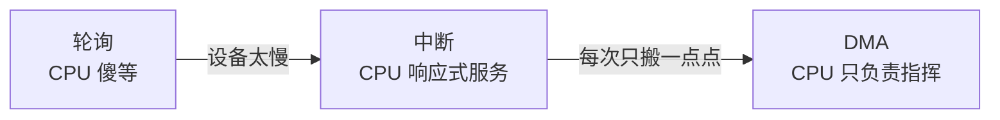
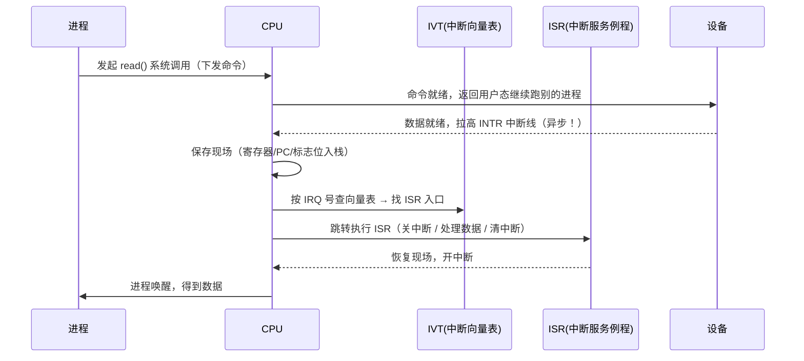
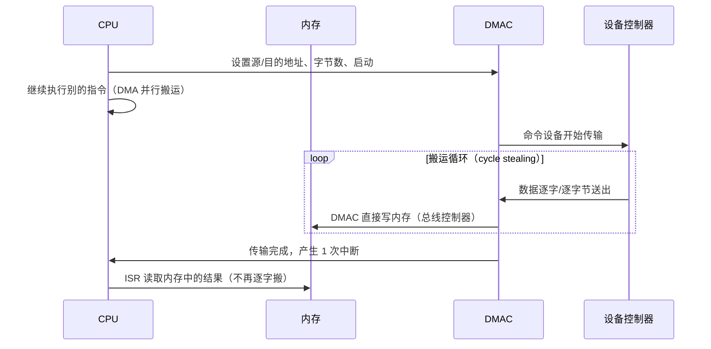

::: abstract 本章定位
轮询让 CPU 空转到崩溃，于是有了中断——设备"招呼"CPU，CPU 随叫随到；可中断一次只搬一个字符，太浪费，于是有了 DMA——CPU 发号施令，DMA 控制器负责搬运，中断只在整块数据搬完后响一次。本篇把这条进化链讲透，并对比同步/异步 IO。
:::

## 1. 三种 IO 控制方式的总览

| 方式 | 谁在等 | 谁搬数据 | 中断次数 | 适用场景 |
|---|---|---|---|---|
| **轮询（PIO）** | CPU 忙等 | CPU | 0 | 极快设备 / 特殊场景 |
| **中断驱动 IO** | 进程睡眠，CPU 去干别的 | CPU（每字节/每块一次中断） | 多 | 慢速设备、单次小数据 |
| **DMA** | CPU 发命令后就走 | DMA 控制器 | 整块完成后 1 次 | 大数据块传输（磁盘/网卡） |



::: important 一句话主线
轮询费 CPU 时间，中断省 CPU 时间但费"打断次数"，DMA 两者都省。**成本换位置**：从"CPU 亲自等"换到"CPU 派代理搬"。
:::

## 2. 中断驱动 IO（interrupt-driven I/O）

### 2.1 基本思想

轮询的问题：CPU 必须**主动**查状态。中断反其道而行：**设备主动通知 CPU**。

1. CPU 向设备发起读写命令后，**立刻回去干别的**（进程睡眠或被调度走）。
2. 设备就绪后，通过**中断请求线（IRQ）**向 CPU 发出电信号。
3. CPU 暂停当前工作，转入**中断处理**，完成数据搬运，再恢复现场。

### 2.2 中断处理流程（5 步）



**5 步拆解**：

1. **产生中断**：设备就绪，断言 INTR（interrupt request）线。
2. **保存现场**：CPU 硬件自动保存 PC、标志位、必要寄存器（压栈）。
3. **查向量表**：CPU 依据中断号查**中断向量表（IVT）**，拿到 ISR 入口地址。
4. **执行 ISR**：关中断 → 读/写数据、处理错误、向设备确认（clear interrupt）→ 开中断。
5. **恢复现场**：弹栈还原寄存器，CPU 继续被打断前的指令；被阻塞的进程被唤醒加入就绪队列。

::: warning 保存现场/切换不是免费的
每次中断都有压栈、查表、ISR 执行、弹栈的开销（现代 CPU 上每次中断约几百纳秒到几微秒）。设备**很频繁**时，中断风暴会让 CPU 忙于响应而拖垮吞吐——所以才有 DMA 和中断合并（coalescing）。
:::

### 2.3 中断机制细节

**中断线与类型**

| 类型 | 特点 |
|---|---|
| 不可屏蔽中断（NMI） | 不能被 `cli` 屏蔽，用于致命错误（如 NMI watchdog、内存奇偶错） |
| 可屏蔽中断 | 可以被 `cli` 关闭；普通设备中断都属于此类 |
| 软件中断 / 异常 | CPU 内部产生：除零、缺页（fault）、系统调用（trap） |
| IPI | 处理器间中断，用于多核唤醒、调度 |

**中断向量表（IVT）**

- 固定编号：每个中断/异常对应一个**向量号**，表中存 ISR 入口地址。
- x86：IDT（Interrupt Descriptor Table）最多 256 项，前 32 项为 CPU 异常，32+ 为设备中断与系统调用（Linux 的 `int 0x80` / syscall 走专用指令）。
- 查询过程：CPU 收到 IRQ → 中断控制器给出向量号 → CPU 查 IDT → 权限检查（GDT 内核代码段）→ 跳转。

**PIC / APIC**

- 早期 **8259A PIC**（Programmable Interrupt Controller）：可管理 8 路（级联 15 路），固定 IRQ 0-15，老式分配。
- 现代 **APIC/xAPIC/x2APIC**：Local APIC（每核一个）+ IO APIC，支持 24+ 路、IRQ 重映射、**IRQ 亲和性**（把某设备的 IRQ 钉到指定 CPU 上分散负载）。
- 中断控制器的作用：**仲裁**多个设备的并发中断、**缓存**待处理中断、给 CPU 一个确定的向量号。

```bash
cat /proc/interrupts          # 每个 IRQ 在各 CPU 上的计数
#   IRQ 号  CPU0 CPU1 ...  设备
#    16   ...
#    24   ...              nvme0q0
# 看多队列：nvme0q0/q1/q2 各自一个 IRQ，Linux 会自动散布到不同 CPU
```

### 2.4 中断合并（interrupt coalescing）

网卡/固态盘为了减少中断风暴，会**攒几个事件再中断一次**：

- 缺点：延迟略升（要把最后一个事件多等一会儿）。
- 优点：中断次数数量级下降，吞吐提升。
- 权衡是延迟 vs 吞吐，很多网卡驱动提供 `adaptive-rx` 之类的动态合并策略。

## 3. DMA：直接内存访问

### 3.1 为什么需要 DMA

中断驱动 IO 仍有一个痛：**每次中断只能服务一小段数据**，而磁盘一次传输是 KB~MB 级。如果让 CPU 逐字节搬：

- 一次 4KB 读 = 4096 次数据搬移 + 1 次中断？不——其实是"一次中断搬一块"，但搬的过程 CPU 全程参与（PIO），4096 字节的拷贝把 CPU 占死。
- 网卡 10Gbps 满速时每秒约 148 万个小包，每个包都要 CPU 搬，CPU 直接累垮。

**DMA 的思路**：引入一个专门的 **DMA 控制器（DMAC）**，CPU 只需告诉它"从哪搬、搬到哪、搬多少、搬完通知我"，然后彻底撒手。

### 3.2 DMA 控制器与传输流程

DMAC 关键资源：

| 资源 | 作用 |
|---|---|
| **地址寄存器** | 内存端起始地址 |
| **计数寄存器** | 要传输的字节/块数 |
| 控制寄存器 | 方向（读/写）、单位、是否链式 |
| 状态寄存器 | 传输中 / 完成 / 错误 |



**典型传输流程（读磁盘块）**：

1. CPU 把"读扇区 N"命令写给磁盘控制器；同时在**内存中分配缓冲区**，把其地址与长度告诉 DMAC。
2. CPU 启动 DMA，然后返回继续运行其它任务。
3. 磁盘控制器每读出一个字，**DMAC 在总线上接管一个内存周期**，把它写入缓冲区——这叫 **cycle stealing（周期挪用）**：DMA 与 CPU 轮流占用内存总线，每挪走一个周期 CPU 就慢一拍。
4. 整块搬完，DMAC 发**一次中断**告诉 CPU：任务完成，数据已在内存里。
5. CPU 的 ISR 只需确认完成并唤醒等待的进程，**不用再碰数据本身**。

### 3.3 现代 DMA：多了两个重要角色

- **IOMMU（VT-d / AMD-Vi）**：为设备建立"设备视角的页表"，防止设备 DMA 乱写任意内存（安全/虚拟化直通的关键）。
- **DMA 引擎（如 Intel I/OAT）**：CPU 可以在两块内存之间也借 DMA 引擎搬运（加速 memcpy 类大拷贝）。

## 4. DMA 与中断的对比

| 维度 | 中断驱动 IO | DMA |
|---|---|---|
| 数据搬运者 | CPU（PIO，逐字节/逐字） | DMA 控制器 |
| CPU 参与时间 | 每块数据搬运全程 | 只在命令下发与完成中断 |
| 中断次数 | 每次传输 1 次（但搬运成本高） | 整块完成 1 次 |
| CPU 占用 | 高（搬运就是 CPU 干活） | 低（周期挪用可忽略） |
| 适用 | 小数据、慢设备 | 大数据块（磁盘/网卡/GPU） |
| 额外成本 | 无 | DMA 控制器 + 地址一致/IOMMU 管理 |

::: important "为什么 DMA 减少中断次数"
中断驱动：N 个字节往往对应 N 次（或 N/每块）传输，每次都要 CPU 打断自己搬数。DMA：一次启动 + 一次完成中断，**整块数据由 DMA 控制器与内存直接打交道**，CPU 的中断次数从"每小块一次"降为"每整块一次"。网卡场景尤其明显：中断次数 ≈ 包数 → 中断次数 ≈ 批次数（配合合并还能更少）。
:::

**DMA 的两个经典坑**：

1. **一致性问题**：设备写内存时 CPU 的 cache 里可能是旧数据（DMA 绕过 cache）。现代系统通过 **cache 一致性协议（coherency）** 或让驱动用 uncached/dma 缓冲解决；有些老架构需要 CPU 手动 flush。
2. **边界/占用**：DMA 需要**物理连续**内存（或 IOMMU 页表映射），且传输期间该内存不能换出/迁移——驱动通常申请专用 DMA buffer。

## 5. 同步 IO 与异步 IO

### 5.1 两种概念的两条轴

::: warning 先分清楚轴
- **同步 vs 异步**：发起后，调用方是否需要"参与"等待结果完成才返回？（本质是"要不要等它干完"）
- **阻塞 vs 非阻塞**：发起后，调用方是否被挂起（睡眠）？（本质是"等的时候我还能不能干别的"）
它们描述的是不同维度，常被混用，但严格说是两个维度。
:::

| 组合 | 行为 | 例子 |
|---|---|---|
| 同步 + 阻塞 | 调用后进程睡眠，直到 IO 完成 | 普通 `read()` 磁盘文件（进程挂起） |
| 同步 + 非阻塞 | 立即返回 EAGAIN，进程反复询问（轮询） | `open(O_NONBLOCK)` 后 `read` 管道 |
| 异步 + 阻塞 | 少见（阻塞等待"异步完成事件"） | 阻塞在 epoll_wait 上 |
| 异步 + 非阻塞 | 立即返回，事件完成时内核回调通知 | `io_uring`、`aio`、epoll 驱动模型 |

### 5.2 同步 IO 的代价

```bash
# strace 观察：读 10MB 文件，每次 read 都要等内核完成
strace -e trace=read -c cat /tmp/bigfile
# read() 返回的是"已完成的数据长度"，说明调用是同步的
```

同步 IO 期间，调用线程只能睡眠；要并行处理多路 IO 就得开多线程——线程多了又贵（每个线程栈 + 上下文切换）。这是高并发 IO 设计的根本矛盾，也是 [内核IO子系统与缓冲](/kb/os/IO/03-内核IO子系统与缓冲/) 讲四种 IO 模型的入口。

### 5.3 异步 IO 的意义

- 发起 `aio_read`/`io_uring` 后立即返回，进程继续算；完成后内核以事件/完成队列通知。
- 收益：**一个线程可以同时管理成百上千个在途 IO**，不用为每个 IO 开线程，上下文切换与内存占用大幅下降。
- 代价：编程模型复杂（回调/完成队列）、且 IO 与计算重叠需要小心数据竞争。
- 现代 Linux 首选 **io_uring**（内核 5.1+）：共享内存环提交/收割请求，系统调用几乎为 0，性能和可扩展性远超老式 aio。

## 6. 本章小结

- IO 控制方式三阶段：**轮询 → 中断 → DMA**，核心是把"CPU 等待"换成"CPU 响应"、再把"CPU 搬运"换成"DMA 搬运"。
- 中断流程 5 步：产生中断 → 保存现场 → 查 IVT → 执行 ISR → 恢复现场；中断由 **PIC/APIC** 仲裁与编号。
- **DMA** 由 DMAC 携带地址/计数/控制/状态寄存器，通过 **cycle stealing** 直接搬内存，整块完成才中断一次。
- DMA vs 中断：搬运者、中断次数、CPU 占用三方面全面碾压，代价是 DMA 控制器与内存管理复杂度。
- 同步/异步、阻塞/非阻塞是两个维度；异步非阻塞是高并发 IO 的解法。
- 观察：`cat /proc/interrupts` 看 IRQ 分布与多队列。

## 7. 自测题

1. **中断驱动 IO 的 5 步流程？**
   设备拉 INTR → CPU 保存现场 → 查中断向量表得 ISR 入口 → 执行 ISR（搬运数据/清中断）→ 恢复现场，唤醒进程。
2. **DMA 为什么能减少中断次数？**
   数据搬运由 DMA 控制器完成，CPU 只在启动和整块完成时各受一次打扰，中断次数从"每小块/每包一次"降到"每整块一次"。
3. **cycle stealing 是什么意思？**
   DMA 与 CPU 分时占用内存总线，DMA 在每次总线周期"偷"用内存，CPU 的访存被短暂延迟。
4. **DMAC 的地址寄存器和计数寄存器各自作用？**
   地址寄存器指定内存侧缓冲区地址；计数寄存器指定传输字节/块数；两者决定"搬多少、放哪"。
5. **NMI 与普通设备中断的区别？**
   NMI 不可被屏蔽（致命错误用），普通设备中断可被 `cli` 关闭。
6. **PIC 和 APIC 各解决什么问题？**
   PIC 提供有限路数的集中仲裁；APIC 支持更多 IRQ、中断重映射和按 CPU 亲和分布，适配多核。
7. **同步阻塞 IO 与异步非阻塞 IO 的差别？**
   同步阻塞：线程挂起等结果返回；异步非阻塞：调用立即返回，完成后内核异步通知，单线程可管理海量在途 IO。
8. **DMA 的两个经典坑？**
   缓存一致性问题（设备写内存绕过 CPU cache，需 coherency 或专用缓冲）和物理内存约束（需要连续或经 IOMMU 映射、不能换出）。
