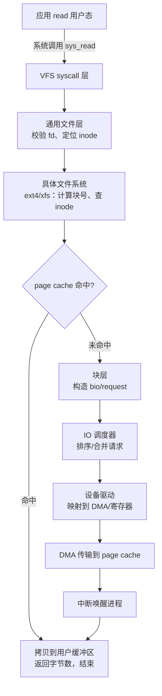
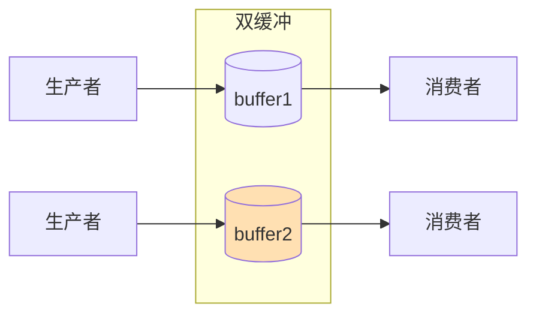
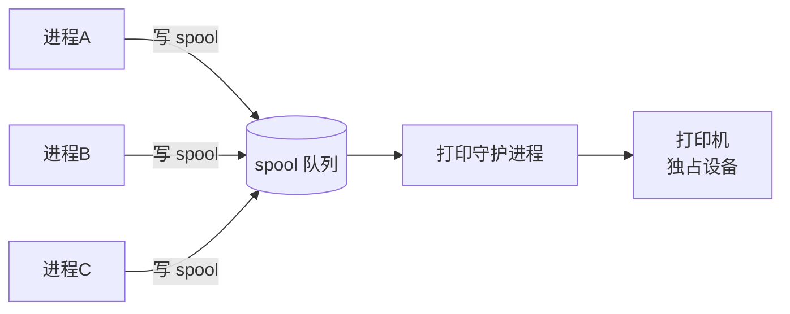
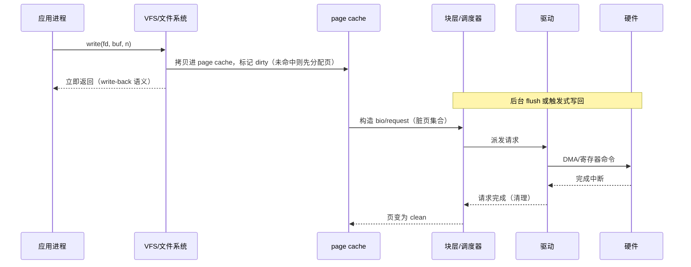
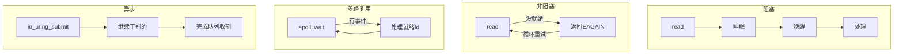

::: abstract 本章定位
硬件层我们搞定了"数据怎么搬"，但进程发起的 `read()` 凭什么要等你磁盘慢吞吞地转？内核 IO 子系统用四件法宝包装一切：**缓冲**平滑速度差、**缓存**复用数据、**spooling** 把独占变共享、**错误处理**保证不崩溃。本篇还从应用层视角梳理阻塞/非阻塞/多路复用/异步四种 IO 模型，并给出 IO 请求的完整生命周期。
:::

## 1. read() 全链路：从应用到硬件

### 1.1 一次系统调用发生了什么



**关键点**：`read()` 不是"直接读磁盘"——它先查 **page cache**；没命中才真正下发到块层。所以多次读同一个文件很快，第一次读慢。

```bash
# 实证：第一次读 vs 第二次读的速度差异（第二次命中 page cache）
echo 3 | sudo tee /proc/sys/vm/drop_caches   # 清空缓存
time cat /tmp/bigfile > /dev/null            # 冷：真实磁盘 IO
time cat /tmp/bigfile > /dev/null            # 热：全命中 page cache
```

### 1.2 系统调用涉及的层（Linux）

| 层 | 职责 | 关键接口/概念 |
|---|---|---|
| 系统调用层 | `sys_read` 入口、参数校验 | `read(fd, buf, len)` |
| VFS（虚拟文件系统） | 统一所有文件系统、维护打开文件表、page cache | `struct file`、`dentry` |
| 具体文件系统 | 地址空间 ↔ 块号映射（inode/extents） | ext4 / xfs / btrfs |
| 页缓存/块层 | 缓存命中判定、构造 `bio`、IO 调度 | `page cache`、`bio`、`request` |
| 设备驱动 | 把请求翻译成设备命令 | `block_device_operations` |
| 硬件 | DMA 传输、中断 | controller / DMAC |

::: tip "一切皆文件"
普通文件、目录、块设备、字符设备、socket、管道，全部通过 `fd` + `read/write` 访问。内核用 **VFS** 这一层把差异抹平，这正是 [设备驱动与设备管理](/kb/os/IO/04-设备驱动与设备管理/) 讲的"设备独立层/驱动层"分工的体现。
:::

## 2. 缓冲（buffering）

### 2.1 为什么要缓冲

1. **速度匹配**：设备与 CPU/内存速度差太大，缓冲把"快的等慢的"变成"快的先倒进缓冲，慢的慢慢吃"。
2. **数据单位适配**：设备按块/扇区读写，应用按字节读写——缓冲完成**粒度转换**。
3. **复制语义**：`read` 返回后，应用再改缓冲区也不影响内核/设备的数据（copy-on-write 语义的基础）。

### 2.2 三种缓冲策略

| 策略 | 结构 | 效果 | 代价 |
|---|---|---|---|
| **single buffering** | 1 个缓冲，生产/消费互斥 | 简单 | 双方必须轮流，有一方空等 |
| **double buffering** | 2 个缓冲轮换 | 一边装一边取，空闲时间几乎消除 | 多占一份内存 |
| **circular buffering** | 环形队列，多缓冲 | 进一步平滑突发，读指针写指针分离 | 实现复杂、要处理溢出 |



::: warning 缓冲 ≠ 缓存
缓冲（buffer）是**存储数据的临时中转区**（为了同步/适配），缓存（cache）是**存储高频复用数据的副本**（为了复用）。缓冲让数据"流过"，缓存让数据"留下"。page cache 是缓存，磁盘驱动里的 DMA 环是缓冲。
:::

## 3. 缓存（caching）与页面缓存

### 3.1 page cache

Linux 用空闲内存做 **page cache**：文件内容被读入后留存在内存，下次读直接命中。

```bash
free -h
#               total   used   free  buff/cache
#                ...     ...    ...      ...
# buff/cache 高是"内存被用于缓存了"，不是泄漏
cat /proc/meminfo | grep -E "^(Cached|Dirty):"
```

- **写路径**：写文件先写 page cache（标脏），由 **write-back** 机制异步落盘（`pdflush`/`flush` 线程 + `dirty_ratio` 阈值）。
- **write-through vs write-back**：

| 策略 | 何时写盘 | 优点 | 缺点 |
|---|---|---|---|
| write-through | 每次写立即落盘 | 数据可靠、简单 | 慢（每写都 IO） |
| write-back | 积累后批量落盘 | 快、合并写 | 掉电丢数据风险 |

Linux 默认 write-back，靠 `dirty_ratio`/`dirty_background_ratio` 与 `sync/fsync` 折中。数据库常绕过缓存直接落盘（direct IO + fsync）换取可靠性。

### 3.2 缓存与缓冲的对比

| 维度 | 缓冲（buffer） | 缓存（cache） |
|---|---|---|
| 目的 | 速度匹配、粒度转换 | 复用数据、避免重复 IO |
| 数据 | 中转流过 | 留下复用 |
| 典型 | DMA 环、tty 行缓冲 | page cache、CPU cache |
| 被淘汰 | 传完即弃 | LRU/clock 等策略替换 |

## 4. spooling：把独占设备变共享

- **问题**：打印机等设备一次只能被一个进程使用，且很慢；进程直接打印会互相踩。
- **spool 思想**：把"要打印的内容"先写入磁盘上的**缓冲文件（spool file）**，由一个**守护进程（如 cupsd）** 统一排队、逐一送打印。进程只需写文件，立即返回。
- **本质**：设备 + 磁盘队列 = 一台"虚拟的独占设备"给所有进程排队使用。



::: tip 生活化记忆
spooling 就像"前台打印店"：大家把文件丢进信箱（spool），老板按顺序打印，你不用一直站在打印机旁边。比"直接插队打印机"公平且高效。
:::

## 5. 错误处理

IO 错误分为两类，处理策略不同：

| 类型 | 例子 | 处理 |
|---|---|---|
| **瞬态/可重试** | 磁盘 busy、总线争用、设备瞬时错误 | 驱动重试若干次（有上限） |
| **永久/致命** | 坏扇区、控制器失效、介质错误 | 向上返回错误码（EIO）；系统日志记录；RAID/文件系统做冗余 |

- **系统调用返回**：`read` 失败返回 -1 并置 `errno`（EIO、ENXIO、EBADF...），应用可据此重试或报错。
- **内核内部**：返回负的错误码，逐层上传；损坏数据绝不能静默传给应用（这是文件系统校验、RAID 冗余存在的意义）。
- **探测与恢复**：SMART 自检、`fsck`、RAID 重建、文件系统日志（[日志](/kb/os/存储/06-文件系统可靠性与日志/)）都服务于"错误可发现、可恢复"。

## 6. IO 请求的生命周期



- 请求不是"发出去就没了"：内核会**合并相邻请求**（request merging）、**重排**（elevator/调度器）、**限流**（device limits）。
- 故障点遍布各层，所以排查要从"哪一层"入手——见 [排查](/kb/os/问题排查/04-磁盘与IO瓶颈排查/)。

## 7. 应用层视角：四种 IO 模型

### 7.1 总览

| 模型 | 等待方式 | 线程占用 | 性能特点 | 代表 API |
|---|---|---|---|---|
| 阻塞 IO | 线程睡眠直到完成 | 每 IO 占一线程 | 简单，并发靠多线程 | `read()`（默认） |
| 非阻塞 IO | 立即返回，忙轮询状态 | 线程不睡但空转 | 浪费 CPU，少用 | `O_NONBLOCK` + `read` |
| IO 多路复用 | 内核监视一组 fd，就绪才返回 | 单线程管理海量 fd | 事件驱动，高并发 | `select`/`poll`/`epoll` |
| 异步 IO | 立即返回，完成后内核通知 | 零等待 | 最优吞吐，模型复杂 | `io_uring`、`aio` |



### 7.2 select → poll → epoll → io_uring 的演进

| 机制 | 问题 | 改进 |
|---|---|---|
| `select` | fd 数量上限 1024；每次调用要**遍历所有 fd**、内核态用户态拷贝集合 | 老古董，几乎不用 |
| `poll` | 去掉上限，但仍是**每次全量遍历** O(n) | 小改进 |
| `epoll` | 内核维护**兴趣表**，只返回**就绪列表** O(就绪数)；边缘/水平触发；LT/ET | 高并发标配（Nginx/Redis） |
| `io_uring` | 连"系统调用"本身都省了：用户与内核共享**环形队列**，提交与完成都无 syscall | Linux 5.1+，异步原生，深度绑定块层 |

```bash
# 观察一个进程打开/关注的 fd 数量与 epoll 使用
cat /proc/&lt;pid&gt;/limits | grep "open files"
strace -e trace=epoll_wait -p <nginx_pid>
```

::: tip epoll 关键细节
- **水平触发（LT）**：缓冲区有数据就会反复通知——默认模式，实现简单。
- **边缘触发（ET）**：只在状态变化时通知一次，必须把数据一次读尽——效率高但容易漏读。
- epoll 把"每 fd 一个等待队列"改为"内核事件表 + 就绪链表"，复杂度从 O(n) 降到 O(就绪数)，这是它碾压 select 的本质。
:::

### 7.3 io_uring 一句话模型

用户态填充 `sqe`（提交队列项）→ 内核从提交环取走执行 → 完成后把 `cqe` 放进完成环 → 用户态读取。**系统调用被压缩到最小**，配合块层直通，IOPS 可以比传统 `read/write` 提升数倍（尤其是小 IO 高并发场景）。

## 8. 链向排查实战

当系统"慢"时，先用工具分层定位，而不是瞎猜：

- 看整体：`iostat -x 1`、`sar -d 1`、`top` 的 `wa`（iowait）
- 看进程：`pidstat -d 1`（谁在疯狂 IO）
- 看系统调用：`strace -e read,write -p &lt;pid&gt;`（应用层发生了什么）
- 看队列：`/sys/block/&lt;dev&gt;/queue/nr_requests`、`blktrace`（请求到了块层没有）
- 综合方法论：[排查](/kb/os/问题排查/04-磁盘与IO瓶颈排查/)

## 9. 本章小结

- `read()` 全链路：应用 → syscall → VFS → 具体文件系统 → page cache → 块层 → 驱动 → DMA/中断。
- 缓冲：single/double/circular，解决速度匹配与粒度转换；**缓冲让数据流过，缓存让数据留下**。
- page cache + write-back 让读写"看起来"很快，代价是掉电风险，可靠性靠 fsync/日志兜底。
- spooling 用磁盘队列 + 守护进程把独占设备共享化。
- 错误分瞬态与致命，逐层上传、绝不静默。
- 应用层四种 IO 模型，从阻塞到 io_uring，本质是**把等待从线程迁移到内核事件机制**。

## 10. 自测题

1. **一次 `read()` 可能不经过磁盘吗？为什么？**
   可能。page cache 命中时直接从内存拷贝返回，不发块层 IO；只有 miss 才真正访问设备。
2. **single / double / circular buffering 各自解决什么？**
   single 最简单但双方互等；double 通过两块轮换消除空等；circular 用环形队列平滑突发并支持多段数据。
3. **缓冲和缓存的本质区别？**
   缓冲为速度匹配/粒度转换而临时存放；缓存为复用而保留数据副本。缓冲流过，缓存留下。
4. **spooling 把什么问题解决了？**
   独占设备（打印机）被多进程并发使用时的排队与互斥，通过磁盘 spool 队列 + 守护进程实现。
5. **write-through 与 write-back 的取舍？**
   write-through 每次写盘、可靠但慢；write-back 批量落盘、快但掉电丢数据，需要 fsync/sync 显式控制。
6. **四种应用层 IO 模型分别怎么等待？**
   阻塞=线程睡眠；非阻塞=立即返回反复问；多路复用=内核监视一组 fd 就绪才处理；异步=立即返回、完成后通知。
7. **select 与 epoll 的性能差异本质？**
   select 每次全量遍历 fd 集合 O(n)；epoll 内核维护兴趣表、只返回就绪列表 O(就绪数)，并避免集合反复拷贝。
8. **io_uring 相比 read/write 的优势？**
   提交/完成走共享环形队列，几乎消除系统调用与拷贝开销，天然异步，能大幅提升高并发小 IO 的吞吐与延迟。
