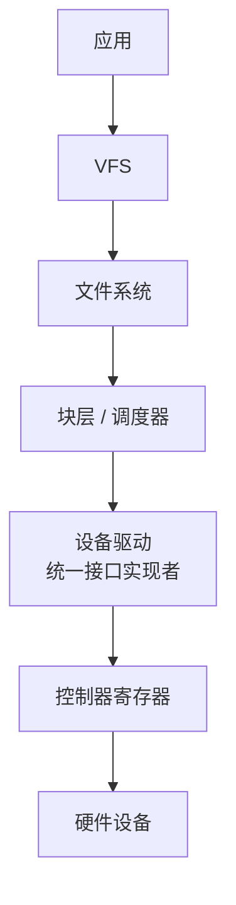
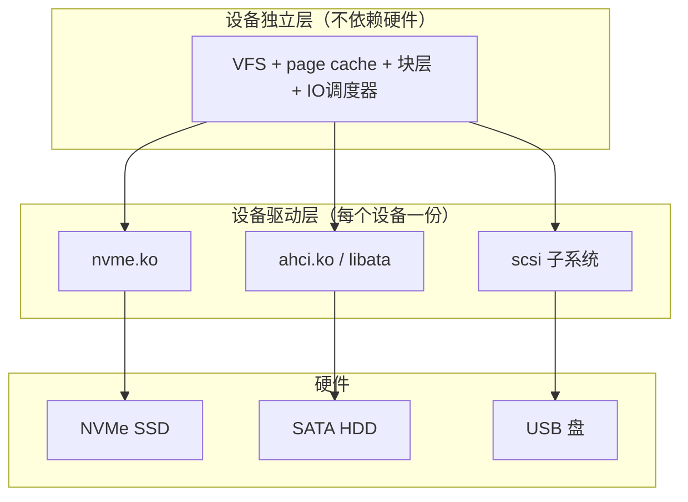
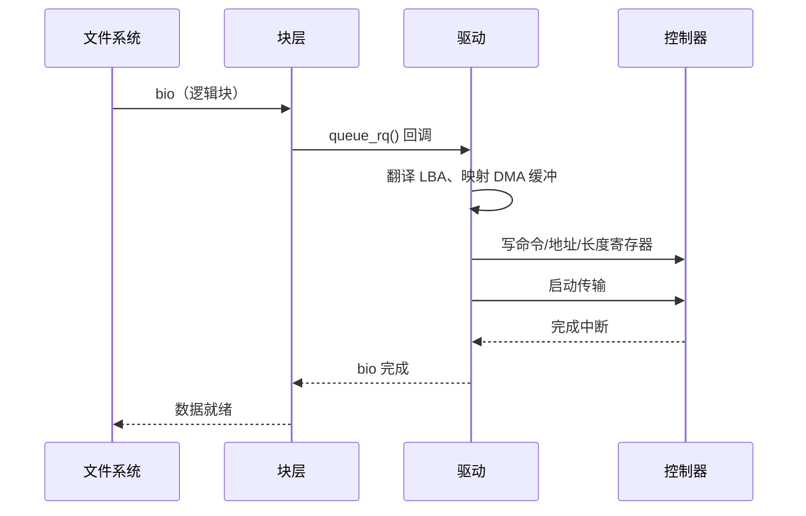

::: abstract 本章定位
内核怎么和一个"具体的、没见过的"设备打交道？答案：设备驱动——一段内核态代码，把设备的寄存器语言翻译成内核统一的接口。本篇讲驱动在内核 IO 结构中的位置、IO 请求怎么从通用层落到硬件、Linux 的统一设备模型（sysfs//dev/udev）、字符/块设备接口，以及模块加载。
:::

## 1. 设备驱动的角色

### 1.1 为什么需要驱动

设备控制器只认识"写寄存器、读寄存器"。文件系统想要"读扇区 42"，内核统一接口是 `submit_bio()`——但一个 NVMe 盘和一个老式 SATA 盘的寄存器布局完全不同。**驱动就是把"统一的内核请求"翻译成"具体设备的寄存器操作"**：

- 实现内核定义好的接口（读、写、ioctl、open/close...）。
- 维护设备私有的状态（队列、DMA 缓冲、中断上下文）。
- 处理设备产生的中断与错误。



::: important 驱动为什么必须进内核态
驱动要操作设备寄存器（特权指令）、响应中断、参与 DMA，这些都需要内核权限与 CPU 特权级。用户态程序无法直接触碰，所以驱动以内核模块形式加载。代价：驱动 bug 会直接搞崩内核——这正是驱动分层、接口约束的意义。
:::

### 1.2 驱动的两面

| 面向内核 | 面向设备 |
|---|---|
| 实现标准接口（`struct file_operations` / `block_device_operations`） | 读写控制器寄存器 |
| 注册进内核（设备号、中断处理） | 配置 DMA / 中断 |
| 响应上层的 bio / 系统调用 | 处理设备就绪/错误/完成中断 |

## 2. 内核 IO 结构：设备独立层 vs 设备驱动层

教材把内核 IO 分成清晰的层次，Linux 一一对应：

| 内核层（教材） | 职责 | Linux 对应 |
|---|---|---|
| **设备独立层**（device-independent） | 不关心具体硬件：缓冲、缓存、调度、错误处理、命名 | VFS、page cache、块层/调度器、设备号体系 |
| **设备驱动层**（device-driver） | 只关心一个硬件：翻译命令、中断、DMA 细节 | 各 `drivers/` 下的驱动代码 |
| **硬件层** | 物理设备 + 控制器 | 设备 |

分层的好处：

1. **隔离**：换一块盘（SATA→NVMe），上层文件系统完全无感。
2. **复用**：缓冲/缓存/调度逻辑写一次，所有驱动共用。
3. **可插拔**：驱动作为模块加载/卸载，内核本体不必重编译。



## 3. IO 请求到驱动的映射

以"读文件"为例，看请求如何逐层降级为寄存器操作：

```bash
# 应用层看到的
read(fd, buf, 4096)
```

1. **VFS/文件系统**：`fd` → inode → 算出逻辑块号 → 交给块层。
2. **块层**：构造 `struct bio`，`submit_bio()` 入队，IO 调度器可能重排/合并。
3. **驱动层**：`blk_mq_ops` / `block_device_operations` 的 `.queue_rq()` 被回调——驱动开始干活：
   - 把 bio 翻译成设备的 LBA（逻辑块地址）与长度。
   - 分配/复用 DMA 缓冲区，填写 DMAC 寄存器。
   - 写命令寄存器，启动硬件。
4. **硬件完成** → 驱动中断处理 → 唤醒等待进程 / 完成 bio → 向上逐层返回。



## 4. 统一设备模型：sysfs、/dev、udev

### 4.1 设备树：bus / device / driver

Linux 维护一棵**设备树**：每个物理设备是 `struct device`，挂在某条 **bus**（PCIe/USB/SATA/平台总线）上，并由某个 **driver** 驱动。`sysfs`（`/sys`）把这棵树导出成目录。

```bash
ls /sys/bus/                  # 有哪些总线
ls /sys/block/                # 所有块设备
ls /sys/bus/pci/devices/      # PCI 设备
cat /sys/block/nvme0n1/device/../../../class  # 顺着设备树看它挂在哪
```

| 目录/文件 | 含义 |
|---|---|
| `/sys/bus/&lt;bus&gt;/devices` | 总线上挂的设备 |
| `/sys/bus/&lt;bus&gt;/drivers` | 各总线已加载的驱动 |
| `/sys/block/&lt;dev&gt;/queue/scheduler` | 该设备的 IO 调度器 |
| `/sys/block/&lt;dev&gt;/queue/nr_requests` | 队列深度上限 |
| `/sys/class/net/eth0/statistics/` | 网卡统计 |

### 4.2 /dev 与设备号

设备对用户态表现为 `/dev` 下的**设备文件**，用 **主设备号（major）+ 次设备号（minor）** 标识：

- 主设备号 = 哪类驱动；次设备号 = 该驱动下第几个实例。
- `ls -l /dev/sda` 第一个字符 `b`（块）或 `c`（字符），后面两个数字就是主:次。

```bash
ls -l /dev/sda /dev/tty0
# brw-rw---- 1 root disk 8, 0 ... /dev/sda   块，主 8 次 0
# crw--w---- 1 root tty  4, 0 ... /dev/tty0  字符，主 4 次 0
mknod /tmp/mydev c 10 61     # 手动造一个字符设备节点（nvidia? 仅为示例）
```

### 4.3 udev：设备出现即管理

当设备被内核发现（热插拔、驱动匹配），`udev` 守护进程监听 **uevent**，根据规则：

- 在 `/dev` 下创建/删除设备节点（命名规则、权限、属主）。
- 加载固件、触发服务（如 `systemd` 挂载自动挂载）。

```bash
udevadm monitor            # 观察热插拔事件流
udevadm info -q path -n /dev/sda   # 设备节点 → sysfs 路径
```

::: tip sysfs 是"真相源"，/dev 只是它的"用户态名片"
设备管理真正的状态都在 `/sys`；`/dev` 的节点只是 `udev` 依据 `/sys` 里的设备信息生成的快捷入口。搞清这个三角关系，`/dev` 和 `/sys` 的神秘感就没了。
:::

## 5. 字符设备 vs 块设备驱动接口

### 5.1 两套操作集

| 接口 | 字符设备 | 块设备 |
|---|---|---|
| 打开/关闭 | `open` / `release` | `open` / `release` |
| 读写 | `read` / `write`（字节流，逐字节语义） | 走 `submit_bio` / `block_device_operations` |
| 控制 | `ioctl`（设备私有命令） | `ioctl`（如分区、直通参数） |
| 映射 | 可选 `mmap` | 页面可映射 |
| 批量传输 | 无，一次一个流 | 支持队列、合并、多 bio |

- 字符设备驱动核心：在 `struct file_operations` 里实现 `read`/`write`/`ioctl`，数据往往来自**缓冲区/中断**（如串口一个字节一个中断）。
- 块设备驱动核心：实现 `blk_mq_ops` 的 `queue_rq`，面对的是 **request 队列**，讲究批量与调度。

### 5.2 file_operations 结构简述

```c
/* 字符设备最常用的字段（省略了很多） */
struct file_operations {
    ssize_t (*read)(struct file *, char __user *, size_t, loff_t *);
    ssize_t (*write)(struct file *, const char __user *, size_t, loff_t *);
    long    (*ioctl)(struct file *, unsigned int, unsigned long);
    int     (*open)(struct inode *, struct file *);
    int     (*release)(struct inode *, struct file *);
    int     (*mmap)(struct file *, struct vm_area_struct *);
};
```

- 用户态 `read()` 触发系统调用，最终调用到注册的 `read` 回调（VFS 按设备文件找到驱动）。
- 回调里做两件事：把用户缓冲与内核/设备缓冲交换数据；返回实际字节数或错误码。
- 用 `ioctl` 传递"读寄存器、设参数"这类命令：`ioctl(fd, CMD, arg)` → 驱动里 `switch(cmd)` 分发。

## 6. 模块加载：insmod / modprobe / lsmod

驱动大多以内核模块（`.ko`）形式存在，可动态加载/卸载：

| 命令 | 作用 |
|---|---|
| `lsmod` | 列出已加载模块（看依赖 `Used by` 列） |
| `insmod xxx.ko` | 直接加载指定模块文件（不解析依赖） |
| `rmmod xxx` | 卸载模块 |
| `modprobe xxx` | 智能加载：自动解析依赖 + 按模块名查找（推荐） |
| `modinfo xxx` | 查看模块元信息（license、依赖、参数） |

```bash
lsmod | head -20                      # 当前模块
modinfo nvme | head -10               # 看 nvme 驱动信息
sudo modprobe xfs                     # 加载 xfs 文件系统模块
# 卸载前要确保没有进程在使用（Used by 列）
```

模块入口：

```c
#include <linux/module.h>
static int __init mydev_init(void) { /* 注册设备号、注册 file_operations */ }
static void __exit mydev_exit(void)  { /* 清理、注销 */ }
module_init(mydev_init);
module_exit(mydev_exit);
MODULE_LICENSE("GPL");
```

::: warning 模块与驱动的区别
驱动是"代码功能"，模块是"代码载体"。一个驱动可以被编译进内核（built-in），也可以做成模块。`/lib/modules/$(uname -r)/kernel/drivers/` 下就是所有可加载驱动的 `.ko`。
:::

## 7. 本章小结

- 驱动 = 内核与设备之间的**翻译官**：把统一请求翻译成寄存器操作，并处理中断/DMA。
- 内核 IO 三层结构：**设备独立层 / 驱动层 / 硬件**，分层带来隔离、复用与可插拔。
- Linux 统一设备模型：**bus–device–driver** 三要素，`sysfs` 导出为 `/sys`，`udev` 据此生成 `/dev` 节点。
- 设备文件用 **主:次设备号** 标识；字符设备接口是 `file_operations` 的 `read/write/ioctl`，块设备走 bio/request 队列。
- 模块用 `insmod/modprobe/lsmod/rmmod` 管理，`module_init/module_exit` 注册入口。
- 观察：`lsmod`、`/sys/bus`、`/sys/block`、`udevadm monitor`。

## 8. 自测题

1. **设备驱动存在的意义？**
   把内核统一接口翻译成具体设备控制器的寄存器操作，屏蔽硬件差异，处理中断与 DMA。
2. **驱动为什么要内核态？**
   操作寄存器需特权指令、要响应中断、参与 DMA，均需内核权限；代价是驱动 bug 可能拖垮内核。
3. **设备独立层与驱动层各干什么？**
   独立层：缓冲/缓存/调度/命名/错误处理，不依赖硬件；驱动层：一个硬件一套翻译逻辑。
4. **sysfs、/dev、udev 的关系？**
   sysfs 导出内核设备树（真相源），udev 监听设备事件并按规则生成/维护 /dev 节点。
5. **主设备号与次设备号含义？**
   主 = 哪类驱动，次 = 该类下第几个实例；`ls -l` 首字符 b/c + 主:次 即设备身份。
6. **字符设备与块设备驱动的核心差异？**
   字符驱动实现 file_operations 的 read/write 字节流语义；块驱动实现 blk_mq_ops 的 queue_rq、面向请求队列与批量调度。
7. **file_operations 中 read/write/ioctl 的职责？**
   read/write 交换数据并返回字节数或错误；ioctl 传设备私有命令（设参数/读寄存器）。
8. **modprobe 与 insmod 的区别？**
   insmod 直接加载指定文件不解析依赖；modprobe 按名称自动解析并加载依赖，日常更推荐。
