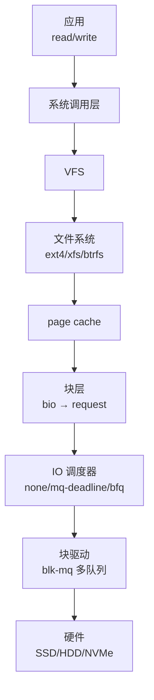

::: abstract 本章定位
前面讲清了机制，本篇量化它：吞吐量、延迟、IOPS 怎么测怎么读；Linux IO 栈每一层在数据路径上做什么；page cache 与 direct IO 如何取舍；NVMe/blk-mq 为什么是 SSD 时代的答案；以及用 iostat、sar、pidstat、blktrace 逐层定位瓶颈后怎么优化。
:::

## 1. 衡量 IO 的三个指标

### 1.1 指标定义

| 指标 | 定义 | 关注点 | 单位 |
|---|---|---|---|
| **吞吐量（throughput）** | 单位时间传输的数据量 | 带宽利用率 | MB/s、GB/s |
| **延迟（latency）** | 单个请求从发起到完成的时间 | 响应快慢、尾部延迟 | µs、ms |
| **IOPS** | 每秒完成的 IO 操作次数 | 小 IO 并发能力 | IO/s |

**关键关系**：`吞吐量 = IOPS × 单次请求大小`。HDD 的 IOPS 受寻道限制（百量级），SSD/NVMe 达十万到百万级；延迟上 NVMe 随机读 µs 级，HDD 随机读 ms 级。

### 1.2 为什么要分开看

- 顺序大块读（备份）：看**吞吐**，HDD 也能到 ~200MB/s，与 NVMe 差距没那么离谱。
- 随机小 IO（数据库）：看 **IOPS + 延迟**，HDD 直接崩溃，NVMe 碾压。
- **延迟的分布**比平均更重要：P99（99 分位）高意味着有用户"卡"；平均延迟被少数快请求拉低是假象。

::: warning 指标会骗人
平均延迟 5ms 很"好"？如果 P99 是 200ms，那 1% 的请求很惨。IO 场景务必看 **percentile**（如 `fio` 输出的 `clat percentiles`）。另外 HDD 顺序 vs 随机是两个物种，别拿顺序吞吐吹随机性能。
:::

```bash
# fio 一次性测三个维度（随机 4K 看 IOPS，顺序 1M 看吞吐）
fio --filename=/tmp/fio_test --direct=1 --rw=randread --bs=4k --ioengine=libaio \
    --iodepth=32 --size=1G --name=rand4k --output-format=json | \
    python3 -c "import json,sys;d=json.load(sys.stdin);j=d['jobs'][0];print('IOPS',j['read']['iops'],'clat P99(us)',j['read']['clat_ns']['percentile']['99.000000']/1000)"
```

## 2. Linux IO 栈全景

### 2.1 一条数据路径经过的层



| 层 | 关键对象 | 干什么 |
|---|---|---|
| VFS | `struct file` / `dentry` | 统一接口、fd 管理 |
| 文件系统 | inode / extent | 逻辑块号 ↔ 设备 LBA |
| page cache | `struct page` | 读写缓冲，write-back 落盘 |
| 块层 | `struct bio` | 拆分/合并请求、限流 |
| 调度器 | `struct request` | 排序、合并、公平 |
| 驱动 | `blk_mq` | 多队列派发到硬件 |

### 2.2 bio 与 request

- **bio**：描述"一段数据要读写"的块级单元，携带地址、长度、方向；是 **IO 请求的载体**（逻辑视图）。
- **request**：块层把 bio 组包成发给驱动的**硬件命令单元**；相邻 bio 会**合并**成更大的 request（减少硬件命令数与中断）。

```bash
cat /sys/block/nvme0n1/queue/scheduler   # 当前调度器
# none（NVMe 默认，因为硬件已处理排序）/ mq-deadline / bfq
cat /sys/block/nvme0n1/queue/nr_requests # 每队列请求上限（队列深度）
```

::: tip bio vs request 一句话
bio 是"我要什么"，request 是"给硬件一个打包好的命令"。合并 bio 减少硬件命令数，这是块层优化的第一抓手。
:::

## 3. page cache 与 write-back

- 读路径：未命中 → 读盘进 page cache → 拷贝给应用；命中直接内存返回。
- 写路径：写 page cache 标脏 → 返回；后台 flush 线程按阈值异步落盘。

```bash
cat /proc/meminfo | grep -E "^(Cached|Dirty|Writeback):"
# Dirty 高说明积压了很多待落盘数据（write-back 滞后）
sync            # 主动落盘
sysctl vm.dirty_ratio vm.dirty_background_ratio   # 查看脏页阈值
```

### 3.1 buffered IO vs direct IO

| 维度 | 缓冲 IO（默认） | direct IO（O_DIRECT） |
|---|---|---|
| 经过 page cache | 是 | 否（直通设备） |
| 性能 | 读写缓存加速 | 无缓存，裸设备速度 |
| 一致性 | 需要 fsync/sync 控制落盘 | 写即落盘（还需 fdatasync 才保证持久） |
| 适用 | 通用文件、读多写少 | 数据库、应用自有缓存、需要确定性 |
| 风险 | 掉电丢脏页 | 需要自己处理对齐与缓存 |

```bash
# 对比：缓冲 vs direct
dd if=/dev/zero of=/tmp/a bs=1M count=1024          # buffered
dd if=/dev/zero of=/tmp/b bs=1M count=1024 oflag=direct   # direct
# direct 往往更慢（没缓存），但胜在"说写就写"的确定性
```

::: warning direct IO 不是银弹
O_DIRECT 要求缓冲区**对齐**（块大小整数倍）且自己管理缓存；对读多写少的业务，放弃 page cache 通常得不偿失。数据库用它是因为**要自己掌控落盘时机与一致性**，而不是为了快。
:::

## 4. NUMA 与 IO

- NUMA（非一致性内存访问）：每个 CPU 有本地内存，跨节点访问变慢。
- IO 绑定：设备的 DMA 目标内存与处理该 IO 的 CPU 若跨 NUMA 节点，会有额外延迟。
- 手段：**IRQ 亲和**（把网卡/磁盘 IRQ 钉到靠近设备的 CPU）、`numactl` 绑定、NUMA 感知的驱动（NVMe 按 NUMA 节点分配队列）。

```bash
numactl --hardware        # 看节点拓扑
cat /proc/interrupts | grep nvme   # 看 nvme 队列的 IRQ 落在哪些 CPU
```

## 5. NVMe 与多队列（blk-mq）

### 5.1 为什么老路径不适合 NVMe

- 传统块层是**单一请求队列 + 全局锁**：SSD 快到 10 万+ IOPS 时，单队列成为瓶颈（锁竞争、无法并行）。
- AHCI/SATA 协议本身是**单队列、半双工**设计，为 HDD 而生。

### 5.2 blk-mq 怎么做

- **每 CPU 一个软队列**（写请求先入本地队列，无锁）→ 映射到设备的**多个硬件队列**（NVMe 支持数千队列）。
- 每个硬件队列对应一个 **IRQ**，Linux 自动把 IRQ 分散到不同 CPU——多核并行搬运，吞吐线性扩展。
- 现代 SSD/NVMe 就靠 blk-mq 把 IOPS 推到百万级。

```bash
lscpu | grep NUMA
cat /proc/interrupts | grep -E "nvme|eth"   # 多队列：每队列一个 IRQ
ls /sys/block/nvme0n1/mq/                   # 多队列结构可见
```

## 6. 性能观测工具

| 工具 | 看什么 | 典型命令 |
|---|---|---|
| `iostat -x` | 块设备利用率、await、svctm、队列长度 | `iostat -x 1` |
| `sar -d` | 历史/实时的磁盘吞吐与利用率 | `sar -d 1 5` |
| `top` / `uptime` | 整体 `wa`（iowait）占比 | `top` |
| `pidstat -d` | 每个进程的 IO 速率 | `pidstat -d 1` |
| `iotop` | 交互式看谁在读写 | `iotop` |
| `blktrace` / `blkparse` | 块层的详细请求轨迹（合并/派发/完成时间） | `blktrace -d /dev/nvme0n1` |
| `fio` | 构造负载测基准 | 见上文 |
| `strace -e read,write` | 应用视角系统调用 | `strace -p &lt;pid&gt;` |

```bash
# 一块盘的实时状态
iostat -x 1
# %util: 设备"忙"时间占比；await: 平均服务+等待时间；aqu-sz: 队列深度
# 注意 %util 100% 不一定是坏——NVMe 的 %util 会失真，要配合 IOPS/await 看
sar -d 1 5 | grep -v Linux
# tps、rd_sec/s、wr_sec/s、%util
```

::: warning iowait 的解读陷阱
`wa` 高只代表"CPU 有空闲但任务卡在 IO 等待"，**不代表磁盘慢**——可能是进程被文件锁、网络等阻塞。要结合 `pidstat -d`（谁在 IO）、`iostat -x`（盘到底忙不忙）交叉判断。NVMe 因延迟低，`wa` 往往不高，别以为它一定没瓶颈。
:::

## 7. 常见 IO 优化手段

| 手段 | 原理 | 场景 |
|---|---|---|
| **预读（readahead）** | 检测到顺序读，提前多读几块进 cache | 顺序大文件（备份、日志分析） |
| **批处理/合并** | 合并相邻 bio、调高队列深度，减少硬件命令数与中断 | 数据库批量写 |
| **异步化** | 用 `io_uring`/`aio` 让一个线程管理海量在途 IO | 高并发小 IO（Web/存储服务） |
| **direct IO 取舍** | 需要确定性时绕过 cache | 数据库、日志强制落盘 |
| **调整调度器** | HDD 用 mq-deadline/bfq，SSD 用 none | 按介质选择 |
| **IRQ 亲和 / NUMA** | 中断与缓冲靠近处理 CPU | 多核高负载 |
| **SSD 直连** | NVMe/PCIe 直通、跳过 PCH | 低延迟存储服务 |
| **IO 队列深度** | 增大 iodepth 让设备始终有活干 | fio/数据库并发 |

**优化优先级心智模型**：先减请求数（合并/预读）→ 再减等待（异步/调度）→ 最后才是硬件（换 SSD/加队列）。90% 的"IO 慢"是上层没用好，而不是盘不够快。

## 8. 本章小结

- 三大指标：**吞吐量、延迟（看分位）、IOPS**，三者由 `吞吐=IOPS×大小` 关联，场景决定看哪个。
- Linux IO 栈：VFS → 文件系统 → page cache → 块层（bio/request）→ 调度器 → blk-mq 驱动 → 硬件。
- bio 是请求，request 是打包给硬件的命令；**合并**是第一优化。
- page cache 让读写"假快"，write-back 异步落盘；direct IO 换确定性，需自管缓存。
- NUMA 影响 IO 延迟，靠 IRQ 亲和与队列分布缓解。
- **blk-mq** 用多软队列 + 多硬件队列 + 多 IRQ 撑起 NVMe 的百万 IOPS。
- 观测用 iostat/sar/pidstat/blktrace/fio；优化按"减请求→减等待→换硬件"的顺序。
- 综合排查见 [排查](/kb/os/问题排查/04-磁盘与IO瓶颈排查/)，Linux 实操见 [Linux](/kb/os/Linux/04-LinuxIO与性能监控实操/)。

## 9. 自测题

1. **吞吐量、延迟、IOPS 的关系？各看什么场景？**
   吞吐=IOPS×请求大小；顺序大 IO 看吞吐，随机小 IO 看 IOPS 与延迟（尤其分位）。
2. **为什么平均延迟会骗人？**
   平均值被少数极快请求拉低；高并发场景 P99/P999 决定用户体验，必须看分布。
3. **bio 与 request 的区别？**
   bio 是逻辑 IO 单元；request 是块层把 bio 合并打包给硬件执行的命令，合并能减少硬件命令数与中断。
4. **缓冲 IO 与 direct IO 的取舍？**
   缓冲 IO 借 page cache 加速但有掉电丢数据风险；direct IO 绕过缓存、落盘确定，但要求对齐且需自管缓存，适合数据库类业务。
5. **page cache 的 write-back 如何工作？**
   写先标脏进 cache、立即返回；后台 flush 线程按 dirty 阈值批量落盘；fsync/sync 强制提前落盘。
6. **传统单队列块层为什么撑不住 NVMe？**
   单队列全局锁竞争、无法多核并行；NVMe 需要多队列并发搬运。
7. **blk-mq 如何做到百万 IOPS？**
   每 CPU 软队列（无锁）映射多硬件队列，每队列一个 IRQ 且分散到多核，并行度随核扩展。
8. **为什么 SSD 上推荐 none 调度器、HDD 上推荐 mq-deadline/bfq？**
   SSD 随机延迟极低、需要低延迟与公平，硬件已足够快，调度反而引入排队开销；HDD 依赖磁头寻道，需要调度器做电梯排序/防饿死。
9. **iowait 高一定代表磁盘慢吗？**
   不一定，可能只是线程阻塞在 IO 上；要配合 iostat 的 %util/await 与 pidstat 确认瓶颈到底在哪一层。
10. **按什么顺序优化 IO？**
    减请求数（合并/预读/批处理）→ 减等待（异步/调度/队列深度）→ 硬件升级（SSD 直连、NVMe、多队列）。
