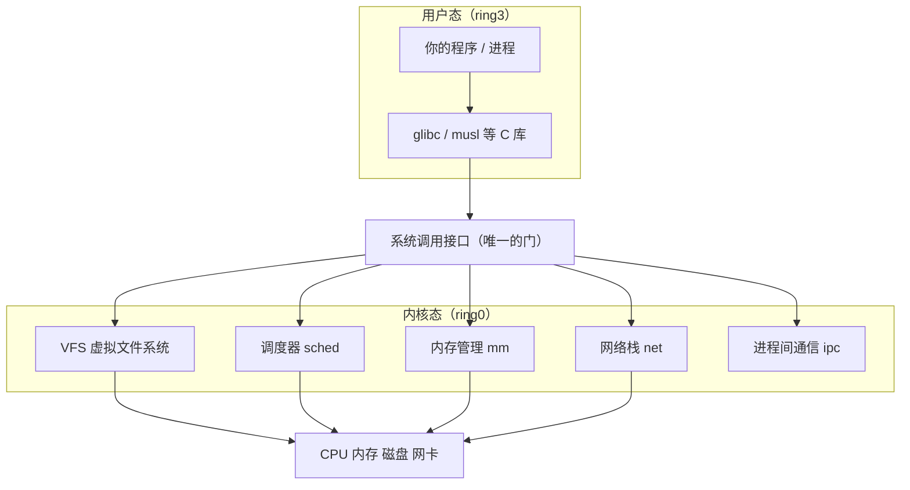
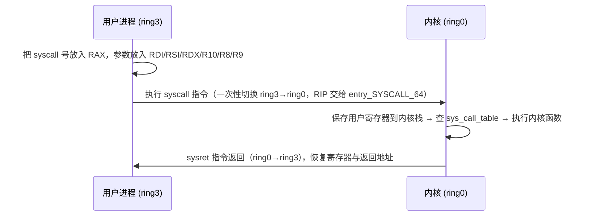
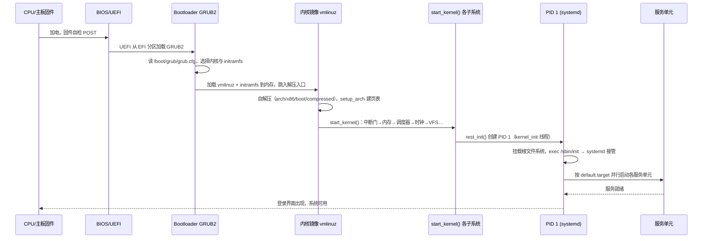
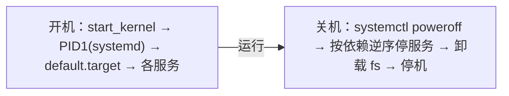

::: abstract 本章定位
实操篇用命令"看现象"，本系列回答"内核为什么这样设计"。本篇建立**"内核是台独立机器"**的心智模型：它运行在更高特权级上，有自己的地址空间与资源表，你的程序只是"租户"，靠系统调用提出请求。讲清整体架构、用户态/内核态边界、系统调用、模块组织、启动链路与并发模型，为 [Linux进程与线程内核原理](/kb/os/Linux/08-Linux进程与线程内核原理/) 与 [Linux调度器原理](/kb/os/Linux/09-Linux调度器原理/) 打地基。
:::

实操篇里你用过 `ps` 看到 PID 1 的 systemd、用 `strace` 抓到每一次系统调用、用 `dmesg` 看过启动日志——它们背后是同一个内核。本篇把镜头拉远：**先看整台"内核机器"长什么样，再看它是怎么被点燃（启动）的，最后看进程怎么合法地敲它的门（系统调用）。**

## 1. Linux 内核是什么

### 1.1 三种内核架构

操作系统内核解决同一个问题：**在多个程序之间安全地复用硬件**。按"把多少服务放进内核"来分，有三种设计：

| 架构 | 核心思想 | 代表 | 优点 | 缺点 |
|---|---|---|---|---|
| **微内核** | 内核只保留 IPC 与最小机制，驱动、文件系统、调度都搬到用户态服务器 | Mach、Minix、QNX | 模块隔离好、崩溃可重启、易移植 | 用户态↔内核态来回拷贝与切换，性能差 |
| **单体内核** | 几乎所有系统服务都在一个内核进程里，函数直接互调 | Linux、经典 UNIX、BSD | 无跨态开销，性能好，代码紧耦合协作高效 | 一处 bug 可能整机崩溃，体积庞大 |
| **混合内核** | 宏内核 + 模块化，把可延迟的部分做成可加载模块 | Windows NT、macOS XNU | 兼具性能与部分弹性 | 本质仍是"大内核"，隔离不彻底 |

### 1.2 Linux 为何选单体内核

Linus 在 1991 年起步时就是单体内核（受了 MINIX 的启发又反对其微内核理念）。**性能是首要原因**：文件系统读一个字节，单体内核里就是 `read()` → VFS → ext4 → 块层几次普通函数调用；微内核要跨两次进程间通信，每个 IPC 都是一次上下文切换 + 多次内存拷贝。Linux 赌的是"我让内核代码尽量正确，再用模块把驱动这类易错件做成可拆卸的"。

::: tip 可加载模块弥补了单体内核最大的短板
驱动、文件系统、网络协议都能编译成 `.ko` 模块，运行时 `modprobe` 插进去、`rmmod` 拔下来。这样"单体内核 + 动态模块"两者兼得：核心是紧凑的单体，周边是可热插拔的零件。
:::

| 单体内核的优点 | 单体内核的缺点 | 模块机制如何弥补 |
|---|---|---|
| 系统调用直达，无跨态 IPC 开销 | 代码量大，易错区域多 | 驱动/文件系统等从内核分离为 `.ko` |
| 组件间数据共享零拷贝 | 一个 bug 可能带崩整机 | 模块可卸载、可单独升级 |
| 编译/部署简单 | 配置项爆炸（`menuconfig` 几千项） | 只有需要的模块才加载 |

### 1.3 内核的定位：资源管理器 + 抽象层



内核的两副面孔：
- **资源管理器**：CPU（调度器把 CPU 时间片分给进程）、内存（地址空间与页表）、磁盘（VFS 统一文件视图）、设备（驱动）。所有进程抢的硬件资源，由内核仲裁。
- **抽象层**：进程眼里没有"SATA 控制器"和"NVMe"，只有一个统一的 `read(fd, buf, n)`。内核把千差万别的硬件收敛成一套 POSIX 接口——这是 Linux 能跑在从单片机到超算上的原因。

### 1.4 GNU/Linux 生态组成

严格说，"Linux" 只是**内核**。完整操作系统是：

```
Linux 内核（GPL）
   └─ GNU 用户态：glibc（系统调用的 C 库封装）、coreutils（ls/cp/mv）、bash
   └─ 初始化系统：systemd（现代）或 SysVinit/OpenRC
   └─ 图形与显示：X.Org / Wayland
   └─ 发行版层：Debian/Ubuntu、Fedora/RHEL、Arch、openSUSE……负责把上面打包装盘
```

你装一个发行版时，内核只是其中很小一个包（`linux-image-*`），`ps` 是 coreutils、`systemd` 是 init 系统——它们和内核分属不同项目，只是约定通过内核的接口协作。

## 2. 内核态与用户态

### 2.1 特权级：x86 与 ARM

CPU 原生支持多特权级，保证"普通代码碰不到关键资源"：

| 平台 | 特权级 | Linux 用法 |
|---|---|---|
| x86/amd64 | `ring 0`（最高）~ `ring 3`（最低） | ring0 = 内核态，ring3 = 用户态，ring1/2 **闲置不用** |
| ARM（AArch64） | `EL0` ~ `EL3` | EL0 = 用户态，EL1 = 内核态，EL2 = 虚拟化 hypervisor，EL3 = 安全世界 |

::: tip 记住口诀
x86 的 ring0/ring3 与 ARM 的 EL1/EL0 是同一个东西的两种叫法：**内核在最高特权级，用户在最低特权级，中间隔离层是 MMU + 特权级位**。CPU 靠当前特权级（x86 的 CPL）决定能否执行特权指令（如开中断 `sti`、改页表、读写控制寄存器）和能否访问受保护的内存。
:::

### 2.2 为何要分离

1. **隔离故障**：普通程序崩了只是 `Segmentation fault`，不会改掉别的程序的内存，更不会毁掉内核自己——因为特权指令和受保护页用户态根本碰不到。
2. **安全边界**：所有对硬件、对其他进程资源的访问都必须经过内核审查（权限、capability、LSM），恶意用户代码无法直接读写物理内存。
3. **统一仲裁**：时间片、内存分配由内核集中调度，不会出现程序互相抢占资源。

### 2.3 进入与返回：系统调用是唯一合法入口

用户态无法"直接跳进"内核，必须通过硬件机制完成**状态切换**。x86_64 上的路径：



**进入内核的唯一合法途径**有三类，统称"陷入（trap）"：

| 方式 | 说明 |
|---|---|
| **系统调用** | `syscall`/`sysret`（64 位快路径）、`sysenter`（32 位）、`int 0x80`（32 位老式）——主动请求服务 |
| **中断（interrupt）** | 硬件异步通知，如时钟中断、网卡中断，内核被动进入处理 |
| **异常（exception）** | CPU 执行出错，如缺页（page fault）、除零 |

只有第一条是用户程序能"合法主动"进入的方式，这正是"系统调用是唯一入口"的含义——剩下两条都是内核硬拉着你进来的。

### 2.4 看内核的影子：/proc/kcore 与 /proc/version

`/proc` 是内核自己暴露的用户可见接口，实操篇天天在用它。这两个文件直接反映"内核这台机器"：

```bash
cat /proc/version          # 内核编译时的版本信息（就是 start_kernel 里打印的 linux_banner）
sudo ls -lh /proc/kcore    # 内核内存的 ELF core dump，需 root
```

- `/proc/version`：输出 `Linux version 6.6.x-generic (gcc…) #… SMP …`，和 `uname -a` 同源（都来自 `utsname()`），包含编译工具链、处理器型号。
- `/proc/kcore`：把**正在运行的内核的虚拟内存**以 ELF core 文件形式导出，大小约等于物理内存。配合 `gdb vmlinux /proc/kcore` 可以调试运行中的内核——这是"内核是台独立机器"最直观的证据：它有自己完整的地址空间，你平时 `ps` 看到的进程地址空间只是它的"租户"。

::: warning 不要直接 cat 大文件
`/proc/kcore` 禁止 `cat` 全文读取（会触发保护甚至挂起），只能用调试器或工具按需读取。`/proc/meminfo` 才是看内存用量该用的文件。
:::

## 3. 系统调用机制

实操篇（[Linux网络与系统调用实操](/kb/os/Linux/05-Linux网络与系统调用实操/)）用 `strace` 观察到了系统调用的"外表"，本篇补上"内核内部怎么定义和分发"。

### 3.1 内核里怎么定义一个系统调用：SYSCALL_DEFINEn

内核源码（如 `fs/read_write.c`）里，`read` 是这样定义的：

```c
SYSCALL_DEFINE3(read, unsigned int, fd, char __user *, buf, size_t, count)
{
    struct fd f = fdget_pos(fd);
    ...
    return ret;
}
```

`SYSCALL_DEFINE3` 名字里的 `3` = 3 个参数，宏（`include/linux/syscalls.h`）把它展开成真实的函数 `__do_sys_read(fd, buf, count)`，并为每个架构生成对应的入口包装（x86_64 上是 `__x64_sys_read`）。参数里的 `__user` 标记告诉编译器这些指针来自用户空间，内核代码不能盲目解引用，必须先经过 `copy_from_user()`/`copy_to_user()` 校验——**防止用户传一个非法地址进来把内核弄崩**。

### 3.2 系统调用号表

每个系统调用有个固定编号，查表分发：

- **x86_64**：`arch/x86/entry/syscalls/syscall_64.tbl`（源码），编译生成 `asm/unistd_64.h`；用户侧可见于 `/usr/include/asm/unistd_64.h`。`read=0`、`write=1`、`open=2`、`close=3`、`getpid=39`、`fork=57`、`execve=59`、`exit=60`。
- **通用表**：新架构（arm64、riscv）用 `/usr/include/asm-generic/unistd.h`，编号从 `__NR_io_setup=0`、`__NR_read=63` 排起，与 x86 不同——**系统调用号是架构绑定的，跨架构不能直接拿数字用**。

```bash
grep -E '__NR_(read|open|getpid|execve)' /usr/include/asm/unistd_64.h
```
::: warning 系统调用号是 ABI
号一旦发布就不能改（改了所有已编译程序全崩），新调用只能往后追加编号。这是"稳定 ABI"承诺的最硬约束。
:::

### 3.3 glibc 封装与 syscall()

用户程序几乎不会直接写汇编，C 库把它包好了：

| 层 | 形式 | 例子 |
|---|---|---|
| C 库封装 | `read()`、`open()`，glibc 内部完成寄存器填充 + `syscall` 指令 | 99% 的程序 |
| 通用接口 | `long syscall(long number, ...)`（`<sys/syscall.h>`）手动指定调用号 | 新调用无封装时用 |
| 汇编/内联 | 手写 `syscall` 指令 | 极少场景 |

glibc 的封装会做一件事：内核用**负返回值**表示错误（如 `-ENOENT`），glibc 把它转成 `-1` 并设置 `errno`。所以 C 程序里 `if (read(...) == -1) perror(...)` 才成立。

### 3.4 执行路径：syscall/sysret vs int 0x80

| 指令 | 架构 | 速度 | 备注 |
|---|---|---|---|
| `syscall`/`sysret` | x86_64（64 位进程） | 最快 | 现代默认路径；CPU 自动把 RIP 存到 RCX、RFLAGS 存到 R11，一键切特权级 |
| `sysenter`/`sysexit` | 32 位兼容 | 较快 | 曾用于 32 位快路径 |
| `int 0x80` | 32 位 | 慢 | 走完整 IDT 中断门，保留给老程序 |

`syscall` 之所以比 `int 0x80` 快，是因为前者是 CPU 指令级的特权级切换（一条指令完成，不带中断向量查找/压栈），后者要走完整的中断描述符表流程。**进程内切换开销的绝大部分不是这几条指令，而是内核要保存/恢复大量寄存器、更新 TSS、可能触发 TLB 刷新与调度**。

### 3.5 参数传递与开销

```text
系统调用号 → RAX
参数1..6   → RDI, RSI, RDX, R10, R8, R9   （第 7 个及以上要压栈）
返回值     → RAX
```

开销量级：一次系统调用约 **百纳秒到微秒**级（保存恢复寄存器 + 用户/内核栈切换 + 可能的地表刷新），而普通函数调用只需约 1ns。**这就是为什么高性能代码会做系统调用批处理**（`readv`/`writev`、`io_uring`、`splice`）——把多次进门的成本压成一次。

### 3.6 strace 看到的边界

```bash
strace -e trace=read,write dd if=/dev/zero of=/dev/null bs=1 count=5
```
```
read(0, "\0\0\0\0\0", 1) = 1
write(1, "\0", 1)            = 1
...
```

`strace` 基于 `ptrace` 在**每个系统调用的入口和出口各停一下**，所以它能同时看到：这次调用（入口边界）和内核返回的结果（出口边界）。它"看得见"的只是进门/出门的瞬间，看不见门里的实现——这正是 05 篇用它诊断"进程卡在哪一步"的原理：卡住 = 进了门但很久没出来（如 `read` 在等磁盘）。**`strace` 每次都会拖慢目标进程几十倍**，生产环境务必谨慎（呼应 [篇](/kb/os/Linux/05-Linux网络与系统调用实操/) 的警告）。

## 4. 内核的模块与组织

### 4.1 源码顶层目录

Linux 源码（`torvalds/linux`，约 3 万文件）顶层目录即功能地图：

| 目录 | 职责 | 关键内容 |
|---|---|---|
| `arch/` | **架构相关**，每个 CPU 一个子目录 | `x86/`、`arm64/`、`riscv/`；页表、启动、中断向量 |
| `kernel/` | 内核核心 | 调度（`sched/`）、进程（`fork.c`）、信号、中断、模块、printk |
| `mm/` | 内存管理 | 页分配器（`page_alloc.c`）、虚拟内存（`vm_*`）、slab |
| `fs/` | 文件系统 | VFS（`vfs_*`）+ 具体 fs（`ext4/`、`proc/`、`sysfs/`） |
| `net/` | 网络协议栈 | `ipv4/`、`socket.c`、协议族（TCP/IP/UDP） |
| `ipc/` | 进程间通信 | SysV 消息/信号量/共享内存 |
| `drivers/` | 设备驱动 | 体积最大的目录，按总线/类型分（`net/`、`block/`、`gpu/`…） |
| `init/` | 启动初始化 | `main.c` 里的 `start_kernel()` |
| 其他 | `block/` 块设备层、`crypto/` 加密、`security/` LSM、`include/` 头文件、`tools/` 与 `scripts/` 构建工具 |

### 4.2 模块机制

```bash
ls /lib/modules/$(uname -r)/            # 当前内核版本的模块树
lsmod                                    # 已加载模块（读 /proc/modules）
modinfo ext4                             # 模块元信息：描述、作者、license
sudo insmod ./mymod.ko                   # 直接插入
sudo modprobe nvme                       # 按依赖自动插入（读 modules.dep）
sudo rmmod nvme                          # 卸载
```

- `insmod` 只加载指定文件；`modprobe` 会解析 `modules.dep` 依赖表，自动把依赖模块一起装上——**这是两者最本质的区别**。
- 每个模块声明 license：`MODULE_LICENSE("GPL")`。加载非 GPL 模块后内核被标记为"被污染（tainted）"，并在崩溃时拒绝提供符号帮助——GPL 是内核生态的法律底座。
- 模块加载在 `sysctl kernel.modules_disabled` 置 1 后会被禁止（安全加固常见手段）。

### 4.3 内核模块 vs 应用程序

| 维度 | 内核模块 | 应用程序 |
|---|---|---|
| 运行空间 | 内核态（ring0） | 用户态（ring3） |
| 特权 | 与内核同权，能碰任何内存 | 受限，只能碰自己的地址空间 |
| 入口 | 模块注册的回调（如 `module_init`） | `main()` |
| 出错后果 | 一个 bug 可能 panic 整机 | 通常只是进程崩掉 |
| 链接方式 | 与内核符号表链接 | 与 C 库/动态库链接 |
| 内存保护 | 无 MMU 保护，全靠自律 | 有 MMU 隔离 |
| 可移植性 | 强绑定内核版本与配置 | 一般只看 ABI |

### 4.4 内核版本号

```bash
uname -r        # 例如 6.6.15-amd64
uname -v        # 编译号 #1 SMP …（与 /proc/version 一致）
```

版本号语义：**主.次.修订**（`6.6.15`）。Linus 每 9~10 周发一个主线版（`6.7`、`6.8`…）；稳定版在 `kernel.org` 维护；**LTS（长期支持）版**（`6.6`、`6.1`、`5.15`、`5.10`…）由志愿者维护数年，服务器发行版选它。老内核（2.6 时代）曾用"奇数=开发版"，**现代版本号不再这样约定**。

## 5. 启动流程全链路

从按下电源键到看见登录界面，一路的守护者依次交接：



### 5.1 硬件加电 → 引导程序

1. 按下电源，CPU 先执行固件（**UEFI**，老机器是 BIOS）自检：枚举内存、CPU、磁盘。
2. UEFI 扫描 **EFI 系统分区**（ESP，`/boot/efi`），找到并加载 **GRUB2**。
3. GRUB2 读取 `/boot/grub/grub.cfg`（Ubuntu/Debian 上由 `update-grub` 生成），列出内核菜单。选中后它把两个东西放进内存：
   - **vmlinuz**：压缩过的内核镜像（`/boot/vmlinuz-$(uname -r)`），内含自解压程序；
   - **initramfs**：早期根文件系统（`/boot/initrd.img-*`），内含加载根文件系统所需的驱动（磁盘控制器、LVM/LUKS 等）。
4. 跳入 vmlinuz 解压入口，内核解压自身、进入保护模式、建立早期页表，随后进入 C 世界的 `start_kernel()`。

### 5.2 start_kernel()：C 语言的第一个函数

`init/main.c` 的 `start_kernel()` 是**架构无关的启动核心**。它以 `pr_notice("%s", linux_banner)` 打印版本横幅开始——这就是 `dmesg` 第一行 `Linux version …` 的来源。

### 5.3 子系统初始化顺序（以 v6.6 为例）

```text
start_kernel()
 ├─ boot_cpu_init()           启动 CPU 的初始化
 ├─ pr_notice(linux_banner)   打印版本横幅 → dmesg 第一行
 ├─ setup_arch(&command_line) 架构相关：页表、内存布局、cmdline 解析
 ├─ trap_init()               异常/中断门的初始化（还没开中断）
 ├─ mm_core_init()            内存管理早期初始化（旧版内核叫 mm_init）
 ├─ sched_init()              调度器初始化（赶在开中断之前！）
 ├─ workqueue_init_early() / rcu_init()
 ├─ early_irq_init() → init_IRQ()   中断控制器（PIC/APIC/GIC）
 ├─ init_timers() / hrtimers_init() / softirq_init()
 ├─ timekeeping_init() / time_init()   时钟与时间基准
 ├─ local_irq_enable()        开中断 —— 此后内核可被外部事件打断
 ├─ console_init()            早期控制台（enable printk 输出）
 ├─ vfs_caches_init() / signals_init() / proc_root_init()
 └─ arch_call_rest_init() → rest_init()   创建 PID 1 与 PID 2，进入空转
```

::: tip 顺序背后的因果
`sched_init()` 必须在 `init_IRQ()` 之前：因为一旦开了时钟中断，调度器就得能工作。内存先于调度、调度先于中断、中断先于时间、时间先于文件系统——**每一行初始化都在为下一行准备"可运行的环境"，倒过来任何一步都会死锁或空指针**。
:::

### 5.4 rest_init()：诞生 PID 1 与 PID 2

`rest_init()` 干三件事：

1. 创建 **`kernel_init` 内核线程** → 它成为 **PID 1**，后续会 `exec` 用户空间的 `/sbin/init`（systemd）。
2. 创建 **`kthreadd` 内核线程** → **PID 2**，专职孵化其他内核线程（`ps -ef` 里 `[kthreadd]`）。
3. 启动 CPU 进入 **idle 空转**（`cpu_startup_entry`）——这就是 PID 0 的 `swapper`。

之后 `kernel_init` 按顺序：`smp_init()` 唤醒其他 CPU → `do_basic_setup()` 跑 `do_initcalls()`（把编译进内核的各子系统初始化函数按 `core→postcore→arch→subsys→fs→device→late` 七级顺序执行）→ 挂载根文件系统（`prepare_namespace`，按 `root=` 参数找设备，找不到则 `panic`）→ `free_initmem()` 释放启动期临时内存 → 依次尝试 `/sbin/init`、`/etc/init`、`/bin/init`、`/bin/sh`（最后这个 `sh` 是修复模式兜底）。

### 5.5 用 dmesg 观察启动段

```bash
dmesg -T | less                # -T 把时间戳转成可读时间
dmesg | grep -i 'Linux version'   # 版本横幅（start_kernel 第一行）
dmesg | grep -iE 'Command line|Memory:|sched|IRQ'   # 关键阶段
journalctl -k                  # systemd 下等同 dmesg 的持久化版本
```

预期能看到：`Linux version 6.6.x` → `Kernel command line: …` → 内存探测 → `sched_clock` → 各驱动 `initcall` → `Run /sbin/init as init process` → `systemd[1]: …`。**这一串日志就是 5.3 节那张顺序表的实录**。

## 6. 进程 0 与 PID 1

### 6.1 swapper：PID 0（idle）

- **PID 0 = `swapper`**，是内核静态定义的第一个任务（`init_task`），没有由 `fork` 产生，只在每个 CPU 上以 idle 身份存在：当该 CPU 没有可运行进程时，就执行 `cpu_idle()` 空转（通常是 `hlt`/`wfi` 指令省电）。
- 它不创建自 `/proc` 之外的任何可见进程，但 `ps` 里的 `[swapper/0]`、`[kthreadd]` 这一排内核线程都是它的后代（经 kthreadd）。实操篇里 `ps` 看到 `PID 2 kthreadd`、`PID 0` 显示为 `sched`/`0` 的空线程，就是这条链。

### 6.2 systemd：PID 1

```bash
ps -p 1 -o pid,comm,args
cat /proc/1/comm        # systemd
```

systemd 被 `exec` 为 PID 1 后，取代内核线程身份成为用户态"众进程之祖"（孤儿进程都由它收养）。它的职责：

- 解析 `/etc/systemd/system/` 与 `/usr/lib/systemd/system/` 下的 **unit**（`.service`、`.target`、`.socket`…）；
- 按 `default.target` 的依赖图**并行启动**服务（并行是 systemd 相比 SysVinit 的顺序脚本最大的提速点）；
- 用 **cgroup v2** 把每个 unit 的进程装进独立 cgroup，实现资源统计与统一停止（`systemctl kill` 能整组杀）。
- 还常驻 `journald`（日志）、`udevd`（设备事件）、`dbus`（IPC）等系统服务。

### 6.3 启动 vs 关机流程



| 阶段 | 开机 | 关机 |
|---|---|---|
| 顺序 | 内核 → PID1 → 按 `default.target` 正向启动 | 按依赖**逆序**停止 → 写回缓存 → 卸载文件系统 |
| 触发器 | 加电/重启 | `systemctl poweroff`/`reboot`/`halt`（等价命令会走 `reboot(2)` 系统调用） |
| 内核态 | `kernel_power_off()`/`machine_restart()` | 发送 ACPI 电源事件或复位 |

::: tip `reboot` 是系统调用
关机最后一步 `reboot(LINUX_REBOOT_CMD_POWER_OFF)` 同样是系统调用——你第 3 节学到的"唯一入口"，连关机这种"反方向的事"也不例外。
:::

## 7. 内核并发模型

### 7.1 内核抢占

现代 Linux 可配置抢占粒度，用 `make menuconfig` 的 `CONFIG_PREEMPT*` 选项选择：

| 配置 | 场景 | 含义 |
|---|---|---|
| `CONFIG_PREEMPT_NONE` | 服务器 | 内核态任务不抢占，只有时间片到才切换，吞吐优先 |
| `CONFIG_PREEMPT_VOLUNTARY` | 服务器 + 低延迟 | 内核代码在"自愿让出点"检查调度 |
| `CONFIG_PREEMPT` | 桌面/实时性 | 内核态也可被更高优先级任务抢占，响应快 |
| `CONFIG_PREEMPT_RT` | 实时系统 | 近乎完全可抢占 + 大量锁改 rtmutex |

无论哪种，**用户态进程总是可被抢占的**（随时可能被换下 CPU）——这正是 [Linux调度器原理](/kb/os/Linux/09-Linux调度器原理/) 的地基。

### 7.2 中断上下文 vs 进程上下文

内核里"正在执行的代码"分两种身份，处理方式完全不同：

| | 进程上下文 | 中断上下文 |
|---|---|---|
| 谁在跑 | 某个 task，`current` 有效 | 中断向量，`current` 无意义 |
| 能否睡眠/阻塞 | 可以 | **绝对不行** |
| 能否拿自旋锁 | 可以（也要谨慎） | 可以（但不能 sleep） |
| 典型场景 | 系统调用主体、workqueue | 网卡/时钟中断的 top half |

### 7.3 推迟工作：softirq / tasklet / workqueue

中断处理要"尽快收尾"，耗时的活推迟到后面做，这就是**下半部（bottom half）**三兄弟：

| 机制 | 运行上下文 | 特点 | 状态 |
|---|---|---|---|
| **softirq** | 中断上下文 | 固定类型（网络收发、块 IO），并发度由 CPU 数决定 | 网络栈仍大量使用 |
| **tasklet** | 中断上下文 | softirq 的简化版，同一 tasklet 串行执行 | 已标记废弃（推荐改 workqueue） |
| **workqueue** | 进程上下文（kworker 线程） | 可睡眠、可加锁久等，基于线程池 | 现代驱动首选 |

为什么有这么多机制？因为"推迟"也分能睡不能睡：**中断上下文的软中断不能睡，只能用自旋锁；要睡的工作得交给可睡眠的 workqueue 线程**。

### 7.4 为什么内核里要用自旋锁

- 用户态锁（互斥锁/信号量）sleep 时让出 CPU，代价是上下文切换；内核中断上下文里**根本无法 sleep**，只能"原地转圈"等待，即自旋（spin）——这就是自旋锁存在的根本原因。
- 内核里的普通互斥锁（`mutex`）可以睡眠，但**它也必须遵守"不持锁睡眠进入中断上下文"**的纪律。
- 自旋锁适合临界区极短（几条指令，如修改一个计数器）的场景；临界区长就该换 workqueue/互斥锁，否则多核上自旋浪费 CPU。更细的取舍见 [同步原语](/kb/os/同步异步/02-信号量与同步原语/) 篇，本篇先记住结论：**"内核态能不能睡"决定该用哪种锁**。

## 8. 如何学习内核

### 8.1 读源码：LXR / Elixir

- **Elixir Cross Referencer**：`elixir.bootlin.com/linux/v6.6/source`，任意函数点击即跳定义/调用者，带交叉索引，是读内核源码第一选择。
- **LXR**（`lxr.linux.no` 类站点）与 `kernel.org` 源码压缩包。
- 入手路径：`init/main.c`（本篇已拆解）→ `kernel/sched/` → `mm/` → `fs/`，沿着第 4 节目录表逐个攻。

### 8.2 /proc 与 /sys：内核的可视化窗口

- `/proc/` 反映**进程与内核运行态**：`/proc/version`、`/proc/cpuinfo`、`/proc/meminfo`、`/proc/&lt;pid&gt;/…`（实操篇的"PCB 投影"）。
- `/sys/`（sysfs）反映**设备与驱动模型**：`/sys/class/`、`/sys/module/<模块>/`、`/sys/bus/`，由内核 `kobject` 框架生成。
- 二者读的都是内核数据结构：**你不需要猜测内核状态，直接读文件即可**。

### 8.3 查看内核配置

```bash
cat /proc/config.gz 2>/dev/null | zcat | grep PREEMPT   # 若内核开启 CONFIG_IKCONFIG_PROC
grep PREEMPT /boot/config-$(uname -r)                    # 发行版通常备有 /boot/config-*
```
若 `CONFIG_IKCONFIG_PROC=y`，`/proc/config.gz` 就是"正在运行内核的完整配置"，`zcat` 解压即得——这是查抢占模型、模块开关等行为的最准答案（比网上猜测靠谱得多）。

### 8.4 编译与安装内核（简介）

```bash
cd linux                                   # 内核源码
make menuconfig                            # ncurses 图形化配置（依赖 libncurses-dev）
make -j$(nproc) bzImage modules            # 编译
sudo make modules_install install          # 安装模块与 vmlinuz/System.map
sudo update-grub                           # 更新 GRUB 菜单
# 重启进入新内核；保留旧内核可随时回退
```

`make menuconfig` 把几千个 `CONFIG_*` 组织成树状菜单（第 4.4 节说的"配置爆炸"由此消化），编译一个最小内核只需几分钟，但**不建议在唯一的生产机上折腾**——用虚拟机/容器练手，出问题 `grub` 菜单选旧内核即可。

## 9. 本章小结

- **内核是一台独立机器**：运行在最高特权级、有独立地址空间（`/proc/kcore` 可见）、自己管理 CPU/内存/设备，用户程序是它的"租户"。
- Linux 选**单体内核**求性能，用**可加载模块**补弹性；其本质是资源管理器 + 硬件抽象层，组成完整系统还需要 GNU 用户态、init 系统与发行版。
- 用户态与内核态的边界由 CPU 特权级（ring0/3、EL1/EL0）保证，**系统调用是用户程序唯一合法入口**；x86_64 用 `syscall/sysret`，成本在百纳秒到微秒级。
- 系统调用 = 固定编号 + `sys_call_table` 查表分发，号是硬 ABI；`strace` 看到的只是进门/出门的边界。
- 启动是一条接力链：固件 → GRUB2 → 内核自解压 → `start_kernel()`（**内存先于调度、调度先于开中断、时间先于文件系统**）→ PID 1（systemd）→ 并行拉起服务。
- 并发上要分清"能不能睡"：中断上下文只能用自旋锁，能睡的工作交给 workqueue；这决定了内核里锁的选型。
- `/proc`、`/sys`、`/proc/config.gz` 是给用户看的"内核驾驶舱"；Elixir + `init/main.c` 是读源码的起点。

## 10. 动手实验

1. **uname -a 解读**：运行 `uname -a`，逐一指出内核版本、机器名、CPU 架构、`#1 SMP` 与日期；再 `cat /proc/version` 对比，观察两处输出为何同源（都来自 `utsname()`）。
2. **启动日志走读**：`dmesg -T | grep -iE 'Linux version|Command line|Memory:|Calling|Run /sbin/init'`，对照第 5.3 节的初始化顺序，把日志里的每一行标出对应子系统（sched/IRQ/time/VFS）。
3. **模块视角**：`ls /lib/modules/$(uname -r)/` 看模块树；`lsmod | head` 看当前已加载模块；对任一个用 `modinfo` 看其 license 与描述；`cat /proc/modules | head` 观察引用计数列。
4. **读取系统调用号表**：`grep -E '__NR_(read|open|close|getpid|execve|exit)' /usr/include/asm/unistd_64.h`，用第 3.2 节的表核对 `read=0`；再 `strace -e trace=getpid date` 数一数一个简单命令做了多少次系统调用。
5. **观察 PID 0/1/2**：`ps -eo pid,comm,args --sort=pid | head` 找到 `kthreadd`(PID 2)；`pstree -p 1` 看 systemd 的子进程树；`cat /proc/1/comm` 确认 PID 1 是谁。
6. **查看内核配置**：`zcat /proc/config.gz 2>/dev/null | grep -E 'CONFIG_PREEMPT|CONFIG_HZ'` 或 `grep -E 'PREEMPT|HZ=' /boot/config-$(uname -r)`，判断你的内核是哪种抢占模型、时钟频率多少。

## 11. 自测题

1. **Linux 为什么不选微内核？模块机制解决了单体内核的什么痛点？** 微内核跨态 IPC 开销大、性能差；Linux 选单体内核求"系统调用直达"。模块机制把驱动/文件系统等易错件变成可动态加载卸载的 `.ko`，弥补了单体内核"代码臃肿、一处崩溃带崩整机"的短板。
2. **为什么说"系统调用是用户态进入内核态的唯一合法入口"？中断和异常不算吗？** 只有系统调用是用户程序**主动、合法**的请求服务方式；中断（硬件异步通知）和异常（CPU 出错）都是内核"被迫"进入，用户程序无法用来主动请求服务。
3. **x86_64 下 `syscall`/`sysret` 与 32 位 `int 0x80` 有何本质区别？** `syscall` 是 CPU 指令级特权切换，一条指令完成切换并把 RIP/RFLAGS 存到 RCX/R11；`int 0x80` 走完整中断门（IDT 查询、压栈），更慢。二者最终都进入同一个系统调用分发逻辑。
4. **系统调用号为什么"只能追加不能改"？** 它是编译进所有已发行程序的可执行文件的 ABI，改了号等于让旧程序全部失效。新增调用只能取新号。
5. **`start_kernel()` 里为什么 `sched_init()` 必须在 `init_IRQ()` 之前？** 一旦 `init_IRQ()` 建立时钟中断并 `local_irq_enable()` 开中断，中断处理就可能触发调度；若调度器还没初始化，直接崩溃。所以顺序是：内存 → 调度器 → 中断 → 时间 → 文件系统。
6. **PID 0、PID 1、PID 2 分别是谁？各自职责？** PID 0 = `swapper`（idle，静态定义，CPU 空闲时空转）；PID 1 = `kernel_init` 线程，后 `exec` 为 systemd（用户态众进程之祖、收养孤儿、启动服务）；PID 2 = `kthreadd`，专职创建其他内核线程。
7. **为什么中断上下文里只能用自旋锁而不能用互斥锁/信号量？** 中断上下文无法睡眠（没有可被调度的任务上下文），而互斥锁拿不到锁会睡眠让出 CPU；自旋锁原地自旋等待，不依赖调度器，故是中断上下文唯一选择。
8. **`strace` 显示 `read(...) = 1`，这行输出说明了什么边界？** 说明该进程在"进门"（read 系统调用，参数：fd/缓冲区/长度）和"出门"（返回值 1，成功读入 1 字节）两个瞬间被 ptrace 各停一次——它只能看到边界的进出，看不到内核内部的实现，这正是 05 篇诊断"进程卡在哪"的原理。
