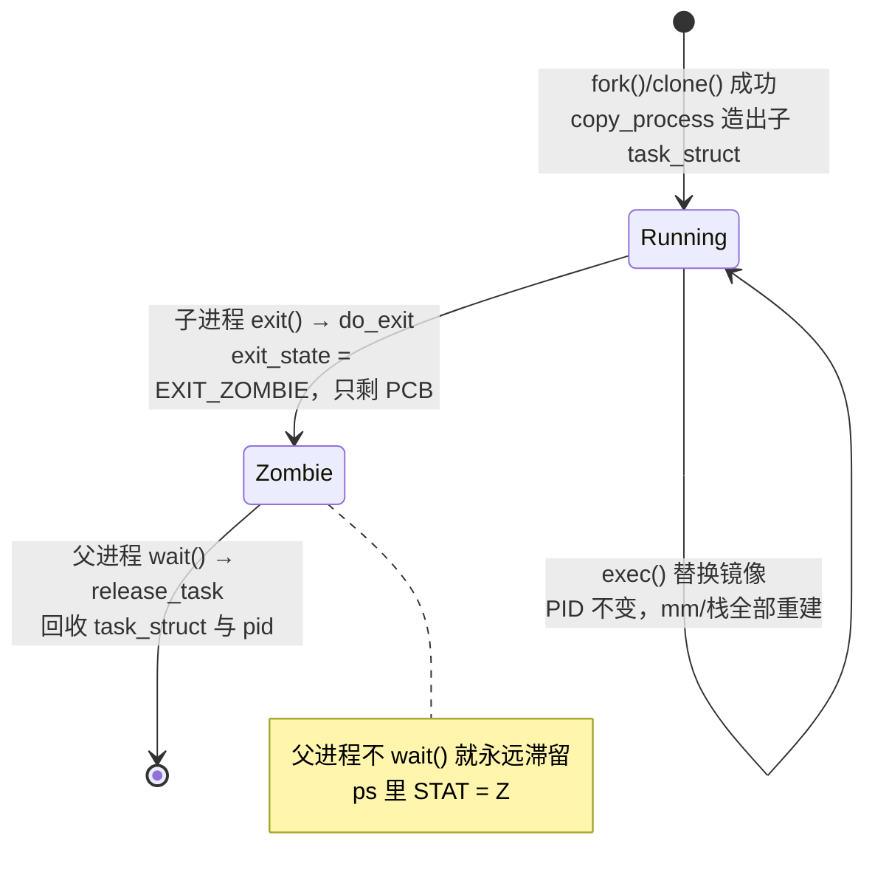
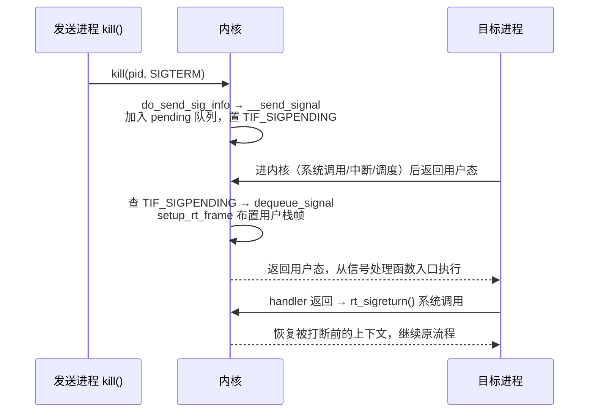

::: abstract 本章定位
上一篇用 `ps` 看进程的"外貌"，这一篇钻进内核看"五脏六腑"：`task_struct` 如何记录进程、fork/exec/exit 在内核的完整路径、写时复制为何让 fork 快如闪电、线程与进程在内核差在哪、地址空间如何布局、命名空间如何造出容器、信号如何进出内核。读完，`ps` 每列、`/proc/&lt;pid&gt;` 每项都有源码出处。
:::

教材把进程讲成"程序 + 运行状态"，Linux 内核里这个"运行状态"就是 `struct task_struct`。这一篇是"内核原理"系列第 2 篇（上一篇见 [Linux内核架构与启动原理](/kb/os/Linux/07-Linux内核架构与启动原理/)），全程对照 [Linux进程与调度实操](/kb/os/Linux/01-Linux进程与调度实操/) 里的命令——`ps`/`top`/`/proc` 里看到的每个数字背后都有本文要讲的数据结构。概念底子见 [进程模型](/kb/os/进程线程/01-进程概念与状态模型/) 与 [PCB](/kb/os/进程线程/02-进程控制块与系统调用/)。

## 1. 进程在内核的化身：task_struct

### 1.1 概念：PCB 就是 task_struct

教材的 PCB（进程控制块）在 Linux 里的真身是 `include/linux/sched.h` 里的 `struct task_struct`。**内核不管理"程序"，只管理 task_struct**：调度器调度它、信号发给它、`/proc/&lt;pid&gt;` 读它。没有 task_struct 的进程在内核眼中不存在。

task_struct 是内核里最大的结构体之一（数百字节到 KB 级），因为进程的所有状态都要记在里面。

### 1.2 图解：一个 task_struct 装着什么

```
                       struct task_struct（PCB）
┌────────────────────────────────────────────────────────┐
│ 标识   pid / tgid / comm / start_time                  │
│ 状态   state / exit_state / blocked                     │
│ 调度   prio / static_prio / sched_class / se(vruntime) │
│ 血缘   parent / children / sibling / thread_group      │
│ 文件   files(描述符表) / fs(cwd,root,umask)             │
│ 内存   mm(地址空间) / active_mm                         │
│ 信号   signal / sighand / pending / blocked             │
│ 线程   thread(寄存器现场) / thread_info                 │
│ 其他   cred(权限) / cgroups / nsproxy(命名空间) ...     │
└────────────────────────────────────────────────────────┘
```

### 1.3 内核实现：关键字段分组

| 分组 | 关键字段 | 含义 |
|---|---|---|
| 标识 | `pid` / `tgid` | 进程号 / 线程组号。`getpid()` 返回 tgid，`gettid()` 返回 pid（见第 4 节） |
| 标识 | `comm[TASK_COMM_LEN]` | 命令名，`ps -o comm` 读的就是它 |
| 状态 | `state` | `TASK_RUNNING`/`TASK_INTERRUPTIBLE`/`TASK_UNINTERRUPTIBLE`/`TASK_STOPPED`/`TASK_TRACED`，对应 `ps` 的 `R/S/D/T/t` |
| 状态 | `exit_state` | `EXIT_ZOMBIE`/`EXIT_DEAD`，僵尸态就在这（第 2 节展开） |
| 调度 | `prio`/`static_prio`/`normal_prio` | 实时/静态/普通优先级，数字越小越优先 |
| 调度 | `sched_class` + `se` | 调度类（CFS/RT）与调度实体，`vruntime` 在 `se` 里 |
| 血缘 | `real_parent`/`parent`/`children`/`sibling` | 父子兄弟链表，`pstree` 的数据来源（第 6 节） |
| 文件 | `files`/`fs` | 文件描述符表 / 文件系统上下文（cwd、umask、root） |
| 内存 | `mm`/`active_mm` | 地址空间（第 5 节）；内核线程无 `mm`，借用 `active_mm` |
| 信号 | `signal`/`sighand`/`pending`/`blocked` | 进程级共享信号状态 / 信号处理函数表 / 挂起信号 / 信号掩码（第 8 节） |
| 线程 | `thread`/`thread_info` | 寄存器现场（切换时保存）/ 内核栈配套信息 |

### 1.4 内核实现：current 宏、thread_info 与内核栈

每个任务有一块**独立内核栈**（x86_64 上 `THREAD_SIZE = 16KB`，即 4 页），系统调用/中断就在这块栈上执行。内核代码怎么从栈上找到"我是谁"？早期实现把 `struct thread_info` 放在栈底，用栈指针按 `THREAD_SIZE` 对齐就能算出；x86_64 从内核 5.9 起启用 `THREAD_INFO_IN_TASK`，`thread_info` 直接内嵌进 `task_struct`，而 `current` 用 per-CPU 变量 `current_task` 一次读得。

::: tip current 为什么"总是当前进程"
内核代码里到处都是 `current`（如 `current->mm`）。它不是一个普通全局变量，而是"从当前 CPU 的 per-CPU 槽读出正在运行的那个 task_struct"。进程切换 `__schedule()` 时把新任务的指针写进这个槽，`current` 就自动变成新进程——每个 CPU 同一时刻只跑一个任务，所以 per-CPU 变量天然正确且快。
:::

### 1.5 内核实现：进程上限 kernel.pid_max

PID 用位图分配，上限在 `/proc/sys/kernel/pid_max`：64 位机器默认 **32768（2^15）**，最大可调到 **4194304（2^22）**；超出后 PID 循环复用，所以可能看到旧 PID 被新进程占用（`cat /proc/sys/kernel/pid_max` 可见）。

### 1.6 与实操呼应

[Linux进程与调度实操](/kb/os/Linux/01-Linux进程与调度实操/) 里 `ps -eo pid,ppid,stat,pri,ni,comm` 的每一列几乎都能从上面表格找到字段：`STAT` ← `state`+`exit_state`，`PRI` ← `prio`，`NI` ← `static_prio`，`COMMAND` ← `comm`。想看自己 shell 的完整 task_struct 摘要，直接读：

```bash
cat /proc/self/status   # Name / State / Pid / PPid / Tgid / Threads / VmRSS ...
```

## 2. 进程生命周期在内核的实现

### 2.1 概念：四个系统调用撑起一生

进程的一生就是四个系统调用：**fork/clone（生）、exec（变身）、exit（死）、wait（收尸）**，Linux 里每一步都有明确的函数链。

### 2.2 图解：内核状态机



### 2.3 内核实现：创建链 fork / clone / vfork

`fork()`/`vfork()`/`clone()` 三个系统调用最终都进同一个函数（`vfork` 只是额外带 `CLONE_VM|CLONE_VFORK` 标志，父进程会阻塞到子进程 exec/exit）。调用链：`fork/vfork/clone → kernel_clone()`（内核 5.10 之前叫 `_do_fork()`）→ `copy_process()`（造新 task_struct 与资源，内部一串 `copy_*` 步骤）→ `wake_up_new_task()` 把子进程放进就绪队列。

`copy_process()` 里的 `copy_*` 步骤（顺序即源码顺序）：

| 步骤 | 复制内容 | 可被 clone 标志共享 |
|---|---|---|
| `dup_task_struct` | 父进程 task_struct 的一份拷贝 | 必做 |
| `copy_semundo` | System V 信号量撤销表 | `CLONE_SYSVSEM` |
| `copy_files` | 文件描述符表 | `CLONE_FILES` |
| `copy_fs` | cwd / root / umask | `CLONE_FS` |
| `copy_sighand` | 信号处理函数表 | `CLONE_SIGHAND` |
| `copy_signal` | 进程级信号 / 记账 | `CLONE_THREAD` |
| `copy_mm` | 地址空间与页表 | `CLONE_VM` |
| `copy_namespaces` | 命名空间视图 | `CLONE_NEW*` |
| `copy_io` | IO 上下文（ioprio 等） | `CLONE_IO` |
| `copy_thread` | 寄存器现场（含返回地址） | 必做 |
| `sched_fork` | 调度实体初始化 | 必做 |

::: important "fork 返回两次"的机理解释
`copy_thread()` 复制寄存器时，把子进程的返回地址设在父进程系统调用返回处、但返回值寄存器置 **0**；父进程正常返回拿到子进程 PID。于是同一个 `fork()` 在父子两边各返回一次、值不同——这不是魔法，就是寄存器的差异化复制。
:::

### 2.4 内核实现：exec 替换（load_elf_binary）

`execve()` 不创建新进程，而是"换皮"：PID、task_struct、进程关系全不变，只有**地址空间重建**。调用链 `execve() → do_execveat_common() → exec_binprm() → search_binary_handler() → load_elf_binary()`（`fs/binfmt_elf.c` 处理 ELF）：先 `flush_old_exec()` 冲刷旧 mm、信号、记账；再解析 ELF `program headers` 建立各段映射；`setup_arg_pages()` 建新栈并压入 argv/envp；最后设置新的 entry point 返回用户态开跑。

旧的 `mm_struct` 在此过程中被释放替换（`exec_mmap()`）——这正是"exec 之后 fork 复制的页表全作废"的原因，也是写时复制（第 3 节）存在的意义之一。

### 2.5 内核实现：退出与回收（do_exit / release_task / wait）

| 阶段 | 函数 | 干什么 |
|---|---|---|
| 退出 | `do_exit()` | 依次释放 mm / files / fs / sighand / signal / namespaces，置 `exit_state = EXIT_ZOMBIE`，给父进程发 `SIGCHLD` |
| 滞留 | — | 僵尸态 = `exit_state == EXIT_ZOMBIE`：**task_struct 和 pid 还在**（挂在父进程 `children` 链表上），但 mm 已释放——所以 `ps` 里僵尸进程 `VSZ/RSS` 都是 0 |
| 回收 | `wait4() → do_wait() → wait_consider_task() → release_task()` | 找到僵尸子进程，`release_task()` 释放 task_struct 与 pid，僵尸消失 |

::: warning 僵尸杀不死
僵尸进程已经没有执行流，`kill -9` 对它无效（信号发给一个"已死"的 task_struct 没意义）。唯一办法是让父进程 wait 它，或杀掉父进程、由 init/systemd 接管回收。亲手制造/清除僵尸见 [Linux进程与调度实操](/kb/os/Linux/01-Linux进程与调度实操/) 的"僵尸进程实验"。
:::

### 2.6 与实操呼应

在 [Linux进程与调度实操](/kb/os/Linux/01-Linux进程与调度实操/) 里 `ps -eo pid,ppid,stat,comm` 看到 `Z`，对应的就是上面 `EXIT_ZOMBIE`；用 `strace -f -e trace=clone,execve,exit,wait4 ./app` 能看到这条生命周期链路每个阶段调用了哪个系统调用。

## 3. 写时复制 COW：fork 为什么快

### 3.1 概念：只复制页表，不复制物理页

如果不做优化，fork 要把父进程整个地址空间的物理页全拷一份给子进程——几百 MB 内存的进程 fork 一次就复制几百 MB，慢且费内存。**写时复制（Copy-On-Write）**：fork 时父子共享同一批物理页，只复制页表，并把所有匿名页 PTE 标记为**只读**；谁先写，谁触发缺页异常，内核才真正复制那一页。

### 3.2 图解：一次写入触发的复制

```
fork 后（共享，全部只读）             子进程第一次写入页 N
┌────────┐  ┌────────┐               ┌────────┐  ┌────────┐
│ 父页表  │  │ 子页表  │               │ 父页表  │  │ 子页表  │
│ PTE:N  │  │ PTE:N  │               │ PTE:N  │  │ PTE:N' │←─新页
│ 只读───┼──┼─只读    │               │ 只读   │  │ 可写   │
└────┬───┘  └────┬───┘               └────┬───┘  └────┬───┘
     └────物理页N──┘        写→缺页异常→    物理页N     物理页N'(拷贝)
```

### 3.3 内核实现：三个关键环节

| 阶段 | 函数 | 动作 |
|---|---|---|
| fork 时 | `dup_mm()` → `dup_mmap()` → `copy_page_range()` | 复制页表结构，父子共享物理页，**清掉 PTE 的写位**（`VM_WRITE` 仍留在 VMA 里，缺页时可恢复） |
| 写时 | `handle_pte_fault()` → `do_wp_page()` | 写保护缺页：`wp_page_copy()` 分配新物理页、把旧页内容拷过去、PTE 指向新页并恢复写权限、刷新 TLB |
| 文件映射 | `mmap(..., MAP_PRIVATE)` | 私有文件映射也走 COW：多进程 map 同一文件时共享 page cache，谁写谁触发复制 |

::: tip 名字里的"写时"
只有**写**才复制，读永远不会触发。所以 fork 后父子都只读时，整片内存永远共享；都写时则是"谁先写谁出钱"——每个被写页单独复制，互不干扰。这正是 [内存篇 COW](/kb/os/内存/04-虚拟内存与按需分页/) 讲的按需分页思想在 fork 上的应用。
:::

### 3.4 性能影响

- **fork 变快**：复杂度从 O(物理页数) 降到 O(页表项数)。父进程地址空间越大，收益越明显。
- **内存变省**：共享直到一方写。典型如 `fork()` 后立刻 `exec()`——exec 会重建整个地址空间，那些 COW 页几乎没被写，等于省下了整份复制。
- **代价与进阶**：写共享页有一次缺页 + 复制（首次写入变慢），TLB 也要刷新；`vfork()` 让父子**完全共享** mm（父被阻塞直到子 exec/exit），`posix_spawn()` 则在 libc 里把"fork + exec"打包。

### 3.5 与实操呼应

在 [Linux进程与调度实操](/kb/os/Linux/01-Linux进程与调度实操/) 里 fork 一个进程几乎没有延迟；[Linux内存管理实操](/kb/os/Linux/02-Linux内存管理实操/) 里父子进程 `SHR`（共享内存）列不小，就是 COW 共享的物理页。实验验证见"动手实验 3"：fork 前后对比 `/proc/&lt;pid&gt;/statm` 的 resident 数——写之前共享、写之后子进程 RSS 跳升。

## 4. 线程在内核的实现：共享资源的进程

### 4.1 概念：Linux 没有独立的"线程对象"

教材常讲"线程 = 轻量级进程，有独立 PCB"。但 Linux 内核**根本没有专门的线程结构**——线程也是一个 `task_struct`，区别只在于它和同组线程**共享哪些资源**（地址空间、打开文件、信号处理……）。所以 Linux 的实现更接近"线程 = 共享了资源的进程"。

::: important "线程没有独立 PCB"是教材说法
教材说线程共享 PCB、不需要重复维护，指的是**资源不重复**。Linux 里每个线程都有自己的 task_struct（独立的调度单位、独立内核栈），但 `mm`/`files`/`fs`/`sighand` 这些指针指向**同一个**结构。说"有"或"没有"都对，关键在"资源共享、调度独立"。
:::

### 4.2 图解：两个线程的 task_struct

```
       线程 A 的 task_struct               线程 B 的 task_struct
┌──────────────────────────┐    ┌──────────────────────────┐
│ pid = 1000 (tid)          │    │ pid = 1001 (tid)          │
│ tgid = 1000               │    │ tgid = 1000 ────────────────┐
│ mm    ──────────────────┐ │    │ mm    ──────────────────┐ │
│ files ────────────────┐ │ │    │ files ────────────────┐ │ │
│ fs    ──────────────┐ │ │ │    │ fs    ──────────────┐ │ │ │
│ sighand ──────────┐ │ │ │ │    │ sighand ──────────┐ │ │ │ │
└───────────────────┴─┴─┴─┴─┘    └───────────────────┴─┴─┴─┴─┴───┘
                    └─┬─┬─┬─┬──── 全部指向同一份 mm/files/fs/sighand
```

### 4.3 内核实现：clone 标志位决定"共享多少"

| clone 标志 | 共享 / 特殊行为 | 效果 |
|---|---|---|
| `CLONE_VM` | 共享地址空间 | 同一 `mm_struct`、同一组页表，线程间内存天然可见 |
| `CLONE_FILES` | 共享文件描述符表 | 一个线程 `close(fd)`，其他线程立即生效 |
| `CLONE_FS` | 共享 cwd / root / umask | `chdir()` 对整个线程组生效 |
| `CLONE_SIGHAND` | 共享信号处理函数表 | `signal()` 对一个线程设置，全组生效 |
| `CLONE_THREAD` | 加入线程组 | `getpid()` 返回同一 tgid；组长死亡不影响其他线程 |
| `CLONE_SETTLS` | 设置线程本地存储 | 每个线程独立的 TLS 基址 |
| 必要条件 | `CLONE_THREAD` 必须配 `CLONE_SIGHAND`，`CLONE_SIGHAND` 必须配 `CLONE_VM` | 内核强制，保证语义自洽 |

**独立**的部分是：`pid`（各线程不同）、内核栈、寄存器现场、信号掩码 `blocked`（可各自屏蔽）。

### 4.4 内核实现：NPTL 与 pthread_create

glibc 的 **NPTL（Native POSIX Thread Library）** 是 Linux 上默认的 POSIX 线程实现。`pthread_create()` 底层就是：

```
pthread_create() → clone(CLONE_VM | CLONE_FS | CLONE_FILES | CLONE_SIGHAND
                          | CLONE_THREAD | CLONE_SYSVSEM | CLONE_SETTLS | ...)
```

从 Linux 2.6 起用 `CLONE_THREAD` 让线程同属一个线程组，`getpid()` 对组内所有线程返回同一个值——修正了老式 LinuxThreads 里"线程有不同 PID"的缺陷，符合 POSIX 语义。

### 4.5 与实操呼应：gettid / getpid、ps -L、/proc

| 观察手段 | 看到什么 | 对应内核 |
|---|---|---|
| `getpid()` | 线程组号 tgid | `current->tgid` |
| `gettid()` | 线程自己的 pid | `current->pid` |
| `ps -T -p &lt;pid&gt;` / `ps -L` | 每个线程一行，显示 LWP | 遍历线程组的 task_struct |
| `top -H` | 按线程展示 | 同上 |
| `/proc/&lt;pid&gt;/task/` | 每个线程一个子目录，目录名是 tid | `thread_group` 链表 |
| `cat /proc/self/status` | `Tgid` 与 `Pid` 两行 | 一个 tgid 下多个 pid |

呼应 [Linux进程与调度实操](/kb/os/Linux/01-Linux进程与调度实操/)：`ps -eo stat` 里的 `l`（多线程）修饰符、`pstree` 输出里 `{线程名}(tid)` 的花括号形式，根源都是"线程 = 共享资源的 task_struct"。`ps -L -C firefox` 可看每个线程一行（PID 实为 TGID，LWP 为 tid），`ls /proc/$$/task/` 可数线程数。

## 5. 进程地址空间：mm_struct 与 vm_area_struct

### 5.1 概念：地址空间 = 一串"虚拟区间"

进程能访问的虚拟地址不连续地分成许多段（代码、数据、堆、栈、共享库、mmap 文件……），每段叫一个 **VMA（Virtual Memory Area，`vm_area_struct`）**。整个地址空间由一个 `mm_struct` 统一管理。

### 5.2 图解：x86_64 用户地址空间布局

```
高地址 0x7fffffffffff
┌────────────────────────────────┐
│  [vdso] / [vsyscall] 内核映射   │ ← 快速系统调用、gettimeofday
│  栈 stack（向下增长）            │ ← start_stack 起，rw-p
│  ↓ 增长方向                    │
│  ...                          │
│  mmap 区（从 mmap_base 向下增长）│ ← 共享库 libc.so / ld.so ...
│  ↑ 增长方向                    │
│  堆 heap（brk，向上增长）         │ ← start_brk..brk，rw-p
│  bss（未初始化数据，零填充）        │
│  data（已初始化数据）             │ ← start_data..end_data，rw-p
│  text（代码段，只读+执行）         │ ← start_code..end_code，r-xp
低地址 0x400000（ELF 装载起点）
```

### 5.3 内核实现：mm_struct 的关键字段

| 字段 | 含义 |
|---|---|
| `mmap` | VMA 链表头（按地址排序） |
| `mm_rb` | VMA 红黑树根，`find_vma()` 用它 O(log n) 定位区间 |
| `pgd` | 顶层页表指针，进程切换页表就是换它 |
| `start_code`/`end_code` | 代码段区间 |
| `start_data`/`end_data` | 数据段区间 |
| `start_brk`/`brk` | 堆的起点与当前上界（`brk` 系统调用改它） |
| `start_stack` | 栈顶位置 |
| `arg_start`/`arg_end`/`env_start`/`env_end` | argv 与环境变量区间 |
| `map_count` | VMA 数量（`/proc/&lt;pid&gt;/maps` 行数） |
| `rss_stat` | 常驻内存统计 |

每个 VMA 的核心就三个量：

```c
struct vm_area_struct {
    unsigned long vm_start, vm_end;   /* 区间 [start, end)，字节对齐到页 */
    struct vm_area_struct *vm_next;   /* 链表：顺序遍历 */
    struct rb_node vm_rb;             /* 红黑树：快速查找 */
    unsigned long vm_flags;           /* VM_READ/WRITE/EXEC/SHARED ... */
    const struct vm_ops *vm_ops;      /* open/close/fault 回调 */
    struct file *vm_file;             /* 映射的文件（文件映射才有） */
    unsigned long vm_pgoff;           /* 映射在文件里的偏移 */
};
```

`mmap()` 系统调用 → `do_mmap()` → `get_unmapped_area()` 找空闲区间 → 新建或与相邻兼容的 VMA 合并（`vma_merge()`），可执行段则交给 ELF loader（第 2 节）。

### 5.4 内核实现：COW 与 mmap 的关系

- `mmap(..., MAP_PRIVATE)` 的"私有"正是靠 **COW**：所有进程 map 同一文件时共享 page cache，读谁都不缺；一旦有进程写，`do_wp_page()` 给它复制一份私有副本。
- `MAP_SHARED` 不开 COW，写直接进共享页。
- fork 的 COW（第 3 节）与 MAP_PRIVATE 用的是同一套缺页机制，区别只在于共享源是"父进程的匿名页"还是"文件页"。

### 5.5 与实操呼应：/proc/&lt;pid&gt;/maps 就是 VMA 列表

`/proc/&lt;pid&gt;/maps` 每一行对应一个 `vm_area_struct`，格式 `start-end perms offset dev inode path`：

```bash
cat /proc/self/maps | head -8
# 55b2c00000-55b2c01000 r-xp  00000000 08:02 12345  /usr/bin/cat        ← text
# 55b2c01000-55b2c02000 r--p  00001000 08:02 12345  /usr/bin/cat        ← data
# 55b2c02000-55b2c03000 rw-p  00002000 08:02 12345  /usr/bin/cat        ← bss
# 55b2c03000-55b2c06000 rw-p  00000000 00:00 0                          ← 堆
# 7f...-7f... r-xp ... /usr/lib/x86_64-linux-gnu/libc.so.6              ← mmap 区
# 7fff...-7fff... rw-p ...                                              ← 栈
```

perms 前三位的 `r/w/x` 就是 `vm_flags`，`p`/`s` 对应私有/共享（`p` = MAP_PRIVATE = COW）。[Linux内存管理实操](/kb/os/Linux/02-Linux内存管理实操/) 的 `pmap -x &lt;pid&gt;` 与 `/proc/&lt;pid&gt;/smaps`（每段 Rss/Pss 明细）读的都是这份 VMA 数据。

## 6. 进程关系树：父/子/兄弟、线程组、进程组与会话

### 6.1 概念：进程不是孤岛

进程间有三层"血缘/团体"关系：**父子兄弟**（task_struct 链表）、**线程组**（同 tgid）、**进程组/会话**（作业控制与终端绑定）。`pstree` 和 shell 的前后台都是靠它们实现的。

### 6.2 图解：三层关系

```
session（会话 sid=1000，控制终端 /dev/tty2）
└─ 进程组 pgrp=1000（前台）
   └─ PID 1000 bash
      ├─ 进程组 pgrp=1500（前台作业）
      │  ├─ PID 1500 vim ─┬─ PID 1501 子进程（sibling 链表）
      │  │                 └─ PID 1502 子进程
      │  └─ tgid=1500（若 vim 多线程，线程 pid=1500/1501 同组）
      └─ 进程组 pgrp=1600（后台作业）→ sleep 300
```

### 6.3 内核实现：血缘链在 task_struct 里

| 关系 | 内核表示 | 说明 |
|---|---|---|
| 父/子 | `real_parent`（亲生）、`parent`（当前负责 wait 的） | 孤儿被收养后 `parent` 会变化 |
| 子列表 | `children` 链表 | 父进程的所有直系子进程 |
| 兄弟 | `sibling` 链表 | 同父进程的子进程互相链接 |
| 线程组 | `thread_group` 链表 + 共享 `signal` | 同一 tgid 的线程，见第 4 节 |
| 进程组 | `signal->pgrp`（一个 `struct pid`） | `setpgid()` 设置；`kill(-pgrp, sig)` 向全组发信号 |
| 会话 | `signal->session` + 控制终端 `tty` | 登录即建新会话；`Ctrl+C` 只发给前台进程组 |

::: tip PID 的本质：struct pid
内核里 pid 不是简单的 int，而是 `struct pid` 对象，`pgrp`/`session`/`tgid` 都是它。这为第 7 节的 PID namespace 埋了伏笔——同一个 `struct pid` 在不同命名空间里有不同的数字 `numbers[]`。
:::

### 6.4 内核实现：pstree 与孤儿收养

- `pstree` 就是内核里 `children`/`sibling` 链表的一次 DFS 遍历打印；`ps -o pid,ppid` 的 `ppid` 列直接读 `parent->pid`。
- **孤儿**：父进程先死 → 内核调 `reparent_thread()` 把孤儿重新挂到"最近的祖先"。规则：找最近的 **subreaper**（`prctl(PR_SET_CHILD_SUBREAPER, 1)` 声明，systemd 就是），没有则交给 PID 1 的 init。这就是"孤儿被 init 收养"的内核出处。
- 收养后 `parent` 更新，孤儿正常执行、正常被新父 wait——孤儿不会变僵尸；僵尸只会因"父进程在却不 wait"而产生。

### 6.5 与实操呼应

`pstree -p -a` 看 PID 1 → 各服务的完整血缘；`ps -eo pid,ppid,pgid,sid,tty,stat,comm` 把父子、进程组、会话、终端一层层列出来；`ps -o pid,pgid,sid,tty,comm -p $$` 看自己的 pgrp/session/终端。

## 7. 命名空间与容器：进程的"视图隔离"

### 7.1 概念：容器 = 一批进程 + 各自命名空间

容器没有自己的内核。**容器 = 共享同一个 host 内核的一组进程，通过命名空间（namespace）让每批进程看到不同的"系统"**。命名空间把资源（PID、挂载表、主机名、网络栈……）做了视图隔离：同一份内核资源，在不同 namespace 里呈现不同的样子。

### 7.2 图解：host 内核上多个容器

```
                ┌────────────── Linux 内核（一份）──────────────┐
┌────── 容器A ──────┐  ┌────── 容器B ──────┐  ┌── 宿主普通进程 ──┐
│ PID1(真PID 100)   │  │ PID1(真PID 200)   │  │ PID 300         │
│ netns A / uts A   │  │ netns B / uts B   │  │ 宿主 netns      │
│ mount 表 A        │  │ mount 表 B        │  │ 宿主 mount 表   │
└───────────────────┘  └───────────────────┘  └─────────────────┘
       每份都只是"进程 + 指向不同 ns 结构的指针"
```

### 7.3 内核实现：clone 的 CLONE_NEW* 标志

创建进程时带上 `CLONE_NEW*` 标志即进入新命名空间（`copy_namespaces()`）：

| 标志 | 隔离内容 | 看到的效果 |
|---|---|---|
| `CLONE_NEWPID` | PID 编号视图 | 容器里第一个进程 PID 是 1，宿主看它是普通大号 PID |
| `CLONE_NEWNS` | 挂载表 | 容器有自己的文件系统视图，`pivot_root` 换根 |
| `CLONE_NEWUTS` | 主机名 / NIS domain | 容器里 `hostname` 独立 |
| `CLONE_NEWIPC` | System V IPC | 消息队列 / 共享内存独立 |
| `CLONE_NEWNET` | 网络栈 | 独立网卡、lo、路由、iptables |
| `CLONE_NEWUSER` | 用户/组 ID 映射 | 容器里 uid 0 映射宿主普通用户，容器 root 也受限 |
| `CLONE_NEWCGROUP` / `CLONE_NEWTIME` | cgroup / 时钟 | 资源隔离与时间视图 |

### 7.4 内核实现：为什么"容器里 PID 1 是假的"

PID 1 只在**自己的命名空间内**是真的。内核里 `getpid()` 返回 `struct pid` 在当前 namespace 层的编号（`numbers[level]`），所以：

- 容器里进程看到自己是 PID 1 / 5 / 10，宿主上用 `ps -ef` 看到的是真实 pid（比如 10000+）。
- 嵌套命名空间：每层各有一个"自己的 1 号"，`init` 语义层层独立。
- 容器里的 PID 1 承担"收孤儿"职责（第 6 节），如果容器 init 不 wait，容器内就会堆僵尸——这是排查容器僵尸的常见原因，呼应 [进程调度疑难](/kb/os/问题排查/07-进程与调度异常疑难/)。

```bash
# 宿主机与容器内，同一进程看到的 PID 不同；再对比 ns inode 是否同属一个 namespace
docker run --rm alpine sh -c 'echo 容器内 PID=$$; ps aux | grep $$'
docker top <容器名> -o pid,comm     # 宿主视角的真实 PID
ls -l /proc/$$/ns/pid /proc/$$/ns/net
```

### 7.5 与实操呼应

runc/docker 的底层就是 `clone(CLONE_NEWPID|CLONE_NEWNS|CLONE_NEWUTS|CLONE_NEWIPC|CLONE_NEWNET) + pivot_root + cgroups` 这一套的组合。容器不是虚拟机：进程、内存、系统调用全走宿主内核，只是"看得见的视图"不同。这也解释了排查容器问题时最常见的困惑——容器里 `top` 看到的是宿主全部进程（缺 `/proc` 视图隔离）。

## 8. 信号的内核机制

### 8.1 概念：信号 = 内核投递的异步通知

信号是进程级的异步事件（Ctrl+C、`kill`、段错误都由它承载），由内核负责"送达并让进程处理"。它不打断 CPU 执行流，而是**等进程从内核态返回用户态时"顺路"处理**。

### 8.2 图解：一次信号的完整旅程



### 8.3 内核实现：发送与递送

| 环节 | 内核路径 | 要点 |
|---|---|---|
| 发送 | `kill()` → `do_send_sig_info()` → `__send_signal()` | 放入 `task->pending`（线程）或 `signal->shared_pending`（进程级）；**同一种普通信号只保留一个**（合并），实时信号（34+）用 `sigqueue` 排队不合并 |
| 挂起标记 | `set_tsk_thread_flag(TIF_SIGPENDING)` | 只打标记，不打断运行 |
| 递送时机 | 返回用户态前查 `TIF_SIGPENDING` | 只在用户态执行用户 handler，内核态不执行 |
| 处理 | `dequeue_signal()` → `handle_signal()` → `setup_rt_frame()` | 在用户栈压入"伪返回帧"，返回地址指向 handler |
| 返回 | handler 末尾调用 `rt_sigreturn()` | 恢复栈帧与寄存器，如同没发生过 |

### 8.4 内核实现：屏蔽、不可阻塞信号、EINTR

- **屏蔽（sigmask）**：`current->blocked` 位图。`sigprocmask()`/`pthread_sigmask()` 设置后，被屏蔽的信号**仍然入 pending 队列、只是不递送**；解除屏蔽立即递送（可用 `sigpending()` 查询）。
- **不可阻塞 / 不可捕获**：`SIGKILL`(9) 与 `SIGSTOP`(19) 由内核强制递送——屏蔽位图对它们无效，`signal(SIGKILL, handler)` 会被忽略。这两兄弟保证"总有最后手段"。
- **EINTR**：被信号打断的**慢速系统调用**（read/write 等）返回 `-1` 且 `errno=EINTR`；若 handler 设置 `SA_RESTART`，内核自动重启该系统调用，用户程序无感。所以严谨的代码对 EINTR 要做循环重试。

```c
/* 处理 EINTR 的标准写法：被打断就重试 */
while (read(fd, buf, n) < 0 && errno == EINTR) ;
```

### 8.5 内核实现：信号与退出 / 僵尸的关系

- 子进程 `exit()` 时父进程收到 **SIGCHLD**，父进程据此知道"该去 wait 收尸了"（第 2 节僵尸的产生与消除都围绕它）。
- 若父进程把 SIGCHLD 设为 `SIG_IGN`（或 `SA_NOCLDWAIT`），内核自动回收子进程，不产生僵尸。
- 僵尸进程收不到信号：它已经执行完 `do_exit`，没有可中断的执行流，所以 `kill -9 <僵尸pid>` 无效。

### 8.6 与实操呼应：kill -l 编号表

[Linux进程与调度实操](/kb/os/Linux/01-Linux进程与调度实操/) 的 `kill -l` 列出的就是内核 `include/uapi/asm-generic/signal.h` 的编号（x86 架构）：

| 编号 | 信号 | 默认行为 | 编号 | 信号 | 默认行为 |
|---|---|---|---|---|---|
| 1 | SIGHUP | 终止 | 17 | SIGCHLD | 忽略（子进程状态变化） |
| 2 | SIGINT | 终止（Ctrl+C） | 18 | SIGCONT | 继续 |
| 3 | SIGQUIT | 终止 + core | 19 | SIGSTOP | **暂停，不可阻塞/捕获** |
| 4 | SIGILL | 终止 + core | 20 | SIGTSTP | 暂停（Ctrl+Z） |
| 6 | SIGABRT | 终止 + core（abort） | 21/22 | SIGTTIN/TTOU | 后台读写终端 |
| 7/8 | SIGBUS/SIGFPE | 终止 + core | 24/25 | SIGXCPU/XFSZ | CPU/文件超限 |
| 9 | **SIGKILL** | **强制终止，不可阻塞/捕获** | 26/27 | SIGVTALRM/PROF | 定时器 |
| 10/12 | SIGUSR1/USR2 | 用户自定义 | 28 | SIGWINCH | 终端窗口变化 |
| 11 | SIGSEGV | 终止 + core（段错误） | 29 | SIGIO | 异步 IO |
| 13 | SIGPIPE | 终止（写已关闭管道） | 30 | SIGPWR | 电源故障 |
| 14 | SIGALRM | 终止（alarm） | 31 | SIGSYS | 非法系统调用 |
| 15 | SIGTERM | 终止（默认 kill） | 34–64 | SIGRTMIN.. | 实时信号（排队） |

试试 `kill -l` 看当前架构的编号，`kill -l 9` 会输出 `KILL`。

## 本章小结

进程在内核中的本质就是 `struct task_struct`（PCB）+ 它指向的一组资源对象：`mm_struct`（地址空间）、`files_struct`（打开文件）、`fs_struct`（文件系统上下文）、`signal_struct`/`sighand_struct`（信号）。这一篇把它们逐个拆开：

| 主题 | 一句话内核真相 |
|---|---|
| task_struct | 所有进程信息都在这一块结构里，`current` + per-CPU 变量拿到"当前进程" |
| 生命周期 | fork→`kernel_clone`→`copy_process`；exec→`load_elf_binary` 重建 mm；exit→`do_exit` 置 EXIT_ZOMBIE；wait→`release_task` 收尸 |
| 写时复制 | fork 只复制页表 + 清写位，首次写触发 `do_wp_page` 才复制物理页 |
| 线程 | 线程 = 共享 mm/files/fs/sighand 的进程，`pthread_create` 底层是带 CLONE_* 的 clone |
| 地址空间 | `mm_struct` 管一串 `vm_area_struct`，`/proc/&lt;pid&gt;/maps` 就是 VMA 列表 |
| 进程关系 | 父/子/兄弟、线程组(tgid)、进程组、会话、subreaper 收养 |
| 命名空间 | 容器 = 带 CLONE_NEW* 的进程集合，PID 1 只是命名空间内的视图 |
| 信号 | 发→pending 队列，返用户态时递送，SIGKILL/SIGSTOP 不可阻塞，EINTR 与 SA_RESTART |

内核实现细节可进一步在 [Linux内核架构与启动原理](/kb/os/Linux/07-Linux内核架构与启动原理/)（启动到调度器全景）和 [Linux内存管理实操](/kb/os/Linux/02-Linux内存管理实操/)（页表实证）中延伸。

## 动手实验

1. **fork 观察（C 程序）**：编译运行下面的程序，回答"为什么 `fork()` 打印两行、`getpid` 不同"：

```c
#include <stdio.h>
#include <unistd.h>
#include <sys/wait.h>
int main(void) {
    pid_t pid = fork();
    if (pid == 0) {                       /* 子进程 */
        printf("child:  pid=%d ppid=%d\n", getpid(), getppid());
        sleep(1);
    } else {                              /* 父进程 */
        printf("parent: pid=%d child=%d\n", getpid(), pid);
        wait(NULL);
    }
    return 0;
}
```
```bash
gcc -o fork fork.c && ./fork
```

2. **pid/tid/tgid 对比**：

```bash
ps -L -C bash          # PID=TGID，LWP=线程 tid，单线程时两者相等
ps -o pid,ppid,tid,tgid,stat,comm -p $(pgrep -f <程序名>)
```

3. **COW 验证**：写一个 C 程序，`fork()` 后子进程先 `sleep(1)`，父进程读 `/proc/<子pid>/statm` 第二列（resident 页数）；子进程醒来写一页再 `sleep(1)`，父进程再读一次，观察 RSS 跳升。或直接对照 `/proc/&lt;pid&gt;/smaps` 的 `Shared_*` 与 `Private_*`（`watch -n1 'ps -o pid,stat,rss,comm'` 同时看）。

4. **读 maps 对照布局**：对 `/bin/ls` 分别执行 `cat /proc/self/maps | head`（看 ls 自己）与 `readelf -l /bin/ls`（看 ELF 段），把 VMA 的 `r-xp`/`rw-p` 与 ELF 的 `LOAD` 段对应起来。

5. **命名空间与容器**（有 Docker 时）：

```bash
docker run --rm -it alpine sh -c 'echo "容器内 PID=$$"; ps'
docker top $(docker ps -ql) -o pid,comm   # 宿主视角的真实 PID
ls -l /proc/$$/ns/pid /proc/$$/ns/net     # 对比 inode，看是否同 namespace
```

6. **信号亲历**：`sleep 100 &` 后 `kill -TERM %1` 看优雅终止；`kill -STOP %1` 后 `ps` 里看到 `T` 状态，`kill -CONT %1` 恢复。`cat /proc/self/status | grep -E 'Pid|Tgid|Threads'` 可同时核对线程组号。

## 自测题

1. **`current` 宏为什么能拿到"当前进程"的 task_struct？** 每个 CPU 同一时刻只运行一个任务，内核把当前任务指针放在 per-CPU 变量 `current_task` 里（x86_64 自 5.9 起），进程切换时更新它；早期则是把 `thread_info` 放在内核栈底，用栈指针按 `THREAD_SIZE` 对齐算出。

2. **fork 的 COW 究竟省了什么？** 省掉了物理页复制：fork 只复制页表并把匿名页 PTE 置只读，父子共享物理页；首次写触发 `do_wp_page` 才复制那一页。复杂度和内存占用从 O(物理页数) 降到 O(页表项数)。

3. **Linux 线程和进程在内核里到底差在哪？** 结构上没有差别——都是 `task_struct`。区别只在 clone 标志：线程带 `CLONE_VM|CLONE_FILES|CLONE_FS|CLONE_SIGHAND|CLONE_THREAD`，共享 mm/files/fs/sighand 并同属一个 tgid；独立的是 pid、内核栈、寄存器现场、信号掩码。

4. **`getpid()` 与 `gettid()` 的区别？** `getpid()` 返回 tgid（组内所有线程相同），`gettid()` 返回该线程自己的 pid。`ps -L` 的 LWP 列就是 tid，`/proc/&lt;pid&gt;/task/` 每个目录对应一个 tid。

5. **僵尸进程在内核里怎么表示？** `exit_state = EXIT_ZOMBIE`：task_struct 与 pid 还在（挂在父进程 `children` 链表上），但 mm/files 等已释放，所以 RSS 为 0。只有父进程 `wait()`（调 `release_task`）才真正回收。

6. **为什么容器里的 PID 1 是"假的"？** PID 1 只在它的 PID 命名空间内成立；`getpid()` 返回 `struct pid` 在当前 namespace 层的编号，宿主看它是真实的大 PID。该 PID 1 还承担命名空间内的孤儿收养职责。

7. **为什么 SIGKILL/SIGSTOP 不能被屏蔽或捕获？** 内核在信号发送/递送路径上强制递送这两个信号（屏蔽位图对它们无效），保证管理员始终有"立即杀死/暂停"的最后手段。

8. **EINTR 是什么，怎么处理？** 慢速系统调用（read/write）被信号打断返回 -1 且 errno=EINTR。若 handler 带 `SA_RESTART`，内核自动重启调用；否则程序要循环重试（`while (read(...) < 0 && errno == EINTR);`）。
