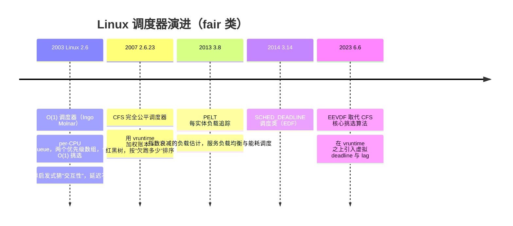
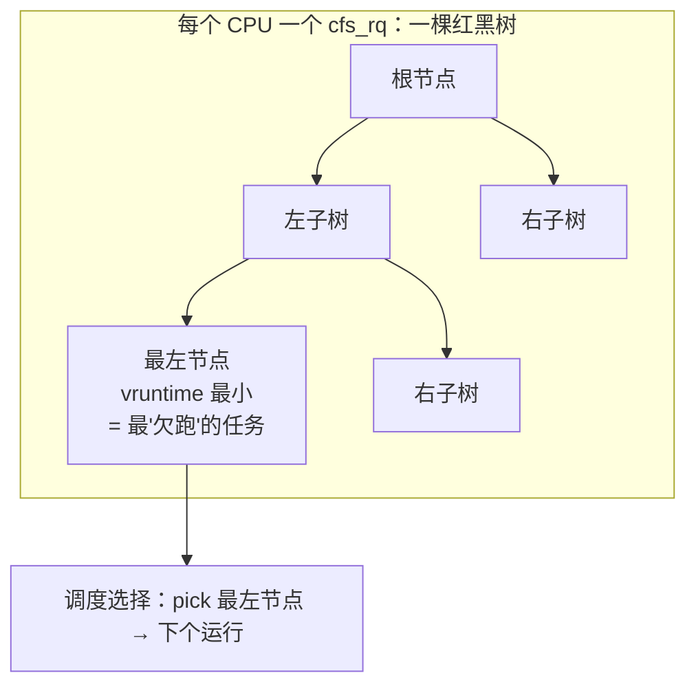
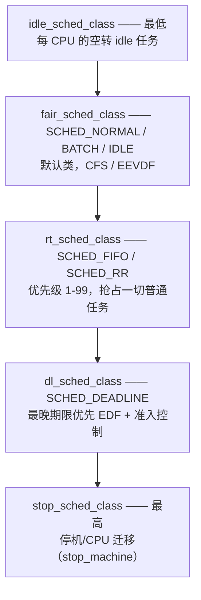
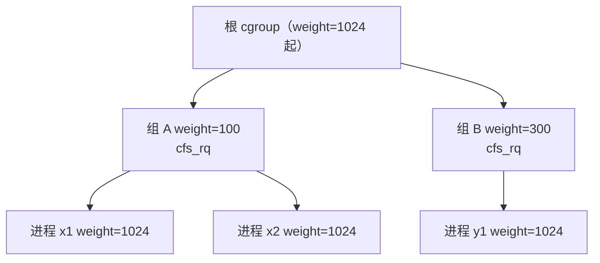
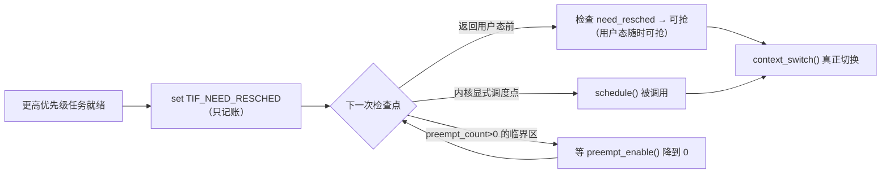

::: abstract 本章定位
内核原理系列第 3 篇，从"看得见的调度"进入"内核里的调度"。把 [篇](/kb/os/Linux/01-Linux进程与调度实操/) 里的 nice/优先级，翻译成 O(1) → CFS → EEVDF 的演进史，拆解 vruntime 加权、红黑树、五个调度类、组调度与负载均衡的源码级设计，最后落到抢占模型与 `kernel.sched_*` 参数。目标：能解释"为什么 `nice -n 10` 只是让它少分点、而 `chrt -f 10` 是直接抢"。
:::

在 [篇](/kb/os/Linux/01-Linux进程与调度实操/) 里，`ps` 的 `PRI/NI` 列只是"显示出来的数字"。这一篇回答：**这个数字在内核里到底怎么存、怎么换算、怎么变成 CPU 时间**。调度器的本质只有一句话——**给一堆想跑 CPU 的进程一本公平的账，再设计一个高效的方法找出"下一个该跑谁"**。`账怎么记`、`人怎么挑`，是理解所有调度的两条主线。

先给一张"用户可见 → 内核概念"的映射表，之后所有章节都围绕它展开：

| 01 篇里你见过的 | 本篇对应的内核概念 | 章节 |
|---|---|---|
| `NI`（nice 值） | `static_prio` → weight → vruntime 记账 | §2、§5 |
| `PRI` 列 | 内核 prio 减去偏移量的显示值 | §5.2 |
| `top` 的 `PR`/`rt` | 调度类（rt 类 vs fair 类） | §4、§5 |
| `renice` | 改 `static_prio`，只影响 fair 类分额 | §5 |
| `STAT` 的 `R`/`S` | 就绪 → 进红黑树；睡眠 → vruntime 冻结 | §2.4 |
| 容器 CPU 限制 | cgroup cpu.weight + cpu.max（quota/period） | §6 |

## 1. 调度器演进：从 O(1) 到 CFS 再到 EEVDF

### 1.1 时间线



### 1.2 O(1) 调度器：启发与问题

O(1) 是 Linux 2.6 的主角，设计目标就是"大机器上挑选也要 O(1)"。它奠定了两个至今还在的基础：

- **每 CPU 一个 runqueue**：每个 CPU 只管自己的队列，避免全局调度锁成为多核瓶颈。
- **两个优先级数组（active / expired）**：每个数组 140 个优先级链表（0-99 实时、100-139 普通），配一个位图，用 `sched_find_first_bit` 一条指令就能找到"最高优先级非空队列"，挑选开销恒定。


时间片用完的进程放进 expired 数组，并**按"睡眠了多少"提升其动态优先级（老化 aging）**——睡得多=像交互型任务，优先级上调，这是它试图讨好交互性的方式。active 数组跑空后两数组交换、下一轮开始。

::: warning O(1) 的致命伤：靠猜
O(1) 用"睡眠时间→优先级"的启发式判断谁是交互型任务，猜对了体验好、猜错了延迟奇高。它换来了 O(1) 的挑选速度，却把**公平性与可预测性牺牲给了启发式**。CFS 正是在这个废墟上重建的。
:::

### 1.3 CFS 的动机

Ingo Molnar 在 2.6.23 重写调度器时的核心想法：**不要再去"猜"交互性，转而假设机器上有一个"理想的、能同时跑所有进程的多处理器"**。在这个理想模型里，n 个进程共享 1 个 CPU，每个人分到 `1/n`。CFS 要做的只是"记账"——谁跑得比理想份额少，谁就排在前面；谁跑多了，谁就往后排。**公平被转化为一个可计算的量 vruntime**，交互性、优先级全部被"折算"进权重，不再需要启发式。

### 1.4 EEVDF：CFS 的接班人（6.6）

CFS 的挑选规则是"总是选 vruntime 最小的"，这个规则有个副作用：某个任务可能被**连续选中多次**，产生"饿一阵、突然冲一波"的突发延迟。EEVDF 给每个任务加了一个**虚拟 deadline**（该跑完自己那份时间的时刻），只从"有资格（eligible，不欠 CPU 债）"的任务里挑 deadline 最早的——详见第 3 节。

### 1.5 三代对比

| 维度 | O(1)（2.6） | CFS（2.6.23–6.5） | EEVDF（6.6+） |
|---|---|---|---|
| 核心数据结构 | 两个优先级数组 + 位图 | 按 vruntime 排序的红黑树 | 红黑树 + 虚拟 deadline |
| 公平依据 | 静态优先级 + 睡眠老化 | vruntime 加权平衡 | 虚拟 deadline 抢占 + lag 记账 |
| 挑选规则 | 位图找最高优先级队列 | 恒取 vruntime 最小（最左） | 取"eligible 且 deadline 最早" |
| 交互性 | 启发式猜测，不准 | 睡眠不涨 vruntime，天然优先 | 继承 + lag 保证欠账不丢 |
| 挑选/插入复杂度 | O(1) | O(log n) / O(log n) | O(log n) / O(log n) |
| 延迟表现 | 波动大、不可预测 | 较公平 | 抢占时机更可预期，抖动更低 |

## 2. CFS 核心原理：vruntime 与红黑树

### 2.1 vruntime：一本加权的账

CFS 给每个任务记的账叫 **vruntime（虚拟运行时间）**。关键在设计它的增长规则——**真实运行时间除以权重**，即：

```
Δvruntime = Δ实际运行时间 × NICE_0_LOAD / weight   （NICE_0_LOAD = 1024，即 nice 0 的权重）
```

- 权重越大（优先级越高）→ 单位时间里 vruntime 涨得越慢 → 在同一棵树里"落后"→ 被选中的机会越多。
- nice 0 的任务 weight = 1024，vruntime 与墙钟时间同速前进；nice -20 的任务 weight = 88761，vruntime 只以约 `1/87` 的速度增长。
- vruntime 是**纯虚拟量**，不同优先级之间就是靠它"折算"到同一把尺子上比较。

**nice ↔ weight 换算表**（`kernel/sched/core.c` 的 `sched_prio_to_weight[40]`，nice 范围 -20..19 共 40 档）：

| nice | 0 | 1 | 2 | 3 | 4 | 5 | 6 | 7 | 8 | 9 |
|---|---|---|---|---|---|---|---|---|---|---|
| weight | 1024 | 820 | 655 | 526 | 423 | 335 | 272 | 215 | 172 | 137 |

| nice | 10 | 11 | 12 | 13 | 14 | 15 | 16 | 17 | 18 | 19 |
|---|---|---|---|---|---|---|---|---|---|---|
| weight | 110 | 87 | 70 | 56 | 45 | 36 | 29 | 23 | 18 | 15 |

关键档位（负数侧对称放大）：`nice -20 → 88761`，`-15 → 29154`，`-10 → 9548`，`-5 → 3121`。

**算一个实例**：nice 0 与 nice 5 两进程竞争 1 核，权重 1024 与 335，总权重 1359：

```
nice 0 分得 CPU = 1024/1359 ≈ 75.4%
nice 5 分得 CPU = 335/1359 ≈ 24.6%
```

所以"nice 加 5"不是少 5%，而是**少约 3 倍**——这是 nice 最容易被误读的地方（呼应 [篇](/kb/os/Linux/01-Linux进程与调度实操/) 的 `renice`）。

::: tip 换算规律（背这两条就够）
1. **nice 每 +1，weight 约 ×1/1.25**（0.8 倍）；反之每 -1 约 ×1.25。
2. **每 3 档约翻倍**（1.25³≈1.95）。于是 nice -20 比 nice 0 快约 87 倍，比 nice 19 快约 5900 倍——这就是为什么 `nice -n 19` 几乎"拿不到 CPU"，而 `nice -n -20` 能占掉几乎全部。
:::

### 2.2 红黑树：按 vruntime 排序，取最左



- 每个 CPU 的 fair 运行队列（`cfs_rq`）维护一棵**按 vruntime 排序的红黑树**，key 就是 vruntime。
- **最左节点 = vruntime 最小 = 跑得最少的任务 = 下一个被选中的任务**。选中后它运行，vruntime 增长，节点向右移动，把位置让给后来者。
- 插入/删除 O(log n)，取最小值 O(1)（最左节点）。**"调度"就退化为：找最左、跑它、把它插回去。**

### 2.3 调度周期、时间片与最小粒度

CFS 不用固定时间片，而是算出一个"目标延迟"再按权重切：

```
调度周期 period = max( 就绪任务数 × sched_min_granularity_ns, sched_latency_ns )
每个任务时间片 = period × (该任务 weight / 总 weight)
```

- **`sched_latency_ns`**：目标调度周期，默认 6ms。任务数少时，保证每个人在 6ms 内轮完一圈。
- **`sched_min_granularity_ns`**：最小切换粒度，默认 0.75ms。任务很多时（超过 `sched_nr_latency`，默认 8 个），周期线性放大，但每份不少于最小粒度，避免切换开销过大。
- 例 1：两个 nice 0 进程，period=6ms，weight 各 1024，时间片各 3ms——各跑 3ms 轮换一次。
- 例 2：一个 nice -20（weight 88761）与一个 nice 0（weight 1024）竞争：period=6ms，总权重 89785，时间片分别为 5.93ms 与 0.07ms——**优先级差 20 档，时间片差约 87 倍**。
- 这里的"时间片"只是**目标**，EEVDF/CFS 是优先级（抢占）驱动而非严格按片轮转；虚拟时间上账目自会平衡。

### 2.4 睡眠补偿：I/O 型任务为什么"天然优先"

- 进程**睡眠时 vruntime 不增长**（它没在跑，当然不记账）。醒来时它的 vruntime 明显落后于队列平均值 → 自动排到树最左边 → 被立即选中。
- 于是**I/O 型（交互型）任务的体验极佳**：每次读键盘/磁盘醒来都几乎立刻上 CPU，用完就睡，把 CPU 让给计算型任务。
- 内核不会让补偿无限大：唤醒时用 `sched_wakeup_granularity_ns`（默认 1ms）与 min_vruntime 兜底，防止计算型任务靠"小睡片刻"骗优待。

::: note 与 O(1) 的本质区别
O(1) 是"猜谁交互"然后改优先级；CFS/EEVDF 是"不猜"，只是睡眠期间不涨 vruntime，交互性作为公平记账的**副产品**自然涌现。
:::

## 3. EEVDF（Linux 6.6+）：更可预期的抢占

::: important 先说清：EEVDF 不是新的调度类
6.6 起 fair 类的**内部挑选算法**由 CFS 换成了 EEVDF，仍归 fair 类，`nice`、组调度、负载均衡的框架不变。6.6 之前跑的是 CFS，6.6 之后是 EEVDF，二者对用户可见的 API 完全一致。
:::

### 3.1 两个新概念：虚拟 deadline 与 lag

- **虚拟 deadline**：每个任务在"虚拟时间轴"上有一个时刻 `deadline = vruntime + slice/weight`，表示"按我的权重，我该在虚拟时刻 X 之前跑完我这一份"。选它之后就更新 deadline，相当于"这次机会用完，轮到别人"。
- **lag（滞后）**：`lag = 该任务 vruntime − 系统加权平均 vruntime`。lag ≤ 0 表示它**还欠跑（落后于平均）**，此时才 **eligible（有资格被选）**；lag > 0 表示它已经跑超了，先靠边站。

### 3.2 挑选规则与 CFS 的差异

EEVDF 的规则：**在所有 eligible（lag ≤ 0）的任务中，选虚拟 deadline 最早的那个**。对比 CFS"永远选 vruntime 最小"，差异在于：

| | CFS（6.5 前） | EEVDF（6.6+） |
|---|---|---|
| 排序依据 | 只有 vruntime | vruntime（资格）+ deadline（选择） |
| 选中后 | 任务可连续多次被选，造成突发 | 每个任务跑完自己那份后 deadline 推后，轮到别人 |
| 抢占时机 | 由 min_vruntime 阈值触发，时机较粗 | 到期即抢，抢占点可预期 |
| 唤醒/新任务放置 | 近似放回 min_vruntime | **按 lag 放置**，保留欠账，不因换 CPU 丢历史 |
| 延迟抖动 | 可能有"饿一阵、冲一下" | 显著降低，tail latency 更稳 |

### 3.3 为什么能降低延迟波动、对延迟敏感负载的意义

CFS 的问题场景：一个刚睡醒的 CPU-bound 任务 vruntime 很低，会被连续选中多次、一次跑很久，其他任务的等待时间被拉得很长。EEVDF 让**每个任务一旦到期就必须让位**，等得久的人 deadline 先到、优先被选，抢占发生得更早也更规律——同一批任务下，任务间延迟的**方差更小**。

对游戏、视频、交互式后台这类**延迟敏感负载**，好处是尾延迟（tail latency）更稳定、用户体验波动更小；对纯吞吐的批处理影响不大。这也是 6.6 合入后社区普遍认可"更公平、抖动更低"的原因。

::: note 深入阅读
内核源码 `kernel/sched/fair.c` 中的 `entity_eligible()` 与 `pick_eevdf()`；KernelNewbies 的 "EEVDF" 词条与 Peter Zijlstra 的补丁系列 "sched/EEVDF"。
:::

## 4. 调度类体系：五个等级的金字塔

### 4.1 五个调度类与抢占关系



| 调度类 | 内核实例 | 用户策略 | 优先级 | 说明 |
|---|---|---|---|---|
| stop | `stop_sched_class` | —（内核专用） | 最高 | `stop_machine`、CPU 热插拔迁移 |
| dl | `dl_sched_class` | `SCHED_DEADLINE` | 按 deadline，EDF | 3.14+，带准入控制，需 CAP_SYS_NICE |
| rt | `rt_sched_class` | `SCHED_FIFO` / `SCHED_RR` | 1-99 | 实时优先级，抢占一切 fair 任务 |
| fair | `fair_sched_class` | `SCHED_NORMAL` / `BATCH` / `IDLE` | nice -20..19 | 默认，绝大多数进程在此 |
| idle | `idle_sched_class` | — | 最低 | 空闲时运行的 `swapper/idle` |

**抢占规则：高类永远抢先于低类**。一个 RT 任务就绪，会立刻抢占正在跑的 fair 任务；同类别内再看优先级（rt）或公平记账（fair）。

### 4.2 各策略语义与 `chrt`

| 策略 | 语义 | 要点 |
|---|---|---|
| `SCHED_FIFO` | 先入先出，**无时间片** | 只要不阻塞，同优先级下它可一直占 CPU；有更高优先级 FIFO 到达则被抢 |
| `SCHED_RR` | FIFO + 时间片轮转 | 同优先级 RR 任务按 `sched_rr_timeslice_ms`（默认 100ms）轮流 |
| `SCHED_DEADLINE` | runtime/deadline/period | 按截止时间最紧迫者先跑，有准入控制（跑不过来就不准进） |
| `SCHED_NORMAL` | 默认策略 | fair 类，CFS/EEVDF |
| `SCHED_BATCH` | 批处理 | 与 NORMAL 同调度，但更适合计算密集、不关心响应 |
| `SCHED_IDLE` | 最低 nice 之下 | 只在 CPU 真正闲着时运行 |

```bash
chrt -f 10 ./prog          # SCHED_FIFO 优先级 10 运行
chrt -r 30 ./prog          # SCHED_RR 优先级 30
chrt -p 123                # 查看进程 123 的策略与优先级
chrt -f 10 -p 123          # 把已运行进程改成 FIFO 10
```
注意：`chrt` 不带策略参数时默认就是 `SCHED_FIFO`；设置实时策略需要 `CAP_SYS_NICE`（root）。**RT 优先级 1-99 与 nice 完全无关**，各自独立维度。

### 4.3 SCHED_DEADLINE 的准入控制

`SCHED_DEADLINE`（dl 类）是最"硬"的策略：进程声明 `runtime / deadline / period` 三个量（如每 20ms 周期内最多跑 10ms、截止期限 20ms），内核用 **EDF（最晚期限优先）** 保证它一定按时完成，且**不可超标**——dl 类任务的总带宽之和超过 100% 时，新任务会被**拒绝加入（准入控制 admission control）**，因为它承诺了硬实时保证，不能打破。dl 类也受带宽限制，由 `/sys/fs/cgroup/&lt;cg&gt;/cpu.dl_*` 控制。它比 RT 类更适合"周期固定的实时负载"（如采集、控制回路），比 RT 的固定优先级更灵活。

### 4.4 RT 任务的饥饿保护：rt_runtime

一个 `SCHED_FIFO` 任务如果不睡、不退出，可以**永久占住 CPU，饿死所有普通进程**。内核的兜底是 RT 带宽控制（RT throttling）：

| 参数 | 默认 | 含义 |
|---|---|---|
| `kernel.sched_rt_period_us` | 1000000（1s） | RT 记账周期 |
| `kernel.sched_rt_runtime_us` | 950000（950ms） | 每周期 RT 类最多使用量 |

RT 任务每 1s 周期内最多合计用 950ms CPU（95%），超了就 **throttle 到下一周期**，把至少 5% 留给普通进程。设 `-1` 可取消限制（危险，禁止对含 RT 任务的生产机这么做）。cgroup 层还有 `cpu.rt_runtime_us` 可对某组单独限量。

## 5. 优先级在内核中的表示

### 5.1 三套数字的换算

内核里每个任务有几个相关的优先级字段，用户看到的只是最外面一层：

```c
static_prio = nice + 120;            /* nice -20..19 → 100..139，普通任务静态优先级 */
normal_prio = 99 - rt_priority;      /* RT 1..99 → 0..98，RT 任务数值越小越优先 */
```

| 用户视角 | 内核字段 | 换算 |
|---|---|---|
| nice -20..19 | `static_prio` | `static_prio = nice + 120`（100..139） |
| RT 1..99 | `rt_priority` + `normal_prio` | `normal_prio = 99 − rt_priority`（0..98） |
| 权重 | `se.load.weight` | 由 nice 查 `sched_prio_to_weight` 表（见 §2.1） |
| 当前优先级 | `prio` | 运行时取 `normal_prio`；被优先级继承（PI）提升时例外 |

::: note 关于"动态优先级"
教材里的"动态优先级 = 静态 + 老化"是 O(1) 时代的算法；CFS 起不再改数字，而是把老化的语义换成了 **vruntime 记账**——"动态"体现在 vruntime 上而非优先级数值上。RT 任务的优先级在普通态与 RT 态之间切换时也会变化（`normal_prio` 随策略变）。
:::

**内核里"数字越小越优先"，且 RT 与 nice 两套体系互不换算**——`nice -20` 也压不过 `SCHED_FIFO 1`。换算对照示例：

| 你想表达的优先级 | 用户操作 | static_prio / rt_priority | weight（fair 内） | ps 的 PRI |
|---|---|---|---|---|
| 最高（普通） | `nice -n -20` | static_prio=100 | 88761 | 60 |
| 默认 | （无操作） | static_prio=120 | 1024 | 80 |
| 最低（普通） | `nice -n 19` | static_prio=139 | 15 | 99 |
| 最高（实时） | `chrt -f 99` | rt_priority=99 | —（不参与 fair） | -40 |
| 最低（实时） | `chrt -f 1` | rt_priority=1 | —（不参与 fair） | 58 |

### 5.2 与 01 篇呼应：`ps -o pri,ni` 读到的到底是什么

procps 的 `ps` 显示的不是内核原始值，而是**内核 prio 减 40 后的偏移量**：

```
普通进程：PRI = nice + 80      （nice 0 → 80，正是 01 篇里看到的输出）
RT 进程：  PRI = 59 − rt_prio  （可显示为负，如 FIFO 99 → -40）
```

- `top` 的 `PR` 列则是另一套：普通进程 `PR = 20 + nice`（nice 0 → 20），RT 进程直接显示 `rt`。
- `renice 5 &lt;pid&gt;`：把进程 nice 改成 5。**普通用户只能往高 nice 调（放权），往低调（提权）需要 root/`CAP_SYS_NICE`**。`renice` 改的就是 §5.1 的 `static_prio`，经权重表即时影响 fair 类分额。

### 5.3 `/proc/&lt;pid&gt;/sched`：看到 vruntime 与切换次数

```bash
# 需要调度统计（kernel.sched_schedstats=1，或按进程开启）
sudo sysctl kernel.sched_schedstats=1
cat /proc/&lt;pid&gt;/sched
```
```
se.sum_exec_runtime:       1.234567    # 累计执行时间
se.vruntime:              62.123456    # 虚拟运行时间（越小越"欠跑"）
nr_switches:                 45678     # 总切换次数
nr_voluntary_switches:       40000     # 主动让出（睡眠/等 IO）
nr_involuntary_switches:      5678     # 被抢占
se.load.weight:                 1024   # 权重
```
比较几个忙进程的 `se.vruntime`，差值大 = 一个在狂跑、一个在挨饿；`nr_involuntary_switches` 高说明经常被别的任务抢占。

## 6. 组调度（cgroup cpu 子系统）

### 6.1 为什么需要组调度

CFS 默认的公平是"**任务级**"公平。假设两个用户：A 跑 1 个进程、B 跑 100 个进程，若只按任务分，B 会拿到 ~99% 的 CPU——**按进程数公平恰恰是对用户的不公平**。组调度把公平单位从"进程"升级为"**cgroup（任务组）**"：先按组分，组内再按进程分。

### 6.2 CFS 层级树



每个组（`task_group`）都有自己独立的 `cfs_rq` 与红黑树，组作为一个**调度实体（se）**挂到父级的树上。调度时先看组的权重分 CPU，组内再看各进程权重分。`A` 组 100 个进程和 `B` 组 1 个进程，在"组之间"这一层是公平的。

### 6.3 cgroup v1 vs v2 的参数

| 参数 | v1 | v2 | 含义 |
|---|---|---|---|
| 相对权重 | `cpu.shares`（默认 1024） | `cpu.weight`（默认 100，范围 1-10000） | 决定 CPU 空闲时怎么**分** |
| 硬上限 | `cpu.cfs_quota_us` / `cpu.cfs_period_us` | `cpu.max` = "quota period" | 决定最多能**用**多少 |
| nice 快捷 | — | `cpu.weight.nice` | 直接把 weight 换算成 nice |

v1 shares 与 v2 weight 的换算：`weight ≈ shares × 100 / 1024`。例如 `cpu.shares=2048` ≈ `cpu.weight=200`，表示该组在兄弟组里权重翻倍。

::: tip shares 与 quota 的区别（面试高频）
**shares/weight 是"分蛋糕"**：只有 CPU 不够时才起作用，CPU 空闲时一个组用满 100% 也没人管。**quota 是"限高"**：`cpu.max` 写成 `50000 100000` 表示每 100ms 周期最多 50ms，即**硬性 0.5 核上限**。`--cpu-shares` 给的是前者，`--cpus`/`--cpu-quota` 给的是后者。
:::

### 6.4 容器 CPU 限制的内核机制

- Docker `--cpus=1.5` → 写入 `cpu.max = 150000 100000`（或 v1 `cfs_quota_us=150000, cfs_period_us=100000`）。
- Docker `--cpu-shares=2048` → 写入 `cpu.shares`/`cpu.weight`。
- 内核侧由 **CFS 带宽控制（cfs_bandwidth）** 落地：每个周期为带限额的组记账 runtime，跑超就 **throttle**（冻结该组所有任务到下一周期）。这就是"容器说自己很慢、但宿主机 CPU 看起来没满"的常见原因之一——详见 [CPU 排查](/kb/os/问题排查/02-CPU性能问题排查/)。

## 7. 负载均衡（SMP 与 NUMA）

### 7.1 per-CPU runqueue：为什么需要均衡

每 CPU 一个 `rq`（内含 fair 的红黑树）是为了**避免全局调度锁**，但代价是可能出现"4 核机器：3 核排队，1 核空转"。调度器需要一套机制把任务从忙核搬去闲核。

### 7.2 何时触发均衡

| 触发点 | 动作 |
|---|---|
| **tick 周期性** | `scheduler_tick()` 周期调用 `rebalance_domains()`，检查本 CPU 与邻居是否失衡 |
| **空闲** | `idle_balance()`：空核主动去忙核 **pull** 任务过来 |
| **唤醒** | `wake_affine()`：唤醒时若 waker 与 wakee 共享同一 LLC 缓存，优先放到 waker 所在核，**保住缓存亲和性** |
| **fork** | 新进程优先放到负载最轻的核 |
| **tickless** | 空闲 CPU 靠 wakeup 时一次性检查 |

### 7.3 迁移成本与缓存亲和性

- **迁移代价**：任务换个 CPU = 丢掉热 L1/L2/L3 缓存与 TLB、还要争抢 runqueue 锁，短期性能可能不升反降。
- 因此均衡遵循"**获益 > 成本才迁移**"：`sched_migration_cost_ns`（默认 0.5ms）作为迁移成本阈值，`sched_nr_migrate`（默认 32）限制单次最多搬多少。
- 亲和性排序：**同核 > 同 LLC（L3）> 同 NUMA 节点 > 跨节点**。短命任务尽量少搬，长任务才精确均衡。

### 7.4 PELT：负载到底怎么度量


`per-entity load tracking`（3.8+，Paul Turner）给每个实体（进程、cfs_rq）维护一个**指数衰减的负载均值 `load_avg`**：

`per-entity load tracking`（3.8+，Paul Turner）给每个实体（进程、cfs_rq）维护一个**指数衰减的负载均值 `load_avg`**：

```
load_avg(t+1) = load_avg(t) × decay + 新增贡献       （半衰期约 32ms）
```

过去的负载按指数衰减，越久远影响越小——这比"此刻就绪队列多长"更能反映真实负载趋势。PELT 的数值喂给负载均衡、EAS 能耗感知调度（`energy_aware`）等。对比一下：`top` 的 load average 是**系统级、1/5/15 分钟**的粗粒度负载，PELT 是**实体级、毫秒级**的细粒度负载。

### 7.5 观测与干预工具

```bash
cat /proc/schedstat      # 每 CPU/域 的均衡与迁移计数
taskset -pc 0-3 1234     # 把进程 1234 绑到 0-3 号核（sched_setaffinity）
taskset -c 2 ./prog      # 启动即绑定
numactl --hardware       # 看 NUMA 拓扑
numactl --cpunodebind=0 --membind=0 ./prog   # 绑 CPU 节点 + 内存节点
```
`sched_setaffinity`（taskset）是**硬亲和**；NUMA 感知调度（`kernel.numa_balancing`）是**软亲和**——内核尽量把任务和它常访问的内存放同一节点，必要时才跨节点迁移。

## 8. 抢占机制

### 8.1 能不能抢，由两个机制决定



- **`TIF_NEED_RESCHED` 标志**：某个更高优先级任务就绪时，调度器只是"记账"：给当前任务打上 `need_resched` 标记。真正的切换发生在**返回用户态前、或内核允许的抢占点**。
- **`preempt_count` 计数器**：每个任务一个，内核进入临界区/中断时 `preempt_disable()` 递增，退出时递减。**`preempt_count > 0` = 当前处在不可抢占的临界区**，即使有 `need_resched` 也要等它降到 0。
- **用户态抢占**：从中断/系统调用返回用户空间时检查 `need_resched`——用户态代码**随时可被抢**（反正切走保存现场就行）。
- **内核态抢占**：内核代码跑到一半能不能被抢，取决于 `CONFIG_PREEMPT`（见下）。

### 8.2 CONFIG_PREEMPT 四档

| 配置（内核参数名） | 语义 | 适用场景 |
|---|---|---|
| `PREEMPT_NONE`（`preempt=none`） | 内核只在**显式调度点**切换，长内核路径不可抢 | 服务器/吞吐优先 |
| `PREEMPT_VOLUNTARY`（`preempt=voluntary`） | 内核在显式**自愿抢占点**可让出 | 兼顾吞吐与响应 |
| `CONFIG_PREEMPT`（`preempt=full`） | 内核**几乎全部可抢占**（临界区、中断除外） | 桌面、低延迟 |
| `PREEMPT_RT`（`preempt=rt`） | 完整实时内核 | 工业控制、音频 |

**实时性（RT）的四块基石**：① RT 调度类优先级高于一切；② 内核可抢占（PREEMPT 或 RT）——中断处理完就能切走，不用等内核跑完；③ **中断线程化**（RT 下中断变成可调度的线程，可被抢占、可设优先级）；④ **优先级继承**（rt-mutex 的 PI 机制）防优先级反转。`preempt_count` 在这些模式下依然存在，只是临界区被收窄到真正短小的部分。

### 8.3 `kernel.sched_*` 关键参数解读

| 参数 | 默认 | 含义 |
|---|---|---|
| `sched_latency_ns` | 6ms（debugfs） | 目标调度周期，任务少时的轮换目标 |
| `sched_min_granularity_ns` | 0.75ms（debugfs） | 最小时间片，防切换抖成筛子 |
| `sched_wakeup_granularity_ns` | 1ms（debugfs） | 唤醒抢占阈值，兼控睡眠补偿上限 |
| `sched_rt_period_us` / `sched_rt_runtime_us` | 1s / 950ms | RT 带宽上限（§4.4） |
| `sched_rr_timeslice_ms` | 100 | SCHED_RR 时间片 |
| `sched_nr_migrate` | 32 | 均衡单次最多迁移任务数 |
| `sched_migration_cost_ns` | 500000 | 迁移成本阈值 |
| `sched_schedstats` | 0 | 开启调度统计（`/proc/&lt;pid&gt;/sched`、`schedstat`） |

::: warning 调参红线
`sched_latency_ns`/`sched_min_granularity_ns`/`sched_wakeup_granularity_ns` 位于 debugfs（`/sys/kernel/debug/sched/`，root 可改）。**把 min_granularity 调小能降响应延迟，但会显著增加上下文切换次数**——切换也是开销，调过头吞吐崩掉。生产环境优先用 RT 类、cgroup 和任务绑核解决问题，而不是盲目改全局参数。
:::

## 本章小结

- 一条主线：**调度器 = "公平的记账 + 高效的选择"**。账本从 O(1) 的静态优先级+老化，进化为 CFS 的 vruntime 加权，再到 EEVDF 的 vruntime + 虚拟 deadline；选择结构从位图数组演进为红黑树。
- 优先级三层换算：**nice → static_prio → weight**；RT 优先级 1-99 独立成维、`normal_prio = 99 − rt_prio`；`ps` 的 `PRI = nice + 80` 只是显示偏移。
- 五个调度类 stop > dl > rt > fair > idle 层层抢占，RT 靠 `rt_runtime` 95% 上限防饿死普通进程。
- 组调度（cpu.shares/weight + cpu.max quota/period）把公平单位从"进程"升到"容器/用户"，是容器 CPU 限制的内核机制。
- 负载均衡在"核利用率"与"迁移成本/缓存亲和性"间权衡，靠 PELT 毫秒级负载做决策。
- 抢占 = `TIF_NEED_RESCHED` 标记 + `preempt_count` 临界区 + `CONFIG_PREEMPT` 四档；实时性 = RT 类 + 内核可抢占 + 中断线程化 + 优先级继承。

配合 [Linux进程与线程内核原理](/kb/os/Linux/08-Linux进程与线程内核原理/) 理解调度实体的来源（进程/线程），对照 [调度算法](/kb/os/进程线程/05-CPU调度算法详解/)、[实时调度](/kb/os/进程线程/06-多处理器调度与实时调度/) 的教材版本。

## 动手实验

1. **读 vruntime**：`sudo sysctl kernel.sched_schedstats=1`，`yes > /dev/null &` 后台跑满，`cat /proc/&lt;pid&gt;/sched | grep -E 'vruntime|nr_switches'`，每 3 秒看一次 `vruntime` 单调增长、`nr_involuntary_switches` 反映被抢占次数。
2. **chrt 对比响应**：起两个 `yes >/dev/null &` 占满核，再 `chrt -f 10 ./prog` 跑一个忙循环，观察 RT 任务几乎独占 CPU、普通进程被压到个位数；改回普通策略再对比。
3. **taskset 绑核**：`taskset -pc 0 &lt;pid&gt;` 把忙进程锁到 0 号核，再用 `perf stat` 对比上下文切换与 cache-miss 数量。
4. **nice vs chrt 的本质区别**：`nice -n -10 ./prog`（只在 fair 类里多分）与 `chrt -f 10 ./prog`（直接抢所有 fair 任务），看 `ps -o pri,ni,rtprio` 的列变化。
5. **perf sched 观察**：`perf sched record` 跑一段多进程负载，`perf sched latency` 看各任务的调度延迟（`sched:task` 事件）。
6. **观测负载均衡**：4 核机器起 8 个 `yes >/dev/null &`，`cat /proc/schedstat` 前后对比各 CPU 的 balance/migrations 计数；再用 `taskset` 手动打乱看系统如何慢慢拉平。

## 自测题

1. **nice 0 与 nice 5 的两个进程各占多少 CPU？** nice0 weight=1024，nice5 weight=335，各占 1024/(1024+335)≈75.4% 与 24.6%。
2. **nice -10 与 nice 10 的权重比约多少？** 9548 / 110 ≈ 87 倍。
3. **nice -20 与 nice 19 相差约多少倍？** 88761 / 15 ≈ 5900 倍（每 3 档约翻倍：39 档 ≈ 2^13）。
4. **`ps -o pri` 显示 PRI=80 的进程 nice 是多少？它属于哪个调度类？** nice=0（PRI=nice+80）；普通任务，fair 类。
5. **一个死不退出的 SCHED_FIFO 任务会饿死普通进程吗？内核怎么兜底？** 会（无时间片）。靠 `sched_rt_runtime_us`（默认 950ms/1s）节流，RT 每周期最多用 95% CPU。
6. **CFS 为什么让 I/O 型进程"天然优先"？** 睡眠期间 vruntime 不增长，醒来时落后于平均值，红黑树最左即被选；无需猜测交互性。
7. **EEVDF 相比 CFS 改进了什么？** 引入虚拟 deadline 与 lag：只选 eligible（lag≤0）任务中 deadline 最早的，抢占时机更可预期，延迟抖动更小（6.6+）。
8. **cgroup 的 `cpu.shares=2048` 表示该组一定占两倍 CPU 吗？** 不是。它只是相对权重（≈v2 的 weight=200），只在 CPU 争抢时按比例分；要硬上限需 `cpu.max`（quota/period）。
