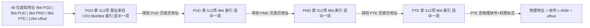
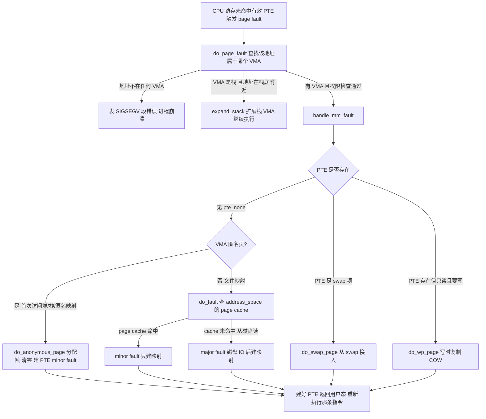

::: abstract 本章定位
把 [内存管理](/kb/os/内存/01-内存管理基础与连续分配/)、[分页](/kb/os/内存/02-分页与页表结构/)、[虚拟内存](/kb/os/内存/04-虚拟内存与按需分页/) 的知识下沉到 Linux 内核：页表与 TLB 怎么翻译地址、buddy 与 slab 怎么分配物理内存、缺页异常怎么按需分页、kswapd 怎么回收、OOM killer 怎么挑受害者。目标：把 `free`/`pmap` 的每一列都对应到内核的一个数据结构与一条代码路径。
:::

`free` 只告诉你"还剩多少"，内核实际在做的是：**给进程的虚拟地址建立映射、把物理页框切成块发出去、缺页时现场补上、不够时从 LRU 上回收、回收不了就杀人**。本篇按这条主线，把 Linux 内存子系统拆成八块讲透。

## 1. 虚拟地址空间与页表

### 1.1 x86-64 地址空间布局

x86-64 用**48 位**虚拟地址（高位第 63~48 位必须是第 47 位符号扩展，否则触发异常），因此可寻址 256 TB，其中用户空间与内核空间各占 128 TB：

```
0x0000 0000 0000 0000 ─────────────────────────── 用户空间 (128 TB)
0x0000 7fff ffff ffff │  text / data / heap / mmap / stack / vdso
0x0000 8000 0000 0000 ─────────────────────────── 非规范地址空洞 (未使用)
0xffff 8000 0000 0000 ─────────────────────────── 内核空间 (128 TB)
0xffff 8880 0000 0000 │  direct map(physmap)：物理内存直接映射
0xffff c900 0000 0000 │  vmalloc 区：非连续映射 / ioremap
0xffff ea00 0000 0000 │  vmemmap：struct page 数组
0xffff ffff 8000 0000 │  内核 text/data 镜像
0xffff ffff a000 0000 │  modules 模块加载区
0xffff ffff ffff ffff ─────────────────────────── 最高地址
```

关键区域（典型值，4 级页表、未开 KASLR）：

| 区域 | 基址 | 用途 |
|---|---|---|
| 用户区 | `0x0000...` ~ `0x00007fff_ffff_ffff` | 每个进程独立，见 [篇](/kb/os/Linux/02-Linux内存管理实操/) 的 `pmap` |
| **direct map** | `0xffff8880_00000000`（`PAGE_OFFSET`） | 物理内存被**线性映射**到内核态，`virt→phys` 只需减基址 |
| vmalloc | `0xffffc900_00000000` | 需要连续虚拟地址但物理可不连续的大块（模块、驱动） |
| vmemmap | `0xffffea00_00000000` | 每个物理帧对应一个 `struct page` 的数组 |
| 内核镜像 | `0xffffffff_80000000` | 内核编译链接的 text/data |

::: note 为什么内核要"看得见"所有物理内存
内核要管理物理页（页框分配、写回收），所以把整块物理内存映射进自己的地址空间（direct map）。而用户进程只映射自己用到的那几页——这就是"内核占地址多、占物理少，用户进程反过来"的根源。
:::

### 1.2 四级页表：地址如何翻译

4K 页 + 4 级页表时，48 位虚拟地址被拆成 **5 段**：每级页表索引 9 位 + 页内偏移 12 位。每级页表页 512 项 × 8 字节 = 4 KB。



各级能覆盖的空间：

| 级别 | 项数×大小 | 覆盖范围 |
|---|---|---|
| PGD（页全局目录） | 512 项 × 512 GB | 256 TB |
| PUD（页上级目录） | 512 项 × 1 GB | 512 GB |
| PMD（页中间目录） | 512 项 × 2 MB | 1 GB |
| PTE（页表） | 512 项 × 4 KB | 2 MB |
| offset | — | 4 KB 内偏移 |

**一次翻译最坏要访问 4 次内存**（4 个页表页），所以 CPU 用 TLB 缓存结果（见第 2 节）。

### 1.3 内核实现

- 页表相关代码在 `arch/x86/mm/fault.c`（缺页）与 `mm/memory.c`（`pud_alloc`/`pmd_alloc`/`pte_alloc`），每个进程的 `mm_struct` 里 `pgd` 字段指向自己的 PGD。
- **共享内核半区**：每个进程的 PGD 高半部分（内核空间对应项）指向同一组内核页表，用户态切换页表时内核部分不用重建，这是"上下文切换不碰内核页表"的基础。
- 页表页本身用专用 slab 缓存（`pgd_cache`/`pmd_cache`），`/proc/meminfo` 的 `PageTables` 就是这些页的统计（见第 8 节）。
- 页表项 PTE 的低位是标志：`P`（present 是否存在）、`W/R`（可写）、`U/S`（用户态可访问）、`A`（accessed）、`D`（dirty）、`N`（non-exec）、`COW` 由 `W` 位清零实现。
- Linux 5.17 起 x86-64 可选 **5 级页表**（LA57，57 位地址、256 PB），用于超大内存机器；原理相同，多一级。

### 1.4 Huge Page：2M / 1G 大页

| 机制 | 页大小 | 谁在用 | 特点 |
|---|---|---|---|
| **HugeTLB** | 2M / 1G | 数据库、HPC 显式申请 | 启动/运行时预留，页永不换出，`hugetlbfs` 挂载使用 |
| **THP**（透明大页） | 2M（rarely 1G） | 普通进程透明受益 | `khugepaged` 内核线程在后台把相邻 512 页合并为 2M 页 |

大页的好处：PTE 变少 → **TLB 条目减少**、翻译少走 1~2 级页表。代价：分配连续 2M/1G 物理块更易受碎片影响。

```bash
# HugeTLB
cat /proc/sys/vm/nr_hugepages            # 预留的 2M 大页数
grep HugePages /proc/meminfo
# THP
cat /sys/kernel/mm/transparent_hugepage/enabled   # always / madvise / never
```

### 1.5 与实操呼应

- [Linux内存管理实操](/kb/os/Linux/02-Linux内存管理实操/) 的 `pmap` 输出里，地址 `00007f...` 开头的映射就是**用户空间**，高地址的 `[stack]`/`[vdso]` 印证了布局。
- `pmap -x` 的 `RSS` 列正是"该 VMA 里**有 PTE 且 present** 的页数 × 4K"——没缺过页的虚拟地址不占物理内存。
- `getconf PAGESIZE` 验证 4K 页；大页场景看 `/proc/meminfo` 的 `HugePages_*`。

## 2. TLB 与缓存

### 2.1 TLB 是什么、为什么需要

**TLB（Translation Lookaside Buffer）** 是 CPU 里的页表翻译缓存：存「虚拟页号 → 物理帧号 + 权限」的最近映射。没有它，每次访存都要去内存**逐级查 4 个页表页**（4 次额外内存访问），指令执行成本陡增。

| 情形 | 代价 |
|---|---|
| TLB 命中 | ~1 个周期 |
| TLB miss | 触发 **page walk**（硬件遍历页表），几十到上百周期；若各级页表不在 cache，代价接近 4 次随机内存访问 |
| 单条指令访问 2 个地址（取指+取数） | 需要 2 个 TLB（iTLB/dTLB） |

典型 dTLB 容量：一级 64~128 项（仅 4K 页）+ 少量 2M/1G 项；二级统一 TLB 约 512~1536 项。

### 2.2 上下文切换与 TLB 失效（ASID/PCID）

上下文切换会换 `CR3`（指向新进程 PGD），若不做处理，旧进程的 TLB 条目全部残留——**必须清空**，否则串数据：

| 技术 | 谁在用 | 原理 |
|---|---|---|
| 全量 TLB flush | 早期/无 PCID 的 x86 | 切 CR3 即失效全部条目，下次访问重新 page walk |
| **ASID**（Address Space IDentifier） | ARM | TLB 条目打上进程标签，切换时按标签区分，**不清空** |
| **PCID**（Process Context ID） | x86（Haswell+，Linux 4.14 起默认开启） | 同 ASID：CR3 高 12 位带 PCID，内核态运行期间用户条目保留，返回用户态免重建 |

### 2.3 内核在 TLB 上的优化

- **lazy TLB**：切换到内核线程（没有用户 mm）时**不换 CR3**，只在下一次回用户态前 flush——省掉频繁切换内核/用户上下文的 TLB 开销。
- **按范围 flush**：`munmap`/`mprotect` 只 flush 相关页（`flush_tlb_page`/`flush_tlb_range`），不整表清。
- **大页**：2M 页只需 1 条 TLB 项覆盖 512 个 4K 页，显著提升大内存工作负载的 TLB 命中率。
- **页面局部性**：PTE 更新（写时复制、缺页）尽量合并批量 flush，见第 5 节。

### 2.4 与实操呼应：perf 观察

```bash
perf stat -e dTLB-loads,dTLB-load-misses,dTLB-stores,dTLB-store-misses ./your_prog
# 解读: dTLB-load-misses / dTLB-loads 即 TLB miss 率
```

把同一个程序改用 2M 大页（THP `madvise` 或 HugeTLB）再跑一次，miss 率通常会明显下降——这就是第 1 节大页的实战价值。

## 3. 物理内存管理

### 3.1 zone 与 node

物理内存被分成 **zone**，zone 之间按**用途/硬件限制**划分（`ZONE_DMA`/`ZONE_DMA32`/`ZONE_NORMAL`/`ZONE_MOVABLE`）：

| zone | x86-64 范围 | 用途 |
|---|---|---|
| `ZONE_DMA` | 0 ~ 16 MB | 老 ISA 设备 DMA |
| `ZONE_DMA32` | 16 MB ~ 4 GB | 只能寻址 32 位（<4G）的 DMA 设备 |
| `ZONE_NORMAL` | 4 GB 以上 | 常规内存，绝大多数分配落在这里 |
| `ZONE_MOVABLE` | 配置启用时 | 可迁移页（热插拔、CMA、防碎片） |

::: note 为什么要有 4G 以下 DMA 区
很多 PCI 设备的 DMA 引擎寄存器只有 32 位，只能把数据放到物理地址 4G 以下的内存。`ZONE_DMA32` 就是"给这些设备保留的低区"。这是硬件约束，不是软件设计。
:::

**node 与 NUMA**：每个 CPU（及相连的内存控制器）对应一个 **node**，`pg_data_t` 结构管理该 node 的全部 zone。非一致性内存架构下，CPU 访问本 node 内存快、远程慢。`numactl --hardware` 查看拓扑；内核优先从"当前 CPU 所在 node"分配（`gfp` 带 `__GFP_THISNODE`），失败才按 **zonelist 回退**到邻居 node。


### 3.2 buddy 分配器

**buddy（伙伴系统）** 把内存按 **order** 分组，order 表示"块大小 = 2^order 页"：

| order | 页数 | 大小 |
|---|---|---|
| 0 | 1 | 4 KB |
| 3 | 8 | 32 KB |
| 5 | 32 | 128 KB |
| 10 | 1024 | **4 MB**（`MAX_ORDER-1`） |

**分裂（split）**：分配 order 2（16K）时若没有，就把 order 3 的空闲块一分为二，取一半继续拆，直到得到 order 2。**合并（coalesce）**：释放时若其"伙伴"（同 order、物理相邻）也空闲，就合并成高一级，递归向上——伙伴地址用异或算出：`buddy = page_idx ^ (1 << order)`。

```
分配 order 1 (8K) 前：空闲 order 3 块 A
order3:  [        A        ]
split ─▶ order2: [  A0  | A1 ]
split ─▶ order1: [A00|A01| A1 ]  → A01 交给请求者, A00 与 A1 挂回空闲链表
```

- 每个 zone 有一组**空闲链表**（order 0~10），且按 **migratetype** 再分（`UNMOVABLE`/`RECLAIMABLE`/`MOVABLE`/`CMA`），防止可迁移页与不可迁移页互相"锁死"造成高 order 分配失败。
- 每个 CPU 还有 **pageset**（一小批 order-0 热页），减少对 zone 锁的竞争。
- 核心路径：`alloc_pages(gfp_mask, order)` → 快路径从 pageset/free_list 拿 → 慢路径唤醒 kswapd、compaction、直接回收 → 仍失败则 OOM（第 7 节）。

### 3.3 与实操呼应：读 /proc/buddyinfo

```bash
cat /proc/buddyinfo
# 输出格式: Node 0, zone   Normal     1    2    3    4  ...  1024
#          Node 0, zone  DMA32      ...（每列对应 order 0..10 的空闲块数）
```

- 某列数字很大 → 该 order 有很多空闲连续块。
- 若 order≥5 的列几乎全为 0、只有 order 0 有数 → **物理内存高度碎片化**，未来申请 2M 大页/THP 会失败，`dmesg` 可能报 `page allocation failure: order:5`。

**Memory compaction（内存规整）**：`kswapd` 或分配路径把 `MOVABLE` 页从碎片区域迁移走，把空出来的连续块凑给高 order 请求。`cat /proc/pagetypeinfo` 看各 migratetype 分布；它成功与否是"高 order 分配失败"的下一层解释。

::: tip 与用户态碎片对比
**用户态碎片**是虚拟地址空间里堆/映射的"洞"（malloc 大块被小对象切碎，无法合并，见 [连续分配](/kb/os/内存/01-内存管理基础与连续分配/)）；**内核碎片**是物理页框按 order/migratetype 被切碎。前者由 malloc 的 arena 结构负责，后者由 buddy + compaction 负责，两层互不相通。
:::

## 4. slab / slub / slob：内核对象分配器

### 4.1 为什么内核对象不能全用 buddy

| 维度 | buddy 分配 | 内核对象需求 |
|---|---|---|
| 最小粒度 | 4 KB（order 0） | `task_struct` 约几 KB、`dentry`/`inode` 几百字节，4K 起步浪费严重 |
| 分配频率 | 每次要走链表 | 每建一个文件/进程/套接字都要对象，极高频 |
| 生命周期 | 无类型概念 | 需要构造函数/析构、按类型统计、对象级调试 |

所以内核在 buddy 之上加了 **slab 分配器**：把若干物理页做成一个 **slab**，切成等大的**对象**，缓存对象类型或尺寸，快速分配/释放。

### 4.2 kmem_cache 与 kmalloc

- **专用缓存**：`kmem_cache_create("my_obj", size, ...)` 为某一类型建缓存（`task_struct`、`dentry`、`inode`、`filp` 都是专用 cache）。
- **通用缓存**：`kmalloc` 从 `kmalloc-8`、`kmalloc-16`、…、`kmalloc-4k`、`kmalloc-8k` 等按 size 就近取缓存（`kmalloc-192` 存 129~192 字节的对象）。
- **三个实现**：`SLAB`（老）、`SLUB`（2.6.23 起默认，per-CPU freelist，锁竞争更小）、`SLOB`（嵌入式极小内存）。`grep SLUB /boot/config-$(uname -r)` 看本机。
- 超过 kmalloc 上限（约 32K）的请求改走 **vmalloc**，用非连续物理页映射连续虚拟地址。

### 4.3 与实操呼应：读 /proc/slabinfo 与 slabtop

```bash
cat /proc/slabinfo | grep -E 'kmalloc-|dentry|inode|task_struct'   # 需 root
slabtop -o
```

`/proc/slabinfo` 每列：

| 字段 | 含义 |
|---|---|
| `cache name` | 缓存名 |
| `active_objs` / `num_objs` | 在用的对象数 / 该缓存总对象数 |
| `objsize` | 单个对象大小（字节） |
| `objperslab` | 每个 slab（一页或几页）放几个对象 |
| `pagesperslab` | 每个 slab 占几页 |
| `active_slabs` / `num_slabs` | 在用的 slab 数 / 总 slab 数 |

::: important slab 泄漏怎么判定
若某缓存 `active_objs` 只涨不降且贴合某类对象（如 `dentry` 涨、`kmalloc-192` 涨），可能是内核态泄漏。判断与取证见 [排查](/kb/os/问题排查/03-内存与内存泄漏排查/) 的 slab 节：对比 `slabtop` 前后快照、看 `SReclaimable` vs `SUnreclaim`（不可回收 slab 只涨才是疑似泄漏）。
:::

**sanity check**：内核可开启 `slub_debug`（boot 参数）做越界毒化、redzone、双 free 检测，生产环境别开（性能损失），开发调试利器。

## 5. 缺页异常全流程

### 5.1 一次缺页怎么走

用户进程访问一个还没有 PTE（或 PTE 权限不符）的虚拟地址，CPU 触发 **page fault 异常（#PF）**，进内核 `do_page_fault` → `handle_mm_fault` 处理：



### 5.2 分类与细节

| 情形 | minor 还是 major | 触发点 |
|---|---|---|
| 匿名页首次访问 | minor | `mmap` 后第一次写/读 |
| 文件页已在 page cache | minor | 缓存命中，只差建 PTE |
| 文件页不在缓存 | **major** | 磁盘读入后才建映射 |
| 写只读页（fork 后） | minor | COW：复制一页、改两处 PTE |
| 访问 swap 换出的页 | major | 换入（见第 6 节） |
| 栈增长 | minor | 栈底附近缺页自动扩 VMA |

- **COW（写时复制）**：`fork` 后父子共享只读页，谁写谁触发 `do_wp_page` 复制自己的副本——第 1 节的 `W` 位清零就是为此。
- **文件页缺页**：走 `address_space`（`struct address_space`，文件系统与 page cache 的桥）的 `filemap_fault`，先查 page cache，miss 才 `readpage`。文件页的"谁在缓存"模型见 [Linux文件系统内核原理](/kb/os/Linux/11-Linux文件系统内核原理/)。
- **按需分页**：`mmap` 只登记 VMA 不建 PTE，真正访问才分配——这就是 [虚拟内存](/kb/os/内存/04-虚拟内存与按需分页/) 说的 lazy allocation，[Linux内存管理实操](/kb/os/Linux/02-Linux内存管理实操/) 的 `mmap` 实验亲眼可见。

### 5.3 与实操呼应：观察缺页

```bash
ps -o pid,min_flt,maj_flt,cmd -p &lt;pid&gt;      # 累计 minor / major 次数
vmstat 1 3                                   # pgfault / pgmajfault 速率
grep -E 'pgfault|pgmajfault' /proc/vmstat
```

::: warning 缺页 vs 换页
**缺页（page fault）** 是"虚拟地址还没有可用的映射"这一事件；**换页（paging/swap）** 是"内存页被换出到 swap 磁盘、换入回来"这一动作。`vmstat` 的 `pgfault` 统计前者（含 minor），`si/so` 统计后者。缺页 minor 很快；major 要等磁盘；若大量 major fault + `si` 高，就是 [页面置换](/kb/os/内存/05-页面置换算法/) 在"抖"（thrashing）。
:::

## 6. kswapd 与内存回收

### 6.1 水线（watermark）

每个 zone 有三条水线，决定 kswapd 何时出动：

```
空闲页数
  ▲
  │  high ──── kswapd 目标，收满即睡
  │  low  ──── 低于 low：唤醒 kswapd 后台回收
  │  min  ──── 低于 min：进程分配直接进入直接回收(direct reclaim)
  ▼        仍不足 → 第 7 节 OOM
```

- `min` 的基础是 `vm.min_free_kbytes` 按 zone 比例摊分（留给原子分配/紧急分配）。
- `low`、`high` 与 `min` 的间距由 `vm.watermark_scale_factor` 控制（默认 10，间距很小；调大如 30 让 kswapd 更早、更凶）。
- `/proc/zoneinfo` 能看到每个 zone 的 `min/low/high` 与 `pages free`。

### 6.2 回收哪些页、怎么回收

| 可回收对象 | 走哪条路 |
|---|---|
| **脏文件页** | 先写回磁盘再释放（flusher 线程负责） |
| **干净文件页 / page cache** | 直接丢（读盘能再读回） |
| **匿名页** | 只能换出到 **swap**（swap 不存在则不可回收） |
| **slab 可回收部分**（dentry/inode） | `vfs_cache_pressure` 调节力度 |

回收主体是 **LRU（Least Recently Used）双链**：按"匿名/文件"和"活跃/非活跃"分成四条链表（`active_anon` / `inactive_anon` / `active_file` / `inactive_file`）。页面首次触达进 **inactive**，被再次访问提升到 **active**（`refault` 距离检测会在页面刚被回收又被读回时提前把它放进 active，防止"缓存抖动"）。

- **脏页回写**：`pdflush` 老线程 2.6.32 后被 **per-BDI flusher 线程**（`/proc/sys/vm/dirty_background_*`）取代：`dirty_background_ratio`（默认 10%）到了 flusher 后台写；`dirty_ratio`（20%）到了分配路径同步卡住写。
- **匿名页回收**：写进 swap → PTE 变为 swap 项 → 内存页释放；被访问再触发 `do_swap_page` 换入（第 5 节）。swappiness 调大 → 更倾向先换匿名页而非回收文件缓存。
- **kswapd vs 直接回收**：水线之上交给后台 kswapd 慢慢做；分配等不及就到 `min` 之下由请求线程**同步直接回收**，这是卡顿的来源之一。

### 6.3 与实操呼应：/proc/sys/vm/* 关键参数

| 参数 | 默认 | 作用 | 什么时候调 |
|---|---|---|---|
| `swappiness` | 60（新版 0~200） | 回收时偏向换匿名页还是清文件缓存 | 高并发放置类调低（少换出），有大量可回收缓存可调高 |
| `min_free_kbytes` | 按内存 | 每 zone 的 min 水线基数 | 关键业务留余量，调大防原子分配失败 |
| `watermark_scale_factor` | 10 | min/low/high 间距 | 想提前回收调大（30+） |
| `dirty_background_ratio` / `dirty_ratio` | 10 / 20 | 后台写回 / 同步卡写阈值 | 落盘慢、Dirty 持续上涨时降 |
| `vfs_cache_pressure` | 100 | 回收 dentry/inode 的倾向 | >100 更激进回收 slab 缓存 |

```bash
# 改 swappiness 观察 swap 行为（重读 [[02 Linux内存管理实操]] 的 vmstat si/so）
echo 10 > /proc/sys/vm/swappiness
echo 100 > /proc/sys/vm/swappiness
# 观察 active/inactive 分布
grep -E 'Active|Inactive' /proc/meminfo
```

## 7. OOM killer 机制

### 7.1 触发与选择

当分配请求：快路径拿不到 → 后台 kswapd 不够 → **直接回收仍失败**（或不允许回收/无 swap 可换），`__alloc_pages_slowpath` 认输，进入 `out_of_memory()`。它按 **badness 分数**选受害者：

$$oom\_score \approx RSS + swap 使用量 + 页表开销 + (相关 VM 大小调整) + oom\_score\_adj$$

```bash
cat /proc/&lt;pid&gt;/oom_score        # 分数越高越先被杀
echo -1000 > /proc/&lt;pid&gt;/oom_score_adj   # 免死（OOM_DISABLE）
echo 1000  > /proc/&lt;pid&gt;/oom_score_adj   # 自杀式，永远第一个被杀
```

选人规则（`oom_badness()`）：
- 分数 = 该进程**物理内存占用量**（RSS + 已换出量 + 页表页），内存占得越多越先死；
- root 进程、最近刚跑（占用 CPU 少）的进程有惩罚分，**优先杀**；
- 守护进程/内核线程不计；子进程多时先杀子进程。

内核参数：`panic_on_oom`（0 默认杀进程，1 panic）；`oom_kill_allocating_task`（=1 时不选人，直接杀触发者）。

### 7.2 如何规避：overcommit 三种模式

`/proc/sys/vm/overcommit_memory`：

| 值 | 模式 | 行为 |
|---|---|---|
| 0 | 启发式（默认） | 巨型 malloc 会被拒，常规不过度拒绝 |
| 1 | 总是 overcommit | 从不拒绝，全交给 OOM killer 兜底 |
| 2 | 从不 overcommit | **严格会计**：承诺量超过 `swap + RAM×overcommit_ratio` 就 `ENOMEM`，malloc 大块提前失败 |

```bash
echo 2 > /proc/sys/vm/overcommit_memory    # 严格模式，防止 overcommit 引发的雪崩式 OOM
grep -E 'CommitLimit|Committed_AS' /proc/meminfo
```

::: note overcommit 与 OOM 的关系
默认启发式模式下内核"先答应、后赖账"：`malloc` 成功但真实分配时物理内存不够，才轮到 OOM killer。`overcommit_memory=2` 是从源头把"虚拟承诺量"卡住，把失败提前到 `malloc` 时刻，代价是正常但大的虚拟分配也可能失败。
:::

### 7.3 容器内 OOM

容器用 **cgroup 内存控制器**限流（v1 `memory.limit_in_bytes` / v2 `memory.max`）。当 cgroup 用量触顶，**cgroup 级 OOM** 杀组内进程，与主机级 OOM 独立：

```bash
# 容器/cgroup 触发后 dmesg 可见, v2 下:
cat /sys/fs/cgroup/memory.max
cat /sys/fs/cgroup/memory.events     # 含 oom_kill 计数
```

症状区分：主机 OOM 杀**系统内存大户**；容器 OOM 杀**该 cgroup 内**进程（即使机器还有内存）。排查入口见 [内存排查](/kb/os/问题排查/03-内存与内存泄漏排查/) 与 [虚拟内存与交换](/kb/os/问题排查/08-虚拟内存与交换疑难/) 两篇。

## 8. 内存与用户态接口

### 8.1 malloc 走 brk 还是 mmap

glibc 的 `malloc` 根据大小选择路径：

| 分配方式 | 阈值 | 特点 |
|---|---|---|
| **brk/sbrk** | < **128 KB**（`M_MMAP_THRESHOLD`） | 动 heap 顶指针，释放不还内核，快速 |
| **mmap** | ≥ 128 KB（可调） | 单独映射段，`munmap` 即还，降低碎片 |

大块走 mmap 的原因：避免小对象的洞被大块"锁住"而无法合并（呼应第 3 节碎片思想）。`malloc` 只是用户态库的会计，真正的"分配"动作是第 5 节的缺页——**malloc 返回的指针，缺页前不占物理内存**。

### 8.2 /proc/meminfo 与内核结构对应

| /proc/meminfo 字段 | 内核数据来源 |
|---|---|
| `MemTotal` | 所有 zone 的 managed 页之和（`totalram_pages`） |
| `MemFree` | `NR_FREE_PAGES`：buddy 各 order 空闲 + per-CPU pageset |
| `MemAvailable` | 估算值 = MemFree + 可回收 page cache/slab（`si_mem_available`） |
| `Buffers` | 块设备 page cache（`NR_BLOCKDEV`） |
| `Cached` | 文件 page cache = `NR_FILE_PAGES − SwapCached − Buffers` |
| `Active` / `Inactive` | LRU 活跃/非活跃页（含 `Active(anon)`/`Active(file)` 细分） |
| `AnonPages` | `NR_ANON_MAPPED` 匿名页 |
| `SwapCached` | 已换出但仍留在内存的 swap 缓存 |
| `Shmem` | tmpfs/shm 共享页（`NR_SHMEM`） |
| `Dirty` / `Writeback` | `NR_FILE_DIRTY` / `NR_WRITEBACK`（第 6 节 flusher 的依据） |
| `Slab`/`SReclaimable`/`SUnreclaim` | SLUB 占页，`NR_SLAB_RECLAIMABLE`/`UNRECLAIMABLE` |
| `PageTables` | 页表页占用量（第 1 节） |
| `CommitLimit` / `Committed_AS` | overcommit 限额 / 当前承诺量（第 7 节） |
| `KernelStack` | 内核栈页 |

::: tip 用 meminfo 反推内核状态
`free`/`top`/`vmstat` 都只是 `/proc/meminfo` + `/proc/vmstat` 的格式化视图。线上诊断优先读原始字段，字段定义即内核 counter 名，能直接对上第 3~6 节的每个机制。
:::

### 8.3 /proc/zoneinfo

```bash
cat /proc/zoneinfo | head -40
# Node 0, zone   DMA32
#   per-node stats
#       pages free   7887
#       boost        0
#       min          22        ← 第 6 节水线
#       low          28
#       high         34
#       spanned      393216
#       ...
#       protection: (0, 0, 16013, ...)
#   pagesets
#     cpu: 0
#           count: 32      ← per-CPU 热页数
#           high:  186
#           batch: 31
#   node stats
#     nr_free_pages ...
```

读 `/proc/zoneinfo` 能一眼确认：内存去哪了（按 node/zone 分布）、水线是否被压穿（`free` 是否长期低于 `low`）、per-CPU 页池有没有耗尽——它把第 3、6 节的全部机制摊开给你看。

## 本章小结

Linux 内存管理是一条流水线：**页表翻译地址**（第 1 节）→ **TLB 加速翻译**（第 2 节）→ **buddy 管物理页框、slab 管内核对象**（第 3、4 节）→ **缺页异常按需建立映射**（第 5 节）→ **kswapd 按水线回收 LRU 页**（第 6 节）→ **回收不动就 OOM**（第 7 节）→ **最外层是 malloc/brk/mmap 与 /proc 接口**（第 8 节）。看到 `free`/`pmap` 的每一个数字，都能在这条链上找到它的产生机制。与实操篇 [Linux内存管理实操](/kb/os/Linux/02-Linux内存管理实操/) 一"量"一"理"，与 [Linux进程与线程内核原理](/kb/os/Linux/08-Linux进程与线程内核原理/) 的 fork/COW 一脉相承，与 [Linux文件系统内核原理](/kb/os/Linux/11-Linux文件系统内核原理/) 的 page cache 共用同一套缺页与回收框架。

## 动手实验

1. **看 buddy 与碎片**：`cat /proc/buddyinfo`、`cat /proc/pagetypeinfo`，记录各 order 空闲块数；尝试申请 2M 大页（`sysctl vm.nr_hugepages=4`）观察高 order 是否还分得动。
2. **读内存真值**：`grep -E 'Active|Inactive|Dirty|Writeback|SwapCached|PageTables' /proc/meminfo`，对照第 8 节的映射表解释每一行。
3. **TLB miss 测量**：写个连续扫描大数组的程序，`perf stat -e dTLB-loads,dTLB-load-misses ./prog` 跑两次——一次普通，一次 `madvise(MADV_HUGEPAGE)` 或改用大页，对比 miss 率。
4. **用 strace 看 major fault**：`mmap` 一个大文件再顺序读，`strace -c -e trace=mmap,read` 观察；对比 `ps -o min_flt,maj_flt` 前后差值，理解 major fault 伴随磁盘 IO。
5. **调 swappiness 观察 swap**：`echo 60 > /proc/sys/vm/swappiness` 下压内存触发换出，再用 `vmstat 1` 看 `si/so`；切到 `echo 10` 对比匿名页换出倾向变化。
6. **slab 体检**：`slabtop -o` 看哪些缓存对象最多；`grep kmalloc- /proc/slabinfo` 理解 kmalloc 尺寸分档。

## 自测题

1. **计算题**：4 级页表、4K 页，虚拟地址 `0x0000_0000_0020_ABCD` 的 PGD/PUD/PMD/PTE 索引与页内偏移各是多少？
   **答**：offset = 0xBCD；PTE 索引 = (addr>>12) & 0x1FF = 0x20A & 0x1FF = 0x0A = 10；PMD 索引 = (addr>>21) & 0x1FF = 1；PUD = PGD = 0。即 `PGD[0]→PUD[0]→PMD[1]→PTE[10]`，页内偏移 0xBCD。
2. **没有 TLB 的话一次翻译要几次内存访问？TLB 命中省掉什么？** 最多 4 次（逐级查页表页）；命中省掉这 4 次访问，约从几十周期降到 1 周期。
3. **buddy 释放一页时，什么条件才能与邻居合并成更高 order？** 邻居是"伙伴"：物理相邻、同 order、同 migratetype 且空闲（`buddy = page_idx ^ (1<<order)`），合并后可递归向上。
4. **minor fault 与 major fault 的本质区别？分别举一个例子。** minor 不需要磁盘 IO（页已在内存：page cache 命中、匿名页首次分配、COW）；major 要从磁盘/swap 读（文件页不在 cache、换入）。
5. **`dirty_ratio` 到了为什么进程会被卡住？** 脏页超过 `dirty_ratio` 时分配路径 `balance_dirty_pages` 同步强制回写，写得多慢就卡多慢；`dirty_background_ratio` 到点则只是 flusher 后台写。
6. **`oom_score_adj=-1000` 的效果？`overcommit_memory=2` 改变了什么？** -1000 表示该进程 OOM_DISABLE，永不成为 OOM 受害者；=2 开启严格 overcommit 会计，`Committed_AS` 超过 `CommitLimit` 时 malloc/brk 直接返回 `ENOMEM`，把失败提前而不是等 OOM。
7. **为什么 malloc 大块（≥128K）走 mmap 而不是 brk？** 避免大块分配"锁住" heap 里的小洞导致地址空间碎片无法合并（呼应第 3 节用户态碎片思想），且 `munmap` 能立即归还给内核。
8. **swappiness=100 意味着内核更倾向于换出什么？** 回收时更倾向把匿名页换出到 swap 而不是清 page cache；文件缓存多、匿名页宝贵的数据库场景通常调低它。
