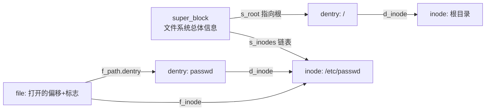
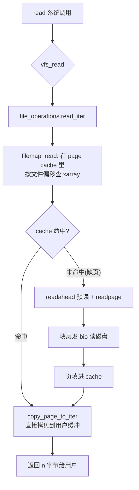
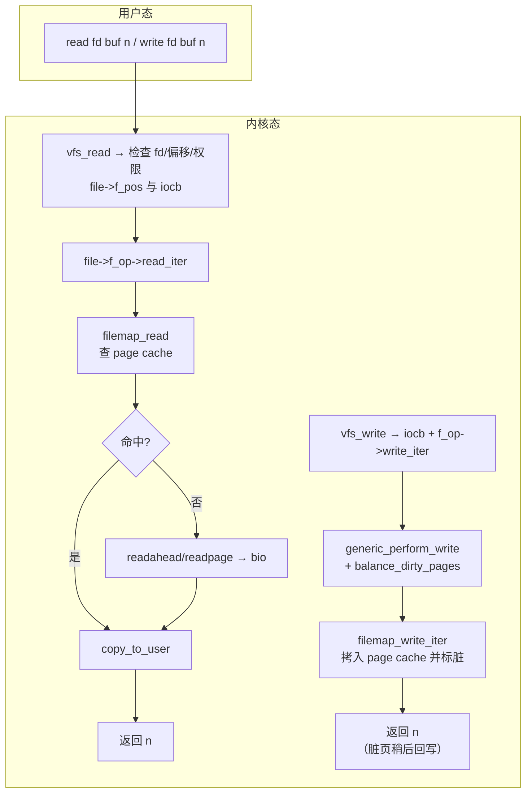
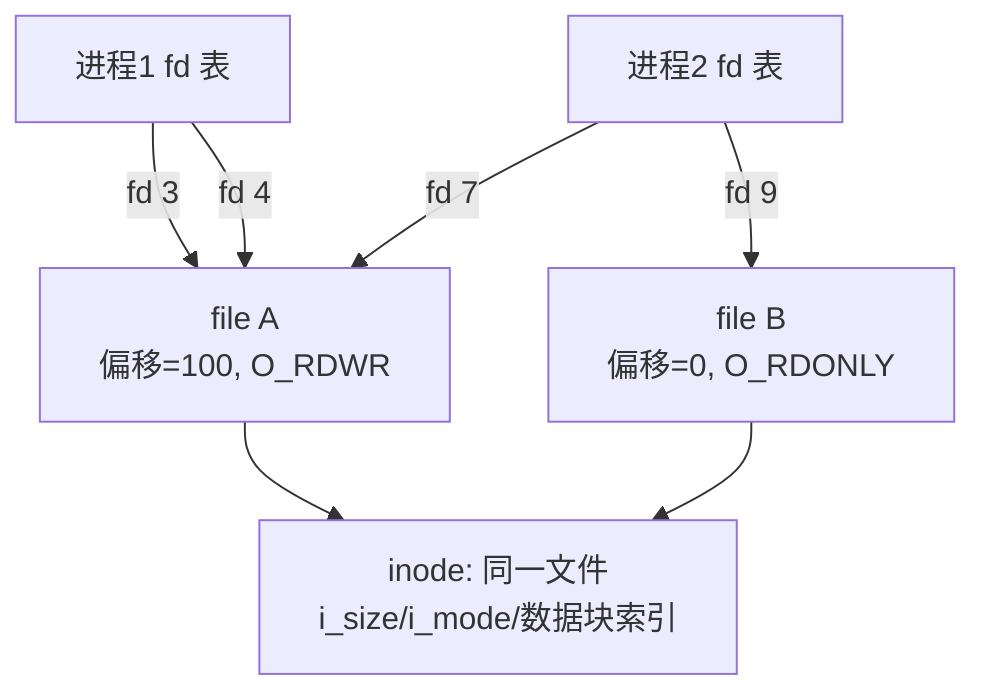

::: abstract 本章定位
把 [文件系统实现](/kb/os/存储/04-文件系统实现/) 的抽象概念落到 Linux 内核源码：VFS 为何要抽象一层、super_block/inode/dentry/file 四大对象如何协作、page cache 如何加速读写、`open`/`read`/`write` 三条系统调用在内核里到底走哪条路、ext4 的块组与 extent 树长什么样，以及挂载、overlayfs、tmpfs 与文件 IO 性能。目标：看到一次 `read()`，能画出从 fd 到磁盘的中枢路径。
:::

[篇](/kb/os/Linux/03-Linux文件系统与磁盘实操/) 回答了"命令能看到什么"，本篇回答"内核里到底存了什么"。两者对照着看：`stat` 读出的每个字段，都能在 `struct inode` 里找到来源。

## 1. VFS 设计思想：为什么要抽象一层

### 1.1 统一接口，多文件系统共存

Linux 上一个目录可以同时看到 `ext4`、`tmpfs`、`proc`、`overlayfs`、NFS 挂载。如果每种文件系统都暴露一套自己的 `open`/`read`，应用就没法写了。**VFS（Virtual File System）在内核里做了两层拆分**：

```text
┌──────────────────────────────────────────────┐
│  应用层：open("a.txt") / read(fd, buf, n)      │  ← 无论底层是啥，接口不变
├──────────────────────────────────────────────┤
│  VFS 层：syscall → vfs_open → vfs_read ...     │  ← 公共路径、公共对象
├──────────────────────────────────────────────┤
│  具体文件系统：ext4_read_iter / tmpfs_read_iter │  ← 各实现自己的 read_iter
├──────────────────────────────────────────────┤
│  块层 / 设备驱动（见 [[../IO/03 内核IO子系统与缓冲|IO子系统]]）│
└──────────────────────────────────────────────┘
```

VFS 做的事：**定义通用的对象模型和操作集，把"系统调用怎么走"固定下来，把"具体怎么读盘"下放给各文件系统注册的钩子函数。**

### 1.2 VFS 四大对象

| 对象 | 内核结构 | 生命周期 | 职责 | 对应你看到的 |
|---|---|---|---|---|
| **super_block** | `struct super_block` | 挂载时创建、卸载时销毁 | 整个文件系统的"总体信息"：块大小、inode 总数、挂载点、指向根 dentry/inode | `df -h`、`/proc/mounts` |
| **inode** | `struct inode` | 文件创建到删除，常驻缓存 | 一个文件的**元数据 + 数据块索引**，不含文件名 | `stat` 输出、`ls -li` 的 inode 号 |
| **dentry** | `struct dentry` | 目录遍历时创建、缓存复用 | 一个**目录项**：文件名 → inode 的映射，仅内存中概念 | `ls` 列出的每个名字 |
| **file** | `struct file` | `open` 到 `close` | 一个**打开的文件描述**：文件偏移、读写模式、权限标志 | `lsof`、`/proc/&lt;pid&gt;/fd` |



::: note 三个"一"要记牢
- 一个 **inode** 对应一个文件（物理实体），可被多个 dentry 引用（硬链接）。
- 一个 **dentry** 对应一个路径成分，只存在于内存，磁盘上没有结构。
- 一个 **file** 对应一次打开，是"会话"级别的状态。
:::

### 1.3 三类操作集：钩子函数表

VFS 对象本身不做事，真正干活的是各文件系统填写的**操作集（operations）**——本质是指针数组，类似 C 的虚函数表：

| 操作集 | 挂载在 | 关键函数 | 典型实现者 |
|---|---|---|---|
| `file_operations` | `struct file` | `open` `release` `read_iter` `write_iter` `mmap` `fsync` `llseek` | ext4、tmpfs、FUSE |
| `inode_operations` | `struct inode` | `lookup` `create` `link` `unlink` `mkdir` `symlink` | 各文件系统 |
| `dentry_operations` | `struct dentry` | `d_hash` `d_compare` `d_delete` `d_release` | 多用于网络文件系统自定义匹配 |

调用关系：`sys_read(fd)` → `struct file.f_op->read_iter()`。换底层文件系统，只是换了 `f_op` 这一张表，系统调用不变。

### 1.4 `ls -li` 与 `stat` 背后读了什么

- `ls -li`：先遍历目录的 dentry cache 得到每个文件名，再对每个文件读 inode 得到 inode 号、链接数、大小、权限、时间戳。
- `stat /etc/passwd`：核心就是**读 inode**——`st_ino` 是 inode 号，`st_size/st_blocks` 来自 inode 的 `i_size/i_blocks`，三种时间戳对应 `i_atime/i_mtime/i_ctime`。

```bash
stat -f /     # stat 一个挂载点会读 super_block（文件系统级信息）
stat /etc/passwd  # stat 一个文件会读 inode（文件级信息）
```

## 2. inode 与 dentry：名字与实体的分离

### 2.1 inode：不含文件名的"元数据 + 数据索引"

```text
struct inode（精简）：
├── i_ino          # inode 号（磁盘上唯一）
├── i_mode/i_uid/i_gid   # 权限与属主
├── i_size/i_blocks      # 文件大小、占用的 512B 块数
├── i_atime/i_mtime/i_ctime  # 三个时间戳
├── i_nlink         # 链接数
├── i_op/i_fop/i_mapping    # 操作集 + address_space
└── i_blocks[] / i_extent   # 数据块索引（ext4 是 extent 树根，见第 5 节）
```

关键点：**文件名不在 inode 里**。同一个 inode 可以有多个名字（硬链接），所以"哪个名字是主名"没有意义。`i_nlink` 数的是有多少个名字指向它；减到 0 时文件真正释放。

### 2.2 dentry：目录项 = 名字到 inode 的映射

磁盘上的目录内容就是一个个"文件名 + inode 号"的二元组。VFS 把每个路径成分转成一个 `struct dentry`：

```text
struct dentry：
├── d_name        # 文件名
├── d_parent      # 父目录的 dentry（串成路径树）
├── d_inode       # 指向对应 inode（NULL 表示路径未解析完）
├── d_op          # dentry_operations
└── 通过 d_hash 挂在哈希表 + LRU 链上（dentry cache）
```

### 2.3 dentry cache 与 inode cache

VFS 有两个共享缓存，都是为了省掉下一次系统调用里的"慢操作"：

| 缓存 | 存在哪 | 加速什么 |
|---|---|---|
| **dentry cache**（dcache） | 每个挂载点一个 hash table + LRU | 路径解析：命中后不用再翻磁盘目录块 |
| **inode cache** | super_block 上的 LRU + hash | 元数据：命中后不用再读 inode 表 |

- 两个缓存占的内存就是 `free` 里 **`buff/cache`** 的一大块，**可被内核自动回收**。
- 在 `/proc/slabinfo` 里能看到这两个 slab 缓存的行：

```bash
grep -E 'dentry|inode' /proc/slabinfo
# 输出示例：
# dentry            &lt;objects&gt; &lt;size&gt; ...       # 每条 = 一个目录项
# inode_cache       &lt;objects&gt; &lt;size&gt; ...       # 每条 = 一个 inode
```

::: tip 呼应 [篇](/kb/os/Linux/03-Linux文件系统与磁盘实操/) 的链接实验
- **硬链接**：`ln a b` 后 `ls -li`，`a` 和 `b` 的 inode 号相同、`i_nlink` 变 2——两个 dentry 指向同一个 inode。
- **软链接**：`ln -s a b` 后 `stat b`，`b` 是**一个独立的 inode**，里面不存数据块，只存目标路径字符串"a"（大小就是路径长度）；读 `b` 时内核自动跟随解析。
:::

## 3. page cache：读写的"高速缓存层"

### 3.1 什么是 page cache

page cache 是内核用内存页缓存**文件数据**的结构。`free` 里的 cache 大部分就是它。每个 inode 对应一个 `address_space`，里面挂着一棵存放所有缓存页的树：

```text
struct inode ── i_mapping ──▶ struct address_space
                                  ├── i_pages     # xarray/radix tree，页索引 → 页
                                  ├── a_ops       # address_space_operations
                                  │                  readpage/writepage/readahead
                                  └── 脏页链表     # 待回写页
```

::: note radix tree → xarray
老版本内核 page cache 用 **radix tree** 按文件内偏移索引页，Linux 5.x 已迁移为 **xarray**（`address_space.i_pages` 是 `struct xarray`）。本质都是"文件内偏移 → `struct page *`"的稀疏映射。
:::

### 3.2 读路径：命中与缺页



- **命中**：一次 `copy_to_user`，无磁盘 IO，这也是反复读小文件飞快的原因。
- **未命中**：触发 **缺页（page fault）** 走 `readpage`，把页从磁盘读进 cache 再拷贝。同一页第二次读就命中了。
- 顺序读时内核还会触发 **readahead（预读）**，提前多读几页（见第 8 节）。

### 3.3 写路径：write-back（回写）机制

写不像读那样"先落地"，而是**写进 page cache 就返回，把页标脏，稍后由内核批量落盘**——这叫 **write-back 缓存策略**。

```text
write() ──▶ 拷贝进 page cache 页 ──▶ 标记 dirty（PAGECACHE_TAG_DIRTY）
     │                                  │
     │ 立即返回（快）                     ▼
     │                        flusher 内核线程（pdflush 的后继者）
     │                        ├─ 定时（dirty_writeback_centisecs）
     │                        └─ 超量（dirty_ratio 触发 balance_dirty_pages）
     ▼                                    ▼
    用户态无感                             块层写盘 → 页转 clean
```

触发回写的有三条路：

| 触发条件 | 机制 | 相关参数 |
|---|---|---|
| 脏页超时 | flusher 定时唤醒 | `vm.dirty_writeback_centisecs`（默认 500，即 5s） |
| 脏页"年龄"到 | 超过 `vm.dirty_expire_centisecs`（默认 3000，30s） | 决定多久没写的页必须刷 |
| 脏页超量 | `balance_dirty_pages` 让写进程自己背锅 | `vm.dirty_ratio`（默认 20）/ `dirty_background_ratio`（默认 10） |

::: warning 写一半断电丢数据
`write()` 返回 ≠ 数据在磁盘。突然断电会丢 cache 里还没回写的脏数据。要保证落盘必须用 `fsync` 或 `O_SYNC`。
:::

### 3.4 `sync` / `fsync` / `fdatasync`：三种"落盘"

| 接口 | 作用范围 | 内核保证 |
|---|---|---|
| `sync()` | **整个系统**所有文件系统 | 调度全部脏页/脏元数据回写；一次性系统级"冲刷" |
| `fsync(fd)` | **单个文件** | 把该文件的**数据 + 元数据**写盘并等待完成 |
| `fdatasync(fd)` | 单个文件 | 只同步数据，以及**读取该数据所必需**的元数据（跳过如 mtime 这类不影响内容的元数据），通常更快 |

对应到 `/proc/sys/vm` 里的参数，回写策略与 [内存调优](/kb/os/内存/06-内存性能与系统调优/) 篇讲的 `drop_caches` 呼应：`echo 3 > /proc/sys/vm/drop_caches` 清掉 page cache（含 dentry/inode 缓存），可以用来测"冷读"速度。

### 3.5 绕过 cache：Direct I/O 与 mmap

- **Direct I/O（`O_DIRECT`）**：读写直接在内核与用户缓冲之间通过 bio 传输，**绕过 page cache**，数据不缓存在内存。适合大块顺序读写（如数据库、`dd oflag=direct`），避免"读了不用的页污染 cache"。缺点：每次都要等磁盘，且缺了合并/预读优化。
- **mmap**：把文件的 page cache 页**直接映射进进程地址空间**，读写不走 `read`/`write` 系统调用、没有 `copy_to_user`。但 mmap 写的脏页**依然由 flusher 回写**，不是同步落盘。

## 4. open / read / write 内核路径全链路

### 4.1 open：路径解析 + 创建 file + 分配 fd

```text
open("a/b.txt", O_RDWR)
 ├─ 1. getname：从用户态拷入文件名
 ├─ 2. path_openat：路径解析（pathwalk）
 │     ├─ 逐段找 dentry：先在 dcache 命中（lookup_fast）
 │     └─ 未命中则调 inode_operations->lookup() 读磁盘目录（lookup_slow）
 ├─ 3. 拿到目标 dentry → inode，校验权限（inode 的 mode + 当前 cred）
 ├─ 4. alloc_file：创建 struct file，f_op 指向具体文件系统的 file_operations
 ├─ 5. get_unused_fd_flags：从 fd 表（files_struct）找最小空闲 fd
 └─ 6. fd_install：fd ↔ file 关联，返回 fd
```

### 4.2 read / write：vfs_read → read_iter → page cache



::: note `read_iter` 是入口
现代内核统一用带 `iocb`（I/O context block，含偏移/标志）的 `read_iter`/`write_iter` 接口，旧的 `read`/`write` 钩子只是它的封装。偏移在 `struct file`（`f_pos`），并发写同一文件靠它自己维护。
:::

### 4.3 O_APPEND / O_DIRECT / O_SYNC 三个标志

| 标志 | 含义 | 内核表现 |
|---|---|---|
| `O_APPEND` | 追加写 | 每次写前把 `f_pos` 置为文件末尾（`i_size`），并加锁保证多进程不互相覆盖 |
| `O_DIRECT` | 直接 IO | 绕过 page cache，读写字对齐到块大小，直接走 bio |
| `O_SYNC` | 同步写 | `write()` 返回前数据必须已落盘（在写路径里做 `writeback + wait`），用性能换保证 |

::: tip 等价关系
`open(..., O_SYNC)` ≈ 每次写后自己调 `fsync`，但内核实现更高效（把等待合并进写路径）。数据库通常用 `O_DIRECT`（自己管缓存）或 `fsync`（让内核管缓存），两者二选一。
:::

### 4.4 fd ↔ file ↔ inode 三层关系



- **fd**：进程级，从 0 开始，`ulimit -n` 管的就是 fd 表长度。
- **file（打开文件描述，open file description）**：每次 `open` 新建一个，**偏移是这里面的**。`dup()` 或 `fork` 会让多个 fd **共享同一个 file**（偏移也共享）；两个独立 `open` 则是两个 file，偏移互不影响。
- **inode**：文件实体，跨进程、跨打开共享。`f_op` 在 file 上、元数据在 inode 上，这就是"两个 fd 指向同一 file"与"两个文件共享 inode"两种关系的内核答案。

## 5. ext4 实现细节：把 VFS 落盘

### 5.1 磁盘布局：超级块与块组

ext4 把磁盘划分成大小相等的**块（block）**，再把块聚成一个个**块组（block group）**：

```text
磁盘 ──▶ [块组0] [块组1] [块组2] ...（每个块组包含同一套元数据结构）
一个块组内部：
┌──────────────┬─────────────┬───────────────┬──────────────────┐
│ 块位图 bitmap │ inode位图    │ inode 表      │ 数据块           │
│ 记录哪些块被用│ 记录哪些inode│ 存放 inode 本身│ 真正的文件数据   │
└──────────────┴─────────────┴───────────────┴──────────────────┘
        ↑ 这些都叫"块组元数据"，占用块组开头几个块
```

- **超级块**：存文件系统全局信息（块大小、inode 数、feature 标志、魔数 `0xEF53`），在块 0 附近，并在若干块组里存**备份**用于 fsck 恢复。
- **inode 表 + 位图**：inode 存于块组内的 inode 表，inode 号 = 块组号 + 组内偏移；inode 位图记录哪些 inode 槽被占用。
- 这就是 [文件系统实现](/kb/os/存储/04-文件系统实现/) 里说的"inode 表"与"位图"的落盘形态；`df -i` 统计的正是所有 inode 位图。

### 5.2 extent 树：从间接块到区段

ext3 用**间接块**索引：inode 里 15 个槽（12 直接 + 一级/二级/三级间接指针），深度超过三层，且为多级分配慢。ext4 用 **extent（区段）** 取代：

```text
inode.i_block（60 字节，4 个槽）
   └─ 头部 + extent[0..3]
        ├─ 覆盖连续范围的 (起始块, 长度)，每段最多 32768 块
        └─ 不够就升级成 extent 索引树（extent index node 指向存放
           extent 条目的数据块，支持多级）
```

一次连续的写变成一个 extent，**分配和寻址都变成 O(log n) 甚至 O(1)**，这是 ext4 相对 ext3 最大文件可达 16 TiB 的机制保证。用工具可现场看：

```bash
filefrag -v /path/to/bigfile   # 看文件被拆成几个 extent、是否连续
dumpe2fs /dev/sda1             # 看超级块、块组描述符、feature 标志
```

### 5.3 ext4 关键特性

| 特性 | 作用 |
|---|---|
| `dir_index`（htree） | 目录项用 hash 树索引，大目录查找从 O(n) 变 O(log n) |
| `flex_bg`（flexible block groups） | 把多个块组的元数据聚合到少数块组，减少碎片、利于大分配 |
| `metadata_csum` | 元数据块校验和，fsck 时能发现损坏 |
| **Journaling（JBD2 日志）** | 见下 |

### 5.4 Journaling 三种 data 模式与崩溃一致性

ext4 先把"要做的元数据变更"写进日志（journal），再落实际数据，崩溃后靠 **replay（重放）** 恢复一致性（详见 [可靠性](/kb/os/存储/06-文件系统可靠性与日志/)）。`data=` 模式决定**文件数据本身**要不要进日志：

| 模式 | 数据进日志? | 性能 | 崩溃一致性 |
|---|---|---|---|
| `data=writeback` | 不 | 最快 | 仅元数据有序，文件数据可能"新元数据 + 旧数据" |
| `data=ordered`（**默认**） | 不，但数据在元数据提交前强制落盘 | 中等 | 保证数据先于元数据落盘，杜绝"指到坏数据" |
| `data=journal` | 是 | 最慢 | 数据和元数据都进日志，最稳 |

```bash
# 看当前挂载用了哪种 data 模式
findmnt -no OPTIONS /     # 或 grep ' / ' /proc/mounts
# 注意：data= 模式不能在 remount 时修改（内核报
# "Cannot change data mode on remount"），要换模式需重新挂载/格式化
```

::: note 与 03 篇呼应
03 篇的 `chattr +i` 改的是 inode 的 flags；本篇的 data= 模式改的是"日志策略"。前者管"谁能动"，后者管"崩溃后多一致"。
:::

## 6. 挂载与文件系统栈

### 6.1 mount 的内核机制

`mount -t ext4 /dev/sda1 /mnt` 最终走到内核的 `do_mount` 流程：

```text
mount() ─▶ ksys_mount ─▶ do_mount ─▶ path_mount
   ├─ alloc_super：读磁盘超级块，创建 struct super_block
   ├─ 读根 inode，创建根 dentry，挂上文件系统
   ├─ alloc_vfsmount：创建 struct mount（挂载树节点）
   └─ attach_recursive_mnt：把这个 mount 挂到当前挂载树上，暴露给路径解析
```

- **挂载树**：所有挂载点组成一棵树；每个进程的 **mount namespace**（`clone(CLONE_NEWNS)` 得到）里保存**自己的挂载树副本**——容器改挂载不影响宿主机。
- **`/proc/mounts`** 是当前命名空间的挂载列表（只读快照）；**`/proc/self/mountinfo`** 更详细（挂载 ID、父挂载、传播标志等）。

```bash
cat /proc/mounts                 # 每个挂载点：设备 挂载点 类型 选项 0 0
cat /proc/self/mountinfo         # 字段更多，是排查挂载问题的权威来源
```

### 6.2 overlayfs：容器镜像层的魔法

容器镜像"多层只读 + 一层可写"就是 overlayfs 实现的（这是容器文件系统层的关键机制）：

```text
容器根（merged，/var/lib/docker/overlay2/&lt;id&gt;/merged）
   ├── lowerdir：镜像各层，只读（内核原生、多个 lower 层可叠加）
   ├── upperdir：容器自己的可写层（/tmp 等写入都在这）
   └── workdir：合并时用的临时工作目录
   读：从最上层往下找；写：copy-up（把 lower 文件拷到 upper 再改）
   删：在 upper 放 whiteout（字符设备 0/0）挡住 lower 的同名文件
```

```bash
mount -t overlay overlay -o \
  lowerdir=/base,upperdir=/up,workdir=/work /merged
```

### 6.3 tmpfs：内存文件系统

- tmpfs 的数据直接存在 **匿名页**（不经过块层，也不进 page cache），占的是 RAM，可被 swap 换出。
- 典型位置：`/dev/shm`、systemd 默认的 `/tmp`。
- 特点：读写快（无磁盘）、数据掉电即失、可挂大小（`-o size=`）。

```bash
mount -t tmpfs -o size=512M tmpfs /mnt/ram
```

### 6.4 proc / sysfs：伪文件系统

`/proc` 与 `/sys` 不是真有数据在磁盘，而是内核把对象"暴露成文件"：

| 伪文件系统 | 背后对象 | 例子 |
|---|---|---|
| `procfs` | 进程的 `task_struct` 等 | `/proc/&lt;pid&gt;/status`、`/proc/slabinfo` |
| `sysfs` | 内核对象 `kobject` | `/sys/block/sda/queue/`、`/sys/module/` |

读到它们时触发的是"现场生成数据的钩子函数"，这就是为什么 `stat /proc/uptime` 每次都不一样。

## 7. 文件系统类型对比

### 7.1 磁盘文件系统特性对照

| 特性 | ext4 | xfs | btrfs | zfs |
|---|---|---|---|---|
| 日志/一致性 | **journal（JBD2）** | journal | **COW + checksum** | COW + checksum |
| 数据校验和 | 仅元数据（`metadata_csum`） | 仅元数据 | 数据+元数据 | 数据+元数据 |
| 快照 | 无 | 无 | 有 | 有 |
| 原地修改 vs COW | 原地 | 原地（延迟分配） | COW | COW |
| 池化存储 | 否 | 否 | 否 | 是（存储池） |
| 适用场景 | 通用默认 | 大文件、高并发 | 需要快照/自愈 | 海量数据、企业存储 |

::: note 一个记忆锚
**journal（日志）保证"结构一致"**，但数据可能过时；**COW + checksum 保证"数据本身也对"**——写时不覆盖旧块，写完校验再切指针，坏块可自愈。这也是 btrfs/zfs 敢砍掉 fsck 的原因。
:::

### 7.2 网络文件系统 NFS vs 本地

| 维度 | 本地（ext4） | NFS |
|---|---|---|
| 数据位置 | 本机磁盘 | 远端服务器，走 RPC（NFSv3 无状态 / NFSv4 有状态） |
| 性能特征 | 取决于本地磁盘 | 取决于**网络延迟**，随机小 IO 极慢 |
| 缓存 | page cache 直接缓存 | 客户端也有 cache，但**一致性**靠协议回调/lease 协调 |
| 故障模式 | 掉盘 | 服务器挂、网络分区、stale handle |

### 7.3 FUSE：用户态文件系统

FUSE（Filesystem in Userspace）把文件系统逻辑搬到用户态进程（如 sshfs、rclone、gVisor）：

```text
用户进程 ──▶ VFS ──▶ fuse 内核模块 ──/dev/fuse──▶ fuse 守护进程（用户态）
                                              └─ 自己实现 read/write（可能走网络等）
```

代价是**每次操作要用户态↔内核态往返**，吞吐与延迟都不如内核实现，但换来开发成本极低、可挂网络/对象存储。

## 8. 文件 I/O 与性能

### 8.1 顺序读 vs 随机读的内核表现

| | 顺序读 | 随机读 |
|---|---|---|
| page cache 行为 | 触发 **readahead**，一次预读多页，磁盘顺序 IO | 多页不连续，命中率低，几乎每次都等磁盘 |
| 块层 | 可合并成大 bio（merge） | 小 bio，掉队到 IO 队列 |
| 关键优化 | 预读 + 合并 | 靠缓存；O_DIRECT 随机读最伤 |

### 8.2 read-ahead 预读

内核在检测到顺序访问模式时，会按窗口（从几页到几十页）提前读。有两层可调：

- **page cache 层**：内核 readahead 算法按文件自动调窗，通常无需干预。
- **块设备层**：`/sys/block/&lt;dev&gt;/queue/read_ahead_kb`（默认 128 KB），是通用设备级预读；影响的是块层缓存预取。

```bash
cat /sys/block/sda/queue/read_ahead_kb   # 默认 128
echo 256 > /sys/block/sda/queue/read_ahead_kb  # 大文件顺序读可适当调大
```

### 8.3 write-back vs write-through

- **write-back（Linux 默认）**：写进 cache 即返回，后台批量落盘。快，但掉电丢数据窗口。
- **write-through**：写数据同时下盘，写完才返回。慢但稳（近似 `O_SYNC`）。
- Linux 内核以 write-back 为主，通过 `fsync`/`O_SYNC`/`sync` 在需要时"补一刀"。

### 8.4 mmap vs read/write

| | `mmap` | `read`/`write` |
|---|---|---|
| 数据路径 | 页直接映射进地址空间，**免去 copy_to_user** | 用户缓冲 ↔ page cache 之间**一次拷贝** |
| 代价 | 缺页处理 + 页表管理 | 每次调用多一次系统调用 + 拷贝 |
| 适合 | 原地随机改数据（如数据库索引、共享内存） | 顺序大块读写（readahead 收益大） |

结论：**没有绝对快慢**——顺序大文件 `read` 有预读优化，通常不输 mmap；小对象随机访问 mmap 免拷贝占优。生产测速用 `fio` 而不是想当然。

### 8.5 blktrace：看块层请求

读写从 VFS 到磁盘中间还隔块层。`blktrace` 在块层埋点，能抓到每个 bio 的进出（呼应 [IO 路径](/kb/os/IO/05-IO路径与性能优化/)）：

```bash
blktrace -d /dev/sda -o - | blkparse -i -   # 实时跟踪 /dev/sda
# 关注：D（下发）、C（完成）、Q（入队）、I（合并）事件
# 顺序读应看到大量相邻块合并成大 IO；随机读则分散。
```

## 9. 本章小结

VFS 是 Linux 文件系统的"总线"：**四大对象**（super_block/inode/dentry/file）+ **三类操作集**把"系统调用"与"具体文件系统"解耦；inode 存元数据与数据索引、dentry 做名字到 inode 的映射、file 管一次打开的偏移与标志。读写都优先走 **page cache**，命中免磁盘、未命中补缺页，脏页由 flusher 按 `vm.dirty_*` 参数回写；`sync`/`fsync`/`fdatasync` 是不同粒度的"落盘保证"，`O_DIRECT` 是绕过 cache 的旁路。`open` 的路径解析、`read/write` 的 read_iter→filemap 链路，以及 fd/file/inode 三层关系，构成了面试最常拷问的"一次读写走多远"。落盘时，ext4 用块组 + 位图 + extent 树组织数据，用 JBD2 日志保证崩溃一致性（`data=ordered` 是默认）。挂载树 + mount namespace 支撑容器，overlayfs 实现镜像层，tmpfs/proc/sysfs 是内存与伪文件系统。最后，顺序读靠 readahead、顺序写靠 write-back，性能差别都能用 `blktrace`/`fio` 亲眼看到。

延伸阅读：[Linux内存管理内核原理](/kb/os/Linux/10-Linux内存管理内核原理/)（page cache 与回收）、[LinuxIO栈内核原理](/kb/os/Linux/12-LinuxIO栈内核原理/)（VFS 之下块层到磁盘）、[可靠性](/kb/os/存储/06-文件系统可靠性与日志/)（日志与 COW 的崩溃一致性）、[IO 路径](/kb/os/IO/05-IO路径与性能优化/)（blktrace 与调优）。

## 10. 动手实验

::: warning 实验环境
全部命令需 Linux（macOS 无 `/proc` 与 `blktrace`）。涉及 `mount`/`sysctl` 的步骤请用虚拟机或临时云主机，不要在生产机做破坏性操作。
:::

1. **strace 看 VFS 调用**：`strace -e openat,read,write,newfstatat ls -l /etc`——注意 `ls` 先 `openat` 打开目录再 `newfstatat` 读 inode，路径解析的每一步都能看到。
2. **看缓存**：`cat /proc/slabinfo | grep -E 'dentry|inode'`，再 `free -h` 确认 cache；`ls -R` 一个大目录后再看 dentry 对象数是否上涨。
3. **冷热读对比**：`dd if=/tmp/bigfile of=/dev/null bs=1M` 测热读；然后 `sync; echo 3 > /proc/sys/vm/drop_caches`，再 `time dd ...` 测冷读，对比两次耗时与吞吐（热读几乎瞬时）。
4. **观察 journal 模式**：`findmnt -no OPTIONS /` 看到默认 `data=ordered`；尝试 `mount -o remount,data=writeback /`，观察内核拒绝改 data 模式的报错。
5. **ext4 细节**：对一个大文件 `filefrag -v` 看 extent 列表；`dumpe2fs /dev/sda1 | head` 读超级块与 feature。
6. **extent vs 间接块**：格式化一个小的 ext3 文件系统（`mkfs.ext3`），对比 `filefrag` 输出与 `df -i` 的 inode 结构差异。
7. **tmpfs**：`mount -t tmpfs -o size=64M tmpfs /mnt/ram`，写 1G 数据观察满掉与报错，`free` 看内存变化。
8. **mmap vs read**：对同一大文件分别用 `fio`（`--ioengine=mmap` vs `--ioengine=libaio`）测吞吐，对比缺页与拷贝的代价。

## 11. 自测题

1. **VFS 为什么要抽象 super_block/inode/dentry/file 四个对象？** 统一系统调用接口与底层文件系统实现解耦：super_block 描述整个文件系统，inode 是文件实体（元数据+数据索引），dentry 是"文件名→inode"的目录项，file 是一次打开的偏移与标志。
2. **文件名存在 inode 里吗？为什么硬链接不复制文件？** 不存在，inode 只存元数据与数据索引；硬链接只是新建一个指向同一 inode 的 dentry，`i_nlink` 加一，所以不复制数据。
3. **`write()` 返回后断电，数据一定丢吗？** 不一定：数据写进了 page cache，是否丢取决于是否已回写；要保证必须 `fsync`/`fdatasync` 或 `O_SYNC`。
4. **`fsync` 与 `fdatasync` 的区别？** 前者同步文件的数据与全部元数据；后者只同步数据及读取它必需的那部分元数据，不强制刷 mtime 之类，通常更快。
5. **为什么两个 fd 指向同一个 file 时偏移共享，指向同一文件却偏移独立？** 偏移存在 open file description（`struct file`）里；`dup`/`fork` 复制 fd 但共享同一个 file，所以偏移共享；两次独立 `open` 各自创建 file，偏移互不影响。
6. **ext4 的 `data=ordered` 保证什么？** 保证在元数据提交前先把文件数据落盘，崩溃重放后不会出现"元数据指向未写入的数据块"，是默认且兼顾性能的一致性模式。
7. **overlayfs 的 copy-up 是什么？** 写一个 lower 层的只读文件时，先把文件复制到 upper 层再修改，之后读写都走 upper 副本，镜像层保持只读。
8. **顺序读为什么比随机读快这么多？** 顺序访问触发 readahead 预读成批页、块层把相邻请求合并成大 bio，磁盘顺序 IO 效率远高于随机寻道；随机读缺页多、无合并，几乎每次都要等磁盘。
