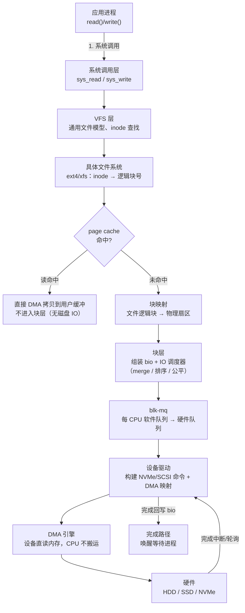
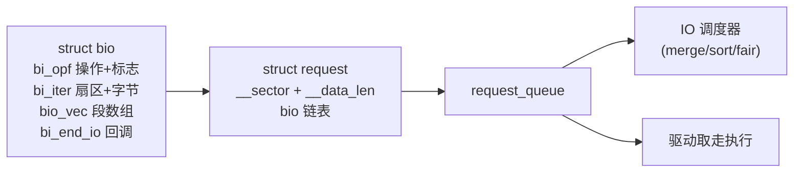
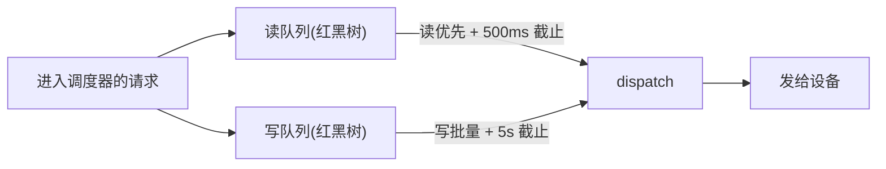
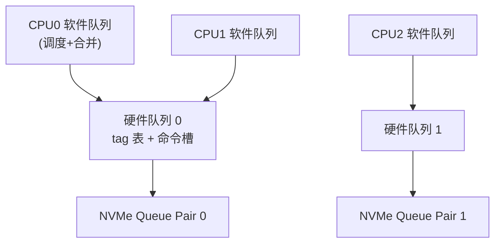
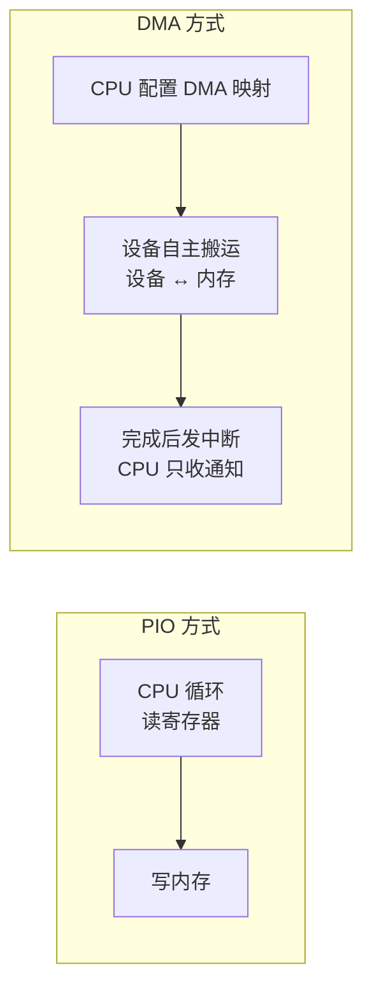
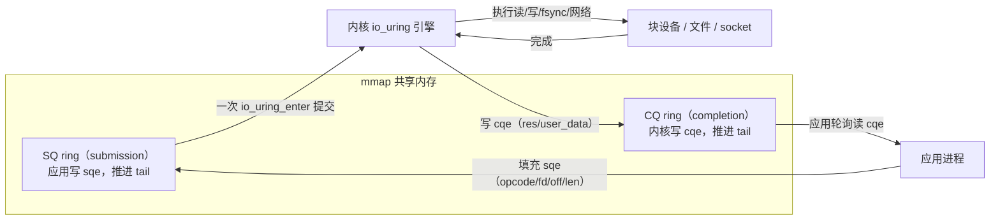

::: abstract 本章定位
追一条 `read()` 从用户态到磁盘硬件的**内核完整路径**：VFS → page cache → 文件系统 → bio/request → IO 调度器 → blk-mq 多队列 → 驱动 → DMA。与 [实操篇](/kb/os/Linux/04-LinuxIO与性能监控实操/) 一一呼应：`iostat`/`fio` 的每个数字，底层是哪个内核对象在产生。
:::

实操篇告诉我们"慢"，本篇回答**为什么慢**：调度器排队？单队列锁竞争？还是 DMA 与 cache 一致性？看完你将能画出完整 IO 路径，并理解 `io_uring` 为何是异步 IO 的现代答案。

## 1. 块 IO 栈总览

### 1.1 概念：一次 read() 的完整旅程

一次普通的 `read(fd, buf, 4096)` 要穿过内核一整条**分层栈**：应用层发 `read()` → VFS 解析文件 → 具体文件系统把字节换算成块号 → page cache 拦截多数 IO → 未命中才由块层封装成 `bio`/`request` → blk-mq 分发 → 驱动构造设备命令 → DMA 搬运到内存 → 完成唤醒进程。



::: tip 关键领悟
一条 read 里**只有"未命中"那部分才会走到块层以下**。绝大多数文件 IO 在 page cache 就结束了——这就是为什么"读过的文件再读特别快"。磁盘慢，本质是 cache 未命中 + 块层以下的路径慢。
:::

### 1.2 内核实现：块设备 vs 字符设备

Linux 设备分三类，块设备是"以块为单位、可随机寻址、走 page cache + 块层"：

- **字符设备**：`/dev/tty`、`/dev/null`——按字节流读，**没有块层**，直接调驱动的 `read()`/`write()`。
- **块设备**：`/dev/sda`、`/dev/nvme0n1`——按块寻址，经 `struct block_device` 走完整 IO 栈。
- 网络设备：不走这两条路径，独立于网络栈（呼应 [网络篇](/kb/os/Linux/13-Linux网络栈内核原理/)）。

块设备在内核中就是一个 `struct block_device`，绑定一个 `struct request_queue`（IO 调度的宿主）；驱动通过 `blk_mq_alloc_queue` 创建队列并注册 `blk_mq_ops`。

### 1.3 块大小与扇区、设备号与 /dev

| 概念 | 含义 | 备注 |
|---|---|---|
| 扇区 sector | 块层的**最小寻址单位**，512 B（或 4K 逻辑扇区） | `bio.bi_iter.bi_sector` 按扇区计 |
| 块 block | 文件系统分配单位，通常 4K = 8 扇区 | `stat` 的 `IO Block` |
| 设备号 | major:minor，如 `8:0`（sda） | 现代内核 12 位 major + 20 位 minor |
| `/dev` | udev 生成的设备节点文件 | `ls -l /dev/sda` 可见主次设备号 |

```bash
ls -l /dev/sda          # brw-rw---- 1 root disk 8, 0 ... -> b 块设备，主8 次0
lsblk -o NAME,SIZE,PHY-SEC,LOG-SEC   # 看物理/逻辑扇区大小
stat -c '%B' /some/file # 看文件系统块大小（通常 4096）
```

::: important 扇区 vs 块
块层所有 `bio` 的 `bi_sector` 都以**扇区（512B）**为单位；文件系统才把扇区聚合成"块"。4K 块 = 8 个扇区，一次 4K 读 = 1 个 bio、8 个 sector。
:::

### 1.4 与实操呼应

[篇](/kb/os/Linux/04-LinuxIO与性能监控实操/) 里 `dd if=/dev/sda` 是**裸读块设备**——不经过文件系统，直接由块层组装 bio；而 `dd if=/etc/passwd` 走完整文件系统栈。两条路径的 `iostat` 指标含义完全不同：前者没有文件系统映射开销，`await` 更接近纯设备延迟。

## 2. bio 与 request

### 2.1 概念：IO 的最小封装单元

- **`bio`**：块层处理 IO 的基本单元，描述"往哪读/写多少数据、数据放哪块内存"。
- **`request`**：一个或多个可合并的 bio 组成的**设备执行单元**（一次磁盘命令）。
- **request queue**：请求的宿主队列，IO 调度器在其中做合并与排序。

### 2.2 图解：bio 与 request



bio_vec 指向具体物理页（`struct page` + 页内偏移 + 长度），一次跨多页的读会被拆成多个 bio_vec **段（segment）**，驱动据此构造 DMA 描述符（SGL/PRP）。核心字段简化为：

```c
struct bio {
    sector_t        bi_sector;   /* 起始扇区号 */
    struct bvec_iter bi_iter;    /* 当前进度：扇区+字节数 */
    unsigned short  bi_vcnt;     /* bio_vec 段数 */
    struct bio_vec  *bi_io_vec;  /* 段数组 */
    bio_end_io_t    *bi_end_io;  /* 完成回调 */
    unsigned short  bi_opf;      /* 操作+标志 */
};
struct bio_vec {
    struct page *bv_page;   /* 目标物理页 */
    unsigned int  bv_len;   /* 长度 */
    unsigned int  bv_offset;/* 页内偏移 */
};
```

### 2.4 为什么合并能提升吞吐

相邻的多个小 IO 合并成一个 request：机械盘一次寻道可服务整段连续数据、单次传输变大（`带宽 ≈ IOPS × 每次大小`）、一次请求一次完成中断。内核 merge 分三类：

| 类型 | 含义 | 触发点 |
|---|---|---|
| 前向/后向 merge | 新 bio 紧邻 request 头部/尾部 | 调度器 `elv_merge`/`blk_attempt_plug_merge` |
| plug 合并 | 进程短期连续提交被"堵"在一起再统一提交 | `blk_start_plug`/`blk_finish_plug` |
| 页级合并 | bio_vec 相邻页合并成更大段 | bio 组装阶段 |

`/proc/diskstats` 的 `field5`（reads merged）/`field9`（writes merged）就是合并计数器——`iostat -x` 的 `rrqm/s`/`wrqm/s` 就来自它。

### 2.5 io_schedule 与阻塞

同步路径上进程等 IO 完成时进入不可中断睡眠（`D` 状态，`ps` 的 STAT 可见），内核在块层用 `io_schedule()` 切走 CPU：进程把 `bio` 提交（`submit_bio`）后置 `TASK_UNINTERRUPTIBLE` 调用 `io_schedule()` 让出 CPU；设备完成经中断/轮询找到 bio，调 `bi_end_io` 回调唤醒等待进程。`top`/`ps` 大量 `D` 状态进程 = 磁盘服务不过来（呼应 [排查篇](/kb/os/问题排查/04-磁盘与IO瓶颈排查/) 的"不可中断任务堆积"）。

### 2.6 /proc/diskstats 字段解读

```bash
cat /proc/diskstats
#   8       0 sda 12345 678 2097152 1024 45678 901 4194304 2048 0 3072 4096 6144
```

| 序号 | 字段 | 含义 | iostat 对应 |
|---|---|---|---|
| 1-3 | major minor devname | 设备标识 | Device |
| 4 | reads completed | 读完成次数 | r/s |
| 5 | reads merged | 读合并次数 | rrqm/s |
| 6 | sectors read | 读扇区数 | rkB/s（×512B 换算） |
| 7 | time reading (ms) | 读累计耗时 | r_await 分子 |
| 8-11 | writes completed/merged/sectors/time | 写对应字段 | w/s、wrqm/s、wkB/s |
| 12 | I/Os in progress | 正在处理的请求数 | aqu-sz 相关 |
| 13 | time doing I/O (ms) | **有请求在服务的时间** | **%util** |
| 14 | weighted time doing I/O | 加权 IO 时间 | svctm/await 分子 |

::: note iostat 的数学来源
`%util ≈ field13 / 采样时长`（磁盘有请求在服务的时间占比）；`r_await ≈ field7 / (field4+field5)`（读总耗时 ÷ 读总次数）。所以 `iostat` **不是额外采集**，只是把内核现成的计数器换算成百分比。
:::

### 2.7 与实操呼应

[篇](/kb/os/Linux/04-LinuxIO与性能监控实操/) 的 `iostat -x 1` 里 `wrqm/s` 高 = 合并做得好（顺序写）；`r/s` 高而 `rkB/s` 低 = 大量 4K 随机小读，bio 无法有效合并，这正是数据库随机 IO 的典型形态。

## 3. IO 调度器原理

### 3.1 概念：为什么要调度

- **机械盘（HDD）**：寻道是成本大头，调度器希望把请求按扇区排序，让磁头沿一个方向扫过去，减少寻道次数。
- **公平性**：多个进程抢磁盘，不能允许一个进程饿死其他进程。
- **SSD/NVMe**：没有寻道代价，随机与顺序同速，排序几乎无收益，反而带来延迟——所以调度器要"轻"。

### 3.2 调度器横向对比

| 调度器 | 机制 | 公平性 | 适用盘 | 状态 |
|---|---|---|---|---|
| noop | FIFO + 相邻合并，不排序 | 无 | SSD | 旧单队列时代，**已随 blk-mq 移除** |
| Deadline | 读/写两个排序红黑树 + 截止时间（读 500ms、写 5s） | 读优先防饥饿 | HDD/SATA | 经典算法，见"deadline" |
| CFQ | 每个进程一个队列，时间片轮转 + 权重 | 强公平 | HDD | 长期默认调度器，**内核 5.16 随旧块层移除** |
| mq-deadline | Deadline 移植到 blk-mq，按每软件队列维护 | 读优先 | **SATA/SCSI 默认** | 现行主流 |
| BFQ | CFQ 思想 + 更细预算（Budget），交互延迟好 | 强公平 | HDD/桌面 | 可选（CONFIG_BFQ） |
| Kyber | 面向目标延迟，动态控制队列深度 | 无 | 低延迟场景 | 可选 |
| none | 完全无序，仅靠驱动 | 无 | **NVMe 默认** | 现行 |

::: important 内核版本变化
Linux 5.16 移除了旧单队列块层及配套的 noop/cfq/deadline，现在只剩 **mq-deadline / bfq / kyber / none** 四种 blk-mq 调度器。看到旧文章讲 noop 是默认调度器，注意其内核版本已过时。
:::

### 3.3 图解：Deadline 双队列



Deadline 的关键权衡：读通常被进程同步等待、延迟敏感，默认"读优先"；但写也不能饿死，于是用读截止时间做批量切换的平衡（呼应 [IO 篇](/kb/os/IO/02-IO控制方式与中断DMA/) 的"磁盘调度"）。

### 3.4 查看与切换调度器

```bash
cat /sys/block/sda/queue/scheduler     # 带 [] 的是当前生效的
echo mq-deadline > /sys/block/sda/queue/scheduler   # root 切换（临时）
echo none > /sys/block/nvme0n1/queue/scheduler
```

### 3.5 调度器对随机 vs 顺序 IO 的影响

- **顺序 IO**：扇区天然相邻，调度器几乎只做合并，`none` 和 `mq-deadline` 差别很小。
- **随机 IO（HDD）**：排序显著减少寻道，吞吐提升明显；用 `none` 则机械盘随机 IO 会极慢。
- **随机 IO（NVMe）**：排序无收益，`none` 直达硬件队列，延迟最低。

::: warning 选型一句话
HDD 用 mq-deadline/BFQ；SATA SSD 用 mq-deadline（默认即可）；**NVMe 用 none**——多队列硬件本身已足够并行，调度器反而是额外开销。
:::

### 3.6 与实操呼应

[篇](/kb/os/Linux/04-LinuxIO与性能监控实操/) 用 `fio --rw=randread --direct=1` 测随机读时，可对比切换调度器前后 `fio` 的 `iops`/`clat`：HDD 上 mq-deadline 明显更好，NVMe 上差别不大——这就是"调度器有没有在工作"的实验证据。

## 4. 单队列 → blk-mq 多队列

### 4.1 概念：单队列为什么是瓶颈

传统块层（旧内核）只有**一个全局 request_queue + 一把锁**：所有 CPU 提交请求都争抢同一把锁（"锁风暴"），调度/合并/tag 分配全集中一处，无法利用多核；而现代 NVMe 设备本身有**多个硬件队列**，单队列模型无法对接。

### 4.2 图解：blk-mq 两层结构



blk-mq 设计要点：

| 部件 | 作用 | 意义 |
|---|---|---|
| **软件队列**（每 CPU） | 本 CPU 的调度/合并/plug | 无锁或本地锁，消除全局锁竞争 |
| **硬件队列** | 对应设备真实硬件队列，`nr_hw_queues` | 与 NVMe 多队列一一映射 |
| **tag（标签）** | 每个硬件队列预分配的命令槽位 | 跟踪在途命令、限制队列深度（`nr_requests`） |
| 映射 | 软件队列 → 硬件队列（可多对一） | 低端设备共享队列也不浪费 |

### 4.3 内核实现：blk_mq_make_request

```c
/* block/blk-mq.c 提交路径（伪代码） */
blk_mq_make_request(q, bio):
    blk_attempt_plug_merge(bio)   /* 1. 软件队列本地合并 */
    rq = blk_mq_get_request(...)  /* 2. 分配 request + tag */
    blk_mq_queue_rq(...)          /* 3. 推到硬件队列 -> 驱动 */
```

要点：每个 CPU 有自己的软件队列（`ctx`），提交请求时优先本地合并，减少锁竞争；合并的批由 `blk_mq_run_hw_queues` 分发给硬件队列，命令槽受 tag 管理；NVMe 驱动 `nvme_setup_cmd` 把 request 转成命令写进门铃寄存器，设备直接通过 DMA 完成。**性能提升原理**：无全局锁多核并行提交、批量 dispatch 减少中断/门铃次数、NVMe 每队列对独立完成队列可绑定 CPU、吞吐随核数扩展。

### 4.4 blktrace/blkparse 观察

```bash
blktrace -d /dev/sda -w 5 -o trc    # 抓 5 秒块层事件
blkparse -i trc                      # action 列：A(插入) M(合并) Q(入队) D(发设备) C(完成)
```

`Q → M → D → C` 就是一条请求的生命周期；`blkparse` 的 `ttime`（发出到完成的间隔）≈ 磁盘服务延迟。

### 4.5 fio 多队列验证

```bash
fio --name=q --ioengine=libaio --direct=1 --rw=randread \
    --bs=4k --numjobs=16 --iodepth=16 --filename=/dev/nvme0n1
```

`numjobs` 多 + `iodepth` 高时，多核各自向不同软件队列提交，观察 `iostat -x` 的 `%util` 和吞吐是否随 `numjobs` 扩展；扩展性差多半是硬件队列被共享或驱动层瓶颈。

### 4.6 与实操呼应

[篇](/kb/os/Linux/04-LinuxIO与性能监控实操/) 用 `fio` 测 IOPS 时，`iodepth` 正是绕过软件队列深度限制、测设备真实并行能力的参数；`blktrace` 则是把"调度器合并了多少请求"可视化。呼应 [驱动篇](/kb/os/IO/04-设备驱动与设备管理/) 的设备模型。

## 5. DMA 与驱动层

### 5.1 概念：DMA 是什么

**DMA（Direct Memory Access）**：设备（磁盘/NVMe 控制器）在无 CPU 参与下直接在内存与设备之间搬运数据。非 DMA 方式（PIO）下 CPU 一条条读写数据寄存器，搬 4K 数据 CPU 要忙 4000 次；DMA 方式下 CPU 只需告诉设备"数据在哪个地址"，设备自行搬运，完成后**中断**通知 CPU。DMA 让"数据拷贝"与"CPU 计算"并行，是块 IO 高吞吐的前提（呼应 [IO 篇 DMA](/kb/os/IO/02-IO控制方式与中断DMA/)）。

### 5.2 图解：中断 vs DMA



PIO 让 CPU 忙在搬运上，DMA 把搬运交给设备，CPU 只在"配置映射"和"收完成中断"两处露面。

### 5.3 内核实现：DMA 映射

驱动在提交 IO 前必须做 **DMA 映射**，把 bio 页面转换成设备可访问的物理地址：

| 映射类型 | API | 用途 |
|---|---|---|
| 流式映射（streaming） | `dma_map_single`/`dma_map_page` | 一次性读写缓冲区，用完 `dma_unmap_*` |
| 一致性映射（coherent） | `dma_alloc_coherent` | 驱动与设备长期共享的 DMA 缓冲区 |
| 同步 | `dma_sync_single_for_device`/`for_cpu` | 维护 cache 一致性 |

```c
dma_addr = dma_map_single(dev, page_addr, len, DMA_TO_DEVICE);
/* 把 dma_addr 填进设备命令（PRP/SGL 描述符），写门铃提交 */
...设备搬运...
dma_unmap_single(dev, dma_addr, len, DMA_TO_DEVICE);
/* 搬运完成后 bio->bi_end_io 唤醒等待的进程 */
```

### 5.4 DMA 与 cache 一致性

CPU 有 cache，设备直读内存时看不到 CPU cache 里的脏数据，于是需要一致性协议：

- **一致性映射**：内存映射为 uncached / write-combining，设备与 CPU 看到一致数据。
- **流式映射**：由驱动显式调 `dma_sync_*` 同步（`flush`/`invalidate`）。
- **IOMMU / SWIOTLB**：设备地址能力不足（32 位设备配大内存）时用 bounce buffer 中转，或 IOMMU 重映射。

::: note DMA 方向很重要
`DMA_TO_DEVICE`（写盘）需先 `flush` cache；`DMA_FROM_DEVICE`（读盘）需先 `invalidate` cache。方向传错是经典的 DMA 数据错乱 bug。
:::

### 5.5 NVMe 驱动简述

NVMe（Non-Volatile Memory express）是**天生为多队列 + DMA** 设计的协议：**队列对**（admin + 每 CPU 一个 IO 队列）恰好对应 blk-mq 硬件队列；驱动把 request 编码成 64B 命令写进 SQ，再写**门铃寄存器**通知控制器；数据经 `PRP`/`SGL` 描述符经 DMA 搬运；控制器把完成条目写进 CQ 并发中断，`nvme_irq` 唤醒等待进程。低延迟 = 无寻道 + 多队列并行 + 短命令路径 + 精简中断。

### 5.6 与实操呼应

`perf stat` 里能看到 `dma_alloc`/`dma_map` 的开销；NVMe 的每队列中断可看 `/proc/interrupts` 里 `nvme0q1`/`nvme0q2` 分布。呼应 [设备驱动](/kb/os/IO/04-设备驱动与设备管理/) 的"驱动如何绑定设备"。DMA 原理更深层内容见 [IO 篇 DMA](/kb/os/IO/02-IO控制方式与中断DMA/)。

## 6. 异步 IO 演进

### 6.1 概念：阻塞 IO 的问题

同步阻塞 IO 的代价：**线程 = 并发单位**（一个 IO 占一个线程在 `D` 状态睡觉，高并发需要海量线程，切换开销巨大）；**系统调用开销**（每笔 IO 至少一次 `read/write` 陷入内核）；**无法批处理**（一次 syscall 只处理一个请求）。epoll 解决了**网络**事件的并发（呼应 [网络篇](/kb/os/Linux/13-Linux网络栈内核原理/)），但它是"就绪通知"而非"完成通知"，且对磁盘 IO 没有帮助。

### 6.2 演进路线

阻塞 `read/write`（线程阻塞）→ `select/poll/epoll`（就绪通知，仅网络）→ POSIX aio/libaio（`io_submit`/`io_getevents`，需 O_DIRECT）→ **io_uring**（SQ/CQ 共享双环，通用异步）。
### 6.3 aio（libaio）的缺陷

| 问题 | 说明 |
|---|---|
| 必须 O_DIRECT | 不能用于 page cache 缓冲 IO，场景受限 |
| 完成需轮询 | `io_getevents` 必须主动查询，语义别扭 |
| 内核实现重 | 早期用内核线程池处理，开销大、可扩展差 |
| 功能单一 | 只能读写，`fsync` 等元数据操作仍要同步 |
### 6.4 io_uring：设计思想

io_uring（内核 5.1+，`io_uring_setup`/`io_uring_enter`/`io_uring_register`）的核心是**两个共享内存环形队列**：**SQ**（submission）应用填提交项 sqe；**CQ**（completion）内核写完成项 cqe；**mmap 共享内存**让应用与内核直接读写同一块内存，**正常路径零系统调用、零拷贝**；一次 `io_uring_enter` 可**批量提交**成百上千个请求。为什么快，一句话：**把"每次 IO 一次系统调用"变成"一批 IO 一次系统调用 + 共享环免拷贝"**。

### 6.5 图解：io_uring 双环



### 6.6 io_uring 数据结构

```c
struct io_uring_sqe {          /* 提交项：应用填，内核执行 */
    __u8   opcode;             /* IORING_OP_READ / WRITE / FSYNC ... */
    __s32  fd;                 /* 目标文件描述符 */
    __u64  off;                /* 文件偏移 */
    __u64  addr;               /* 数据缓冲地址 */
    __u32  len;                /* 长度 */
    __u64  user_data;          /* 应用自带的 cookie，完成时原样返回 */
    ... 其余为 union 的附加参数 ...
};
struct io_uring_cqe {          /* 完成项：内核写，应用读 */
    __u64 user_data;           /* 与 sqe 的 user_data 配对，识别是哪笔 IO */
    __s32 res;                 /* 结果：字节数 或 -errno */
    __u32 flags;
};
```

### 6.7 高级特性与 io_uring vs epoll

| 特性 | 作用 |
|---|---|
| `IORING_OP_FSYNC` | 异步刷盘，无需单独线程 |
| 固定缓冲/文件 | 预注册内存与文件，省掉每次映射与 fd 表开销 |
| `SQPOLL` 模式 | 内核线程主动轮询 SQ，应用连 `enter` 都不用，极致低延迟 |
| `iopoll`（`IOPOLL`） | 完成用轮询取代中断，NVMe 直通式低延迟 |
| provided buffers / multishot | 网络场景的接收缓冲池与多事件一次性注册 |

| 对比项 | epoll | io_uring |
|---|---|---|
| 语义 | 就绪通知（可读/可写） | 完成通知（数据已就绪/已写出） |
| 覆盖范围 | 仅 socket/事件源 | 读写 + fsync + 网络 + timeout 等统一 |
| 每次事件开销 | 一次系统调用 | 共享环，正常路径无系统调用 |
| 内存拷贝 | 就绪后仍需 `read` | 直接提交缓冲，可免拷贝 |
| 适用 | 网络服务器事件循环 | 数据库/存储/高吞吐异步引擎 |

### 6.8 适用场景与验证

- **数据库/存储**：MySQL（部分 io_uring）、RocksDB、ScyllaDB、Fio 等，追求"IOPS × 低延迟"；**文件服务器**：高并发异步读写 + 异步 fsync；网络服务也可用（multishot accept/recv），但成熟度上 epoll 更普遍。

```bash
# 同一份随机读负载，对比两个引擎
fio --name=sync --ioengine=sync      --direct=1 --rw=randread --bs=4k --iodepth=1  --numjobs=8 --filename=/dev/nvme0n1
fio --name=ring --ioengine=io_uring  --direct=1 --rw=randread --bs=4k --iodepth=64 --numjobs=8 --filename=/dev/nvme0n1
strace -e io_uring_register,io_uring_enter ./your_program   # 抓 io_uring 系统调用
```

::: tip io_uring 为什么快（面试总结）
① 共享环 mmap 免拷贝、正常路径无系统调用；② 批量提交摊薄 syscall 开销；③ 固定缓冲/文件省映射；④ iopoll/SQPOLL 把"等中断"换成轮询，NVMe 上延迟可低到个位数微秒。
:::

### 6.9 与实操呼应

[篇](/kb/os/Linux/04-LinuxIO与性能监控实操/) 的 `fio` 引擎从 `sync` 换成 `io_uring`，`iops` 往往翻倍——这是同一硬件下**异步提交语义**带来的收益。更细的异步模型见 [IO 子系统](/kb/os/IO/05-IO路径与性能优化/)。

## 7. 缓存与回写策略

### 7.1 概念：page cache 写路径

写文件默认先写 **page cache**（把 page 标记为 **dirty**），真正落盘由**回写（write-back）**机制异步完成：


好处：写操作立即返回，无需等磁盘；脏页批量落盘提高吞吐。代价：**掉电会丢数据**——所以有 `fsync`/`O_SYNC` 兜底。

### 7.2 回写触发条件与内核参数

| 参数（/proc/sys/vm/） | 默认 | 含义 |
|---|---|---|
| `dirty_background_ratio` | 10 | 脏页占可用内存 **10%** 时，后台线程**异步**开始回写 |
| `dirty_ratio` | 20 | 脏页占 **20%** 时，进程**同步**受限回写（直接阻塞写入方） |
| `dirty_expire_centisecs` | 3000 | 脏页超过 **30s** 必须落盘 |
| `dirty_writeback_centisecs` | 500 | 回写线程每 5s 唤醒一次检查 |

::: warning 两个 ratio 的区别
`dirty_background_ratio` 是"水位线到了，后台慢慢刷"，不阻塞应用；`dirty_ratio` 是"写太快内存兜不住，强制卡住写入进程"。应用写突然变慢，先查脏页占比是否顶到 `dirty_ratio`。
:::

### 7.3 同步语义：O_SYNC / O_DSYNC / O_DIRECT

| 标志 | 语义 | 用途 |
|---|---|---|
| `O_SYNC` | write 返回前**数据 + 元数据**都落盘 | 数据库 WAL 等强一致 |
| `O_DSYNC` | write 返回前**数据**落盘（元数据仅在影响取数时落） | 性能略好于 O_SYNC |
| `O_DIRECT` | **绕过 page cache**，直接到块层 | 大数据顺序 IO、数据库自管理缓存 |
| `fsync(fd)` | 把 fd 关联的全部脏数据 + 元数据刷盘 | 单次写之后的持久化屏障 |
| `fdatasync(fd)` | 只刷数据，元数据可选 | 轻量版 fsync |

**缓冲 IO vs 直接 IO**：

| 维度 | 缓冲 IO（默认） | 直接 IO（O_DIRECT） |
|---|---|---|
| 路径 | VFS → page cache → 块层 | VFS → 块层（跳过 cache） |
| 是否可缓存 | 是，重复读快 | 否，每次落盘 |
| 返回时机 | write 只写 cache，快速返回 | 数据真正发出 |
| 一致性 | 应用缓存可能不新鲜 | 与磁盘一致 |
| 适用 | 通用、随机小 IO | 大块顺序、应用自管缓存 |

### 7.4 与实操呼应

- `dd oflag=direct` vs 默认：验证缓冲 IO 与直接 IO 速度差（呼应 [篇](/kb/os/Linux/04-LinuxIO与性能监控实操/) 实验）。
- 写进程卡住 → 查 `/proc/meminfo` 的 `Dirty`/`Writeback` 是否逼近阈值；`fsync` 慢 → 看 `iostat` 写 `await`（呼应 [IO 排查](/kb/os/问题排查/04-磁盘与IO瓶颈排查/)）。
- page cache 本身在 [文件系统篇](/kb/os/Linux/11-Linux文件系统内核原理/) 展开。

::: tip 一句话选型
数据库 WAL、元数据用 `O_SYNC`/`fsync`；大数据顺序读写用 `O_DIRECT`；普通文件、随机小读留给 page cache。
:::

## 8. IO 性能观测原理

### 8.1 概念：iostat 的数字从哪来

`iostat`（sysstat）**不采样设备**，只读 `/proc/diskstats` 的累计计数器，按采样间隔**做差**：

- `%util = field13(io_ticks) / 采样秒数`：有请求在服务的时间占比。
- `r_await = field7 / (field4 + field5)`：每次读的平均耗时（ms）。
- `svctm = field14 / 请求数`：旧指标，已不推荐（假设设备串行，现代并行设备失真）。

::: warning %util 陷阱（呼应 04 篇）
NVMe 并行度高，`%util` 到 100% 时设备**未必饱和**；判断瓶颈看 `await` 是否持续超过设备理论延迟（机械 >30ms、SATA SSD >10ms、NVMe >2ms）。
:::

### 8.2 IOPS / 带宽 / 延迟的关系

- `带宽 = IOPS × 平均请求大小`：4K 随机读 100K IOPS ≈ 400 MB/s；1MB 顺序读 10K IOPS ≈ 10 GB/s。
- 三者互相约束：队列深度（并发）一定时，`延迟 = 排队延迟 + 服务延迟`；`IOPS = 并发度 / 延迟`。
- 小 IO 拼 IOPS，大 IO 拼带宽，这是调优目标不同的根源。

### 8.3 perf 观察内核 IO 栈

```bash
perf record -e block:block_rq_issue -a sleep 5      # 抓发往设备的请求
perf script                                          # 看每次请求、进程
perf top -e block:block_rq_issue                    # 谁在发起 IO
perf stat -e block:block_rq_insert,block:block_rq_issue -a dd if=/dev/sda of=/dev/null bs=1M count=128
```
内核侧关键函数（`block/blk-core.c`、`block/blk-mq.c`）：

| 函数 | 作用 |
|---|---|
| `submit_bio` / `submit_bio_noacct` | 通用入口：合并检查 → 分发 |
| `blk_mq_submit_bio` / `blk_mq_make_request` | blk-mq 组装 request、分配 tag |
| `blk_mq_queue_rq` | 把 request 推到硬件队列 |
| `blk_complete_request` | 完成处理，唤醒等待进程 |
| `nvme_irq` / `scsi_finish_command` | 驱动层完成回调 |

insert（入调度队列）与 issue（发设备）的差值 = 调度器滞留时间，配合 blktrace 的 `Q→D` 间隔可定位"是调度排队慢还是设备慢"。

### 8.4 常见瓶颈定位流程

1. `iostat -x 1`：先看 `await`、`%util`，判断设备是否真忙。
2. `iotop`/`pidstat -d`：锁定哪个进程在写。
3. `blktrace`/`perf`：区分"调度滞留"与"设备服务慢"。
4. 查 `/sys/block/sda/queue/`：`nr_requests`（队列深度）、`read_ahead_kb`（预读）。
5. 对症下药：设备真慢 → 换盘/RAID；队列浅 → 调 `nr_requests`；预读不足 → 调 `read_ahead_kb`。

::: tip 呼应排查篇
本流程是 [磁盘排查](/kb/os/问题排查/04-磁盘与IO瓶颈排查/) 的内核视角版：排查篇告诉你"怎么查"，本篇告诉你"为什么这么查"。
:::

## 本章小结

一次 `read()` 的旅程即 Linux 块 IO 栈的缩影：VFS 解析文件 → page cache 拦截多数 IO → 未命中才由文件系统映射成扇区 → 块层用 **bio** 封装数据、用 **request** 组织命令、由 **IO 调度器**决定排队顺序 → **blk-mq** 用每 CPU 软件队列 + 硬件队列消除锁竞争并与 NVMe 多队列硬件对齐 → 驱动经 **DMA** 让设备直读内存 → 中断/轮询完成并唤醒进程。异步 IO 从阻塞线程、aio 一路演进到 **io_uring**，用共享双环把"每次 IO 一次系统调用"压缩成"一批 IO 一次调用"。最后，page cache 的 dirty 回写决定"写什么时候真落盘"，而 `iostat` 的每个数字都能追溯到 `/proc/diskstats` 的内核计数器。看到 `%util`、`await`、IOPS，你应该能立刻画出它对应的内核路径。

## 动手实验

1. **画一次完整 read**：`strace -e trace=read,pread64 cat /etc/hostname`，再看 `iostat -x 1`——应无真实磁盘 IO（cache 命中），体会"大多数读不落盘"。
2. **bio 到磁盘**：`dd if=/dev/sda of=/dev/null bs=4k count=10000`（root）同时 `blktrace -d /dev/sda -w 2 -o trc && blkparse -i trc`，数 `Q/M/D/C` 事件、看 merge 占比。
3. **调度器对比**：`cat /sys/block/sda/queue/scheduler`；对 HDD 用 `echo none` vs `echo mq-deadline` 各测一次 `fio --rw=randread --direct=1 --bs=4k --iodepth=32`，对比 `iops`/`clat`。
4. **异步引擎对比**：同一份 `fio --rw=randread --bs=4k --iodepth=64`，分别用 `--ioengine=sync` 与 `--ioengine=io_uring`，对比 IOPS 与 CPU 占用。
5. **抓 io_uring**：`strace -e io_uring_setup,io_uring_register,io_uring_enter` 挂到 io_uring 程序上，观察一次 `enter` 提交的请求数。
6. **写回行为**：`dd if=/dev/zero of=/tmp/big bs=1M count=2048`，同时 `watch -n1 'grep -E "Dirty|Writeback" /proc/meminfo'`，观察脏页上涨与回写触发；再试 `oflag=sync` 对比。
7. **perf 观栈**：`perf stat -e block:block_rq_insert,block:block_rq_issue -a dd if=/dev/sda of=/dev/null bs=1M count=256`，观察 insert/issue 计数差异。

::: warning 实验安全
对 `/dev/sda` 直接读写需要 root 且**有数据风险**；建议在虚拟机/WSL 的测试盘（如 `/dev/vdb`）上进行，切勿在生产盘上 `dd` 写入。
:::

## 自测题

1. **一次 `read()` 在什么情况下完全不经过块层？** page cache 命中时：数据直接从 page cache 拷贝到用户缓冲，不组装 bio、不产生磁盘 IO。
2. **`bio` 和 `request` 的区别？** bio 是"读写什么数据"（扇区 + 目标内存页），request 是"设备执行命令"（若干可合并 bio 的集合，对应一次磁盘命令）。
3. **`/proc/diskstats` 第 13 个字段对应 `iostat` 的哪一项？为什么 SSD 上 `%util` 会虚高？** 对应 `%util`（io_ticks/采样时长）。SSD 支持多队列并发服务，`%util` 高只代表"一直有请求在服务"，不代表设备饱和。
4. **为什么 SSD/NVMe 上 `none`/`mq-deadline` 更合适？** 无寻道代价，排序无收益甚至引入延迟，`none` 直达硬件队列；HDD 需要排序减少寻道，所以用 mq-deadline/BFQ。
5. **blk-mq 解决了单队列的什么问题？** 全局锁竞争：改为每 CPU 软件队列 + 硬件队列，多核可并行提交/合并，tag 管理在途命令，并与 NVMe 每 CPU 队列对硬件模型匹配。
6. **DMA 相比中断/PIO 的收益？** 数据搬运由设备完成，CPU 只做映射配置和接收完成中断，搬运与计算并行，吞吐与延迟都改善；还需通过一致性映射/`dma_sync_*` 处理 CPU cache 一致性。
7. **io_uring 为什么比 aio 快？** 共享 mmap 双环免拷贝、正常路径无系统调用、一次 enter 批量提交；而 aio 需 O_DIRECT、靠轮询完成、内核线程池实现开销大、不支持 fsync。
8. **`O_SYNC` 与 `O_DIRECT` 的区别？** O_SYNC 仍走 page cache 但 write 返回前保证数据+元数据落盘；O_DIRECT 完全绕过 page cache 直接到块层，由应用自行管理缓存与对齐。
