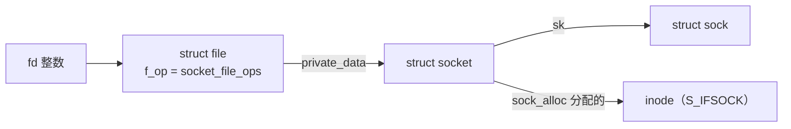
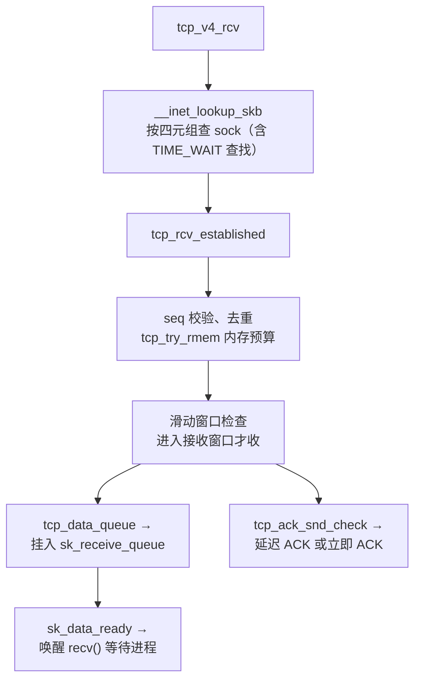
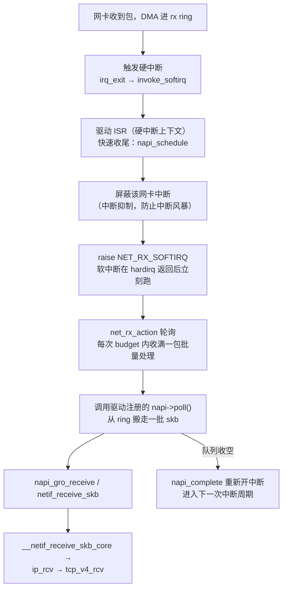
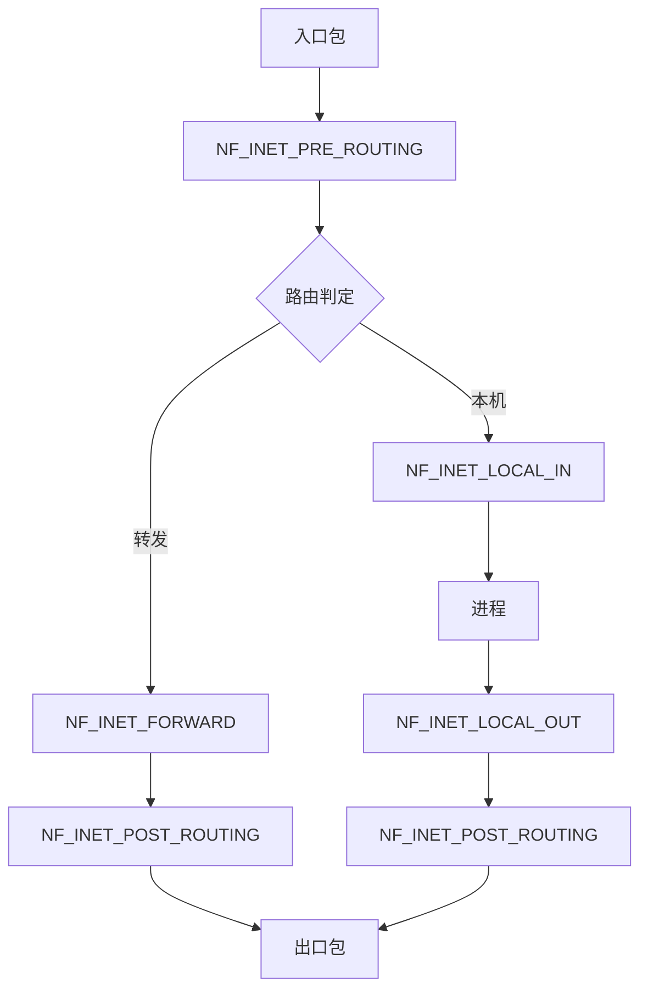
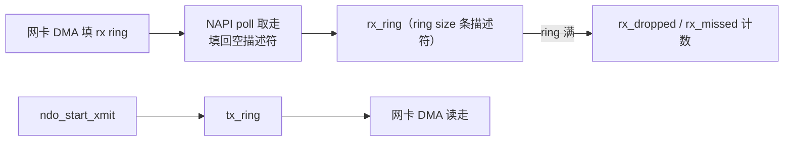
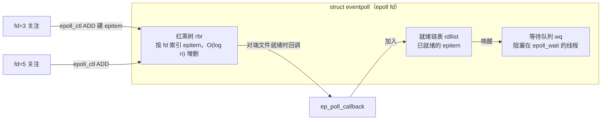

::: abstract 本章定位
把 Linux 网络栈从"能用的黑盒"拆成"看得懂的代码路径"：一个包从网卡到进程经历了哪些内核函数，socket 在内核里是什么，TCP 的滑动窗口与拥塞控制落在哪几行代码上，NAPI 怎么压中断，epoll 凭什么比 select 快。每节都按"概念 → 图解 → 内核实现 → 与实操呼应"展开，承接 [篇实操](/kb/os/Linux/05-Linux网络与系统调用实操/)，为 [系统排查方法论](/kb/os/问题排查/00-系统问题排查方法论/) 提供原理支撑。
:::

理论篇已经在 [IO 子系统](/kb/os/IO/03-内核IO子系统与缓冲/) 讲过"设备→内核→进程"的通用 IO 路径，本篇专注**网络这条特殊 IO 路径**：它有伪文件、有协议状态机、有软中断轮询，还有基于事件的异步接口。读懂本篇，你就知道 `ss -tin` 里的 `cwnd` 是哪来的，`/proc/softirqs` 的 `NET_RX` 为什么跳得飞快，以及 `epoll_wait` 挂起时进程到底睡在哪。

## 1. 网络栈分层总览

### 1.1 七层到四层：Linux 的实现层级

Linux 网络栈不是严格的 OSI 七层，而是"应用 → socket → 协议 → 设备 → 硬件"五段：

| 层级 | 内核实体 | 入口/代表函数 | 对应 OSI |
|---|---|---|---|
| 应用层 | 进程 + 系统调用 | `send()`/`recv()` | L7 应用 |
| socket 层 | `struct socket` + `struct file` | `sock_write_iter` / `sock_read_iter` | 传输接口 |
| 传输层 | `struct sock`（TCP/UDP 状态机） | `tcp_sendmsg` / `tcp_v4_rcv` | L4 传输 |
| 网络层 | IP 路由与分片 | `ip_queue_xmit` / `ip_rcv` | L3 网络 |
| 链路层/设备 | `struct net_device` + 驱动 | `dev_queue_xmit` / `ndo_start_xmit` | L2 链路 |
| 硬件 | 网卡 + DMA | ring buffer | L1 物理 |

::: note 发送与接收不是对称的
发送路径**自上而下**由进程主动驱动（syscall 压栈，qdisc 排队），接收路径**自下而上**由硬中断触发（第 4 节专门讲）。两条路径的入口完全不同，背熟了才能看懂 `perf` 的火焰图。
:::

### 1.2 收发两条路径全景图

```mermaid
flowchart TD
    subgraph SEND["发送路径（进程主动）"]
        A1["应用 send()/write()"] --> S1["socket 层<br/>sock_write_iter → sock_sendmsg"]
        S1 --> S2["TCP 层<br/>tcp_sendmsg → tcp_write_xmit"]
        S2 --> S3["IP 层<br/>ip_queue_xmit → ip_output"]
        S3 --> S4["设备层<br/>dev_queue_xmit → qdisc 排队"]
        S4 --> S5["驱动<br/>ndo_start_xmit → DMA 写 ring"]
        S5 --> S6["网卡发出"]
    end
    subgraph RECV["接收路径（中断驱动）"]
        R1["网卡收到包 → DMA 进 rx ring"] --> R2["驱动硬中断 ISR"]
        R2 -->|napi_schedule| R3["NAPI 轮询<br/>net_rx_action（软中断）"]
        R3 -->|napi_gro_receive| R4["IP 层 ip_rcv"]
        R4 -->|ip_local_deliver| R5["TCP 层 tcp_v4_rcv"]
        R5 -->|sk_receive_queue| R6["socket 层<br/>sock_read_iter"]
        R6 -->|recv()/read()| R7["应用进程被唤醒"]
    end
```

### 1.3 sk_buff：网络栈的"快递单 + 包裹"

整个路径上跑的数据是一个 `struct sk_buff`（简称 skb），既装数据（包裹）又装元数据（快递单）。核心字段：

| 字段 | 作用 |
|---|---|
| `head` / `end` | 数据缓冲区的**边界**（skb 持有整块内存） |
| `data` / `tail` | **当前有效数据**的起止位置，`len = tail - data` |
| `mac_header` / `network_header` / `transport_header` | 记录各层头部偏移，解析时"指针跟随协议" |
| `dev` | 到达/发出的设备 |
| `sk` | 关联的 socket（若收包归属某连接） |
| `truesize` | 实际占用内存（含页分配对齐），决定内存账目 |
| `cb[]`（control block） | 各协议私有暂存区 |

```
|←────────── 一次分配的缓冲区（head ~ end）──────────→|
  [headroom] [mac][ip][tcp] [payload …… ]  [tailroom]
  ^head  ^data  ^mac ^nh  ^th  ^tail             ^end
   头空间     各层头部偏移量指针       len 指向的净载荷   预留尾部
```

- **headroom**：给各层**加头**留的空间。发送时协议逐层向上移动 `data` 前插头部，正是 `skb_push()`；接收时逐层 `skb_pull()` 后移 `data` 剥掉头部。
- `alloc_skb()` 按 `NET_SKB_PAD + L1_CACHE_BYTES` 预留 headroom，所以加 14 字节以太头、20 字节 IP 头都不用新分配内存——这就是"零拷贝式加头"的基础。

::: tip 和实操对上号
`ss -tin` 里没有 skb，但 `perf top` 里 `net_rx_action`/`skb_release_data` 常占大头——skb 分配与释放是网络热点的第一来源，调优 `tcp_rmem` 就是在调 skb 的账本。
:::

## 2. socket 内核实现

### 2.1 两层结构：struct socket 与 struct sock

内核里"套接字"是两个对象，别混：

| 对象 | 定义 | 职责 | 面朝谁 |
|---|---|---|---|
| `struct socket` | `include/linux/net.h` | 通用 socket 接口：`type`（SOCK_STREAM…）、`state`、`ops`（`inet_stream_ops`）、`file`、`sk` | 面向 VFS / 文件层 |
| `struct sock` | `include/net/sock.h` | 具体协议状态：`sk_state`、`sk_prot`（`tcp_prot`）、`sk_receive_queue`、`sk_write_queue`、`sk_data_ready`、`sk_err` | 面向协议栈 |

`struct sock` 是协议层的"大头"，首成员是 `struct sock_common`，`inet_sk(sk)` 拿到 `struct inet_sock`，`tcp_sk(sk)` 拿到 `struct tcp_sock`——典型的"以组合/首成员复用模拟继承"。`tcp_sock` 里才有 `snd_cwnd`、`snd_ssthresh`、`rx_opt` 这些状态。

### 2.2 套接字是"伪文件"

`socket()` 返回的是个普通 fd，但背后没有磁盘 inode：



- `sock_alloc_file()` 用 `alloc_file_pseudo()` 造一个文件，文件操作表是 `socket_file_ops`：`.read_iter = sock_read_iter`、`.poll = sock_poll`、`.release = sock_close`。
- 所以 `read(fd, buf, n)` 对 socket fd 最终走到 `sock_read_iter → sock_recvmsg`；`close(fd)` 走到 `sock_release`。这也是为什么 `lsof -i :80` 显示 socket 是"文件"。

### 2.3 关键系统调用内核流程

| 调用 | 内核主路径 | 关键动作 |
|---|---|---|
| `socket()` | `__sys_socket → sock_create → net_families[AF_INET] → inet_create` | 按 family/type 选 `inet_stream_ops` 与 `tcp_prot`，`sock_alloc` 造 socket+inode，`sock_alloc_file` 造 file 返回 fd |
| `bind()` | `__sys_bind → inet_bind → inet_csk_get_port` | 在端口表里占位，防冲突 |
| `listen()` | `__sys_listen → inet_listen → inet_csk_listen_start` | 状态置 `TCP_LISTEN`，初始化 `icsk_accept_queue` |
| `connect()` | `__sys_connect → inet_stream_connect → tcp_v4_connect` | 构造 SYN 发出，状态置 `TCP_SYN_SENT`；非阻塞返回 `EINPROGRESS` |
| `accept()` | `__sys_accept4 → inet_accept → inet_csk_accept` | 从 accept 队列取一个已完成连接，`sock_alloc_file` 造新 fd（**listening socket 本身的 fd 不变**） |

::: important accept 返回的是新 fd
监听 fd 只负责"接客"，每个被 accept 的连接是独立 fd、独立 `struct sock`。`ss -tulnp` 里 LISTEN 行是监听 fd，ESTAB 行是连接 fd。
:::

### 2.4 listen 队列：SYN 队列与 accept 队列

`listen(fd, backlog)` 之后，内核维护两个队列：

| 队列 | 别称 | 存放 | 限制 |
|---|---|---|---|
| 半连接队列 | SYN 队列 / request_sock 队列 | 发了 SYN、等对方回 SYN+ACK 的连接 | `net.ipv4.tcp_max_syn_backlog`（默认 1024） |
| 全连接队列 | accept 队列 | 三次握手完成、等应用 `accept()` 的连接 | `listen()` 的 backlog，上限 `net.core.somaxconn`（默认 4096） |

```mermaid
flowchart LR
    SYN["客户端 SYN"] --> Q1["SYN 队列<br/>(半连接)"]
    Q1 -->|SYN+ACK → ACK 完成握手| Q2["accept 队列<br/>(全连接)"]
    Q2 -->|accept()| APP["应用"]
```

- 内核 4.3 起 request_sock 并入哈希表统一管理，但"半连接数量上限"与"accept 队列长度"仍是两个独立口径。
- `ss -lt` 里 `Recv-Q` 是**当前 accept 队列里排队的连接数**，`Send-Q` 是 backlog 上限——`Recv-Q` 常年顶格说明应用 `accept()` 太慢。
- 半连接队列满 → 新 SYN 被丢（配合 SYN cookies 应对洪泛，见第 8 节）；全连接队列满 → 完成握手的连接被丢弃或 RST，表现为客户端"connect 成功但马上断"。这与连接建立故障排查中"半连接队列溢出"的 `netstat -s`/`ss -lnt` 观察完全对应。

### 2.5 /proc/net/tcp：把 sock 状态倒出来

`/proc/net/tcp` 每行一个 socket，第 4 列是十六进制状态码：

```bash
ss -s && awk 'NR>1{print $4}' /proc/net/tcp | sort | uniq -c | head
```

| 编码 | 状态 | 编码 | 状态 |
|---|---|---|---|
| 01 | ESTABLISHED | 06 | TIME_WAIT |
| 02 | SYN_SENT | 07 | CLOSE |
| 03 | SYN_RECV | 08 | CLOSE_WAIT |
| 04 | FIN_WAIT1 | 09 | LAST_ACK |
| 05 | FIN_WAIT2 | 0A | LISTEN |

`ss` 本质就是解析这份表（`inet_diag` netlink），所以读得懂 `/proc/net/tcp` 就理解了 `ss` 的每一列。

## 3. TCP 在内核的实现

### 3.1 状态机对应哪 11 个常量

内核把状态机固化在 `tcp_fsm.h`，用户态 `ss` 打印的名字就是它的可读形式：

```
CLOSED →(connect)→ SYN_SENT →(收到 SYN+ACK)→ ESTABLISHED
LISTEN →(收到 SYN)→ SYN_RECV →(回 SYN+ACK 收到 ACK)→ ESTABLISHED
ESTABLISHED →(主动 close)→ FIN_WAIT1 → FIN_WAIT2 →(收 FIN)→ TIME_WAIT →(2MSL)→ CLOSED
ESTABLISHED →(被动收 FIN)→ CLOSE_WAIT →(close)→ LAST_ACK →(收 ACK)→ CLOSED
```

`struct tcp_sock` 里对应字段是 `tp->tcp_state`（即 `sk->sk_state`）。状态转移由 `tcp_v4_connect`、`tcp_rcv_state_process`、`tcp_close` 等函数驱动——状态机不是散落各处，而是集中在这几个函数里。

### 3.2 接收路径：seq 校验、滑动窗口、延迟 ACK



- **seq 校验**：`tp->rcv_nxt` 是期望的下一个序号，收到重复/乱序包进乱序队列（`tcp_data_queue` 处理 out-of-order），`tcp_receive_window` 计算窗口判断是否丢弃。
- **receive queue**：数据落进 `sk_receive_queue`，应用 `recv()` 的 `tcp_recvmsg` 在等它，靠 `sk_data_ready`（回调为 `sock_def_readable`）唤醒。
- **延迟 ACK**：不每次都回 ACK，而是启动 `tcp_delack_timer`，等最多约 40ms 攒两个包一起 ACK；出现 `tcp_enter_quickack_mode`（如收到乱序）则立即回 ACK。所以 ping 包不占 ACK，小包交互时 RTT 会带上 40ms 的量级。

### 3.3 发送路径：拥塞窗口与 CUBIC

发送由 `tcp_sendmsg`（拷用户数据）→ `tcp_write_xmit`（按窗口与拥塞控制决定发多少）→ `tcp_transmit_skb` → `ip_queue_xmit` 完成。能发多少由两个窗口的较小者决定：

```
发送量 = min(接收方通告的 rwnd, 拥塞窗口 cwnd)
```

| 算法 | 核心规则 | 内核位置 |
|---|---|---|
| Tahoe | 慢启动（每 RTT cwnd×2）→ 拥塞避免（每 RTT +1）；丢包后 ssthresh=cwnd/2 且 cwnd 归 1 重走慢启动 | `tcp_slow_start` |
| Reno | 慢启动 + 加性增/乘性减 + **快速恢复**（3 个 dupACK 触发，cwnd=ssthresh+3，丢包后不归 1） | `tcp_cong_avoid` |
| CUBIC | 丢包后用时间的三次函数增长 cwnd，在网络"大而胖"时比 Reno 激进，Linux 默认拥塞控制 | `tcp_cubic.c`（模块 `tcp_cubic`） |

```bash
# 看当前拥塞算法
sysctl net.ipv4.tcp_congestion_control
# 观察单条连接的 cwnd/rtt/ssthresh
ss -tin dst 127.0.0.1 dport = :5201
# 输出里可见: cwnd:10 (initial 10), ssthresh:14, rtt:0.010, rttvar:0.003 ...
```

`cwnd:10 (initial 10)` 即慢启动初始窗口（RFC 6928 起为 10 个 MSS），`ssthresh` 是慢启动与拥塞避免的分界线。下载一个大文件时用 `watch -n1 'ss -tin | grep -E "cwnd|rtt"'`，能看到 cwnd 被指数拉高后在第 3 个 dupACK 处掉一半再爬升的曲线。

### 3.4 TIME_WAIT 与 tw bucket

主动 close 方发完最后一个 ACK 后进入 TIME_WAIT，挂 2MSL（Linux 固定 60s）。内核用 **tw bucket 哈希表**批量回收：

- `net.ipv4.tcp_max_tw_buckets`（主线程默认 180000）：TIME_WAIT 总上限，超限后新连接直接复用旧 tw。
- `net.ipv4.tcp_tw_reuse`（默认 0，4.12 起）：仅对**客户端发起连接**有效，靠 TCP 时间戳保证"新 SYN 的 tsval 大于旧连接最后包的 tsval"时才安全复用。
- `net.ipv4.tcp_tw_recycle`（4.12 已删除）：曾用于服务端，但破坏 NAT 下时间戳单调性，已移除。

这解释了 [篇](/kb/os/Linux/05-Linux网络与系统调用实操/) 里 TIME_WAIT 堆积为什么"大多正常"：高并发短连接必然堆 TIME_WAIT，60s 后由 tw bucket 静默回收，一般不用动。

### 3.5 TCP_NODELAY 与 Nagle

Nagle 算法：**有未确认的小包时，不发新的小包，攒够一个 MSS 或等到 ACK**。目的减少小包数量，代价是交互延迟。`setsockopt(fd, IPPROTO_TCP, TCP_NODELAY, &1, 4)` 把 `tp->nonagle = 1` 关掉它（`tcp_nagle_check` 直接放行）。

::: warning Nagle × 延迟 ACK 的"经典 40ms 停顿"
客户端 Nagle 攒着第二个小包不发，服务端延迟 ACK 攒着 ACK 不回，双方各等对方 → 交互式应用莫名多 40ms。解法就是 TCP_NODELAY（Redis 默认开，很多 RPC 框架默认开）。
:::

## 4. 接收路径与 NAPI / 软中断

### 4.1 从硬中断到 softirq



- **为什么 NAPI 省中断**：一次硬中断后干脆把网卡中断关掉，改为在软中断里"轮询"把 rx ring 里攒的一批包一次收完，收空了才重新开中断。把"每包一次中断"变成"每批一次中断"，在高 PPS 下 CPU 占用率差异极大。
- 中断处理在**硬中断上下文**只做 `napi_schedule` 这种 O(1) 动作，真正的协议处理移到 softirq，遵守"硬中断快进快出"的原则。
- softirq 由 `ksoftirqd`（`top` 里的 `ksoftirqd/N` 线程）或在 `do_softirq` 里执行；`net_rx_action` 每轮有 `net.core.netdev_budget`（默认 300）与 `netdev_budget_usecs`（默认 2000μs）双预算，防止软中断饿死进程。

### 4.2 观察：/proc/softirqs 与 top 的 si 列

```bash
watch -n1 -d cat /proc/softirqs     # 看 NET_RX / NET_TX 每 CPU 计数在涨
top                               # si 列 = 软中断消耗的 CPU 时间
```

- `NET_RX` 暴涨：收包路径吃 CPU（可能是 DDoS 或业务高吞吐）。
- `NET_TX` 暴涨：发送队列满、回压触发重传。
- `top` 的 `si`（software interrupts）与 `hi`（hardware interrupts）分别对应 softirq 与硬中断耗时，`perf top` 里能看到具体是 `net_rx_action`、`tcp_v4_rcv` 还是驱动 poll 在烧 CPU。

### 4.3 RPS / RFS：软件多核分发

| 机制 | 做什么 | 配置 |
|---|---|---|
| RSS（硬件） | 网卡按 4 元组哈希把包散到多个 rx 队列，各队列绑不同 CPU | `ethtool -l eth0` 看队列数 |
| RPS（软件 RSS） | 单队列时把收包软中断分配到多 CPU，按哈希发 IPI | `echo ff > /sys/class/net/eth0/queues/rx-0/rps_cpus` |
| RFS | 在 RPS 基础上把包送到**应用所在 CPU**，提高缓存命中 | 配 `rps_flow_cnt` + `net.core.rps_sock_flow_entries` |
| XPS | 发送侧按 CPU 选 tx 队列，减少锁竞争 | `queues/tx-0/xps_cpus` |

::: tip 什么时候用 RPS
网卡队列数 < CPU 核数（如虚拟化/单队列驱动）时开 RPS 收益最大；多核 NUMA 机器上注意绑定同 NUMA 节点，否则跨节点 IPI 反而更慢。
:::

## 5. Netfilter 与 iptables

### 5.1 五个 Hook 点

Netfilter 在 IP 层埋了 5 个钩子，所有包必经，注册了回调的模块才能"截胡"：



- `PRE_ROUTING`：最先见包，做 DNAT（目标地址改写）就在这里，因为路由要在 NAT 之后做。
- `LOCAL_IN`：发给本机进程前的最后关卡。
- `FORWARD`：转发流量的关卡（路由器/网关场景）。
- `LOCAL_OUT`：本机进程发出的包出门前的第一站，做 DNAT/OUTPUT 策略。
- `POST_ROUTING`：最后一站，做 SNAT/MASQUERADE。

### 5.2 table / chain / rule 的匹配

`iptables -t filter -A INPUT -p tcp --dport 22 -j DROP` 的含义：在 **filter 表的 INPUT 链**追加一条规则，匹配"TCP 且目标端口 22"的包执行 DROP。匹配顺序是 **表内链 → 链内规则自顶向下 → 命中即停**：

| 表 | 作用 | 能挂的链 |
|---|---|---|
| `raw` | 标记包跳过 conntrack（`NOTRACK`） | PREROUTING / OUTPUT |
| `mangle` | 改 TOS/打标记（QoS 用） | 全部 5 链 |
| `nat` | DNAT / SNAT / MASQUERADE | PREROUTING / INPUT / OUTPUT / POSTROUTING |
| `filter` | 放行/拒绝（默认表） | INPUT / FORWARD / OUTPUT |
| `security` | SELinux 强制访问控制标记 | INPUT / FORWARD / OUTPUT |

规则命中后 `-j` 目标：`ACCEPT`/`DROP`/`REJECT` 立即决定，`DNAT`/`SNAT` 改写后**继续走链**。

::: note iptables vs nftables
iptables（xtables）是挂在 Netfilter hook 上的老框架，每链规则逐条线性匹配。nftables（内核 3.13+）用统一的 `nf_tables` 框架，一次性提交规则集、链表数据结构更优、名字空间友好。发行版里的 `iptables-nft` 是给老命令的兼容壳。新项目用 `nft` 全家桶。
:::

### 5.3 conntrack：连接跟踪表

NAT 和状态防火墙都依赖 **connection tracking**：内核维护一张连接表，记录每条流（四元组 + 状态 + 方向）。`-m state --state ESTABLISHED,RELATED -j ACCEPT` 的规则就是查这张表。

```bash
cat /proc/net/nf_conntrack          # 一行一条流: ipv4 2 tcp 6 431999 ESTABLISHED src=... dport=...
cat /proc/sys/net/netfilter/nf_conntrack_max   # 表容量上限（默认 65536）
cat /proc/sys/net/netfilter/nf_conntrack_count # 当前条目
```

- 表是哈希表，`hashsize` 由 `nf_conntrack` 模块参数定，`nf_conntrack_max` 超过后新流直接丢 → 高并发 NAT 网关的经典瓶颈。
- 对照 [安全防御](/kb/os/安全/05-安全防御与审计/)：conntrack 让防火墙"有状态"，但也被攻击者用来打表（填满连接表导致所有新连接拒绝），所以生产防火墙要按峰值并发预留表容量。

### 5.4 防火墙性能观感

| 场景 | 影响 |
|---|---|
| 大规则集 | 老 iptables 每包线性扫链，热点函数 `ipt_do_table` 在 `perf top` 上显形；用 nftables 集合或 `ipset` 缓解 |
| conntrack 满 | 新连接被丢，`perf` 可见 `nf_conntrack_in` 长驻 |
| 关闭 conntrack | 纯转发/高性能 NAT 可 `NOTRACK` 绕过跟踪 |

## 6. 网络设备与驱动

### 6.1 struct net_device 与驱动接口

每个接口（`eth0`、`lo`、`veth0`、`bond0`）对应一个 `struct net_device`：

| 字段/接口 | 作用 |
|---|---|
| `name` / `ifindex` / `flags` / `mtu` | 名字、索引、UP/DOWN 状态、MTU |
| `netdev_ops`（`ndo_open`/`ndo_stop`/`ndo_start_xmit`/`ndo_get_stats64`） | 驱动实现的回调，内核只调不实现 |
| `ethtool_ops` | `ethtool` 命令背后的驱动钩子 |
| `priv`（私有区） | 驱动自己的状态，如 ring 指针 |
| `features`（NETIF_F_*） | 硬件卸载能力位图（GRO、TSO、RSS…） |

网卡驱动做四件事：初始化寄存器、**分配 DMA ring buffer**（`alloc_etherdev` + `netif_napi_add`）、注册 NAPI poll、实现 `ndo_start_xmit`。

### 6.2 rx/tx ring buffer 与丢包

收发包在驱动和硬件之间靠**环形队列**（rx ring / tx ring），是 DMA 的载体：



```bash
ethtool -g eth0        # 看当前/最大 ring size
ethtool -S eth0        # 逐队列统计: rx_errors, rx_dropped, rx_missed, tx_errors...
ethtool -l eth0        # 看有多少个 rx/tx 队列（RSS 队列数）
```

- **rx ring 满 → 丢包**：`rx_dropped`（收下但上层处理不过来）与 `rx_missed`（ring 满直接被硬件丢）持续增长时，要么调大 ring（`ethtool -G eth0 rx 4096`），要么上 RPS/RSS 分散到多 CPU。
- **多队列 RSS**：多队列网卡按流哈希分发到不同 rx 队列，配合 `irqbalance` 把各队列中断绑到不同 CPU，才能吃满多核。

### 6.3 虚拟设备三兄弟

| 设备 | 原理 | 内核实现要点 |
|---|---|---|
| `lo`（loopback） | 发给自己，不进硬件 | `loopback_xmit` 直接把 skb 塞回接收路径（`netif_rx_ni`），秒回 |
| `veth` | 成对虚拟以太网线，跨容器命名空间 | `veth_xmit` 把 skb 送到**对端**的收包路径，配 NAPI 对容器隔离收包 |
| `bond0` | 把多块物理网卡聚合成一块 | 按 mode 分发：`balance-rr` 轮询、`active-backup` 主备、`balance-xor` 按流哈希、`802.3ad` 走 LACP 协商 |

```bash
ip link add veth0 type veth peer name veth1   # 造一对，docker 网络就是这套
cat /sys/class/net/eth0/speed                 # 协商速率
cat /sys/class/net/eth0/statistics/rx_dropped # 与 ethtool -S 同源的计数
```

::: tip `/sys/class/net/` 是设备信息的"只读窗口"
每个接口一个目录：`speed`/`duplex`/`mtu`/`tx_queue_len`/`statistics/*`/`queues/rx-0/`。脚本监控网卡不一定要 ethtool，读这里更轻。
:::

## 7. epoll 与异步

### 7.1 epoll 的三个内核数据结构



- `epoll_create` 分配一个 `struct eventpoll`；`epoll_ctl` 把要监控的 fd 包装成 `struct epitem` 插入**红黑树**（按键 = fd）。
- 关键在**回调机制**：`epoll_ctl ADD` 时给目标文件注册一个唤醒回调 `ep_poll_callback`（挂在目标文件自己的 waitqueue 上）。文件就绪（如 socket 有数据）时内核唤醒回调 → 回调把 epitem 挂到 eventpoll 的**就绪链表**并唤醒 `epoll_wait` 的等待者。
- `epoll_wait` 只需拷走就绪链表（O(k)，k=就绪数），**不需要遍历全部 fd**——这是它和 select/poll 的本质区别。

### 7.2 LT 与 ET

| | Level Triggered（水平，默认） | Edge Triggered（边缘，`EPOLLET`） |
|---|---|---|
| 触发时机 | 只要"还有未消费的事件"就反复报 | 仅在**状态发生跳变**时报一次 |
| 消费不完 | 下次 epoll_wait 还会报（回调把 epitem 留在 rdllist） | 不再报，直到你读光数据（EAGAIN）后下次新数据到达 |
| 使用要求 | 阻塞/非阻塞皆可 | **必须非阻塞** + 读/写直到 `EAGAIN` |
| 陷阱 | 大流量下可能忙轮询 | 漏读一次就永远丢事件（"惊"踩坑） |

::: warning ET 的经典事故
用 ET 却忘了循环 `recv` 到 `EAGAIN`，或误用了阻塞 fd——事件只报一次，数据留在内核读不走，连接"假死"。线上 ET 慎用，先用 LT 跑通。
:::

### 7.3 惊群（thundering herd）

- **accept 惊群**：多线程同时 `accept` 同一监听 fd，来一个连接把大家都叫醒。内核 2.6.18 起 `accept` 只唤醒一个等待者，**已自动解决**，不需要 `EPOLLEXCLUSIVE`。
- **epoll_wait 惊群**：多线程在同一 epoll fd 上 `epoll_wait`，就绪时所有线程被唤醒。Linux 4.5 加入 **`EPOLLEXCLUSIVE`** 标记，`epoll_ctl(ADD)` 时带上它则事件只唤醒一个等待者——Nginx/Redis 的多 worker 模型就靠它。

### 7.4 epoll vs poll vs select，及 io_uring

| 维度 | select | poll | epoll |
|---|---|---|---|
| 单次开销 | O(n) 全量拷贝 fd 集合 | O(n) 全量建 poll_table | O(1) 唤醒 + O(k) 拷贝就绪 |
| fd 上限 | `FD_SETSIZE`（默认 1024） | 无（链表/动态数组） | 无（红黑树） |
| 触发模式 | LT | LT | LT / ET |
| 重复注册 | 每次调用都重新传集合 | 每次重新 pollfd 数组 | 一次 `epoll_ctl`，之后复用 |
| 适用 | 连接少、够用就行 | 连接多、无上限但轮询贵 | **连接多且大部分空闲**的高并发 server |

**io_uring 的定位**：epoll 解决了"等事件"的效率，但读/写仍是 `recv`/`send` 系统调用，每次进出内核 + 数据拷贝。io_uring 用共享内存的 SQ/CQ 环形队列做**完全异步、免 syscall 批处理**的读写，一条链同时覆盖网络与磁盘 IO。定位差异：

| | epoll | io_uring |
|---|---|---|
| 解决 | 事件就绪的**通知** | 就绪后 IO 的**执行** |
| 系统调用 | 每次 epoll_wait/recv/send | 多数操作免 syscall（仅 io_uring_enter 提交/收割） |
| 生态 | 所有老代码都在用 | 新栈（nginx/redis 等实验性支持），详情见 [LinuxIO栈内核原理](/kb/os/Linux/12-LinuxIO栈内核原理/) |

### 7.5 strace 观察 epoll

```bash
# 挂到 nginx 主进程，看 epoll 调用
strace -p $(pgrep nginx | head -1) -e trace=epoll_create,epoll_ctl,epoll_wait -f
# 典型输出
# epoll_wait(8, [{EPOLLIN, {u32=..., u64=...}}], 512, -1) = 1   <- 有 1 个 fd 就绪
# epoll_wait(8, [], 512, -1) = -1 EINTR                         <- 被信号打断
```

注意 `-1` 超时参数 = 无限等待；被信号打断返回 `EINTR`，是写事件循环时必须处理的情况。

## 8. 网络性能调优原理

### 8.1 关键 sysctl 参数

| 参数 | 含义 | 一句话调优逻辑 |
|---|---|---|
| `net.core.somaxconn` | accept 队列上限（默认 4096） | 高并发监听服务要 ≥ 应用 `listen()` 的 backlog |
| `net.ipv4.tcp_max_syn_backlog` | SYN（半连接）队列上限 | 洪泛/握手慢时加大，但要配合 syncookies |
| `net.ipv4.tcp_rmem` / `tcp_wmem` | `min default max` 三段每连接收发缓冲 | 长肥管道加大 default，短连接别改（内存换吞吐） |
| `net.core.rmem_max` / `wmem_max` | setsockopt SO_RCVBUF/SNDBUF 的硬上限 | 想调大单连接缓冲先抬这里 |
| `net.core.netdev_max_backlog` | 设备收包队列长度（每 CPU） | 突发丢包时可调大 |
| `net.ipv4.tcp_tw_reuse` | 客户端安全复用 TIME_WAIT | 默认 0，客户端场景可开（依赖时间戳） |
| `net.ipv4.tcp_syncookies` | SYN cookies | 防 SYN 洪泛，默认 1 |
| `net.ipv4.tcp_max_tw_buckets` | TIME_WAIT 上限 | 一般不动，观察 `ss -s` 为准 |

### 8.2 多队列与 CPU 亲和

```
网卡 RSS 多队列 ── 每队列中断绑不同 CPU（irqbalance 或手动 smp_affinity）
        │
        ├─ 还不够 → 软件 RPS 再散一层（第 4.3 节）
        └─ 发送侧 → XPS 按 CPU 选 tx 队列
```

```bash
systemctl start irqbalance          # 守护进程自动分配 IRQ 亲和性
cat /proc/irq/46/smp_affinity       # 手动看/设某中断的 CPU 掩码
```

`perf top` 里若见单个 `net_rx_action` 占满一个核而其他核空闲，就是中断没有摊开——去查 RSS 队列数和 irqbalance。

### 8.3 DDoS 防御：SYN cookies

`net.ipv4.tcp_syncookies=1` 时，SYN 队列满后不再存状态，而是把连接信息（seq 的 hash + 时间戳 + MSS）直接编码进 SYN+ACK 的 ISN：合法客户端回 ACK 时内核**离线恢复**出连接，不占队列。代价是丢失部分 TCP 选项（SACK/时间戳）。这是内核自带的第一道 DDoS 防线，Nginx 等常配合 `tcp_max_syn_backlog` 一起调。

### 8.4 用 iperf3 与 perf 定位热点

```bash
# 服务端
iperf3 -s
# 客户端：先测吞吐再测延时
iperf3 -c &lt;server&gt; -t 30
iperf3 -c &lt;server&gt; -u -b 1G -t 30      # UDP 高吞吐压测

# 压测的同时抓内核热点
sudo perf top -a --sort=cpu
# 关注符号：net_rx_action / napi_poll / tcp_v4_rcv / ip_rcv / tcp_sendmsg
```

| 热点符号 | 含义 | 对应调优 |
|---|---|---|
| `net_rx_action` / `napi_poll` | 收包轮询吃 CPU | RSS/RPS 摊多核、调大 budget |
| `tcp_v4_rcv` | 协议处理吃 CPU | 关 GRO 试、调 tcp_rmem |
| `tcp_sendmsg` / `copy_from_user` | 数据拷贝吃 CPU | 大缓冲、零拷贝（io_uring/sendfile） |
| `ipt_do_table` / `nf_conntrack_in` | 防火墙吃 CPU | 精简规则集、调 conntrack 表 |

## 本章小结

- 网络栈五段结构：**socket 层（伪文件）→ 传输层（struct sock）→ 网络层（IP）→ 设备层（net_device）→ 驱动**；数据载体是 `sk_buff`（headroom 支持零拷贝加头）。
- socket 内核里是 `struct socket`+`struct sock` 双层；`listen()` 建 SYN/accept 双队列，`ss -lt` 的 Recv-Q 就是 accept 队列水位。
- TCP：接收路径 seq/窗口/延迟 ACK 落数据进 `sk_receive_queue`；发送由 cwnd/rwnd 双窗约束，默认 CUBIC；TIME_WAIT 由 tw bucket 批量回收。
- 接收是**硬中断 → NAPI 轮询 → softirq → 协议 → socket** 的中断抑制流水线，`/proc/softirqs` 与 `top` 的 `si` 列可观察。
- Netfilter 五个 hook + table/chain/rule 匹配 + conntrack 连接表，是防火墙与 NAT 的原理底座。
- 网卡驱动靠 DMA ring buffer + NAPI poll 工作，ring 满就丢包；`ethtool -S`/`/sys/class/net` 是观测窗口。
- epoll = 红黑树 + 就绪链表 + 回调，O(k) 返回就绪事件，LT/ET 语义差别巨大；io_uring 是把"通知 + 执行"一起异步化的下一代（[LinuxIO栈内核原理](/kb/os/Linux/12-LinuxIO栈内核原理/)）。

## 动手实验

1. **收发路径走查**：本机 `nc -l 1234` + `nc 127.0.0.1 1234` 对聊，另一终端 `sudo perf top -a`，找 `net_rx_action`、`ip_local_deliver`、`tcp_v4_rcv` 并截图。
2. **软中断观察**：`watch -n1 -d cat /proc/softirqs`，用 `iperf3` 压 `lo` 或对端，看 `NET_RX` 计数与 `top` 的 `si` 列涨幅。
3. **cwnd 生长曲线**：`iperf3 -s` 对端，本端 `watch -n1 'ss -tin dst &lt;peer&gt; | grep -E "cwnd|rtt|ssthresh"'`，观察慢启动 cwnd 指数爬升与丢包后 ssthresh 的下降。
4. **ring buffer 丢包体检**：`ethtool -S eth0 | egrep "drop|miss|err"` 连续采样两次，观察计数器是否增长；`ethtool -g eth0` 看 ring 大小。
5. **select vs epoll 连接数对比**：写 C 程序（用 `select()` 或 `epoll()`）各挂 1 万连接并 accept/echo，`time` 对比轮询 1000 次的总耗时；再 `strace` 看 `select` 每次传 fd_set 而 `epoll_wait` 只返回就绪数。
6. **strace 看 epoll**：对 `nginx`/`redis-server` `strace -e trace=epoll_wait,epoll_ctl -p &lt;pid&gt; -f`，观察 `epoll_wait` 返回的 fd 数与超时 `-1`。
7. **LISTEN 队列验证**：`sysctl net.core.somaxconn` 看上限，`ss -lt` 对比 `Recv-Q/Send-Q`，用 `ab -n 10000 -c 200` 压一个 python http.server 看是否出现 `LISTEN` 队列满。

## 自测题

1. **一个以太网包到达网卡到进程 recv()，经历了哪几段？** 硬中断 → 驱动 ISR → napi_schedule → softirq（net_rx_action）→ 驱动 poll 取 ring → `netif_receive_skb` → `ip_rcv` → `tcp_v4_rcv` → 挂 `sk_receive_queue` → 唤醒 `tcp_recvmsg`。
2. **`ss -lt` 里 Recv-Q 与 Send-Q 分别是什么？** Recv-Q 是 accept 队列当前排队数，Send-Q 是 backlog 上限；Recv-Q 顶格说明应用 `accept()` 跟不上。
3. **NAPI 为什么能减少中断？** 硬中断后关掉网卡中断改为软中断批量轮询收包，收空才重新开中断，把"每包一次中断"变成"每批一次中断"。
4. **cwnd 和 ssthresh 各决定什么？** cwnd 是拥塞窗口（本端能发的量），ssthresh 是慢启动/拥塞避免分界线；cwnd<ssthresh 走慢启动指数增长，否则加性增/按 CUBIC 增长，丢包后 ssthresh=cwnd/2。
5. **TIME_WAIT 为什么要等 2MSL？`tcp_tw_reuse` 安全的前提是什么？** 保证最后 ACK 可重发且旧报文消亡防串台；复用前提是启用 TCP 时间戳且新连接 tsval 严格大于旧连接最后一个包的 tsval。
6. **LT 与 ET 的核心区别？ET 的正确用法？** LT 只要数据没读完就反复上报，ET 只在状态跳变上报一次；ET 必须用非阻塞 fd 并循环读写到 `EAGAIN`。
7. **epoll 相比 select 为什么是 O(1)？** select 每次把整个 fd 集合拷进内核再全量轮询（O(n)）；epoll 注册时把回调挂到目标文件，就绪时经 `ep_poll_callback` 直接进就绪链表，`epoll_wait` 只拷就绪项（O(k)）。
8. **收包丢包的排查顺序？** 先看 `ethtool -S` 的 `rx_missed`（ring 满，调大 `-G`）与 `rx_dropped`（处理不过来，上 RSS/RPS/多核），再看 `net.core.netdev_max_backlog`，最后用 `perf`/`/proc/softirqs` 定位 CPU 是否被单个 `net_rx_action` 占满。
