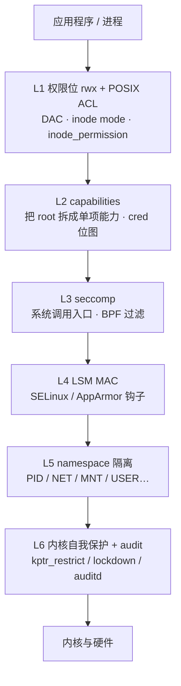
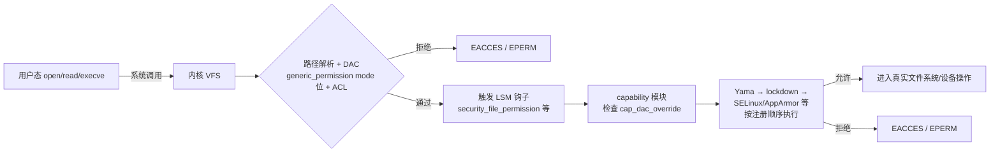

::: abstract 本章定位
"内核原理"系列完结篇：把 [实操](/kb/os/Linux/06-Linux安全权限与审计/) 的命令下沉到内核实现，从 DAC/MAC 模型讲到内核自我保护，拆解 capabilities 位图、LSM 钩子、seccomp BPF 过滤、namespace/cgroup 隔离与 audit netlink，并讲清容器隔离与 SELinux 排障。
:::

06 篇讲的是"**怎么用**"（chmod/setcap/auditctl 这些命令），本篇讲"**内核凭什么**"。Linux 安全不是单一机制，而是一组机制按"纵深防御"叠在一起：权限位管 DAC、capabilities 收窄 root、seccomp 过滤系统调用、LSM 提供 MAC、namespace 做隔离、auditd 做审计。每层都有对应的内核代码路径。

## 1. 安全模型总览：DAC 与 MAC

**概念**。教材把访问控制分成两大类：

| 模型 | 英文 | 谁说了算 | 特点 | Linux 实现 |
|---|---|---|---|---|
| 自主访问控制 | DAC (Discretionary AC) | 文件**属主**自己决定权限 | 属主可任意授权/收回 | 默认的 owner/group/other + rwx |
| 强制访问控制 | MAC (Mandatory AC) | **系统策略**说了算，属主无权改 | 全局一致、不可绕过 | SELinux / AppArmor / Smack |

Linux 默认只有 DAC：`chmod 600 secret` 之后属主还能 `chmod 777` 自己改回去，属主拥有对自己文件资源的"自主权"。而 SELinux 的标签和策略由系统管理员（policy）统一决定，属主 `chmod 777` 也改变不了 MAC 层的拒绝。

**图解**。纵深防御各层——外层挡住的是"没权限"，内层挡住的是"有权限但越界"：



**内核实现**。DAC 检查发生在 VFS 路径解析阶段：`generic_permission()` 先做 uid/gid 匹配 + mode 位掩码，再调用 LSM 钩子（第 4 节）。为什么 DAC 不足？因为 **root（uid 0）默认拥有全部 capabilities**，`CAP_DAC_OVERRIDE` 让 root 能读写任意文件——一旦一个 root 服务被攻破，攻击者就是"全知全能"。DAC 无法回答"这个 root 进程只该碰它自己的目录"。

这套层次与教材的**访问矩阵**（subject/object/permission）一一对应：每一层都在问同一个问题"主体对客体有没有这个权限"，只是"客体"的粒度从文件一路细到系统调用。LSM 层（L4）回答"进程 domain 能否 access 这个 type"，seccomp 层（L3）回答"进程能否调用这个 syscall"——见 [访问控制](/kb/os/安全/01-保护机制与访问控制/)。而认证（你是谁）属于 L0，是 [认证加密](/kb/os/安全/02-身份认证与密码学基础/) 那篇的范畴。

**与实操呼应**：06 篇的 `chmod`/`umask`/`setfacl` 全落在 L1；面试答"容器为何安全"，要说清楚它是 L2（capabilities）到 L5（namespace）协同，而不是虚拟机那样靠硬件隔离。

## 2. 传统权限内核实现：mode 位、ACL 与 setuid

**概念**。每个 inode 的 `i_mode` 字段里存放 12 位权限：9 位 rwx（owner/group/other）+ 3 位特殊位（setuid/setgid/sticky）。ACL 则是"rwx 三位不够用"时的扩展：给指定用户单独授权。

**图解**。inode 里权限相关的存储：

```
struct inode {
    umode_t i_mode;      // 权限位：高3位特殊位 + 9位rwx
    uid_t   i_uid;       // 属主
    gid_t   i_gid;       // 属组
    struct posix_acl *i_acl;        // 访问 ACL（system.posix_acl_access）
    struct posix_acl *i_default_acl;// 目录默认 ACL（system.posix_acl_default）
    ...
}
```

- 特殊位：`S_ISUID`=04000、`S_ISGID`=02000、`S_ISVTX`(sticky)=01000。
- POSIX ACL 以**扩展属性**存放在文件系统里：`system.posix_acl_access`（对文件的访问列表）、`system.posix_acl_default`（目录默认，新文件继承）。`getfacl`/`setfacl` 底层就是 `getxattr`/`setxattr` 系统调用。有 ACL 时 `generic_permission()` 优先走 `posix_acl_permission()` 而不是裸 mode 位。

**内核实现**（关键细节）：

1. **setuid 的 exec 处理**。执行 `execve()` 时，内核在 `cap_bprm_set_creds()`（`security/commoncap.c`）里发现文件带 `S_ISUID` 且属主不是当前 euid，就把新进程的 euid 改成文件属主。因为 root 有全部能力，一个 setuid root 程序**exec 之后整个进程变成全量 root 能力**——这正是"setuid 危险"的根源：程序只要有一个可利用漏洞，攻击者就拿到了全量特权，而不是只拿到"改密码"这一件事的能力。file caps（第 3 节）就是为了精确解决这一点。
2. **写文件时清 setuid**。内核在写打开时调用 `file_remove_privs()`：若非属主写入 setuid/setgid 文件，自动清掉这两个位——防止用户把"带 setuid 的 root 后门"写进某个可写文件里。这是教科书"保护环防篡改"思想的落地。
3. **sticky bit**。删除/改名时 `may_delete()` 检查：在 sticky 目录里，只有**文件属主、目录属主、或有 CAP_FOWNER** 才能删除，防止 `/tmp` 里互相删文件。
4. **`/proc/sys/fs/protected_*`** 是内核加固 DAC 的开关：

| sysctl | 作用 |
|---|---|
| `fs.protected_hardlinks=1` | 不能对不属于自己的文件创建硬链接（防 suid 硬链接攻击） |
| `fs.protected_symlinks=1` | 限制跟随 sticky 共享目录中的符号链接（防 symlink 攻击） |
| `fs.protected_regular=1/2` | 阻止在 sticky 共享目录打开他人创建的常规文件/管道 |
| `fs.protected_fifos=1/2` | 同上，针对 FIFO |
| `fs.suid_dumpable=0` | 禁止 setuid 程序崩溃时生成 core 转储（转储文件可能含特权进程的内存） |

这几个开关背后是同一个攻击套路：攻击者在**可写的共享目录**（如 `/tmp`）里放陷阱文件，诱导高权限进程去 open/follow——`protected_*` 直接在内核路径解析时拒绝这种"跨属主"操作。

**与实操呼应**：`ls -l` 的 `s`/`S`/`t` 就是 `i_mode` 特殊位；`stat -c '%a' file` 打印的八进制（如 `4755`）最高位 4/2/1 就是 S_ISUID/S_ISGID/S_ISVTX；`getfacl` 读到的正是 `system.posix_acl_access` 扩展属性。06 篇"setuid 实验"里 `cp /bin/cat` 复制后 `chmod u+s`，权限串上的 `rws` 就是内核 exec 时判断依据。另注意 setgid 目录：其中新建文件自动继承目录的组，靠的是 `i_gid` 继承逻辑而非 ACL。

## 3. capabilities：把 root 拆成位图

**概念**。传统模型"要么 root 全有、要么普通用户全无"，capabilities 把 root 特权拆成 40+ 个独立能力位（Linux 5.x，编号 0~40）。进程的凭证（`struct cred`）里用 5 组位图记录能力。

**图解**。五组 capability set 的语义：

| 集合 | 英文 | 语义 |
|---|---|---|
| permitted | P | 进程"有资格"持有的能力池 |
| effective | E | 真正参与权限检查的位，**E ⊆ P** |
| inheritable | I | 可被子进程继承、并参与 exec 后 P 的计算 |
| bounding | B | 所有集合的天花板，**只能减不能增**，跨 exec 保持 |
| ambient | A | Linux 4.3+，无文件 cap 时也能跨 exec 保留，**A ⊆ P ∩ I ∩ B** |

常用能力位（编号即内核定义）：

| 编号 | 能力 | 作用 |
|---|---|---|
| 1 | `cap_dac_override` | 绕过所有文件读/写/执行权限检查（root 能读一切的原因） |
| 3 | `cap_fowner` | 绕过文件属主检查，可 chmod/chown 任意文件 |
| 5 | `cap_kill` | 向任意进程发信号 |
| 7 | `cap_setuid` | 设置任意 uid |
| 10 | `cap_net_bind_service` | 绑定 <1024 端口 |
| 12 | `cap_net_admin` | 网络管理（iptables、网卡配置） |
| 13 | `cap_net_raw` | 原始/ICMP 套接字——**ping 只需要它** |
| 16 | `cap_sys_module` | 加载/卸载内核模块 |
| 18 | `cap_sys_chroot` | chroot |
| 19 | `cap_sys_ptrace` | ptrace 任意进程（gdb 调试） |
| 21 | `cap_sys_admin` | 挂载、namespace、配额等（最危险的一个） |
| 25 | `cap_sys_time` | 改系统时钟 |
| 34 | `cap_syslog` | 读内核日志（`dmesg`） |

**内核实现**：进程每次系统调用触发的权限检查都查 `cred->cap_effective`，而"能获得什么能力"由 execve 时 `cap_bprm_set_creds()` 按下列公式变换（`X`=bounding，`P_f/I_f`=文件里存的能力，`F`=文件 effective 标志位）：

```
P' = (X ∩ P_f) ∪ (P ∩ I ∩ I_f) ∪ A
E' = F ? P' : (A 非空 ? P' : 0)
A' = A ∩ X ∩ P'
X' = X,  I' = I
```

- **root exec 无 file caps 的文件**：`P' = E' = X`（即"全量 bounded 能力"）——所以 root 天然全有。
- **普通用户 exec 无 file caps 的文件**：`P' = E' = 0`——普通进程通常没有任何能力。
- **ping**：现代发行版给 `/usr/bin/ping` 打了 `cap_net_raw+ep` 文件能力，普通用户 exec 时 `P_f=cap_net_raw`、`F=1`，于是 P 和 E 都拿到 `cap_net_raw`，能开原始套接字发 ICMP，却拿不到 mount/kill 等其他特权。
- 文件能力存放在 inode 的 **`security.capability` 扩展属性**里（`getfattr -d -m - file` 可见），由 `setcap`/`getcap` 读写。
- **容器降权**：Docker `--cap-drop ALL --cap-add cap_net_raw` 的本质是**设置 bounding set**——容器的进程即使以 root 身份跑，`X` 里被 drop 的位永远进不来（bounding 只能减不能增），这是比 setuid 更彻底的收权。

把公式套到实际例子上：

```
例1：root 执行 /usr/bin/ls（无 file caps）
  → P=E=X（全量 bounded 能力）          ← root 天然全有，无法用 file caps 收住
例2：普通用户执行 /usr/bin/ping（cap_net_raw+ep）
  → P = X ∩ {cap_net_raw} = {cap_net_raw}
  → E = F(1) ? P = {cap_net_raw}        ← 只拿到 ICMP 发包的能力
例3：普通用户执行 /usr/bin/cat（无 file caps）
  → P = 0，E = 0                        ← 普通进程默认无能力
```

**与实操呼应**：06 篇的 `capsh --print` 打印的就是 P/E/I/B/A 五组；`getcap /usr/bin/ping` 读的正是 `security.capability` xattr，用 `getfattr -d -m - /usr/bin/ping` 能看到二进制属性里的位掩码。`getpcaps &lt;pid&gt;` 能看任意进程的 current 集合。面试常问"setuid vs capabilities"——答案就是上面 root 那条规则：setuid root 给的是全量，file caps 给的是精确的一两格。

## 4. LSM 框架：安全模块的插槽

**概念**。Linux Security Module 是内核 2.6 引入的框架：在内核**关键检查点**预埋统一命名的钩子函数，让 SELinux、AppArmor 等以"可加载安全模块"的形式插进去，不用各自改 VFS/内核主路径。检查顺序是"先 DAC（mode/ACL）→ 再 LSM"。

**图解**。一次 `open()` 的检查路径：



**内核实现**。核心在 `security/security.c`：

- 钩子点声明在 `include/linux/lsm_hooks.h`，按对象类型分组：`inode_*`（`inode_permission`）、`file_*`（`file_permission`、`file_open`）、`task_*`（`task_fix_setuid`）、`socket_*`（`socket_connect`、`socket_bind`）、`msg/shm/sem` 等，共 100+ 个钩子。

| 分组 | 典型钩子 | 触发点 |
|---|---|---|
| inode | `inode_permission`、`inode_setattr` | 路径解析、chmod/chown |
| file | `file_permission`、`file_open` | 已打开文件的读写、打开检查 |
| task | `task_fix_setuid`、`task_prctl` | setuid、prctl 系统调用 |
| socket | `socket_create`、`socket_bind`、`socket_connect` | 创建/绑定/连接套接字 |
| ipc | `msg_queue_msgrcv`、`shm_shmat` | System V IPC 操作 |

- 每个钩子是一张**链表**：`security_hook_heads` 是全局结构体，每个 hook 名对应一条 `security_hook_list` 链，模块用 `security_add_hooks()` 把自己的函数挂进去。调用时 `call_int_hook(file_permission, 0, file, mask)` 遍历链表。
- VFS 侧调用点举例：`fs/namei.c` 的 `inode_permission()` 里先 DAC 后 `security_inode_permission()`；文件读写前 `fs/open.c`/`fs/read_write.c` 调 `security_file_permission()`；`socket()` 调 `security_socket_create()`。
- **安全 blob**：模块要给 inode/task/file 附带自己的私有数据（SELinux 的标签指针、AppArmor 的 profile 指针），内核在分配这些对象时按所有模块的需求预留内存，模块通过 blob offset 读写——这就是"挂标签"的底层机制。
- **共存**：capability 模块永远存在；传统"major"模块一次只能挂一个做强制 MAC（SELinux、AppArmor、Smack 互斥），而 Yama、lockdown、Landlock、integrity、BPF 等 "minor" 模块可以叠加。`/sys/kernel/security/lsm` 列出当前启用的模块。

**与实操呼应**：`cat /sys/kernel/security/lsm` 看到的就是已注册的模块链；`dmesg` 里 `LSM: initializing selinux` 那几行就是模块初始化、往 `security_hook_heads` 挂钩子的过程。SELinux/AppArmor 并不是内核外的什么东西，而是**挂在内核钩子上的 LSM 模块**。

## 5. SELinux：基于标签的类型强制

**概念**。SELinux 采用类型强制（TE，Type Enforcement）：**所有主体（进程，称为 domain）和客体（文件/端口，称为 type）都打标签**，访问规则写成"domain 可以对 type 做哪些 class 的哪些操作"。策略之外的一律拒绝（默认拒绝）。

**图解**。一条规则与一个拒绝事件的对应：

```
allow httpd_t httpd_log_t:file { read write open append };
      ↑domain  ↑type     ↑class    ↑permission 集合
scontext=httpd_t  tcontext=httpd_log_t  tclass=file
  ↑规则里的 domain     ↑规则里的 type
```

文件标签用 `ls -Z` 查看（`system_u:object_r:httpd_log_t`），进程标签用 `ps -Z`：

```bash
ls -Z /var/www/html/index.html
# -rw-r--r--. root root system_u:object_r:httpd_sys_content_t:s0 /var/www/html/index.html
ps -Z -p 1234
# LABEL                         PID TTY          TIME CMD
# system_u:system_r:httpd_t:s0 1234 ?        00:00:01 httpd
```

**内核实现**：SELinux 是**内核自带的一个 LSM 模块**（`security/selinux/`），策略编译后通过 `/sys/kernel/security/selinux/policy` 加载进内核，`avc_has_perm()` 查 AVC（Access Vector Cache，策略规则的缓存）做决策；AVC 命不中时查完整策略并回填缓存。命中/拒绝都会向 audit 子系统发事件——这就是 AVC 日志的来源。

**配置与排查**（呼应 06 篇）：

```bash
cat /etc/selinux/config     # SELINUX=enforcing|permissive|disabled; SELINUXTYPE=targeted
getenforce                  # Enforcing / Permissive / Disabled
setenforce 0                # 临时 Permissive（只记日志不拦截）—— 谨慎
ausearch -m avc -ts recent  # 查最近被拒绝的 AVC 事件
restorecon -Rv /var/www     # 按策略默认标签修复文件标签（常用救法）
chcon -t httpd_sys_content_t /var/www/index.html   # 临时改标签
```

拒绝日志长这样：

```
type=AVC msg=audit(1720...): avc:  denied  { open } for  pid=1234
  comm="httpd" path="/var/www/html/secret" scontext=system_u:system_r:httpd_t:s0
  tcontext=system_u:object_r:default_t:s0 tclass=file
```

**常见坑**：nginx/apache 突然起不来、日志却一切正常，多半是**文件标签错误**——新挂载的目录、scp 上去的文件标签是 `default_t` 或 `usr_t`，domain 没权限 access。修法是 `restorecon` 或 `semanage fcontext -a` 加规则再 `restorecon`：

```bash
restorecon -Rv /var/www                     # 按策略默认标签批量修复
semanage fcontext -a -t httpd_sys_content_t '/web(/.*)?'   # 注册新路径规则
restorecon -Rv /web                         # 再按新规则打标签
```

**不要直接 `setenforce 0` 或 disabled 一关了之**，disabled 后要重启才能再开，且整个系统失去 MAC 保护。

## 6. AppArmor：基于路径的强制访问控制

**概念**。AppArmor 同样是 LSM 模块，但把进程"限定"在**一组路径 + 能力 + 网络规则**之内：profile 说"这个程序只能读哪些文件、写哪些文件、有没有哪些 cap"，越界即拒绝。与 SELinux 的"全局类型强制"对比，AppArmor 是"逐程序清单式"，学习曲线低很多。

**图解**。一个 `/etc/apparmor.d/usr.sbin.mysqld` profile 的骨架：

```
profile /usr/sbin/mysqld flags=(attach_disconnected) {
  /usr/sbin/mysqld  mr,            # 可读可映射自身二进制
  /var/lib/mysql/** rwk,           # 数据目录读写
  /etc/mysql/**     r,             # 配置文件只读
  /var/log/mysql/** w,             # 日志可写
  capability net_bind_service,     # 允许绑定端口
  deny /etc/shadow r,              # 显式禁止
}
```

**内核实现**：AppArmor 模块（`security/apparmor/`）在 LSM 钩子里对路径查找做匹配。相比 SELinux 的 label 语义，AppArmor 用"路径 + 文件系统标签（File Labels，4.x 后引入）"混合表示，`/sys/kernel/security/apparmor/` 下有 profile 与 labels 的虚拟文件，`apparmor_parser` 负责编译加载 `/etc/apparmor.d` 下的文本规则。

**实操**：

```bash
aa-status                 # 列出已加载 profile 与 enforce/complain 状态
aa-enforce /etc/apparmor.d/usr.sbin.mysqld   # 置为强制模式
aa-complain &lt;profile&gt;     # 置为"只记不拦"，先看日志再收紧
dmesg | grep -i apparmor  # 看拦截记录
apparmor_parser -r /etc/apparmor.d/usr.sbin.mysqld   # 修改 profile 后重载
```

**推荐工作流**：新装服务先在 **complain 模式**下跑一段时间 → 用 `dmesg | grep apparmor` 看它实际访问了哪些路径 → 把合法路径补进 profile → 再切 enforce。这条"先看后拦"的路径就是 AppArmor 比 SELinux 好上手的直观体现。

**与 SELinux 对比**：

| 维度 | SELinux | AppArmor |
|---|---|---|
| 所属发行版 | RHEL/CentOS/Fedora | Ubuntu/Debian/SUSE |
| 控制模型 | 类型强制（全局标签） | 路径 + profile（逐程序） |
| 控制对象 | 一切进程/文件/端口都要标签 | 只限定被 profile 覆盖的程序 |
| 学习成本 | 高（策略语法、semanage） | 中（读 profile 文本即可） |
| 常见故障 | 文件标签错 → 服务起不来 | 程序读不到某目录、被 deny |
| 排查入口 | `ausearch -m avc` | `dmesg \| grep apparmor` |

两者不可同时启用做强制 MAC（同属 major LSM）。面试常问"SELinux 与 AppArmor 区别"，答核心一句：**SELinux 管"标签能不能碰"，AppArmor 管"这个程序能碰哪些路径"**。

## 7. seccomp：系统调用层面的强制过滤

**概念**。权限与 MAC 都拦不住"程序本身调了危险的系统调用"（如 `ptrace` 注入、`mount`、`kexec_load`）。seccomp（secure computing）在**系统调用入口**用一段 BPF 程序按 syscall 号和参数做放行/拒绝/杀掉，是"最小权限"在系统调用面的落地。

**图解**。一次系统调用的过滤路径：

```
用户态 syscall ──> 内核 syscall 入口 ──> seccomp 运行 cBPF 过滤程序
                                          ├─ SECCOMP_RET_ALLOW  → 放行
                                          ├─ SECCOMP_RET_ERRNO  → 返回 EPERM
                                          ├─ SECCOMP_RET_TRACE  → 交给 tracer
                                          └─ SECCOMP_RET_KILL   → 直接杀死进程
```

**内核实现**（`kernel/seccomp.c`）：

- **strict 模式**：`prctl(PR_SET_SECCOMP, SECCOMP_MODE_STRICT)`，只允许 `read/write/_exit/sigreturn`，其余一律 SIGKILL。过于粗暴，现在少用。
- **filter 模式**：`prctl(PR_SET_SECCOMP, SECCOMP_MODE_FILTER, &prog)` 加载一段**经典 BPF（cBPF）**程序，每次系统调用在入口处执行，用 32 位寄存器读 syscall 号（A=读偏移 0）与参数。
- 必须先设 `PR_SET_NO_NEW_PRIVS`（或具备 CAP_SYS_ADMIN），否则进程可能先降权、再借 setuid/exec 继承高权限后布置过滤器——`no_new_privs` 的引入正是为了堵死这条"降权进程重新提权再过滤"的路径（这也是 Docker 默认给容器进程设 no_new_privs 的原因）。
- 过滤器在 execve 后保留（不随 exec 清除），可叠加多层。

一个"禁止 ptrace"的过滤器示例：

```c
struct sock_filter filter[] = {
    BPF_STMT(BPF_LD|BPF_W|BPF_ABS, 0),                 /* 读取 syscall 号 */
    BPF_JUMP(BPF_JMP|BPF_JEQ|BPF_K, __NR_ptrace, 0, 1),
    BPF_STMT(BPF_RET|BPF_K, SECCOMP_RET_KILL),         /* 是 ptrace → 杀 */
    BPF_STMT(BPF_RET|BPF_K, SECCOMP_RET_ALLOW),        /* 否则放行 */
};
struct sock_fprog prog = { .len = 4, .filter = filter };
prctl(PR_SET_NO_NEW_PRIVS, 1, 0, 0, 0);
prctl(PR_SET_SECCOMP, SECCOMP_MODE_FILTER, &prog);
```

**与实操呼应**（呼应 [容器](/kb/container/Docker/原理分析/03-Namespace-Cgroups与容器隔离/)）：Docker 默认给容器进程挂一个**默认 seccomp profile**，约禁掉 44 个系统调用——`mount`、`umount2`、`ptrace`、`reboot`、`kexec_load`、`init_module`、`open_by_handle_at`、`userfaultfd`、带 `security.*` 前缀的 `setxattr` 等。所以容器里即使 `--cap-add CAP_SYS_ADMIN`，`mount` 仍可能被 seccomp 拦下报 `Operation not permitted`。可 `docker run --security-opt seccomp=unconfined` 关掉（强烈不建议），或自写 profile：

```bash
docker run --rm --security-opt seccomp=/path/profile.json alpine sh -c 'mount; echo hi'
# 容器里 mount 直接 EPERM，即使 docker 默认给 root 能力
docker run --rm alpine grep Seccomp /proc/self/status   # Seccomp: 2 = filter 模式
```

面试"容器里为什么某些 syscall 不可用"——答：**capabilities 收掉特权，seccomp 再按白名单过滤，双保险**。

## 8. namespace 与隔离

**概念**。namespace 让进程"**看到**"一个隔离的视图：每个 namespace 是一套全局资源（PID 表、网络栈、挂载树……）的副本。隔离 ≠ 安全，也 ≠ 资源限制——资源上限是 cgroup 的职责（呼应 [Linux进程与线程内核原理](/kb/os/Linux/08-Linux进程与线程内核原理/)）。

**图解**。7 种 namespace 与隔离对象：

| namespace | clone 标志 | 隔离了什么 | 相关系统调用/命令 |
|---|---|---|---|
| Mount | `CLONE_NEWNS` | 挂载点视图 | `mount --bind`、`unshare -m` |
| PID | `CLONE_NEWPID` | 进程号（容器内 PID 1） | `unshare -f -p` |
| Network | `CLONE_NEWNET` | 网卡、路由、iptables | `ip netns add`、`docker0` |
| UTS | `CLONE_NEWUTS` | hostname / domainname | `unshare -u`、容器 `hostname` |
| IPC | `CLONE_NEWIPC` | System V IPC / POSIX mqueue | `unshare -i` |
| User | `CLONE_NEWUSER` | uid/gid 映射（非特权即可开） | `unshare -r`、rootless 容器 |
| Cgroup | `CLONE_NEWCGROUP` | cgroup 根（4.6+） | `unshare -C` |

**内核实现**：进程描述符 `task_struct` 里有一个 `nsproxy` 指针，指向 5 个独立的 namespace 对象（`mnt_namespace`、`pid_namespace`、`net`、`uts_ns`、`ipc_ns`；user ns 在 `cred` 上，cgroup ns 在 cgroup 树）。`clone()`/`unshare()`/`setns()` 用上面的标志创建或加入。**user namespace** 特殊：非特权用户可以用 `unshare -r` 在自己的 user ns 里"成为 uid 0"，并**只在本 namespace 内**获得 capabilities——这就是 rootless 容器（无需 root 跑 docker daemon）的根基。

**namespace 隔离 ≠ 安全**：隔离改变"可见性"，但进程仍共享同一内核、同一 CPU/内存池。一个容器可以疯狂 fork 耗尽整机内存，namespace 拦不住——**cgroup v2**（`/sys/fs/cgroup`）按控制器限制 `cpu.weight`、`memory.max`、`pids.max`、`io.weight`，OOM 时由 cgroup 的 OOM 杀手在容器边界内处理：

```bash
cat /sys/fs/cgroup/cgroup.controllers      # 本机可用控制器 cpu memory io pids
echo 100M > /sys/fs/cgroup/xxx/memory.max  # 给某 cgroup 限 100MB
systemd-cgls                               # 用 systemd 视角看 cgroup 树
```

另外历史上 namespace 单独滥用出过提权漏洞（如 Dirty COW 时代），所以"隔离 + cap-drop + seccomp"三者缺一不可。

**与实操呼应**：`lsns` 列出所有 namespace；`unshare -r -p -f bash` 体验"自己当容器内 PID 1"；对比 `chroot`——chroot 只改根目录视图，进程还共享 PID/网络，且 root 进程可以用 `chroot + chdir` 之类手法逃逸出 chroot；namespace 是内核级隔离，不存在"文件系统路径"层面的逃逸，但同样需要配合降权。这正是"chroot 是给单进程看新根目录，namespace 是给一整个进程树造新世界"。

## 9. 审计机制：audit 内核实现

**概念**。审计（audit）解决"**事后追责**"：把安全相关事件（谁、何时、对什么、做了什么）不可篡改地记录下来。它与日志（syslog）的区别在于：audit 面向安全取证，记录格式严格、带序列号，规则由内核强制执行，无法被普通进程伪造。

**图解**。数据流：

```
内核（audit 子系统，netlink 消息）
  │  NETLINK_AUDIT + AUDIT_NLGRP_READLOG 组播
  ▼
auditd 守护进程（用户态，netlink 监听）
  │
  ▼
/var/log/audit/audit.log  ←── ausearch / aureport 查询
```

**内核实现**（`kernel/audit.c`）：审计子系统在内核里维护规则表，通过 **AF_NETLINK + NETLINK_AUDIT** 协议与用户态通信：`auditctl` 发 `AUDIT_ADD_RULE` 增加规则，内核在对应检查点（文件操作、execve、网络等）触发后把 `AUDIT_RECORD` 组播给 auditd。规则两类：

```bash
auditctl -w /etc/shadow -p wa -k shadow_watch   # -w 文件监控（path rule）
auditctl -a always,exit -F arch=b64 -S execve -k exec_events   # -a 系统调用规则
```

- `-w /etc/shadow -p wa`：监控写(w)、属性变更(a)事件，`-k` 打标签。
- `-a always,exit -S execve`：所有 `execve` 系统调用退出时都记录——即"每次程序执行都留痕"。
- `auditctl -e 2` 把规则集设为**不可变**（只有重启能改），这是取证完整性的关键。
- `auditctl -l` 列出当前规则；`auditctl -W /etc/shadow` 删除 watch。规则要持久化，写入 `/etc/audit/rules.d/*.rules`（`auditctl -R` 可导入），重启后由 auditd 加载。

**查询与报告**（呼应 06 篇）：

```bash
ausearch -k shadow_watch -i      # 按标签查明细（-i 把时间戳/uid 转可读）
ausearch -m avc -ts recent       # 查 SELinux 拒绝
aureport -au                     # 认证失败报告
aureport -a                      # 访问事件汇总
```

一条记录示例：

```
type=SYSCALL msg=audit(1729...): arch=c000003e syscall=257(openat)
  success=yes exit=4 a0=ffffff9c a1=2b45f0 a2=80000 a3=0
  ppid=1234 pid=5678 auid=1000 uid=0 gid=0 comm="vi"
  key="shadow_watch"
```

**审计 vs 日志**：

| 维度 | auditd | syslog |
|---|---|---|
| 面向 | 安全取证（谁动过什么） | 程序运行信息 |
| 记录格式 | 严格字段、带序列号、可校验 | 自由文本 |
| 生成方 | 内核规则强制触发 | 应用自己写 |
| 能否篡改 | 规则可设不可变 `auditctl -e 2` | 应用可随意写 |
| 典型用途 | 合规、追责、事件调查 | 排障、监控告警 |

## 10. 内核自我保护：加固参数与编译选项

**概念**。攻击者常先"提权到 root"再读内核内存/加载模块扩大战果。内核自我保护 = 一系列把"内核资源"对用户态藏起来、锁起来的手段，多数是 sysctl 或内核编译选项。

**常见加固参数表**：

| 参数/选项 | 推荐值 | 作用 |
|---|---|---|
| `kernel.kptr_restrict` | 1 或 2 | 隐藏 `/proc/kallsyms` 内核符号地址（呼应 [Linux内存管理内核原理](/kb/os/Linux/10-Linux内存管理内核原理/)；1=无 CAP_SYSLOG 隐藏，2=始终隐藏） |
| `kernel.dmesg_restrict` | 1 | 非特权用户不能读 dmesg（防泄漏内核地址） |
| `kernel.yama.ptrace_scope` | 1 | 只允许父进程 ptrace 自己的子进程（防注入） |
| `kernel.perf_event_paranoid` | 3 | 禁止非特权 perf 事件（防侧信道/提权） |
| `kernel.sysrq` | 0 或安全值 | 禁用魔术键 sysrq（`CONFIG_KGDB` 下 `g` 键会进调试器） |
| `fs.suid_dumpable` | 0 | 禁止 setuid 程序崩溃转储（防转储文件里泄漏内存） |
| `net.core.bpf_jit_harden` | 2 | eBPF JIT 加固（常数盲化，防 Spectre 类攻击） |
| `module.sig_enforce` | 1 | 强制内核模块签名校验，未签名模块无法加载 |
| `CONFIG_STRICT_DEVMEM` | 开启 | 限制 `/dev/mem` 只映射第一页与 PCI/MMIO，其余返回 EIO |
| Lockdown 模式 | integrity/confidentiality | 见下 |

**内核实现细节**：

- **Lockdown**（`CONFIG_SECURITY_LOCKDOWN_LSM`）：作为 LSM 模块提供两级模式（`/sys/kernel/security/lockdown`）：
  - `integrity`：阻止"篡改内核"——加载未签名模块、kexec 未签名镜像、读写 `/dev/mem`/`/dev/kmem`/`/dev/port`、休眠(hibernation)、写 debugfs 等。
  - `confidentiality`：在 integrity 之上再加"读内核信息"的封锁——禁 dmesg、禁非特权 eBPF/perf、禁 io_uring 等调试路径。
- **KGDB 保护**：`CONFIG_KGDB` 开启内核调试器后，串口/网络（kgdboc/kgdboe）+ sysrq `g` 可让内核停下进入调试器，等同"远程 root"；生产内核应关掉 KGDB，至少 `kernel.sysrq=0` 并隔离串口控制台。
- 这些参数写入 `/etc/sysctl.d/99-hardening.conf` 用 `sysctl --system` 生效；编译选项写在发行版内核 config 里。

```bash
# 查看当前值
sysctl kernel.kptr_restrict kernel.dmesg_restrict kernel.yama.ptrace_scope
# 临时设置（实验完记得恢复）
sudo sysctl -w kernel.kptr_restrict=2
# 永久生效：写入 /etc/sysctl.d/99-hardening.conf，再 sysctl --system
```

## 11. 本章小结

- Linux 默认是 **DAC**（rwx + ACL），root 因 `CAP_DAC_OVERRIDE` 等全量能力过大，所以需要 MAC 与降权；安全 = 权限位 → capabilities → seccomp → LSM → namespace → 审计的**纵深防御**。
- **capabilities** 把 root 拆成位图（P/E/I/B/A 五组），file caps 存在 `security.capability` xattr，`ping` 只需 `cap_net_raw`；setuid root 给的是全量能力，这是它危险的原因。
- **LSM** 是内核预留的钩子框架（`security_hook_heads` 链表），SELinux/AppArmor 都是挂在上面的模块；检查顺序先 DAC 后 LSM。
- **SELinux** 基于标签做类型强制（domain/type/class），文件标签错误会让服务"莫名"起不来；**AppArmor** 基于路径 profile，逐程序限定。
- **seccomp** 在系统调用入口用 BPF 过滤，Docker 默认 profile 禁约 44 个 syscall，与 cap-drop 构成容器的双保险。
- **namespace** 隔离可见性（7 种），**cgroup** 限制资源（v2 统一层级）；隔离 ≠ 安全；rootless 容器靠 user namespace 的 uid 映射。
- **audit** 通过 netlink 从内核把记录送到 auditd，`auditctl -w/-a` 定义规则，`ausearch`/`aureport` 取证；与 syslog 一个讲安全一个讲运维。
- **内核自我保护**：`kptr_restrict`/`dmesg_restrict`/Lockdown/`module.sig_enforce`/`CONFIG_STRICT_DEVMEM`/KGDB 防护，把"内核"对攻击者藏起来。

## 12. 动手实验

1. **capabilities 观察**：`getcap /usr/bin/ping`；若无则 `sudo setcap cap_net_raw+ep /usr/bin/ping`，再用 `capsh --print` 看自己进程的五组集合，用 `getpcaps $$` 看 shell 的能力。
2. **给程序加最小能力**：写个 bind 80 端口的 python 小脚本，普通用户跑失败；`sudo setcap cap_net_bind_service+ep 脚本` 后普通用户即可绑定 80——体验"不用整个 root"。
3. **seccomp 小程序**：用第 7 节的 C 代码编译运行，在过滤器中把 `ptrace` 换成 `open` 或 `uname`，观察 `strace ./a.out` 里对应 syscall 被杀死（返回 `Killed`/`EPERM`）。
4. **auditd 观察**：`sudo auditctl -w /etc/shadow -p wa -k shadow_watch`，另开终端 `sudo touch /etc/shadow`，然后 `sudo ausearch -k shadow_watch -i` 查到这次事件，最后 `sudo auditctl -W /etc/shadow` 清理规则。
5. **容器降权对比**：`docker run --rm --cap-drop ALL ubuntu sh -c 'id && grep Cap /proc/1/status'`，对比默认配置与 `--cap-add cap_net_raw` 时 CapEff 位图的差异；再跑 `docker run --rm --cap-add CAP_SYS_ADMIN alpine mount`，看给了 mount 能力仍报 `Operation not permitted`——因为 seccomp 默认 profile 把 `mount` 禁掉了，这就是双保险的直观演示。
6. **chroot vs namespace**：`chroot` 一个最小 rootfs（busybox）体验"只换根目录"；再用 `unshare -r -p -f bash` 里看 `ls /proc/1/cmdline`、`hostname` 与宿主差异，理解 7 种 namespace 各自的隔离面。
7. **内核加固参数**：`sysctl kernel.kptr_restrict kernel.dmesg_restrict kernel.yama.ptrace_scope` 查看当前值；非 root 用户 `cat /proc/kallsyms | head` 对比 `sysctl -w kernel.kptr_restrict=2` 后的输出差异（临时设置，实验完恢复）。

## 13. 自测题

1. **DAC 与 MAC 的本质区别？** DAC 由文件属主自主决定权限（Linux 默认 rwx+ACL），属主可自行变更；MAC 由系统策略统一决定，属主无权改变（SELinux/AppArmor）。DAC 防"无权限的人"，MAC 防"有权限的人越界"。
2. **setuid root 与 file capabilities 的根本差异？** setuid 让进程 euid 变 root，而 root exec 时 P=E=全量 bounded 能力，等于把整个 root 交给程序；file caps 只把 `security.capability` 里写的少数位合并进 P/E，程序只拿到干那件事所需的一两格能力。
3. **bounding set 为什么"只能减不能增"？** 它是所有能力集合的天花板，cap_drop/`--cap-drop` 只是从 bounding 里删位；一旦删除，进程及后代永远无法再获得该能力（除非重新 exec 一个更高权限的二进制）。这是"降权不可逆"的保证。
4. **LSM 钩子在哪里触发？** VFS 路径解析/读写/execve/网络等关键路径，如 `inode_permission()` 里的 `security_inode_permission()`、文件读写前的 `security_file_permission()`、`socket()` 的 `security_socket_create()`；且顺序是"先 DAC 后 LSM"。
5. **SELinux 让 nginx 起不来的常见原因与排查？** 文件标签错误（新目录/scp 文件标签是 default_t），domain `httpd_t` 无权限 access 导致 open 被拒；用 `ausearch -m avc -ts recent` 看拒绝，`restorecon`/`semanage fcontext` 修复，而不是关 SELinux。
6. **seccomp 与 capabilities 的分工？** capabilities 决定进程"能否做特权操作"（收 root 权力）；seccomp 决定进程"能否调用某些系统调用"（连无特权的 syscall 也能拦）。Docker 里 cap-add 后又想 mount 仍失败，就是 seccomp 默认 profile 禁了 `mount`——两者互补。
7. **namespace 隔离为什么不能当安全边界用？** namespace 只隔离"可见性"（PID/网络/挂载等视图），不限制资源用量，共享同一内核；资源上限必须靠 cgroup（cpu/memory/pids 控制器）。隔离 + cap-drop + seccomp 三者叠加才是容器的安全模型。
8. **audit 与 syslog 的关键区别？** audit 由内核按规则强制记录、格式严格带序列号、可用 `auditctl -e 2` 设为不可变，面向取证追责；syslog 由应用自由写文本，面向排障监控，可被应用伪造。
