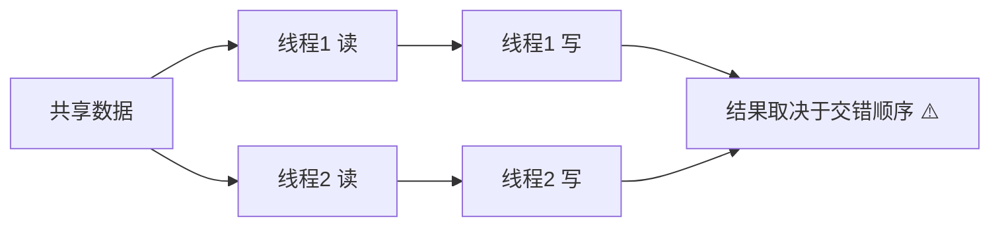
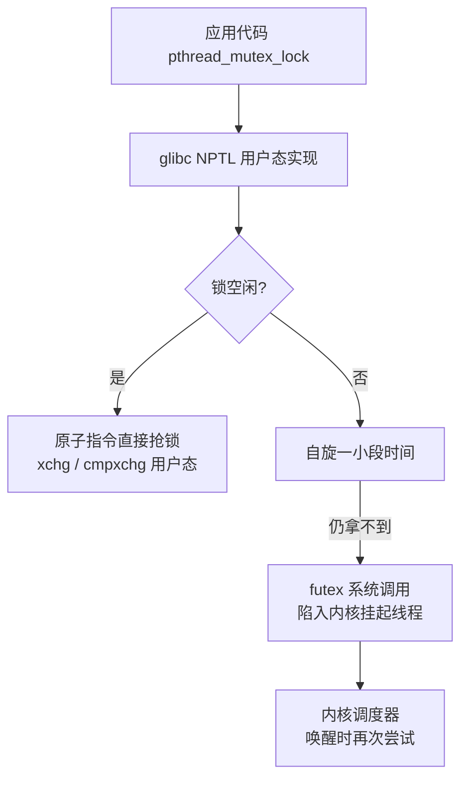

::: abstract 本章定位
本章回答同步问题的起点：两个执行单元并发访问共享数据为什么出错？什么是临界区（critical section）？一个正确的互斥方案要满足哪三个要求？以及软件（Peterson）与硬件（test_and_set / compare_and_swap）两条实现路径。理解本章，后面的信号量、管程都只是"包装好的互斥"。
:::

## 1. 竞态条件（Race Condition）

### 1.1 一个真实的错误

两个线程同时执行：

```c
int counter = 0;              // 共享全局变量
void worker(void *arg) {
    for (int i = 0; i < 100000; i++) counter++;   // 每个线程各加 10 万次
}
// 两个线程并行运行，期望结果是 200000，实际经常是 199987、199456……
```

`counter++` 在汇编层面是三条指令（**read-modify-write**）：

```
LOAD   counter -> 寄存器   # 读
ADD    1        -> 寄存器   # 改
STORE  寄存器   -> counter   # 写
```

两个线程交错执行时可能这样：

```
线程1: LOAD counter (=10)
线程2: LOAD counter (=10)      ← 读到同一旧值
线程1: ADD → 11
线程1: STORE counter=11
线程2: ADD → 11
线程2: STORE counter=11       ← 两次加法，最终只 +1！
```

### 1.2 定义

> **竞态条件（race condition）**：多个执行单元并发访问同一个共享数据，且**至少一个访问是写操作**，而结果取决于它们相互交错的相对时序——这样的场景就是竞态。其结果是不可预测、与调度时序相关的。



::: important 竞态的本质
竞态不是"代码写错了逻辑"，而是"**读-改-写三步在时间上被拆开**，两个线程的步骤互相穿插"。只要三条指令之间不发生抢占，结果就正确；一旦抢占，就可能错。因此同步的本质是：**让"读-改-写"在逻辑上成为一个不可分割的整体**。
:::

### 1.3 竞态一定发生吗？

不一定。它依赖：
- 是否多核并行（单核也会因**时钟中断 + 抢占**发生，只是概率不同）；
- 编译优化是否重排/合并指令；
- 机器负载。

所以**"跑一次没出错"不能证明代码正确**。竞态是概率性的，生产环境比开发环境更容易触发。

::: warning 编译器也会制造竞态
`gcc -O2` 可能把循环中的 `counter++` 合并或延迟写回寄存器，掩盖竞态。调试并发代码时必须用 `-O0` 复现、用真实负载验证。
:::

## 2. 临界区（Critical Section）

### 2.1 定义与结构

程序片段中**访问共享数据的那一段代码**叫临界区。正确做法是：每个线程进入临界区前**申请许可**（entry section），离开时**归还许可**（exit section），其余部分是 remainder section。

```
while (true) {
    entry section              // 进入区：申请进入临界区
        critical section       // 临界区：访问共享资源（互斥保护这一段）
    exit section               // 退出区：释放许可
        remainder section      // 剩余区：与共享资源无关的代码
}
```

### 2.2 临界区三要求（必须同时满足）

| 要求 | 含义 | 杜绝的问题 |
|---|---|---|
| **互斥**（Mutual Exclusion） | 任意时刻**最多一个**线程在临界区内 | 数据竞争（两个线程同时写） |
| **前进**（Progress） | 若临界区空闲，则**必须放行某个请求者**；且选择哪个请求者**不能无限拖延**（不能把同意权只给少数人） | 明明空闲却谁都不让进（忙等空转） |
| **有限等待**（Bounded Waiting） | 一个线程发出请求后，**保证在有限次放行内**能进入临界区 | 饥饿（starvation）：某个线程永远轮不到 |

::: tip 三要求的记忆
- 互斥 = "不能同时进"（安全）
- 前进 = "没人用就必须有人能用"（不空转）
- 有限等待 = "每个等待者都能在有限时间内进"（不饿死）

注意：三要求只约束"进入/退出临界区"的协议本身，默认忽略抢占后 CPU 的去向等实现细节。
:::

## 3. 软件方案：Peterson 算法

### 3.1 算法描述

Peterson 算法用于**两个线程（Pi 和 Pj）**互斥，只需要两个共享变量：

```c
// 共享变量
bool flag[2];      // flag[i] = true 表示线程 i 想进临界区
int turn;          // 表示"该谁让路"：轮到谁

// 线程 i 的协议
flag[i] = true;            // 1. 声明"我想进"
turn = j;                  // 2. 主动说"我让你先"（谦让）
while (flag[j] && turn == j) { /* 忙等待 */ }   // 3. 若对方也想进且该对方，就等
/* ---------- 临界区 ---------- */
flag[i] = false;           // 4. 释放
```

`turn` 只能有两个值（i 或 j）。**关键性质**：如果两个线程同时想进，`turn` 只会被赋为最后一个写它的人的值——即**至少有一个线程会看到 `turn` 不等于自己**，从而只有一个进入。

### 3.2 证明思路（不要求背，要求理解）

**互斥性（Mutual Exclusion）证明思路**：
假设 Pi 和 Pj 同时进入临界区。那么二者都通过了 while 条件：`flag[j] && turn == j` 对 Pi 不成立，且 `flag[i] && turn == i` 对 Pj 不成立。这意味着 `turn` 同时等于 i 和 j——矛盾。因此不可能同时进入。✅

**前进性（Progress）**：若只有一个线程想进（如 Pj 不想进），则 `flag[j]` 为 false，Pi 的 while 直接退出，必然能进。✅

**有限等待（Bounded Waiting）**：Pi 想进时，若 Pj 也在等，由于 `turn` 会被两个线程反复赋给对方，Pj 最多再进一次，Pi 就会等到 `turn == i`。✅

::: warning Peterson 的局限性
现代 CPU 有乱序执行（out-of-order execution）与多级缓存，纯 C 代码的"赋值顺序"不一定等于"实际执行顺序"。要真正可靠，必须配合内存屏障（memory barrier）。所以 Peterson 算法在教材里是**理论正确**，工程上由硬件原子指令替代——它的价值在于证明"**互斥可以只用内存读写做到**"。
:::

## 4. 硬件方案：原子指令

现代硬件提供**原子（atomic）**指令：一条指令内完成"读-改-写"，执行期间不可被抢占/拆开。

### 4.1 test_and_set（TS）

```c
// 语义：原子地返回 *target 的旧值，并把 *target 置为 true
bool test_and_set(bool *target) {
    bool old = *target;     // 读旧值
    *target = true;         // 写 true
    return old;             // 返回旧值
}
```

用 TS 实现互斥：

```c
bool lock = false;                 // false=空闲，true=被占用

void acquire() {
    while (test_and_set(&lock)) { /* 忙等待，直到拿到 */ }
}
void release() {
    lock = false;
}
```

**原理**：当 `lock` 为空闲（false）时，第一个执行 `test_and_set` 的线程得到 `old=false` 并退出循环，同时把 `lock` 置为 true。其他线程再执行 `test_and_set` 时 `old=true`，只能继续循环。这就是"**CAS 之前最经典的互斥锁内核**"。

### 4.2 compare_and_swap（CAS）

```c
// 语义：若 *ptr == expected，则把 *ptr 置为 new_value，返回 true；否则返回 false。
// 整个操作原子。
bool compare_and_swap(int *ptr, int expected, int new_value) {
    int old = *ptr;
    if (old == expected) *ptr = new_value;
    return old == expected;
}
```

用 CAS 实现互斥：

```c
int lock = 0;   // 0=空闲，1=占用

void acquire() {
    while (compare_and_swap(&lock, 0, 1)) { /* 等 */ }   // 注意：成功时返回 false（old==expected）
}
void release() {
    lock = 0;
}
```

::: tip CAS 与 TS 的关系
CAS 比 TS 更通用：TS 只能"把值设为 true 并取旧值"，CAS 可以"**期望某值时置新值**"。无锁编程（[现代同步原语与无锁编程](/kb/os/同步异步/05-现代同步原语与无锁编程/)）完全建立在 CAS 之上，它的核心用法是 `while (!compare_and_swap(&p, old, new));` 这种"乐观重试"循环。
:::

### 4.3 硬件的实现形态

- x86：`xchg`（原子交换）、`lock` 前缀指令（如 `lock cmpxchg`）——`lock` 前缀锁定内存总线/缓存行。
- ARM：`LDREX / STREX`（load-exclusive / store-exclusive 对）。
- RISC-V：`AMOSWAP` 等 AMO 指令。

```asm
# x86 上自旋锁的经典实现（示意）
lock:
    .zero 4
lock_try:
    mov  $1, %eax
    xchg %eax, lock      # xchg 在 x86 上原子
    test %eax, %eax
    jnz  lock_try        # 非零=没拿到，继续自旋
    ret
```

## 5. 锁的实现层次

从底到顶，同步原语的"实现栈"：



- **用户态快路径**：大多数时候锁竞争不激烈，一条原子指令就能拿到锁，不进内核。
- **内核态慢路径**：竞争激烈时，通过 `futex` 让线程睡眠，避免浪费 CPU。
- 这个设计思想在 [现代同步原语与无锁编程](/kb/os/同步异步/05-现代同步原语与无锁编程/) 的 futex 一节会详细展开。

::: important 核心结论
- 竞态 = 共享数据的"读-改-写"被并发拆开。
- 解决办法 = 把临界区包成"不可分割"的段，靠互斥实现。
- 互斥的最低层是硬件原子指令（TS/CAS），软件 Peterson 是"只用读写实现"的理论证明。
- 一切高级原语（信号量、mutex、条件变量）本质都是"原子指令 + 等待队列"的封装。
:::

## 6. Linux 工程映射

Linux 内核里"自旋锁"就是 TS/CAS 思想的直接工程实现：

- `include/linux/spinlock.h`：`spin_lock() / spin_unlock()`，临界区极短、进程不会被抢占时使用。
- `arch/x86/include/asm/cmpxchg.h`：`cmpxchg` 宏，直接映射到 `lock cmpxchg` 指令。
- 用户态 glibc 的 `pthread_mutex`：内部即"原子指令抢锁 → 失败则 futex 睡眠"两级结构。

```c
// Linux 内核自旋锁的最简等价（真实实现有 memory barrier + 排队优化）
static inline void spin_lock(volatile int *lock) {
    while (test_and_set(lock)) cpu_relax();   // cpu_relax() = pause/rep nop
}
```

工程上"忙等"对应的 CPU 指令是 `pause`（x86）/ `cpu_relax`，告诉处理器"我在自旋等待"，减少缓存冲突与功耗。

## 7. 常见误区

| 误区 | 正确理解 |
|---|---|
| "临界区 = 加锁的那几行代码" | 临界区是**访问共享资源**的代码段；加锁/解锁是它的进入区/退出区。只加锁但不访问共享资源是浪费，访问共享资源但不加锁才是错误 |
| "单核 CPU 不需要同步" | 单核也会因时钟中断导致线程切换，同样可能发生竞态；只是多核更容易复现 |
| "我测过没出错，所以是安全的" | 竞态是概率性的，与编译优化、CPU 乱序、负载有关。正确性必须靠协议保证，不能靠"运气" |
| "变量加 volatile 就安全" | `volatile` 只禁止编译器优化/重排，**不提供原子性**，也不能阻止 CPU 乱序。`counter++` 加 volatile 依旧竞态 |
| "Peterson 算法能直接用于现代机器" | 现代 CPU 乱序执行会让 Peterson 失效；它只是理论证明"互斥可只用读写做到" |

## 8. 本章小结

1. 竞态条件源于共享数据的"读-改-写"被并发拆开，结果依赖交错时序。
2. 临界区三要求：**互斥、前进、有限等待**——分别对应安全、不空转、不饿死。
3. 软件方案 Peterson 用两个 flag + 一个 turn 实现双线程互斥，可证明三要求，但依赖内存序。
4. 硬件方案 test_and_set / compare_and_swap 是真正的工程基础：一条原子指令完成"读-改-写"。
5. 现代锁 = 用户态原子指令快路径 + futex 内核慢路径，层层封装。

## 9. 自测题

1. **Q**：为什么两个线程各执行 100 次 `counter++`，期望 200，结果可能不到 200？
   **A**：`counter++` 是"读-改-写"三步，两个线程可能读到同一个旧值再各自写回，一次交错就丢一次更新（lost update）。

2. **Q**：临界区三要求分别杜绝什么问题？
   **A**：互斥→数据竞争；前进→临界区空闲却无人进入（空转）；有限等待→线程饥饿。

3. **Q**：Peterson 算法靠哪个变量解决"同时想进"的矛盾？为什么？
   **A**：靠 `turn`。两个线程都写 `turn = 对方`，最后一个写的决定放行谁，故至少有一个线程会被挡在临界区外，保证互斥。

4. **Q**：test_and_set 实现互斥时，为什么第一个拿到锁的线程能成功进入？
   **A**：`test_and_set` 原子地返回旧值并置 true。lock 初始 false，第一个线程得到 false 退出循环并把 lock 置 true；后续线程得到 true 只能自旋。

5. **Q**：CAS 在互斥锁里和在未来无锁编程里的用法有什么本质不同？
   **A**：互斥锁里 CAS 用于"抢/还一个锁变量"；无锁编程里 CAS 用于"乐观更新共享结构，失败则循环重试（LL/SC 循环）"。

6. **Q**：为什么说 Peterson 算法在现代 CPU 上可能失效？
   **A**：现代 CPU 会乱序执行，赋值顺序可能被重排，导致先 `flag[i]=true` 后 `turn=j` 的顺序颠倒。需要内存屏障才能保证。

7. **Q**：`volatile` 能消除竞态吗？为什么？
   **A**：不能。volatile 只防止编译器重排/缓存优化，既不保证原子性也不保证内存序，read-modify-write 依旧可分。

8. **Q**：x86 上实现原子操作主要靠什么？ARM 呢？
   **A**：x86 靠 `lock` 前缀指令（如 `lock cmpxchg`）与 `xchg`；ARM 靠 `LDREX/STREX` 独占加载/存储对。

下一篇：[信号量与同步原语](/kb/os/同步异步/02-信号量与同步原语/)，把"一个锁"升级为"一个计数器"。
