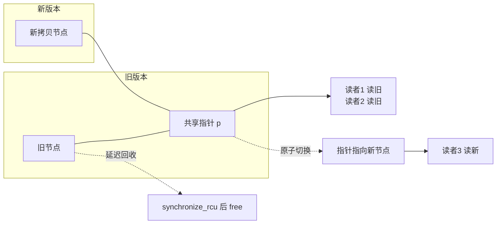

::: abstract 本章定位
锁太慢、锁会死锁、锁有优先级反转。现代系统于是走向"少用锁"甚至"无锁"：内存模型与原子操作（memory_order）、CAS 及其 ABA 问题、无锁数据结构、RCU（Read-Copy-Update）、futex、以及伪共享（false sharing）。本章是并发进阶篇，回答"当锁成为瓶颈时，CPU/内核如何绕开锁"。
:::

## 1. 内存模型与内存序

### 1.1 为什么"代码顺序"不等于"执行顺序"

编译器可能重排指令（优化），CPU 可能乱序执行（out-of-order），多核还有**各自独立的缓存**——于是"线程 A 先写了 x，再写了 y"，线程 B 看到的可能是"y 先变，x 后变"，甚至写操作"延迟"到缓存还没刷出去。

**内存模型**就是硬件+编译器给出的承诺：什么样的内存访问顺序是可见的、怎样保证有序。C11/C++11 标准定义了内存序（memory order）。

### 1.2 memory_order 分类

C11 `<stdatomic.h>` 提供几种内存序：

| memory_order | 含义 | 代价 |
|---|---|---|
| `memory_order_relaxed` | 只保证原子性，**不保证顺序** | 最低 |
| `memory_order_acquire` | 之后的读/写**不得重排到该原子读之前**（防止越过 acquire 向上漂移） | 中 |
| `memory_order_release` | 之前的读/写**不得重排到该原子写之后**（防止越过 release 向下漂移） | 中 |
| `memory_order_acq_rel` | 读用 acquire、写用 release（RMW 操作用） | 中 |
| `memory_order_seq_cst` | 全序（默认），所有线程看到全局一致的顺序 | 最高 |

### 1.3 acquire / release：无锁生产者-消费者的基石

```c
#include <stdatomic.h>

atomic_int data = 0;
atomic_int ready = 0;

// 生产者线程
data = 42;                       // 普通写
atomic_store_explicit(&ready, 1, memory_order_release);  // release 发布

// 消费者线程
while (atomic_load_explicit(&ready, 0, memory_order_acquire) == 0) { /* 等 */ }
printf("%d\n", data);            // 保证看到 42 —— acquire 拿到 release 之前的所有写
```

::: important 配对的语义
`release` 写与 `acquire` 读**同步**：一旦消费者 acquire 读到 1，就能**保证看到生产者 release 之前所有对内存的写**（包括 `data = 42`）。这是无锁编程正确性的根基：不用锁，但数据一致。
:::


## 2. 原子操作与 CAS（ABA 问题）

### 2.1 原子变量

```c
atomic_int cnt = ATOMIC_VAR_INIT(0);
atomic_fetch_add(&cnt, 1);   // 原子加，等价于"线程安全的 ++"
```

### 2.2 CAS 的用法与 ABA

`compare_and_swap(ptr, expected, new)`：仅当 `*ptr == expected` 时置为 new，全程原子。无锁数据结构的核心循环：

```c
int *node = head;                       // 读旧头
while (!compare_and_swap(&head, node, node->next)) {
    node = head;                        // 失败重读，乐观重试
}
```

**ABA 问题**：

```
线程1: 读取 head = A
       （被抢占）线程2: pop A → push A'  → head 又被改回 A
线程1: CAS(&head, A, ...) 成功 —— 但此时 head 已经不是"当初那个 A"
```

CAS 只比较**值**，不比较"身份"。值回到 A，不等于结构没变。

### 2.3 解决 ABA 的三种思路

| 方案 | 做法 | 例子 |
|---|---|---|
| **版本号 / 标记** | CAS 的"比较对象"从单个指针变成 (指针, 版本号) 对 | 64 位机器把高 16 位放 counter |
| **Hazard Pointer（危险指针）** | 读线程先登记"我正在用这个节点"，避免被并发回收 | 通用无锁内存回收 |
| **RCU 的延迟回收** | 旧版本节点不立即释放，等所有读者离开后再回收 | Linux RCU |

::: tip 一句话记 ABA
CAS 只看"长啥样"，不看"是不是同一个"。**加版本号**是最简单可靠的防御：每次改动都让版本号+1，值相同但版本不同就 CAS 失败。
:::

## 3. 无锁数据结构

### 3.1 无锁栈（Treiber Stack）

```c
// 无锁 push / pop 的核心思路（伪代码）
void push(int v) {
    node_t *n = new_node(v);
    do {
        n->next = top;                       // 读当前栈顶
    } while (!compare_and_swap(&top, n->next, n));  // CAS 发布
}

int pop(void) {
    node_t *n;
    do {
        n = top;
        if (n == NULL) return EMPTY;
    } while (!compare_and_swap(&top, n, n->next));  // 需防 ABA
    return n->val;
}
```

**特点**：
- 无锁（lock-free）：有线程持锁可能无限等待；CAS 循环里总有人能成功推进（progress 保证）。
- 代价：ABA、内存回收（节点被 pop 后可能被其他线程仍引用）、cache line 竞争。

### 3.2 无锁队列（Michael-Scott）思路

- 维护头/尾两个原子指针，通过 CAS 更新。
- 在队尾 CAS 插入节点；在队头 CAS 出队。
- 需要**处理尾指针与头指针竞争**（dummy node 技巧：永远保留一个哨兵节点，简化边界）。

::: warning 无锁 ≠ 更快
无锁代码在**低竞争**下比加锁快（没有 syscall、没有睡眠），但在**高竞争**下所有线程疯狂 CAS 重试，开销反而超过一把 mutex。而且无锁代码极难写对（ABA、内存序、内存回收）。工程铁律：**默认用锁，只有在 profiling 证明锁是瓶颈后才考虑无锁**。
:::

### 3.3 什么时候值得无锁

| 场景 | 结论 |
|---|---|
| 单写多读（如计数器、序列号） | 非常适合，`atomic_fetch_add` 即可 |
| 读多写少、读路径极热 | RCU 比无锁队列更合适 |
| 多写多读的复杂结构 | 难度极高，先考虑分片（sharded mutex） |
| 临界区本来就很短 | 锁就够了，别折腾 |

## 4. RCU（Read-Copy-Update）

### 4.1 原理

RCU 让**读者完全不加锁**，写者通过"拷贝-修改-发布-延迟回收"完成更新：

```
读者路径（无任何锁）:
    rcu_read_lock();          // 实质是禁抢占/标记，极廉价
    p = read_ptr;
    /* 直接用 p 读数据，无需锁 */
    rcu_read_unlock();

写者路径:
    new = copy(old);          // 1. 拷贝一份
    modify(new);              // 2. 修改拷贝
    rcu_assign_pointer(p, new); // 3. 原子发布（写者改指针）
    synchronize_rcu();        // 4. 等所有读者离开旧版本
    free(old);                // 5. 之后才能安全回收旧节点
```



### 4.2 为什么读路径能无锁

- 读者只读指针指向的不可变数据，**从不修改旧数据**。
- 写者改动的是"拷贝"，发布是原子的**指针替换**，读者要么看到旧指针要么看到新指针，绝无中间态。
- 旧节点在**所有读者离开后才释放**（grace period），所以不存在 use-after-free。

### 4.3 适用场景

| 场景 | 是否适合 |
|---|---|
| 读多写少、读路径极热（如路由表、链表遍历） | ✅ 首选 |
| 写频繁 | ❌ 拷贝成本高 |
| 延迟敏感、不允许读路径被阻塞 | ✅ 读者无锁零阻塞 |
| 需要写操作立刻生效 | ✅（指针原子替换即时生效） |

::: tip Linux 中的 RCU
Linux 内核在**网络协议栈路由表、文件系统 dentry/dcache、进程表（pidhash 等）**大量使用 RCU。用户态没有现成 RCU，通常用"读写锁 + 延迟回收"模拟，或直接使用无锁数据结构。
:::

## 5. Linux futex

### 5.1 问题

用户态锁如果每次都进内核（syscall）会非常慢（上下文切换约 1µs 级）。futex（fast userspace mutex）的思想：**在用户态用原子指令抢锁；抢不到才进内核睡眠/唤醒**。

### 5.2 工作流程

```
pthread_mutex_lock():
    atomic try_lock           # 用户态，一次 CAS
        └─ 成功 → 返回（零系统调用，纳秒级）
        └─ 失败 → futex(WAIT)  # 进内核：挂起线程加入等待队列
pthread_mutex_unlock():
    atomic unlock
    futex(WAKE)                # 有等待者才进内核唤醒
```

### 5.3 用 strace 验证

```bash
strace -f -e trace=futex ./pc_mon 2>&1 | grep futex | head -5
# futex(0x7f... , FUTEX_WAIT ...)     ← 锁竞争激烈时的慢路径
# futex(0x7f... , FUTEX_WAKE ...)     ← 唤醒
# 注意：无竞争的锁根本不会出现 futex —— 全在用户态原子完成
```

::: important futex 的意义
futex 把"锁"的成本从"每次 syscall"降到"只在竞争时才 syscall"。这就是为什么现代 `pthread_mutex` 在无竞争时只需要几十纳秒。它也是 [自旋锁 vs 阻塞锁](/kb/os/同步异步/02-信号量与同步原语/) 的现代融合：用户态先自旋，再内核算等待。
:::

## 6. 伪共享（False Sharing）

### 6.1 问题

CPU 缓存以 **cache line**（通常 64 字节）为粒度。两个变量若落在**同一条 cache line**，即使它们逻辑上毫不相关，一个核修改也会使另一个核的该行**失效（invalidate）**，导致"无意义的缓存同步"。

```c
// 经典伪共享案例
struct {
    long a;    // 线程1 只碰 a
    long b;    // 线程2 只碰 b
} shared;      // a 和 b 大概率同一条 cache line！

// 线程1 疯狂 ++shared.a；线程2 疯狂 ++shared.b
// 两者互相使对方的 cache line 失效 → 性能暴跌（可慢数十倍）
```

### 6.2 解决办法：padding 隔离

```c
struct {
    long a;
    char pad[64 - sizeof(long)];   // 用 padding 把 a 顶到独立 cache line
};
// 或直接用 __attribute__((aligned(64))) / alignas(64) / CACHELINE_PADDING
```

```c
// Linux 内核的做法
struct __aligned(64) per_cpu_counter {
    long count;
};
// 每 CPU 变量天然错开，避免伪共享
```

### 6.3 用性能测试观察

```bash
# false_sharing.c: 两个线程分别 ++a / ++b
gcc -O2 -pthread false_sharing.c -o fs && time ./fs
# 对比 padding 版本（-DPAD），时间可能快数倍
gcc -O2 -pthread -DPAD false_sharing.c -o fs_pad && time ./fs_pad
```

::: warning 伪共享的两个误区
1. 不是"逻辑共享"，是**物理缓存行共享**——变量之间无依赖也可能互相拖慢。
2. 修法不是加锁（这里根本没有共享数据），而是 **padding 或每 CPU 变量**，让每个热变量独占 cache line。
:::

## 7. 与死锁的关联

锁用得不对就死锁，无锁技术并不能消除死锁——它只是**减少使用锁**。要点：

- 无锁循环是"乐观重试"，不会持锁等待，天然**不会形成"持有并等待"的死锁**，但可能**活锁（livelock）**：大家都在 CAS 重试，谁也无法推进。
- 死锁分析仍适用于所有"还保留锁"的路径（如 RCU 写路径、futex 快路径失败后的加锁回退）。
- 锁排序错误、优先级反转、饥饿等问题，在无锁世界里变成"公平性/活锁"问题，依然要设计。

> 死锁四条件与死锁处理见 [死锁](/kb/os/死锁/01-死锁特征与必要条件/)。

## 8. 常见误区

| 误区 | 正确理解 |
|---|---|
| "无锁 = 更快" | 只对低竞争成立；高竞争时 CAS 重试风暴比 mutex 更贵 |
| "CAS 足够保证正确" | 还要处理 ABA、内存序、内存回收（hazard pointer/RCU） |
| "volatile/原子变量随便用" | 原子性 ≠ 有序性；顺序问题要显式 acquire/release |
| "RCU 能替代所有锁" | 只适合读多写少；写频繁时拷贝代价巨大 |
| "伪共享是数据竞争" | 不是竞争，是缓存行物理共享；修法是 padding 而非加锁 |
| "futex 是无锁的" | futex 快路径无锁，慢路径仍是内核阻塞；它是"锁的优化"不是"无锁" |

## 9. 本章小结

1. 内存模型决定"看到什么顺序"；`acquire/release` 是无锁编程正确性的契约。
2. CAS 是无锁的原子基石，但要防 **ABA**：版本号 / hazard pointer / 延迟回收。
3. 无锁数据结构（Treiber 栈、Michael-Scott 队列）用 CAS 循环推进，难度高、收益场景窄。
4. **RCU** 让读者无锁、写者拷贝+原子发布+延迟回收，是 Linux 内核读多写少场景的主力。
5. **futex** 让锁只在竞争时进内核，是现代 mutex 快慢两级的实现。
6. **伪共享** 是缓存层的隐形性能杀手，用 padding / per-CPU 变量解决。
7. 无锁不消除死锁，只是把它转化为活锁/公平性问题。

## 10. 自测题

1. **Q**：`memory_order_acquire` 保证什么？
   **A**：该原子读之后的读写不能被重排到它之前，从而与配对的 `release` 写建立同步，能看到其之前的所有写。

2. **Q**：ABA 问题是什么？三种解法？
   **A**：CAS 只比数值，值回到原样但结构已变导致误判。解法：版本号（CAS 比较带版本的复合值）、hazard pointer（登记在用节点）、RCU 延迟回收。

3. **Q**：无锁栈的 push 为什么用 do-while CAS？
   **A**：读栈顶→CAS 发布必须循环：若 CAS 失败（其他人改了栈顶）就重读重试，保证总有一次成功推进（lock-free 性质）。

4. **Q**：RCU 为什么读者能无锁？
   **A**：读者只读不可变旧数据；写者改拷贝并原子替换指针；旧节点等所有读者离开（grace period）后才回收，故无 use-after-free。

5. **Q**：RCU 适合什么场景？
   **A**：读多写少、读路径极热、读不可阻塞（如 Linux 路由表、dentry 缓存）。写频繁时不合适。

6. **Q**：futex 如何避免每次加锁都进内核？
   **A**：先用户态原子尝试，成功则零 syscall；失败才 `futex(WAIT/WAKE)` 进内核睡眠/唤醒，把 syscall 成本降到只有竞争时发生。

7. **Q**：伪共享为什么慢？怎么修？
   **A**：两个热变量落在同一条 cache line，互改对方导致缓存行频繁失效。修法：padding/`aligned(64)` 让热变量独占缓存行，或每 CPU 变量。

8. **Q**：无锁编程能彻底摆脱死锁吗？
   **A**：能避免"持有并等待"型死锁，但可能引入活锁；且保留锁的路径仍需死锁分析。无锁是"少锁"而非"无死锁"。

（进阶方向：结合 [死锁](/kb/os/死锁/01-死锁特征与必要条件/) 对比死锁与活锁；回到 [学习路线](/kb/os/同步异步/00-同步与异步学习路线/) 查漏补缺。）
