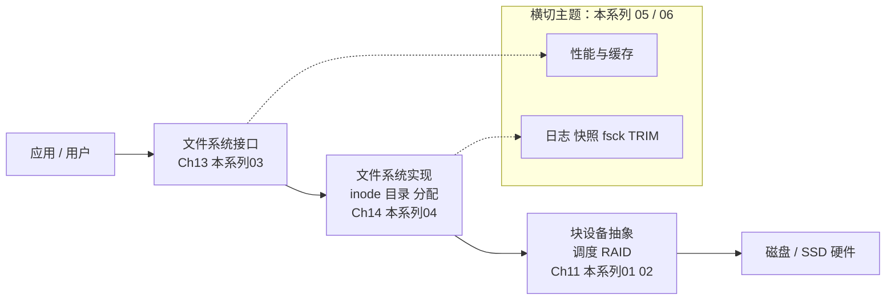

::: abstract 本章定位
存储与文件系统回答一个核心问题：**数据如何被持久化**。本系列基于《Operating System Concepts》第 9 版 Ch11（Mass-Storage Structure）、Ch13-15（File System），从磁盘物理结构讲起，经过调度算法、RAID、文件系统接口与实现，最后落到可靠性、日志与 Linux 工程实践。目标不是复述教材目录，而是把磁盘、调度、RAID、文件系统、可靠性这五件事真正讲透。
:::

内存是"易失的"（断电即失），磁盘/SSD 是"持久的"（断电仍在）。操作系统要处理两者的速度差（内存纳秒级、磁盘毫秒级）和语义差（内存按字节、磁盘按块），于是有了存储抽象的三层答案：**块设备层**负责"怎么把数据放上磁盘"（调度、RAID），**文件系统层**负责"怎么把磁盘组织成文件"（目录、inode、分配），**可靠性层**负责"崩溃之后数据还在不在"（日志、快照、fsck）。

## 1. 主题地图

| 篇目 | 回答的问题 | 核心概念 | Linux 观察点 |
|---|---|---|---|
| [磁盘结构与大容量存储](/kb/os/存储/01-磁盘结构与大容量存储/) | 磁盘物理上长什么样？HDD 和 SSD 差在哪？ | 盘面/磁道/扇区/柱面、寻道/旋转/传输、HDD vs SSD、RAID 0/1/5/6/10、SATA/SAS/NVMe、存储层级 | `lsblk -o NAME,TRAN,ROTA`、`df -h` |
| [磁盘调度算法与RAID](/kb/os/存储/02-磁盘调度算法与RAID/) | 磁头怎么移动才能最快服务请求？ | FCFS/SSTF/SCAN/C-SCAN/LOOK/C-LOOK、寻道距离计算、SSD 磨损均衡、CFQ/Deadline/noop/BFQ | `cat /sys/block/sda/queue/scheduler` |
| [文件系统接口与目录结构](/kb/os/存储/03-文件系统接口与目录结构/) | 文件对用户长什么样？怎么组织？ | 文件属性、open/read/write/seek、访问方法、目录层级、mount、硬链接 vs 软链接、chmod/chown | `stat`、`ln -s`、`ls -li`、`mount` |
| [文件系统实现](/kb/os/存储/04-文件系统实现/) | 文件系统的"骨架"怎么搭起来的？ | 文件系统 5 层、inode 与间接指针、目录项、空闲空间位图、连续/链接/FAT/索引分配、ext4 布局 | `filefrag`、`dumpe2fs` |
| [文件系统性能与空间管理](/kb/os/存储/05-文件系统性能与空间管理/) | 文件系统怎么做得又快又不浪费？ | 块大小权衡、页缓存/双缓冲/统一缓冲、read-ahead、mmap、磁盘配额、快照备份、RAID+FS | `free`、`cat /proc/meminfo`、`quota`、`dd` |
| [文件系统可靠性与日志](/kb/os/存储/06-文件系统可靠性与日志/) | 断电/崩溃后数据为什么还在？ | 一致性问题、journaling（writeback/ordered/data）、LFS、ZFS/Btrfs COW、fsck、TRIM、NFS | `dmesg`、`fsck`、`mount -o data=ordered` |

## 2. 推荐学习顺序

### 2.1 零基础完整路线（推荐）

1. **先建硬件直觉**：[磁盘结构与大容量存储](/kb/os/存储/01-磁盘结构与大容量存储/)——磁盘是"转动的盘 + 移动的磁头"，所有调度问题的根源都在这。
2. **再学调度策略**：[磁盘调度算法与RAID](/kb/os/存储/02-磁盘调度算法与RAID/)——SCAN/C-SCAN 手算是面试必考，RAID 是生产环境的标配。
3. **认识文件接口**：[文件系统接口与目录结构](/kb/os/存储/03-文件系统接口与目录结构/)——文件、目录、链接、权限，用户每天打交道的就是这一层。
4. **深入文件系统内部**：[文件系统实现](/kb/os/存储/04-文件系统实现/)——inode、间接指针、空闲空间、ext4 布局，回答"文件到底存在哪"。
5. **性能视角**：[文件系统性能与空间管理](/kb/os/存储/05-文件系统性能与空间管理/)——页缓存、read-ahead、配额、快照。
6. **可靠性收尾**：[文件系统可靠性与日志](/kb/os/存储/06-文件系统可靠性与日志/)——日志文件系统、COW、fsck，回答"为什么崩溃后数据还在"。

::: tip 两条主线
- **按"自底向上"读**（磁盘 → 调度 → 接口 → 实现 → 性能 → 可靠性）：建立完整因果链，适合打基础，是本系列默认顺序。
- **按"应用倒查"读**（接口 → 实现 → 磁盘）：从 `stat`/`ls -li` 这些日常命令出发，逆向追到磁盘，适合面试冲刺。
:::

### 2.2 面试速成路线

1. [磁盘调度算法与RAID](/kb/os/存储/02-磁盘调度算法与RAID/)——SCAN/C-SCAN/LOOK/C-LOOK 手算（最常考）。
2. [文件系统接口与目录结构](/kb/os/存储/03-文件系统接口与目录结构/)——硬链接 vs 软链接、访问方法。
3. [文件系统实现](/kb/os/存储/04-文件系统实现/)——inode 与最大文件大小计算、连续/索引分配对比。
4. [磁盘结构与大容量存储](/kb/os/存储/01-磁盘结构与大容量存储/)——容量计算、HDD vs SSD、RAID 容错。
5. [文件系统可靠性与日志](/kb/os/存储/06-文件系统可靠性与日志/)——journaling 三种模式、为什么崩溃后数据还在。

### 2.3 跨目录联动

- 磁盘调度与块层 IO 调度：[IO 性能优化](/kb/os/IO/05-IO路径与性能优化/)
- 缓冲/缓存与页缓存：[IO子系统](/kb/os/IO/03-内核IO子系统与缓冲/)
- 内存映射文件与虚拟内存：[内存](/kb/os/内存/06-内存性能与系统调优/)
- Linux 命令实操：[Linux](/kb/os/Linux/03-Linux文件系统与磁盘实操/)

## 3. 每篇一句话介绍

- [磁盘结构与大容量存储](/kb/os/存储/01-磁盘结构与大容量存储/)：磁盘是"可寻址的块序列"，容量取决于磁道×扇区×字节数，HDD 靠机械转动、SSD 靠闪存，RAID 用多块盘换速度或安全。
- [磁盘调度算法与RAID](/kb/os/存储/02-磁盘调度算法与RAID/)：磁头移动是最贵的操作，调度算法按"减少总寻道距离"排队，SCAN/C-SCAN 用"电梯"思想让每次请求等待都有限。
- [文件系统接口与目录结构](/kb/os/存储/03-文件系统接口与目录结构/)：文件是"字节流的容器"，目录把文件组织成树，硬链接共享 inode、软链接存路径，权限用 rwx 八进制表达。
- [文件系统实现](/kb/os/存储/04-文件系统实现/)：文件系统用 inode 存元数据与数据块指针，用位图管空闲块，用不同分配方式换性能与碎片之间的平衡。
- [文件系统性能与空间管理](/kb/os/存储/05-文件系统性能与空间管理/)：块大则碎片多、块小则寻道多，页缓存让读秒回、read-ahead 让顺序读起飞，配额与快照是管理者的工具。
- [文件系统可靠性与日志](/kb/os/存储/06-文件系统可靠性与日志/)：崩溃会在元数据与数据之间造成不一致，journaling 用"先写日志再落盘"保证可恢复，COW 文件系统用副本免去覆盖风险。

## 4. 实验清单

::: important 建议全程在一台 Linux 环境（本机 / WSL2 / 虚拟机）执行，每个概念都要"看到"才算学会。格式化与 mount 实验请在**专门的试验磁盘/分区**上进行，避免损坏系统盘。
:::

| 实验 | 命令 | 验证的概念 | 对应篇目 |
|---|---|---|---|
| 列出块设备 | `lsblk -o NAME,SIZE,TYPE,TRAN,ROTA` | 块设备、HDD/SSD（ROTA=1 机械盘） | 01 |
| 查看磁盘分区 | `sudo fdisk -l /dev/sda` | 分区表、CHS、扇区大小 | 01 |
| 查看容量与使用 | `df -h`、`df -i` | 块使用率、inode 使用率 | 04 |
| 查看目录占用 | `du -sh ~`、`du -h --max-depth=1` | 块级空间统计 | 01/04 |
| 查看文件元数据 | `stat /etc/passwd` | inode、权限、时间戳 | 03/04 |
| 查看文件碎片 | `filefrag -v <大文件>` | extent、文件物理块分布 | 04 |
| 硬链接 vs 软链接 | `ln f hlink`、`ln -s f slink`、`ls -li` | inode 共享 vs 路径存储 | 03 |
| 观察调度器 | `cat /sys/block/sda/queue/scheduler` | io scheduler（none/mq-deadline/bfq） | 02 |
| 格式化实验盘 | `sudo mkfs.ext4 /dev/sdb1` | 文件系统创建、超级块/块组 | 04 |
| 挂载与卸载 | `sudo mount /dev/sdb1 /mnt`、`umount` | mount、挂载点 | 03 |
| 看挂载表 | `mount`、`cat /proc/mounts`、`blkid` | 文件系统类型、UUID | 03 |
| 追踪文件事件 | `inotifywait -m /tmp` | inotify 文件监控 | 03 |
| 模拟 IO | `dd if=/dev/zero of=/tmp/t bs=1M count=1024 conv=fsync` | 写吞吐、页缓存 | 05 |
| 查看页缓存 | `free -h`、`cat /proc/meminfo`、`vmtouch` | page cache 命中 | 05 |
| 查看日志模式 | `tune2fs -l /dev/sdb1 \| grep journal` | journal、data 模式 | 06 |
| 查看内核对设备输出 | `dmesg \| grep -i sda` | 块设备初始化、调度器 | 02 |

**安全提示**：`mkfs`、`mount`、`fdisk` 只对专门的实验盘执行；`dd` 使用普通文件，不要整盘覆盖；`fsck` 只能在未挂载的文件系统上运行。

## 5. 常见面试考点清单

- 磁盘容量计算公式：容量 = 盘面数 × 每面磁道数 × 每道扇区数 × 每扇区字节数（01）
- 磁盘访问时间 = 寻道时间 + 旋转延迟 + 传输时间，随机访问为什么慢（01）
- HDD vs SSD：随机 IOPS 差几个数量级，为什么（01）
- RAID 0/1/5/6/10 各自的容量、容错、最小盘数（01）
- **磁盘调度算法手算**：FCFS/SSTF/SCAN/C-SCAN/LOOK/C-LOOK 的总寻道距离（02）
- SSTF 为什么可能饥饿；SCAN/C-SCAN 为什么等待更均匀（02）
- SSD 还需要磁盘调度算法吗？磨损均衡是什么（02）
- 硬链接 vs 软链接：inode 共享 vs 路径存储，跨文件系统为什么不能硬链接（03）
- 顺序访问 vs 直接访问 vs 索引访问（03）
- 目录树、无环图、通用图目录的异同与循环问题（03）
- **inode 最大文件大小计算**：直接 + 单间接 + 双间接 + 三间接（04）
- 连续/链接/索引分配对比：随机访问、碎片、扩容（04）
- 空闲空间管理：位图 vs 链表（04）
- ext4 块组结构与超级块的作用（04）
- 块大小权衡：内部碎片 vs 顺序读性能（05）
- 页缓存与 read-ahead 为什么让顺序读快、随机读慢（05）
- mmap 与普通 read/write 的区别（05）
- 磁盘配额如何实现（05）
- **journaling 三种模式**：writeback/ordered/data 的取舍（06）
- 为什么崩溃后 ext4 能快速恢复，fsck 在干什么（06）
- SSD 为什么要 TRIM、不 TRIM 会怎样（06）
- LFS/ZFS COW 的设计动机（06）

## 6. 学习完成标准

学完本系列，应能回答：

- 一次 `read()` 从应用层到磁盘，经过了文件系统哪些层、磁盘上发生了什么？
- 为什么"旋转延迟"是随机 IO 的主要敌人？SSD 为什么没有这个问题？
- 给定磁道队列，能手算出六个调度算法的服务顺序与总寻道距离。
- RAID 5 和 RAID 10 在容错与性能上怎么选？
- 一个文件在磁盘上由哪些结构组成？inode、目录项、数据块各存什么？
- 崩溃在"写了一半"时发生，文件系统如何保证元数据与数据一致？
- 数据库为什么常说"用顺序 IO 不要用随机 IO"？从磁盘到文件系统到页缓存逐层解释。

从 [磁盘结构与大容量存储](/kb/os/存储/01-磁盘结构与大容量存储/) 开始。
