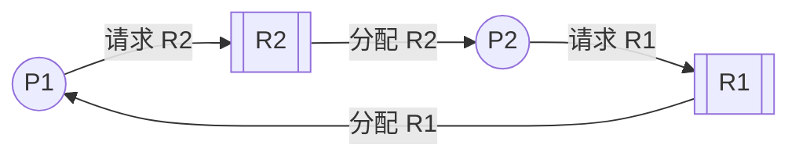
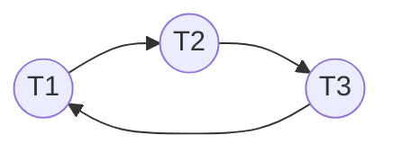

::: abstract 本章定位
资源分配图（Resource-Allocation Graph，RAG）是把系统状态画成图的工具，是"判断当前是否死锁"的直觉化方法。本章掌握两条核心判定：**无环必无死锁；单实例资源下"有环 ⇔ 死锁"，多实例资源下"有环"还需进一步分析**。
:::

## 1. 资源分配图（RAG）的定义

一张 RAG 由**两类节点**和**两类有向边**组成。

### 1.1 节点

| 节点 | 图形 | 含义 |
|---|---|---|
| 进程 | 圆圈 `Pᵢ` | 系统中的进程 |
| 资源类型 | 方框 `Rⱼ` | 一类资源；方框内的小圆点表示该类资源的**实例**（instance）个数 |

```
    P1          R2（2个实例）
   ( ○ )      [ ● ● ]
```

### 1.2 边

| 边 | 画法 | 含义 |
|---|---|---|
| **请求边（request edge）** | 进程 → 资源：`Pᵢ ──► Rⱼ` | Pᵢ 正在等待 Rⱼ 的一个实例 |
| **分配边（assignment edge）** | 资源 → 进程：`Rⱼ ──► Pᵢ` | Rⱼ 的一个实例已经分配给了 Pᵢ |

::: important 关键细节
- 请求边指向**资源方框**（该类的任意一个实例都行）。
- 分配边必须指向**具体的某个实例**（即方框内的一个小圆点）——这决定了判断时要知道"哪几个实例在谁手里"。
- 如果一个进程持有资源 R 又请求资源 S，图上会同时出现 `R→P` 和 `P→S` 两条边。
:::

## 2. 用图判断死锁的判定定理

### 2.1 两条核心结论

**定理 A：无环必无死锁。**
如果图中不存在有向环，系统当前必然没有死锁（必要不充分，安全）。

**定理 B：单实例资源下，有环 ⇔ 死锁。**
如果**每类资源恰好只有一个实例**，那么图中存在环**当且仅当**存在死锁。

**定理 C：多实例资源下，有环不必然死锁。**
如果某些资源有多于一个实例，存在环**只是死锁的必要条件**，还需进一步判断环内的请求能否被环外的空闲实例满足。

::: warning 面试高频坑
教材原话："如果图中没有环，就没有死锁；如果每类资源只有一个实例，那么有环就意味着死锁。" 千万不能记成"有环就一定死锁"——**多实例资源下环可能被空闲实例打破**。
:::

### 2.2 为什么多实例时"有环"可能不死锁

直觉：环上的进程虽然互相等，但环内某条请求边指向的资源类型可能**还有空闲实例**。只要有空闲实例，请求方就能立刻得到资源、继续运行、随后释放资源，环自然被打破。只有当环上每个请求都"撞上"已全部占用的资源、没有任何空闲实例可救场时，才会真正死锁。

### 2.3 判定算法（多实例时的精确做法）

对多实例资源，用"**归约（reduction）**"判断，思路和[死锁避免与银行家算法](/kb/os/死锁/04-死锁避免与银行家算法/)的安全算法一致：

1. 找出"请求能被当前空闲资源满足"的进程 P；
2. 假定 P 运行完成并释放其全部资源（把分配边全部收回为可用实例）；
3. 重复，直到找不出这样的进程；
4. 若最终所有进程都能被归约，则无死锁；若还有进程无法归约（互相等着无法满足的请求），则它们处于死锁状态。

```text
repeat:
    for each process P:
        if P 的所有请求 <= 当前可用实例:
            释放 P 的所有实例
            break
    until 没有进程可归约
如果所有进程都被归约 → 无死锁
否则剩下的进程 → 死锁
```

## 3. 一个完整的判定例子

### 3.1 例一：单实例死锁（有环 ⇔ 死锁）

系统里有 P1、P2 两个进程，R1、R2 各 1 个实例：

```text
   ┌─────────┐
   ▼         │
  P1        P2
   ▲         ▼
   │ ┌───┐   │
   └─┤ R2 ├──┘      ← P2 持有 R2，P1 请求 R2
     └───┘
   P1 持有 R1（R1→P1），P2 请求 R1（P2→R1）
```

整理成请求/分配表：

| 进程 | 持有 | 请求 |
|---|---|---|
| P1 | R1 | R2 |
| P2 | R2 | R1 |

判定：
- 存在环 `P1 → R2 → P2 → R1 → P1`；
- R1、R2 都是单实例，环内请求全部撞上已占资源，无空闲实例；
- 结论：**死锁**。

环的完整 ASCII 画法（箭头上方是边类型，注意分配边方向为资源→进程）：

```
   请求           分配           请求           分配
P1 ───────► R2 ───────► P2 ───────► R1 ───────► P1
```

- 第 1 段 `P1 → R2`：请求边，P1 等 R2；
- 第 2 段 `R2 → P2`：分配边，R2 在 P2 手里；
- 第 3 段 `P2 → R1`：请求边，P2 等 R1；
- 第 4 段 `R1 → P1`：分配边，R1 在 P1 手里。

首尾相接成环 `P1 → R2 → P2 → R1 → P1`。请务必记住：**请求边是进程→资源，分配边是资源→进程**，别被边的方向搞混。

**用 mermaid 表示单实例死锁环（方向：进程→资源为请求，资源→进程为分配）：**



### 3.2 例二：多实例资源，有环但不死锁

系统：R1、R2 各 **2 个实例**，只有 P1、P2 两个进程。

- P1 持有 R2 的 1 个实例，请求 R1；
- P2 持有 R1 的 1 个实例，请求 R2。

环的链式画法（P1 请求 R1、R1 分配给 P2、P2 请求 R2、R2 分配给 P1，首尾成环）：

```text
   请求           分配           请求           分配
P1 ───────► R1 ───────► P2 ───────► R2 ───────► P1
  (P1等R1)    (R1给P2)    (P2等R2)    (R2给P1)
```

资源占用情况：

| 资源 | 实例总数 | 已被占用 | 空闲 |
|---|---|---|---|
| R1 | 2 | P2 占用 1 | **1 个空闲** |
| R2 | 2 | P1 占用 1 | **1 个空闲** |

判定：
- 图中确实存在环 `P1 → R1 → P2 → R2 → P1`；
- 但 **R1 和 R2 各有 1 个空闲实例**：P1 的请求 R1 可立即被空闲实例满足 → P1 运行完释放 R2 → P2 拿到 R2 → 全部完成；
- 结论：**有环，但不是死锁**。这就是"多实例下环不必然死锁"的经典反例。

### 3.3 例三：多实例死锁（环内请求全部撞上已占实例）

把上面的例子改成 R1、R2 的实例被占满：

- P1 持有 R1 第 1 个实例 + R2 第 1 个实例，请求 R2；
- P2 持有 R2 第 2 个实例，请求 R1；

```text
资源占用：
  R1: 2 实例 → P1 占 1，空闲 1
  R2: 2 实例 → P1 占 1、P2 占 1，空闲 0
```

- P2 请求 R1 → R1 有 1 个空闲实例 → 可以满足 → P2 运行 → 释放 R2 → P1 拿到 R2 → 不死锁。
- 结论：虽然 P1 等 R2、P2 等 R1，但 R1 有空闲实例救场，不构成死锁。

若再让 R1 也占满（比如 P1 持有 R1 和 R2 各 1 个，P2 持有 R1 的另 1 个，P2 请求 R2），则环内两个请求都撞上"零空闲"资源，**死锁成立**。

::: tip 记忆口诀
单实例：有环即死锁；多实例：环内每个请求所指向的资源都"零空闲"才死锁。
:::

## 4. wait-for graph：只画等待关系的简化版

现实系统（尤其数据库、锁表）里，资源往往是"同一个类型、多实例"（如行锁），直接画 RAG 太啰嗦。更常用的是 **wait-for graph（等待图）**：

- 节点 = 进程（线程、事务）；
- 边 = `Tᵢ → Tⱼ` 表示 **Tᵢ 正在等 Tⱼ 释放资源**；
- 判定：**等待图有环 ⇔ 死锁**（wait-for graph 的定义确保边只表示"等谁"，环即死锁）。



上面的等待图 T1→T2→T3→T1 成环，直接判死锁。wait-for graph 是[死锁实战与内核实现](/kb/os/死锁/05-死锁实战与内核实现/)中数据库/OS 死锁检测的实际数据结构。

## 5. 数据库死锁例子：从 RAG 到真实场景

用 MySQL InnoDB 的经典死锁串一遍：

```sql
-- 会话 A
UPDATE t SET v=v+1 WHERE id=1;   -- 持有第 1 行的行锁
UPDATE t SET v=v+1 WHERE id=2;   -- 等待 B 释放第 2 行

-- 会话 B
UPDATE t SET v=v+1 WHERE id=2;   -- 持有第 2 行的行锁
UPDATE t SET v=v+1 WHERE id=1;   -- 等待 A 释放第 1 行
```

映射成 wait-for graph：

```text
会话A: 持有行1，请求行2
会话B: 持有行2，请求行1
等待图: A ──► B   (A 等 B 的第 2 行)
        B ──► A   (B 等 A 的第 1 行)
有环 → 死锁
```

InnoDB 会**主动检测**到这个环，选择代价较小的事务回滚并抛出：

```
ERROR 1213 (40001): Deadlock found when trying to get lock; try restarting transaction
```

::: note 为什么数据库"必须"检测死锁
因为数据库的锁请求是动态的、无法预先知道事务要更新的全部行，没法用[死锁避免与银行家算法](/kb/os/死锁/04-死锁避免与银行家算法/)，只能事后检测 + 回滚牺牲者。`SHOW ENGINE INNODB STATUS\G` 的 `LATEST DETECTED DEADLOCK` 段就是 wait-for graph 的证据。
:::

## 6. 本章小结

资源分配图把"谁持有、谁在等"变成一张可判定的图：**无环 → 无死锁（可立即得出结论）；单实例 → 有环即死锁；多实例 → 有环还需要用"归约"看环内请求是否撞上零空闲资源**。判定本质和银行家算法的安全判定同构：不断让"请求可被满足"的进程运行并归还资源，看能否全部完成。数据库的 wait-for graph 是 RAG 的实用变体，成环即死锁。

## 7. 自测题

1. 请求边和分配边的方向分别是什么？
   - 请求边：进程→资源（`Pᵢ→Rⱼ`）；分配边：资源→进程（`Rⱼ→Pᵢ`）。

2. RAG 中"无环"能得出什么结论？
   - 必然无死锁（安全）。

3. 每类资源只有一个实例时，"有环"意味着什么？
   - 必然死锁（有环 ⇔ 死锁）。

4. 多实例资源下，环为什么不一定死锁？
   - 环内请求所指向的资源可能还有空闲实例，请求方能先运行、释放资源、打破环。

5. 用归约法判断例二（R1/R2 各 2 实例）最终结论是什么？
   - 不死锁。P1 先拿到空闲的 R1，运行后释放 R2，P2 再拿到 R2 完成。

6. wait-for graph 与 RAG 的节点、边有何不同？为什么数据库爱用 wait-for graph？
   - RAG 有进程和资源两类节点、请求和分配两类边；wait-for graph 只有进程节点、边表示"等谁"，定义上环即死锁，画起来简单，适合行锁海量实例的场景。

7. 若 wait-for graph 无环，系统一定无死锁吗？
   - 是。wait-for graph 只保留了"等待"关系，无环即不存在循环等待，必然无死锁。
