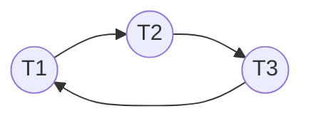

::: abstract 本章定位
前面学的是"怎么不让死锁发生"，本章回答真实系统的问题：**死锁已经（可能）发生了，怎么检测？怎么恢复？** 内容涵盖：死锁检测（wait-for graph / 多实例检测算法）、恢复手段、Linux 内核的 lockdep 锁序校验、常见的自死锁陷阱、分布式死锁，以及真实的数据库死锁日志排查，并串回 [哲学家进餐](/kb/os/同步异步/04-经典同步问题详解/)。
:::

## 1. 死锁检测

### 1.1 两种检测场景

| 场景 | 数据结构 | 触发方式 |
|---|---|---|
| 每类资源单实例 | **wait-for graph（等待图）** | 周期性构造图，**有环 ⇔ 死锁**（见 [资源分配图与死锁建模](/kb/os/死锁/02-资源分配图与死锁建模/)） |
| 资源多实例 | **检测算法（Detection Algorithm）** | 周期性用"归约"判断，类似银行家算法的安全判定 |

### 1.2 wait-for graph 的构造

把"进程持有资源 + 请求资源"转换成"进程等进程"：

```
若 P_i 请求的资源被 P_j 持有 → 画边 P_i ──► P_j
```



边 T1→T2→T3→T1 成环，即存在死锁。数据库、Java `jstack` 的死锁报告、MySQL InnoDB 的检测器，本质都是这张图。

### 1.3 多实例检测算法（Detection Algorithm）

与[死锁避免与银行家算法](/kb/os/死锁/04-死锁避免与银行家算法/)的安全算法高度相似，但方向相反：不死锁时安全算法保证"不做事"；检测算法允许死锁发生，用同一套"归约"看谁能完成。

```
输入: Available, Allocation, Request(不是 Need)
Work = Available
对 i: Finish[i] = (Allocation[i][*] == 0) ? true : false
loop:
  找 i 使 Finish[i]==false 且 Request[i][*] <= Work[*]
  若有: Work += Allocation[i][*]; Finish[i]=true; 继续
  若没有: 跳出
若存在 Finish[i]==false → 进程 P_i 死锁（处于死锁集合）
```

区别在于：**预防/避免用 Max 和 Need，检测用 Request（当前实际请求）**——检测不需要预知最大需求，这是它能在动态系统落地的关键。

::: tip 与银行家算法的关键区别
| 算法 | 用什么数据 | 目的 | 假设 |
|---|---|---|---|
| 银行家（避免） | Need = Max − Alloc | 不让系统进入不安全状态 | 需要预知 Max |
| 检测算法 | 当前 Request | 发现已发生的死锁 | 不需要预知 Max |
:::

### 1.4 什么时候运行检测

| 触发策略 | 优点 | 缺点 |
|---|---|---|
| 每次资源请求时都检测 | 立即发现 | 开销极大 |
| 周期性检测（每 N 秒/每空闲时） | 开销可控 | 可能漏掉短暂死锁 |
| 检测到 CPU 利用率显著下降时 | 只在系统可能出问题时检测 | 检测阈值难调 |

## 2. 死锁恢复

一旦检测到死锁，任选以下手段：

### 2.1 进程终止（Process Termination）

| 策略 | 做法 | 评价 |
|---|---|---|
| 终止所有死锁进程 | 简单粗暴 | 代价可能巨大，可能丢弃已完成的工作 |
| 逐个终止、每次终止后重新检测 | 代价可控 | 直到死锁解除，每轮都开销，要考虑"最小代价" |

### 2.2 资源抢占（Resource Preemption）

三步走：

1. **选择受害者（victim）**：选代价最小的进程被抢占，代价考虑因素——已使用 CPU 时间、剩余时间、占用资源数。
2. **回滚（rollback）**：让受害者回到安全检查点（如事务 start、最近一次 commit），释放的资源交给别人。
3. **避免饥饿**：反复选中同一个受害者会导致其永远完不成——必须保证"受害次数"也进入代价函数（如限定每个进程最多被牺牲 N 次）。

::: warning 抢占的两个前提
- 资源状态必须**可保存/可回滚**（如内存可换出、事务可回滚）。正在写文件、正执行不可逆操作的资源无法抢占。
- 回滚需要**检查点机制**，这是数据库事务、内存虚拟化的老本行。
:::

### 2.3 恢复方式对比

| 方式 | 优势 | 局限 | 典型系统 |
|---|---|---|---|
| 进程终止 | 实现简单 | 可能丢失大量工作 | 简单嵌入式系统 |
| 资源抢占 + 回滚 | 只牺牲一个受害者 | 需检查点、需可回滚资源 | 数据库事务、虚拟内存 |

## 3. Linux 内核死锁检测：lockdep

### 3.1 是什么

**lockdep（Lock Dependency Validator，锁依赖校验器）** 是 Linux 内核的运行时锁死锁检测器，通过 `CONFIG_PROVE_LOCKING`（在 `CONFIG_DEBUG_LOCKDEP` 之上）启用。它靠**静态分析锁的获取顺序**来发现潜在死锁，而不是等死锁真正发生。

### 3.2 原理

内核把所有锁抽象成"锁类（lock class）"，lockdep 记录内核运行过程中**每一次锁的获取顺序**：

- 若代码执行路径先后获取了锁 A、锁 B，则记录依赖：`A → B`（"先 A 后 B"）；
- 当某条路径出现了**反向依赖** `B → A` 时，就构成潜在环：`A → B → A`，即预测存在死锁风险；
- 此时内核打印 `possible deadlock detected` 报告，并给出两条调用栈。

```text
==============================================
WARNING: possible circular locking dependency detected
------------------------------------------------------
5.10.0 ...
possible deadlock detected:
  lock_a --> lock_b --> lock_a
 ...
```

### 3.3 lockdep 校验的四条规则（原理即预防）

| 规则 | 违反即报 | 说明 |
|---|---|---|
| 锁序一致性（环形依赖） | `possible deadlock` | 两条路径锁序相反 |
| 递归锁（同锁重入） | `recursive locking` | 同一锁类嵌套加锁 |
| 与中断上下文抢锁 | `irq` 相关警告 | 进程上下文持锁时进中断，中断又抢同一把锁 |
| 错误锁类/锁释放 | `unlock ... while locked` | 锁的获取/释放不配对 |

::: important 为什么 lockdep 是"静态发现潜在死锁"
lockdep 记录的是"曾经出现的锁序依赖"。只要代码里存在两条互相矛盾的顺序路径，即使当前没死锁，lockdep 也会提前报警——它把"可能死锁"消灭在代码审查阶段。这就是生产内核**用检测思路实现预防**的典范：不加"预知需求"假设，而是靠运行时观测锁序 + 报告，开发者据此修复代码。
:::

### 3.4 使用方式

```bash
# 启用: 内核配置
CONFIG_DEBUG_LOCKDEP=y
CONFIG_PROVE_LOCKING=y

# 运行期查看
dmesg | grep -i "possible deadlock"
cat /proc/lockdep                # 已记录锁依赖统计
cat /proc/lockdep_chains         # 锁链
```

`lockdep` 默认在`DEBUG`内核上可用，发行版生产内核通常关闭以省开销（它有运行时开销，但能发现难以复现的锁序 bug）。

## 4. 常见的自死锁（Self-deadlock）陷阱

### 4.1 自旋锁里再次加锁：必死

自旋锁是忙等锁，**不可重入**。同一 CPU 上第二次加同一把自旋锁，永远等不到自己释放：

```c
spinlock_t lock;
spin_lock(&lock);
/* ... */
spin_lock(&lock);    // 死锁: 同一个执行流在等自己释放，而自己永远释放不了
spin_unlock(&lock);  // 永远执行不到
spin_unlock(&lock);
```

::: warning 自旋锁与中断
自旋锁持有期间若开中断，中断处理函数可能再次抢同一把锁 → 等自己。所以内核要求：**持自旋锁时要 `spin_lock_irqsave`**（关中断再拿锁），防止中断路径抢锁。这是内核最经典的自死锁来源之一。
:::

### 4.2 中断上下文与内核路径互锁

```c
// 进程路径: 持锁做慢操作
mutex_lock(&data_lock);
/* ... 期间被中断打断，中断处理里又试图 mutex_lock(&data_lock) ... */
// 中断上下文不能睡眠、不能等 mutex → 直接死锁
```

内核规则：**中断上下文只能用自旋锁（且常需关中断），不能用互斥锁**；持锁代码不能被延迟、不能被抢占。

### 4.3 trylock 组合的自死锁/活锁

```c
pthread_mutex_t a, b;
void worker(void) {
    if (pthread_mutex_trylock(&a) != 0) return;   // 拿不到就重试
    if (pthread_mutex_trylock(&b) != 0) {         // B 拿不到
        pthread_mutex_unlock(&a);
        usleep(10);                                // 退避
        return;                                    // 可能形成活锁: 两线程同时退避同时重试
    }
    work();
    pthread_mutex_unlock(&b);
    pthread_mutex_unlock(&a);
}
```

### 4.4 递归锁（回看 [死锁特征与必要条件](/kb/os/死锁/01-死锁特征与必要条件/)）

非递归锁同一线程二次加锁即自死锁；C++ `std::recursive_mutex`、Java `synchronized` 可重入，是它的对症解药，但只能解决"自己等自己"，不解决多线程互等。

### 4.5 自死锁常见成因清单

| 成因 | 现象 | 对策 |
|---|---|---|
| 自旋锁重入 | CPU 忙等卡死 | 拆锁/用读锁；不加第二层 |
| 中断路径抢锁 | 持锁时进中断死锁 | `spin_lock_irqsave` / 下半部延迟 |
| 锁序颠倒 | 线程 A、B 交叉拿两把锁 | 全局锁顺序规范 |
| 递归重入 | 单线程自己等自己 | `recursive_mutex` 或重构临界区 |
| trylock 互让 | 活锁空转 | 随机退避 + 指数退避 |

## 5. 分布式死锁简述

分布式系统的死锁和单机原理一致，但**检测和避免都难得多**：没有全局共享的锁表，状态分散在多个节点。

| 维度 | 单机死锁 | 分布式死锁 |
|---|---|---|
| 状态可见性 | 全局可见 | 局部可见，需跨节点协调 |
| 检测 | 单点 wait-for graph | 分布式检测器汇总各节点等待图，或采用"超时近似" |
| 避免 | 银行家算法（需全局 Max） | 几乎不可行 |
| 缓解 | 直接恢复 | 事务回滚、两阶段提交 |

**实际工程做法**：分布式数据库/微服务普遍依赖**超时（timeout）+ 事务回滚**，而不是精确检测——等锁超过阈值就当作死锁处理，回滚重试。**两阶段锁（2PL）**是分布式一致性的基石，但 2PL 本身不能避免死锁（两个事务按相反顺序加锁仍可能死锁），仍需超时/死锁检测兜底。

## 6. 三策略总结决策表

| 维度 | 预防（Prevention） | 避免（Avoidance） | 检测与恢复（Detection & Recovery） |
|---|---|---|---|
| 核心做法 | 破坏四条件之一（静态规则） | 每次分配前判断是否安全 | 允许死锁发生，事后检测并恢复 |
| 是否需要预知 Max | 部分需要（预分配） | **需要**（银行家算法） | **不需要** |
| 运行开销 | 零（编译/设计期决定） | 高（O(n²·m) 每次请求） | 中（周期性检测 + 恢复） |
| 资源利用率 | 低 | 高 | 高 |
| 是否可能死锁 | 不可能 | 不可能 | 可能（但能恢复） |
| 现实代表 | 锁顺序规范、预分配 | 教科书/静态系统 | **Linux lockdep、数据库死锁检测、事务回滚** |
| 适用场景 | 资源需求已知、并发度要求低 | 资源需求已知、静态系统 | **生产系统主流** |

::: important 生产系统的主流选择
现实系统几乎都选"**预防的弱化版 + 检测恢复**"：用锁顺序规范减少死锁概率（预防思想），再用 lockdep / wait-for graph / 事务回滚兜底（检测恢复思想）。银行家算法因需要预知 Max，几乎只出现在教科书里。
:::

## 7. 真实排查案例：数据库死锁日志

### 7.1 现象

MySQL 报错：`ERROR 1213 (40001): Deadlock found when trying to get lock; try restarting transaction`。

### 7.2 看日志

```sql
SHOW ENGINE INNODB STATUS\G
```

输出中 `LATEST DETECTED DEADLOCK` 段：

```text
------------------------
LATEST DETECTED DEADLOCK
------------------------
*** (1) TRANSACTION:
TRANSACTION 1234, ACTIVE 2 sec
UPDATE t SET v=v+1 WHERE id=1;          -- 事务1 持第1行锁, 等第2行
...
*** (1) WAITING FOR THIS LOCK TO BE GRANTED:
RECORD LOCKS space id 5 page no 3 n bits 72 index PRIMARY of table `db`.`t`
...
*** (2) TRANSACTION:
TRANSACTION 1235, ACTIVE 1 sec
UPDATE t SET v=v+1 WHERE id=2;          -- 事务2 持第2行锁, 等第1行
...
*** (2) HOLDS THE LOCK(S): ...          -- 两者互相持有对方要的行锁
*** WE ROLL BACK TRANSACTION (2)        -- InnoDB 自动选择回滚代价小的事务(2)
```

### 7.3 排查方法

| 工具/手段 | 作用 |
|---|---|
| `SHOW ENGINE INNODB STATUS` | 看死锁证据：两个事务各持哪行、等哪行（wait-for graph） |
| `information_schema.INNODB_TRX` / `PERFORMANCE_SCHEMA` | 找当前持锁/等锁事务 |
| 业务侧统一加锁顺序 | 按 id 升序更新，消灭"反向锁序" |
| 缩短事务、减少持锁时间 | 降低死锁窗口 |
| 应用重试 | 捕获 1213 错误，回滚后重试事务 |

**对照**：进程级死锁排查用 `pstack` / `gdb -p PID` 抓线程栈，见 [死锁学习路线](/kb/os/死锁/00-死锁学习路线/) 实验清单——数据库查日志、进程查栈，思路都是"还原 wait-for 图，找出环上节点"。

## 8. 与哲学家进餐的联系

`../同步异步/04 经典同步问题详解` 中 Dijkstra 的哲学家进餐问题，就是死锁/饥饿的**教科书现场**：

- **场景**：5 个哲学家围桌，每个哲学家需要左右两把叉子才能吃饭。若每人先拿起左叉再等右叉，当 5 人都拿起左叉时，形成循环等待 → **死锁**（四个条件全满足）。
- **与本章的对应**：
  - **预防（循环等待）**：规定哲学家必须先拿**编号小**的叉子（资源有序分配，见 [死锁预防](/kb/os/死锁/03-死锁预防/)），从结构上消除环。
  - **避免（[死锁避免与银行家算法](/kb/os/死锁/04-死锁避免与银行家算法/)）**：限制同时最多 4 人拿叉（预留 1 把叉子作"安全余量"），保证至少 1 人能完成。
  - **检测恢复**：用 wait-for graph 建模"谁等谁"，检测到环后回滚/终止受害者。
  - **可消耗资源**：进餐的"需求"动态变化，正是银行家算法不适用、只能靠预防/检测的原因之一。

::: tip 经典问题的复习提示
哲学家进餐是"死锁三策略"的综合实验台：同一个问题，四种解法分别对应预防、避免、检测三种思路，务必对照 [哲学家进餐](/kb/os/同步异步/04-经典同步问题详解/) 的四种解法逐一映射。
:::

## 9. 本章小结

真实系统的死锁处理走"检测 + 恢复"路线：单实例用 wait-for graph（有环即死锁），多实例用归约式检测算法；恢复手段是终止进程或抢占 + 回滚（需检查点）。Linux 内核用 lockdep 在运行时静态发现锁序依赖矛盾，把"潜在死锁"消灭在编码阶段；自死锁（自旋锁重入、中断抢锁）是最常见的实操陷阱。而分布式环境因无法全局建模，只能靠超时回滚兜底。生产系统最终的选择是"预防思想降风险 + 检测恢复兜底"，这也是把四篇理论落地成工程实践的标准答案。

## 10. 自测题

1. wait-for graph 的节点和边分别代表什么？有环是否必然死锁？
   - 节点 = 进程/线程/事务；边 `A→B` 表示 A 等待 B 释放资源。有环 ⇔ 死锁（这是 wait-for graph 的定义保证）。

2. 检测算法与银行家算法的一个本质区别是什么？
   - 检测算法用**当前实际请求 Request**，不需要预知 Max；银行家算法用 Need（依赖 Max）。

3. 死锁恢复的两种基本手段分别是什么？抢占为什么需要"回滚"？
   - 进程终止、资源抢占。抢占把资源从受害者手里夺走，必须能恢复到一致状态（检查点），否则数据损坏。

4. Linux lockdep 检测死锁的原理一句话概括？
   - 记录所有锁的获取顺序，一旦发现某两条路径锁序互相矛盾（`A→B` 与 `B→A`），就报告 possible deadlock，而不是等死锁发生。

5. 自旋锁在同一执行流中二次加锁为什么会死锁？
   - 自旋锁不可重入，第二次加锁会忙等自己释放，而自己正持锁不会释放 → 永等。

6. 持自旋锁时为什么要关中断（`spin_lock_irqsave`）？
   - 防止持锁期间被中断打断，中断处理函数又尝试抢同一把锁，形成"自己等自己"的死锁。

7. 三策略（预防/避免/检测恢复）在"是否需要预知 Max"上如何取舍？
   - 预防的部分策略需要（预分配）、避免**必须需要**、检测恢复**不需要**。这是现实系统舍弃银行家算法、选择检测恢复的根因。

8. 分布式系统中为什么普遍用"超时回滚"而不是精确死锁检测？
   - 没有全局锁表、状态分散、协调开销大，精确检测不可行；超时 + 事务回滚简单可靠，是分布式一致性的务实兜底。
