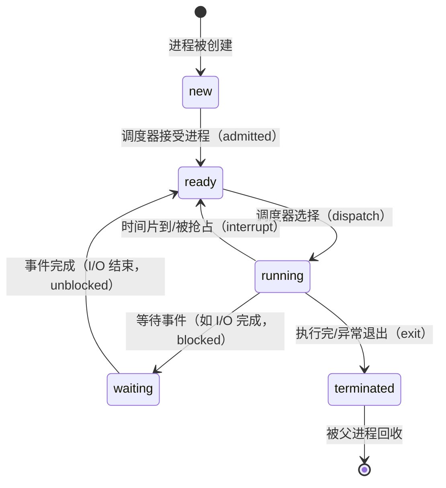
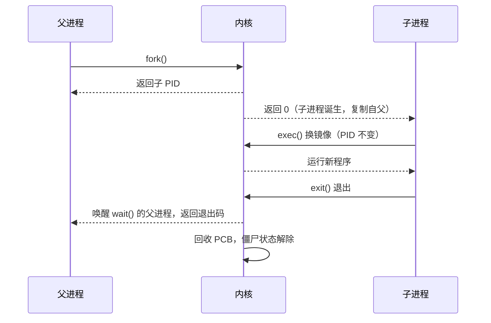

::: abstract 本章定位
建立"进程"这个最核心抽象的整体图景：进程是什么、和程序差在哪、在内存里长什么样、一生会经历哪些状态，以及 Linux 上如何用 `ps` 观察这些状态。最后用 `fork()`/`exec()` 写一个最小例子，感受进程如何诞生与变身。这是整个操作系统系列的第一块地基。
:::

## 1. 进程定义

### 1.1 进程 vs 程序

::: important 一句话区分
**程序（Program）是静态的**：磁盘上的可执行文件，由指令、数据与元数据组成。
**进程（Process）是动态的**：程序被加载进内存后的执行实例，包含程序计数器、寄存器、栈、堆等运行态内容。
:::

```
磁盘上的二进制文件（程序）              内存中的执行实体（进程）
┌──────────────────────┐      load    ┌──────────────────────┐
│ 代码段（指令）         │ ──────────→ │ text 段               │
│ 初始化的数据          │             │ data/bss 段          │
│ 符号表/元数据         │             │ heap（动态分配）       │
│                      │             │ stack（函数调用）      │
└──────────────────────┘             │ 程序计数器/寄存器       │
                                     │ 资源句柄（文件/信号）   │
                                     └──────────────────────┘
```

关键差异：

| 维度 | 程序 | 进程 |
|---|---|---|
| 存在性 | 静态实体，存在于磁盘 | 动态实体，存在于内存 |
| 生命周期 | 永远在那里，除非删除 | 创建 → 运行 → 终止 |
| 数量关系 | 一个程序可以被多个进程运行 | 一个进程对应一份加载的实例 |
| 内容 | 只有指令和数据 | 指令 + 数据 + 运行状态（PC、寄存器、栈、堆） |
| 操作系统管理 | 文件系统管 | PCB 管（见 [进程控制块与系统调用](/kb/os/进程线程/02-进程控制块与系统调用/)） |

::: tip 直觉例子
打开两个终端，分别执行 `vi a.txt` 和 `vi b.txt`——这是同一个程序（vi）产生的**两个进程**。它们代码相同，但各自的堆栈、打开的文件、程序计数器完全不同。
:::

### 1.2 并发执行

教材强调进程的一个核心性质：**多个进程可以"同时"存在，但单个 CPU 上任意时刻只能有一个进程真正运行**（单核）。所谓"同时执行"，是操作系统快速切换（时间分片 multiplexing）造成的假象。

## 2. 进程内存布局

一个进程的虚拟地址空间从低地址到高地址依次是：

```
高地址 ┌────────────────────────────────┐
       │ 命令行参数 / 环境变量 (argv/env)│
       │────────────────────────────────│
       │            Stack（栈）          │  ← 向下增长，局部变量、函数调用帧
       │          ↓ 增长方向             │
       │             ...                │
       │          ↑ 增长方向             │
       │            Heap（堆）           │  ← 向上增长，malloc/new 动态分配
       │────────────────────────────────│
       │            BSS（未初始化数据）   │  ← 全局变量，编译期置 0
       │            Data（已初始化数据）  │  ← 全局变量、static 变量，有初值
       │            Text（代码段）       │  ← 只读，CPU 从这里取指令
低地址 └────────────────────────────────┘
```

| 段 | 内容 | 生命周期 | 谁管理 |
|---|---|---|---|
| text | 机器指令、只读常量 | 进程存活期 | 编译期固定，只读 |
| data | 已初始化的全局/静态变量 | 进程存活期 | 编译期分配 |
| bss | 未初始化的全局/静态变量（自动清零） | 进程存活期 | 编译期只记大小 |
| heap | 动态分配的内存 | malloc 到 free | 程序员 + malloc/free |
| stack | 局部变量、函数调用栈帧、返回地址 | 函数调用期间 | 编译器自动管理 |

::: warning 栈和堆方向相反
栈向下增长、堆向上增长，两者相向而行。若任一路径越过边界就会互相碰撞，造成**栈溢出（stack overflow）**或**堆溢出（heap overflow）**。这也是为什么地址空间中间留有大片"空隙"。
:::

在 Linux 上可以亲自验证（不同体系结构地址不同）：

```bash
cat /proc/$$/maps
# 输出片段：
# 55c0...-55c0... r-xp  代码段（text，可读可执行不可写）
# 55c0...-55c0... rw-p  数据段（data/bss）
# 55c0...-55c0... rw-p  堆（heap）
# 7ffd...-7ffd... rw-p  栈（stack，末尾通常是最高地址）
```

## 3. 进程状态机

### 3.1 五状态模型

教材的标准模型（新版教材将"等待"进一步细分为阻塞/就绪-挂起等，但五状态是核心骨架）：



| 状态 | 含义 | 是否占用 CPU | 是否在内存 | 典型触发 |
|---|---|---|---|---|
| new（新建） | 进程正在被创建，尚未就绪 | 否 | 正在分配 | fork 后的瞬间 |
| ready（就绪） | 万事俱备只欠 CPU | 否 | 是 | 时间片耗尽、I/O 完成 |
| running（运行） | 正占用 CPU 执行指令 | **是** | 是 | 被调度器选中 |
| waiting（等待/阻塞） | 等待某个事件（I/O、锁、信号） | 否 | 是 | 发起 read、抢锁失败 |
| terminated（终止） | 已停止，等待父进程回收 | 否 | 资源待回收 | exit() 之后 |

::: tip 记忆口诀
进程的出路只有一条是"自己往前跑"（running），其余要么**等 CPU**（ready）、要么**等事件**（waiting）、要么**已经完了**（terminated）。状态转换的唯一入口是 dispatch：只有 ready → running 是调度器主动干的。
:::

### 3.2 教材新版：五状态 + 挂起

9 版教材还引入**挂起（suspended）**状态（旧版教材 Ch3 也有讨论）：当内存不足时，操作系统把整个进程换出到磁盘（swap），形成 ready-suspended / blocked-suspended。挂起进程完全不占内存，只有换入后才能继续。这部分在内存管理篇（[分页与页表结构](/kb/os/内存/02-分页与页表结构/)）更详细。

## 4. Linux 进程状态对应

Linux 内核把状态机映射到 `ps`/`top` 的 STAT 列。每个状态一个字母，后面可跟附加标记：

| 教材状态 | Linux 字母 | 含义 | 触发场景 |
|---|---|---|---|
| running | `R` | 运行中或就绪（可被调度） | 正在执行或排队等 CPU |
| waiting（可中断） | `S` | 可中断睡眠（interruptible sleep） | 等输入、`sleep()`、等待锁 |
| waiting（不可中断） | `D` | 不可中断睡眠 | 等磁盘/网络 I/O，不能被信号唤醒 |
| waiting（挂起） | `T` | 停止（stopped） | `Ctrl+Z`、`kill -STOP` |
| terminated 待回收 | `Z` | 僵尸（zombie/&lt;defunct&gt;） | 已退出但父进程未 `wait()` |
| — | `I` | 空闲内核线程（idle） | 内核工作线程在休息 |

附加标记（STAT 列第二位及以后）：

| 标记 | 含义 |
|---|---|
| `<` | 高优先级（nice 为负） |
| `N` | 低优先级（nice 为正，见 [多处理器调度与实时调度](/kb/os/进程线程/06-多处理器调度与实时调度/)） |
| `+` | 位于前台进程组（终端前台） |
| `s` | 会话首进程（session leader） |
| `l` | 多线程（`clone` 出来的轻量级进程） |

::: warning `D` 状态为什么危险
`D` 状态的进程连 `kill -9` 都杀不掉，因为内核正等着它完成不可中断的 I/O。大量 `D` 进程堆积通常是磁盘/网络故障的信号（如 NFS 挂起）。
:::

```bash
# 观察各状态进程数量（自己机器上看一眼，立刻有直观印象）
ps -eo stat | grep -o '^[RSDTZI]' | sort | uniq -c
# 制造一个僵尸：
bash -c 'sleep 5 & exit 0'   # 或更明确：
( sleep 2 & )                # 子进程先退、父进程不等，变成 &lt;defunct&gt;
ps aux | grep -i defunct
```

## 5. 进程与线程对比

先给结论，线程的细节见 [线程概念与多线程模型](/kb/os/进程线程/04-线程概念与多线程模型/)：

| 维度 | 进程 | 线程 |
|---|---|---|
| 定义 | 正在执行的程序实例 | 进程内的执行流 |
| 资源拥有 | **是资源分配单位**（地址空间、文件、信号） | 共享所属进程的资源 |
| CPU 调度 | 传统上是调度单位；现代是线程 | **是 CPU 调度单位** |
| 地址空间 | 各自独立、隔离 | 同一进程内共享 |
| 上下文切换开销 | 大（换页表、刷 TLB/cache） | 小（只切栈/寄存器/PC） |
| 通信方式 | IPC（管道/共享内存/消息队列） | 直接读写共享内存 |
| 健壮性 | 一个崩溃不影响其他进程 | 一个线程崩溃可能拖垮整个进程 |
| Linux 实现 | `fork()` 创建 | `clone()`（共享地址空间） |

::: tip 一句话
进程负责"我的地盘我做主"（隔离），线程负责"同一屋檐下干活"（共享与并行）。隔离换来安全，共享换来效率。
:::

## 6. 孤儿进程与僵尸进程

### 6.1 僵尸进程（Zombie）

**产生**：子进程先 `exit()`，父进程没有（或没来得及）调用 `wait()`，子进程的 PCB 和退出码仍留在内核里，等待父进程回收。此时 `ps` 中显示 `&lt;defunct&gt;`，STAT 为 `Z`。

**危害**：僵尸不占 CPU、不占内存，但它**占用一个 PID 和内核进程表项**。如果父进程不回收又不断产生子进程，进程表会被塞满，导致系统无法创建新进程。

**清除**：
- 父进程调用 `wait()`/`waitpid()` 回收；
- 父进程退出，僵尸交给 init（1 号进程）周期性回收；
- 已无法挽回的进程表耗尽只能重启。

```bash
# 制造一个短命僵尸（父进程不 wait）
bash -c 'sleep 0.1 &' ; ps -eo pid,ppid,stat,comm | grep -i defunct
# 一旦 bash 退出，僵尸会被 init 收养并回收，通常很快消失
```

### 6.2 孤儿进程（Orphan）

**产生**：父进程先于子进程退出，子进程被 1 号进程（init/systemd）收养，`PPID` 变为 1。

**危害**：一般无害，反而是设计行为（如守护进程 daemon 故意 fork 后让父进程退出，使自己脱离终端、避免被挂起）。

```bash
# 制造一个孤儿：父进程秒退，子进程 sleep 长一点
bash -c 'sleep 30 &' & sleep 0.1
ps -eo pid,ppid,stat,comm | grep sleep
# 你会发现 sleep 的 PPID = 1（被 init 收养）
```

::: important 对比记忆
- **僵尸** = 子进程死了、父进程还活着但没回收 → 死而未埋。
- **孤儿** = 父进程死了、子进程还活着 → 被国家（init）领养。
面试最爱问这对兄弟，本质一句话：**谁先死、谁收尸**。
:::

## 7. fork() 与 exec()

### 7.1 fork()：复制自己

`fork()` 系统调用创建一个**子进程**，子进程是父进程的拷贝（独立的地址空间副本，内容相同）。神奇之处：`fork()` **调用一次，返回两次**。

- 在**父进程**中返回：子进程的 PID（> 0）
- 在**子进程**中返回：0
- 失败返回：-1

```c
#include <stdio.h>
#include <unistd.h>
#include <sys/wait.h>

int main(void) {
    pid_t pid = fork();

    if (pid < 0) {
        perror("fork");
        return 1;
    } else if (pid == 0) {
        /* 子进程 */
        printf("I am the child, pid=%d, ppid=%d\n", getpid(), getppid());
    } else {
        /* 父进程 */
        printf("I am the parent, pid=%d, child pid=%d\n", getpid(), pid);
        wait(NULL);   /* 回收子进程，避免僵尸 */
    }
    return 0;
}
```

编译运行：

```bash
gcc -o forkdemo forkdemo.c && ./forkdemo
# 输出（两次 fork 的 PID 可能不同）：
# I am the parent, pid=1234, child pid=1235
# I am the child, pid=1235, ppid=1234
```

::: tip 为什么父子都要往下执行？
fork 返回时，父子进程从 `fork()` 返回点**接着往下跑**，各自拥有独立副本。`printf` 输出顺序不保证，因为父子可能交错执行。
:::

### 7.2 经典面试题：fork 次数

```c
int main() {
    fork();   // 进程数 ×2
    fork();   // ×2
    fork();   // ×2
    printf("hello\n");
}
```

**结论：总共 2³ = 8 个进程**（含最初的父进程），打印 8 次 hello。

```c
// 进阶：if 内的 fork
int main() {
    if (fork() == 0)        // ① 父进程 + 子进程
        fork();             // ② 只有子进程执行这行 → 子进程再分裂
    printf("A\n");
}
// 进程数 = 3，打印 3 次 A
```

### 7.3 exec()：换掉自己

`exec` 系列系统调用把**当前进程的映像完全替换**成另一个程序（text/data/bss/heap/stack 全部换掉），PID 不变。`fork` + `exec` 是 Unix 的黄金组合：**先复制一个"外壳"，再用 exec 换内核**。

```c
#include <stdio.h>
#include <unistd.h>
#include <sys/wait.h>

int main(void) {
    pid_t pid = fork();
    if (pid == 0) {
        /* 子进程：把自己变成 ls */
        char *argv[] = {"ls", "-l", NULL};
        execlp("ls", "ls", "-l", (char *)NULL);   // 成功后不会返回
        perror("execlp failed");                  // 只有失败才会走到这里
        return 1;
    }
    wait(NULL);
    printf("parent: child finished\n");
    return 0;
}
```

::: warning exec 成功不返回
`exec` **成功后当前进程直接消失**，不再回到原代码。只有 exec 失败（如文件不存在）才会返回 -1。所以 exec 之后不要写"正常流程代码"，那等于永远不会执行。
:::

### 7.4 fork + exec 的完整生命周期



::: tip 现实世界的映射
终端里每敲一条命令，shell 就是"父进程 fork 出一个子进程再 exec"：`strace -f -e trace=process bash -c 'ls'` 能看到整个 fork/exec/wait 链条。这也是 [Linux进程与调度实操](/kb/os/Linux/01-Linux进程与调度实操/) 里进程树 `pstree` 的来源。
:::

## 8. 本章小结

- 进程 = 动态执行实例，与静态程序不同；在内存中按 text/data/bss/heap/stack 布局。
- 五状态状态机：new → ready → running → waiting → terminated，只有 running 占 CPU。
- Linux 用 `R/S/D/T/Z/I` 对应这些状态，`ps` 的 STAT 列可直接观察。
- 进程管资源、线程管调度；僵尸（死而未埋）与孤儿（父死子活）是经典考点。
- `fork()` 复制、`exec()` 换壳，两者组合构成 Unix 创建进程的标准范式。

## 9. 自测题

1. **程序与进程的根本区别？** 程序是磁盘上的静态指令序列；进程是程序的动态执行实例，含地址空间、寄存器、栈等运行态。
2. **状态机中 ready 与 waiting 的区别？** ready 是"等 CPU"（万事俱备，缺 CPU）；waiting 是"等事件"（如 I/O 完成、锁释放），二者都不占 CPU。
3. **一个进程被时钟中断打断，进入什么状态？** 进入 ready（就绪），因为它是被动让出 CPU，事件（下个时间片）随时可来。
4. **僵尸进程怎么产生、怎么消除？** 子进程 exit 后父进程未 wait；父进程 wait 回收，或父进程死亡后由 init 回收。
5. **fork() 为什么"调用一次、返回两次"？** fork 创建了新的地址空间副本，两个执行流各自从返回点继续，父进程拿到子 PID、子进程拿到 0。
6. **exec() 成功之后会发生什么？** 进程映像被完全替换、PID 不变，控制权永远离开原代码，不再返回（除非失败返回 -1）。
7. **Linux 的 `D` 状态进程为什么杀不掉？** 不可中断睡眠，内核正等待它完成 I/O（如磁盘/NFS），信号无法打断。
8. **子进程的 PPID 变成 1 说明什么？** 父进程已先退出，子进程成为孤儿并被 init（PID 1）收养。

> 下一篇：[进程控制块与系统调用](/kb/os/进程线程/02-进程控制块与系统调用/)——内核凭什么能管理这么多进程？
