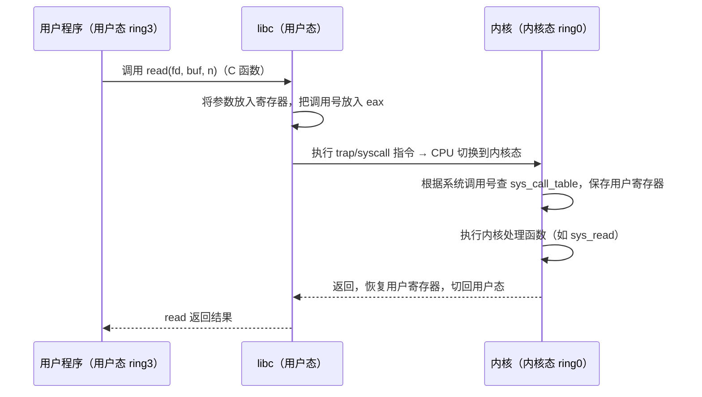
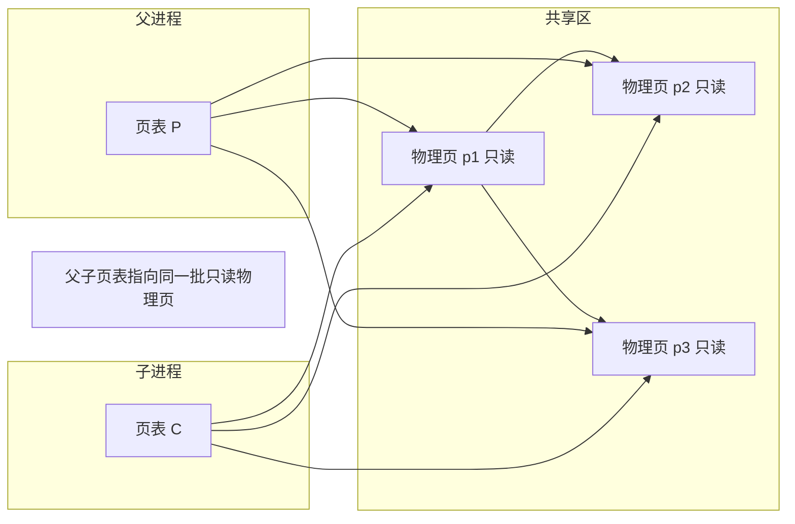
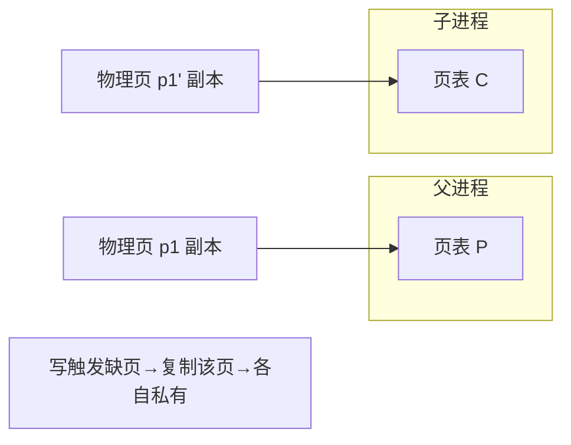

::: abstract 本章定位
上一篇看了进程"外部的样子"（状态、内存布局），这一篇进入内核内部：**PCB 到底记录了什么、CPU 如何通过 trap 从用户态切入内核态执行系统调用、fork/exec/wait/exit 全家桶的完整细节、以及写时复制（COW）为什么能省一半时间**。这一篇是连接"进程概念"与"CPU 调度"的桥梁。
:::

## 1. PCB：进程控制块

### 1.1 什么是 PCB

每个进程在内核中都有一份 **Process Control Block（进程控制块）**，也叫进程描述符（Linux 中叫 `task_struct`）。PCB 是内核"管理这个进程"的全部依据——**没有 PCB 的进程在内核眼中不存在**。

::: important 换个角度理解
进程 ≠ 代码段 + 栈 + 堆。进程 = **它的一切资源 + 一份 PCB**。调度器看的是 PCB 里的状态和优先级，不是代码。
:::

### 1.2 PCB 里有什么

| 类别 | 内容 | 说明 |
|---|---|---|
| 标识信息 | PID、PPID、UID/GID、用户信息 | 谁能对进程发信号、谁的权限 |
| 状态 | ready / running / waiting / terminated… | 调度器的输入 |
| 寄存器 | 程序计数器 PC、栈指针 SP、通用寄存器 | 上下文切换时保存/恢复的依据 |
| 调度信息 | 优先级、CPU burst 统计、时间片剩余 | 见 [CPU调度算法详解](/kb/os/进程线程/05-CPU调度算法详解/) |
| 内存信息 | 页表指针、base/limit 寄存器 | 指向该进程的地址空间，见 [分页与页表结构](/kb/os/内存/02-分页与页表结构/) |
| 打开文件表 | 文件描述符表指针 | 每个进程有独立的 fd 表，见 [文件系统接口](/kb/os/存储/03-文件系统接口与目录结构/) |
| 记账信息 | CPU 用时、系统调用次数 | 计费、`time` 命令的数据来源 |
| I/O 状态 | 挂起的 I/O 请求、信号掩码 | 等待队列的链接指针 |

::: tip Linux 的 task_struct 可以直接看
内核源码 `include/linux/sched.h` 中 `struct task_struct` 就是 PCB。平时不想看源码，可以读：

:::```bash
> cat /proc/self/status      # 当前 shell 的 PCB 摘要：Name/State/Pid/Uid/VmRSS/Threads
> cat /proc/self/fdinfo/0    # 文件描述符信息
> ```

## 2. 用户态与内核态

### 2.1 两种执行模式

CPU 有特权级别，操作系统利用它把程序限制在低权限模式：

| | 用户态（user mode） | 内核态（kernel mode） |
|---|---|---|
| 权限 | 低：不能访问特权指令 | 高：可以执行全部指令 |
| 能做什么 | 算数、读写自己的地址空间、普通指令 | 改页表、开关中断、I/O 设备访问、内存管理 |
| 谁在跑 | 用户进程（application） | 内核代码（调度、系统调用、中断处理） |
| 如何进入 | — | 通过**系统调用**或**中断/异常** |

::: warning 为什么必须隔离
如果用户程序能直接写磁盘、改页表、关中断，任何一个 Bug 或恶意程序都能毁掉整个系统。隔离 = 特权分离 + 地址空间分离（页表不同）。
:::

x86 有四环（ring 0-3），Linux 只用 ring 0（内核）和 ring 3（用户）；ARM 用 EL0/EL1。概念一样：**最少特权原则**。

### 2.2 系统调用流程（trap 机制）

系统调用是用户程序进入内核的**唯一合法入口**。`fork`、`read`、`write`、`open` 都是系统调用。流程：



```
用户态                                    内核态
┌──────────────────┐    trap/syscall    ┌──────────────────────────┐
│ 应用代码          │ ─────────────────→ │ sys_call_table 查表       │
│  libc 封装        │                    │ 保存现场（用户寄存器）      │
│  (printf→write)   │ ←───────────────── │ 执行 sys_write            │
└──────────────────┘   返回（恢复现场）    │ 检查权限 / 拷贝参数        │
                                         └──────────────────────────┘
```

关键点：
1. **系统调用号**：每个系统调用一个编号（`read=0`，`write=1`，`fork=57` 等），内核靠它查表分发。
2. **参数传递**：通过寄存器（x86-64 用 rdi/rsi/rdx…），避免用户态/内核态之间用栈传递的麻烦。
3. **开销来源**：CPU 模式切换 + 保存/恢复寄存器 + 可能的内存拷贝 + 缓存/TLB 刷新。
4. `strace` 就是拦截这些 trap 来展示系统调用的。

```bash
strace -c ls /tmp     # 统计所有系统调用及耗时
# 输出会显示 openat/read/close/write/mmap 等系统调用各被调了多少次
```

## 3. fork / exec / wait / exit 族

### 3.1 四者的分工

| 系统调用 | 作用 | 谁调用 | 返回值 |
|---|---|---|---|
| `fork()` | 创建子进程（复制当前进程） | 父进程 | 子 PID / 0 / -1 |
| `exec*()` | 替换当前进程镜像 | 任意（通常子进程） | 成功不返回 |
| `wait()`/`waitpid()` | 阻塞等待子进程退出并回收 | 父进程 | 子 PID |
| `exit(status)` | 终止当前进程，写退出码 | 任意进程 | 不返回 |

::: tip 生命周期闭环
一个进程的生命周期 = `fork()` 出生 → 被 `exec` 换脸 → 干活 → `exit()` 死亡 → 被 `wait()` 收尸。少任何一环都会出问题（僵尸就是"死而无尸被收"）。
:::

### 3.2 fork 细节再深入

`fork` 复制的内容是**创建时那一刻的完整拷贝**：地址空间内容、打开的文件描述符表、信号处理器、PCB 中的绝大多数字段。但**不复制**：PID（新分配）、统计信息（清零）、子进程继承但独立。

```c
#include <stdio.h>
#include <unistd.h>
#include <sys/wait.h>

int main(void) {
    int x = 10;
    pid_t pid = fork();
    if (pid == 0) {
        x = 99;                    /* 子进程修改自己的副本 */
        printf("child: x = %d\n", x);
    } else {
        wait(NULL);
        printf("parent: x = %d\n", x);   /* 父进程的 x 仍是 10 */
    }
    return 0;
}
/* 输出：
   child: x = 99
   parent: x = 10
*/
```

::: warning 经典的"值不变"陷阱
上面例子证明：fork 之后父子**不共享普通变量**。修改子进程的 `x` 不影响父进程的 `x`——它们各自拥有一份内存副本。想共享数据要用 `mmap` 共享内存或 `pthread` 共享地址空间。
:::

### 3.3 exec 族全家桶

| 函数 | 程序从 PATH 找 | 参数列表形式 | 环境变量 |
|---|---|---|---|
| `execl(path, arg0, ..., NULL)` | 否 | 变长参数 | 继承 |
| `execlp(file, arg0, ..., NULL)` | 是 | 变长参数 | 继承 |
| `execv(path, argv[])` | 否 | 数组 | 继承 |
| `execvp(file, argv[])` | 是 | 数组 | 继承 |
| `execve(path, argv[], envp[])` | 否 | 数组 | 指定 |

```c
// 子进程里五选一，效果等价（都执行 "ls -l"）
execl("/bin/ls", "ls", "-l", NULL);
execlp("ls", "ls", "-l", NULL);
char *argv[] = {"ls", "-l", NULL};
execv("/bin/ls", argv);
execvp("ls", argv);
char *envp[] = {"PATH=/bin", NULL};
execve("/bin/ls", argv, envp);
```

### 3.4 wait 的返回值与退出状态

`wait(&status)` 可以拿到子进程的退出状态，用宏解析：

```c
#include <stdio.h>
#include <stdlib.h>
#include <sys/wait.h>
#include <unistd.h>

int main(void) {
    pid_t pid = fork();
    if (pid == 0) {
        exit(42);                 /* 子进程用 42 退出 */
    }
    int status;
    waitpid(pid, &status, 0);
    if (WIFEXITED(status))
        printf("child exited with %d\n", WEXITSTATUS(status));
    return 0;
}
/* 输出：child exited with 42 */
```

| 宏 | 作用 |
|---|---|
| `WIFEXITED(status)` | 是否正常退出 |
| `WEXITSTATUS(status)` | 正常退出的退出码 |
| `WIFSIGNALED(status)` | 是否被信号杀死 |
| `WTERMSIG(status)` | 杀死它的信号编号 |
| `WIFSTOPPED(status)` | 是否被停止（Ctrl+Z） |

::: warning 退出码的取值范围
退出码是 8 位（0~255），`exit(-1)` 实际是 255。shell 里 `$?` 拿到的就是它。
:::

## 4. 写时复制（Copy-on-Write, COW）

### 4.1 问题

如果 fork 真的"完整复制"父进程地址空间，那么：
- **慢**：几十 MB 的内存逐页拷贝，一个 fork 就要几十毫秒；
- **浪费**：绝大多数子进程 fork 后立刻 exec 换掉整个镜像，拷贝的内容白费。

### 4.2 解决方案

::: important COW 核心思想
fork 后**不复制物理页**，父子共享同一批只读页；只要任何一方**要写**某个页，内核才把该页复制一份，双方各自拥有私有的那份。读得越多、省得越多；只有"真的会写"的页才付出代价。
:::



当**任一进程写入页 p1** 时：



### 4.3 细节与收益

- **机制**：共享页标记为"只读 + copy-on-write 位"；写操作触发页错误，缺页处理程序复制该页，更新双方页表，然后重放写操作。
- **收益**：fork 只复制页表（O(页表大小)），不再复制整个地址空间（O(地址空间)）；实际只有被写的页才复制。
- **代价**：写时多一次缺页处理；需要额外页表项标记 COW。
- **exit 语义**：`exit` 后退出码写入 PCB；子进程的页面由内核统一释放。

```bash
# 感受 COW：fork 一个 ls，期间内存几乎不增长
/usr/bin/time -v bash -c 'for i in $(seq 100); do ls >/dev/null; done' 2>&1 | grep -i "maximum resident"
# fork+exec 100 次，最大常驻内存仍然很小——因为 exec 不拷贝
```

::: tip 与线程对比
fork 用 COW 偷懒，所以"几乎不复制"；线程则是**根本不复制**，直接共享整个地址空间。这就是为什么线程创建比 fork 快、但数据同步问题比进程 IPC 复杂（见 [线程概念与多线程模型](/kb/os/进程线程/04-线程概念与多线程模型/) 与 [临界区问题](/kb/os/同步异步/01-临界区问题与互斥实现/)）。
:::

## 5. Linux 的实现速览

| 教材概念 | Linux 实现 |
|---|---|
| PCB | `struct task_struct`（`include/linux/sched.h`） |
| 进程列表 | 双向循环链表 + `ps -ef` 可查看 |
| fork | `fork()` → `clone()`（`fork` 是 `clone` 的特例，不共享地址空间） |
| exec | `execve()` 系列，替换内存镜像 |
| wait | `wait4()` / `waitid()` |
| exit | `do_exit()` |
| COW | fork 时设置 `VM_MAYWRITE` + COW 标志 |

::: tip 深入阅读
fork/exec 的细节属于 [Linux进程与调度实操](/kb/os/Linux/01-Linux进程与调度实操/)。这里只需记住一个心智模型：**所有进程管理最终都收敛到 task_struct + clone/execve/wait/exit 四件套**。
:::

## 6. 本章小结

- PCB 是内核管理进程的档案，含标识、状态、寄存器、调度、内存、文件等全部信息。
- 用户态与内核态靠特权级别分离，系统调用（trap/syscall）是唯一合法入口。
- `fork` 复制、`exec` 替换、`wait` 回收、`exit` 退出，四件套构成进程生命周期闭环。
- COW 让 fork 从"整块拷贝"降级为"按需复制"，是性能的关键。

## 7. 自测题

1. **PCB 中最容易被调度器用到的三类字段？** 状态、调度信息（优先级/时间片）、寄存器（用于上下文切换）。
2. **系统调用与普通函数调用的本质区别？** 系统调用要跨特权级（用户态→内核态），经 trap 陷入内核；普通函数调用只改栈帧，不换特权级。
3. **为什么 exec 成功后没有返回值？** 因为它把当前进程的地址空间整个替换了，原代码已经不存在，无法"返回"。
4. **fork 之后父进程和子进程的 PID 关系？** 子进程 PID = 新分配，父进程 PID 不变；子进程的 PPID = 父进程 PID。
5. **wait() 的作用有两个，分别是什么？** ① 阻塞直到子进程退出并回收资源（解除僵尸）；② 拿到子进程退出状态。
6. **COW 为什么能加速 fork？** fork 时只复制页表、共享物理页，只有被写入的页才复制，避免整块地址空间拷贝。
7. **`exit()` 之后进程立刻消失吗？** 不。进程进入 terminated 状态，PCB 与退出码仍保留，等父进程 `wait()` 回收，此期间是僵尸。
8. **用户程序为什么不能直接修改内核内存？** 内存隔离（不同页表）+ 特权级别（ring0/ring3），用户态访问内核地址会触发页错误/权限异常。

> 下一篇：[进程切换与调度行为](/kb/os/进程线程/03-进程切换与调度行为/)——切换进程到底要花多少钱？
