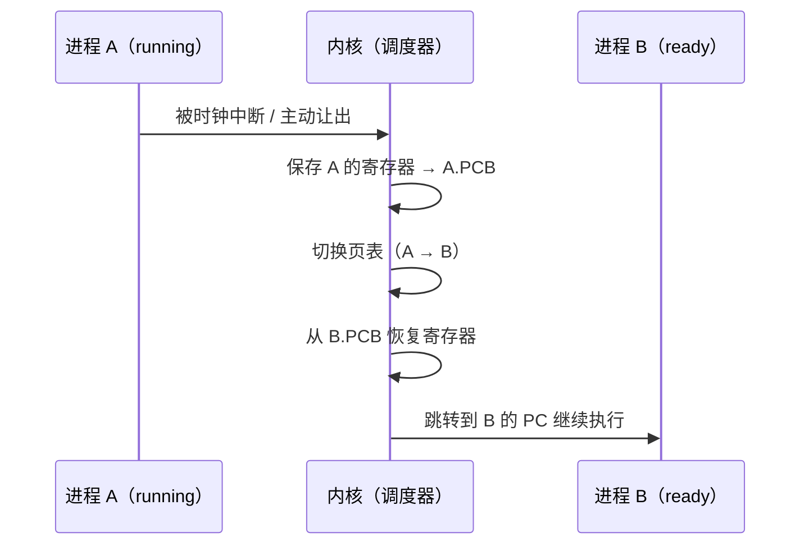

::: abstract 本章定位
前两篇认识了进程和它的 PCB，这一篇回答"**切换一个进程到底要花多少钱、调度器平时管着哪些队列**"。上下文切换（Context Switch）是理解调度算法开销的前提，调度队列模型是理解"进程等什么"的框架，最后落到 Linux 上用 `vmstat`/`time` 亲自测出切换成本。
:::

## 1. 上下文切换（Context Switch）

### 1.1 什么是上下文

一个进程被换下 CPU 时，CPU 上残留着它的"全部现场"：程序计数器、寄存器组、栈指针、状态寄存器等。这些运行现场统称**上下文（context）**。

**上下文切换** = 内核把当前进程的上下文保存到它的 PCB，再把下一个进程的上下文从 PCB 恢复到 CPU，然后跳转执行。



### 1.2 切换开销

| 开销来源 | 说明 |
|---|---|
| 寄存器保存/恢复 | 每次切换要读写全套寄存器（几十个），纯 CPU 开销 |
| 页表切换 | 每个进程独立地址空间，切换页表要刷新 **TLB**，后续访问全部重新查表 |
| Cache 失效 | L1/L2/L3 缓存、分支预测器状态全废，新进程冷启动，缓存命中率骤降 |
| 内核调度逻辑 | 运行调度算法、更新队列、统计记账 |
| 系统调用叠加 | 切换往往伴随一次系统调用（如 read 返回）甚至两次 |

::: important 为什么比系统调用贵
系统调用（如 read）**不换进程**：虽然也切到内核态，但页表不变、缓存仍在，返回后继续跑同一个进程。上下文切换**换人**：页表、TLB、缓存全部作废。所以"每毫秒切换上百次"的系统，大量 CPU 时间被白费在换人上，而不是干活上。
:::

### 1.3 一句话量化

教材给出的量级：典型上下文切换耗时在**微秒级（几 µs 到十几 µs）**。听起来小，但如果时间片只有 10ms，那么每 10ms 就要付一次切换费；时间片越短，切换占比越高（详见 [CPU调度算法详解](/kb/os/进程线程/05-CPU调度算法详解/) 的 RR 部分）。

## 2. 调度程序 Dispatcher

调度（scheduling）和分派（dispatch）是两个动作：

| 动作 | 谁做 | 做什么 |
|---|---|---|
| 调度决策 | CPU Scheduler（调度器） | 从就绪队列里**选一个**进程 |
| 分派 | Dispatcher（分派器） | 把选中的进程**真的放上 CPU** |

Dispatcher 的工作：
1. 保存当前进程上下文；
2. 恢复目标进程上下文；
3. 切换到目标进程用户态并跳转。

**分派延迟（dispatch latency）** = 完成"保存 + 恢复 + 切换"所需时间。调度算法评估里，分派延迟越小越好。

## 3. 调度队列模型

操作系统维护若干队列，进程在队列之间移动：

```
                        new
                         │ fork 创建
                         ▼
                 ┌───────────────┐
                 │  Ready Queue  │ ←──── 时间片耗尽/被抢占
                 └───────┬───────┘
                         │ 调度器选中（dispatch）
                         ▼
                 ┌───────────────┐     发起 I/O 请求
                 │   running     │ ──────────────┐
                 └───────────────┘               │
                         │ 事件完成             ▼
                         │                  ┌──────────┐
                         │                  │Device     │
                         │                  │Queue(s)   │  ← 每个设备一条
                         │                  └──────────┘
                         ▼ I/O 完成后回 ready
                 ┌───────────────┐
                 │  terminated   │ ← exit()
                 └───────────────┘
```

| 队列 | 装什么 | 谁操作 |
|---|---|---|
| Ready Queue | 就绪进程（等 CPU） | 调度器入队/出队 |
| Device Queue（设备队列） | 等待某设备（如磁盘）的进程 | 设备控制器 + 中断处理 |

::: tip 队列 vs 状态
队列是"物理存在"的数据结构，状态是"语义描述"。`waiting` 状态的进程其实就是排在某个设备队列里。`vmstat` 的 `r` 列就是就绪队列长度，`b` 列就是阻塞（等设备）的进程数。
:::

## 4. Linux 的调度实体与切换观察

### 4.1 调度实体

Linux 把"能被调度的东西"抽象成**调度实体（sched_entity）**。进程或线程（task_struct）都作为调度实体参与调度。你不需要读源码，只要理解：**Linux 调度的最小单位是线程（轻量级进程），不是传统意义上的"进程"**。多线程进程里的每个线程都排在同一张就绪队列上。

现代 Linux 的就绪队列是**多级队列**结构（per-CPU runqueue + CFS 红黑树 + 实时队列），每个 CPU 一个，这就是 [多处理器调度与实时调度](/kb/os/进程线程/06-多处理器调度与实时调度/) 里"亲和性 + 负载均衡"的物理基础。

### 4.2 观察上下文切换

```bash
# ① 系统级：cs 列 = 每秒上下文切换次数
vmstat 1 5
# procs -----------memory---------- ---swap-- -----io---- -system-- ------cpu-----
#  r  b   swpd   free   buff  cache   si   so    bi    bo   in   cs us sy id wa st
#  1  0      0  10000    ...               ...  250 1200  8  2 90  0  0
#   ↑就绪队列              system 列 in=中断/秒, cs=上下文切换/秒

# ② 进程级：每个进程每秒的主动/被动切换次数
pidstat -w 1
#   UID PID cswch/s nvcswch/s Command
#   cswch/s   = 主动让出（等 I/O、sleep、锁）
#   nvcswch/s = 被动切换（被抢占、时间片耗尽）

# ③ 测量一次"系统调用 + 切换"的成本
time sleep 1          # real≈1s, user≈0, sys≈几 ms（睡眠期间的少量系统调用）
```

::: warning cs 高不一定是坏事
上下文切换多，说明系统里活跃进程多、时间片短或 I/O 频繁。判断是否"过高"要看 **cs 与 CPU 占用率的比值**：`cs` 每秒上万次而 `sy`（内核态 CPU）占比高，才说明切换成为瓶颈。正常负载 cs 通常几百到几千。
:::

### 4.3 亲手制造切换

```bash
# 起 4 个死循环进程，观察 r 列（就绪）与 cs 列飙高
for i in 1 2 3 4; do yes > /dev/null & done
vmstat 1 3
kill %1 %2 %3 %4        # 记得收工
```

## 5. 切换与调度的关系

::: tip 一个心智模型
调度算法决定"**多久换一次人**"（时间片长度、优先级规则），上下文切换决定"**换一次人多少钱**"。两者相乘就是调度的总开销。所以：
- 进程数多 → 队列长 → 每人分到的时间片短 → 切换频率高；
- I/O 密集型进程 → 频繁发起 I/O → 主动切换多；
- 调度器要在这两者间找平衡（这正是 [CPU调度算法详解](/kb/os/进程线程/05-CPU调度算法详解/) 里 RR 时间片讨论的核心）。
:::

## 6. 本章小结

- 上下文切换保存/恢复寄存器、切换页表并作废 TLB/cache，是调度开销的主要来源。
- Dispatcher 负责"把选中的进程放上 CPU"，分派延迟越小越好。
- 调度队列模型：Ready Queue + Device Queue，进程在其间迁移。
- Linux 的调度单位是调度实体（线程），每 CPU 一个就绪队列。
- 用 `vmstat`（cs/r/b 列）、`pidstat -w` 可以亲眼看到切换行为。

## 7. 自测题

1. **上下文切换具体保存什么？** 程序计数器、通用寄存器、栈指针、状态寄存器等，保存进 PCB，恢复时从目标 PCB 读出。
2. **为什么上下文切换比系统调用贵？** 系统调用不换地址空间、页表与缓存保留；上下文切换换进程，页表切换导致 TLB/cache 全部失效。
3. **Dispatcher 和 Scheduler 的区别？** Scheduler 从就绪队列选进程；Dispatcher 执行保存/恢复/跳转，把选中进程放上 CPU。
4. **Ready Queue 和 Device Queue 分别装什么？** Ready 装"等 CPU"的就绪进程；Device Queue 装"等某设备 I/O"的阻塞进程。
5. **`vmstat` 输出中 `r`、`b`、`cs` 三列的含义？** r=就绪队列长度，b=阻塞/等待设备的进程数，cs=每秒上下文切换次数。
6. **`pidstat -w` 中 cswch/s 和 nvcswch/s 的区别？** cswch/s 主动让出 CPU（等 I/O/锁/sleep），nvcswch/s 被动被抢占（时间片耗尽/高优先级插队）。
7. **时间片变短会带来什么代价？** 响应更快但上下文切换更频繁，切换开销占比升高；时间片太长则响应变差、退化成 FCFS。
8. **一个纯计算（CPU-bound）进程为什么 nvcswch/s 高？** 它不会主动让出 CPU，只能等时间片耗尽被抢占，所以被动切换多、主动切换少。

> 下一篇：[线程概念与多线程模型](/kb/os/进程线程/04-线程概念与多线程模型/)——既然进程切换这么贵，为什么不换个便宜的东西来调度？
