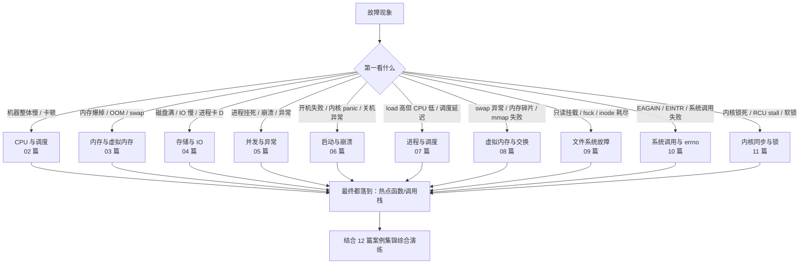
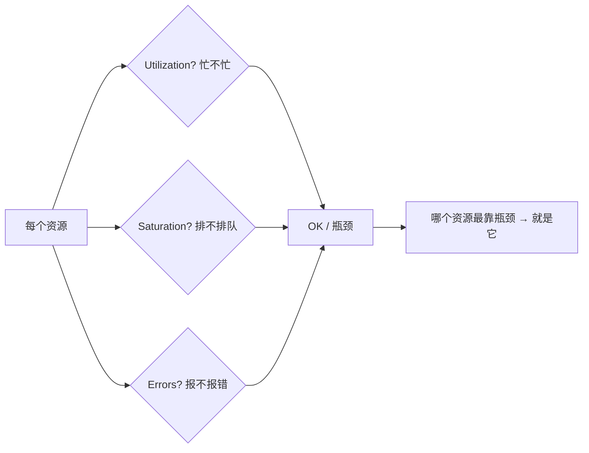

::: abstract 本章定位
本篇是整个"问题排查"目录的导航与总纲：给定一台"出问题"的 Linux 机器，如何不慌不忙、按固定套路定位根因。它把《Operating System Concepts》里的进程、调度、内存、IO、同步、死锁全部知识，组织成一套可重复执行的排查流程，并给出本目录的主题地图与关键工具速查表。
:::

排查故障最怕的不是没有工具，而是**没有套路**。新手拿到一台慢机器会随机敲命令，老手则按"负载 → 进程 → 资源 → 日志 → 调用栈"的固定顺序层层收敛。本篇先把套路和工具地图建立起来，01–05 每篇对 CPU、内存、磁盘、并发四类资源问题纵深展开，06–11 每篇再对启动崩溃、进程调度、虚拟内存、文件系统、系统调用、内核同步六类操作系统本身的高频疑难纵深展开，12 用真实风格案例做综合演练。本目录只讨论**操作系统层面**的问题——内核态的现象、系统调用、文件系统、调度与资源，不涉及上层应用、中间件或容器编排。

## 1. 主题地图

| 编号 | 主题 | 解决的核心问题 | 对应的 OS 知识 | 主要工具 |
|---|---|---|---|---|
| [系统问题排查方法论](/kb/os/问题排查/00-系统问题排查方法论/) | 方法论总纲 | 拿到故障机先干什么？用什么顺序排查？ | 全书综合 | uptime/top/vmstat/pidstat |
| [性能分析方法论](/kb/os/问题排查/01-性能分析方法论/) | 性能分析框架 | 性能基线与 Load Average 怎么解读？热点如何一步步定位到函数？ | Ch3-5 调度 · Ch8-9 内存 | uptime→top→vmstat→pidstat→perf |
| [CPU性能问题排查](/kb/os/问题排查/02-CPU性能问题排查/) | CPU 问题 | us/sy 高、上下文切换高、软中断高怎么办？ | Ch3-5 调度 · 中断 | top/ps/pidstat/perf/strace/taskset |
| [内存与内存泄漏排查](/kb/os/问题排查/03-内存与内存泄漏排查/) | 内存问题 | OOM、swap 疯狂读写、内存泄漏、slab 泄漏怎么定位？ | Ch8-9 内存 · 虚拟内存 | free/vmstat/ps/pmap/smaps/valgrind |
| [磁盘与IO瓶颈排查](/kb/os/问题排查/04-磁盘与IO瓶颈排查/) | 磁盘与 IO | df 满、%util 高、D 状态进程卡死、fd 耗尽怎么办？ | Ch11-13 存储 · Ch12 IO | df/du/iostat/iotop/strace/blktrace/lsof |
| [并发与异常排查](/kb/os/问题排查/05-并发与异常排查/) | 并发与异常 | 死锁、僵尸、段错误、core dump 怎么定位？ | Ch6-7 同步 · Ch8 死锁 · Ch9 内存 | jstack/pstack/gdb/coredumpctl |
| [系统启动与内核崩溃](/kb/os/问题排查/06-系统启动与内核崩溃/) | 启动与崩溃 | 系统起不来、内核 panic、启动卡死、关机异常怎么办？ | 系统结构 · 启动流程 | dmesg/journalctl/kdump/crash |
| [进程与调度异常疑难](/kb/os/问题排查/07-进程与调度异常疑难/) | 进程与调度 | load 高但 CPU 低、进程 D 状态、调度延迟、进程数/线程数爆表？ | Ch3-5 调度 · 进程 | pidstat/perf sched/sar/ps |
| [虚拟内存与交换疑难](/kb/os/问题排查/08-虚拟内存与交换疑难/) | 虚拟内存与交换 | swap 异常、内存碎片、thrashing、mmap 失败、overcommit 超限？ | Ch9 虚拟内存 | free/vmstat/swapstats/pprof |
| [文件系统与磁盘故障](/kb/os/问题排查/09-文件系统与磁盘故障/) | 文件系统故障 | 只读挂载、文件系统损坏、fsck、inode 耗尽、删除后空间不释放？ | Ch11-15 存储 · 文件系统 | fsck/mount/dumpe2fs/lsof +L1 |
| [系统调用与错误码疑难](/kb/os/问题排查/10-系统调用与错误码疑难/) | 系统调用与 errno | EAGAIN/EINTR/EMFILE 等 errno 怎么理解？系统调用为何失败？ | Ch2 系统结构 · 系统调用 | strace/errno/perf |
| [内核同步与锁疑难](/kb/os/问题排查/11-内核同步与锁疑难/) | 内核同步与锁 | 内核死锁、RCU stall、软锁死、自旋锁饥饿、锁竞争严重？ | Ch6-8 同步 · 死锁 | lockdep/rcu_*_stall/perf lock |
| [疑难案例集锦](/kb/os/问题排查/12-疑难案例集锦/) | 案例汇编 | 真实风格生产事故的完整复盘与排查手顺 | 全书综合 | 各篇工具联动 |

::: tip 阅读建议
01–05 讲**资源维度**（CPU/内存/磁盘/并发），06–11 讲**操作系统纵深疑难**（启动/调度/虚拟内存/文件系统/系统调用/内核锁），12 是综合演练。先从 01–02 建立定位链直觉，再按需查阅 06–11，最后用 12 检验综合能力。
:::

### 1.1 排查层次划分

故障按"资源"划分成四类，每类对应一本教材章节，排查手法完全不同：



::: important 一个核心思想
无论哪类问题，最终都要落到"**在哪个进程、哪个线程、哪条函数调用链上**"。所以"看调用栈"（strace/perf/gdb/jstack）是所有排查的终点站。
:::

## 2. 排查方法论总纲：五步法

拿到一台故障机，按下面五步走，不跳跃、不随机：

```
① 看负载   uptime / top / vmstat    系统整体状况：CPU 忙还是 IO 忙？
      │
      ▼
② 找进程   top 按 CPU / 内存排序    锁定可疑进程 PID
      │
      ▼
③ 看资源   pidstat / pmap / lsof / iostat   该进程的资源画像
      │
      ▼
④ 看日志   dmesg / journalctl / 应用日志   内核与应用的"遗言"
      │
      ▼
⑤ 看调用栈 perf / gdb / strace / jstack    找到热点函数 / 阻塞点
```

### 2.1 第一步：看负载——先判断"机器怎么了"

不要一上来就盯 CPU。先回答三个问题：**负载高不高？CPU 忙不忙？还是在等 IO？**

```bash
# 三件套：负载 + 总体 CPU + 系统概况
uptime
top -b -n1 | head -15
vmstat 1 3
```

预期输出（负载高但 CPU 空闲的典型场景）：

```
$ uptime
 21:48:33 up 46 days,  3:12,  1 user,  load average: 8.02, 7.87, 7.61

$ top -b -n1 | head -8
top - 21:48:33 up 46 days,  3:12,  1 user,  load average: 8.02, 7.87, 7.61
Tasks: 245 total,   2 running, 243 sleeping,   0 stopped,   0 zombie
%Cpu(s):  2.1 us,  1.3 sy,  0.0 ni, 61.2 id, 35.4 wa,  0.0 hi,  0.0 si,  0.0 st
```

解读：
- `load average` 8.02 高，但 `%Cpu(s)` 里 `id=61.2`（空闲）而 **`wa=35.4`（IO 等待）** → 结论：**不是 CPU 不够，是磁盘 IO 在拖后腿**。方向立刻切到 [磁盘篇](/kb/os/问题排查/04-磁盘与IO瓶颈排查/)。
- 如果 `us+sy` 接近 100、load 高、wa≈0 → CPU 计算瓶颈，方向在 [CPU 篇](/kb/os/问题排查/02-CPU性能问题排查/)。
- 如果 `si/so`（swap 换入换出）非零 → 内存不足，方向在 [内存篇](/kb/os/问题排查/03-内存与内存泄漏排查/)。

::: tip 五步法第一课
第一步的目的不是找到根因，而是**排除错误方向**。80% 的故障在第一步就能定大类。
:::

### 2.2 第二步：找进程——从"机器"收敛到"进程"

用 top 排序或 ps 排序，找出最可疑的进程：

```bash
top -b -n1 | sort -k9 -r | head -10        # 按 %CPU 排前 10（近似）
ps -eo pid,ppid,pcpu,pmem,stat,comm --sort=-pcpu | head -10
ps -eo pid,ppid,pcpu,pmem,stat,comm --sort=-rss  | head -10   # 按内存
```

预期输出：

```
$ ps -eo pid,ppid,pcpu,pmem,stat,comm --sort=-pcpu | head -10
   PID  PPID %CPU %MEM STAT COMMAND
  3841     1 302.0  7.0 S    node
  2035     1   5.2  0.3 S    mysqld
  1421     1   1.1  0.4 S    redis-server
```

解读：
- `%CPU 302.0` → 该进程占 **3 个核**，明显是 CPU 杀手。
- `STAT` 列的 S/R/D 能快速区分：R=在跑、D=等 IO、S=正常睡眠。若 `COMMAND` 是 `[kworker]`、`[jbd2]` 这类内核线程，则问题出在内核侧（文件系统/驱动），不是应用。

### 2.3 第三步：看资源——给嫌疑进程画画像

拿到 PID 后，用资源级工具把它的 CPU、内存、文件、线程摸清楚：

```bash
pidstat -u -r -d -p 3841 1            # CPU/内存/IO 三个维度
pmap -x 3841                           # 虚拟内存分布
ls /proc/3841/task/ | wc -l            # 线程数
cat /proc/3841/status | head -20       # 状态/voluntary/nonvoluntary 切换
lsof -p 3841 | head -20                # 打开的文件
```

解读：
- `pidstat -u` 能区分 **user / system** 时间——如果 `%system` 高，说明系统调用/内核态开销大，后面要用 `strace` 看它在调什么。
- `lsof -p` 若看到大量重复文件或 `deleted` 文件，往往对应 fd 泄漏或磁盘占用（见 [磁盘篇](/kb/os/问题排查/04-磁盘与IO瓶颈排查/)）。

### 2.4 第四步：看日志——听内核与应用怎么说

程序不会说话，但日志会。三步全覆盖：

```bash
dmesg -T | tail -50                    # 内核日志：OOM、硬件错误、oom-killer
journalctl -xe --since "30 min ago"    # systemd 全量日志（含用户态）
tail -f /var/log/app/app.log           # 应用自己的日志
```

::: warning dmesg 要看什么
1. `Out of memory: Kill process ...` → 内存不足被 OOM killer 杀了（见 [内存篇](/kb/os/问题排查/03-内存与内存泄漏排查/)）
2. `EXT4-fs error` / `I/O error` → 磁盘/文件系统硬件问题（见 [磁盘篇](/kb/os/问题排查/04-磁盘与IO瓶颈排查/)）
3. `BUG: unable to handle kernel NULL pointer` → 内核 panic，多半是硬件或驱动 bug
:::

### 2.5 第五步：看调用栈——把问题钉死在代码上

前三步告诉你"是哪个进程"，这一步告诉你"是哪一行代码"。按语言/场景选工具：

| 场景 | 工具 | 例子 |
|---|---|---|
| CPU 热点在哪（采样） | `perf top` / `perf record` | [CPU 篇](/kb/os/问题排查/02-CPU性能问题排查/)、[火焰图](/kb/os/问题排查/01-性能分析方法论/) |
| 进程被什么系统调用卡住 | `strace -p PID` | read/write/futex 等待 |
| C/C++ 程序调用栈 | `gdb -p PID` → `bt` | [并发篇](/kb/os/问题排查/05-并发与异常排查/) |
| Java 线程 dump | `jstack PID` | [并发篇](/kb/os/问题排查/05-并发与异常排查/) |

## 3. USE 方法与 RED 方法

### 3.1 USE 方法（Brendan Gregg，资源视角）

针对每个资源（CPU、内存、磁盘、网络、锁），回答三个问题：

| 问题 | 含义 | 指标 | 工具 |
|---|---|---|---|
| **U**tilization 利用率 | 资源有多忙？ | 越高越接近瓶颈，100% 意味饱和 | `top` `iostat %util` `sar` |
| **S**aturation 饱和度 | 有多少任务在排队等待？ | 队列长度 > 0 = 已饱和 | `vmstat r/cs` `iostat avgqu-sz` `load average` |
| **E**rrors 错误 | 有没有报错？ | 越高越危险，1 个也可能是问题 | `dmesg` `journalctl` `/proc/softirqs` |



**记忆口诀**：先看 `U`（%util/idle），再问 `S`（队列/load/cs），最后查 `E`（dmesg 报错）。对 CPU、内存、磁盘、网卡、锁五种资源各问一遍，答案自己跳出来。

::: tip USE 与五步法的关系
五步法是"从整体到局部"的流程，USE 是"在每一步里对每个资源做的体检"。两者叠加：第一步对 CPU/内存/磁盘各跑一遍 U-S-E。
:::

### 3.2 RED 方法（Tom Wilkie，服务视角）

USE 面向资源，RED 面向"请求"。排查 Web 服务、微服务时用：

| 字母 | 含义 | 指标 | 例子 |
|---|---|---|---|
| **R**ate 速率 | 每秒处理多少请求 | QPS / RPS | `nginx` access log、Prometheus `rate()` |
| **E**rrors 错误 | 多少请求失败 | 5xx 率、错误数 | 4xx/5xx、超时 |
| **D**uration 时长 | 请求花了多久 | P50/P95/P99 延迟 | `p99 latency` |

RED 的用法：如果 **Rate 正常但 Duration 飙升** → 某个环节变慢（DB？GC？锁？）；如果 **Errors 飙升** → 上游故障或依赖雪崩。RED 告诉你"用户感受到的慢"，USE 告诉你"底层哪个资源慢"，两者结合才能从现象推到根因。

## 4. 关键工具速查表

按资源分类，排好优先级，**前面失效才用后面**：

### 4.1 CPU

| 工具 | 用途 | 常见用法 |
|---|---|---|
| `uptime` | 负载（1/5/15 分钟） | `uptime` |
| `top` / `htop` | 总体 CPU 与进程排行 | `top` 按 P 排序，按 1 看每核 |
| `vmstat` | r 队列 + cs 上下文切换 + us/sy/wa | `vmstat 1 5` |
| `mpstat` | 每核 CPU 使用率 | `mpstat -P ALL 1` |
| `pidstat` | 每进程 CPU/内存/IO/上下文切换 | `pidstat -u 1 -p PID` |
| `perf top` | 采样热点函数 | `perf top -p PID` |
| `perf record/report` | 离线采样+火焰图 | `perf record -g -F 99 -p PID -- sleep 30` |
| `sar -u` | 历史 CPU 记录 | `sar -u 1 5` |
| `taskset` | 查看/设置 CPU 亲和性 | `taskset -pc PID` |

### 4.2 内存

| 工具 | 用途 | 常见用法 |
|---|---|---|
| `free -h` | 总体内存/swap 概览 | `free -h` |
| `vmstat` | si/so 换页速率 | `vmstat 1 5` |
| `ps --sort=-rss` | 内存占用大户 | `ps aux --sort=-rss \| head` |
| `pmap -x PID` | 单进程地址空间分布 | `pmap -x PID` |
| `cat /proc/PID/smaps` | RSS/Pss/私有脏页细节 | `grep -E 'Rss\|Pss' /proc/PID/smaps` |
| `smem` | 考虑了共享的实际内存 | `smem -k -s rss` |
| `slabtop` | 内核 slab 缓存占用 | `slabtop -o` |
| `dmesg \| grep -i oom` | OOM killer 记录 | `journalctl -k \| grep -i oom` |

### 4.3 磁盘

| 工具 | 用途 | 常见用法 |
|---|---|---|
| `df -h` / `df -i` | 空间/inode 使用率 | `df -h; df -i` |
| `du` | 目录/文件占多大 | `du -h --max-depth=1 /var \| sort -h` |
| `iostat -x 1` | 设备吞吐、等待、%util | `iostat -x 1` |
| `iotop` | 按进程看 IO 排行 | `sudo iotop -o` |
| `pidstat -d` | 某进程的读写速率 | `pidstat -d 1 -p PID` |
| `lsof +L1` | 被删除但仍打开的文件 | `lsof +L1` |
| `strace -e trace=read,write -p PID` | 看进程在读写什么 | `strace -p PID` |
| `blktrace` / `blkparse` | 块层 IO 事件追踪 | `blktrace -d /dev/sda -o trace -w 5` |

### 4.4 网络

| 工具 | 用途 | 常见用法 |
|---|---|---|
| `sar -n DEV 1` | 网卡吞吐 | `sar -n DEV 1 5` |
| `ss -s` | 连接统计 | `ss -s` |
| `ss -tanp` | 各 TCP 连接状态与进程 | `ss -tanp` |
| `iftop` | 实时流量排行 | `sudo iftop -i eth0` |
| `nethogs` | 按进程看流量 | `sudo nethogs` |
| `tcpdump` | 抓包分析 | `sudo tcpdump -i eth0 port 80 -w cap.pcap` |
| `ethtool` | 网卡速率/丢包统计 | `ethtool -S eth0 \| grep -i drop` |

### 4.5 进程

| 工具 | 用途 | 常见用法 |
|---|---|---|
| `ps` | 进程状态/CPU/内存 | `ps -eo pid,stat,pcpu,comm` |
| `pstree` | 进程父子关系 | `pstree -p` |
| `pidstat` | 进程资源动态采样 | `pidstat 1` |
| `lsof` | 打开文件/网络连接 | `lsof -p PID` |
| `strace` | 系统调用追踪 | `strace -f -p PID` |
| `gdb` | 附加调试 / 调用栈 | `gdb -p PID` 然后 `bt` |
| `jstack` | Java 线程 dump | `jstack PID` |
| `coredumpctl` | 管理 core 文件 | `coredumpctl list` |

### 4.6 操作系统纵深疑难

| 工具 | 用途 | 常见用法 |
|---|---|---|
| `dmesg` / `journalctl -k` | 内核日志（panic/OOM/驱动报错） | `journalctl -k -b -1` 看上一次启动 |
| `kdump` / `crash` | 内核 panic 转储与分析 | `crash /usr/lib/debug/vmlinux /var/crash/vmcore` |
| `systemctl status` / `journalctl -u` | systemd 服务与启动排查 | `journalctl -u docker --since yesterday` |
| `perf sched` | 调度延迟/唤醒链分析 | `perf sched record` + `perf sched latency` |
| `perf lock` | 锁竞争与持锁时间 | `perf lock record` + `perf lock report` |
| `lockdep`（内核选项） | 内核死锁/AB-BA 检测 | 内核日志 `possible circular locking dependency` |
| `swapstats` / `sar -W` | 换页统计 | `sar -W 1 5` 看 pswpin/pswpout |
| `free -h` + `vmstat` | 内存/swap 现状 | `vmstat 1 5` 看 si/so |
| `fsck` / `dumpe2fs` | 文件系统检查与超级块 | `fsck -f /dev/sdb1`（须先 umount） |
| `mount -o remount,ro` | 应急只读挂载 | 文件系统异常时先保护现场 |
| `lsof +L1` | 已删除但仍被占用的文件 | `lsof +L1 \| head` |
| `strace -e trace=...` | 系统调用失败定位 | `strace -e trace=open,read -p PID` |
| `perf trace` | 系统调用级采样 | `perf trace -p PID` |
| `errno` / `man 2` | errno 含义查询 | `perror 11` 查 EAGAIN |

::: tip 工具按需取用
上表对应 06–12 篇：启动/崩溃见 [系统启动与内核崩溃](/kb/os/问题排查/06-系统启动与内核崩溃/)，调度见 [进程与调度异常疑难](/kb/os/问题排查/07-进程与调度异常疑难/)，虚拟内存见 [虚拟内存与交换疑难](/kb/os/问题排查/08-虚拟内存与交换疑难/)，文件系统见 [文件系统与磁盘故障](/kb/os/问题排查/09-文件系统与磁盘故障/)，系统调用见 [系统调用与错误码疑难](/kb/os/问题排查/10-系统调用与错误码疑难/)，内核锁见 [内核同步与锁疑难](/kb/os/问题排查/11-内核同步与锁疑难/)，综合见 [疑难案例集锦](/kb/os/问题排查/12-疑难案例集锦/)。
:::

## 5. 何时用哪层工具：逐层深入

同样一个问题，从"宏观"到"微观"有明确的工具阶梯。**每一层能回答就停手**，不要跳级：

```
┌─ L0 整体概览 ── uptime / top / free / df
│     负载高不高？CPU/MEM/盘 哪个最满？          ← 几秒钟
├─ L1 每进程统计 ── pidstat / ps --sort / iostat -x
│     是谁在吃资源？吃的是 user 还是 system？     ← 十几秒
├─ L2 每线程/系统调用 ── pidstat -t / strace -p / cat /proc/PID/task/*/wchan
│     在哪个线程？阻塞在哪个内核函数/系统调用？    ← 有 ptrace 权限即可
├─ L3 采样热点 ── perf top / perf record / 火焰图
│     热循环在哪个函数？调用链什么样？            ← 需要 perf_event 权限
└─ L4 精确追踪 ── gdb bt / jstack / bpftrace / blktrace
      具体一行代码、一个锁、一个 IO 请求           ← 最重，按需使用
```

对应关系表：

| 问题 | L0 | L1 | L2 | L3 |
|---|---|---|---|---|
| 某个服务 CPU 高 | `top` | `pidstat -u` | `pidstat -t` | `perf top` |
| 进程卡住不动 | `top`（状态 S/R/D） | `pidstat -d` | `strace -p` | `gdb bt` |
| 机器 IO 慢 | `iostat -x` | `pidstat -d` | `wchan` | `blktrace` |
| 内存一直涨 | `free -h` | `ps --sort=-rss` | `pmap -x` | `smaps`/valgrind |

::: important 跳级的代价
直接上 `perf`/`gdb` 不是不行，但会看不到全局，容易"找到一棵树却丢了森林"。L0→L3 逐层走，每一步都基于上一步的结论，方向才不会被带偏。
:::

## 6. 常见误区

| # | 误区 | 正确认知 |
|---|---|---|
| 1 | Load Average 高 = CPU 不够 | Linux 的 load 包含 **D 状态（等 IO）** 任务，IO 慢也会推高 load，必须配 `top` 的 `wa` 列一起看（见 [篇](/kb/os/问题排查/01-性能分析方法论/)） |
| 2 | `free` 里 used 大 = 内存泄漏 | `buff/cache` 是可回收缓存，正确指标是 `available` 列 |
| 3 | 只看 CPU 不看 wa | `wa` 高时加 CPU 没用，瓶颈在磁盘 |
| 4 | 机器慢就先重启 | 重启会丢掉 `/proc`、`dmesg` 里的现场证据，应先抓快照再考虑重启 |
| 5 | 认为是"某个进程的 bug"，结果是内核线程/驱动 | `%CPU` 里出现 `kworker`/`jbd2` 说明是内核问题，方向完全不一样 |
| 6 | 一个工具用到死 | `top` 看不到的东西要 `pidstat`，`pidstat` 看不到的（热点函数）要 `perf`，逐层深入 |
| 7 | 忘记看基线 | 没有基线，"40% CPU"到底是正常还是异常无法判断（见 [基线](/kb/os/问题排查/01-性能分析方法论/)） |
| 8 | 只看 `/proc/loadavg` 不结合上下文 | load 与 CPU 核数、IO 状态强相关，裸数字没有意义 |

## 7. 面试考点

| 考点 | 一句话要点 |
|---|---|
| 排查步骤 | 五步法：看负载 → 找进程 → 看资源 → 看日志 → 看调用栈 |
| USE 方法 | Utilization / Saturation / Errors，对每个资源三连问 |
| RED 方法 | Rate / Errors / Duration，面向服务请求的黄金三指标 |
| load average | 1/5/15 分钟就绪+不可中断任务数，要除以 CPU 核数判断 |
| wa 高 vs us 高 | wa 高 = IO 瓶颈，us 高 = CPU 计算瓶颈，处理方式相反 |
| top 看不到函数 | 要用 perf 采样才能看到热点函数，top 只能看到进程 |
| 上下文切换 | `vmstat cs` 是全局，`pidstat -w` 是按进程，`/proc/PID/status` 有自愿/非自愿切换计数 |
| 面试场景题 | "线上服务 CPU 100% 怎么排查？"→ 答：top 找进程 → pidstat 分 us/sy → perf top 找函数 → 看代码/火焰图 |
| 现场证据 | dmesg 里 OOM/IO error 是诊断金矿，重启前必须先抓 |

## 8. 本章小结

问题排查 = **套路 + 工具 + 知识** 三者的叠加：

- **套路**：五步法（负载→进程→资源→日志→调用栈）+ USE（资源视角）+ RED（服务视角）。
- **工具**：L0–L3 分层，逐层深入，每一层能定位就停手。
- **知识**：load 的含义、wa 与 us 的区别、`available` 与 `used` 的区别……这些底层机制正是《Operating System Concepts》在讲的东西——排查问题就是把你学过的调度、内存、IO、同步知识反过来验证一次。

后续路线：先读 [性能分析方法论](/kb/os/问题排查/01-性能分析方法论/) 掌握性能分析通用框架，再按资源分头深入 [CPU](/kb/os/问题排查/02-CPU性能问题排查/)、[内存](/kb/os/问题排查/03-内存与内存泄漏排查/)、[磁盘](/kb/os/问题排查/04-磁盘与IO瓶颈排查/)，最后用 [并发与异常](/kb/os/问题排查/05-并发与异常排查/) 收尾进程级疑难杂症。

## 9. 实战演练：一台上故障机的完整五步法演示

::: note 场景
一台 8 核 Web 服务器，用户反馈"打开网页非常慢"，需要你诊断。全程按五步法走，以下是每一步的真实命令与输出。
:::

**第一步 看负载**：

```bash
$ uptime
 21:48:33 up 46 days,  3:12,  1 user,  load average: 6.02, 3.87, 2.61

$ vmstat 1 3
procs -----------memory---------- ---swap-- -----io---- -system-- ------cpu-----
 r  b   swpd   free   buff  cache   si   so    bi    bo   in   cs us sy id wa st
 3  2      0 152344  40228 902364    0    0   124  2018 2031 1850  5  3 55 37  0
 2  3      0 150118  40228 902380    0    0   115  1920 1988 1793  4  3 56 37  0
 3  2      0 149890  40228 902388    0    0   120  1998 2010 1812  5  3 54 38  0
```

解读：load 6.0 高于 8 核的一半但还在攀升（1→5→15 在涨，问题正在恶化）；`wa=37` 且 `b`（阻塞在 IO 的进程数）为 2–3 → **IO 瓶颈，不是 CPU**。`bi/bo` 看读 120KB/s、写 2000KB/s，写明显多于读。

**第二步 找进程**：

```bash
$ pidstat -d 1 3
Linux 5.15.0-91-generic (web01) 	08/10/26 	_x86_64_	(8 CPU)

21:50:00      UID       PID   kB_rd/s   kB_wr/s kB_ccwr/s  Command
21:50:01        0      1021      0.00   1996.00      0.00  jbd2/sda1-8
21:50:01      999      3841     84.00    122.00      0.00  mysqld
21:50:02        0      1021      0.00   1912.00      0.00  jbd2/sda1-8
21:50:02      999      3841     72.00    118.00      0.00  mysqld
```

解读：写入量最大的不是应用，而是 **`jbd2/sda1-8`**——这是 ext4 文件系统的日志内核线程！写操作触发频繁的 fsync/日志提交，说明**应用在疯狂做同步写**，把磁盘日志拖垮了。

**第三步 看资源（mysqld）**：

```bash
$ pidstat -u 1 3 -p 3841
21:50:00      UID       PID    %usr %system  %guest   %wait    %CPU   CPU  Command
21:50:01      999      3841    3.20    1.10      0.0      0.0    4.30     2  mysqld
```

解读：mysqld 的 CPU 只有 4.3%，**CPU 不是瓶颈**。结合 `%wait`≈0，问题不在计算，在它触发的写盘。

**第四步 看日志**：

```bash
$ dmesg -T | grep -iE 'error|warn' | tail -10
（无 IO error、无 oom —— 硬件正常）
$ journalctl -u mysqld --since "10 min ago" | grep -i slow
10:05:11 web01 mysqld[3841]: [Warning] Slow query:  UPDATE t SET ts=NOW() ...
```

解读：出现了 **慢查询**，指向数据库层的高频写操作。

**第五步 看调用栈/确认根因**：

```bash
$ strace -f -p 3841 -e trace=fsync,write,fdatasync 2>&1 | head
fdatasync(7)                          = 0
fdatasync(7)                          = 0
fdatasync(7)                          = 0
```

解读：mysqld 在**每秒上千次 fdatasync**——多半是 `innodb_flush_log_at_trx_commit=1`（每次事务提交都刷盘），配合磁盘写入慢，形成"高 IO + 高等待"。

**结论**：IO 瓶颈 → 慢查询 `UPDATE` 每秒大量提交 → `fdatasync` 刷盘过频 → 磁盘 `%util` 高、`jbd2` 忙。优化方向：批量提交、调大 `innodb_buffer_pool`、`innodb_flush_log_at_trx_commit` 权衡，或上 SSD。完整案例的深入定位见 [篇](/kb/os/问题排查/04-磁盘与IO瓶颈排查/)。

## 10. 自测题

1. **`load average` 高但 `top` 里 `id` 很高、`wa` 也很高，说明什么？** 说明有大量任务在等 IO（D 状态），瓶颈在磁盘而非 CPU，应去查 IO。
2. **USE 方法对"磁盘"这个资源三连问分别看什么？** Utilization 看 `iostat %util`，Saturation 看 `avgqu-sz` 队列长度，Errors 看 `dmesg`/`smartctl` 报错。
3. **五步法中，哪一步负责把问题从"机器"收敛到"进程"？** 第二步"找进程"：`ps --sort=-pcpu` / `top` 锁定嫌疑 PID。
4. **什么时候该从 `top` 升级到 `perf top`？** 当已经锁定进程、需要看进程内部哪个函数吃 CPU 时——`top` 只能到进程级，`perf` 才能到函数级。
5. **RED 三个指标里，如果 Rate 正常、Duration 的 P99 暴涨，大概率问题出在哪？** 某个依赖环节变慢（数据库、锁、GC、远程调用），需要再用 USE 去查底层资源。
