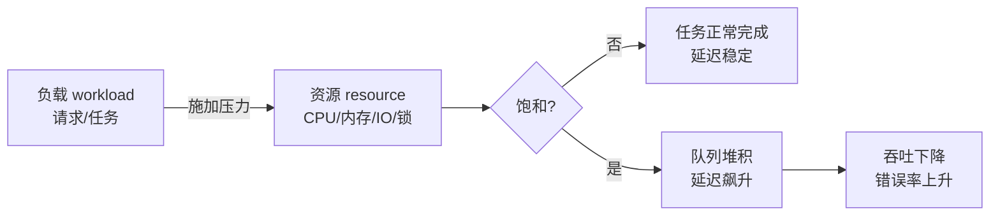
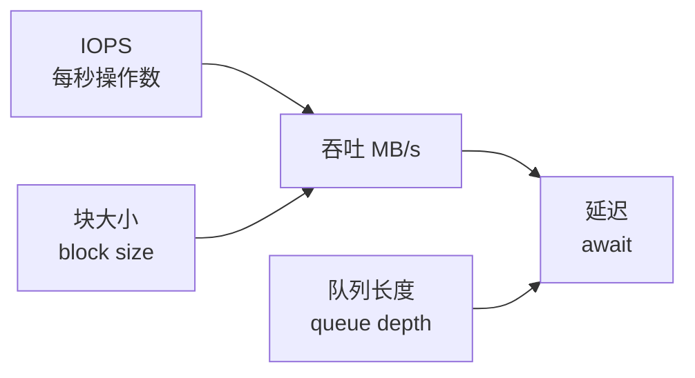

::: abstract 本章定位
本篇解决"性能分析怎么做才不靠猜"：先立基线、再量化负载、把 Load Average 读明白、用 CPU 的 us/sy/wa 三分法判断瓶颈类型、沿"uptime→top→vmstat→pidstat→perf"定位链把热点钉到函数，最后亲手生成一张火焰图。对应《Operating System Concepts》Ch5 调度与 Ch8-9 内存的实战应用。
:::

性能问题的本质是**资源竞争**：多个进程抢 CPU、抢内存、抢磁盘、抢锁。分析的目标就是回答三个问题——**谁在抢？抢哪个资源？为什么抢？** 本篇教一套可以复制的方法，下一篇 [CPU 篇](/kb/os/问题排查/02-CPU性能问题排查/) 在此框架上做纵深。

## 1. 性能分析的通用框架

### 1.1 三个基本量：负载、资源、队列

任何性能问题都可以拆成三个互相影响的量：



- **负载**：单位时间到达的请求数（QPS）、活跃进程数、IO 请求速率。
- **资源**：CPU 核数、内存大小、磁盘 IOPS/带宽、锁。
- **队列**：当负载逼近或超过资源能力时产生的排队，是性能恶化的放大器。

::: important 核心公式（排队论直觉）
响应时间 ≈ 服务时间 + 排队时间。资源利用率越高，排队时间越按非线性暴涨——**利用率 80% 时延迟翻倍，90% 时延迟可能翻 10 倍**。所以"资源还有 20% 空闲"≠"没问题"。
:::

### 1.2 性能分析的固定流程

1. **立基线**：这台机器/服务"正常时"的 CPU、内存、延迟是多少？（没有基线就无法判断异常）
2. **量化现象**：用户说"慢"，要量化成"P99 从 50ms 涨到 800ms"或"load 从 2 涨到 9"。
3. **定位资源**：用 USE 方法（见 [篇](/kb/os/问题排查/00-系统问题排查方法论/)）逐资源问：Utilization/Saturation/Errors。
4. **定位进程**：哪个进程吃掉了该资源（`top`/`pidstat`）。
5. **定位代码**：进程内部的哪条调用链（`perf`/`gdb`/`strace`）。
6. **验证与复盘**：改完后复测，确认指标回到基线附近。

## 2. 性能基线：没有基线就没有诊断

基线 = 系统在**正常负载下**的一组合法指标。采集基线要在"没出事的时候"做：

```bash
# 建议定时采集（cron 里跑，或用 sar/sysstat 自动记录）
sar -o /var/log/sa/sa$(date +%d) 5 120     # 每 5 秒采样 2 分钟，落盘
sar -u; sar -r; sar -d; sar -n DEV         # 事后回放 CPU/内存/磁盘/网络
```

预期输出（回放基线）：

```
$ sar -u 2>/dev/null | tail -20
09:00:00     CPU     %user   %nice   %system   %iowait    %steal     %idle
09:00:05     all      8.00    0.00      4.00      0.50      0.00     87.50
09:00:10     all      9.00    0.00      3.50      0.60      0.00     86.90
09:00:15     all      7.80    0.00      3.20      0.40      0.00     88.60
```

解读：
- 基线就写：`%user≈8%、%system≈4%、%iowait≈0.5%、load 1 分钟≈1.2、P99≈50ms`。
- 出问题时对照基线：`%iowait` 从 0.5% 涨到 35% 就是异常；但如果基线本来就是 30%，说明这台机器一直如此，问题可能另有蹊跷（比如被限流）。
- 基线还能帮你区分"容量问题"和"代码问题"：同样的负载下，`%user` 涨了一倍 → 代码变慢（回归）；负载翻倍导致 `%user` 翻倍 → 容量不够。

::: warning 基线采样的坑
基线一定要覆盖业务高峰和低峰。只采凌晨的数据，到了晚上高峰照样抓瞎。建议至少采集 1–2 周，覆盖完整的业务周期。
:::

## 3. Load Average 解读

### 3.1 它到底统计的是什么

Linux 的 load average（`uptime`、`top` 右上角、`/proc/loadavg`）统计的是**处于运行态（R）和不可中断睡眠态（D，典型是等磁盘 IO）的任务数**：

```
$ cat /proc/loadavg
6.02 5.87 5.61 2/312 15432
 └─┘ └─┘ └─┘ └─┘└└─└─┘
 1min 5min 15min  当前 R+D / 总任务  最近 PID
```

| 数字 | 含义 | 使用要点 |
|---|---|---|
| 1 分钟 | 最近 1 分钟平均 R+D 数 | 反映最新变化，波动大 |
| 5 分钟 | 5 分钟平均 | 短期趋势 |
| 15 分钟 | 15 分钟平均 | 长期趋势，最稳 |

### 3.2 与 CPU 核数的关系（关键）

Load 的意义要除以 CPU 核数来看：

| 场景 | 判断 |
|---|---|
| load < CPU 核数 | 资源有富余，CPU 侧正常 |
| load ≈ CPU 核数 | CPU 接近打满，刚好处在临界 |
| load > CPU 核数（如 8 核 load 16） | CPU 明显过载，任务在排队 |

```bash
$ nproc          # 看有几核
8
$ uptime
 21:48:33 up 46 days,  3:12,  1 user,  load average: 16.02, 14.87, 12.61
```

解读：8 核机器 load=16，**平均每个核排了 2 个任务**，CPU 饱和，任务响应时间会被拉长。

::: important 经典陷阱：load 高 ≠ CPU 忙
Linux 的 load 把 **D 状态（等 IO）** 的任务也计入了。所以：
- 如果 load 高、`top` 里 `wa` 也高、`id` 也不低 → 瓶颈是 **IO**，不是 CPU（[磁盘篇](/kb/os/问题排查/04-磁盘与IO瓶颈排查/)）。
- 如果 load 高、`id`≈0、us+sy 接近 100% → 瓶颈是 **CPU**。
只看 load 数字、不看 wa/id，会被带进沟里。
:::

## 4. CPU 瓶颈特征：us / sy / wa / id 三分法

`top` 和 `vmstat` 把 CPU 时间分成几块，每一块对应不同的瓶颈：

| 指标 | 全称 | 含义 | 高时代表 |
|---|---|---|---|
| **us** | user | 用户态运行时间 | 应用在真实计算（循环、哈希、正则……），**计算密集** |
| **sy** | system | 内核态运行时间 | 大量系统调用/内核工作：读写、调度、中断处理（见 [CPU 篇 §sys](/kb/os/问题排查/02-CPU性能问题排查/)） |
| **wa** | iowait | 等 IO 完成 | 进程阻塞在磁盘/网络 IO，**IO 瓶颈**（[磁盘篇](/kb/os/问题排查/04-磁盘与IO瓶颈排查/)） |
| **id** | idle | 空闲 | 无事可做，除非 load 还高（那说明是等 IO 的假空闲） |
| **hi / si** | hard/soft irq | 硬/软中断 | 网络、网卡驱动高频中断（[CPU 篇 §软中断](/kb/os/问题排查/02-CPU性能问题排查/)） |
| **st** | steal | 被宿主机偷走 | 虚拟机场景，**被其他 VM 抢走 CPU** |

### 4.1 三种典型组合

```
场景 A：计算密集            %Cpu(s): 88 us,  6 sy,  2 id,  0 wa
→ 应用真的在算，去 perf 找热点函数

场景 B：IO 密集              %Cpu(s):  5 us,  3 sy, 55 id, 35 wa
→ CPU 在等磁盘，去查 IO（%util、await、慢查询）

场景 C：系统调用/锁密集      %Cpu(s):  8 us, 52 sy, 30 id,  8 wa
→ 内核态占比高，去 strace/软中断/上下文切换
```

```bash
$ vmstat 1 5
procs -----------memory---------- ---swap-- -----io---- -system-- ------cpu-----
 r  b   swpd   free   buff  cache   si   so    bi    bo   in   cs us sy id wa st
 2  0      0 152344  40228 902364    0    0   124  2018 2031 1850  5  3 55 37  0
 1  0      0 150118  40228 902380    0    0   115  1920 1988 1793  4  3 56 37  0
```

解读（场景 B）：`us+sy` 只有 8%，`wa=37`，`cs`（上下文切换）1800/s 左右 → **CPU 在大量时间等 IO**。这时候给机器加 CPU 毫无意义，要解决的是磁盘写入慢（完整案例见 [篇](/kb/os/问题排查/04-磁盘与IO瓶颈排查/)）。

::: tip 快速判断口诀
高 us = 算不过来 → 优化代码 / 加 CPU
高 wa = 等不及 → 换 SSD / 减 fsync / 优化 SQL
高 sy = 系统调用太频繁 → strace 看它在干嘛，合并/批量化系统调用
高 st = 被邻居偷 → 换宿主 / 用独占实例
:::

## 5. 工具定位链：uptime → top → vmstat → pidstat → perf

一条从"整体"到"函数"的完整链路，每步收敛一层：


### 5.1 uptime：第一眼

```bash
$ uptime
 21:48:33 up 46 days,  3:12,  1 user,  load average: 3.02, 2.87, 2.61
```
解读：load 3.0，和核数对比（`nproc`）。只回答"有没有问题"。

### 5.2 top：进程排行 + CPU 分项

```bash
$ top -b -n1 | head -15
top - 21:48:33 up 46 days,  3:12,  1 user,  load average: 3.02, 2.87, 2.61
Tasks: 245 total,   3 running, 242 sleeping,   0 stopped,   0 zombie
%Cpu(s): 68.3 us, 15.4 sy,  0.0 ni, 14.6 id,  0.5 wa,  0.0 hi,  1.2 si,  0.0 st
MiB Mem :  16023.9 total,   1523.4 free,   8892.1 used,   5608.4 buff/cache
MiB Swap:   8192.0 total,   8191.0 free,      1.0 used.   6411.9 avail Mem

  PID USER      PR  NI    VIRT    RES    SHR S  %CPU  %MEM     TIME+ COMMAND
 3841 app       20   0 2787288 1.1g  12440 R 302.4  7.0 123:21.67 node
 2035 mysql     20   0 1635240 480m  31308 S   8.3  3.0   45:11.02 mysqld
```
解读：
- `%Cpu(s)` 行：`us=68` → 用户态计算为主，锁定 `node`（%CPU 302 = 吃了 3 个核）。
- 进入交互模式 `top` 按 `1` 看每核负载是否均衡，按 `P` 按 CPU 排序，按 `M` 按内存排序。

### 5.3 vmstat：系统级分项

```bash
$ vmstat 1 5
procs -----------memory---------- ---swap-- -----io---- -system-- ------cpu-----
 r  b   swpd   free   buff  cache   si   so    bi    bo   in   cs us sy id wa st
 3  0      0 152344  40228 902364    0    0     6    40 1031  830  4  3 93  0  0
 3  0      0 152344  40228 902364    0    0     6    40 1020  812  4  3 93  0  0
```
解读：`r`（运行队列）3、`cs`（上下文切换）~820、`us+sy` 低、`id` 高 → 不是 CPU 问题。`cs` 过高是另一个典型问题，见 [CPU 篇 §上下文切换](/kb/os/问题排查/02-CPU性能问题排查/)。

### 5.4 pidstat：锁定进程的分项

```bash
$ pidstat -u 1 3
Linux 5.15.0-91-generic (web01) 	08/10/26 	_x86_64_	(8 CPU)

21:50:00      UID       PID    %usr %system  %guest   %wait    %CPU   CPU  Command
21:50:01     1000      3841    99.8    0.0      0.0      0.0    99.8     3  node
21:50:02     1000      3841    99.8    0.0      0.0      0.0    99.8     3  node
```
解读：`%usr` 99.8、`%system`≈0 → **纯用户态计算**，几乎没系统调用。热点在应用代码内部，下一步上 perf。

::: tip pidstat 常驻采样
`pidstat -u -r -d -w 1` 可同时看 CPU、内存、IO、上下文切换四个维度，适合常驻监控。某进程上下文切换高用 `pidstat -w 1 -p PID`（见 [CPU 篇](/kb/os/问题排查/02-CPU性能问题排查/)）。
:::

### 5.5 perf：热点函数（定位链终点）

`top` 只能看到进程，`perf` 能看到进程**内部哪个函数**：

```bash
$ sudo perf top -p 3841
Samples: 1M of event 'cycles', 4000 Hz, Event count (approx.): 2858721200
  Children      Self  Shared Object       Symbol
+  55.02%     0.00%  node               [.] v8::internal::String::Flatten
+  34.10%     0.00%  node               [.] v8::internal::Parser::ParseStatements
```
解读：热点集中在 V8 的字符串拼接 `String::Flatten`——**业务代码在做高频字符串拼接**，方向明确：改成 `join()`/模板缓冲。

::: warning perf 权限
`perf top` 需要 `perf_event_paranoid` 权限：`cat /proc/sys/kernel/perf_event_paranoid`。值为 `-1`/`0` 可用，`2`（默认）以上需 root 或 `sudo sysctl -w kernel.perf_event_paranoid=-1`。
:::

## 6. 火焰图（Flame Graph）

### 6.1 原理

`perf report` 是文本，人脑难以梳理调用树。**火焰图**把调用栈可视化：横轴 = 时间（采样数）占比，纵轴 = 调用深度，宽 → 该函数占用多；顶端平顶 → 热点所在。

```
┌──────────────────────────┐  ← 顶端平顶 = 热点（最宽的被采样最多）
│ main ── compute ── loop ──f()─┤
│ main ── parse ── tokenize ──d()│
└──────────────────────────┘  ← 底部是入口
  横轴越宽 = 该路径越耗时
```

图里看两条：**"平顶"**（每个顶层函数的宽度）是时间花在哪；**"栈宽度"** 传播最宽的一条链是调用路径。

### 6.2 生成步骤（perf record → perf script → 折叠 → 绘图）

前提：`FlameGraph` 工具（Brendan Gregg 开源）：

```bash
git clone https://github.com/brendangregg/FlameGraph.git
cd FlameGraph
```

**第一步：采样**（对目标进程 30 秒，99Hz 采样，含调用栈）：

```bash
sudo perf record -F 99 -g -p 3841 -- sleep 30
```

预期输出：

```
[ perf record: Woken up 12 times to write data ]
[ perf record: Captured and wrote 3.847 MB perf.data (40250 samples) ]
```

**第二步：导出为文本**：

```bash
sudo perf script > out.perf
```

**第三步：折叠成一行式调用栈**：

```bash
./stackcollapse-perf.pl out.perf > out.folded
```

**第四步：生成 SVG**：

```bash
./flamegraph.pl out.folded > flame.svg
```

预期输出：生成 `flame.svg`，浏览器打开即可查看可交互火焰图（悬停显示函数与占比）。

```bash
# 一键脚本版（参数依次是 PID / 秒数）
sudo perf record -F 99 -g -p "$1" -- sleep "$2" \
 && sudo perf script | ./stackcollapse-perf.pl | ./flamegraph.pl > flame.svg
```

::: tip 三种火焰图变体
`perf record` 采样的是 **on-CPU** 火焰图（热点在哪）；要分析进程**为什么没在跑**（等 IO/等锁），用 off-CPU 火焰图（`perf record -e sched:sched_switch`）或直接上 [gdb/jstack](/kb/os/问题排查/05-并发与异常排查/)。Linux 上 `perf` 的 off-CPU 方案需要 BPF，生产环境更常用的替代是直接看 wchan。
:::

## 7. 性能指标解释表：tps / IOPS / 吞吐 / 延迟

这几个词是面试和沟通的高频词，先厘清关系：

| 指标 | 全称 | 含义 | 单位 | 典型工具 |
|---|---|---|---|---|
| **TPS** | Transactions Per Second | 每秒事务数（业务侧） | 次/s | 应用埋点、DB 状态 |
| **QPS** | Queries Per Second | 每秒请求数（近似 TPS） | 次/s | 应用层计数 |
| **IOPS** | I/O Operations Per Second | 每秒 IO 操作数（设备侧） | 次/s | `iostat` 的 `r/s + w/s` |
| **吞吐** | Throughput | 单位时间传输的数据量 | MB/s | `iostat` 的 `rkB/s+wkB/s` |
| **延迟** | Latency | 单个请求/IO 的完成时间 | ms | `iostat await`、`perf`、应用 P99 |

### 7.1 四者关系



核心关系：
- **吞吐 ≈ IOPS × 平均块大小**：块越大，同样的 IOPS 吞吐越高。
- **延迟 = 服务时间 + 排队时间**：设备越忙、队列越长，延迟越高（随机读 vs 顺序读：机械盘随机读 IOPS 可能只有 100，顺序读吞吐可达 100MB/s）。
- **用户感知的是延迟，系统调优看的是吞吐与 IOPS**：加了缓存后 QPS 上去了、`%util` 下去了，但一次慢查询仍可能拖垮 P99——**平均指标好不等于体验好**，要盯 P95/P99。

::: important 面试高频：为什么磁盘随机 IO 和顺序 IO 差别巨大？
机械盘寻道时间 ~5-10ms，随机 IO 每次都要寻道；顺序 IO 几乎无寻道，靠连续读数据。所以**随机场景看 IOPS，顺序场景看吞吐**。SSD 没有寻道，随机/顺序差异大幅缩小（随机仍受 Flash 页写入放大影响）。
:::

## 8. 实操案例演练：定位一次"CPU 打满但不知道哪段代码"的全过程

::: note 场景
一台 4 核机器，`top` 显示某 Java 服务占满 4 核，`load average: 4.8`。运维怀疑"代码有死循环"。我们用定位链完整走一遍。
:::

**第 1 步：确认瓶颈类型**

```bash
$ uptime
 10:12:04 up  2:03,  2 users,  load average: 4.80, 4.21, 3.55
$ top -b -n1 | head -12
%Cpu(s): 92.0 us,  5.0 sy,  0.0 ni,  2.0 id,  0.5 wa,  0.0 hi,  0.5 si,  0.0 st
```
解读：load 4.8 贴着 4 核、`us=92`、`wa≈0` → **纯 CPU 计算瓶颈**，无 IO 干扰。

**第 2 步：锁定进程**

```bash
$ top -b -n1 | sort -k9 -r | head -5
  PID USER      PR  NI    VIRT    RES    SHR S  %CPU  %MEM     TIME+ COMMAND
 8721 app       20   0 8456388 1.8g   4024 R 398.0 11.3  41:52.31 java
```
解读：Java 进程 `%CPU=398` → 吃满 4 核。TIME+ 41 分钟意味着这个状态持续很久了。

**第 3 步：进程内部找热点（perf）**

```bash
$ sudo perf top -p 8721
Samples: 200K of event 'cycles', 4000 Hz
  Children      Self  Shared Object         Symbol
+  91.20%     0.00%  libjvm.so              [.] JavaThread::run
+  80.10%    80.10%  libjvm.so              [.] StubRoutines::continuation
+  78.00%     0.00%  [unknown]              [.] 0x00007f... 
```
解读：热点集中在 `StubRoutines::continuation`（JIT 生成的汇编），还没看到业务代码——对 JVM，直接用 **jstack 抓线程**更直接：

```bash
$ jstack 8721 | grep -A 6 '"main"' | head -20
"main" #1 prio=5 os_prio=0 tid=0x00007f... nid=0x2a1d runnable [0x00007f8d3b5fe000]
   java.lang.Thread.State: RUNNABLE
	at java.lang.String.toLowerCase(Locale.java:472)
	at com.example.Worker.normalize(Worker.java:112)
	at com.example.Worker.run(Worker.java:42)
	at java.lang.Thread.run(Thread.java:748)
```
解读：**实锤**。`RUNNABLE` 状态 + 栈顶是 `String.toLowerCase`，来自 `Worker.normalize()` 的高频调用——业务代码在循环里对每个字符做 `toLowerCase`（大写字符串转小写）。采样多次都停在同一行，说明是热点循环。

**第 4 步：验证与修复**

```bash
# 连续抓 3 次 jstack，确认每次都停在相同栈
for i in 1 2 3; do jstack 8721 | grep -m1 'at com.example.Worker.normalize'; sleep 2; done
```
解读：连续 3 次命中同一函数 → 热循环成立。修复方向：把 `toLowerCase` 移出循环/用缓存，或改用不区分大小写的匹配。

**复盘**：`top` 定位进程 → `perf top` 提示 JIT 内部 → `jstack` 直接命中业务代码 → 修复。整条定位链耗时 < 5 分钟。jstack 的更多用法（含死锁检测）见 [篇](/kb/os/问题排查/05-并发与异常排查/)。

## 9. 本章小结

- **方法论**：立基线 → 量化现象 → USE 找资源 → 定位进程 → 定位代码 → 验证复盘。
- **Load Average**：R+D 任务数，必须除以核数、必须结合 `wa`/`id` 判断，**高 load ≠ 高 CPU**。
- **CPU 三分法**：us 高=计算、wa 高=IO、sy 高=系统调用/内核，修复方向完全不同。
- **定位链**：`uptime`（有没）→ `top`（谁）→ `vmstat`（分项）→ `pidstat`（进程细分）→ `perf`（函数）。
- **火焰图**：`perf record -F 99 -g` → `perf script` → `stackcollapse-perf.pl` → `flamegraph.pl`，横宽=耗时，平顶=热点。
- **指标关系**：吞吐 ≈ IOPS × 块大小；延迟 = 服务 + 排队；盯 P99 而非平均值。

下一篇把 CPU 方向做深：[CPU性能问题排查](/kb/os/问题排查/02-CPU性能问题排查/)。

## 10. 实战演练：一个完整练习——找出"谁把 8 核吃满了"

::: note 场景
一台 8 核机器，`top` 显示 load 10 以上，用户反应服务超时。你要从零开始定位。
:::

```bash
$ uptime
 23:10:00 up 12 days,  4:20,  1 user,  load average: 10.80, 9.20, 7.10
$ nproc
8
```
结论：load 10.8 > 8 核，过载。继续看分项：

```bash
$ top -b -n1 | head -8
%Cpu(s): 60.0 us, 20.0 sy,  0.0 ni, 15.0 id,  4.0 wa,  0.0 hi,  1.0 si,  0.0 st

  PID USER      PR  NI    VIRT    RES    SHR S  %CPU  %MEM     TIME+ COMMAND
 3331 www       20   0 3245528 1.2g  12300 S 210.0  7.5 120:11.21 nginx
 1410 mysql     20   0 1635240 480m  31308 S  45.0  3.0  88:02.11 mysqld
```
注意：`sy=20` 偏高、nginx 占了 210%（2 个核）。进一步分 CPU：

```bash
$ pidstat -u 1 3 -p 3331
21:50:00      UID       PID    %usr %system  %guest   %wait    %CPU   CPU  Command
21:50:01     1000      3331    15.00   195.00      0.0      0.0   210.00     1  nginx
```
解读：nginx 的 `%system=195`——**几乎全是内核态**！这不是应用计算，而是内核在替它干活。往下查：

```bash
$ sudo perf top -p 3331
Samples: 60K of event 'cycles', 4000 Hz
  Children      Self  Shared Object        Symbol
+  78.10%     0.00%  [kernel]              [k] __do_softirq
+  70.00%    70.00%  [kernel]              [k] _raw_spin_unlock_irqrestore
+  55.00%    55.00%  [kernel]              [k] udp_send_skb
```
解读：热点是 `udp_send_skb`（发 UDP 包）+ 软中断处理 → nginx 在**高频发送 UDP 数据包**。怀疑是某个模块在疯狂发日志/DNS 查询：

```bash
$ sudo strace -p 3331 -f -e trace=sendto 2>&1 | head
sendto(17, "10.0.0.8: "..." = 112
sendto(17, "10.0.0.8: "..." = 112
sendto(17,  "10.0.0.8: "..." = 112
```
解读：nfs 通过 UDP 狂发 NFS 请求（端口 2049），且失败在重试。进一步确认：

```bash
$ cat /proc/net/nfs 2>/dev/null; mount | grep nfs
10.0.0.8:/data on /data type nfs4 (rw,...proto=udp,...)
```
**结论**：nginx 挂载的 NFS 用 **UDP** 传输，后端 `10.0.0.8` 网络抖动，NFS 客户端疯狂重发 UDP 包 → 内核软中断打满 → CPU 被吃光。修复：把挂载改为 `proto=tcp`，并排查 10.0.0.8 的网络质量。

**复盘**：这条链路里 `top` 看到了 sy 高 → `pidstat` 确认是 system → `perf` 找到 `udp_send_skb` → `strace` 确认是 NFS 发包 → 一步到根因。工具链的每一环都派上了用场。

## 11. 自测题

1. **load average 里包含哪些任务状态？为什么 IO 慢也会让 load 升高？** 包含 R（运行）和 D（不可中断睡眠，多为等 IO）任务；D 状态进程也算入 load，所以磁盘慢时 load 会涨而 CPU 空闲。
2. **`us` 高和 `wa` 高分别说明什么？处理思路有何不同？** us 高=用户态计算密集（优化代码/加 CPU）；wa 高=IO 等待（换 SSD/减 fsync/优化查询）。
3. **火焰图怎么看热点？** 找最宽的顶部"平顶"函数；沿最宽调用链下钻就是热点路径。横轴宽度 = 采样占比 = 耗时占比。
4. **吞吐与 IOPS 什么关系？为什么机械盘随机 IO 慢？** 吞吐 ≈ IOPS × 平均块大小；机械盘随机 IO 需频繁寻道（~10ms/次），IOPS 极低，顺序 IO 无寻道故吞吐高。
5. **为什么说"平均延迟正常"不足以证明系统健康？** 平均值会被少数极快请求拉低，掩盖大量长尾请求；应看 P95/P99 分位数，缓存/队列抖动往往只体现在长尾上。
