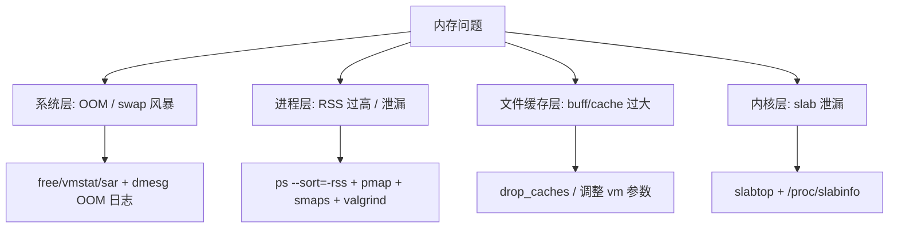

::: abstract 本章定位
本篇解决"内存不够用"和"内存被偷走"两大问题：OOM 与 swap 风暴怎么救、进程 RSS 谁在占用、内存泄漏怎么抓、内核 slab 泄漏与 OOM killer 日志怎么读。对应《Operating System Concepts》Ch8（内存管理）与 Ch9（虚拟内存）在 Linux 上的全部实战：分页、换页、按需分页、页面置换、写时复制。
:::

内存问题分四层，从"系统看"到"进程看"到"内核看"，逐层下钻：



## 1. 内存不足的表现与判断

### 1.1 三种典型症状

| 症状 | 特征 | 立即动作 |
|---|---|---|
| **OOM killer 杀进程** | dmesg 里有 `Out of memory: Kill process` | 查谁泄漏，必要时 `echo 0 > /proc/sys/vm/overcommit_memory` 前先定位 |
| **swap 疯狂读写** | `vmstat` 的 si/so 长期非零 | 找出内存大户，考虑扩容或清理 |
| **机器整体卡死** | 页面置换频繁（thrashing），load 高 | 降低并发/释放内存 |

### 1.2 free 到底看哪一列

```bash
$ free -h
              total        used        free      shared  buff/cache   available
Mem:           15Gi       8.6Gi       1.4Gi        212Mi       5.4Gi       5.9Gi
Swap:         8.0Gi          0B       8.0Gi
```

解读：
- **`used` 8.6Gi ≠ 真的不够**——因为 `buff/cache`（5.4Gi）是**可回收的页缓存**，内核内存不足时会自动回收。
- **真正要看的是 `available`（5.9Gi）**：预估还能安全分配多少内存给新进程（已把可回收缓存算进去）。
- `Swap` 的 `used` 为 0 → 目前没在换页，健康。

::: warning 经典误区
看到 `used` 高就以为是泄漏。`buff/cache` 是内核"能用则用"的文件缓存，是**特性不是 bug**。Linux 会尽量把空闲内存拿去做缓存，所以 `used` 高很常见，判断依据是 `available` 和 swap 使用量。
:::

### 1.3 vmstat 看换页速率（内存不足的实锤）

```bash
$ vmstat 1 5
procs -----------memory---------- ---swap-- -----io---- -system-- ------cpu-----
 r  b   swpd   free   buff  cache   si   so    bi    bo   in   cs us sy id wa st
 2  4 2048000 12345   40228 102364 3200 4800  6600 5200 2031 1850 12 18 20 50  0
 2  5 2048000 11800   40228 102364 3400 5100  6800 5400 2010 1793 11 17 21 51  0
```

解读：
- `si`（swap in）/`so`（swap out）持续 3000+ KB/s → **内存不足，正在疯狂换页**。
- `swpd` 20GB 说明 swap 里躺着大量数据。CPU 大量 `wa`，因为换页本身就是磁盘 IO。
- 内存不足会导致"swap 风暴"：进程数据在内存↔磁盘间反复倒腾，系统假死。这种状态下加 CPU 没用，**要么释放内存、要么扩容**。

### 1.4 sar 看内存历史趋势

```bash
$ sar -r 1 5
12:00:01    kbmemfree   kbavail kbmemused  %memused  kbbuffers  kbcached  kbcommit   %commit
12:00:06     1240000   6012345   8331000     56.0      180000   4700000   9100000     61.0
12:00:11     1100000   5900000   8400000     56.5      180000   4700000   9200000     61.5
```

解读：`kbmemused` 缓慢爬升、`%memused` 从 50% 涨到 56% → **内存用量持续增长**，是泄漏的早期信号。`sar` 的优势是能看历史趋势（sysstat 定时采集）。

## 2. 定位内存占用大的进程

### 2.1 ps 按 RSS 排序

```bash
$ ps aux --sort=-rss | head -10
USER       PID %CPU %MEM    VSZ   RSS TTY      STAT START   TIME COMMAND
app       3841 302.  7.0 2787288 1126484 ?      S    Jun28 123:21 node /opt/app/server.js
app       2035  12.  4.8 1635240  780000 ?      S    Jun28  45:11 mysqld
```

解读：
- **`RSS`（Resident Set Size）** = 进程当前驻留在物理内存的大小（列中单位 KB，`1126484KB≈1.1GB`）。
- `%MEM` 是该 RSS 占总内存比例。RSS 包含共享库，所以**所有进程 RSS 之和可能超过物理内存**——精确计算共享部分用 `smem`。
- 注意 `VSZ`（虚拟内存）很大不代表占物理内存，它只是地址空间的"承诺"。

```bash
$ smem -k -s rss | tail -10    # smem 会按共享比例折算 PSS
PID   User   Command                 Swap      USS      PSS      RSS
3841  app    node /opt/app/server.js    0    980.0M    1.0G     1.1G
```

### 2.2 pidstat 观察内存增长趋势（泄漏监控）

```bash
$ pidstat -r 1 10 -p 3841
21:50:00      UID       PID   minflt/s  majflt/s     VSZ     RSS   %MEM  Command
21:50:01     1000      3841      8.00      0.00 2787288 1126484   7.0  node
21:50:02     1000      3841      9.00      0.00 2787288 1130124   7.1  node
21:50:03     1000      3841      8.00      0.00 2787288 1134000   7.1  node
```

解读：RSS 每秒钟 +4MB 左右、持续增长不回落 → **疑似内存泄漏**（正常情况下会稳定在一个水位或波动）。`minflt`（缺页）高说明在持续分配新页。跑 10 分钟、画个趋势图，比一次截图有力得多。

::: important 泄漏 vs 缓存
有些"内存增长"是正常缓存（如 JVM 堆未回收、DB buffer pool 预热到上限）。判断标准：**涨到某个水平稳定 → 正常缓存；一直涨不回头 → 泄漏**。JVM 场景先看 GC 日志（堆回收不掉才是泄漏），C/C++ 场景看 RSS 与 valgrind。
:::

## 3. pmap：看单个进程的内存分布

### 3.1 pmap -x

```bash
$ pmap -x 3841
3841:   node /opt/app/server.js
Address           Kbytes     RSS   Dirty Mode  Mapping
0000000000400000    1032     576       0 r-x-- node
0000000000800000      12       8       8 r---- node
0000000000810000      84      64      64 rw--- node
00007f8d3b5f0000  262144  262144  262144 rw---   [ anon ]
00007f8d3b5f1000 2097152 1048576 1048576 rw---   [ anon ]
00007f8d7c800000   65536   65536   65536 rw---   [ anon ]
...
total kB          2725480 1126484 1052768
```

解读：
- `r-x-- node` 那几段是**代码段/只读段**（RSS 小，磁盘映射）。
- `[ anon]` 段 = **匿名内存**（堆、栈、mmap 分配的私有内存），Dirty 列基本等于实际占用。这里好几段 64MB–2GB 的 `[ anon]` → 进程堆在大量增长。
- `total` 的 RSS 1126484KB 与 `ps` 一致。**Dirty 大的 `[ anon]` 段就是泄漏嫌疑区**。

### 3.2 看映射的文件

```bash
$ pmap -x 3841 | grep -v 'anon\|total' | head -15
Address           Kbytes     RSS   Dirty Mode  Mapping
0000000000400000    1032     576       0 r-x-- node
0000000000800000      12       8       8 r---- node
00007f8d3b5f0000   65536    8192       0 r--s- /usr/lib/locale/...
00007f8d4b0f0000    1088     700       0 r-x-- libc-2.31.so
```

解读：映射到真实文件的是**共享库**，RSS 是加载进来的页（共享，不算泄漏）。真正需要盯的还是 `[ anon]`。

## 4. /proc/PID/smaps：RSS 与匿名页的精细账本

`smaps` 是每段映射的细账，比 pmap 多出 `Pss`（按共享比例分摊）、`Private_*`（私有）等字段：

```bash
$ grep -A 8 'anon' /proc/3841/smaps | head -20
...
VmFlags: rd wr mr mw me ac
Size:              262144 kB
Rss:               262144 kB
Pss:               262144 kB
Private_Clean:         0 kB
Private_Dirty:    262144 kB
Referenced:       262144 kB
Anonymous:        262144 kB
```

| 字段 | 含义 | 排查价值 |
|---|---|---|
| **Rss** | 该段驻留内存 | 大于 Size 说明超额驻留 |
| **Pss** | 按进程共享比例分摊后的实际占用 | **多进程共享场景看它最准** |
| **Private_Dirty** | 私有且已写脏的页 | **泄漏/真实占用的核心指标** |
| Anonymous | 匿名页（无文件背书） | 堆/栈/mmap 匿名区 |

```bash
# 快速汇总某进程的匿名+私有内存
awk '/Anonymous|Private_Dirty/ {print $1, $2}' /proc/3841/smaps | head
```

::: tip 判断"到底谁真的用了多少"
`ps` 的 RSS 会把共享库算进每个进程（重复计）。**判断真实占用用 Pss**：`smem -t -k` 或逐段 `awk '/Pss/ {s+=$2} END {print s}' /proc/PID/smaps`。这也是容器 OOM 判断时容易踩的坑（cgroup 统计的其实就是某种 PSS/Private 口径）。
:::

## 5. 内存泄漏定位

### 5.1 方法论：先观测增长，再定位代码

1. **观测**：`pidstat -r` 记录 RSS 曲线，确认"只涨不降"。
2. **定性**：涨的是堆（`[ anon]`）还是缓存？smaps 里 `Private_Dirty` 一直涨 → 堆泄漏实锤。
3. **定位**：按语言选工具——C/C++ 用 `valgrind`，Java 用 heap dump，Python/Go 用内置 profiler。

### 5.2 C/C++：valgrind 找泄漏点

```bash
$ valgrind --leak-check=full --show-leak-kinds=all ./my_program
==1234== Memcheck, a memory error detector
==1234== HEAP SUMMARY:
==1234==     in use at exit: 2,048 bytes in 16 blocks
==1234==   total heap usage: 2,048 allocs, 2,032 frees, 4,096 bytes allocated
==1234==
==1234== 1,024 bytes in 8 blocks are definitely lost in loss record 1 of 2
==1234==    at 0x4845779: malloc (vg_replace_malloc.c:299)
==1234==    by 0x4005D1: create_buffer (main.c:12)
==1234==    by 0x400637: process_loop (main.c:28)
==1234==    by 0x40066B: main (main.c:35)
```

解读：
- `definitely lost` = 确定的泄漏，`1,024 bytes in 8 blocks`，调用栈精确到 `main.c:12` 的 `malloc`。
- `still reachable` 一般是全局指针未释放，不一定是 bug，但要审。
- valgrind 会把程序跑慢 10–50 倍，**只能在测试/压测环境跑**，不要挂生产。

### 5.3 生产环境轻量方案：malloc 跟踪 / ASAN

不想用 valgrind 时：

```bash
# AddressSanitizer 编译（编译期插桩，比 valgrind 快）
gcc -fsanitize=address -g main.c -o main_asan
./main_asan        # 崩溃时直接打印泄漏的调用栈

# 或 ltrace 统计库调用
sudo ltrace -c -p &lt;PID&gt; -- timeout 5 | head
```

### 5.4 Java：heap dump

```bash
# 触发堆转储（保留现场）
jmap -dump:format=b,file=heap.hprof &lt;PID&gt;
jhat heap.hprof           # 或 Eclipse MAT 打开，找支配树 top
```

解读：MAT 里看 **Dominator Tree**（支配树）最大的对象，一路点到业务对象——GC 回收不掉的大对象通常是静态集合/缓存只增不减。配合 GC 日志 `-Xlog:gc` 观察回收失败，区分"堆小"与"真泄漏"。

### 5.5 mmap 泄漏

mmap 分配的内存不在堆里，走 `[ anon]` 大段映射，`pmap` 直接可见：

```bash
# 特征：反复出现 1MB+ 的 [ anon] 段且不再释放
pmap -x &lt;PID&gt; | grep anon | wc -l       # 段数持续增多 = mmap 泄漏
ls /proc/&lt;PID&gt;/map_files | wc -l         # 映射条目数
```

::: warning mmap 泄漏的坑
mmap 的段在 smaps/pmap 里是 `rw--- [ anon]`，与普通堆混在一起。若观察到"匿名段数量只增不减、每段大小固定"，多半是代码里 `mmap`/`memfd` 后没 `munmap`。用 `strace -e trace=mmap,munmap -c -p PID` 统计调用配比能快速确认。
:::

## 6. 缓存回收与内核参数

### 6.1 手动回收页缓存（drop_caches）

```bash
$ sync                          # 先落盘，避免丢数据
$ echo 3 > /proc/sys/vm/drop_caches
$ free -h
              total        used        free      shared  buff/cache   available
Mem:           15Gi       7.2Gi       3.9Gi        212Mi       3.8Gi       7.1Gi
```

解读：`buff/cache` 从 5.4Gi 降到 3.8Gi（回收的是干净缓存）。**用途**：测试时想要干净内存环境、或缓存占满导致新分配抖动。**限制**：只清干净缓存，帮不了 OOM；生产环境一般不建议手动清，内核会自动回收。

::: important drop_caches 的三个档位
`echo 1` 只清 page cache；`echo 2` 清 dentry/inode；`echo 3` 全清。生产环境通常**不需要**它——内核的内存回收机制比手动清更智能，除非你是做 benchmark 要排除缓存干扰。
:::

### 6.2 相关内核参数（内存篇的调优开关）

```bash
cat /proc/sys/vm/swappiness        # 0-100，倾向用 swap 的程度，服务器常设 10
cat /proc/sys/vm/overcommit_memory # 0=启发式,1=永远允许,2=禁止过量提交
cat /proc/sys/vm/vfs_cache_pressure# 回收 dentry/inode 缓存的压力，默认 100
cat /proc/sys/vm/min_free_kbytes   # 保底空闲内存
```

解读：`swappiness=10` 减少 swap 倾向；`overcommit_memory=2` 防止单进程吃光内存（但可能误伤正常程序）。这些参数在 [内存篇](/kb/os/内存/06-内存性能与系统调优/) 有完整展开，这里只作为排查工具箱。

## 7. OOM killer：日志解读与应对

### 7.1 什么时候触发

当系统内存耗尽（`available` 逼近 0）且 **overcommit 已超额分配**时，内核启用 OOM killer 挑选进程杀掉。`oom_score` 越高越可能被杀（占用大、root 豁免低）。

```bash
cat /proc/3841/oom_score          # 0-1000，越高越容易被杀
echo -1000 > /proc/3841/oom_score_adj   # 设为 -1000 让内核绝不杀它（保护）
```

### 7.2 看 OOM 日志

```bash
$ dmesg -T | grep -iE 'oom|killed process' | tail -20
[Wed Aug 10 22:15:03 2026] Out of memory: Killed process 3841 (node) total-vm:2787288kB, anon-rss:1126484kB, file-rss:0kB, shmem-rss:0kB, UID:1000 pgtables:3124kB oom_score_adj:0
[Wed Aug 10 22:15:03 2026] oom_reaper: reaped process 3841 (node), now anon-rss:0kB, file-rss:0kB, shmem-rss:0kB
```

systemd 发行版看这里：

```bash
journalctl -k | grep -i oom          # -k = 只看内核日志
grep -i oom /var/log/kern.log        # Debian/Ubuntu 的持久内核日志
```

解读关键字段：
- `total-vm:2787288kB` = 该进程虚拟内存；`anon-rss:1126484kB` = 匿名常驻（实际大头）。
- `oom_score_adj` = 当时的豁免值。**这条日志就是"谁吃了内存"的官方宣判**，顺着 PID 查应用即可。

### 7.3 应对策略（按优先级）

1. **先找泄漏**：OOM 杀的是"最大受害者"不一定是"泄漏源头"，用第 5 节方法查真凶。
2. **限制单进程**：容器用 cgroup 内存限制 `--memory`，避免一颗老鼠屎毁一锅粥。
3. **提高保护**：核心进程 `oom_score_adj=-1000`。
4. **合理 overcommit**：`vm.overcommit_memory=2` + `vm.overcommit_ratio` 限制超额比例。
5. **扩容/上 swap**：但 swap 是磁盘，频繁换页会更慢——**swap 是应急不是常态**。

::: warning OOM 不一定看得到应用崩溃日志
被 OOM 杀的进程默认收到 SIGKILL，**来不及**写自己的错误日志。排查时先查 `dmesg`，否则会以为是"程序莫名消失"。
:::

## 8. 内核内存与 slab 泄漏

### 8.1 slab 是什么

内核自己也要分配内存，且按"对象池"缓存常用结构（dentry、inode、struct file、TCP 连接等）。这些对象缓存在 **slab** 里，位于 `SReclaimable`（可回收）/`SUnreclaim`（不可回收）：

```bash
$ cat /proc/meminfo | grep -E 'Slab|SReclaimable|SUnreclaim'
Slab:            220160 kB
SReclaimable:    200000 kB
SUnreclaim:       20160 kB
```

### 8.2 slabtop 找占用大户

```bash
$ slabtop -o -s c | head -12
 Active / Total Objects (% used) : 32000 / 48000 (66.7%)
 Active / Total Slabs (% used)   : 600 / 800 (75.0%)
 Active / Total Caches (% used)  : 110 / 200 (55.0%)

  OBJS ACTIVE  OBJ SIZE  OBJS/SLAB CACHE NAME
  12000 11000   0.10K       40   xfrm_dst_cache
   8000  7800   0.26K       15   dentry
   6000  5800   0.19K       20   filp
   4000  3900   0.25K       16   inode_cache
```

解读：
- 按对象数（`-s c`）排序。`xfrm_dst_cache` 异常巨大 → 通常对应 **IPsec VPN 隧道连接泄漏**（每个隧道一个对象）。
- `dentry`/`inode_cache` 异常 → 文件打开/删除风暴，目录项没被回收（配合 `ls /proc/*/fd` 检查是否有进程持有大量已删除文件）。
- `SUnreclaim` 持续增长且 slabtop 里某 cache 只增不减 → **内核对象泄漏**，常是驱动 bug 或连接未释放。

### 8.3 进一步确认

```bash
grep -E 'xfrm_dst_cache|dentry|inode_cache' /proc/slabinfo   # 两次对比增长量
ss -s                                                         # 顺便看 socket 对象
```

::: warning slab 泄漏难缠在哪
内核对象泄漏不会像用户进程那样"进程重启就好"，得靠 `slabinfo` 定位 cache 名 → 对应到驱动/子系统（TCP、IPsec、filesystem）→ 更新内核/驱动或查厂商 bug 报告。
:::

## 9. 本章小结

- **系统层**：看 `free -h` 的 `available`（不是 `used`），`vmstat` 的 si/so 判断是否换页风暴，`dmesg` 抓 OOM 宣判。
- **进程层**：`ps --sort=-rss` 找大户，`pidstat -r` 观测增长曲线，`pmap -x`/`smaps` 区分匿名内存与文件映射，`Private_Dirty`/`Pss` 是精细账本。
- **泄漏定位**：C/C++ 用 `valgrind --leak-check=full`，Java 用 `jmap` + MAT，mmap 泄漏盯匿名段数量，怀疑系统调用用 `strace -e trace=mmap`。
- **缓存与回收**：`drop_caches` 只能清干净缓存、帮不了 OOM；`swappiness`/`overcommit` 是长期调优参数。
- **内核层**：`slabtop` 盯 slab cache，`SUnreclaim` 只增不减 = 内核对象泄漏。

## 10. 实战演练：一个"内存一直涨"的完整排查

::: note 场景
某 C++ 服务运行几天后 RSS 从 500MB 涨到 6GB，用户开始 OOM。禁止重启，先定位。
:::

**第 1 步：确认趋势（是缓存还是泄漏）**

```bash
$ pidstat -r 2 5 -p 9021
      UID       PID   minflt/s  majflt/s     VSZ     RSS   %MEM  Command
     1000      9021   1200.00      0.00 8422880 5800000   36.2  app
     1000      9021   1220.00      0.00 8422880 5824000   36.4  app
     1000      9021   1180.00      0.00 8422880 5848000   36.5  app
```

解读：RSS 每秒 +24MB、`minflt` 1200/s（持续分配新页）→ 不是预热缓存，是**真泄漏**。

**第 2 步：确定泄漏区域（堆还是 mmap）**

```bash
$ pmap -x 9021 | grep anon | head -8
Address           Kbytes     RSS   Dirty Mode  Mapping
00007f8d3b5f0000  262144  262144  262144 rw---   [ anon ]
00007f8d4b0f0000  262144  262144  262144 rw---   [ anon ]
00007f8d5a1f0000  262144  262144  262144 rw---   [ anon ]
...
```

解读：大量 256MB 的 `[ anon]` 段 → 匿名内存（堆）在增长，每个段 256MB 很规律 → 可能每次都分配了一个大块。

**第 3 步：确认分配调用（strace 计数）**

```bash
$ sudo strace -c -p 9021 -- timeout 5
% time     seconds  usecs/call    calls     errors syscall
------ ----------- ----------- --------- --------- ----------------
 60.00    0.300000     300000         1           mmap
 25.00    0.125000      15000         8           mmap
 10.00    0.050000         62       800           brk
```

解读：5 秒内调用了大量 `mmap` 且单次执行 300ms（分配 256MB）→ 确认是**匿名 mmap 分配**。

**第 4 步：生产环境抓泄漏调用栈**

valgrind 太慢不能挂生产，用 ASAN 重新编译一个副本在预发环境复现：

```bash
gcc -fsanitize=address -g -O0 src/*.c -o app_asan
./app_asan
==9022==ERROR: LeakSanitizer: detected memory leaks
    Direct leak of 262144 byte(s) in 1 object(s) allocated from:
        #0 0x4a0c9d in malloc
        #1 0x4005D1 in create_session session.c:88     ← 会话创建
        #2 0x400637 in handle_request server.c:152
```

解读：**实锤**——`session.c:88` 每次请求 `malloc(262144)` 创建会话对象，但会话对象从不被释放（`handle_request` 拿到后没销毁）。修复：释放或池化，压测验证 RSS 稳定。

**复盘**：趋势（pidstat）→ 区域（pmap 匿名段）→ 调用（strace mmap 计数）→ 调用栈（ASAN/valgrind）。内存泄漏排查就是"观测增长 → 缩小区域 → 钉到分配点"三步。

## 11. 自测题

1. **`free -h` 里应该看哪一列判断内存够不够？为什么？** 看 `available`，它已把可回收的 buff/cache 算入；`used` 高可能是缓存占用，不代表不够。
2. **`vmstat` 的 `si`/`so` 持续非零说明什么？该怎么做？** 说明在持续换页，内存不足；释放内存（杀泄漏进程/降并发）或扩容，swap 疯狂读写会让系统假死。
3. **RSS 和 PSS 的区别？什么时候用 PSS？** RSS 是常驻内存（共享库重复计），PSS 按共享比例分摊；容器/多进程共享库场景判断真实占用用 PSS。
4. **`pmap` 输出里 `[ anon]` 段代表什么？泄漏时它有什么特征？** 代表匿名内存（堆/栈/mmap 私有内存），泄漏时这些段的 Dirty/数量持续增长。
5. **OOM killer 会杀哪个进程？如何保护关键进程？** 按 oom_score 挑（占用大、豁免值低），`echo -1000 > /proc/PID/oom_score_adj` 可豁免。
6. **slab 里 `SUnreclaim` 持续增长可能是什么问题？** 内核对象泄漏（TCP/dentry/IPsec 等对象未释放），用 `slabtop`/`/proc/slabinfo` 定位 cache 名，对应驱动或子系统。
