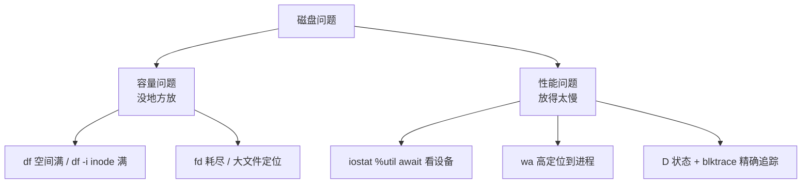

::: abstract 本章定位
本篇解决磁盘侧的两大类问题：**容量问题**（空间满、inode 满、fd 耗尽）与**性能问题**（IO 慢、wa 高、D 状态卡死）。工具链从 `df/du`（容量）到 `iostat/iotop`（性能）到 `strace/blktrace`（精确追踪）。对应《Operating System Concepts》Ch11（大容量存储）、Ch12（IO 子系统）、Ch13-15（文件系统）的实战落地。
:::

磁盘问题先分两支——**是"没地方放"还是"放得太慢"**，方法完全不同：



## 1. 磁盘空间不足

### 1.1 df -h：先看哪个挂载点满了

```bash
$ df -h
Filesystem      Size  Used Avail Use% Mounted on
/dev/sda1       100G   98G  2.0G  98% /
tmpfs            16G     0   16G   0% /dev/shm
/dev/sdb1       500G  300G  200G  60% /data
```

解读：`/dev/sda1` 挂在 `/`，`Use% 98%`、只剩 2G → 根分区告急。根分区满了后果严重：**很多程序连日志都写不进去，直接表现为"莫名启动失败/卡死"**。

### 1.2 du：定位大目录、大文件

```bash
# 从根开始逐层看哪一层最占空间
du -h --max-depth=1 / | sort -rh | head -10
```

预期输出：

```
$ du -h --max-depth=1 / 2>/dev/null | sort -rh | head -10
 60G	/var
 20G	/opt
 10G	/home
```

```bash
# 往 /var 里再钻一层
du -h --max-depth=1 /var | sort -rh | head -10
 40G	/var/log
 15G	/var/lib
```

解读：逐层下钻是标准做法（`--max-depth=1` 只看一层），找到 `/var/log` 占 40G → 大概率是**日志没轮转**。单文件大文件定位：

```bash
find / -xdev -type f -size +1G -exec ls -lh {} \; 2>/dev/null
```

### 1.3 日志轮转与清理

```bash
# 查看现有轮转配置
cat /etc/logrotate.d/nginx
# 手动触发一次
sudo logrotate -f /etc/logrotate.d/nginx
# 删除前确认，释放空间
truncate -s 0 /var/log/nginx/access.log    # 生产环境建议用 truncate 而非 rm
```

::: warning 千万别 rm 正在写入的日志
`rm /var/log/xxx.log` 后，写该日志的进程仍持有 fd，空间不会释放，直到进程重启。正确姿势：`truncate -s 0 文件`（清空内容但保留 fd），或先通知进程重开日志（很多程序支持 `kill -USR1` 触发 reopen）。
:::

### 1.4 被删除但仍占空间的文件

```bash
$ sudo lsof +L1
COMMAND    PID   USER   FD   TYPE DEVICE  SIZE/OFF   NLINK  NAME
app       3841   root   12w   REG    8,1  4294967296      0  /tmp/bigfile.log
```

解读：`NLINK=0` 表示文件已被 unlink，但进程还握着 fd——**空间没释放**。看到这个要么 `kill` 掉进程，要么接受其占用直到重启。

## 2. inode 满：df -i

空间还有，但报"设备上没有空间"。可能是 **inode 耗尽**（文件数量上限）：

```bash
$ df -h /
Filesystem      Size  Used Avail Use% Mounted on
/dev/sda1       100G   20G   80G  20% /

$ df -i /
Filesystem     Inodes  IUsed  IFree IUse% Mounted on
/dev/sda1     6553600 6553600      0  100% /
```

解读：磁盘才用 20%，但 **inode 用光 100%** → 分区上**小文件数量爆炸**（每个文件/目录消耗一个 inode）。典型元凶：临时文件没清理、消息队列/邮件积压、`find` 产生的海量缓存。

```bash
# 找出哪个目录文件最多
for d in /var/tmp /tmp /home /var/spool; do
  echo -n "$d: "; find $d -xdev -type f 2>/dev/null | wc -l
done
```

::: tip inode 上限怎么看/怎么预防
`tune2fs -l /dev/sda1 | grep -i 'Inode count'` 查看总量。格式化时可选更大的 inode 间隔（`mkfs -i`），或用 xfs 的 `inode64`。生产上更常用的是**监控 IUsed%** 并在接近上限时清理小文件。
:::

## 3. 磁盘 IO 慢：iostat 解读

### 3.1 iostat -x 各列含义

```bash
$ iostat -x 1 3
avg-cpu:  %user   %nice %system %iowait  %steal   %idle
          12.50    0.00   18.75   37.50    0.00   31.25

Device            r/s     w/s     rkB/s     wkB/s   rrqm/s   wrqm/s  %rrqm  %wrqm r_await w_await aqu-sz rareq-sz wareq-sz  svctm  %util
sda              12.0   850.0     96.0   34000.0     0.0    120.0   0.00  12.38    0.50   12.00  10.20    8.00    40.00   1.12 96.50
```

| 列 | 含义 | 阈值参考 |
|---|---|---|
| **%util** | 设备忙的时间占比 | 机械盘 >80% 接近瓶颈；SSD 因多队列可能 >100% |
| **await** | IO 请求平均完成时间（含排队） | 机械盘 10-20ms 正常，>50ms 明显慢 |
| **r_await / w_await** | 读/写各自的等待时间 | 写 await 高 → 刷盘/日志问题 |
| **aqu-sz** | 平均队列深度 | > 设备并发数说明排队严重 |
| **r/s + w/s** | 每秒 IOPS | 机械盘随机 ~100-300，SSD 上千 |
| **rkB/s + wkB/s** | 吞吐 | 顺序读机械盘 ~100MB/s，SSD 数 GB/s |
| **svctm** | 平均服务时间 | 新内核已弃用，仅参考 |

::: important %util 的坑
`%util` 统计的是"设备忙的比例"，对支持多队列的 SSD 可能超过 100%，且它对"快设备 + 深队列"失真。**判断设备是否饱和，优先看 `await` 和 `aqu-sz`**（它们在排队时变化最敏感）。设备能力对比用 `r_await/w_await`。
:::

### 3.2 判断读慢还是写慢

```bash
$ iostat -x 1 5 | grep -A1 sda
r/s    w/s  rkB/s  wkB/s  r_await  w_await  aqu-sz  %util
300    50   1200    400    0.8      45.0     0.4     30
```

解读：`w_await=45ms`（写延迟高）而 `%util` 才 30% → **不是设备饱和，是写路径慢**（如 fsync 刷盘、日志提交、RAID 校验）。顺着写慢去查：是应用高频 fsync？还是文件系统日志？对照 [文件系统可靠性](/kb/os/存储/06-文件系统可靠性与日志/) 理解写路径。

### 3.3 按进程看 IO：pidstat -d / iotop

```bash
$ pidstat -d 1 5
      UID       PID   kB_rd/s   kB_wr/s kB_ccwr/s  Command
      999      3841      0.00   34000.00      0.00  mysqld
      999      2035    120.00      40.00      0.00  redis-server
```

解读：mysqld 每秒写 34MB，就是它把磁盘写满的。`iotop` 是交互版：

```bash
sudo iotop -o -P      # 只看实际发生 IO 的进程
```

## 4. CPU wa 高：把 IO 等待定位到进程

`wa`（iowait）高说明 CPU 在等 IO。按 `[篇](/kb/os/问题排查/01-性能分析方法论/)` 定位链，wa 高的排查顺序：

```bash
# 1. 确认 wa 高
top -b -n1 | grep '%Cpu'
# %Cpu(s): 5.0 us, 3.0 sy, 0.0 ni, 55.0 id, 35.0 wa, ...

# 2. 找到 D 状态进程
ps -eo pid,stat,wchan:28,comm | grep D
```

预期输出：

```
  PID STAT WCHAN                      COMMAND
 3841 D    io_schedule                mysqld
 2035 D    md_flush_request           mdadm
```

解读：
- `io_schedule` = 正在等块 IO 完成（最常见）。
- `md_flush_request` = 等 RAID（md）设备 flush。
- 拿到 PID 后用 `pidstat -d` 确认它确实是 IO 大户，再到第 6 节看它在等什么。

::: tip wa 高 ≠ 一定设备坏
wa 高的三来源：①设备确实慢（await 高）；②进程高频小 IO（IOPS 打满但吞吐不高）；③内存不足导致换页（swap 也算 IO，`vmstat` 的 si/so 会同时高）。**用 iostat 的 await + vmstat 的 si/so 一起判断**。
:::

## 5. 慢查询 / 慢日志：应用侧的 IO 放大器

数据库/Web 服务的"慢"往往表现为个别请求耗时长：

```bash
# MySQL：开启慢查询日志
SHOW VARIABLES LIKE 'slow_query%';
SET GLOBAL slow_query_log=ON;
SET GLOBAL long_query_time=2;        # 超过 2 秒的记录

# 从慢日志里找规律
grep -oP 'Query_time: [0-9.]*' /var/log/mysql/slow.log | sort -rn | head
```

解读：慢查询会放大 IO——一次全表扫描 = 几百万次 IO。规律通常很清晰：**某条 SQL 占了大头**，优化它 = 消灭 IO 压力。查看 SQL 执行计划：

```bash
EXPLAIN SELECT ... FROM t WHERE col = x;
```

::: note 慢查询与磁盘的关系
慢 SQL → 长时间占用磁盘读 → `%util` 高 → 其他请求跟着慢。这是"磁盘瓶颈"最常见的业务源头，排查顺序永远是"**先 SQL/应用，再设备**"。对应 [Linux IO 实操](/kb/os/Linux/04-LinuxIO与性能监控实操/) 可做对照实验。
:::

## 6. 文件描述符耗尽

### 6.1 症状与排查

进程报"Too many open files"。文件描述符（fd）是一种可耗尽的资源：

```bash
# 系统级：当前已用 / 上限
cat /proc/sys/fs/file-nr
# 10240    0    800000
# 已分配  未用   系统上限(file-max)

# 进程级：单个进程的软/硬限制
cat /proc/3841/limits | grep -i 'open files'
# Max open files            1024              4096              files

# 该进程实际打开了多少
ls /proc/3841/fd | wc -l
```

解读：`file-nr` 第一列接近第三列（800000）→ 系统级耗尽；进程 1024 的软限制（`Max open files`）若被打满，进程就会报错。

### 6.2 是哪个进程在漏 fd

```bash
$ sudo lsof | awk '{print $1, $2}' | sort | uniq -c | sort -rn | head -5
  500000 java
    3000 nginx
     500 mysqld
```

解读：java 打开了 50 万 fd，明显泄漏。进一步看它打开的到底是什么：

```bash
$ sudo lsof -p 3841 | awk '{print $1}' | sort | uniq -c | sort -rn | head
  400000 TCP 10.0.0.8:8888->client:port (ESTABLISHED)
   90000  /data/tmp/cache.*
```

解读：40 万个 TCP 连接不释放（**连接泄漏**），或大量临时文件句柄。对应 [并发篇](/kb/os/问题排查/05-并发与异常排查/) 的线程/连接治理。

### 6.3 调整上限

```bash
# 临时（进程重启失效）
ulimit -n 100000

# 永久：改 limits.conf 后重登
echo 'app soft nofile 100000'  >> /etc/security/limits.conf
echo 'app hard nofile 100000'  >> /etc/security/limits.conf

# 系统级上限
echo 'fs.file-max = 800000' >> /etc/sysctl.conf && sysctl -p
```

::: warning 调上限 ≠ 解决问题
调大 `nofile` 只是延后爆掉的时间，**连接/文件泄漏还得靠 lsof 揪出源头修代码**。另外 fd 上限也受内存约束（每个 fd 有内核结构），无限调大不现实。
:::

## 7. IO 队列深度

设备在处理的并发 IO 数量 = 队列深度。队列深了延迟涨（排队），浅了吞吐低（喂不饱设备）：

```bash
# 平均队列深度
$ iostat -x 1 2 | grep sda
aqu-sz  0.4        ← 队列浅，设备没被喂饱
aqu-sz  25.0       ← 队列深，正在积压
```

- **队列浅 + await 低 + 吞吐低** → 应用侧并发 IO 太少，白白浪费设备能力（改并发/预取）。
- **队列深 + await 高** → 设备饱和，请求在排队（优化 SQL/减 fsync/换设备）。
- 块设备真实队列深度还能从内核看：

```bash
cat /sys/block/sda/queue/nr_requests          # 每队列请求数上限
cat /sys/block/sda/queue/scheduler            # io scheduler (mq-deadline/none/bfq)
```

::: tip 调度器与队列
现代内核（blk-mq）下服务器盘建议 `none`（NVMe 硬件自己排队）或 `mq-deadline`（机械盘）。队列深度是理解 `iostat` `await` 与 `aqu-sz` 关系的钥匙：**吞吐上不去先看队列，延迟上来先看队列**。
:::

## 8. strace 观察阻塞的 read/write

进程"卡住"，想知道它在等哪个文件、哪个系统调用：

```bash
# 附加并只看 read/write/fsync（会拖慢进程，务必短时间）
sudo strace -e trace=read,write,fsync,fdatasync -p 3841 -- timeout 3
```

预期输出：

```
write(6, "UPDATE t SET ...\n", 42) = 42        ← 立刻返回，不是它
fdatasync(6)                                    ← 卡在这里！
&lt;timeout 已到，输出截止&gt;
```

解读：`write` 已返回，卡在 `fdatasync`——进程在**等待刷盘完成**。配合 `iostat` 的 `w_await` 高，链条闭合：**高频提交 + 刷盘慢 = 写路径瓶颈**。

::: important strace 阻塞确认法
卡住时附加 `strace`，会看到它停在一个系统调用上等返回。那一个"没返回的调用"就是阻塞点：
- `read(3, ...)` 等 socket/管道数据 → 网络/管道阻塞（[并发篇](/kb/os/问题排查/05-并发与异常排查/)）
- `fdatasync/fsync` 等落盘 → 磁盘写慢
- `pread(..., O_DIRECT)` 等磁盘读 → 读路径慢
生产环境用 `--timeout` 限制时长，避免长期拖慢服务。
:::

## 9. 进程卡在 D 状态：不可中断睡眠

### 9.1 D 状态是什么

D 状态 = 进程在内核里做 IO，**不可中断**（`kill -9` 都杀不掉，必须等 IO 结束）。长时间 D 状态且 IO 无响应，通常是**设备故障/死锁**：

```bash
$ ps -eo pid,stat,pri,wchan:28,comm | grep ' D'
  PID STAT PRI WCHAN                     COMMAND
 9999 D    25  md_wait                   mysqld
 8888 D    25  scsi_wait_scan            qemu
```

### 9.2 设备是不是真没响应

```bash
# 看设备 IO 统计是否还在走
iostat -x 1 5 | grep -E 'Device|sdb'
# 连续几秒 r/s、wkB/s 都为 0 但 %util=100 → 设备挂死
```

解读：`%util=100` 但吞吐为 0 → 设备在内核层"卡死"（控制器问题、线缆、磁盘坏道重试）。配合 dmesg：

```bash
$ dmesg -T | grep -iE 'error|i/o|timeout|reset' | tail -20
[Wed Aug 10 22:20:01 2026] sd 0:0:0:0: [sdb] Unit Not Ready
[Wed Aug 10 22:20:01 2026] sd 0:0:0:0: [sdb] I/O error, dev sdb, sector 12345678 op 0x0:(READ)
```

### 9.3 blktrace：块层 IO 精确追踪

`iostat` 看到设备忙，`strace` 看到应用卡住，中间"请求在块层怎么排的"用 **blktrace** 看：

```bash
# 抓 5 秒 sda 的块 IO 事件
sudo blktrace -d /dev/sda -o trace -w 5
# 解析并查看
blkparse -i trace -o trace.txt
grep -i 'C' trace.txt | tail -5     # C = IO 完成事件
```

预期输出（简化）：

```
  8,1  2  8  0.002100  3841 C  R 4096 + 8 [mysqld]      ← mysqld 的读完成
  8,1  2  9  0.002201  3841 D  W 8192 + 16 [mysqld]     ← 写下发（D=deferred/queued）
```

解读：
- `blktrace` 把每个 IO 从 `Q`（排队）→ `D`（下发设备）→ `C`（完成）的事件流全记下来。
- 看 **Q→C 的时间差**是延迟；看 Q→D 是排队；反复 D 后不 C = 设备无响应。
- 生产环境抓取量很大，限定 `-w 5`（5 秒）并用 `-d 设备` 限定盘。

::: warning D 状态 + 无 IO 事件 = 硬件/驱动问题
如果 D 状态进程的 wchan 是 `scsi_wait_scan`/`md_wait` 且 blktrace 里根本没有该进程的 IO 下发事件 → 请求堵在设备层以上，多半是**驱动或控制器卡死**，只能重启机器/下电，硬件层面换盘或换线。
:::

## 10. SSD 性能与 TRIM

### 10.1 SSD 与机械盘的区别

| 项目 | 机械盘 HDD | SSD |
|---|---|---|
| 随机 IOPS | ~100-300 | 数万 |
| 顺序吞吐 | ~100-150MB/s | 数 GB/s |
| 写入特性 | 覆盖写 | **只能写已擦除块**，页大小受限 |
| 磨损 | 机械磨损 | **写放大**影响寿命 |

### 10.2 TRIM：让 SSD 知道哪些块可回收

SSD 必须先擦除才能写。删除文件后若不告诉 SSD"这块没用了"，它下次写前还得先搬移旧数据（**写放大**）。TRIM 通知 SSD 回收空间：

```bash
# 手动执行 TRIM
sudo fstrim -av
# /: 123.4 GiB (132506685440 bytes) trimmed

# 开机自动 + 定时（systemd 定时器默认每周跑一次）
systemctl enable fstrim.timer
```

### 10.3 判断写放大与寿命

```bash
# 检查 SSD 健康度与写入总量（nvme 盘）
sudo nvme smart-log /dev/nvme0n1 | grep -iE 'data_units|percentage|media_errors'

# 普通 SSD（sat 协议）
sudo smartctl -a /dev/sda | grep -iE 'SSD|Percentage Used|Lifetime Writes'
```

::: tip 服务端要不要开 TRIM 看场景
频繁 delete 的高写入库建议开（减少写放大）；但 TRIM 本身有微弱开销，且对 `discard` 挂载方式会拖慢写入——一般用**定时 `fstrim`** 而非挂载时实时 discard。
:::

## 11. 本章小结

- **容量**：`df -h` 看空间、`df -i` 看 inode、`du` 逐层定位大目录；空间被"已删除但被占"的文件卡住用 `lsof +L1`；日志轮转优先 `truncate` 而非 `rm`。
- **性能**：`iostat -x` 的 **`await`/`aqu-sz` 比 `%util` 更可靠**；`w_await` 高查写路径（fsync/日志），`r_await` 高查读路径（慢 SQL）；`pidstat -d`/`iotop` 落到进程。
- **wa 高**：`ps -eo wchan` 找 D 状态进程，`vmstat` si/so 排除换页干扰。
- **资源耗尽**：fd 用 `file-nr`/`lsof`/`ulimit` 三连；调上限是缓兵之计，源头是代码泄漏。
- **精确追踪**：`strace` 看阻塞的系统调用，`blktrace` 看块层 IO 事件流，`dmesg` 抓设备报错。
- **SSD**：`fstrim` 防写放大，`smartctl`/`nvme smart-log` 看寿命。

## 12. 实战演练：一个"数据库越来越慢"的完整案例

::: note 场景
MySQL 所在机器，用户反馈"写入越来越慢、偶发卡死"。机器是 4 核 + 机械盘 RAID1。
:::

**第 1 步：整体判断（负载 + 分项）**

```bash
$ uptime
 22:10:00 up 20 days,  3:12,  1 user,  load average: 5.20, 4.10, 3.30

$ top -b -n1 | head -4
%Cpu(s):  8.0 us, 10.0 sy,  0.0 ni, 35.0 id, 46.0 wa,  0.0 hi,  1.0 si,  0.0 st
```

解读：load 5.2 对 4 核偏高，`wa=46` → **IO 等待是主矛盾**，先查磁盘。

**第 2 步：看设备级指标**

```bash
$ iostat -x 1 5 | grep -A1 sda
Device            r/s     w/s     rkB/s     wkB/s   r_await   w_await  aqu-sz  %util
sda               8.0    500.0      64.0   20000.0      1.0     45.0    22.0   100.0
```

解读：`w_await=45ms`、`aqu-sz=22`、`%util=100` → 写路径饱和且排队严重。继续确认是谁在写：

**第 3 步：定位写进程**

```bash
$ pidstat -d 1 5 | grep -v kB_rd
      UID       PID   kB_rd/s   kB_wr/s kB_ccwr/s  Command
      999      3841      0.00   19000.00      0.00  mysqld
```

解读：mysqld 每秒写 19MB，全压到一块机械盘上。`kB_ccwr/s`（取消写）0，没有闪回。

**第 4 步：看是否高频 fsync（写路径放大）**

```bash
$ sudo strace -c -p 3841 -- timeout 5
% time     seconds  usecs/call    calls     errors syscall
------ ----------- ----------- --------- --------- ----------------
 75.00    0.900000    90000        10        10 fdatasync
 10.00    0.120000       1500        80         0 write
```

解读：5 秒 10 次 `fdatasync` 失败（错误=10，`EAGAIN`/`EIO` 之类）且每次等 90ms → **每次事务提交都在等刷盘**，而机械盘扛不住高频 fsync。

**第 5 步：查业务侧慢 SQL**

```bash
mysql> SHOW GLOBAL STATUS LIKE 'Innodb_os_log_fsyncs';
+------------------------+--------+
| Variable_name          | Value  |
+------------------------+--------+
| Innodb_os_log_fsyncs   | 589123 |
+------------------------+--------+
mysql> EXPLAIN SELECT ... FROM orders WHERE user_id=123 ORDER BY id DESC;
```

解读：`Innodb_os_log_fsyncs` 近 60 万次 fsync → 高频小事务提交。EXPLAIN 若走全表/大范围扫描，就是在拖累 IO。结合慢日志确认高频 `UPDATE`（与 [篇](/kb/os/问题排查/00-系统问题排查方法论/) 案例呼应）。

**第 6 步：修复与验证**

```bash
# 1) 合并写：批量提交事务，降低 fsync 频率
# 2) 参数权衡（数据可靠性可接受时）：
#    innodb_flush_log_at_trx_commit=2   (每秒刷一次而非每事务)
#    innodb_buffer_pool_size 调大，减少磁盘读
# 3) 硬件：条件允许换 SSD
```

```bash
$ iostat -x 1 5 | grep -A1 sda
Device            r/s     w/s     rkB/s     wkB/s   r_await   w_await  aqu-sz  %util
sda               6.0     80.0      40.0    3200.0      0.8      8.0     2.0    30.0
```

解读：`w_await` 从 45ms 降到 8ms、`%util` 从 100% 到 30% → 排队消失，写入恢复正常。**复盘**：wa 高（系统）→ iostat（设备）→ pidstat（进程）→ strace（fsync）→ SQL（业务源头）→ 参数/硬件修复 → iostat 复测。完整闭环。

## 13. 自测题

1. **`df -h` 显示空间充足，但创建文件报"No space left on device"，可能是什么？怎么确认？** inode 耗尽：`df -i` 看 IUsed 是否 100%，是小文件爆炸，用 `find` 统计各目录文件数定位。
2. **`iostat -x` 里 `%util=100` 但 `r_await` 很低，说明什么？** 设备忙但单个请求响应快（并发饱和、队列深），先看 `aqu-sz` 和 `w_await`；`%util` 对 SSD 多队列会失真。
3. **一个进程卡在 D 状态杀不掉，怎么判断是"设备慢"还是"设备挂死"？** 看 `iostat` 该设备吞吐是否还在变化、`dmesg` 有无 I/O error/timeout；blktrace 看请求是否下发后一直无完成事件。
4. **为什么 `rm` 日志文件后空间不释放？正确做法是什么？** 进程仍持有已删文件的 fd（`lsof +L1` 可见），空间等 fd 关闭才释放；用 `truncate -s 0` 清空内容或让进程重开日志。
5. **`file-nr`、`ulimit -n`、`lsof` 三者各解决什么问题？** `file-nr` 看系统级 fd 总量/上限，`ulimit -n` 是单进程软硬限制，`lsof` 找出谁在持有 fd（泄漏源头）。
6. **机械盘上 `w_await` 高但 `%util` 不高，可能的原因？** 写路径本身慢（fsync/日志提交、RAID 校验、坏道重试），而非设备并发饱和；用 `strace` 看是否卡在 `fdatasync`。
