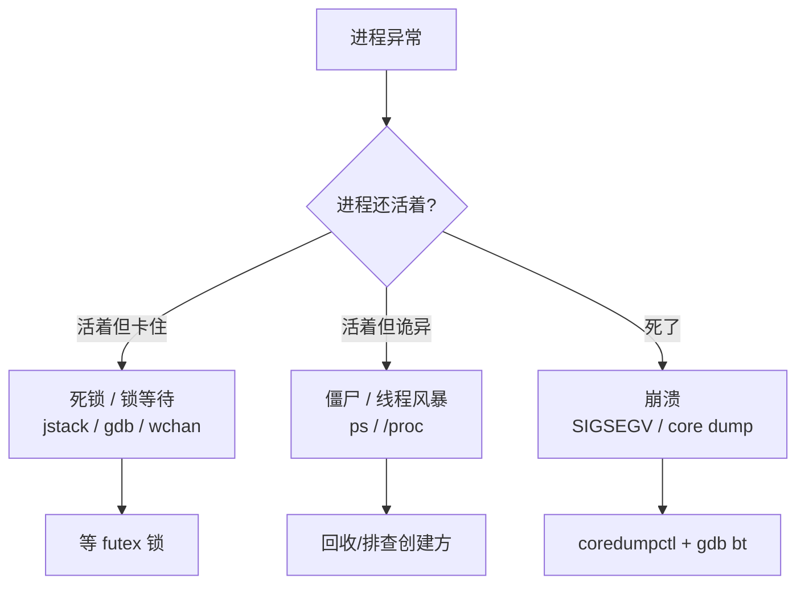

::: abstract 本章定位
本篇是进程级疑难杂症的收官篇：**死锁**（Java/C/C++ 各有打法）、**锁等待**（futex）、**CPU 飙高但进程阻塞**、**线程风暴**、**僵尸进程**、**进程崩溃**（SIGSEGV/core dump/coredumpctl/gdb bt）。对应《Operating System Concepts》Ch6-7（同步）、Ch8（死锁）、Ch9（虚拟内存/保护）在真实生产环境的所有死法。
:::

并发与异常问题的共同特征：**进程还活着，但行为异常**（卡住、僵死、崩溃、悄悄变慢）。这类问题没有统一工具，必须按"语言 → 场景"选择武器。先看地图：



## 1. 死锁定位

### 1.1 复习：死锁四条件

```
① 互斥      资源一次只能被一个进程用
② 持有并等待  握着资源还等别的资源
③ 非抢占    不能抢别人手里的资源
④ 循环等待  A等B、B等A 成环
```
（理论详见 [死锁目录](/kb/os/死锁/00-死锁学习路线/)，本篇只讲怎么在线上抓现行。）

### 1.2 先确认"是不是死锁"

```bash
# 进程状态 + 阻塞在哪
$ ps -eo pid,stat,wchan:24,comm | grep -E ' 9001'
 9001 S    futex_wait_queue_me  app
```

解读：进程 **S 状态**（可中断睡眠）阻塞在 `futex_wait_queue_me`（等 futex 锁）——这是用户态锁等待的标准信号。但要区分：**"等锁"≠"死锁"**。等锁可能只是短暂竞争（生产者等消费者），死锁是**互相持锁成环、永远等下去**。

::: warning 死锁 vs 锁竞争
锁竞争（contention）是"短时间等别人释放"，死锁（deadlock）是"永远等不到"。判断法：`jstack` 抓**连续几次**都看到同一批线程卡在同一组锁上、互相等待 → 死锁；只有个别线程偶尔等 → 正常竞争。死锁检测还可用 `pstack`/`gdb` 循环采样对比。
:::

### 1.3 Java 死锁：jstack

Java 的 jstack 自带死锁检测，一抓一个准：

```bash
$ jstack -l 9001
```

预期输出（结尾的死锁检测段）：

```
Found one Java-level deadlock:
=============================
"pool-1-thread-1":
  waiting to lock monitor 0x0000000780a8f7d0 (object 0x0000000680f7d0a8,
      a java.lang.Object)
  which is held by "pool-1-thread-2"
"pool-1-thread-2":
  waiting to lock monitor 0x0000000780a8f8e0 (object 0x0000000680f8e0c8,
      a java.lang.Object)
  which is held by "pool-1-thread-1"

Java stack information for the threads listed above:
===================================================
"pool-1-thread-1":
	at com.example.A.methodA(A.java:20)
	- waiting to lock <0x0000000680f8e0c8> (a java.lang.Object)
	at com.example.B.methodB(B.java:31)
	- locked <0x0000000680f7d0a8> (a java.lang.Object)
"pool-1-thread-2":
	at com.example.B.methodB(B.java:31)
	- locked <0x0000000680f8e0c8> (a java.lang.Object)
	at com.example.A.methodA(A.java:20)
	- waiting to lock <0x0000000680f7d0a8> (a java.lang.Object)
```

解读：
- `Found one Java-level deadlock` → JVM 检测到死锁，直接点名线程。
- 细看：thread-1 持 `0x...f7d0a8` 等 `0x...f8e0c8`；thread-2 持 `0x...f8e0c8` 等 `0x...f7d0a8` → **循环等待闭环**。
- 修复：统一锁顺序（先 A 后 B），或用 `tryLock(timeout)` + 超时放弃。

::: tip 高频采样法（jstack 连续抓）
死锁可能不致命（一直挂着），抓一次不一定复现。循环抓 3 次：

:::```bash
> for i in 1 2 3; do jstack 9001 >> /tmp/js.txt; sleep 2; done
> grep -c 'deadlock' /tmp/js.txt    # 连续 3 次都检测到 = 实锤
> ```
> 同理，`kill -3 &lt;PID&gt;` 让 JVM 把线程 dump 打到 stdout（Tomcat 等容器场景常用，还能看完整日志）。

### 1.4 C/C++ 死锁：pstack / gdb

**pstack（gdb 的轻量版）**：

```bash
$ sudo pstack 9001
Thread 2 (process 9001):
#0  0x00007f8d4b0f1234 in __lll_lock_wait () from /lib64/libpthread.so.0
#1  0x00007f8d4b0ea9f0 in __GI___pthread_mutex_lock (mutex=0x612000000040)
#2  0x0000000000401234 in worker_func (arg=0x0) at worker.c:15
#3  0x00007f8d4b0f6b24 in start_thread (arg=0x7f8d4b9f9700)

Thread 1 (process 9001):
#0  0x00007f8d4b0f1234 in __lll_lock_wait () from /lib64/libpthread.so.0
#1  0x00007f8d4b0ea9f0 in __GI___pthread_mutex_lock (mutex=0x612000000010)
#2  0x0000000000401290 in main_func () at main.c:25
```

解读：两个线程都卡在 `__lll_lock_wait`（pthread 锁等待），但锁不同（`0x...0040` vs `0x...0010`）。**光看栈还看不出谁锁着谁**，需要看锁的 owner：

**gdb 精确看锁**：

```bash
$ sudo gdb -p 9001
(gdb) thread apply all bt
(gdb) frame 2
(gdb) print mutex->__data.__owner     # 看这把锁当前被谁持有
```

::: important gdb 的威力与代价
`gdb -p` 附加会**暂停**进程，生产环境务必短时间（几秒）操作完退出。它的优势是能看锁 owner、寄存器、任意变量——是 C/C++ 死锁的终审工具。注意新内核 `__lll_lock_wait` 已并入 `futex_wait`。
:::

### 1.5 通用路线：/proc/&lt;pid&gt;/task + wchan

不装任何工具也能做死锁初判——每个线程一个目录：

```bash
# 线程数与每个线程的 PID
$ ls /proc/9001/task
9001  9002  9003

# 每个线程卡在内核哪里
$ for t in /proc/9001/task/*; do echo -n "$t: "; cat $t/wchan 2>/dev/null; echo; done
/proc/9001/task/9001: futex_wait_queue_me
/proc/9001/task/9002: futex_wait_queue_me
/proc/9001/task/9003: do_syscall_64
```

解读：9001、9002 都卡在 futex 等待 → 多线程都在等锁。结合第 1.4 节的 pstack/gdb 拿用户态栈，就能拼出谁等谁。**`wchan` 只看内核函数，用户态锁的持有关系要靠 pstack/jstack/gdb 的栈**。

## 2. 锁等待分析：mutex 与 futex

### 2.1 futex 机制一句话

用户态锁（pthread mutex / Java monitor）底层都走 futex：**抢不到锁的线程进内核睡眠（futex_wait），持锁线程释放时唤醒（futex_wake）**。所以"锁竞争严重"在内核侧的表现就是大量 futex 系统调用 + 高 `cs`。

### 2.2 量化锁竞争

```bash
# 进程级上下文切换飙升（抢锁失败→睡眠→被唤醒→再抢）
$ pidstat -w 1 3 -p 9001
      UID       PID   cswch/s nvcswch/s  Command
     1000      9001   5200.00      0.00   app
```

解读：`cswch/s=5200`（自愿切换）→ 进程在频繁"让出 CPU 等锁"。结合 strace：

```bash
$ sudo strace -c -p 9001 -- timeout 5
% time     seconds  usecs/call    calls     errors syscall
------ ----------- ----------- --------- --------- ----------------
 98.00    1.900000        380      5000        5000 futex
```

解读：5 秒 5000 次 `futex` 且全返回错误（`EAGAIN`，即 trylock 失败）→ **锁竞争极其严重**，线程们光排队抢锁就把 CPU 烧掉了。这是 [CPU 篇](/kb/os/问题排查/02-CPU性能问题排查/) 中"sy 高/上下文切换高"的并发侧根因。

### 2.3 锁竞争 vs 死锁的处理方向

| 问题 | 特征 | 方向 |
|---|---|---|
| **锁竞争** | futex 调用极多、cswch 高、但进程能跑 | 减小临界区、读写锁、无锁结构（[无锁编程](/kb/os/同步异步/05-现代同步原语与无锁编程/)） |
| **死锁** | 线程卡死不动、栈互相等待 | 统一锁顺序、tryLock 超时、锁粒度拆分 |
| **活锁** | 在跑但没进展（锁不断让出又重试） | 加入随机退避、指数退避 |

::: tip 判断"CPU 高但进程没进展"
`top` 看 %CPU 高，`jstack/pstack` 看线程却都在 `sleep/notify/wait` → 典型的**活锁/锁抖动**：CPU 全烧在"唤醒-抢锁-失败-再睡"循环上。和纯死锁的区别是进程还能响应（sys 高、cs 高）。
:::

## 3. CPU 飙高但进程阻塞

一个经典矛盾场景：**CPU 打满，但你想查的进程 `top` 里都找不到几个线程在跑**。

```bash
$ top -b -n1 | head -12
%Cpu(s): 90.0 us,  5.0 sy,  0.0 ni,  4.0 id,  0.5 wa, ...
  PID USER      PR  NI    VIRT    RES    SHR S  %CPU  %MEM     TIME+ COMMAND
 9001 app       20   0 3245528 1.2g   12300 S  15.0  7.5 120:11.21 app
```

解读：`%Cpu` 90 但嫌疑进程才 15%——**CPU 被别的进程/内核吃了**。三种可能：

1. **同机器的其他进程**：`pidstat -u 1 3` 找真正的大户（[CPU 篇](/kb/os/问题排查/02-CPU性能问题排查/)）。
2. **内核线程**：`%CPU` 里有 `[kworker]`/`[ksoftirqd]`（软中断，见 [CPU 篇 §软中断](/kb/os/问题排查/02-CPU性能问题排查/)）。
3. **JVM 的 GC / 垃圾回收**：`jstat` 看 GC 是否在疯狂 full GC：

```bash
$ jstat -gcutil 9001 1s 5
  S0     S1     E      O      M     CCS    YGC     YGCT    FGC    FGCT     GCT
  0.00   0.00  95.00  99.99  92.00  88.00   120    3.200    58   12.500   15.700
```

解读：`O`（老年代）99.99%、`FGC`（Full GC 次数）58 次且在增长 → **JVM 在不停 Full GC**，CPU 全烧在垃圾回收上，而业务线程都卡在 `stop-the-world` 里"看起来没事干"。方向是 [内存泄漏篇](/kb/os/问题排查/03-内存与内存泄漏排查/) 的 JVM 排查（heap dump）。

::: warning 症状≠病因
"进程 CPU 高"查下来可能是**别人的** CPU、**GC** 的 CPU、**内核**的 CPU。永远先 `pidstat` 把 CPU 归位到具体进程/线程，再下手。
:::

## 4. 大量线程创建问题

### 4.1 症状

线程数爆炸会吃内存（每个线程一个栈，默认 8MB 虚拟、~几 MB 常驻）、烧 CPU（调度与切换）、耗尽资源：

```bash
$ cat /proc/9001/status | grep Threads
Threads:	1200
$ ps -eLf | wc -l            # 系统总线程数，正常几百，异常可能上万
```

解读：单进程 1200 线程明显异常（一般应用几十到几百）。再对照系统线程上限：

```bash
cat /proc/sys/kernel/threads-max     # 系统线程上限
cat /proc/sys/vm/max_map_count       # 每个进程映射上限（mmap/线程栈相关）
```

### 4.2 定位"谁在不停创建线程"

```bash
# 观察线程数增长速率
for i in 1 2 3 4 5; do cat /proc/9001/status | grep Threads; sleep 2; done
Threads:	1200
Threads:	1270
Threads:	1340
```

解读：每 2 秒 +70 → **线程泄漏**。Java 用 jstack 数线程名找规律，或 `jstack 9001 | grep -c 'pool-'`；C 用 strace 统计 clone：

```bash
$ sudo strace -c -f -p 9001 -- timeout 5 | head -12
% time     seconds  usecs/call    calls     errors syscall
------ ----------- ----------- --------- --------- ----------------
 60.00    0.800000       4000       200         0 clone
```

解读：5 秒 200 次 `clone`（创建线程）→ 线程池在疯狂扩张（通常配合未回收的任务/连接）。修复：限流/池化/释放逻辑，`ThreadPoolExecutor` 要设 `maximumPoolSize` 与拒绝策略。

::: tip 线程上限还会连累其他资源
每个线程栈占用进程地址空间，可能触发 `mmap` 耗尽（`vm.max_map_count` 报错）。排查线程风暴时顺手查这两项，它们常一起爆。
:::

## 5. 僵尸进程清理

### 5.1 僵尸是怎么来的

子进程 `exit` 后，父进程必须调 `wait()` 回收它的 PCB（僵尸）。父进程忘了 `wait`，僵尸就赖着不走（STAT 列 `Z`，命令列 `&lt;defunct&gt;`）：

```bash
$ ps -eo pid,ppid,stat,comm | awk '$3=="Z"'
  2312  9001 Z   &lt;defunct&gt;
  2313  9001 Z   &lt;defunct&gt;
```

解读：2312、2313 是 9001 的子进程，成了僵尸。僵尸**不占内存不占 CPU**，但占着 PID 和 PCB，堆积太多会耗尽 PID（`/proc/sys/kernel/pid_max`）。

### 5.2 找到"谁在养僵尸"

```bash
$ ps -eo ppid,stat | awk '$2=="Z"{print $1}' | sort | uniq -c | sort -rn | head
     80 9001
      3 1200
```

解读：PID 9001 名下有 80 个僵尸子进程 → 是 9001 没调 wait（或 wait 不及时）。僵尸**杀不掉**（`kill -9` 无效），只能让它爹回收：

| 情形 | 处理 |
|---|---|
| 父进程还活着 | 让开发修代码：`waitpid()` 或处理 SIGCHLD；临时可以先观察 |
| 父进程死了 | 僵尸被 init（PID 1）收养并自动回收，不用管 |
| 想立即腾 PID | 杀掉**父进程**（注意连带影响），init 接手回收 |

```bash
# 杀掉养僵尸的父进程，让 init 回收（确认无业务影响再执行）
kill 9001
sleep 1
ps -eo pid,ppid,stat,comm | grep defunct    # 应已被回收
```

::: warning 杀父进程的代价
父进程被杀，其**所有存活子进程变成孤儿**被 init 收养，业务可能中断。生产上先和开发确认父进程是否可重启，而非直接 kill。
:::

## 6. 进程崩溃排查

### 6.1 崩溃类型：信号与含义

进程"死掉"本质是收到信号默认动作是终止/转储：

| 信号 | 名称 | 触发场景 | 默认动作 |
|---|---|---|---|
| **SIGSEGV** (11) | Segmentation Fault | 非法内存访问（空指针、越界） | 终止 + core |
| **SIGABRT** (6) | Abort | `assert()` 失败、`abort()`、JVM 致命错误 | 终止 + core |
| **SIGBUS** (7) | Bus Error | 对齐错误、mmap 越界访问 | 终止 + core |
| **SIGILL** (4) | Illegal Instruction | 执行非法指令（损坏的二进制/CPU 不兼容） | 终止 + core |
| **SIGFPE** (8) | Float Exception | 除零等算术错误 | 终止 + core |
| **SIGKILL** (9) | Kill | OOM killer、人为强杀 | 终止（不可捕获） |

```bash
$ dmesg -T | tail -5
[Wed Aug 10 22:30:01 2026] app[9001]: segfault at 0x0 ip 0x0000000000401234 sp 0x00007f8d4b9f9700 error 4 in app[400000+1000]
```

解读：**`segfault at 0x0` = 空指针解引用**（访问地址 0）；`ip`（指令指针）指到崩溃指令地址，`error 4` = 用户态读操作。内核日志先给初步定位，详细栈要看 core。

### 6.2 core dump：崩溃现场的"遗言"

core 是进程崩溃瞬间的内存快照，`gdb` 加载后可还原调用栈。先确保配置正确：

```bash
# 1. 用户态 ulimit 允许
ulimit -c unlimited

# 2. 系统 core_pattern（systemd 发行版默认交给 coredumpd）
cat /proc/sys/kernel/core_pattern
# |/usr/lib/systemd/systemd-coredump %P %u %g %s %t %c %h
```

解读：`core_pattern` 以 `|` 开头说明 core 交给 `systemd-coredump` 管理（推荐，带索引能按 PID 检索）。要传统的 `core` 文件放当前目录，改 `core_pattern` 为 `core.%p`。

### 6.3 coredumpctl 检索与调试

```bash
$ coredumpctl list | tail -10
TIME  PID   UID  GID SIG COREFILE  EXE
Wed 2026-08-10 22:30:01 9001 1000 1000 SIGSEGV present  /opt/app/bin/app
```

```bash
# 查看崩溃详情（含信号、命令行、崩溃时间）
coredumpctl info 9001
# 直接进入 gdb 调试
coredumpctl gdb 9001
```

### 6.4 gdb bt：还原调用栈（核心步骤）

```bash
(gdb) bt
#0  0x0000000000401234 in strcpy (dest=0x7ffc..., src=0x0) at .../string.h:83
#1  0x00000000004012a0 in process_name (name=0x0) at app.c:45
#2  0x0000000000401320 in handle_request (req=0x...) at app.c:60
#3  0x0000000000401390 in main (argc=2, argv=0x7ffc...) at app.c:75
```

解读：`strcpy` 从**空指针** `src=0x0` 拷贝 → 崩溃点在 `app.c:45`，来源是 `handle_request` 传进来的 `name=NULL`。`bt` 是"崩溃倒叙"——从崩溃指令一路回溯到 main。

```bash
# 看崩溃时的变量、寄存器、线程
(gdb) frame 1
(gdb) info args        # 当前函数参数（name=0x0 实锤）
(gdb) info threads
(gdb) thread 2         # 切到其他线程
(gdb) bt
```

::: tip 没有 core 怎么办
生产环境有时没开 core。补救：① 日志里若有 `dmesg` 的 segfault 行，记下 `ip`/`error`；② 用 `gdb -p PID` 在崩溃前抓栈（需要复现）；③ 用 `sysctl kernel.core_pattern` 提前配置，下一次崩溃就有 core。
:::

### 6.5 段错误（SIGSEGV）定位常见手法

| 手法 | 适用 | 工具 |
|---|---|---|
| core + gdb bt | 已有 core | `coredumpctl gdb` / `gdb ./app core` |
| 内嵌断言日志 | 可改代码复现 | assert / ASAN |
| AddressSanitizer | 编译期插桩，更快复现 | `gcc -fsanitize=address` |
| 栈里看空指针 | bt 后 `info args` | gdb |

## 7. OOM 与信号（SIGSEGV/SIGABRT/SIGBUS 的区分）

线上"进程突然消失"最常见的三条主线：

```mermaid
flowchart LR
    A[进程消失] --> B{查 dmesg / journal}
    B --> C[Out of memory: Killed] --> C1[SIGKILL 无 core → [[03 内存与内存泄漏排查|内存篇]]]
    B --> D[segfault/bus error] --> D1[SIGSEGV/SIGBUS → 本篇 gdb]
    B --> E[应用日志 abort/assert] --> E1[SIGABRT → 程序自毁，查逻辑]
```

- **SIGKILL 型消失**（OOM）：`dmesg` 有 `Killed process`，**没有 core**（SIGKILL 不可捕获）。方向是 [内存篇](/kb/os/问题排查/03-内存与内存泄漏排查/)。
- **SIGSEGV 型**：有 core 与 `segfault` 日志 → gdb 还原栈（本篇 §6.4）。
- **SIGBUS 型**：常见于 mmap 后访问超过文件长度（`Bus error (core dumped)`），gdb bt 后看是不是越界 mmap。
- **SIGABRT 型**：程序主动 `abort()`——JVM 崩溃（`# A fatal error has been detected`）多属此类，看日志里的错误摘要。

```bash
# 通用第一步：它到底收到了什么信号
$ journalctl -xe --since "5 min ago" | grep -iE 'core|signal|killed' | tail
```

## 8. coredump 配置：一次性配好

```bash
# 内核参数
sysctl -w kernel.core_pattern='core.%p.%s'     # 传统格式：core.&lt;pid&gt;.&lt;sig&gt;
sysctl -w kernel.core_uses_pid=1               # 默认带 PID 后缀

# 用户态每次会话生效
ulimit -c unlimited

# 永久配置（/etc/security/limits.conf）
* soft core unlimited
* hard core unlimited

# systemd 发行版建议保留 systemd-coredump（能按 PID 检索 + 存储管理）
echo 'kernel.core_pattern=|/usr/lib/systemd/systemd-coredump %P %u %g %s %t %c %h' \
     >> /etc/sysctl.d/50-coredump.conf && sysctl -p
```

::: warning core 文件也是磁盘占用
大型进程的 core 可能几个 GB。配好 core 后记得监控磁盘（[磁盘篇](/kb/os/问题排查/04-磁盘与IO瓶颈排查/)），或定期清理 `coredumpctl list` 里的旧条目。
:::

## 9. 常见异常日志解读

| 日志原文 | 含义 | 下一步 |
|---|---|---|
| `segfault at 0x0 ip ...` | 空指针/非法访问 | core + gdb |
| `Out of memory: Killed process ...` | OOM killer | [内存篇](/kb/os/问题排查/03-内存与内存泄漏排查/) |
| `Killed` | 被杀（SIGKILL） | 查 dmesg 与 cgroup 限制 |
| `Aborted (core dumped)` | SIGABRT，程序自毁 | 查 assert/abort 逻辑 |
| `Bus error (core dumped)` | SIGBUS，mmap 越界 | gdb bt 看 mmap 调用 |
| `BUG: soft lockup - CPU# stuck` | 内核软锁死（死循环在内核） | 查驱动/硬件，可能需 reboot |
| `java.lang.OutOfMemoryError` | JVM 堆/栈/直接内存耗尽 | [内存篇](/kb/os/问题排查/03-内存与内存泄漏排查/) |
| `Too many open files` | fd 耗尽 | [磁盘篇 §fd](/kb/os/问题排查/04-磁盘与IO瓶颈排查/) |
| `futex_wait_queue_me` 卡死 | 用户态锁等待 | 本篇 §1-2 |

## 10. 本章小结

- **死锁**：`jstack -l`（Java 自带检测）→ `pstack`/`gdb thread apply all bt`（C/C++）；`/proc/PID/task/*/wchan` 做初判；死锁特征是**多次采样栈不变、互相等待成环**。
- **锁竞争**：futex 调用量、`pidstat -w` 的 cswch 高 → 缩小临界区/读写锁/无锁。
- **CPU 高但进程阻塞**：先 `pidstat` 归位 CPU，别急着怀疑业务；JVM 看 `jstat` 的 FGC。
- **线程风暴**：`/proc/PID/status` 的 Threads 增长率 + `strace -f` 数 clone。
- **僵尸**：杀不掉，只能让父进程 wait 或杀父进程让 init 回收。
- **崩溃**：信号决定性质（SEGV=内存越界、ABRT=程序自毁、KILL=OOM），core + `gdb bt` 还原一切。

## 11. 实战演练：一次"两个服务互相卡死"的完整定位

::: note 场景
微服务 A 和 B 相互调用。线上 A 全部线程打满但无进展，B 偶发超时。怀疑死锁或锁竞争，需要定位。
:::

**第 1 步：看 A 的状态（活着还是僵住）**

```bash
$ top -b -n1 | head -8
  PID USER      PR  NI    VIRT    RES    SHR S  %CPU  %MEM     TIME+ COMMAND
 9001 app       20   0 3245528 1.2g   12300 S  3.0  7.5  120:11.21 A-service
$ pidstat -w 1 3 -p 9001
      UID       PID   cswch/s nvcswch/s  Command
     1000      9001      0.00      0.00   A-service
```

解读：A 的 CPU 只有 3%、`cswch` 也是 0——**不是锁抖动，是彻底僵死**。进程活着但什么都不干 = 高度怀疑死锁。

**第 2 步：抓线程栈**

```bash
$ jstack 9001 | grep -E 'Found|waiting to lock|at com.zhangruipeng' | head -20
Found one Java-level deadlock:
"http-nio-8080-exec-1":
  waiting to lock <0x0000000680f7d0a8> ...
"http-nio-8080-exec-2":
  waiting to lock <0x0000000680f8e0c8> ...
  at com.zhangruipeng.OrderService.getOrder(OrderService.java:88)
  - locked <0x0000000680f7d0a8> (a java.util.concurrent.locks.ReentrantLock)
```

解读：JVM 直接检测到死锁。两个线程分别持有不同的 `ReentrantLock` 互相等待。

**第 3 步：确认死锁环（连续采样）**

```bash
for i in 1 2 3; do jstack 9001 | grep -c 'deadlock'; sleep 2; done
1
1
1
```

解读：连续 3 次都检测到死锁 → 不是偶发竞争，是**稳定死锁环**。

**第 4 步：定位代码（读栈里两个 at 行）**

```
getOrder 持有 lockA 等 lockB   (OrderService.java:88)
updateStock 持有 lockB 等 lockA (StockService.java:44)
```

解读：A 事务里"先拿订单锁再拿库存锁"，B 事务"先拿库存锁再拿订单锁"——锁顺序不一致，典型死锁。修复：

```bash
# 修复方向：全局统一锁顺序（如按表名/资源 ID 排序加锁）
# 或改用 tryLock(timeout) + 失败回滚重试
```

**第 5 步：验证**

```bash
# 发版后压测，再抓 jstack
jstack 9001 | grep -c 'deadlock'   # 0 = 已解决
```

**复盘**：top（僵住）→ pidstat -w（排除抖动）→ jstack（检测+点名）→ 连续采样（确认稳定）→ 读栈定位锁顺序 → 修复验证。并发排查的核心就是**"多次抓栈对比"**：死锁的栈是"定格"的，锁竞争的栈是"动的"。

## 12. 自测题

1. **jstack 如何快速判断是死锁还是普通锁竞争？** 看是否输出 `Found one Java-level deadlock`，且连续多次采样都是同一批线程互等同一批锁；锁竞争则每次抓到的等待方会变化。
2. **C/C++ 程序卡死，如何拿所有线程的调用栈？** `gdb -p PID` 附加后 `thread apply all bt`；或 `pstack PID` 一键打印；`/proc/PID/task/*/wchan` 只能看内核函数。
3. **僵尸进程为什么 kill 不掉？怎么清理？** 僵尸已退出、只剩 PCB 等父进程回收，SIGKILL 无效果；让父进程 `wait()`，或杀掉父进程由 init 回收。
4. **SIGSEGV、SIGABRT、SIGKILL 三者触发场景与是否有 core？** SEGV=非法内存访问（有 core）；ABRT=abort/assert 程序自毁（有 core）；KILL=OOM killer/强杀（无 core，SIGKILL 不可捕获）。
5. **`core_pattern` 以 `|` 开头是什么意思？如何恢复为传统 core 文件？** 表示 core 交给 systemd-coredump 等外部程序处理；设 `kernel.core_pattern=core.%p` 恢复传统格式，并配合 `ulimit -c unlimited`。
6. **进程 CPU 很高但 jstack 里所有线程都在 wait，可能是什么？** 锁抖动/活锁（CPU 全烧在唤醒抢锁）或 JVM 全量 GC（用 `jstat -gcutil` 看 FGC），都不是死锁（死锁时 CPU 会很低）。
