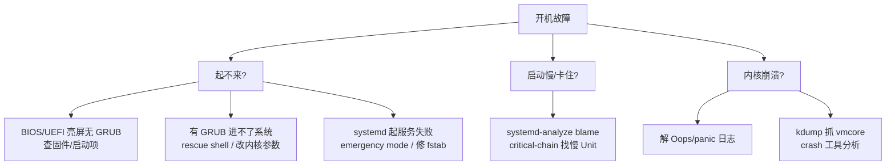

::: abstract 本章定位
本篇面向**操作系统自身**的疑难排查：机器起不来、启动慢、启动一半卡死、内核 panic、内存硬件报错。方法论上先按"启动流程阶段"定位卡点，再对内核崩溃用 kdump + crash 分析 vmcore。对应《Operating System Concepts》Ch1、Ch3 与 systemd 文档、《SRE》"起不来的机器"章节。与 [方法论](/kb/os/问题排查/00-系统问题排查方法论/)、[磁盘篇](/kb/os/问题排查/04-磁盘与IO瓶颈排查/)（根分区满/fsck）联动。
:::



## 1. 启动流程排错总览

### 1.1 启动的五个阶段

| 阶段 | 谁在干活 | 卡住的典型表现 | 去哪看 |
|---|---|---|---|
| 固件 | BIOS / UEFI | 无任何画面 / 黑屏死机 | 主板蜂鸣声、UEFI 事件日志 |
| 引导器 | GRUB2 | 卡在 `grub>` / `rescue>` 提示符 | GRUB rescue shell 内 `ls (hd0,x)` |
| 内核 | vmlinuz + initramfs | 屏幕停在最后一行内核消息 | `dmesg`（若可回放）|
| init | systemd（PID 1）| 有开机画面但不再前进 | `journalctl -b -1`（上一次启动）|
| 服务 | target 与 unit | 报"failed"或起不来 | `systemctl list-units --failed` |

::: tip 判断"卡在哪一阶段"的第一原则
屏幕/串口最后一行**内核消息**到哪 → 内核是否加载完成；能不能进 `getty` 登录 → init 与服务是否完成。阶段边界由"消息来源"划分，而不是看时间。
:::

### 1.2 三个日志出口要分清

```bash
# 内核环形缓冲区（本次内核启动以来的消息）
dmesg | tail -50

# systemd 日志：本次启动
journalctl -b

# systemd 日志：上一次启动（最关键！系统挂了之后常靠它复盘）
journalctl -b -1

# 列出历次启动，拿到 boot id
journalctl --list-boots
```

预期输出（`--list-boots`）：

```
-2 9a1a...-c5d6  Mon 2026-08-08 20:01:14 CST—Mon 2026-08-08 21:40:03 CST
-1 4b2c...-a1e9  Tue 2026-08-09 09:12:07 CST—Tue 2026-08-09 09:12:40 CST
 0 7e9d...-f2a3  Tue 2026-08-09 10:00:00 CST—now
```

解读：`-1` 是上一次启动、`-2` 更早，`0` 是当前。`-1` 的启动时长只有 33 秒就"结束"——很可能那次是挂掉被强重启的，先看它的崩溃尾巴。

### 1.3 现场采集清单

```bash
journalctl -b -1 --no-pager > /var/log/boot_prev.txt   # 上次启动全量
journalctl -b -1 -p err --no-pager                     # 只取错误级
dmesg | grep -iE 'panic|oops|call trace|failed'       # 内核级报错
```

## 2. GRUB 引导问题

### 2.1 GRUB 提示符种类

| 提示符 | 含义 | 常见触发 |
|---|---|---|
| `grub>` | normal 模式已加载 | 手动编辑条目、引导文件损坏 |
| `rescue>` | normal.mod 丢失 | /boot 分区损坏、grub 安装失败 |
| `grub rescue>` 循环 | 找不到 boot 设备 | 分区表/盘序变化 |

### 2.2 在 rescue 里自救（临时启动进系统）

```bash
# 依次执行（先探路，再加载模块）
ls (hd0,1)/boot/grub2/normal.mod          # 找 boot 分区上的模块
set root=(hd0,1)
insmod normal
normal
```

解读：`ls (hd0,1)/` 列出第一块盘第二个分区内容，确认 boot 文件在哪；`insmod normal` 加载 normal 模块后 `normal` 回到图形菜单。找不到盘就 `ls` 试 `(hd0,msdos1)`、`(hd0,gpt2)` 等写法。

### 2.3 从 GRUB 手动引导一次

```bash
set root=(hd0,1)
linux /vmlinuz-6.8.0 root=/dev/sda2 ro
initrd /initramfs-6.8.0.img
boot
```

解读：`linux` 指定内核与根设备，`initrd` 指定 initramfs，`boot` 启动。能进系统后马上重建配置：

```bash
grub2-mkconfig -o /boot/grub2/grub.cfg        # RHEL/CentOS
update-grub                                   # Debian/Ubuntu
grub2-install /dev/sda                        # 必要时重装引导器
```

### 2.4 常用内核参数：进不去系统的救命开关

| 参数 | 作用 |
|---|---|
| `nomodeset` | 禁用 KMS/GPU 驱动初始化，黑屏或花屏时先试 |
| `single` / `1` | 进入单用户维护模式（不需完整服务）|
| `rd.break` | 在内核挂载 initramfs 后、切根前打断，进入 shell |
| `init=/bin/bash` | 跳过 init 直接给 shell（需手动挂根）|
| `systemd.unit=emergency.target` | 直接进 emergency（见第 6 节）|

在 GRUB 菜单按 `e` 编辑启动项，在 `linux` 行末尾加参数后 `Ctrl+x` 启动——**不用重装任何东西**，是纯启动阶段排错的最强手段。

::: note 救援模式 vs 单用户 vs emergency
救援模式（RHEL 安装盘 `rescue`）= 用安装介质进小系统挂载原盘；单用户 `single` = 原系统只起最少量 target；emergency = systemd 只挂载根分区起一个 shell。从强到弱：救援 > 单用户 > emergency。
:::

## 3. systemd 启动排查

### 3.1 一眼看全失败服务

```bash
$ systemctl list-units --failed
  UNIT                     LOAD   ACTIVE SUB    DESCRIPTION
● data.mount               loaded failed failed /data mount point
● nginx.service            loaded failed failed A high performance web server
```

解读：`ACTIVE=failed` 的服务先处理。单服务状态用 `systemctl status nginx`（会附最后几行日志），日志全文用 `journalctl -u nginx -b`（本次启动）或 `-b -1`（上次启动）。

### 3.2 常见失败原因三板斧

| 现象 | 典型根因 | 修法 |
|---|---|---|
| `Failed to mount /data` | fstab 条目设备不存在/挂载点没建 | 修 fstab、`mkdir -p`、`systemctl daemon-reload` |
| `ExecStart` 权限拒绝 | unit 里用户/路径权限不对 | 看 `systemctl status` 输出里的 permission denied |
| 脚本 `exit code=1` | 服务启动脚本自身报错 | 手动跑 `ExecStart` 的命令复现 |
| `Dependency failed` | 前置 target/mount 挂了 | 先救前置项，`systemctl list-dependencies xxx.target` 查依赖树 |

### 3.3 启动慢定位

```bash
$ systemd-analyze time
Startup finished in 2.340s (kernel) + 1.512s (initrd) + 48.923s (userspace) = 52.775s

$ systemd-analyze blame
48.3s data.mount
 1.2s mysql.service
 0.8s network.target

$ systemd-analyze critical-chain
graphical.target @49.012s
└─multi-user.target @48.994s
  └─data.mount @0.056s +48.307s
```

解读：内核 2.3s、用户态 48.9s——慢在 userspace。`blame` 按时长排序，`critical-chain` 展示**关键链上每个 Unit 谁在拖后腿**（`@时间 +耗时`）。`data.mount` 卡 48 秒 → 大概率在等超时的磁盘 IO（见第 6 节 fsck/fstab）。

### 3.4 Unit 启动失败现场：journalctl -u

```bash
$ journalctl -u nginx -b --no-pager
Jun 09 09:12:11 host systemd[1]: Starting A high performance web server...
Jun 09 09:12:11 host nginx[1420]: nginx: [emerg] bind() to 0.0.0.0:80 failed (98: Address already in use)
Jun 09 09:12:11 host systemd[1]: nginx.service: Control process exited, code=exited, status=1/FAILURE
```

解读：端口被占、配置语法错、pid 文件残留是三个高频原因。**修复顺序**：改配置 → `systemctl daemon-reload`（改了 unit 文件时必做）→ `systemctl restart nginx` → `systemctl status` 确认 active。

## 4. 内核 panic：现象、解读与 kdump

### 4.1 Oops / BUG / panic 的区别

| 术语 | 严重度 | 行为 |
|---|---|---|
| `Oops:` | 非致命 | 仅杀死当前进程/内核线程，系统继续 |
| `BUG:` | 内核主动断言 | 触发点即死机，系统状态不可信 |
| `Kernel panic` | 致命 | 停机（panic=0 时自动重启则不一定停）|

::: warning 关键开关 `panic_on_oops`
生产环境常设 `sysctl kernel.panic_on_oops=1` + `kernel.panic=10`：**让 Oops 也触发 panic 并 10 秒后自动重启**。否则一个"轻量 Oops"可能留一个半损坏的内核继续跑，污染数据。持久化写 `/etc/sysctl.d/99-panic.conf`。
:::

### 4.2 panic 信息长什么样

```
BUG: unable to handle kernel NULL pointer dereference at virtual address 0000000000000000
Oops: 0000 [#1] SMP NOPTI
CPU: 2 PID: 1834 Comm: kworker/u8:2 Not tainted 6.8.0-generic
RIP: 0010:nvme_setup_cmd+0x6b/0x120 [nvme]
Code: 48 8b 47 30 48 89 42 28 0f 85 00 00 00 00 48 8b 03 48 8b 53 08 <48> 8b 04 90 ...
RSP: 0018:ffff88803c2d3d78 ...
RAX: 0000000000000000  RBX: ffff88802b9a8000  RCX: 0000000000000002
Call Trace:
 &lt;TASK&gt;
  __nvme_submit_sync_cmd+0x...
  nvme_validate_ns+0x...
 &lt;/TASK&gt;
```

逐行解读：

| 行 | 信息 |
|---|---|
| `BUG: unable to handle...` | 崩溃原因：空指针解引用（解了 NULL 地址）|
| `Oops: 0000 [#1]` | Oops 编号 0000，`#1` 表示这是该次运行第 1 次 Oops |
| `CPU: 2 PID: 1834 Comm: kworker` | 在哪个核、哪个线程里炸的——**Comm 是定位模块的钥匙** |
| `RIP: nvme_setup_cmd+0x6b/0x120 [nvme]` | 崩在 `nvme_setup_cmd` 函数 +0x6b 偏移处，函数全长 0x120，**模块名 `[nvme]` 直接点名字** |
| `RAX: 0` | 通用寄存器快照，可据此判断解了空指针 |
| `Call Trace:` | 调用栈：`__nvme_submit_sync_cmd → nvme_validate_ns`，向上还原触发路径 |
| `Code:` | RIP 处原始机器码，`<48>` 标记崩溃指令，配合 `objdump` 精确反汇编 |

常见原因按概率排序：① 内存损坏（ECC 报错先行，见第 5 节）；② 驱动 BUG（新内核/新驱动首日上线高发）；③ 文件系统不一致（断电后）；④ 硬件（网卡/盘）异常导致的中断/IO 行为异常。

### 4.3 kdump：把崩溃现场存下来

```bash
# 1) grub 内核参数加 crashkernel（reserve 内存给第二内核）
sed -i 's/^GRUB_CMDLINE_LINUX=.*/GRUB_CMDLINE_LINUX="crashkernel=512M"/' /etc/default/grub
grub2-mkconfig -o /boot/grub2/grub.cfg

# 2) 安装启用 kdump 并验证
yum install -y kexec-tools crash        # RHEL/CentOS
systemctl enable kdump && systemctl start kdump
systemctl status kdump                  # active (running)
grep crashkernel /proc/cmdline          # 确认启动参数生效
```

::: note crashkernel 大小建议
物理内存 4~8G 配 `crashkernel=256M~512M`；大内存机（>64G）建议 1G。装完务必 `reboot` 一次并确认 `/proc/cmdline` 里有 `crashkernel=`，否则 kdump 是空转的。
:::

### 4.4 用 crash 工具分析 vmcore

崩溃后，`kdump` 的第二个内核把内存转储写入 `/var/crash/时间戳/`：

```bash
$ ls /var/crash/
2026-08-10-09:12:40   vmcore  vmcore-dmesg.txt  vmlinux
```

```bash
crash /usr/lib/debug/lib/modules/$(uname -r)/vmlinux /var/crash/2026-08-10-09:12:40/vmcore
```

crash 交互式命令：

```
crash> bt          # 所有 CPU 的调用栈，找 panic 的 CPU
crash> ps          # 进程表
PID: 1834   TASK: ffff88803c...  CPU: 2   COMMAND: "kworker/u8:2"
crash> ps aux      # 带资源信息的进程表，看谁在事发瞬间最忙
crash> log         # 崩溃前内核日志（= vmcore-dmesg.txt 的交互版）
crash> quit
```

解读：先 `log` 复现崩溃时刻日志，再 `bt` 定位 panic 栈，用 `ps aux` 还原"当时系统在干什么"（哪个进程触发 IO → 驱动炸掉）。这是社区分析 panic 的标准三板斧。

## 5. 内核 Oops 与硬件错误（MCE / EDAC）

### 5.1 硬件错误的两条线索

| 报告通道 | 工具 | 关注点 |
|---|---|---|
| Machine Check Exception | `mcelog` / `rasdaemon` | 记录 CPU 报的内存/缓存/总线错误 |
| EDAC（内存控制器）| `edac-util`（edac-utils 包）| 定位到具体 DIMM |

```bash
$ dmesg | grep -i mce
mce: [Hardware Error]: Machine check events logged
mce: [Hardware Error]: CPU 5: Machine Check: 0 Bank 8: b2a0000000000158
mce: [Hardware Error]: Time 1625876543
mce: [Hardware Error]: MCGSTATUS: 0
mce: [Hardware Error]: Error Status: 0x0000000000000158
```

解读：`Bank 8` 通常是内存控制器 bank；`Error Status 0x158` 中的 bit 表示 **CE（corrected，可纠正）**，说明内存正在累积可纠正错误——这是换内存的早期信号，别等到 UE（不可纠正）才动手。

```bash
# 看每个内存通道/槽位的错误计数（定位到哪根内存条）
$ sudo edac-util -rs
mc0 csrow0 memory errors: 0       # channel 0
mc0 csrow1 memory errors: 1452    # ← 这个槽位在持续报错
mc0 csrow2 memory errors: 0
```

### 5.2 硬件错误 vs 软件错误的分水岭

::: tip 判断红线
① 重启后**同样位置**复现 Oops → 大概率硬件（内存/盘）；② `dmesg` 里有 `mce`/`EDAC` 计数增长 → 硬件先行；③ 换了应用/驱动版本后不再出现 → 软件。**内存错误是最隐蔽的"随机崩溃"源头**：它可能表现为任何随机模块的随机 Oops，backtrace 根本不指向内存本身。
:::

## 6. 启动卡死定位

### 6.1 挂在哪一步：串口与 con 参数

```bash
# grub linux 行追加，把内核输出导到串口，便于远程看卡点
console=ttyS0,115200n8 console=tty0

# 或者用 systemd 的串口 console：
systemd.unit=emergency.target console=ttyS0,115200
```

解读：物理机死机屏幕不可达时，串口是唯一"眼睛"。`console=ttyS0` 输出到串口，`console=tty0` 同时保留屏幕。虚拟机用 `virsh console`，云主机用厂商的 serial console 入口。

### 6.2 fsck 卡住与 fstab 错误

```bash
$ journalctl -b -1 --no-pager | grep -iE 'fsck|mount|recover'
Jun 09 09:11:20 host systemd-fsck[402]: /dev/sdb1: UNEXPECTED INCONSISTENCY; RUN fsck MANUALLY
Jun 09 09:11:20 host systemd-fsck[402]: *** An error occurred during the file system check. ***
Jun 09 09:11:20 host systemd[1]: Dependency failed for /data mount point.
```

解读：**根分区外的 fsck 失败会触发 emergency（root 进入只读维护 shell）**。修法：

```bash
# 进入维护模式
systemd.unit=emergency.target          # grub 参数 或
systemctl emergency                     # 已在系统内

# 根分区默认只读，先改可写
mount -o remount,rw /

# 手动修复 /data 所在盘
fsck -y /dev/sdb1
mount /dev/sdb1 /data
systemctl daemon-reload && systemctl start local-fs.target
```

### 6.3 /etc/fstab 错误自检

```bash
# 不重启用校验命令（红帽系）
findmnt -f /data          # 对比 fstab 与当前挂载
grep -vE '^#|^$|proc|sysfs|tmpfs|devpts|cgroup' /etc/fstab   # 只看真设备
blkid /dev/sdb1           # 用 UUID 代替 /dev/sdX，避免盘序漂移
```

::: warning fstab 里最危险的写法
根分区不可用 `noauto`、网络挂载（nfs/iscsi）没有 `_netdev` 时，开机会在**等待网络超时前**卡住整个启动，表现为"看似无响应 90~180 秒"。务必给网络盘加 `_netdev`，给可掉盘的数据盘加 `nofail`。
:::

### 6.4 只读根分区恢复

```bash
# emergency/single 里根分区默认只读
mount -o remount,rw /
# 确认写测试
touch /tmp/write_test && echo ok
# 恢复后按 Ctrl+D 继续启动，或 reboot
```

## 7. 关机/重启异常

### 7.1 关机卡死链路

```bash
# 正常关机目标
systemctl poweroff
# 看卡在哪
journalctl -b -p err --no-pager | grep -iE 'halt|shutdown|unmount'
systemctl list-units --state=failed     # 是否有 stop 失败的服务
```

解读：关机异常九成是某个服务 `ExecStop` 超时（默认 90s）或磁盘卸载（`umount`）卡死。`systemd-logind` 负责会话管理，若用户界面点了关机没反应，`systemctl poweroff` 仍可强制。多个**挂在 IO 上的进程**（D 状态）会让 `umount` 一直等。

### 7.2 强制重启后的文件系统检查

```bash
# 断电/强重启后，默认会对上次非正常卸载的盘做 fsck；强制方式：
touch /forcefsck && reboot          # 老式 /forcefsck 文件
# 或 grub linux 行加：fsck.mode=force
```

::: note 别忽略"开机即关机"
`systemd-analyze critical-chain reboot.target` 可看关机/重启链上的慢点；`systemctl set-default` 误设为 `poweroff.target` 会导致"开机就关机"的诡异现象。
:::

### 7.3 watchdog：硬件与内核双保险

| watchdog | 机制 | 配置 |
|---|---|---|
| hardware watchdog | 独立芯片，超时未喂狗强制复位 | `/dev/watchdog`、`watchdog` 服务、BIOS 里开 |
| softlockup | 单核在 softirq/锁上忙死 | `/proc/sys/kernel/softlockup_panic` |
| NMI watchdog | 借 NMI 检查 hardlockup（关中断卡死）| `nmi_watchdog=1` 内核参数 |

```bash
# 查看当前状态
cat /proc/sys/kernel/softlockup_panic     # 1=死锁自动 panic
cat /proc/sys/kernel/nmi_watchdog         # 1=硬件 NMI 机制在
ls /dev/watchdog*                          # 有无硬件 watchdog 设备
```

解读：**系统"假死"（SSH 无响应但电源灯亮）** 的关键是定性：softlockup（内核中断/软中断吃死，watchdog 兜底）还是硬件问题（内存错误、机箱掉电）。生产机建议 `softlockup_panic=1`，把假死转成"panic → kdump → 重启"，留下现场可分析。

## 8. 内核模块与驱动故障

### 8.1 加载失败排查

```bash
$ sudo modprobe e1000
modprobe: ERROR: could not insert 'e1000': No such device
$ dmesg | tail -5
e1000: probe of 0000:03:00.0 failed with error -5
```

| 报错 | 含义 | 对策 |
|---|---|---|
| `No such device` | 设备不在 / 驱动不含该型号 | `lspci -k` 看设备当前用的驱动 |
| `Key was rejected by service` | Secure Boot 拒绝未签名模块 | 签名模块或关闭 Secure Boot |
| `Module xxx not found` | 模块没装 / 版本不匹配 | `modinfo xxx`、`depmod -a` 后重试 |
| `Invalid module format` | 编译内核版本不一致 | 模块与内核同源重编 |

```bash
lsmod | grep -E 'e1000|nvme'      # 当前已加载
modinfo e1000                     # 模块信息、license、依赖
lspci -k | grep -A2 -i ethernet   # 设备实际绑定的驱动
```

### 8.2 黑名单：禁用坏驱动

```bash
# /etc/modprobe.d/blacklist.conf
blacklist nouveau                 # 例：禁用 nouveau，改用 nomodeset+nvidia
blacklist i2c_piix4               # 例：与某硬件冲突的模块

# initramfs 里同样要禁（否则下次开机又加载）
echo "rdblacklist nouveau" >> /etc/modprobe.d/blacklist.conf
dracut --force                    # RHEL；Ubuntu 用 update-initramfs -u
```

::: warning 只禁模块往往不够
很多"驱动导致 panic"是 initramfs 阶段就加载的（存储/图形驱动）。改了 `/etc/modprobe.d` 后必须重建 initramfs，否则重启后"黑名单失效"。
:::

### 8.3 内核升级回滚

```bash
# 方法一：grub 菜单选旧内核启动（不用任何操作）
# 启动菜单 → Advanced options → 选上一个版本

# 方法二：回落后设默认并清理
grub2-editenv list                    # 看 saved_entry
grub2-set-default 'CentOS Linux (3.10.0-1160.119.1)'
grub2-mkconfig -o /boot/grub2/grub.cfg

# 卸载坏内核（确认旧内核能正常跑后）
yum remove kernel-6.8.0-11            # 删除新版，只留旧版
```

```bash
# 与模块配套：回落后内核版本变了，dkms 模块要重编
dkms status          # 看 dkms 状态
dkms autoinstall     # 自动重编当前内核对应模块
```

### 8.4 duplicate module：同一模块两处存在

```bash
$ dmesg | grep -i 'duplicate' 
  ... duplicate module 'nf_tables', version '0.2025' first seen in kernel
```

解读：模块在 initramfs 和真实根文件系统各一份，或 `insmod` 手动加载后又 `modprobe`，导致重复注册。症状是**加载新版本不生效、旧版本仍占用符号**。对策：`modprobe -r` 卸载干净、删掉手动拷贝的 `.ko`、确认只走 `/lib/modules/$(uname -r)/` 一份路径。

## 9. 本章小结

- **定位靠阶段**：固件 → GRUB → 内核 → systemd → 服务，先分清卡在哪一步再动手；日志用 `dmesg`（内核）、`journalctl -b / -b -1`（本次/上次启动）。
- **进不去系统**：GRUB `rescue>` 里 `insmod normal` 自救，或加内核参数 `nomodeset` / `single` / `rd.break` / `systemd.unit=emergency.target`。
- **服务起不来**：`systemctl list-units --failed` → `journalctl -u &lt;unit&gt;` 看真实报错；启动慢用 `systemd-analyze blame` + `critical-chain`。
- **panic 必须留现场**：生产机配 `crashkernel=512M` + `kdump` + `panic_on_oops=1` + `panic=10`，崩溃后用 `crash` 工具 `log / bt / ps` 三板斧分析 `/var/crash` 里的 vmcore。
- **硬件错误靠 MCE/EDAC**：`dmesg` 里 `mce:` 与 `edac-util -rs` 的槽位计数，是"随机 Oops"背后的真正元凶（内存）。
- **卡死/假死**：串口 `console=ttyS0` 是远程眼睛；fsck/fstab 问题进 emergency 修；`softlockup_panic`/硬件 watchdog 兜底假死。
- **驱动问题**：`modprobe` 报错查 `dmesg`，坏驱动进 `/etc/modprobe.d` 黑名单并重建 initramfs；内核升级异常用 grub 旧内核回滚。

## 10. 实战演练：一台起不来的机器

::: note 场景
某 8G 内存的 CentOS 服务器，机房人员反馈：**开机后卡在登录提示符之前**，等了 10 分钟都进不了 shell。机器无法远程，只能用 IPMI 串口操作。
:::

**第 1 步：判断卡在哪一阶段（串口输出）**

```
[ OK ] Reached target Local File Systems.
[ TIME ] Timed out waiting for device dev-disk-by-uuid-xxxx.device.
[DEPEND] Dependency failed for /data.
[ TIME ] Timed out waiting for device dev-disk-by-uuid-yyyy.device.
[FAILED] Failed to mount /data.
[ TIME ] Timed out waiting for device dev-sdb1.device.
[FAILED] Failed to mount /data2.
Welcome to emergency mode!
```

解读：所有 **mount 相关 unit 失败** → 落在"服务/挂载"阶段，不是 GRUB 也不是内核。两个盘都超时，怀疑对象从"单盘坏"升级为"fstab 配置错"。

**第 2 步：用 systemd-analyze 从上次启动取证**

```bash
$ journalctl -b -1 --no-pager | grep -iE 'timed out|failed'
systemd[1]: Timed out waiting for device dev-sdb1.device.
systemd[1]: Timed out waiting for device dev-sdb2.device.
```

解读：本次已进 emergency，日志不完整，故取 `-b -1` 的完整时间线还原"先等谁、谁超时"。

**第 3 步：读 /etc/fstab 找出错条目**

```bash
# emergency 里根是只读，先 remount
mount -o remount,rw /
cat /etc/fstab
UUID=7e9d-... /data  xfs defaults   0 2
UUID=xxxx-... /data  xfs defaults   0 2   # ← 与第 1 行 UUID 相同？！
```

解读：`/data` 出现了两条 fstab 记录，且第二个 UUID `xxxx` 在系统里根本不存在（`blkid` 对不上）。**系统等待不存在的 UUID 设备超时 → 卡住整个 local-fs 链**。这就是"卡在登录前"的真凶。

**第 4 步：修复 fstab**

```bash
# 注释/删除错误条目（用编辑器或 sed）
sed -i '/UUID=xxxx/d' /etc/fstab
# 校验 fstab 可被解析（不重启）
findmnt --verify /data
# 挂载测试
mount -a || echo "还有挂载错误，请继续修"
```

**第 5 步：重启验证**

```bash
reboot
# 启动后确认：
systemd-analyze time            # 总时长恢复为 ~30s
systemctl list-units --failed   # 空
findmnt /data                   # 正确挂载
```

**复盘**：现象（卡登录前）→ 阶段定位（journalctl 全在 mount 失败）→ 上次启动取证（`-b -1` 两个设备超时）→ 读 fstab（重复条目 + 幽灵 UUID）→ 修 fstab → `mount -a` 验证 → 重启复测。**根因是配置文件错误，不是硬件损坏**——这正是"先在 emergency 里读日志再动手"的价值，避免误判成换硬件。

## 11. 自测题

1. **`dmesg`、`journalctl -b`、`journalctl -b -1` 各看什么？系统崩了之后复盘应该用哪个？** dmesg 看内核环形缓冲区（本次）；`journalctl -b` 看本次启动全部 systemd 日志；`journalctl -b -1` 看上一次启动，崩溃复盘用这个。
2. **开机卡在 `grub rescue>` 怎么办？两条关键命令是什么？** 先用 `ls (hd0,1)/` 探路径，再 `insmod normal` + `normal` 回到菜单；进系统后 `grub2-mkconfig -o /boot/grub2/grub.cfg` 重建。
3. **`systemd-analyze blame` 与 `critical-chain` 的区别？** blame 按单个 Unit 耗时排序；critical-chain 沿"关键依赖链"逐层展示谁拖慢整体启动（如 graphical→multi-user→挂载）。
4. **Oops 与 panic 的区别？生产环境为什么建议 `panic_on_oops=1`？** Oops 非致命只杀当前进程，panic 停机；开 `panic_on_oops` 让"半残内核"也触发 panic+自动重启+kdump，避免带着已损坏的内核状态继续写数据。
5. **kdump 抓到 vmcore 后，crash 工具的三个起步命令是什么？** `log`（崩溃前日志）、`bt`（panic CPU 调用栈）、`ps aux`（事发瞬间进程与负载）。
6. **`dmesg` 里出现 `mce:` 且 `edac-util -rs` 显示某 csrow 计数持续增长，说明什么？** 内存硬件在持续报可纠正错误（CE），是内存条早期劣化的信号，应尽快更换对应槽位内存，否则会升级为不可纠正（UE）崩溃。
7. **fstab 里一个不存在的 UUID 会导致什么？怎么避免？** 启动会等该设备超时（默认 90s+）再失败，连锁让依赖它的 mount 全部 failed 而进 emergency；用 `blkid` 核实 UUID、数据盘加 `nofail`、网络盘加 `_netdev`，并定期 `findmnt --verify`。
8. **内核升级后机器起不来，最省事的回滚手段是什么？** 在 GRUB 菜单的 Advanced options 里选旧内核启动，确认正常后再 `grub2-set-default` 设默认并清理坏内核。
