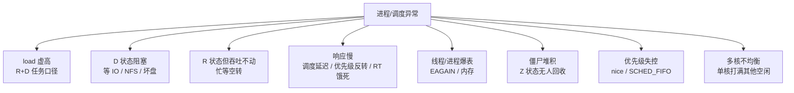
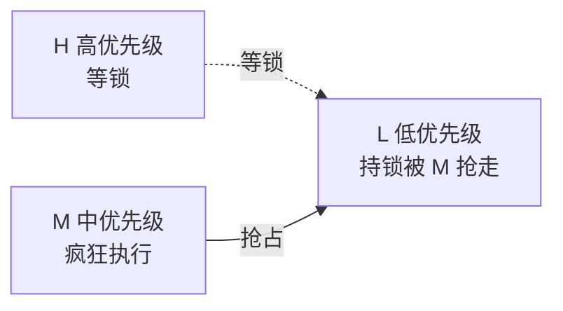

::: abstract 本章定位
本篇聚焦**操作系统层面**的进程与调度疑难：load 虚高的口径、D 状态（不可中断睡眠）卡死、R 状态忙等空转、调度延迟与优先级反转、进程/线程数爆表、僵尸堆积、nice/RT 优先级失控、多核负载不均衡。基于 CFS/EEVDF 与 Linux 调度内核机制，对应 [调度器原理](/kb/os/Linux/09-Linux调度器原理/) 与 [进程内核原理](/kb/os/Linux/08-Linux进程与线程内核原理/) 在排障中的落地。
:::

进程与调度问题最迷惑人的地方：**系统"看起来"坏在 CPU 上，根因却在 IO、锁、内核等待上**。先看地图：



判断总原则（呼应 [篇](/kb/os/问题排查/01-性能分析方法论/)）：先区分"**任务真的在跑**（R+CPU 高）"还是"**任务在等**（D/S+CPU 低）"，load 里两类都算，所以 load 高 ≠ CPU 忙。

## 1. load average 异常解读

### 1.1 现象

```bash
$ uptime
 22:15:03 up 30 days,  2:41,  2 users,  load average: 15.21, 8.34, 4.10
$ top -b -n1 | head -3
%Cpu(s):  4.0 us,  1.5 sy,  0.0 ni, 90.5 id,  3.5 wa,  0.0 hi,  0.5 si,  0.0 st
```

load 一分钟从 4.1 涨到 15.2，CPU 却 90% 空闲——**load 和 CPU 完全脱节**。这是最经典的"load 虚高"。

### 1.2 工具

```bash
cat /proc/loadavg        # 原始口径，含 running/total 与 last_pid
nproc                     # 本机逻辑核数
lscpu | grep '^CPU(s)'
vmstat 1 5 | tail -5      # 重点看 r（可运行）和 b（阻塞）两列
```

`/proc/loadavg` 五个字段：前三 = 1/5/15 分钟平均 load，第四 = `r/total`（当前 R 任务数 / 全部任务数），第五 = 最近分配的 PID。

### 1.3 定位

内核 `kernel/sched/loadavg.c` 计算 load 的口径是 **`nr_running + nr_uninterruptible`**，即：

| 计入 | 含义 | CPU 表现 |
|---|---|---|
| R（runnable） | 就绪/正在运行 | CPU 高 |
| D（uninterruptible） | 不可中断睡眠，等 IO/锁 | CPU 低，load 却涨 |

所以 **load > nproc 只能说明"有超过核数的任务排队或阻塞"，不能说明 CPU 饱和**。8 核机器 load 15 但 idle 90%，那 ~7 个额外 load 几乎都来自 D 状态。

三个值判断趋势：

```
1min > 5min > 15min   → 负载在上升，可能刚出事
1min < 5min < 15min   → 峰值已过，正在回落
三值接近相等          → 稳态，负载一直这么高
```

### 1.4 修复

- 若 r 高、CPU 高 → 真实计算密集，走 [CPU 篇](/kb/os/问题排查/02-CPU性能问题排查/)。
- 若 r 低、b 高（D 状态多）→ 走第 2 节，查 IO/NFS/锁。
- 若 r 和 b 都不高但 load 高 → 检查是否近期大量短命进程反复 fork（每次 fork 都瞬时计入 R），用 `ps -eo pid,ppid,comm --sort=-start` 或第 5 节方法定位。

::: warning load 只是"排队长度"指标
它既算"正在跑"也算"卡住等"，单看 load 判断性能是常见误区。load 高 + idle 高 = 有人在等，别去优化 CPU。
:::

## 2. 进程 D 状态（不可中断睡眠）排查

### 2.1 现象

进程卡住、load 虚高、应用无响应，`top` 里出现一批 `D` 状态进程：

```bash
$ top -b -n1 | grep -E '^ *[0-9]+.*D '
  PID USER  PR  NI  VIRT RES  SHR S  %CPU %MEM TIME+  COMMAND
 3210 app   20   0  1.1g 240m 12m D   0.0  3.1  0:32.10 php-fpm
 3211 app   20   0  1.1g 238m 12m D   0.0  3.0  0:31.88 php-fpm
```

### 2.2 工具

```bash
ps -eo pid,stat,wchan:20,comm | awk '$2=="D"{print}'     # 全部 D 状态及内核等待点
sudo cat /proc/3210/stack                                # 内核栈（需 root + CONFIG_STACKTRACE）
sudo cat /proc/3210/wchan                                 # 内核 wchan 函数（root 才能看到）
vmstat 1 5 | tail -5                                     # b 列即阻塞(D)任务数
```

### 2.3 定位

D = `TASK_UNINTERRUPTIBLE`：任务在内核里等待某种事件（通常 IO 完成或内核锁），**信号（含 SIGKILL）排队但不生效，直到该任务返回用户空间**。`wchan` 直接点名等待点：

| wchan 关键字 | 常见根因 |
|---|---|
| `lock_page` / `wait_on_page_bit` | 页面回写 / 读坏扇区，坏盘典型信号 |
| `io_schedule` | 通用 IO 等待（磁盘阵列卡顿、掉盘） |
| `rpc_wait_bit_killable` / `nfs_wait_on_rpc` | NFS RPC 等待，挂载点服务器失联 |
| `mutex_lock` / 内核锁 | 内核资源竞争（罕见，多为 bug） |

配套确认：NFS 挂载点 `mount | grep nfs`、坏盘看 `dmesg -T | grep -iE 'block|I/O error'`、`iostat -x 1` 看 await 飙高。

::: tip TASK_KILLABLE：多数 NFS 等待能强杀
内核 2.6.25+ 引入 `TASK_KILLABLE`，NFS/部分等待标为 killable——这类 D 状态**可以被 SIGKILL 打断**。真正的坏盘页面等待不可打断，只能等或重启。
:::

### 2.4 修复

1. **等 IO 恢复**：坏盘/NFS 恢复后多数 D 状态自动解除，先观察 `vmstat b` 是否回落。
2. **强杀 killable 等待**：`kill -9 &lt;pid&gt;`（对 NFS 挂起的 php-fpm 等有效）。
3. **NFS 挂起**：修 NFS 服务器或网络；挂载参数建议 `hard,intr,timeo=50,retrans=2`（`soft` 会丢数据，慎用）；长期可换 `nfsvers=4`。
4. **坏盘**：`smartctl -a /dev/sdX` 查 SMART，换盘。
5. **仍无法解除且 wchan 是内核锁/死锁等待**：怀疑内核 bug，升级/更换内核，必要时 `echo b > /proc/sysrq-trigger` 重启。

## 3. 进程 R 状态但 CPU 不涨：忙等空转

### 3.1 现象

进程状态是 `R`、单核打满，但**业务吞吐/进度完全不动**，CPU 全烧在"等待某个条件成立"：

```bash
$ pidstat -t -u 1 3 | grep -E 'CPU|100'
21:00:00  1000   -       8842   100.0  0.0   0.0  100.0  app
21:00:00  1000   8842     -     100.0  0.0   0.0  100.0  |__spin_wait
```

R + 100% CPU + 无产出 = **忙等（busy spin）**：线程在用户态死循环轮询一个标志位，比如 `while (!ready) {}` 而 `ready` 由另一个线程在极慢路径上才置位。

### 3.2 工具

```bash
perf top -p &lt;pid&gt;                     # 看热点函数，忙等会集中在一个自旋函数
pidstat -t -u 1 3 -p &lt;pid&gt;            # 落到具体线程
sudo perf record -F 99 -g -p &lt;pid&gt; -- sleep 10
sudo perf report --stdio | head -30   # 拿调用链，确认是"空转等"还是"在算"
```

### 3.3 定位

看 perf 采样热点的形态即可分辨"真忙"还是"假忙"：

| 表现 | 结论 |
|---|---|
| 热点是 `foo()` 且调用链深、函数名业务化 | 真实计算，优化代码 |
| 热点是 `spin_loop` / `pause` / 浅循环、调用链只有几层 | **忙等空转** |
| 阻塞在 futex（S 状态、`futex_wait_queue_me`） | 锁等待，见 [并发篇](/kb/os/问题排查/05-并发与异常排查/) |

关键区分：**futex 锁等待是 S 状态**（进内核睡眠，不耗 CPU）；**忙等是 R 状态**（不释放 CPU 死转）。`top` 里 S 状态的进程 %CPU 接近 0，R 状态忙等线程 %CPU 100%。

::: note 与"锁自旋"（内核 spinlock）的区别
内核 spinlock 自旋显示在 `sy`，且抢占被禁（`top` 里 `us` 低 `sy` 高、可能看到 `preemption disabled`）。用户态忙等是 `us` 高。二者都要"不忙等"，内核 spinlock 靠改锁设计/加锁粒度，用户态靠改成条件变量。
:::

### 3.4 修复

把忙等改成阻塞等待：`pthread_cond_wait` / futex / `sem_wait` / 事件循环里的 `epoll_wait`，条件成立再唤醒。这是教科书级修复：`while (!ready) {}` → `pthread_mutex_lock + pthread_cond_wait`。

## 4. 调度延迟与响应慢

### 4.1 现象

服务平均响应时间不高，但**偶发几百 ms 的尖峰**，CPU 有余量；或某个低优先级任务永远轮不到执行。

### 4.2 工具

```bash
sudo perf sched record -- sleep 10     # 采样 10s 调度事件
sudo perf sched latency                 # 看每任务的调度延迟分布
sudo perf sched trace                    # 原始调度事件流（sched_switch 等）
```

`perf sched latency` 输出重点看：

```
  TASK     Runtime ms  Switches  Avg delay ms   Max delay ms  Max delay at
  worker   12.34       812       3.21           152.0         12345.67
```

`Max delay ms` 152ms = 该任务曾被压了 152ms 才上 CPU。尖峰通常来自：**优先级反转**或 **RT 任务饿死普通任务**。

### 4.3 定位：优先级反转（priority inversion）

经典场景：低优先级任务 L 持锁，中优先级任务 M 抢占 L 执行（L 没机会释放锁），高优先级任务 H 等锁被无限期拖住——**优先级高的反而等最久**。



工具：`ps -o pri,rtprio,stat,wchan,comm` 看谁持锁谁在等；用户态锁（futex）用 `pthread_mutexattr_setprotocol(..., PTHREAD_PRIO_INHERIT)` 让持锁者临时继承等锁者最高优先级；内核 mutex 自带 PI（`CONFIG_FUTEX_PI` / `rtmutex`）。理论详见 [调度算法](/kb/os/进程线程/05-CPU调度算法详解/)。

### 4.4 修复：RT 节流与应急

```bash
chrt -p &lt;pid&gt;                # 查看调度策略与 RT 优先级
chrt -f -p 80 &lt;pid&gt;          # 设 SCHED_FIFO，优先级 80
cat /proc/sys/kernel/sched_rt_period_us   # 周期 1s = 1000000us
cat /proc/sys/kernel/sched_rt_runtime_us  # RT 每周期额度 950000us
```

内核给 RT 任务 **每周期最多 950ms**，留 50ms 给普通任务——**失控的 RT 任务默认只饿死系统 95%，shell 还能用**。修复手段：

1. **优先级反转**：用 PIP/优先级继承，或统一加锁顺序（见 [并发篇](/kb/os/问题排查/05-并发与异常排查/) 死锁部分）。
2. **RT 任务误配**：`chrt -f -p 99` 给了不该给 RT 的程序 → 改成普通调度：`chrt -o -p 0 &lt;pid&gt;`，或降优先级 `chrt -f -p 1`。
3. **RT 饿死普通任务且失控**：见第 7 节应急 `sched_rt_runtime_us=0`。

::: warning 别把 RT 优先级当"性能加速器"
`SCHED_FIFO` 是"保证及时执行"而不是"跑得快"，滥用 99 会让声卡、内核迁移线程、`migration` 线程都抢不到 CPU，系统像冻结。RT 只给真正的硬实时任务。
:::

## 5. 进程数/线程数爆表

### 5.1 现象

```bash
$ ps -eLf | wc -l              # 统计线程总数（含表头）
31234
$ top -b -n1 | grep -E 'Threads|load'
```

服务开始报 `pthread_create failed: Resource temporarily unavailable`（EAGAIN），新连接起不来，`load` 也随线程数被推高。

### 5.2 工具

```bash
cat /proc/sys/kernel/pid_max        # 系统 PID 上限，默认 32768，64 位可调至 4194304
cat /proc/sys/kernel/threads-max    # 内核线程总数上限，随内存自动估算
ulimit -u                           # 每用户进程/线程数上限（RLIMIT_NPROC）
ulimit -s                           # 线程栈大小（默认 8192 KB = 8MB）
ps -o nlwp,rss,vsz,comm -p &lt;pid&gt;    # 单进程线程数/常驻内存/虚拟内存
cat /proc/&lt;pid&gt;/status | grep -E 'Threads|VmSize|VmRSS'
```

### 5.3 定位

`pthread_create` 返回 EAGAIN 的三类根因，逐层排除：

| 检查 | 命令 | 判断 |
|---|---|---|
| 系统 PID 耗尽 | 对比 `/proc/sys/kernel/pid_max` 与进程数 | 接近上限即耗尽 |
| 线程数超限 | `threads-max`、`ulimit -u` | 超了即被拒 |
| 内存不够建栈 | 线程数 × 8MB（`ulimit -s`）> 可用内存 | 虚拟内存爆掉 |

**大量线程的隐形代价是栈的虚拟内存**：1 万个线程 × 8MB = 80GB VIRT（RSS 按需增长，但 VmSize 吓人，且可能触发 cgroup 内存限制）。定位疯狂创建线程/进程的程序：

```bash
ps -eLf | grep <进程名> | wc -l      # 该进程线程数
pstree -p &lt;pid&gt;                      # 看父子结构，找反复 fork 的源头
for p in $(pgrep &lt;name&gt;); do echo "$p $(grep Threads /proc/$p/status)"; done
```

### 5.4 修复

```bash
# 应急：抬高上限（需 root，按需调）
echo 4194304 > /proc/sys/kernel/pid_max
ulimit -u unlimited                  # 当前 shell 会话生效
# 或 /etc/security/limits.conf: user  soft  nproc  65535

# 治本：修程序
#  - 线程池化，别每请求建线程
#  - 查泄漏点（join 丢失/忘 detach 导致僵尸线程）
#  - 缩小栈：pthread_attr_setstacksize(..., 1<<20)
```

::: warning 线程数 ≠ 并发能力
线程是"重型"并发原语：1 线程 ≈ 8MB 虚拟栈 + 调度开销 + 上下文切换。1 万线程通常已是灾难，先看是不是该用协程/事件驱动（对应 [多线程模型](/kb/os/进程线程/04-线程概念与多线程模型/)）。
:::

## 6. 僵尸进程堆积

### 6.1 现象

```bash
$ ps -eo pid,ppid,stat,comm | awk '$3=="Z"'
  981  1    Z  defunct_child
  982  1    Z  defunct_child
```

大量 `&lt;defunct&gt;` 僵尸进程，新进程 PID 号快速消耗（僵尸仍占 PID）。

### 6.2 工具

```bash
ps -eo pid,ppid,stat,comm | awk '$3=="Z"'     # 列出所有僵尸及其父进程
ps -o ppid,comm -p <僵尸pid>                  # 找父进程
pstree -p <僵尸pid>                            # 看进程树
```

### 6.3 定位

僵尸 = 进程**已退出**，仅剩 PCB（task_struct）等父进程 `wait()` 回收；它不占 CPU、不占内存，只占 **1 个 PID**。回收靠"reaping"：正常由父进程 `wait()`/`waitpid()` 完成；若父进程死了，孤儿被 **init（PID 1）收养并回收**。systemd 作为 PID 1 还会主动设 subreaper 收养系统里被丢弃的孤儿。

**僵尸堆积的根因永远是父进程**：父进程没写 `wait()`，或父进程本身挂着（S 状态）不退出。无限循环 fork 但不 wait 的"炸弹式"程序最典型。

::: note subreaper
除了 PID 1，进程可用 `prctl(PR_SET_CHILD_SUBREAPER, 1)` 自我声明为子进程收割者：它的孙辈孤儿会被它收养，避免长期挂起进程积累僵尸。
:::

### 6.4 修复

僵尸杀不掉（SIGKILL 无效，它已死）——处理父进程：

```bash
# 若父进程还活着：让它退出（正常结束或 kill），僵尸由 PID 1/subreaper 回收
kill <父pid>                      # 或 kill -9
# 服务型进程：直接重启服务，僵尸随父进程一起清理
systemctl restart &lt;service&gt;
# 彻底根治：修父进程代码，循环里 waitpid(-1, ...) / 或 SIGCHLD 置 SIG_IGN
# signal(SIGCHLD, SIG_IGN);  ← 让内核自动回收子进程
```

## 7. 进程优先级与 nice 异常

### 7.1 现象

某个进程"抢"走全部 CPU、或相反被饿到一动不动；或者设了 RT 优先级后**系统整个卡死**（键盘、SSH 全部没反应）。

### 7.2 工具

```bash
ps -eo pid,pri,ni,rtprio,stat,comm -p &lt;pid&gt;   # pri/nice/RT 优先级一览
chrt -p &lt;pid&gt;                                  # 调度策略 + RT 优先级
nice -n 10 ./app                                # 启动时设 nice
renice -n 5 -p &lt;pid&gt;                            # 运行中改 nice
```

字段解读：`NI` = nice（-20~19，越低优先级越高，默认 0）；`RTPRIO` = RT 调度优先级（1~99，`-` 表示非 RT）；`PRI` = 内核动态优先级，普通任务随 nice 平移、RT 任务随 rtprio 变化（看相对值即可）。

### 7.3 定位

- **nice 边界**：普通用户只能往"降优先级"方向调（`renice +N`，0~19）；往"升"（负数）需要 root——这是防止普通用户抢占系统资源的机制。
- **RT 抢占一切**：`SCHED_FIFO` 优先级 99 的任务只要不主动让出（block/sleep），就会**无限抢占**所有普通任务。配合 CFS 的 `sched_cfs_bandwidth`，普通任务连 5% 都难拿到 → 系统假死。

### 7.4 修复

```bash
# 应急（RT 失控卡死时的抢救）：把 RT 每周期额度归零 → RT 任务全部被节流，CPU 还给普通任务
echo 0 > /proc/sys/kernel/sched_rt_runtime_us
# 现在 shell 恢复响应，找到失控 RT 进程干掉
ps -eo pid,rtprio,comm | grep -v '  -'       # 或 chrt -p 逐个看
kill -9 <失控RTpid>
# 恢复默认（RT 每周期 95% 额度）
echo 950000 > /proc/sys/kernel/sched_rt_runtime_us
```

::: warning `sched_rt_runtime_us=0` 是双刃剑
写入 0 = RT 任务每周期分到 0 时间，立即被节流、把 CPU 让给 CFS——这是"抢救"语义；但长时间置 0 会让真正的 RT 任务饿死。用后立即恢复 950000。反直觉的是，写 `-1` 表示不节流（RT 无限），那才是"雪上加霜"。
:::

## 8. 多核负载不均衡与绑定

### 8.1 现象

```bash
$ mpstat -P ALL 1 3
02:10:01  CPU  %usr %sys %idle
02:10:01  all  12.5  1.5  86.0
02:10:01    0  99.0  1.0   0.0     ← CPU0 打满
02:10:01    1   0.0  0.0 100.0
02:10:01    2   0.0  0.0 100.0
02:10:01    3   0.0  0.0 100.0
```

整体 idle 86%，但 CPU0 打满、其余空闲——**单核热点**。

### 8.2 工具

```bash
mpstat -P ALL 1 3            # 逐核利用率
top 后按 1                   # 交互查看每核
taskset -pc &lt;pid&gt;            # 查看/修改进程 CPU 亲和性
numactl --hardware           # NUMA 拓扑：CPU 与内存节点
irqbalance --oneshot         # IRQ 均衡状态
cat /sys/devices/system/cpu/online
```

### 8.3 定位

单核打满的常见来源，逐项对照：

| 来源 | 特征 | 处理 |
|---|---|---|
| 单线程应用 | 整个进程只有一个线程，跑满 1 核 | 多线程/多进程化，或接受 |
| 高优先级任务/中断 | 全部中断落在 CPU0 | `irqbalance` 开启、手动设 `smp_affinity` |
| 锁竞争集中 | 所有线程抢同一把锁，被钉在某核 | 拆锁/无锁（见并发篇） |
| taskset/numactl 绑错 | 人为绑到单核 | 解除绑定或改绑多核 |
| **cgroup CPU 配额** | `cpu.cfs_quota_us`/`cpu.max` 限死 | 提高配额或删限制 |

::: note cgroup 限制的伪装
cgroup v2 的 `cpu.max = 100000 100000` 意味着"每周期最多 1 核"。表现像单核打满，但 `mpstat` 看到的是多个核各占一部分（总量=配额）。用 `systemd-cgtop` 或 `/sys/fs/cgroup/&lt;path&gt;/cpu.stat` 的 `throttled_usec` 确认（呼应 [篇](/kb/os/问题排查/00-系统问题排查方法论/)）。
:::

### 8.4 修复

```bash
taskset -pc 0-3 &lt;pid&gt;          # 绑到核 0-3（进程只在这几个核间调度）
taskset -pc 2 &lt;pid&gt;            # 钉死单核 2（cache 敏感场景）
numactl --physcpubind=0-1 --membind=0 ./app   # 绑核 + 绑内存节点
systemctl start irqbalance     # 让 IRQ 在核间分散
```

何时**不该**绑核：负载本身在多核间抖动的普通服务，绑核会损失核间负载均衡和 NUMA 内存访问的灵活性。绑核是"低延迟/cache 亲和"的特需手段，不是默认做法。

## 9. 本章小结

| 现象 | 关键信号 | 第一步命令 | 方向 |
|---|---|---|---|
| load 高 + idle 高 | `vmstat` b>0、D 状态多 | `ps -eo stat,wchan` | 第 2 节 IO/NFS |
| load 高 + CPU 高 | r 多、us 高 | `perf top` | CPU 篇 |
| R 状态 + CPU 不涨 | 热点是浅层自旋 | `pidstat -t` + `perf` | 忙等改阻塞 |
| 偶发延迟尖峰 | `perf sched latency` Max delay 大 | `perf sched record` | 优先级反转/RT |
| pthread_create EAGAIN | 线程数贴近上限 | `ulimit -u`/`pid_max` | 第 5 节 |
| 僵尸堆积 | Z 状态 | `ps -eo ppid,stat` | 第 6 节 kill 父进程 |
| 系统假死 | RT 任务优先级 99 | `chrt -p` 逐个查 | 第 7 节节流应急 |
| 单核打满 | `mpstat -P ALL` | 逐核看 | taskset/配额 |

**主线**：`uptime`/`top` 看整体 → `vmstat` 分 r/b → `ps stat + wchan` 落到"谁在等、等什么" → 按表对症。进程调度排疑的核心洞察：**状态（R/S/D/Z）告诉你是"在跑"还是"在等"，wchan 告诉你在等什么**。

## 10. 实战演练：load 15 但 CPU idle 90%（NFS 挂起）

**场景**：一台 8 核 Web 服务器，运营反馈应用响应极慢。

**第 1 步：整体确认**

```bash
$ uptime
 23:00:11 up 30 days,  2:41,  2 users,  load average: 15.20, 8.30, 4.10
$ top -b -n1 | head -3
%Cpu(s):  4.0 us,  1.5 sy,  0.0 ni, 90.5 id,  3.5 wa,  0.0 hi,  0.5 si,  0.0 st
```

load 15.2 一路从 4.1 涨上来，但 CPU idle 90% → **不是 CPU 问题**，是有人"卡住排队"。

**第 2 步：vmstat 拆 r/b**

```bash
$ vmstat 1 5 | tail -6
procs -----------memory---------- ---swap-- -----io---- --system-- -----cpu-----
 r  b   swpd   free   buff  cache   si   so    bi    bo   in   cs us sy id wa st
 1  4      0  8.2g  120m  3.1g    0    0     0     0  240  180  4  1 91  4  0
 1  5      0  8.2g  120m  3.1g    0    0     0     0  241  179  3  1 90  6  0
```

`r=1`（只有 1 个真在跑）、**`b=5`**（5 个任务阻塞在不可中断睡眠）→ 方向锁定：**D 状态**。

**第 3 步：找出 D 状态与等待点**

```bash
$ ps -eo pid,stat,wchan:20,comm | awk '$2=="D"{print}'
 3210 D    rpc_wait_bit_killable  php-fpm
 3211 D    nfs_wait_on_rpc        php-fpm
 3212 D    rpc_wait_bit_killable  php-fpm
 3213 D    nfs_wait_on_rpc        php-fpm
 3214 D    lock_page              java
```

5 个 D 状态里 4 个是 NFS RPC 等待，1 个 `lock_page`。→ 继续看是哪个挂载点在等。

**第 4 步：确认 NFS 挂载与服务器状态**

```bash
$ mount | grep nfs
192.168.1.5:/data on /data type nfs4 (rw,relatime,vers=4.1,hard,...)
$ dmesg -T | grep -i nfs | tail -5
[Thu Aug  6 22:50:01 2026] nfs: server 192.168.1.5 not responding, still trying
[Thu Aug  6 22:50:17 2026] nfs: server 192.168.1.5 OK
[Thu Aug  6 22:50:21 2026] nfs: server 192.168.1.5 not responding, still trying
```

`server not responding, still trying` + 反复 OK → **NFS 服务器间歇失联**。`lock_page` 的 java 进程应是回写 `/data` 挂载点上的文件卡住。

**第 5 步：验证 NFS 服务器**

```bash
$ ping -c 3 192.168.1.5          # 通，但丢包
$ ssh 192.168.1.5 uptime          # 服务器负载 30+，磁盘 100%
```

服务器自身高负载/磁盘满，RPC 超时重试 → 客户端任务全部 D 状态排队，load 被这 5 个 D 推高，CPU 却闲着。

**第 6 步：修复与验证**

```bash
# 1) NFS 等待多为 killable：立刻强杀卡住的 php-fpm 恢复部分服务
kill -9 3210 3211 3212 3213
# 2) 修 NFS 服务器（清磁盘/加内存/重启 nfsd）后挂载恢复
# 3) 长期加固挂载参数，缩短超时、加快重试
mount -o remount,intr,timeo=50,retrans=2 /data
# 4) 验证：load 回落、b 归零
vmstat 1 3 | tail -3              # b=0, load 回落到 ~1-2
uptime
```

**复盘**：`uptime`（load 涨）→ `top`（idle 90%）→ `vmstat`（b=5 锁定 D 状态）→ `ps wchan`（NFS RPC 等待点名）→ `dmesg`（server not responding 实锤）→ 修服务器 + 强杀 killable 任务。核心教训：**load 把 D 状态也算作"活跃任务"，load 15 + idle 90% 八成是有人在等 IO，别去优化 CPU**。

## 11. 自测题

1. **`uptime` 三个 load 值 1min > 5min > 15min，说明什么？** 负载正在上升（刚发生异常）；反之是峰值已过。
2. **load 高但 CPU idle 90%，第一反应查什么？为什么？** `vmstat` 看 r/b 与 `ps` 看 D 状态——load 统计 `nr_running + nr_uninterruptible`，D 状态任务算入 load 但不算 CPU。
3. **D 状态进程 `kill -9` 杀不掉，为什么？** D=`TASK_UNINTERRUPTIBLE`，在内核等事件不可被打断，信号排队到返回用户态才生效；`TASK_KILLABLE` 的 NFS 等等待可被致命信号打断。
4. **`ps -o wchan` 显示 `rpc_wait_bit_killable`，根因在哪？** NFS RPC 等待，查挂载点服务器是否失联/高负载，`dmesg` 看 not responding，而非在应用代码里找问题。
5. **`pthread_create` 返回 EAGAIN 的可能原因有哪些？** 系统 PID 耗尽（pid_max）、线程数超过 `threads-max`/`ulimit -u`、线程栈虚拟内存不足。
6. **僵尸进程为什么 SIGKILL 都杀不掉？如何清理？** 僵尸已退出只剩 PCB，等父进程 `wait()` 回收；杀掉父进程让 PID 1/subreaper 收养回收，或代码里 `SIGCHLD` 置 `SIG_IGN`。
7. **SCHED_FIFO 高优先级任务失控导致系统假死，抢救步骤？** `echo 0 > /proc/sys/kernel/sched_rt_runtime_us`（RT 额度归零被节流、CPU 还给普通任务）→ `ps -eo rtprio,comm` 找失控进程 `kill -9` → 恢复 `echo 950000 > ...`。
8. **单核打满其他核空闲，`taskset` 是首选解法吗？** 不一定——先 `mpstat -P ALL` 确认，排除单线程应用、IRQ 集中、cgroup CPU 配额等根因；taskset 是 cache 亲和/低延迟的特需手段。
