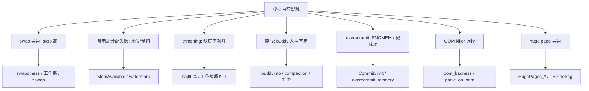

::: abstract 本章定位
本篇处理**内核层面**的虚拟内存与交换疑难：swap 风暴、available 够用却分配失败、thrashing、物理碎片、overcommit、mmap 失败、OOM 选择逻辑与 huge page。与应用 OOM（见 [内存与内存泄漏排查](/kb/os/问题排查/03-内存与内存泄漏排查/)）不同，这里的问题不是"某个进程吃多了"，而是内核的账本、水位线、换页与回收机制出了状况。对应《深入理解 Linux 内核》内存管理篇与内核文档 `vm/`。
:::

虚拟内存疑难从"换页发生地"到"分配失败点"，层层下钻。排查方法论见 [系统问题排查方法论](/kb/os/问题排查/00-系统问题排查方法论/)，底层机制原理见 [内存内核](/kb/os/Linux/10-Linux内存管理内核原理/)：



## 1. swap 异常：swap 疯狂读写

### 1.1 现象

`vmstat` 的 `si`/`so` 长期非零、`swpd` 只增不减，磁盘 IO 高但业务吞吐掉。swap 是磁盘，"换出慢、换入更慢"——一旦 swap 风暴起来，整个系统像被卡住。

| 触发原因 | 机制 | 典型场景 |
|---|---|---|
| **内存压力** | 匿名页超物理内存，kswapd 把冷页写盘 | 数据库 buffer pool 设置过大 |
| **swappiness 过高** | 默认 60，内核"宁可换出也不想回收 page cache" | 缓存多但冷页少，仍疯狂换页 |
| **一次读大量冷数据** | mmap/顺序读大文件，page cache 挤占，顺手把已有匿名页换出 | 批处理扫全表 |

### 1.2 工具：free / vmstat / sar -W

```bash
$ free -h
              total        used        free      shared  buff/cache   available
Mem:           15Gi       8.6Gi       1.4Gi        212Mi       5.4Gi       5.9Gi
Swap:         8.0Gi       6.1Gi       1.9Gi                      # Swap used 高 = 已在换页
$ vmstat 1 5
procs -----------memory---------- ---swap-- -----io---- -system-- ------cpu-----
 r  b   swpd   free   buff  cache   si   so    bi    bo   in   cs us sy id wa st
 2  4 2048000 12345   40228 102364 3200 4800  6600 5200 2031 1850 12 18 20 50  0
 2  5 2048000 11800   40228 102364 3400 5100  6800 5400 2010 1793 11 17 21 51  0
```

解读：`si`/`so` 持续 3000+ KB/s → **正在疯狂换页**；`swpd` 2GB 说明 swap 里躺着大量"睡着的进程页"；`wa` 高达 50% 因为换页本身就是磁盘 IO。

```bash
$ sar -W 1 5
12:00:01  pswpin/s pswpout/s kbswpfree kbswpused  %swpused  kbswpcad  %swpcad
12:00:06    400.00    600.00   1945600   6440960     76.8    2816000    43.7
```

解读：`pswpin/s`/`pswpout/s` 是**按页**计数（每页 4K），和 `vmstat` 的 KB/s 对得上；`%swpused 76.8` 逼近上限，`%swpcad` 高说明 swap 里缓存着"读过的旧页"（可能又被读回，正是抖动特征）。`sar` 还能拉历史：`sar -W -f /var/log/sa/sa10`。

### 1.3 定位：谁在触发换页

```bash
$ ps -eo pid,comm,rss,vsz,min_flt,maj_flt --sort=-rss | head -8; pidstat -r 1 5; sar -B 1
# 依次看：内存大户 → 逐进程 minflt/majflt 曲线 → 全系统缺页速率（配合 si/so）
```

定位思路：先看 `free` 的 `available`——快归零则是**真内存压力**，罪魁是 RSS 大户（如 MySQL buffer pool）；`available` 还有但 si/so 依旧高，八成是 **swappiness 太高**或"冷数据扫描"搅乱了 page cache；再 `pgrep` 刚跑完的大批量任务（`dd`、`scp`、全表扫描），它释放的大缓存会触发 kswapd 顺手换出匿名页。

### 1.4 修复：swappiness 调优、swap 分区 vs swapfile、zswap

```bash
cat /proc/sys/vm/swappiness            # 默认 60；服务器常压到 10
sysctl -w vm.swappiness=10             # 临时；持久化写 /etc/sysctl.d/99-swap.conf
```

::: important swappiness 的含义
它不是一个"什么时候用 swap"的开关，而是**匿名页与 file-backed 页回收时的偏好比**。设为 0 表示"极不情愿换出匿名页"，不代表禁止换页——真到内存耗尽，该换还是换。
:::

swap 分区 vs swapfile：

| 对比 | swap 分区 | swapfile |
|---|---|---|
| 创建 | 分区时留一块，`mkswap` | `fallocate` 任意文件 |
| 灵活性 | 不能随意改大小 | 可在线增删（`swapoff` 后扩容） |
| 碎片 | 连续，性能略稳 | 文件系统上，冷启动读取路径多一跳 |
| 现代内核 | 推荐 | **同样支持**，Swapfile 参数（内核 ≥ 2.6） |

```bash
fallocate -l 8G /swapfile && chmod 600 /swapfile
mkswap /swapfile && swapon /swapfile
echo '/swapfile none swap sw 0 0' >> /etc/fstab
```

**zswap 简述**：swap 页先**压缩后存在内存**（`zpool` 里），真写盘前先腾出 RAM；压力大时压缩率可观，能大幅减少磁盘换页。开启与查看：

```bash
$ cat /sys/module/zswap/parameters/enabled          # Y/N
$ cat /sys/module/zswap/parameters/max_pool_percent # 默认 20 = 最多用 20% RAM 存压缩页
sysctl vm.zswap.enabled=1                           # 部分发行版用 sysctl 开关
```

## 2. 内存不足但 free 显示够用

### 2.1 现象

`free` 明明还有 5GB `free`，但新进程 `malloc`/`mmap` 却失败（`-1 ENOMEM`）、或者 `dmesg` 出现 `page allocation failure`，响应莫名抖动。**看到 free 高 ≠ 内存够用**。

### 2.2 工具：/proc/meminfo 与 zoneinfo

```bash
$ grep -E 'MemTotal|MemFree|MemAvailable|Cached|SReclaimable' /proc/meminfo
MemTotal:       16284960 kB
MemFree:         5000000 kB          # free 列的数据
MemAvailable:     900000 kB          # 真正能用的
Cached:          7000000 kB
SReclaimable:    1000000 kB
$ grep -E 'Node 0, zone|  min|  low|  high' /proc/zoneinfo
Node 0, zone   Normal
  min       12345
  low       15432
  high      18519
```

### 2.3 定位：MemAvailable 的算法与水位

**`available` ≠ `free`**。内核预估"还能安全分配多少"的算法大致是：

```
MemAvailable ≈ MemFree + (Cached + SReclaimable + Buffers) 可回收部分
              - 各 zone 的 low 水位预留（防止回收连自己都饿死）
```

即：`free` 只是"没被占用的页"，而 `available` 把**可回收的 page cache**也算进来，同时扣掉**低水位预留**。所以 `free` 大而 `available` 小 → 内存被可回收缓存占着且水位吃紧；分配失败甚至发生在 `available` 归零之前——因为 **min 水位**（`/proc/sys/vm/min_free_kbytes`）以下的页是"原子分配的保底"，普通进程分配触发回收，回收不过来就失败。每个 zone 有三档水位：

```
高 ▓▓▓▓ 正常：分配不用回收
低 ▓▓▓▓ 越过 low → kswapd 后台异步回收
min ▓▓▓▓ 越过 min → 触发同步 direct reclaim，分配变慢/失败
 0 ───── 只剩 min：仅原子分配（GFP_ATOMIC）可成功
```

`low` 与 `high` 的间距由 `vm.watermark_scale_factor`（默认 10 = 0.1% of totalram）放大：调大 → kswapd 更早介入、抖动更小，但浪费更多内存。

### 2.4 修复：min_free_kbytes 与 watermark_scale_factor

```bash
sysctl -w vm.min_free_kbytes=262144        # 保底 256MB，常见服务器调法
sysctl -w vm.watermark_scale_factor=30     # 让 kswapd 提前回收，降低抖动
```

::: warning 别把 min_free_kbytes 调到巨大
它代表"永远不许使用的内存"。设太高，可用内存白白浪费（`free` 永远显示一大块），反而加剧"够用却失败"。通常是总内存的 0.5%–2%。配合 `sar -r` 看 `%memused` 曲线决定。
:::

## 3. thrashing（颠簸）

### 3.1 现象

负载不高（CPU 低）但响应极慢、磁盘狂转、`vmstat` 里 `b`（阻塞进程）长期非零。系统大部分时间花在"把页换进换出"，而不是跑代码。原因只有一个：**工作集（working set）> 可用内存**。

### 3.2 工具：vmstat / sar -B / ps maj_flt

::: note 一个常见误区
标准 `vmstat 1` 不打印 page fault 数（只有 si/so 和 io），看缺页速率用 `sar -B` 或 `/proc/vmstat` 差分。
:::

```bash
$ sar -B 1 5
12:00:01    pgpgin/s pgpgout/s   fault/s  majflt/s  pgfree/s pgscank/s pgscand/s
12:00:06    3200.00   4800.00  25000.00  1800.00   3000.00  40000.00  30000.00
```

解读：`fault/s`（软缺页）高可能是正常分配，但 **`majflt/s`（硬缺页 = 要读磁盘/swap）持续上千**就是 thrashing 铁证。`pgscank/pgscand` 是 kswapd/直接回收扫的页数，越大回收压力越大。

```bash
$ ps -eo pid,comm,maj_flt,min_flt --sort=-maj_flt | head -6
    PID COMMAND             MAJFL  MINFL
  10432 mysqld           4021551 2031455     # 硬缺页天文数字
$ grep -E 'VmRSS|VmSwap' /proc/10432/status    # 看常驻与换出量
```

### 3.3 定位：工作集 vs 可用内存

```bash
$ grep -E 'AnonPages|SwapCached' /proc/meminfo     # 匿名页总量（约等于"要换出才有的活页"）
AnonPages:      9000000 kB
$ free -h                                          # available≈1.9G，远小于 AnonPages 9GB
Mem:           15Gi       8.6Gi       1.4Gi        212Mi       5.4Gi       1.9Gi
```

判定：
- **AnonPages（9GB）+ 程序热数据 > 物理内存** → 必然颠簸，和负载无关；`maj_flt` 与 `si`/`so` 同步放大 → 每次取数据都要去 swap 捞。
- 进程数翻倍、`maj_flt` 近似翻倍 → **并发叠加**导致工作集超出（典型于跑满 CPU 的 batch + 在线混部）。

**局部性差的程序**（随机访问大数组、链表游走、哈希散列）本身缺页就多，一旦可用内存不足，随机缺页升级为"页被换走又换回"，灾难加倍。见 [置换算法](/kb/os/内存/05-页面置换算法/) 的局部性原理。

### 3.4 修复

1. **最优先：调大内存**，让可用内存 ≥ 工作集。
2. **减少并发进程数**：数据库降 `innodb_buffer_pool_size`、应用降线程数、临时降 batch 并发——直接缩小工作集。
3. **调 `vm.min_free_kbytes` 提高保底**，避免回收风暴进一步挤占（但治标）。
4. 救火与预防：`echo 3 > /proc/sys/vm/drop_caches` 清 file-backed 缓存把回收压力转移（对匿名页无效）；热数据用 `mlock`/`mlockall` 锁内存（如 Redis `maxmemory` + `mlock`），别让它被换走又换回。

::: warning thrashing 时千万别加 CPU
加核只会让更多线程抢同一块已满的内存，颠簸加剧。**要么加内存，要么减工作集**，没有第三条路。
:::

## 4. 内存碎片化

### 4.1 现象

`dmesg` 出现 `page allocation failure: order:5` 或 `order:9`（想要连续 128K/2M 的大块），但 `free` 明明够用。应用侧则表现为 `mmap` 大块失败、`__alloc_pages_nodemask` 卡顿。

::: important 内核态 vs 用户态碎片
用户进程的 `malloc` 大多走 4K 页，碎片无所谓；**需要连续大块的是内核**——DMA 缓冲、`vmalloc` 区外的大分配、TCP 大数据包、驱动 ring buffer。所以"碎片问题"基本是内核层问题，用户态看到的是**分配失败的间接症状**。
:::

### 4.2 工具：buddyinfo / pagetypeinfo

```bash
$ cat /proc/buddyinfo
Node 0, zone   Normal    1024   2048    512    128     32      8      0      0      0      0      0
                          ^0K   ^4K    ^8K   ^16K   ^32K   ^64K  ^128K  ^256K  ^512K   ^1M    ^2M
$ grep -A2 'Page block order' /proc/pagetypeinfo | head
Node 0, zone   Normal
  Movable          free: 100    [  ... ]     # 用户页（可压缩/可迁移）
  Unmovable        free:   2                 # 内核页，钉子户
```

解读：`buddyinfo` 每列是"order N 的空闲块数"——**最右侧几列是 0** → 没有 ≥512K 的连续块，一旦有人要 order 7+ 就失败。`pagetypeinfo` 按页迁移类型归类：Movable（用户页）可被 compaction 搬走，Unmovable（内核对象）是"钉子户"。

### 4.3 定位：碎片成因与 compaction

碎片成因：**Unmovable/Reclaimable 页（slab、内核对象）零散插入 buddy 树**，把大块物理内存切碎；加上长期运行后分配/释放交错，大块越来越少。

```bash
echo 1 > /proc/sys/vm/compact_memory      # 主动压缩：把散落的 Movable 页搬到一起，腾出连续大块
watch -n 2 'cat /proc/buddyinfo'          # 看各 order 变化
```

内核平时靠 **memory compaction**（分配 order>0 失败时同步搬移页，或 kcompactd 后台做）来"整理碎片"。判定：`compact_stall`、`compact_success` 计数一直涨（`/proc/vmstat`），说明系统长期在跟碎片搏斗。

### 4.4 修复：THP 与 khugepaged，关闭 THP

**THP（透明大页）**：把用户进程的 4K 页自动合并成 2MB 大页，减少 TLB miss。但副作用是：
- 分配 2MB 大块更容易撞碎片 → 内核反复 `defrag`（复制整页挪位置），出现毛刺延迟；
- `khugepaged` 后台把 4K 页复制合并成 2MB，期间持有锁，数据库这类延迟敏感应用会周期抖动。

```bash
$ cat /sys/kernel/mm/transparent_hugepage/enabled; cat /sys/kernel/mm/transparent_hugepage/defrag
[always] madvise never
[always] defer madvise never
```

关闭 THP（MySQL、PostgreSQL、Java 常见做法）：

```bash
echo never > /sys/kernel/mm/transparent_hugepage/enabled
echo never > /sys/kernel/mm/transparent_hugepage/defrag
# 持久化：内核启动参数 transparent_hugepage=never，或 systemd 单元里写 echo
```

## 5. overcommit 与 mmap 失败

### 5.1 现象

`malloc` 返回非空指针、但一写入就崩或被杀；`mmap` 直接返回 `-1 ENOMEM`；`dmesg` 有 `Out of memory`。这就是 overcommit——**内核允许"超卖"内存承诺**。

### 5.2 工具：/proc/meminfo 的 CommitLimit / Committed_AS

```bash
$ grep -E 'CommitLimit|Committed_AS' /proc/meminfo
CommitLimit:    15728640 kB    # 内核允许承诺的上限
Committed_AS:   9411232 kB     # 当前已承诺（malloc/mmap 记账）总量
$ cat /proc/sys/vm/overcommit_memory /proc/sys/vm/overcommit_ratio   # 0/1/2 与默认 50（%）
```

### 5.3 定位：三种模式

| 模式 | 值 | 行为 | 后果 |
|---|---|---|---|
| **启发式** | 0（默认） | 允许过量，但明显不合理的大分配仍拒绝 | 多数程序没事，极端场景猝死 OOM |
| **总是允许** | 1 | 任何 malloc/mmap 都记账成功 | 假成功最多，写时突然被杀 |
| **严格禁止** | 2 | 超 `CommitLimit` 直接失败 | 稳定但保守，正常程序可能被拒 |

`CommitLimit` 计算（模式 2）：`CommitLimit = SwapTotal + ram * overcommit_ratio / 100`。

**malloc 假成功**：`malloc` 只改页表承诺（虚拟地址），不真正分配物理页；写完才触发缺页分配，此时内存真不够 → 内核 OOM killer 杀进程。这就是"malloc 返回了、程序却没活过写入"。

### 5.4 修复与 ENOMEM 定位

```bash
$ strace -e trace=mmap -p &lt;PID&gt; 2>&1 | grep ENOMEM   # Committed_AS 逼近 CommitLimit 时的定位
mmap(NULL, 2147483648, PROT_READ|PROT_WRITE, MAP_PRIVATE|MAP_ANONYMOUS, -1, 0) = -1 ENOMEM
```

定位结论：**2GB 匿名映射被拒** → 检查 `/proc/sys/vm/overcommit_memory` 是不是 2，`CommitLimit` 是不是太小。

修复手段：
1. 业务侧别一次性 `malloc` 巨块（改分块/复用缓冲池）。
2. 模式 2 下调大 `vm.overcommit_ratio`（如 80）或加 swap（swap 计入 CommitLimit）。
3. 若某应用只是"预留大虚拟区间、实际用小头"，让它用 `mmap` 的 `MAP_NORESERVE`（见下节）避免记账；**别为防 OOM 无脑切模式 1**——假成功比失败更隐蔽。

## 6. mmap 相关疑难

### 6.1 现象：VIRT 大、RSS 小

`ps` 里某进程 `VSZ` 几十上百 GB，但 `RSS` 很小。`VSZ` 是**地址空间的承诺**不是占用——虚拟内存让进程可以"画饼"（[虚拟内存](/kb/os/内存/04-虚拟内存与按需分页/) 的按需分页），典型是 glibc 大堆预留、JVM heap 预留、大量文件映射。

### 6.2 工具：pmap / /proc/&lt;pid&gt;/maps

```bash
$ pmap -x 10432 | head -15
Address           Kbytes     RSS   Dirty Mode  Mapping
00007f8d3b5f0000 8388608       0       0 rw---   [ anon ]      ← 8GB 虚拟、0 物理：纯预留
00007f8d9b3f0000  262144  262144  262144 rw---   [ anon ]      ← 真用起来的堆
```

```bash
$ head -5 /proc/10432/maps
00400000-00401000 r-xp 00000000 fd:02 786900 /usr/sbin/mysqld      # 文件段：有路径
7f8d3b5f0000-7f8dbb5f0000 rw-p 00000000 00:00 0 [anon]             # 匿名段：[anon]/[heap]/[stack]
```

### 6.3 定位：文件映射 vs 匿名映射，MAP_NORESERVE

| 类型 | maps 里 | 背后 | 释放方式 |
|---|---|---|---|
| **文件映射** | 有路径（libc.so、数据文件） | page cache | 干净页直接丢弃，脏页需落盘 |
| **匿名映射** | `[anon]`/`[heap]`/`[stack]` | 私有内存 | 脏页只能写 swap |

- VIRT 大、RSS 小、且 `[anon]` 段很多 → **预留未用**（glibc 每次 `malloc` 大块都 mmap 一段，之后 `munmap` 归还；没归还就成"虚拟膨胀"）。**MAP_NORESERVE**：`mmap` 时告诉内核"别为这段记账/预留 swap"——在 overcommit 模式 2 下，没有它的大匿名 mmap 可能直接 ENOMEM；加了它则承诺不计入 `Committed_AS`，代价是**真用起来时可能 OOM**。

```c
// C 里显式不记账的大映射
mmap(NULL, size, PROT_READ|PROT_WRITE, MAP_PRIVATE|MAP_ANONYMOUS|MAP_NORESERVE, -1, 0);
```

### 6.4 建议

1. **先分清"预留"与"占用"**：判断内存大户看 `RSS`/`PSS`，别看 `VSZ`（呼应 [内存与内存泄漏排查](/kb/os/问题排查/03-内存与内存泄漏排查/) 的 pmap 解读）。
2. VIRT 无限增长但 RSS 平稳 → 查是否有循环 `mmap` 不 `munmap`（`ls /proc/PID/map_files | wc -l` 对比）；共享库/大文件被多进程映射时，用 `smaps_rollup` 的 `Pss` 判断真实占用：

```bash
$ cat /proc/10432/smaps_rollup
Rss:              512000 kB
Pss:               320000 kB      # 按共享比例分摊后的真实占用
```

## 7. OOM 与内核回收疑难

### 7.1 现象

`dmesg` 出现 `Out of memory: Killed process`，进程莫名消失但应用日志"来不及写"。区别于第 5 节"分配时失败"，OOM 是**提交的承诺无法兑现**时内核的最终裁决。注意与 cgroup 内 OOM 区分（见 7.3）。

### 7.2 工具：dmesg / oom_score

```bash
$ dmesg -T | grep -i 'out of memory' | tail -5
[Wed Aug 10 22:15:03 2026] Out of memory: Killed process 3841 (node)
    total-vm:2787288kB, anon-rss:1126484kB, file-rss:0kB, shmem-rss:0kB, UID:1000 pgtables:3124kB oom_score_adj:0
$ journalctl -k | grep -i oom          # systemd 发行版
$ cat /proc/3841/oom_score             # 被杀时（或当前）的分数 0-1000
$ echo -1000 > /proc/3841/oom_score_adj   # 豁免：内核绝不主动杀它
```

日志字段：`total-vm`（虚拟）、`anon-rss`（匿名常驻，大头）、`file-rss`（文件页）、`shmem-rss`（共享内存）、`oom_score_adj`（当时豁免值）。

### 7.3 定位：oom_badness 与 cgroup OOM 的区别

**选择逻辑**：内核给每个进程算 `badness`（近似）：

```
badness ≈ (进程占用内存 + 其子进程之和) * (1000 - oom_score_adj) / 1000
```

分数最高者被杀；`oom_score_adj=-1000` 分数归零 → 豁免，`oom_score_adj>0` 优先被杀；cgroup v2 下还可设 `/sys/fs/cgroup/<组>/memory.oom.group` 让整组陪葬。

**cgroup 内存超限 vs 全局 OOM**：

| | cgroup 内存超限 | 全局 OOM |
|---|---|---|
| 触发 | 组内 `memory.max` 用满 | 全机内存耗尽 |
| 杀谁 | 组内进程（`oom_score` 高的） | 全机挑一个 |
| 日志 | `dmesg` 里 `oom-kill:constraint=CGROUP` | `constraint=NONE` |
| 排查 | `memory.events` 看 `oom_kill` 计数 | `meminfo` + RSS 大户 |

```bash
$ cat /sys/fs/cgroup/system.slice/myapp.service/memory.events
oom_kill 3          # 组内已杀 3 次 → 是容器限额问题，不是宿主机内存不够
```

### 7.4 修复：panic_on_oom 与 admin_reserve_kbytes

```bash
cat /proc/sys/vm/panic_on_oom          # 0=OOM killer（默认） 1=直接 panic  2=杀完仍不行才 panic
cat /proc/sys/vm/admin_reserve_kbytes  # 给 root 的保底；user_reserve_kbytes 给普通用户（默认约可用内存 1/32，上限 1GB）
```

解读：
- `panic_on_oom=1` 一般只给无盘/嵌入式场景（宁可重启不半死）；服务器保持 0，让 killer 干活。
- `admin_reserve_kbytes` 是 **overcommit 记账时预留给 root 的量**：防止内存被用户进程吃光后连 `ssh`/`top` 都起不来、无法排查（默认 boot 时按可用内存算，约 4MB 量级，别乱调小）。排查顺序：先 `memory.events` 排除 cgroup → 再看全局 `available` → 最后定位 RSS 大户（[内存与内存泄漏排查](/kb/os/问题排查/03-内存与内存泄漏排查/) 第 2 节）。

## 8. huge page 疑难

### 8.1 现象

数据库（MySQL/PostgreSQL/Redis 大内存）周期性**抖动**、延迟毛刺；应用 `mmap`/`shmget` 需要大页时 `ENOMEM`；`dmesg` 有 `Out of memory` 但 `free` 够——其实是大页池空了。

### 8.2 工具：HugePages_* 与 nr_hugepages

```bash
$ grep -i huge /proc/meminfo
HugePages_Total:   512
HugePages_Free:      0        # 池空 = 后续 MAP_HUGETLB 必然失败
HugePages_Rsvd:    480
HugePages_Surp:      0
Hugepagesize:       2048 kB
$ cat /proc/sys/vm/nr_hugepages                  # 当前预留总数
$ echo 1024 > /proc/sys/vm/nr_hugepages          # 预留 1024 × 2MB = 2GB 大页
```

HugePages_Rsvd 是"已承诺给进程但还没真占用"的，`Free` 要减去 `Rsvd` 才是真闲置。`nr_overcommit_hugepages` 允许超额预留。

### 8.3 定位：HugeTLB vs THP

| | HugeTLB（显式大页） | THP（透明大页） |
|---|---|---|
| 谁用 | 应用主动 `mmap(..., MAP_HUGETLB)` / `shmget(SHM_HUGETLB)` | 内核自动合并 |
| 大小 | 2MB/1GB，启动或运行时预留 | 2MB，`khugepaged` 后台合并 |
| 分配失败 | **直接 ENOMEM**，无回退 | 静默回退 4K 页 |
| 适合 | 数据库共享内存、DPDK | 通用应用（有 defrag 开销） |

**数据库用大页**：InnoDB/PostgreSQL 共享缓冲池 `shmget` 时挂 `SHM_HUGETLB`，配合 HugePages 预留，减少 TLB miss、避免被换出（前提池子留够：`HugePages_Free` 长期为 0 说明池小）。

**THP 的 defrag**：`defrag=always` 时内核为凑 2MB 大页反复复制页、持锁扫描 → 延迟毛刺。数据库类延迟敏感服务应禁用：

```bash
echo never > /sys/kernel/mm/transparent_hugepage/enabled
echo never > /sys/kernel/mm/transparent_hugepage/defrag
echo 0 > /sys/kernel/mm/transparent_hugepage/khugepaged/defrag   # 若存在
```

### 8.4 修复

1. **数据库用 HugeTLB**：按 buffer pool 大小算页数，`sysctl vm.nr_hugepages`（或 grub 加 `hugepagesz=1G hugepages=8`），应用 `SHM_HUGETLB` 挂载；DB/延迟敏感服务同时把 THP 改 `madvise` 或 `never`。
2. **大页耗尽**：`HugePages_Free - HugePages_Rsvd` 接近 0 → 调大 `nr_hugepages`，或查谁 `Rsvd` 了不还（`/proc/&lt;pid&gt;/smaps` 的 `HugetlbPages` 字段）。

## 9. 本章小结

- **swap**：`si`/`so` 高先问三件事——内存压力、swappiness、冷数据扫描；`swappiness` 调 10、swapfile 可弹性扩容、zswap 兜底压缩。
- **水位**：判断够不够用看 `available` 不是 `free`；分配失败盯 `/proc/zoneinfo` 的 min/low/high 与 `min_free_kbytes`。
- **thrashing**：`majflt` 高 + 工作集超可用内存，加内存或减并发，加 CPU 无效。
- **碎片**：`/proc/buddyinfo` 靠右列归零 = 没连续大块；`compact_memory` 治标，关 THP 治本。
- **overcommit**：`Committed_AS` vs `CommitLimit`，模式 2 最稳但会误拒；malloc 假成功是写时猝死。
- **mmap**：VIRT 大 RSS 小 = 按需分页的承诺；`MAP_NORESERVE` 不记账但可能 OOM。
- **OOM**：`oom_score_adj=-1000` 保护关键进程；先查 cgroup `memory.events` 再谈全局。
- **huge page**：HugeTLB 显式预留、THP 自动合并有 defrag 开销；数据库禁用 THP、预留 HugeTLB。

## 10. 实战演练：数据库服务器 swap 疯狂 + 响应变慢

::: note 场景
MySQL 服务器 32GB 内存，最近一周每隔几小时响应从 5ms 飙到 800ms，DBA 怀疑"内存不够"。禁止重启，先定位。
:::

**第 1 步：确认是不是 swap 风暴**

```bash
$ vmstat 1 5
procs -----------memory---------- ---swap-- -----io---- -system-- ------cpu-----
 r  b   swpd   free   buff  cache   si   so    bi    bo   in   cs us sy id wa st
 2  4 12000000  80000 100000 8000000 5000 7000 12000 14000 3000 2800 10 15  0 75  0
 2  5 12000000  75000 100000 7900000 5400 7300 13000 15000 3100 2900 10 16  0 74  0
```

解读：`si`/`so` 5–7MB/s、`swpd` 12GB、`wa` 75% → **实锤 swap 风暴**，swap 里躺着 12GB。

**第 2 步：free + swappiness 交叉验证**

```bash
$ free -h
              total        used        free      shared  buff/cache   available
Mem:           31Gi      26.0Gi       80Mi         0B       4.9Gi       4.2Gi
Swap:         16.0Gi      12.0Gi       4.0Gi
$ cat /proc/sys/vm/swappiness
60
```

解读：`available` 只剩 4.2GB，`AnonPages` 大（buffer pool + 连接栈），swappiness 还是默认 60 → **匿名页很容易被换出**。并发峰值时活跃连接变多，工作集（InnoDB buffer 热页 + 连接私有页）暂时超过可用 → 颠簸。

**第 3 步：锁定颠簸源进程**

`majflt/s 2400` 且 mysqld 独占大头 → 不是后台批处理，是 **mysqld 自己的工作集**在 swap 里打滚：

```bash
$ sar -B 1 5 | grep Average
Average: pgpgin/s   pgpgout/s   fault/s  majflt/s  pgfree/s
Average:  5200.00    6800.00  30000.00  2400.00   4000.00
$ ps -eo pid,comm,rss,maj_flt --sort=-maj_flt | head -5
    PID COMMAND             RSS    MAJFL
  10432 mysqld           2600000 18203310   # majflt 千万级，每查询都在 swap 捞页
```

**第 4 步：核对 buffer pool 配置**

buffer pool 26G 本来就大，且 VmSwap 9.6GB 说明 **InnoDB 最热的数据页被换到 swap**，每次查询命中都要先读磁盘：

```bash
mysql> SHOW VARIABLES LIKE 'innodb_buffer_pool_size';
+-------------------------+----------+
| innodb_buffer_pool_size | 26G      |
+-------------------------+----------+
$ grep -E 'VmRSS|VmSwap' /proc/10432/status
VmRSS:   2600000 kB      # 2.6GB 常驻
VmSwap:  9600000 kB      # 9.6GB 被换走！热数据在磁盘
```

**第 5 步：修复（按风险从低到高）**

```bash
# 1) 立即降压：降低换出匿名页的偏好
sysctl -w vm.swappiness=10
# 2) 收缩工作集：把 buffer pool 调到能常驻内存的量
#    （32G 机器、OS+swap 预留 6G → pool 设 22G，先缩 4G）
mysql> SET GLOBAL innodb_buffer_pool_size = 22 * 1024 * 1024 * 1024;
# 3) 稳住 kswapd，让回收更从容
sysctl -w vm.min_free_kbytes=262144
sysctl -w vm.watermark_scale_factor=20
```

::: warning 千万别顺手 drop_caches 或 swapoff
缓存清掉救不了匿名页；`swapoff` 会把 12GB 全部读回内存——内存不够时反而当场 OOM。先降 buffer pool，等 si/so 归零后再考虑 `swapoff -a && swapon -a` 清空旧 swap。
:::

**第 6 步：验证**

```bash
$ vmstat 1 5 | tail -2     # si/so 归零，wa 回落
$ sar -W 1 | tail -1       # %swpused 持续下降
```

**复盘**：vmstat（si/so + swpd 定性）→ free/swappiness（判断是否参数诱因）→ sar -B + ps majflt（锁定颠簸进程）→ VmSwap（确认热数据被换走）→ 降 swappiness + 收缩 buffer pool + 稳水位。**swap 疯狂的本质 = 工作集超出可用内存**，调参是止痛，缩工作集是根治。

## 11. 自测题

1. **`free -h` 里 `free` 大但 `available` 小的本质是什么？** 可回收的 page cache 占了大头，且低水位预留被计算在内；说明内存"看似够、实际紧张"，分配失败可能发生在 available 归零前。
2. **`vmstat` 的 `si`/`so` 高时，第一件事看哪三个参数/指标？** `free` 的 `available`、`/proc/sys/vm/swappiness`、`ps`/`sar -B` 找谁在换页（工作集 vs 可用内存）。
3. **thrashing 与普通内存不足的区别？为什么加 CPU 没用？** thrashing 是工作集 > 可用内存，大量时间花在换页而非执行；加 CPU 增加并发反而扩大工作集，颠簸更严重。
4. **`/proc/buddyinfo` 靠右列全 0 说明什么？怎么救？** 没有连续大块（order 高），内核大分配会失败；`echo 1 > /proc/sys/vm/compact_memory` 压缩，或关 THP 减少大块需求。
5. **overcommit 三种模式的取舍？`CommitLimit` 怎么算？** 0 启发式（默认）、1 总是允许（假成功多）、2 严格（超限即失败）；模式 2 下 `CommitLimit = swap + ram × overcommit_ratio/100`。
6. **进程 VIRT 100GB 但 RSS 2GB，正常吗？为什么？** 正常，VIRT 是地址空间承诺（按需分页），RSS 才是物理占用；也可能是 mmap 后不 munmap 的虚拟膨胀，看 `[anon]` 段数与 `map_files` 计数区分。
7. **OOM killer 杀谁？如何豁免？cgroup OOM 与全局 OOM 怎么区分？** 杀 oom_badness 最高者（占用大、`oom_score_adj` 低）；`echo -1000 > /proc/PID/oom_score_adj` 豁免；cgroup 超限只杀组内进程、dmesg 标 `constraint=CGROUP`，全局是 `constraint=NONE`，配合 `memory.events` 的 `oom_kill` 计数判断。
8. **数据库为什么要关 THP 但可能用 HugeTLB？** THP 的 defrag 会复制页、持锁造成延迟毛刺；HugeTLB 是显式预留、无 defrag 开销，命中高且防换出，适合数据库共享缓冲池。
