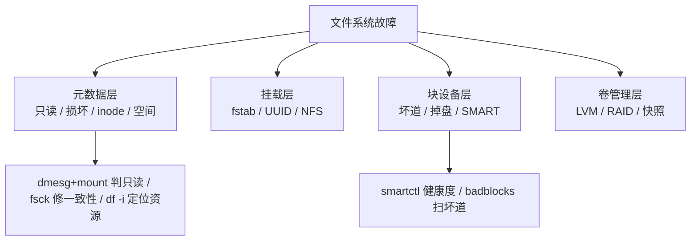

::: abstract 本章定位
本篇聚焦**操作系统层面**的文件系统故障：只读挂载、损坏一致性、inode 耗尽、空间不释放、挂载失败、坏道掉盘等。与 [篇](/kb/os/问题排查/04-磁盘与IO瓶颈排查/) 的"性能瓶颈"互补——本篇是"**坏了怎么救**"，04 篇是"**慢了怎么查**"。工具链从 `dmesg/mount` 到 `fsck/e2fsck` 到 `smartctl`。
:::

文件系统故障按四层拆解——**元数据层（文件系统本身）、挂载层（fstab/vfs）、块设备层（磁盘硬件）、卷管理层（LVM/RAID）**，排查从内到外：



::: important 故障处理铁律
磁盘故障救援的优先级永远是：**先备份现场（只读、镜像）→ 再尝试修复 → 最后才 remount rw 或自动 fsck**。顺序反了，一次错误的写操作就可能把可恢复的损坏变成不可恢复。
:::

## 1. 文件系统只读挂载

**现象**：磁盘上文件突然"只能读、不能写"，`touch` 报 `Read-only file system`，但 `df` 看空间还充足：

```bash
$ touch /data/test.txt
touch: cannot touch '/data/test.txt': Read-only file system
```

**工具**：这是内核**主动把文件系统切成只读**，不是磁盘真的只读。第一件事看 `dmesg`：

```bash
$ dmesg -T | grep -iE 'ext4|xfs|error|read-only' | tail -20
[Aug 10 22:20:01] EXT4-fs error (device sdb1): ext4_lookup: 23454 inode: 4567891: comm find: directory entry corrupt
[Aug 10 22:20:01] EXT4-fs (sdb1): I/O error, inode 4567891 ... Remounting filesystem read-only
```

::: tip 为什么内核要"强制只读"
文件系统有日志（journal）。一旦读到损坏的块/目录项，继续写入会让损坏蔓延到更多元数据。内核兜底策略：**检测到致命错误 → 停止所有写操作 → remount ro**，把现场冻结起来等你来救。这是《深入理解 Linux 内核》VFS 层只读保护的实际落地。
:::

**定位**：dmesg 报错决定根因方向，逐条排查：

| dmesg 报错特征 | 根因方向 | 下一步 |
|---|---|---|
| `directory entry corrupt` / `inode ... corrupt` | 元数据损坏（断电/坏块写入） | e2fsck 修复（见 §2） |
| `I/O error, dev sdb, sector xxx` | 物理坏道/线缆/掉盘 | smartctl + badblocks（见 §6） |
| `Buffer I/O error` 反复出现 | 驱动/控制器问题 | 换线、换槽位、查内核日志 |
| 突发断电后出现 | 未干净卸载 | 重启后 journal replay 自愈，仍报错则 fsck |

**修复**：顺序很重要，**先备份现场，再 remount rw**：

```bash
# 1) 确认当前挂载状态：findmnt /data   →   /data /dev/sdb1 ext4 ro,relatime
# 2) 现场备份：挂载点只读，能拷多少是多少
tar czf /root/data_before_fix.tar.gz -C /data .
# 3) 危险操作：强制 remount rw（dmesg 确认是软错误后再做，可能引发二次损坏）
mount -o remount,rw /data
# 4) 复测
touch /data/test.txt && echo "writable again"
```

::: warning remount,rw 是"赌一把"
`mount -o remount,rw` 只是告诉内核"我打算修了"，**它不能修复已损坏的元数据**。损坏源于坏块时，remount 后写入会让损坏扩大。正确姿势：**ro 状态下 `e2fsck -n` 只读体检 → 离线（umount）后正式 fsck → 再挂载 rw**。根因是硬件就先处理硬件层。
:::

## 2. 文件系统损坏与 fsck

**现象**：挂载直接失败、开机进 emergency shell、`df` 显示乱码目录项、应用报 `Structure needs cleaning`：

```bash
$ mount /dev/sdb1 /data
mount: /data: mount(2) system call failed: Structure needs cleaning
```

`Structure needs cleaning` 是 ext4 返回 `EUCLEAN`——**内核知道文件系统不一致，拒绝挂载**。

**工具**：fsck 家族。ext4 用 `e2fsck`（`fsck.ext4` 是软链），xfs 用 `xfs_repair`。先分清不一致的三种类型：

| 不一致类型 | 含义 | 典型报错 |
|---|---|---|
| superblock 损坏 | 文件系统"总目录"坏了，无法定位其他元数据 | `Bad magic number in super-block` |
| inode 表损坏 | 文件的元数据（属主/大小/块位置）错乱 | `inode N has ... bad` |
| 块位图/目录项错乱 | 哪些块被占用、目录结构对不上 | `Directory inode ... has broken` |

**定位**：**fsck 的第一前提是 umount**——挂载状态下跑 fsck，内存里的元数据会与磁盘不一致，二次损坏：

```bash
findmnt /data; grep data /proc/mounts     # 1) 确认文件系统没被挂载
e2fsck -n /dev/sdb1                       # 2) 只读体检，绝不做修改（-n = no changes）
e2fsck -n -b 32768 /dev/sdb1              # 3) 主 superblock 报 Bad magic number 时，用备份先体检
```

**修复**：找到备份 superblock。`mke2fs -n` 可以**不格式化**而打印备份 superblock 位置：

```bash
# 列出所有备份 superblock（32768 起每隔 3/5/7 的幂），只读查询不影响数据
$ mke2fs -n /dev/sdb1
Superblock backups stored on blocks:
    32768, 98304, 163840, 229376, 294912, ...

# 用备份 superblock 修复（先 -n 确认方案，再正式跑）
e2fsck -b 32768 /dev/sdb1              # 逐个确认
e2fsck -fy -b 32768 /dev/sdb1          # 全自动（非交互，适合脚本）
```

journal replay 是另一条"自愈路径"：**只要 journal（日志）完好，fsck 会先重放 journal，把没写全的事务补上或回滚**——断电/崩溃后 90% 的"损坏"其实只是 journal 里的未完成事务，重放后就一致了。这也解释了为什么**没干净卸载的盘，重启后首次 fsck 总是很快通过**。

::: important 严重损坏的救援顺序：先镜像再动手
主/备份 superblock 与 journal 全坏、或大量 inode/块位图错乱时，**任何 fsck 都可能让残余数据雪上加霜**。正确做法是**先整盘镜像，在镜像上试修**：

:::```bash
> sudo ddrescue -d /dev/sdb1 /root/sdb1.img /root/sdb1.map   # -d 直接读设备，坏道跳过并记录
> e2fsck -fy -b 32768 /root/sdb1.img                          # 在镜像上练习修复
> debugfs -R 'dump &lt;inode&gt; /tmp/recovered_file' /root/sdb1.img  # 从镜像救援关键文件
> ```
> `ddrescue` 把读不通的坏道记在 `.map` 里跳过，能救回多少算多少。**宗旨：宁可多花时间做镜像，不要盲目跑 fsck 把现场破坏掉。**

## 3. inode 耗尽

**现象**：`df -h` 空间充足，但建文件报 `No space left on device`；04 篇 §2 的经典场景，本篇强调它常与"删了还报满"联动：

```bash
$ df -h /data
Filesystem      Size  Used Avail Use% Mounted on
/dev/sdb1       500G  200G  300G  40% /data

$ df -i /data
Filesystem      Inodes  IUsed   IFree IUse% Mounted on
/dev/sdb1      1310720 1310720       0  100% /data
```

**工具**：`df -i` 看 inode 占用率，`tune2fs -l` 看文件系统 inode 总量配置：

```bash
tune2fs -l /dev/sdb1 | grep -iE 'Inode count|Free inodes|Inodes per group'
```

**定位**：inode 用完的根源是**小文件数量爆炸**（每个文件/目录吃一个 inode）。常见元凶：缓存目录（`node_modules`/`target`）、消息队列积压（每消息一个文件）、邮件 spool、`find`/rsync 死循环。逐目录数文件：

```bash
find /data -xdev -mindepth 1 -maxdepth 1 -type d | while read d; do
  printf "%8d  %s\n" "$(find "$d" -type f | wc -l)" "$d"
done | sort -rn | head
```

::: tip rm 后 inode 为什么还在
inode 只跟文件/目录**数量**有关，跟文件大小无关。删大文件释放的是块（`df -h` 变多），删小文件才释放 inode（`df -i` 变多）。所以"rm 了 100GB 但 `df -i` 还是 100%"完全正常——删的是大文件不是小文件。
:::

**修复**：清理 + 结构性调整，两条腿走路：

```bash
# 1) 清理海量小文件（删前确认业务）
rm -rf /data/cache/*

# 2) 天生配置不足：ext4 格式化时用 -i 调大 inode 密度（只对新建分区有效）
mkfs.ext4 -i 16384 /dev/sdb1          # 每 16384 字节一个 inode → 小文件多时总量更大

# 3) 已经用完但空间有富余：ext4 用 resize2fs 扩容（分区本身还能扩的前提下）
resize2fs /dev/sdb1                   # 在线扩容，inode 总量随之增加
```

::: note 与 04 篇的边界
04 篇 §2 是 inode 耗尽的"诊断"，本篇补上"**为什么删了不释放 + 怎么从根上扩容/预防**"。两者合起来才是完整闭环，定位思路遵循 [篇](/kb/os/问题排查/00-系统问题排查方法论/) 的"先量化、再归因"。
:::

## 4. 删除文件后空间不释放

**现象**：`rm` 掉大文件，`df -h` 纹丝不动。与 §3 的 inode 是两回事：**块是否释放，看的是"有没有进程还握着这个文件的 fd"**。

**工具**：`lsof +L1` 专找"已删除但仍被打开"的文件：

```bash
$ sudo lsof +L1
COMMAND     PID   USER   FD   TYPE DEVICE  SIZE/OFF   NLINK  NAME
mysqld     3841   mysql   15w   REG    8,17  8589934592      0  /var/lib/mysql/undo.log (deleted)
rsyslogd    950   root    6w   REG    8,1   5368709120      0  /var/log/syslog (deleted)
```

**定位**：`NLINK=0` = 文件已被 unlink（链接数归零）但 fd 还开着，**SIZE/OFF 列就是它还占着的字节数**。找谁在占：

```bash
# 按进程看占用已删文件的 fd 数量
sudo lsof +L1 | awk '{print $1}' | sort | uniq -c | sort -rn | head
# fuser 看某个挂载点正被谁用
sudo fuser -v /data
# 确认进程是否真需要这个 fd
ls -l /proc/3841/fd | grep deleted
```

**修复**：能重启就重启进程（fd 关闭即释放）；不能重启的用 `truncate` 曲线救国：

```bash
sudo systemctl restart mysqld                          # 1) 首选：重启进程，fd 关闭即回收
sudo truncate -s 0 /proc/3841/fd/15 && df -h ...       # 2) 不能重启：经 /proc 里的 fd 路径 truncate（对已删文件有效）
# 3) 治本：日志类文件用 logrotate + copytruncate 或让进程自己 reopen
```

::: important 隐藏大文件：du 和 df 对不上
`du -x /data` 统计的是"还能通过目录树访问到的文件大小"，**不包含已删除但仍被占用、以及隐蔽挂载点下的数据**。`df` 已用空间 = `du` 看到的部分 + 这些"看不见"的部分。差额很大且 `lsof +L1` 查不到时，检查子目录是否被 bind/overlay 盖住（对应 §7.1）。
:::

## 5. 挂载故障

**现象**：开机进 emergency shell，报 `Failed to mount /data` 或 `A start job is running for ...`；`mount -a` 刷报错；挂载点访问卡死。

**工具**：`mount -a` 按 fstab 批量重试、`blkid` 查设备身份、`findmnt` 查实际状态：

```bash
# 1) 先模拟再真挂（-f 只模拟不真挂）
sudo mount -a -f
sudo mount -a              # 真执行，定位到具体哪条失败

# 2) 设备身份核对：fstab 里写的 UUID/设备名 是否还对应正确设备
$ blkid
/dev/sdb1: UUID="a1b2c3d4-..." TYPE="ext4"

# 3) 看挂载点本身
ls -ld /data               # 挂载点必须存在且是目录
```

**定位**：fstab 条目的常见坑：

| 错误写法 | 后果 |
|---|---|
| fstab 用 `/dev/sdb1`，重启后设备名漂移（插槽/顺序变化） | 挂到别的盘上 → **灾难** |
| UUID 写错/拼错 | `Failed to mount`，进 emergency |
| 写入了不存在的挂载点路径 | `mount point does not exist` |
| 忘写 `noauto` 的分区当前不想挂 | 开机阻塞等待 |

::: warning 设备名漂移是"数据错挂"的最大来源
`/dev/sda`、`/dev/sdb` 是**内核按发现顺序分配的名字**，重启后可能互换。**fstab 一律用 UUID（`blkid` 查询）而不是 `/dev/sdX`**。错挂后果：把新盘当老盘挂，甚至把数据覆盖掉。
:::

**修复**：修 fstab + 处理 NFS 挂载卡死（重点）：

```bash
# 1) 修正 fstab：用 UUID
UUID=a1b2c3d4-...  /data  ext4  defaults  0 2

# 2) NFS 两种挂载模式：
#    hard：服务器不可达时，访问挂载点的进程一直 D 状态卡住（kill -9 无效）
#    soft：超时返回错误，进程报 EIO，但有写半途而废的数据风险
mount -t nfs -o hard,intr 10.0.0.8:/export /mnt/nfs
mount -t nfs -o soft,timeo=50,retrans=2 10.0.0.8:/export /mnt/nfs

# 3) NFS 状态：nfsstat -m 看挂载参数；nfsstat -c 看 timeout/retrans 是否爆涨
nfsstat -m; nfsstat -c
# 服务器可达性：rpcinfo -p 10.0.0.8 或 showmount -e 10.0.0.8
```

::: tip hard 挂载卡死怎么解
hard 挂载下 NFS 服务器宕机，挂载点上的 `ls` 会卡到天荒地老（D 状态）。`nfsstat -c` 的 `timeout`/`retrans` 计数爆涨即可确诊。缓解：`soft` 挂载、`hard,intr` 允许信号打断、或 `umount -f -l` 强制卸载。生产库慎用 soft（写损坏风险）。
:::

## 6. 磁盘坏道与 SMART

**现象**：文件读着读着 `I/O error`、文件内容莫名损坏、`dmesg` 里 `sd` 报错刷屏、`fsck` 修完很快又坏。

**工具**：`smartctl -a` 看健康计数，`badblocks` 扫坏道：

```bash
$ sudo smartctl -a /dev/sda | grep -E 'Raw_Read_Error_Rate|Reallocated_Sector_Ct|Current_Pending_Sector|Offline_Uncorrectable'
  1 Raw_Read_Error_Rate         Pre-fail  RAW_VALUE=3453456     # 读错计数
  5 Reallocated_Sector_Ct       Pre-fail  RAW_VALUE=12          # 已重映射坏扇区
197 Current_Pending_Sector      Old_age   RAW_VALUE=3           # 待重映射
198 Offline_Uncorrectable       Old_age   RAW_VALUE=0           # 不可修复扇区
```

**定位**：VALUE 那几列是归一化分数，**RAW_VALUE（原始计数）才反映真相**：

| 属性 | RAW_VALUE 解读 | 处理 |
|---|---|---|
| `Raw_Read_Error_Rate` | 读错计数，机械盘有噪声，**看是否持续暴涨** | 暴涨则警戒 |
| `Reallocated_Sector_Ct` | **已重映射坏扇区数**，>0 且持续增长 = 坏道发展 | >阈值（常 36）→ 换盘 |
| `Current_Pending_Sector` | 待重映射扇区（读错但还没被写替换） | >0 尽快备份 |
| `Offline_Uncorrectable` | 已确认不可修复扇区 | >0 风险高，换盘 |

**修复**：坏道处理全流程 + 掉盘判定：

```bash
# 1) 只读坏道扫描（-s 扫描期间暂停 SMART，-p 只读不破坏数据）
sudo badblocks -sv /dev/sda

# 2) 坏道盘：先备份再谈修复；文件系统层用 -c 让 e2fsck 标记坏块
e2fsck -c /dev/sdb1            # 用 badblocks 检查并标记坏块，内核不再往那儿写

# 3) 掉盘判定：dmesg 的 sd 报错是铁证
$ dmesg -T | grep -iE 'sd|I/O error|timeout' | tail -20
[Aug 10 22:21:00] sd 0:0:0:0: [sda] Result: hostbyte=DID_ERROR driverbyte=DRIVER_OK
[Aug 10 22:21:00] sd 0:0:0:0: [sda] I/O error, dev sda, sector 12345678
[Aug 10 22:21:00] sd 0:0:0:0: [sda] Device offlined - ready to retire
```

::: important 内核 IO 重试与掉盘的"假死"现象
坏道出现时内核按 `sd_mod` 参数反复重试（`echo 30 > /sys/block/sda/device/timeout` 可调，单位秒）。**重试期间所有 IO 排队，整盘表现为 D 状态 + `%util` 100% + 吞吐 0**，很像死机。`dmesg` 出现 `Device offlined`/`hostbyte=DID_ERROR` 基本坐实掉盘；短暂报错后恢复可能是线缆/背板问题，先换线换槽再判盘死刑。
:::

RAID 场景先看阵列再判单盘：

```bash
$ cat /proc/mdstat
md0 : active raid1 sda1[0] sdb1[1]
      104857600 blocks [2/1] [_U]           # [_U]：第一块盘掉了，降级运行
$ sudo mdadm --detail /dev/md0
   State : clean, degraded
   Failed Devices : 1                        # 赶紧换盘重建：mdadm --add /dev/md0 /dev/sdc1
```

## 7. 目录文件系统特殊问题

**现象**：目录无限递归、`du` 死循环、写文件报 quota、`chmod` 不生效、`stat` 时间戳诡异、删不掉文件。

### 7.1 目录树循环：mount --bind 的坑

`mount --bind` 把目录 A bind 到它自己的子孙上，就形成**循环**——`find`/`du`/备份工具会无限钻：

```bash
mount --bind /data /data/sub/loop            # 灾难示范：/data 的副本出现在自己子树里
find /data -xdev -type d -name loop | head   # -xdev 限定单文件系统，快速缩小范围
findmnt /data/sub/loop                       # 能看到这条诡异的 bind 挂载
umount /data/sub/loop                        # 解除
```

::: tip 隐蔽挂载会让 df/du 失真
bind/overlay/nfs 子挂载会"盖住"原目录内容，`du` 只统计表面一层，`df` 却按底层块设备算——**df 与 du 对不上的又一大来源**（配合 §4 排查）。
:::

### 7.2 配额超限

磁盘配额超限后，即使磁盘还有空间也写不进去：

```bash
$ dd if=/dev/zero of=/data/user1/test bs=1M count=1
dd: error writing '/data/user1/test': Disk quota exceeded

$ repquota -as                       # 用户级配额；grace 过期后 soft 按 hard 强制执行
User         used    soft    hard  grace
user1      9000MB  8000MB 10000MB    6days
quota -v user1                       # 单用户；quotacheck -cug /data 重建配额文件；edquota -u 调限
```

### 7.3 ACL/xattr 损坏

ACL（访问控制列表）/扩展属性（xattr）元数据损坏时，`chmod` 看似成功但权限不生效，或 `setfacl` 报 `Operation not supported`：

```bash
getfacl /data/file; getfattr -d /data/file; lsattr /data/file
mount | grep /data        # 看有没有 noacl/nouser_xattr 之类把 ACL/xattr 关掉的挂载选项
setfacl -b /data/file     # 修复：重新用默认选项挂载，或清空 ACL 重建
```

### 7.4 stat 与时间戳异常：ctime/atime/mtime

时间戳"对不上"八成不是坏了，而是没分清三者语义：

| 时间戳 | 更新时机 | 典型坑 |
|---|---|---|
| **mtime** | 文件**内容**被修改（write） | 只改权限不变 mtime |
| **ctime** | 文件**元数据**被修改（chmod/chown/链接/重命名） | **任何变更都动 ctime**，包括改 mtime 本身 |
| **atime** | 文件被**读取**（read/open） | 高频读疯狂刷新 atime → IO 放大（挂 `noatime`） |

```bash
$ stat /data/file
  Access: 2026-08-10 10:00:00  Uid: (1000)  Gid: (1000)     ← atime
  Modify: 2026-08-09 09:30:00  Uid: (1000)  Gid: (1000)     ← mtime
  Change: 2026-08-10 10:00:01  Uid: (1000)  Gid: (1000)     ← ctime 比 mtime 新，那次 chmod 改了它
```

::: tip 查"文件什么时候被改"该看哪个？
内容改动 → mtime；任何变动（含权限/chown）→ ctime（恒有 ctime ≥ mtime）。备份工具以"mtime > 上次备份"判断增量，若有人动了 ctime，增量备份可能漏。
:::

### 7.5 immutable 属性：chattr +i 的坑

`chattr +i`（immutable）让文件**连 root 都动不了**，坑在于：删不掉、改不了、连 truncate 都不行：

```bash
$ chattr +i /etc/app/config.conf && rm /etc/app/config.conf
rm: cannot remove '/etc/app/config.conf': Operation not permitted
$ lsattr /etc/app/config.conf
----i--------e-- /etc/app/config.conf      # 先确认再解锁
$ chattr -i /etc/app/config.conf           # 解锁后才能删/改
```

::: warning immutable 与系统更新的联动
给 `/etc` 下关键文件加 `+i` 防改是双刃剑：软件升级/配置管理会报 EPERM 失败。排查时 root 用户 chmod/rm/写全报 `Operation not permitted`——**第一反应看 `lsattr`，别先怀疑 selinux/权限**。
:::

## 8. 磁盘文件系统性能以外的故障联动

### 8.1 断电后启动 fsck

没干净卸载（断电/强制关机）重启后，系统会对带 dirty 标志的 ext4 盘**强制 fsck**——这是设计好的恢复路径：

```bash
tune2fs -l /dev/sdb1 | grep -iE 'Mount count|Check interval|Last checked'
touch /forcefsck          # 强制下次开机 fsck（或 tune2fs -c 1 /dev/sdb1）
```

::: note 与 [可靠性](/kb/os/存储/06-文件系统可靠性与日志/) 篇的呼应
断电恢复的完整原理（日志三阶段、commit 顺序、为何只回滚"未 commit 事务"）在存储篇讲透。排查侧记住：**journal 完好的断电 = 重放自愈；journal 也坏的断电 = e2fsck 全盘扫描**（见 §2）。
:::

### 8.2 LVM 与逻辑卷问题

LVM 层故障典型症状：`/dev/mapper/vg-lv` 消失、逻辑卷打不开、`vgchange` 拒绝激活：

```bash
pvs; lvs; vgs                    # 1) PV/LV/VG 状态
vgscan; vgchange -ay vg_data     # 2) 重新扫描并激活 VG（开机自动激活失败时手动）
vgck vg_data                     # 3) 检查 VG 元数据一致性
ls -l /dev/mapper/; dmsetup ls   # 4) dmsetup ls 有但 /dev/mapper 没有 → udev 问题
dmsetup mknodes                  #    重建设备节点
```

扩容/缩容（顺序是生命线）：

```bash
# 扩展：先扩卷再扩文件系统
lvextend -L +20G /dev/vg_data/lv_data && resize2fs /dev/vg_data/lv_data
#    ext4 在线扩；xfs 用 xfs_growfs /data
# 缩容：先缩文件系统再缩卷（顺序反了 = 数据损坏）
e2fsck -f /dev/vg_data/lv_data && resize2fs /dev/vg_data/lv_data 100G
lvreduce -L 100G /dev/vg_data/lv_data
```

::: warning resize 顺序的教训
扩：`lvextend` 在先、`resize2fs` 在后；缩：**必须先 `resize2fs` 后 `lvreduce`**。把 LV 缩到比文件系统还小，文件系统直接损坏，只能走 §2 的救援流程。这是 LVM 场景最常见的"自己把自己弄坏"。
:::

### 8.3 快照空间耗尽

LVM 快照是**写时复制（COW）**：改动越多，快照卷占空间越大。**快照卷满了会失效（invalidate）**，最坑的是它让原逻辑卷"假故障"：

```bash
$ lvs
  LV            VG      Attr     LSize  Snap%  Move Log Copy%
  snap_before  vg_data swi-a-s- 10.00g  100.00      # Snap% 100 → 快照已满失效
# 症状：快照满后写原卷报 ENOSPC / IO 错误（实际是快照撑不下）
lvextend -L +20G /dev/vg_data/snap_before           # 扩容快照
lvremove /dev/vg_data/snap_before                   # 或删掉旧快照
```

::: tip 快照排障的直觉
快照挂掉 ≠ 原数据挂掉，但报错会"嫁接"到业务写入上。看到 LVM 相关 IO 错误，先 `lvs` 瞄一眼有没有 `Snap% 100` 的卷，**比盲目 fsck 原卷安全得多**。
:::

### 8.4 TRIM 与 SSD 的联动故障

TRIM 平时是性能话题（04 篇 §10），排障联动上有一个坑：**TRIM 不影响"会不会掉盘"，但错误配置会让 SSD 越用越慢、且让误删数据恢复无望**：

```bash
findmnt -no OPTIONS /data        # 看是否挂了 discard
sudo fstrim -av                  # 手动 TRIM；fstrim.timer 每周自动
systemctl status fstrim.timer    # 定时器失效 = 写放大累积，SSD 变慢
```

::: note 与 [实现](/kb/os/存储/04-文件系统实现/) 篇的呼应
TRIM 实现链路（discard 从 VFS → block layer → NVMe/SATA 命令）在存储实现篇讲透。排查侧记住：**服务端推荐定时 `fstrim` 而非实时 discard；已做 TRIM 的盘，别指望块级恢复工具**。呼应 [文件系统内核](/kb/os/Linux/11-Linux文件系统内核原理/) 篇，TRIM 与日志、写放大同属"文件系统在 SSD 上的适配"。
:::

## 9. 本章小结

- **只读挂载**：内核检测到致命元数据/IO 错误自动 remount ro 冻结现场，先 `dmesg` 定性，再决定 remount rw 还是 fsck。
- **损坏修复**：fsck 前必须 umount；先 `e2fsck -n` 只读体检；superblock 坏了用 `mke2fs -n` 找备份 + `e2fsck -b 32768`；严重损坏先 `ddrescue` 镜像再修。
- **inode 耗尽**：`df -i` 看 100%、`find ... | wc -l` 定位小文件爆炸；inode 只跟文件数有关，rm 大文件不释放 inode。
- **空间不释放**：`lsof +L1` 找仍被占用的已删文件，`fuser`/`/proc/&lt;pid&gt;/fd` 定位，重启或 `truncate` 解决；du/df 差额还有隐蔽挂载这个来源。
- **挂载故障**：fstab 用 UUID 防设备名漂移；`mount -a -f` 模拟测试；NFS hard 挂载服务器宕机会 D 状态卡死，`nfsstat -c` 看 timeout/retrans 确诊。
- **坏道掉盘**：`smartctl -a` 重点看 `Reallocated_Sector_Ct`/`Current_Pending_Sector` 的 RAW 值趋势；`badblocks -sv` 扫描；`dmesg` 的 `DID_ERROR`/`Device offlined` 是掉盘信号。
- **特殊问题**：bind 循环用 `-xdev`+`findmnt` 发现；配额 `repquota`；时间戳分清 mtime/ctime/atime；`chattr +i` 让 root 也写不动，先 `lsattr`。
- **联动**：断电 = journal replay 自愈；LVM 扩容先 lvextend 再 resize2fs、缩容相反；快照 Snap% 100 会让原卷假报错；TRIM 后块级恢复无望。

## 10. 实战演练：一台服务器只读挂载的完整救援

::: note 场景
数据库服务器，`/var/lib/mysql` 所在 `/dev/sdb1` 突然只读，业务开始报错，mysql 进程还活着但写不进去。目标：**定位 → 只读体检 → 备份恢复 → 救回数据**。
:::

**第 1 步：定性——是元数据坏还是硬件坏**

```bash
$ findmnt /var/lib/mysql
/var/lib/mysql  /dev/sdb1  ext4  ro,relatime        # 确认被切成只读
$ dmesg -T | grep -iE 'ext4|sdb|error' | tail -15
[Aug 10 22:20:01] EXT4-fs error (device sdb1): ext4_find_entry: 6789012 inode: 4521789: comm mysqld: directory entry corrupt
[Aug 10 22:20:01] sd 0:0:0:0: [sdb] I/O error, dev sdb, sector 88990011
```

解读：既有 `directory entry corrupt`（元数据损坏）又有 `I/O error`（硬件嫌疑）→ **先查硬件，再修元数据**，顺序反了 fsck 时坏块会污染修复结果。

**第 2 步：硬件侧快检**

```bash
$ sudo smartctl -a /dev/sdb | grep -iE 'Reallocated_Sector_Ct|Current_Pending_Sector|Raw_Read_Error_Rate'
  5 Reallocated_Sector_Ct   ...  RAW_VALUE=2       # 不多
197 Current_Pending_Sector   ...  RAW_VALUE=0       # 无待重映射
```

解读：坏扇区仅 2 个、无 pending → **硬件尚可，主矛盾在元数据损坏**，先走文件系统修复。

**第 3 步：只读体检，锁定损坏范围**

```bash
$ sudo e2fsck -n /dev/sdb1
Pass 1: Checking inodes, blocks, and sizes
Inode 4521789 has an invalid extent ...
Pass 2: Checking directory structure
Entry 'mysql.ibd' in /var/lib/mysql (4521789) has deleted/unused inode 6789012.  Clear? no
```

解读：`-n` 只报告不修改。inode 4521789 的 extent 损坏 + 目录项指向已删 inode——**典型断电/坏块写入留下的不一致**，与 dmesg 互相印证。

**第 4 步：备份现场后正式修复**

```bash
# 修复前先只读备份关键数据（现场已是 ro，拷贝不会加剧损坏）
sudo tar czf /root/mysql_fix_backup.tar.gz -C /var/lib/mysql .

# 现在可以安全卸载并正式修复（-f 强制检查，即使没有 dirty 标记）
sudo umount /var/lib/mysql
sudo fsck.ext4 -f -y /dev/sdb1
```

**第 5 步：万一主 superblock 坏了？——备用 superblock 恢复**

```bash
$ sudo mke2fs -n /dev/sdb1
Superblock backups stored on blocks: 32768, 98304, 163840, ...

# 用备份 superblock 指定修复（-b 32768），不碰数据区
sudo fsck.ext4 -f -y -b 32768 /dev/sdb1
```

**第 6 步：数据救援（若仍有文件读不回来）**

```bash
# 修完仍有关键文件读不出（如 mysql.ibd 的 extent 彻底损坏）：
sudo debugfs -R 'stat <4521789>' /dev/sdb1
sudo debugfs -R 'dump <4521789> /root/recovered_mysql.ibd' /dev/sdb1
# 或整盘镜像后慢慢救：sudo ddrescue /dev/sdb1 /root/sdb1.img /root/sdb1.map
```

**第 7 步：复挂 + 验证**

```bash
sudo mount /var/lib/mysql
findmnt /var/lib/mysql          # /var/lib/mysql  /dev/sdb1  ext4  rw,relatime  ← rw 回来了
df -h /var/lib/mysql && systemctl restart mysql
# mysql 正常启动，写入恢复。
```

::: note 复盘
dmesg（两类报错并现）→ smartctl（排除硬件主因）→ `e2fsck -n` 只读体检（锁定 inode）→ tar 备份现场 → umount + `fsck.ext4 -f` 修复 →（备援路径 `-b 32768`）→ debugfs/ddrescue 救援 → remount 验证。核心纪律：**先镜像/备份、再修复；只读优先、写操作最后；硬件与元数据分开定性**。方法论对应 [篇](/kb/os/问题排查/00-系统问题排查方法论/) 的"证据链推进"，性能场景对照 [篇](/kb/os/问题排查/04-磁盘与IO瓶颈排查/)。
:::

## 11. 自测题

1. **内核为什么要把文件系统自动 remount 成只读？** 检测到致命元数据/IO 错误后，继续写会让损坏蔓延，先冻结现场便于救援；`dmesg` 里 `Remounting filesystem read-only` 即是此机制。
2. **`e2fsck -n` 和 `fsck.ext4 -f` 的区别与使用时机？** `-n` 只读体检不修改，适合"还没备份、先看伤势"；`-f` 强制全量检查并按提示修复，须在 umount 后执行。危险操作前永远先 `-n`。
3. **主 superblock 损坏怎么找回？** `mke2fs -n /dev/sdX` 打印备份 superblock 块号（32768、98304...），`fsck.ext4 -b 32768 /dev/sdX` 用备份修复。
4. **断电后为什么会自动 fsck / journal replay？** 未干净卸载的文件系统重启后被检测到，ext4 优先重放 journal 恢复未提交事务；journal 完好时是自愈路径，journal 也坏才全盘 fsck。
5. **`df -h` 空间充足但创建文件报"No space left on device"，与"rm 大文件后空间不释放"机制有何不同？** 前者多是 inode 耗尽（`df -i` 确认，只跟文件数有关）；后者是进程仍持有已删文件 fd（`lsof +L1`，`NLINK=0`），重启进程或 `truncate /proc/&lt;pid&gt;/fd/N` 释放。
6. **fstab 为什么建议用 UUID 而不是 `/dev/sdX`？** 设备名按内核发现顺序分配，重启/加盘后会漂移，用 UUID 挂载才不会把数据错挂到别的盘上。
7. **`smartctl -a` 里应该重点盯哪几个属性的 RAW 值？含义？** `Reallocated_Sector_Ct`（已重映射坏扇区，增长=坏道发展）、`Current_Pending_Sector`（待重映射，>0 优先备份）、`Raw_Read_Error_Rate`（读错，暴涨才报警）。
8. **ext4 扩容和缩容时 LVM 操作的顺序分别是什么？顺序反了会怎样？** 扩：先 `lvextend` 再 `resize2fs`；缩：先 `resize2fs` 再 `lvreduce`。顺序反了会把 LV 缩到比文件系统还小，文件系统损坏。
