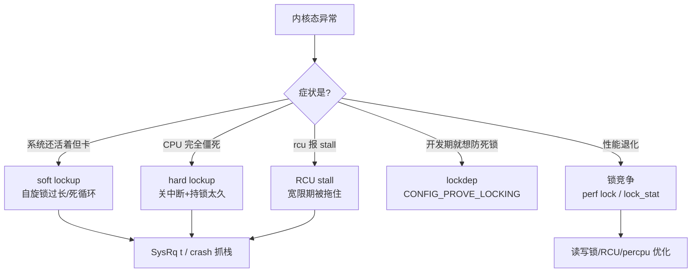

::: abstract 本章定位
本篇是内核态疑难杂症的收官篇：**自旋锁/互斥锁/读写锁/RCU 的选型**、**lockdep 死锁检测**、**soft/hard lockup**、**RCU stall**、**锁竞争调优**，以及 SysRq/crash/ftrace 内核卡死工具链。与用户态锁（[并发与异常排查](/kb/os/问题排查/05-并发与异常排查/)）互补：那边看"进程不动"，这边看"整个 CPU 或内核卡死"。
:::



## 1. 内核锁机制全景

**现象**：同样的锁问题，用户态用 pthread mutex 就完了；内核里却要分四大家族——**自旋锁、互斥锁、读写锁、RCU**。选错类型轻则性能烂，重则死机。难点是它们各有严格的使用上下文限制。

| 原语 | 等待方式 | 临界区可否睡眠 | 允许上下文 | 典型场景 |
|---|---|---|---|---|
| `spinlock` | 忙等（自旋） | 否 | 进程 + 中断 + 软中断 | 临界区极短，如链表/计数器 |
| `mutex` | 睡眠等待 | 是 | 仅进程（可睡眠） | 临界区长、可能阻塞，如设备 I/O |
| `rwlock` | 读共享/写独占 | 否 | 进程 + 中断（读者） | 读多写少且写不频繁 |
| `RCU` | 读无锁/写延迟回收 | 读者不可阻塞 | 读者任意、写者进程 | 读极多写极少，如路由表/地址空间 |

**工具**：`CONFIG_DEBUG_SPINLOCK`、`CONFIG_PROVE_LOCKING`（下节）、`/proc/lock_stat`（§6）。

**定位**：一旦出现"中断上下文里调用了会睡眠的函数"，内核直接 Oops：`BUG: sleeping function called from invalid context at kernel/mutex.c`。这意味着你拿着自旋锁跑了 `mutex_lock` 或 `kmalloc(..., GFP_KERNEL)`（会睡眠）。

**修复**：查锁的使用上下文是否符合上表；`spin_lock` 变体选型看抢占/中断状态。

### 1.1 四个关键限制

```
① 自旋锁持锁期间绝不能睡眠（否则持锁进程被调度走，等锁的 CPU 永远自旋 = 死锁）
② 自旋锁持锁期间抢占是关闭的（preempt_count 增加），临界区必须极短
③ mutex 只能在进程上下文用（可睡眠、有 owner、支持优先级继承）
④ RCU 读者不拿锁，写者要等宽限期（grace period）后才能回收旧数据
```

### 1.2 为什么中断上下文只能用自旋锁

**现象**：写驱动时在 IRQ handler 里想用 mutex 保护共享数据，编译能过、运行必炸。

**工具**：dmesg 里的 `BUG: scheduling while atomic` 或 `BUG: sleeping function called from invalid context`。

**定位**：中断上下文里进程处于"被打断"状态，**没有可睡眠的任务上下文**——mutex 睡眠后没有调度实体去"唤醒"它（依赖进程调度与 owner 优先级继承），所以内核直接 panic/Oops。

**修复**：中断上下文（及持自旋锁期间）只能用**自旋锁 + `local_irq_save/restore`** 保护与中断共享的数据；跨进程-中断的临界区用 `spin_lock_irqsave/spin_unlock_irqrestore`（同时关本地中断防死锁）。详细分析见 [同步原语](/kb/os/同步异步/02-信号量与同步原语/)，无锁替代方案见 [无锁编程](/kb/os/同步异步/05-现代同步原语与无锁编程/)。

::: warning 死锁三不要（内核版）
- 不要在持自旋锁时调用任何可能睡眠的函数（`mutex_lock`/`kmalloc(GFP_KERNEL)`/`copy_to_user`）
- 不要在中断上下文里用 mutex/semaphore
- 不要用自旋锁保护大临界区（那是给 10 条指令以内的锁）
:::

## 2. 内核死锁检测

### 2.1 现象：内核死锁为什么难现场抓

内核死锁一旦发生，**整个系统可能直接卡死**，没有 `jstack`、没有 gdb 可附，连登录都困难。所以内核的思路不是"事后抓"，而是**开发期就静态检查所有加锁顺序**——这就是 lockdep。

### 2.2 工具：lockdep（CONFIG_PROVE_LOCKING）

lockdep 是内核自带的**锁顺序验证器**：它在每次加锁时记录"持有锁集合 → 新锁"的依赖关系，构建全局锁依赖图，一旦发现环就立刻报警（哪怕此刻还没真死锁）。开启方式：

```bash
# 内核编译时开启（发行版内核大多已开）
CONFIG_PROVE_LOCKING=y
CONFIG_LOCKDEP=y
CONFIG_DEBUG_LOCKDEP=y
CONFIG_DEBUG_LOCK_ALLOC=y
CONFIG_LOCK_STAT=y

# 运行时若想临时关闭（不推荐，仅应急）
# 内核启动参数加：lockdep=off
```

### 2.3 定位：possible circular locking dependency 解读

lockdep 发现环的经典日志：

```
======================================================
WARNING: possible circular locking dependency detected
------------------------------------------------------
4.19.91 #1 Tainted: G        W

kworker/1:2/340 is trying to acquire lock:
 ffff88807ca54000 (&nd->lock){+.+.}, at: netlink_seq_show

but task is already holding lock:
 ffff88807ca51000 (&net->rtnl_mutex){+.+.}, at: rtnl_newlink

which lock already depends on the new lock.

the existing dependency chain (in reverse order) is:
 -> #1 (&net->rtnl_mutex){+.+.}:
        lock_acquire+0x71/0x90
        __mutex_lock+0x9a/0x970
        rtnl_lock+0x1d/0x30

 -> #0 (&nd->lock){+.+.}:
        lock_acquire+0x71/0x90
        __raw_spin_lock+0x31/0x60
        netlink_seq_show+0x45/0x130

other info that might help us debug this:

 Possible unsafe locking scenario:

       CPU0                    CPU1
       ----                    ----
  lock(&nd->lock);
                               lock(&net->rtnl_mutex);
                               lock(&nd->lock);
  lock(&net->rtnl_mutex);

 *** DEADLOCK ***
```

解读：
- 第一段：**谁在尝试拿什么锁、手上还握着什么锁**——`kworker` 握着 `rtnl_mutex` 想拿 `nd->lock`。
- 第二段 `which lock already depends on the new lock`：**反方向也有一条加锁路径**（先拿 `nd->lock` 再拿 `rtnl_mutex`）。
- 第三段 `Possible unsafe locking scenario`：把两条路径合成一张表，**CPU0 拿 nd 等 rtnl，CPU1 拿 rtnl 等 nd → AB-BA 环**。
- `*** DEADLOCK ***` 是结论。修复：**统一两处加锁顺序**（都先 rtnl 再 nd）。

::: tip lockdep 报错 ≠ 已死锁，但 ≈ 迟早死锁
lockdep 是"预言家"：它证明**存在一条会形成环的路径组合**。即使当前没复现，也必须当 bug 修。这和 [并发与异常排查](/kb/os/问题排查/05-并发与异常排查/) 里"jstack 抓到环 = 已死锁"不同——内核是防患于未然。
:::

### 2.4 /proc/lockdep 与 /proc/lock_stat

```bash
$ cat /proc/lockdep            # 所有锁的依赖关系（+ 表示在锁栈里）
$ cat /proc/lockdep_chains     # 已记录的加锁链
$ cat /proc/lock_stat          # 每把锁的竞争统计（需 CONFIG_LOCK_STAT）
```

解读：`/proc/lockdep` 每一行是"锁类 + 持有状态"；配合日志里的锁地址可反查锁是哪条路径引入的。`/proc/lock_stat` 详见 §6。

### 2.5 内核死锁的 Oops 特征

真死锁发生时（lockdep 没拦住或没开），内核可能 Oops：

```
BUG: soft lockup - CPU#2 stuck for 22s! [kworker/2:1:9711]
BUG: scheduling while atomic: kworker/2:1/9711/0x00000002
Modules linked in: ...
```

解读：`scheduling while atomic` 说明持锁（`preempt_count` 非零）期间试图调度 → 死锁的前兆；配合 `soft lockup` 说明某个 CPU 已经被卡住。这类日志方向一律是**查持锁路径 + 加锁顺序**，理论背景见 [死锁](/kb/os/死锁/05-死锁实战与内核实现/)。

## 3. 软锁死（soft lockup）

### 3.1 现象

某 CPU **在内核态长时间不释放调度**（默认超过 20 秒没发生调度），但 CPU 还在执行（可能死循环、可能自旋）。系统整体没完全死——其他 CPU 还能干活，但**该 CPU 上的进程全部饿死**，`top` 里会出现"某核 100% 但没进程在跑"。

### 3.2 工具：watchdog 软锁检测器

软锁检测靠每 CPU 的高精度定时器：软锁 watchdog 线程会检查调度计数是否推进，NMI watchdog 负责硬锁（下节）。相关内核参数：

```bash
# sysctl 或 /proc/sys/kernel/
watchdog=1                  # 0 关闭 watchdog（不推荐）
softlockup_panic=1          # 软锁时直接 panic（配合 kdump 转储）
softlockup_all_cpu_backtrace=1  # 转储所有 CPU 栈，方便看全局
nmi_watchdog=1              # NMI watchdog（也喂硬锁检测）
```

::: important 线上别裸奔
`softlockup_panic=1` + kdump 配置好后，一旦软锁直接 panic 落转储，比"卡着等人工发现"好一万倍。生产默认 `watchdog` 是开的，panic 策略按团队决定。
:::

### 3.3 定位：BUG: soft lockup 日志解读

```
BUG: soft lockup - CPU#3 stuck for 22s! [kworker/u16:3:8712]
Modules linked in: megaraid_sas
CPU: 3 PID: 8712 Comm: kworker/u16:3 Tainted: G        W
RIP: 0010:[&lt;ffffffff8184c1b0&gt;] _raw_spin_lock+0x20/0x30
Call Trace:
  &lt;IRQ&gt;
  foo_driver_isr+0x45/0x100 [example_drv]
  handle_irq_event_percpu+0x6a/0x80
```

解读：
- `CPU#3 stuck for 22s` → **3 号 CPU 卡了 22 秒**（超过 20s 阈值）。
- `Comm: kworker/u16:3` → 被卡住的进程/线程名（kworker = 内核工作线程，也可能是任意进程或 `swapper`）。
- `RIP: _raw_spin_lock` + `Call Trace` → **卡在自旋锁获取上**，且由中断处理 `foo_driver_isr` 引入 → 驱动 ISR 持锁时间过长，或与某进程形成自旋死锁。
- `Tainted: G W` → 内核被污染（GPL 外模块等），提示嫌疑在第三方驱动。

### 3.4 常见原因与修复

| 原因 | 特征 | 方向 |
|---|---|---|
| 自旋锁持锁过长 | RIP 在 `_raw_spin_lock`，栈顶是持锁路径 | 缩小临界区；ISR 里别做重活 |
| 内核死循环 | 栈在某个没有阻塞点的 while 循环 | 读代码 + `perf` 采样看 PC 聚集地 |
| 中断风暴 | 栈顶反复 `handle_irq`，ISR 密集 | `cat /proc/interrupts` 看增量，卸驱动/改 IRQ 合并 |
| `local_irq_disable()` 关太久 | 栈在关中断路径 | 分批关中断，少用全局关闭 |

应急：有 kdump 直接 `crash` 分析转储（§7）；没有就 `echo t > /proc/sysrq-trigger` 抓所有任务栈（§7.1），找到持锁者。

## 4. 硬锁死（hard lockup）

### 4.1 现象：与 soft 的区别

硬锁 = **该 CPU 完全僵死，连软锁 watchdog 的定时器中断都跑不进来**（中断被长时间关闭，或在不可屏蔽的紧循环里）。系统症状比 soft 严重得多：该核上所有东西都不转，`top` 直接看到 CPU 占用恒高或系统卡住。

| 维度 | soft lockup | hard lockup |
|---|---|---|
| 检测手段 | 软 watchdog（高精度定时器 + 调度计数） | **NMI watchdog**（perf event，NMI 不可屏蔽） |
| 本质 | CPU 在跑但不调度 | CPU 连中断/NMI 都被挡住太久 |
| 常见根因 | 自旋持锁过长、死循环、中断风暴 | 关中断 + 自旋锁太久、驱动循环在 IRQ 里 |
| 日志关键字 | `BUG: soft lockup - CPU#` | `Watchdog detected hard LOCKUP on cpu` |
| 后果 | 该核进程饿死 | 该核完全失联，通常很快伴随系统级异常 |

### 4.2 工具与定位

```bash
# 硬锁触发 panic + 转储
kernel.hardlockup_panic=1
nmi_watchdog=1
```

日志特征（由 NMI handler 打印）：

```
NMI watchdog: Watchdog detected hard LOCKUP on cpu 2
Modules linked in: ixgbe
CPU: 2 PID: 0 Comm: swapper/2 Not tainted
RIP: 0010:[&lt;ffffffff8162a0b0&gt;] native_safe_halt+0x0/0x10
Call Trace:
  &lt;NMI&gt;
  foo_driver_poll_loop+0x90/0xc0 [example_drv]
  ...
  &lt;/NMI&gt;
```

解读：
- `hard LOCKUP on cpu 2` → **2 号 CPU 硬锁**（NMI 打进去了，说明常规中断被关）。
- `PID: 0 Comm: swapper/2` → 卡的是 idle（说明其他进程根本没机会跑）。
- 栈顶 `native_safe_halt` + 驱动 `poll_loop` → 驱动在中断关闭状态下忙等（忙等循环没开中断），修复方向是把忙等改成 schedule 或补开中断。

### 4.3 常见原因与修复

| 原因 | 说明 | 修复 |
|---|---|---|
| 驱动忙等循环 | ISR/线程里 `while(1)` 轮询寄存器且关中断 | 用 `usleep_range`/`schedule_timeout` 让出 |
| 自旋锁 + 关中断太久 | `spin_lock_irqsave` 后长时间不释放 | 尽早释放；ISR 只做入队，重活交给 workqueue |
| 硬件故障 | 设备不响应、中断不停触发 | `cat /proc/interrupts` 看增量，替换设备/驱动 |

## 5. RCU stall

### 5.1 现象：RCU 是什么

RCU（Read-Copy-Update）针对**读多写极少**：读者拿**共享指针**不锁、不关抢占（现代实现），写者先拷贝新副本更新指针，然后等**宽限期（grace period）**——等到所有读者都离开临界区——才释放旧副本。这个"等所有读者退出"的过程如果迟迟完不成，就叫 **RCU stall**。

### 5.2 工具与定位：INFO: rcu_sched self-detected stall 解读

```bash
# 默认 60 秒报一次 stall，可调
echo 20 > /proc/sys/kernel/rcu_cpu_stall_timeout
# 打开 ftrace 转储，便于看卡住的调用栈
echo 1 > /proc/sys/kernel/rcu_cpu_stall_ftrace_dump
```

日志：

```
INFO: rcu_sched self-detected stall on CPU
	0-...: (1 GPs behind) idle=ec2/0/0 softirq=1/2 fqs=0
	(detected by 1, t=52502 jiffies, g=-817, c=-818, q=20)
Task dump for CPU 0:
task: nfsd          state:D stack:    0 pid: 12345 ppid:     1
Call Trace:
	__schedule+0x2c2/0x860
	schedule+0x35/0x80
	rpc_wait_bit_killable+0x28/0xa0
	...
	do_nfsd_execute+0x...
```

解读：
- `self-detected stall on CPU 0` → **CPU 0 上有一个宽限期超过阈值未完成**。
- `(1 GPs behind)` → 落后了 1 个宽限期（一直没完成 qs 报告）。
- `Task dump for CPU 0` + `state:D` → 该 CPU 上有进程处于**不可中断睡眠 D 状态**，且**长时间不退出内核**（在等待 NFS/块设备 I/O 等），导致 RCU 认为读者永远在线。
- `t=52502 jiffies` → 检测到的 jiffies 计数，可换算 stall 时长。

### 5.3 常见原因与修复

| 原因 | 特征 | 方向 |
|---|---|---|
| 进程在内核态卡死（D 状态） | Task dump 里有 `state:D` 的进程 | 追 D 状态根因（[进程与调度异常疑难](/kb/os/问题排查/07-进程与调度异常疑难/)：IO 卡死/锁） |
| 禁止抢占的临界区过长 | Task dump 栈在持锁/关抢占路径 | 缩短临界区；别在 RCU 临界区里做重活 |
| CPU 负载过高饿死 RCU 相关内核线程 | 多 CPU 同时 stall | 扩容/限流；查 interrupt 与 softirq |
| 关闭了抢占的内核 + 死循环 | 栈在循环里无阻塞点 | 读代码 + perf 采样 |

::: note RCU stall 与 soft lockup 的关联
两者常**伴生**：一个进程在内核态持锁不释放，既会让软锁 watchdog 报 `soft lockup`，也会让 RCU 读者退不出、报 `stall`。诊断顺序：先看谁 `state:D` / 谁持锁，再回头解释两条日志，别被两个告警吓到。
:::

## 6. 锁竞争与性能

### 6.1 现象

系统没死、没卡，但**多核 CPU 利用率上不去**（比如 64 核只能用到 10 个），或某函数 sys 时间爆高。大量 CPU 时间烧在"抢锁失败 → 重试/睡眠 → 唤醒再抢"上。

### 6.2 工具：perf lock 与 /proc/lock_stat

```bash
# 内核锁竞争采样（采集 5 秒全系统）
$ sudo perf lock record -a sleep 5
$ sudo perf lock report
            Name   acquired  contended   avg wait (ns)  total wait (ns)
     &mm->mmap_lock    51200        980        1200000       1176000000
   &inode->i_mutex    20000        210         300000         63000000
  &spinlock (net_rx)   88000       1500          45000         67500000

$ sudo perf lock contention -a sleep 5      # 新版 perf 的 contention 子命令
# 单把锁的统计（需 CONFIG_LOCK_STAT）
$ cat /proc/lock_stat
```

解读：`contended` 大 = 抢锁失败次数多；`avg wait` 大 = 每次等得久。两者都高 = 锁是性能瓶颈。`mmap_lock` 是用户态 mmap/缺页路径上的内核锁，`i_mutex` 是文件 I/O 路径——正好对应 [内存篇](/kb/os/问题排查/03-内存与内存泄漏排查/) 和 [磁盘篇](/kb/os/问题排查/04-磁盘与IO瓶颈排查/) 的高锁现象。

::: tip 用户态版本对比
用户态锁竞争看 `pidstat -w` 的 cswch + strace 的 futex（[并发与异常排查](/kb/os/问题排查/05-并发与异常排查/) §2）；内核锁竞争看 `perf lock report` + `/proc/lock_stat`。方法论一致：**先量化再优化**。
:::

### 6.3 修复：锁粒度优化

| 优化方向 | 手法 | 适用 |
|---|---|---|
| 缩小临界区 | 把持锁内的大计算/拷贝移出去 | 通用，先做 |
| 读写锁 | 读多写少场景 `rwlock`/`rcu_read_lock` | 配置表、路由表 |
| RCU | 读者完全无锁 | 指针级读、可容忍延迟回收 |
| **percpu 计数器** | `percpu_counter`，每 CPU 一份、定期汇总 | 全局计数（页数、包数） |
| 拆分大锁 | 一把大锁拆成多把细锁（分桶） | hash 表、arena 分配器 |

### 6.4 真共享 vs 伪共享（false sharing）

**现象**：优化完锁，性能还是上不去；或两个毫不相干的 CPU 变量互相拖慢。

**定位**：`perf stat -e cache-misses -p PID` 看 cache miss 异常高；`perf c2c record`（需硬件支持）可定位到具体 cacheline 冲突。

**原理**：伪共享是**不同核心改不同变量，但它们落同一 cacheline**，导致缓存行在核间来回抖动（RFO）。每 CPU 一份的 percpu 变量最常见——相邻两个 CPU 的计数器恰好同 cacheline。

**修复**：`____cacheline_aligned` 或 `__cacheline_aligned_in_smp` 按 cacheline 对齐分隔；或 `ALIGN(...)`。写代码时把"每 CPU 读、偶发写"的字段与"每 CPU 频繁写"的字段拆开。这也解释了为什么 **percpu 优化必须配合对齐**：不对齐的 percpu 计数器可能从"无锁"退化成"伪共享锁"。

## 7. 内核死锁/卡死定位工具链

### 7.1 现象：CPU 卡死时的第一反应

系统"半死"（还能敲命令）时，第一目标是把**所有任务的栈**和**锁状态**抓下来，否则一旦完全卡死或重启，现场全无。

### 7.2 工具：SysRq（/proc/sysrq-trigger）

```bash
# 先确保开启（1 = 全部允许）
echo 1 > /proc/sys/kernel/sysrq

echo t > /proc/sysrq-trigger   # 所有任务的栈（含 D 状态），进 dmesg
echo w > /proc/sysrq-trigger   # 只打印 D 状态（阻塞）任务
echo b > /proc/sysrq-trigger   # 立即重启（丢弃一切，慎用！最后手段）
echo c > /proc/sysrq-trigger   # 主动触发 crash（配合 kexec/kdump 落转储）
```

解读：
- `t` 是软锁/死锁排查的**主力**：每条任务一行 `state` + 内核栈，持锁的、卡 I/O 的全现形。
- `w` 是 `t` 的轻量版，专注 D 状态（不可中断睡眠）任务，对应 §8。
- `c` 在有 kdump 时等于"手动制造一次 panic 落 vmcore"，用于验证转储链路。

::: warning 什么时候用 b
`sysrq-b` 不落盘、不关机流程，直接重启——只适合"机器已不可救药、立刻恢复服务优先"的场景。能先用 `t`/`w` 抓证据就先抓。
:::

### 7.3 工具：crash / gdb 分析转储

Kdump 落下的 vmcore 是内核问题的"终极现场"：

```bash
$ crash /usr/lib/debug/lib/modules/`uname -r`/vmlinux /var/crash/vmcore

crash> log                      # 全量内核日志（看 lockup/panic 现场）
crash> ps                       # 所有任务的进程表 + 状态
crash> bt                       # 当前崩溃任务的调用栈
crash> foreach bt               # 所有任务栈（等价 sysrq-t 的离线版）
crash> struct task_struct,pid,comm,state,stack 0xffff8880...   # 看指定任务
```

解读：`ps` 里 `RU/IN/UN` 是运行/中断/不可中断状态；`foreach bt` 找哪个任务持锁卡死，`log` 还原告警顺序（通常先 `soft lockup` 再 `rcu stall`）。没有 vmlinux 也可用 `/proc/kallsyms` + gdb 应急，但符号会缺。

### 7.4 工具：/proc/&lt;pid&gt;/stack 与 ftrace

```bash
# 单个进程的内核栈（D 状态进程必须靠这个看卡在哪）
$ cat /proc/12345/stack
[&lt;ffffffff8106c4a1&gt;] __schedule+0x2c2/0x860
[&lt;ffffffff8106c84e&gt;] schedule+0x35/0x80
[&lt;ffffffffa05d3920&gt;] rpc_wait_bit_killable+0x28/0xa0
```

```bash
# 跟踪加锁函数调用（定位谁在持锁过久）
$ sudo trace-cmd record -p function_graph -l 'spin_lock*' -l 'mutex_lock*' -l '*isr*' -- sleep 10
$ sudo trace-cmd report | grep -A5 '_raw_spin_lock'
```

解读：`/proc/PID/stack`（需 CONFIG_STACKTRACE + root）对 D 状态进程是"唯一窗口"（`wchan` 只看一层，这个看全栈）；`ftrace/trace-cmd` 则是在问题可复现时抓"锁从哪进来、持了多久"的动态证据。

## 8. 与用户态的关联

### 8.1 现象：内核锁卡住了用户进程

内核锁/内核卡死不只在 dmesg 里——它会通过 **D 状态**直接"感染"用户进程：进程陷入不可中断睡眠，**kill 都杀不掉**。

```bash
$ ps -eo pid,stat,wchan:28,comm | grep -E ' D'
 12345 D    rpc_wait_bit_killable  nfsd
 12346 D    __lock_page_killable    mysqld
$ top -b -n1 | grep -E ' D|  D '     # D 状态也常伴随 high si/CPU
```

解读：`stat` 列是 `D`（不可中断睡眠）、`wchan` 显示**内核函数**（如 `rpc_wait_bit_killable` = 等 NFS RPC 返回，`__lock_page_killable` = 等 page lock）。进程既不是被用户锁卡住（那边 wchan 是 `futex_wait_queue_me`，见 [并发与异常排查](/kb/os/问题排查/05-并发与异常排查/) §1.5），也不是正常 sleep——**它在等内核层面的锁/IO**。

::: important D 状态进程 kill 不掉是正常的
进程在内核态且不可中断时，`kill`/`kill -9` 都会挂起或被忽略，直到内核调用返回。所以"杀不掉"不是 bug，是**必须去解内核侧根因**的信号（[进程与调度异常疑难](/kb/os/问题排查/07-进程与调度异常疑难/)）。
:::

### 8.2 定位：内核锁 vs 用户锁的排查路径对比

| 维度 | 用户态锁（[并发与异常排查](/kb/os/问题排查/05-并发与异常排查/)） | 内核锁（本篇） |
|---|---|---|
| 症状载体 | 单进程多线程卡死 | 整机/单 CPU 卡死，进程 D 状态 |
| 首个工具 | `jstack`/`pstack`/`gdb bt` | dmesg + `sysrq-t` + `perf lock` |
| 锁类型 | pthread mutex/futex/JVM monitor | spinlock/mutex/rwlock/RCU |
| 状态标志 | S 状态 + `futex_wait_queue_me` | D 状态 + 内核函数 wchan/`/proc/PID/stack` |
| 现场还原 | core dump + gdb | vmcore + crash |
| 死锁检测 | jstack 自报 `Found deadlock` | lockdep `possible circular` |

判断口诀：**卡死的范围在单进程 → 用户态；范围是整机/某核 → 内核态；进程是 D 状态且杀不掉 → 内核锁/IO，去追内核栈**。

## 9. 本章小结

- **锁选型**：自旋锁给极短临界区与中断上下文，mutex 给可睡眠的进程上下文，读写锁/RCU 给读多写少；中断上下文只能自旋锁。
- **内核死锁**：`CONFIG_PROVE_LOCKING` 的 lockdep 在**开发期**就抓 AB-BA 环；日志看 `possible circular locking dependency` 与 `Possible unsafe locking scenario`。
- **soft lockup**：某核在内核态 >20s 不调度；`BUG: soft lockup - CPU#X`，常见自旋持锁过长/死循环/中断风暴；配 `softlockup_panic=1` + kdump。
- **hard lockup**：NMI 都打不进（中断被关）；`Watchdog detected hard LOCKUP on cpu`；驱动忙等最常见。
- **RCU stall**：宽限期被拖住；`INFO: rcu_sched self-detected stall` + `Task dump`；常与 D 状态进程/soft lockup 伴生。
- **性能**：`perf lock record/report` + `/proc/lock_stat` 量化竞争；缩临界区、读写锁、RCU、percpu 计数器；注意 false sharing 要对齐 cacheline。
- **工具链**：SysRq `t/w/c` 抓现场，`crash` 分析 vmcore，`/proc/PID/stack` 看单进程内核栈，ftrace 追踪锁路径。
- **联动用户态**：内核锁 → 用户进程 D 状态、kill 不掉；区分看状态位与 wchan（[进程与调度异常疑难](/kb/os/问题排查/07-进程与调度异常疑难/)）。

## 10. 实战演练：一次 soft lockup + 单核卡死定位

::: note 场景
线上某 8 核机器告警：`top` 看到 CPU3 占用恒 100%，其上的应用线程全部无响应，`dmesg` 出现 `BUG: soft lockup`。判断是内核锁问题，需要从日志一路挖到自旋锁持锁过长的驱动代码。
:::

**第 1 步：看 dmesg 确认 soft lockup 与卡死核**

```bash
$ dmesg -T | grep -A8 'soft lockup'
[Mon Aug 10 10:02:31] BUG: soft lockup - CPU#3 stuck for 22s! [kworker/3:1:16021]
[Mon Aug 10 10:02:31] CPU: 3 PID: 16021 Comm: kworker/3:1 Tainted: G W
[Mon Aug 10 10:02:31] RIP: 0010:[&lt;ffffffff8184c1b0&gt;] _raw_spin_lock+0x20/0x30
[Mon Aug 10 10:02:31] Call Trace:
[Mon Aug 10 10:02:31]  &lt;IRQ&gt;
[Mon Aug 10 10:02:31]  ndis_driver_rx_isr+0x7a/0x110 [vendor_drv]
[Mon Aug 10 10:02:31]  handle_irq_event_percpu+0x6a/0x80
```

解读：CPU3 卡 22s，卡点 `_raw_spin_lock`，由驱动 `ndis_driver_rx_isr`（网卡收包中断）引入，且 `Tainted: G W` → 嫌疑指向该第三方驱动。

**第 2 步：SysRq t 抓全部任务栈，看谁持锁不还**

```bash
$ echo 1 > /proc/sys/kernel/sysrq
$ echo t > /proc/sysrq-trigger
$ dmesg -T | grep -B2 -A20 'ndis_driver'
```

解读：`sysrq-t` 打印所有任务栈到 dmesg。在其中找到另一个持有同一把锁的任务：

```
[ 10:02:33] ndis_driver_worker+0x50/0x80   <- 在持锁后忙等（没有释放点）
[ 10:02:33] process_one_work+0x1f0/0x420
```

**第 3 步：perf 采样确认热点与锁归属**

```bash
$ sudo perf record -a -g -- sleep 5
$ sudo perf report --sort symbol | head -15
     78.0%  [kernel]  _raw_spin_lock
     75.2%     ndis_driver_rx_isr        <- ISR 里抢锁占掉全部采样
$ cat /proc/interrupts | grep -i eth0      # 看收包中断频率，是否有风暴
```

解读：3 号核采样 78% 都在 `_raw_spin_lock` 且全来自 `ndis_driver_rx_isr` → **ISR 在跟 `ndis_driver_worker` 抢同一把自旋锁，而 worker 持锁后忙等不释放**。

**第 4 步：定位根因（读驱动持锁路径）**

```
ndis_driver_worker() {
    spin_lock_irqsave(&nd->lock, flags);
    while (nd->busy) cpu_relax();   // 忙等设备状态，占着锁不放 ← 根因
    ...  // 设备没就绪时永远卡在这
    spin_unlock_irqrestore(&nd->lock, flags);
}
ndis_driver_rx_isr() {               // 中断上下文也想拿这把锁
    spin_lock_irqsave(&nd->lock, flags);   // 永远拿不到 → CPU3 自旋到 soft lockup
}
```

解读：worker 持 `nd->lock` 忙等设备状态，ISR 抢同一把锁 → 3 号核死自旋。**持锁忙等 + ISR 共享锁**是软锁最经典的组合。

**第 5 步：修复与验证**

- 短期：`modprobe -r vendor_drv` 先卸载驱动止血（或换备机）。
- 长期修复方向：忙等改 `usleep_range`/加超时退出；ISR 只入队（`tasklet`/workqueue），重活移出中断上下文；与厂商确认驱动版本。
- 验证：压测后 `dmesg | grep -c 'soft lockup'` 为 0，`perf lock report` 该锁 `contended` 归零。

**复盘**：`dmesg` 确认 soft lockup（CPU#3 + 卡在 `_raw_spin_lock` + 驱动栈）→ `sysrq-t` 抓到持锁者（worker 忙等）→ `perf record/report` 把采样归位到 ISR 抢锁 → 读驱动代码确认"持锁忙等" → 卸载驱动止血 + 改忙等/移出中断。核心思路：**先确定"谁在抢锁"（RIP 栈），再确定"谁持着锁不还"（sysrq-t 全栈对比）**。

## 11. 自测题

1. **中断上下文为什么不能用 mutex？** 中断没有可睡眠的任务上下文，mutex 睡眠后无人唤醒（依赖调度与 owner），内核会报 `sleeping function called from invalid context` 并 Oops。
2. **lockdep 报 `possible circular locking dependency` 说明死锁已经发生了吗？** 不一定。lockdep 是静态验证加锁顺序，它证明存在会成环的路径组合（`Possible unsafe locking scenario` 里的 CPU0/CPU1 表），发现即当 bug 修，不必等真死锁。
3. **soft lockup 与 hard lockup 的核心区别？** 检测手段：soft 用软 watchdog（hrtimer + 调度计数），说明 CPU 还在跑但 20s 没调度；hard 用 NMI watchdog，说明 CPU 连常规中断都被关太久、NMI 才能打断。硬锁更严重。
4. **dmesg 里 `BUG: soft lockup - CPU#3 stuck for 22s` 该如何解读并找持锁者？** `CPU#3` 是卡死的核、`22s` 超过 20s 阈值、`RIP/Call Trace` 显示卡在 `_raw_spin_lock` 及引入路径；再用 `echo t > /proc/sysrq-trigger` 抓全部任务栈，对比找出持锁不放的任务。
5. **为什么 D 状态进程 `kill -9` 杀不掉？** 进程已陷入不可中断内核路径（等锁/等 IO），信号要等它返回用户态才有机会处理；正确的做法是追内核侧根因（`/proc/PID/stack`、wchan 的内核函数）。
6. **RCU stall 报 `INFO: rcu_sched self-detected stall on CPU`，最优先看什么？** 看紧跟的 `Task dump for CPU`：找出 `state:D` 或长期不退出内核的任务（通常就是它拖住了宽限期），再判断是内核锁、阻塞 IO 还是禁抢占过长。
7. **`perf lock report` 里一把锁 `contended=2000` 且 `avg wait` 很大，怎么优化？** 先缩临界区；读多写少改 rwlock/RCU；全局计数改 `percpu_counter` 并 `____cacheline_aligned` 防 false sharing；必要时分桶拆锁。
8. **`echo c > /proc/sysrq-trigger` 和 `echo b > /proc/sysrq-trigger` 区别？** `c` 触发 crash（配合 kexec/kdump 落 vmcore，保现场）；`b` 直接重启不落盘。能选 `c` 就别用 `b`。
